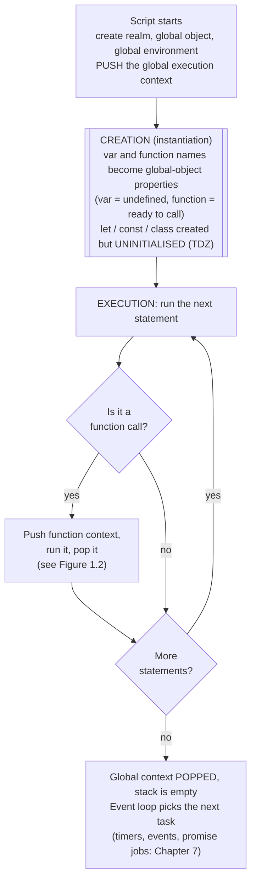
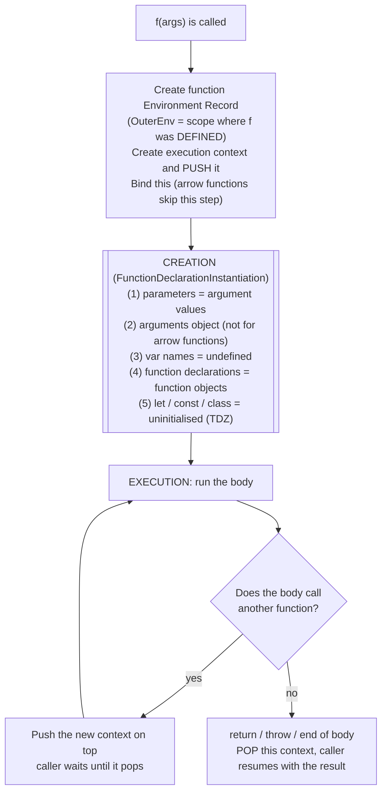
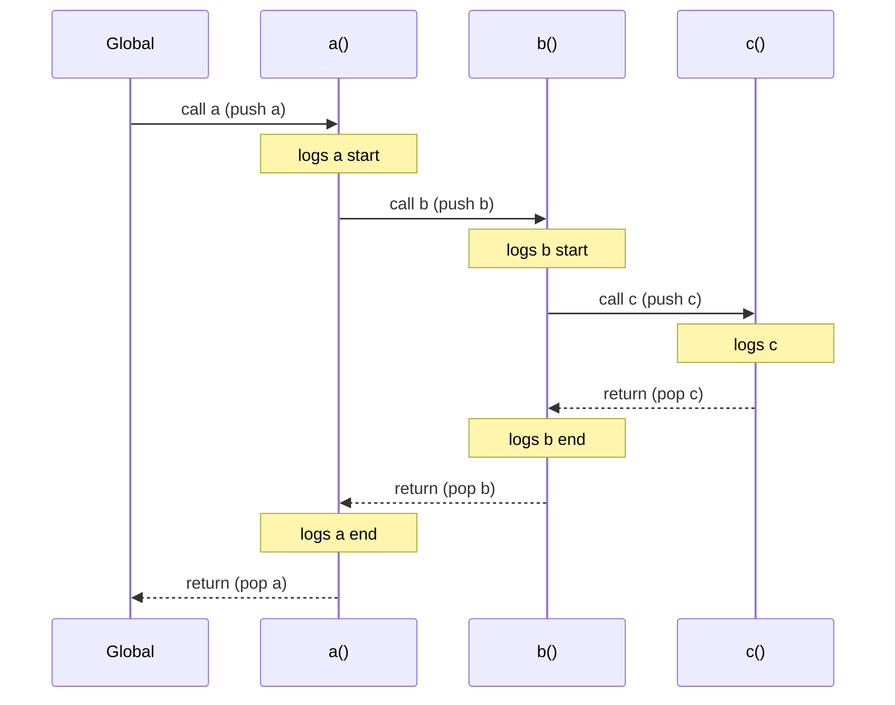
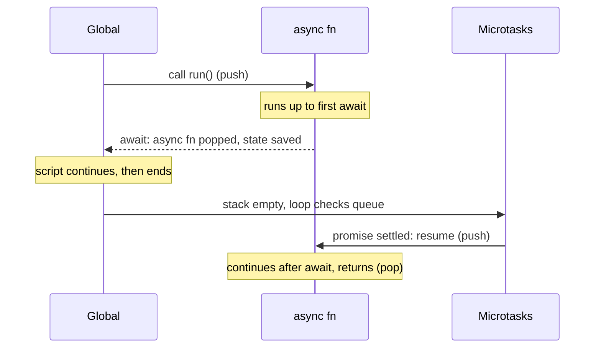

# Chapter 1: Execution Context & Call Stack

## 1.1 Definition and why interviewers ask it

**An execution context is the record the engine creates for each piece of running code (a script, a function call, an `eval`, a module) to track where its variables live, what `this` is, and which outer scope to search next. The call stack is the last-in-first-out stack of those records; the one on top is the code that is running right now.**

Interviewers use this topic as an opener because everything else builds on it. If you can explain what happens *before line 1 runs*, you can explain hoisting, the temporal dead zone, closures, `this` and why `setTimeout` callbacks wait. It also exposes whether you only memorised "JS hoists variables to the top" or understand the mechanism. Reported by candidates as a standard opener in JavaScript-fundamentals rounds (commonly reported).

## 1.2 Core concept

### Plain language

Think of a desk with one pile of work folders. Each time you call a function, a new folder goes on top of the pile. You can only work on the top folder. When that function returns, you remove its folder and carry on with the one underneath. Each folder holds three things: a place for that call's variables, a note saying what `this` is, and a pointer to "where to look if a name isn't in here".

### Precise version

**Kinds of execution context**

| Kind | Created when | Notes |
|---|---|---|
| Global (script) | A classic script starts | One per script run. Top-level `var` and function declarations become properties of the global object. |
| Function | Every function *call* | Created per call, not per function. Ten calls means ten contexts. |
| Eval | Direct `eval(...)` runs | Has its own lexical environment. Sloppy-mode `var` leaks into the caller. |
| Module | An ES module is evaluated | Its own top-level scope. Top-level `this` is `undefined`. Nothing leaks to the global object. |

**What a context holds.** The interview model and the specification use slightly different words for the same ideas:

| Interview model | ECMAScript specification (ES2015+) |
|---|---|
| Variable environment: parameters, `var`, function declarations | `VariableEnvironment` component |
| Lexical environment: `let`, `const`, `class`, block scopes | `LexicalEnvironment` component (changes as blocks are entered and left) |
| Outer reference (the scope chain link) | `[[OuterEnv]]` field of each Environment Record |
| `this` binding | Stored in the function Environment Record (`[[ThisValue]]`), not on the context itself |
| (not usually mentioned) | `Function`, `Realm`, `ScriptOrModule`, `PrivateEnvironment`, and a *code evaluation state* that lets the engine suspend and resume the context (used by generators and `async` functions) |

Older articles talk about a "Variable Object" and an "Activation Object". That is ECMAScript 3 terminology. Since ES5 the specification uses Lexical Environments, so use that vocabulary in an interview.

**The "creation phase" and "execution phase" model.** Most interview answers say each context is created in two phases. The specification does not use those names. It describes *instantiation* (`GlobalDeclarationInstantiation`, `FunctionDeclarationInstantiation`) followed by *evaluation*. The two-phase model is accurate as a description of observable behaviour, so say it, and add the spec terms to show depth.

**The call stack.** The specification calls it the *execution context stack*, and its top element is the *running execution context*. A JavaScript agent (the main thread, or a worker) has exactly one. That is what "JavaScript is single-threaded" means: one stack, one thing running at a time.

**Stack overflow.** The stack lives in a fixed-size memory region. V8's default is roughly 1 MB. Infinite or very deep recursion exhausts it and throws `RangeError: Maximum call stack size exceeded`. The depth depends on frame size, engine and flags, so never quote a single number as a rule (a trivial recursive function reached 12,557 frames on Node.js 22 in this book's test run).

**What is not on the stack.** Callbacks from timers, events and settled promises are not on the stack while the current code runs. They wait in queues until the stack is empty (Chapter 7).

## 1.3 How it works internally

### A. Starting a script

1. The engine creates a **realm** (a set of built-in objects), the **global object**, and a **global Environment Record**. That record is a composite: an *object record* backed by the global object, plus a *declarative record* for `let`, `const` and `class`.
2. It creates the **global execution context** and pushes it on the stack.
3. **Instantiation** (`GlobalDeclarationInstantiation`) runs before any statement executes:
   - each `var` name becomes a property of the global object with value `undefined`;
   - each function declaration becomes a property holding a ready function object;
   - each `let`, `const` and `class` name is created in the declarative record but left **uninitialised** (the temporal dead zone, Chapter 2);
   - conflicting declarations (for example a `let` that clashes with an existing `var`) throw `SyntaxError` here, before any line runs.
4. **Evaluation** runs statements top to bottom. When the script ends, the global context is popped and the stack is empty. The event loop then takes over.

### B. Calling a function

1. `[[Call]]` creates a new **function Environment Record**. Its `[[OuterEnv]]` is the environment that was current *where the function was defined* (not where it is called). That is lexical scoping.
2. A new execution context is created and **pushed**. It is now the running context.
3. `this` is bound (skipped for arrow functions, which look up `this` through the outer environment).
4. **Instantiation** (`FunctionDeclarationInstantiation`), in this order:
   1. parameters are bound to the argument values;
   2. the `arguments` object is created (not for arrow functions);
   3. `var` names are created as `undefined` (a `var` with the same name as a parameter keeps the parameter's value);
   4. function declarations are created as function objects;
   5. `let`, `const` and `class` names are created uninitialised.
5. **Evaluation** runs the body. A call inside the body repeats steps 1 to 5 and pushes another context.
6. On `return`, `throw` or reaching the end, the context is **popped** and the caller resumes with the result (or the exception propagates down the stack).

If a function has **non-simple parameters** (defaults, destructuring, rest), the specification creates a *second* variable environment for the body. This is why Question 1.10 has a surprising answer.

### C. After the pop

Popping removes the context from the stack. Its Environment Record is not freed immediately: if a closure captured it, it stays reachable on the heap (Chapter 4), otherwise the garbage collector reclaims it (Chapter 16).

### D. `eval` and `new Function`

A *direct* `eval(code)` creates a new context whose scope chain is the caller's. In sloppy mode, a `var` declared inside it is added to the caller's variable environment. In strict mode, `eval` gets its own variable environment and nothing leaks. An *indirect* eval, `(0, eval)(code)`, and `new Function(...)` run in the global scope instead.

### E. What V8 actually does

The model above is what the specification requires to be *observable*. V8 implements it differently for speed: functions are compiled to bytecode (Ignition) and hot code to machine code (TurboFan). Local variables that no closure captures live in the stack frame or registers. Only variables captured by closures are placed in heap-allocated *context objects*. The visible behaviour is the same, which is why the spec model is the right one to reason with in an interview.

## 1.4 Diagrams

### Script start-up: creation, then execution



> **How to explain this to the interviewer**
>
> 1. Draw two boxes side by side, labelled CREATION and EXECUTION, with an arrow from the first to the second.
> 2. Under CREATION write "var = undefined, functions ready, let/const = TDZ". Under EXECUTION write "line by line".
> 3. Point at the arrow: "Nothing is moved. The engine records every declaration before running the first line, and that is all hoisting is."
>
> **Takeaway:** every context is set up first and run second.

### A single function call



> **How to explain this to the interviewer**
>
> 1. Start at the top: "Every call builds a fresh environment and pushes a context."
> 2. Point at the numbered CREATION box and read it out in order: parameters, `arguments`, `var` as `undefined`, functions, then `let`/`const` uninitialised.
> 3. Trace the loop on the right: a nested call pushes, a return pops.
>
> **Takeaway:** the outer scope is fixed by where the function was written, while `this` is decided by how it was called.

### Anatomy of one context

```ascii Execution contexts and the environment records they point to
 EXECUTION CONTEXT STACK                  ENVIRONMENT RECORDS (heap)
 (top = running)

 +------------------------+               +-----------------------------------+
 | square(4)    [running] |               | FUNCTION ENV RECORD  (square)     |
 |  LexicalEnvironment  --+-------------->|  n          = 4                   |
 |  VariableEnvironment --+-------------->|  arguments  = [4]                 |
 |  Function = square     |               |  sq         = undefined   (var)   |
 +------------------------+               |  t          = <uninitialised>     |
                                          |  [[ThisValue]] = globalThis       |
 +------------------------+               |  [[OuterEnv]] ---------+          |
 | Global      [waiting]  |               +------------------------+----------+
 |  LexicalEnvironment  --+--+                                      |
 |  VariableEnvironment --+--+                                      v
 +------------------------+  |            +-----------------------------------+
                             +----------->| GLOBAL ENV RECORD                 |
                                          |  g      = 'global'                |
                                          |  square = function                |
                                          +-----------------------------------+

 Source:  var g = 'global';
          function square(n) { var sq; let t = 1; return n * n; }
          square(4);          (sloppy mode: this = globalThis; strict: undefined)
```

> **How to explain this to the interviewer**
>
> 1. Draw the stack on the left with two boxes, `square(4)` on top of `Global`.
> 2. Draw one record on the right per context and an arrow from each box to its record.
> 3. Draw the `[[OuterEnv]]` arrow from the function record down to the global record and say: "this arrow is the scope chain".
>
> **Takeaway:** a context is a small record that *points to* environments. The environments hold the variables, and they can outlive the context.

### Push and pop, step by step

```ascii Call stack, step by step, for printSquare(4)
 (1) PUSH            (2) PUSH            (3) PUSH            (4) POP
                                           +-----------------+
                                           | multiply(4,4)   |
                      +-----------------+  +-----------------+  +-----------------+
                      | square(4)       |  | square(4)       |  | square(4)       |
 +-----------------+  +-----------------+  +-----------------+  +-----------------+
 | printSquare(4)  |  | printSquare(4)  |  | printSquare(4)  |  | printSquare(4)  |
 +-----------------+  +-----------------+  +-----------------+  +-----------------+
 | Global          |  | Global          |  | Global          |  | Global          |
 +-----------------+  +-----------------+  +-----------------+  +-----------------+

 (5) POP             (6) PUSH            (7) POP             (8) POP
                      +-----------------+
                      | console.log(16) |
 +-----------------+  +-----------------+  +-----------------+
 | printSquare(4)  |  | printSquare(4)  |  | printSquare(4)  |
 +-----------------+  +-----------------+  +-----------------+  +-----------------+
 | Global          |  | Global          |  | Global          |  | Global          |
 +-----------------+  +-----------------+  +-----------------+  +-----------------+

 Code:  function multiply(a, b) { return a * b; }
        function square(n)      { return multiply(n, n); }
        function printSquare(n) { const r = square(n); console.log(r); }
        printSquare(4);
 Steps: (4) multiply returns 16   (5) square returns 16   (6) log prints 16
        (7) log returns           (8) printSquare returns; script ends later
```

> **How to explain this to the interviewer**
>
> 1. Draw one column and write `Global` at the bottom. Say: "stack, last in first out".
> 2. For each call, add a box on top and say its name aloud. For each return, cross the top box out.
> 3. Stop at the deepest point (step 3) and say: "only this top frame is running; everything below is waiting for it".
>
> **Takeaway:** a function cannot finish until every function it called has popped.

### Whiteboard version

```ascii Whiteboard version: creation, then execution, on a stack (draw in 90 seconds)
   1. CREATE             2. RUN                  STACK (top = running)
 +--------------+     +-------------+            +-------------+
 | params       |     | line by     |            | multiply    |  <- push on call
 | var=undefined|---->| line, assign|            | square      |
 | functions    |     | values, make|            | Global      |  <- pop on return
 | let/const=TDZ|     | calls       |            +-------------+
 +--------------+     +-------------+
```

## 1.5 Code examples

### Example 1: the call stack is visible in an error stack trace

```js
function a() { return b(); }
function b() { return c(); }
function c() {
  // Each "at name (...)" line is one execution context, top of stack first.
  return new Error().stack.split('\n').slice(1, 4).map((l) => l.trim().split(' ')[1]);
}
console.log(a());
```

```text output
[ 'c', 'b', 'a' ]
```

**Why:** when `c` creates the `Error`, the stack holds `Global`, `a`, `b`, `c`. The trace lists them top first.

### Example 2: creation phase is observable

```js
function demo() {
  console.log(typeof inner, typeof late);  // function undefined
  function inner() {}
  var late = 1;
  try { console.log(tdz); } catch (e) { console.log(e.name); }
  let tdz = 2;
}
demo();
```

```text output
function undefined
ReferenceError
```

**Why:** instantiation already created `inner` (a ready function object), `late` (`undefined`) and `tdz` (uninitialised). Reading `tdz` before its declaration line runs throws `ReferenceError`.

### Example 3: top-level `var` and `let` in a classic script

```js script
var a = 1;
let b = 2;
function fn() {}
console.log(globalThis.a, globalThis.b, typeof globalThis.fn);
```

```text output
1 undefined function
```

**Why:** in a classic script, `var` and function declarations go on the global object, while `let`, `const` and `class` live in the separate declarative record. In an ES module, or a Node.js CommonJS file (which is wrapped in a function), all three would be `undefined`/not global.

### Example 4: `eval` and `var`

```js
function sloppy() { eval('var z = 10'); return typeof z; }
function strict() { 'use strict'; eval('var z = 10'); return typeof z; }
console.log(sloppy(), strict());
```

```text output
number undefined
```

**Why:** sloppy direct eval adds `z` to the *caller's* variable environment. Strict-mode eval gets its own.

### Example 5: stack overflow is a catchable `RangeError`

```js
let depth = 0;
function recurse() { depth++; recurse(); }
try {
  recurse();
} catch (e) {
  console.log(e instanceof RangeError, e.message, depth > 1000);
}
```

```text output
true Maximum call stack size exceeded true
```

**Why:** each call pushes a context until the stack memory is full. V8 throws a `RangeError`, which unwinds the stack so execution can continue. The exact `depth` varies by machine, so the example prints only a stable fact about it.

## 1.6 Common mistakes and gotchas

- **"Hoisting moves code to the top."** Nothing moves. Declarations are *instantiated* before execution starts. Say "instantiated", then mention hoisting as the popular name.
- **"`let` and `const` are not hoisted."** They are instantiated too, but uninitialised, so reading them early throws `ReferenceError` (the TDZ) instead of giving `undefined`.
- **Mixing up context and scope.** Scope is static, fixed by where code is written. A context is a runtime record created per call. See Question 1.5.
- **Believing `this` is decided by where a function is written.** It is decided by how the function is called (arrow functions are the exception). The `this` value is created per call.
- **Assuming async callbacks run "alongside" synchronous code.** They never interrupt the running stack. They run only after it empties.
- **Quoting one recursion limit as a fact.** It is engine-, version- and frame-size-dependent. Say "on the order of ten thousand frames in V8".
- **Expecting tail-call optimisation.** ES2015 specified proper tail calls, but only Safari's JavaScriptCore ships them. V8 does not, so tail-recursive code still overflows in Chrome and Node.js.
- **Forgetting that module and CommonJS top-level `var` is not global.** The "`var` creates `window.x`" rule applies only to classic scripts.
- **Treating the creation/execution phases as spec terms.** They are a teaching model. Interviewers accept it, but add "instantiation and evaluation" to show you know the real names.

## 1.7 Quick revision cheat sheet

- **Definition:** execution context = per-run record of environments, `this` and realm. Call stack = LIFO stack of them.
- **Kinds:** global, function, eval, module.
- **Phases:** creation (instantiation) then execution (evaluation).
- **Creation results:** parameters bound, `arguments` created, `var = undefined`, functions ready, `let`/`const`/`class` in TDZ.
- **Stack:** push on call, pop on return or throw. Overflow throws `RangeError`.
- **`this`** is bound per call and stored in the environment record, not decided lexically (except arrows).
- **Non-simple parameters** (defaults, destructuring) give the body its own variable environment.
- **Top-level `var`** becomes a global property only in classic scripts, never in modules or CommonJS.

## 1.8 Interview questions

*Key: ★ = very frequently reported. "Typically asked in" lines say which round a question tends to appear in; where no single source could be pinned down the question is labelled "commonly reported". Draw-it hints refer to the figures in section 1.4.*

#### Conceptual

### Q1.1 ★ Easy: What is an execution context, and what does it contain?

*Typically asked in: JavaScript fundamentals round (commonly reported).*

> **Model answer**
>
> An execution context is the record the engine creates each time code runs: once for the script, once for every function call, plus `eval` and modules. It tracks the variables of that run through a variable environment and a lexical environment, the outer scope to search next, and the value of `this`. In the spec it also carries the realm and a state that lets generators and async functions be suspended. Contexts are stacked: the engine runs whichever one is on top.

**Key points to mention**

- Created per *call*, not per function definition.
- Variable environment and lexical environment, each with an outer reference.
- `this` binding (kept in the function environment record in the spec).
- Pushed on call, popped on return.
- Draw it: Figure 1.3.

### Q1.2 ★ Medium: Explain the creation phase and the execution phase.

*Typically asked in: JavaScript fundamentals round (commonly reported).*

> **Model answer**
>
> Before running a context's code, the engine sets it up. In the creation phase, it binds parameters, creates the `arguments` object, creates every `var` as `undefined`, creates function declarations as ready function objects, and creates `let`, `const` and `class` names as uninitialised, which is the temporal dead zone. In the execution phase it runs the statements in order, assigning values and calling functions. That setup is what people call hoisting. The spec names are instantiation and evaluation.

**Key points to mention**

- What is `undefined` (`var`), what is ready (functions), what is uninitialised (`let`/`const`/`class`).
- `this` is bound at creation for non-arrow functions.
- Nothing is physically moved.
- Draw it: Figures 1.1 and 1.2.

### Q1.3 ★ Easy: What is the call stack? What happens when it overflows, and how do you avoid it?

*Typically asked in: JavaScript fundamentals round (commonly reported).*

> **Model answer**
>
> The call stack is where the engine tracks which function is running and who called it. A call pushes a frame, and a return pops it, so it is last in, first out. It has a fixed memory budget, roughly a megabyte in V8, so runaway or very deep recursion throws `RangeError: Maximum call stack size exceeded`. To avoid it I add a correct base case, convert the recursion to a loop or an explicit stack, use a trampoline, or break the work into chunks with `setTimeout` so the stack empties between chunks.

**Key points to mention**

- LIFO, one per thread.
- `RangeError`, not a crash, and it is catchable.
- No tail-call optimisation in V8.
- Remedies: loop, explicit stack, trampoline, chunking.
- Draw it: Figure 1.4.

### Q1.4 Medium: What types of execution context exist? How is `eval` different?

*Typically asked in: JavaScript fundamentals round, as a follow-up (commonly reported).*

> **Model answer**
>
> There are global, function, eval and module contexts. Global is created when a script starts, function contexts are created per call, and a module has its own top-level scope. Direct `eval` creates a context whose scope chain is the caller's. In sloppy mode a `var` inside `eval` is added to the caller's variable environment, so it leaks. In strict mode `eval` has its own variable environment and nothing leaks. Indirect eval and `new Function` run in the global scope, which is one reason to avoid them.

**Key points to mention**

- Direct vs indirect eval: `eval(s)` vs `(0, eval)(s)`.
- Sloppy leak vs strict isolation (Example 4).
- Eval defeats engine optimisations and is a security risk.

### Q1.5 ★ Medium: What is the difference between an execution context, a scope and a lexical environment?

*Typically asked in: JavaScript fundamentals round, closures lead-in (commonly reported).*

> **Model answer**
>
> Scope is the rule: which names are visible where. It is static and decided by where code is written. A lexical environment is the runtime structure that implements that rule: an environment record holding the bindings plus a reference to the outer environment. An execution context is the per-run record that points to the current lexical environments, along with `this` and the realm. One context can use several environments, one per block entered. The context disappears when popped, but a closure can keep its environment alive.

**Key points to mention**

- Scope = static rule. Environment = runtime data. Context = per-run container.
- One context to many environments (blocks).
- Environments outlive contexts via closures.
- Draw it: Figure 1.3.

### Q1.6 Easy: JavaScript is single-threaded. What does that mean for the call stack, and where do async callbacks fit?

*Typically asked in: JavaScript fundamentals round, event-loop lead-in (commonly reported).*

> **Model answer**
>
> One thread has one call stack, so one function runs at a time and nothing interrupts it. Waiting work such as timers, network calls and file reads is handed to the host (browser or Node.js), which does it outside the stack. When it finishes, its callback goes into a queue. The event loop moves a queued callback onto the stack only when the stack is empty. That is why a long synchronous loop freezes the page and why `setTimeout(fn, 0)` runs after the current code.

**Key points to mention**

- One stack per agent (main thread or worker).
- The host does the waiting, not the JS engine.
- Queues, then the event loop (Chapter 7).

#### Output prediction

### Q1.7 ★ Easy: What does this print?

*Typically asked in: JavaScript fundamentals round (commonly reported).*

```js
var x = 1;
function foo() {
  console.log(x);
  var x = 2;
}
foo();
```

```text output
undefined
```

> **Model answer**
>
> It prints `undefined`. When `foo` is called, instantiation creates a local `x` as `undefined` because of the `var` further down. That local shadows the global `x = 1` for the whole function. The `console.log` runs before the assignment `x = 2`, so it reads the local, still `undefined`.

**Key points to mention**

- The local `var` shadows the outer `x` from the first line of the function.
- Declaration is early, assignment stays in place.
- With `let x = 2` the same code throws `ReferenceError` (TDZ).

### Q1.8 ★ Medium: What do these two lines print?

*Typically asked in: JavaScript fundamentals round (commonly reported).*

```js
console.log(typeof bar);
var bar = 1;
function bar() {}
console.log(typeof bar);
```

```text output
function
number
```

> **Model answer**
>
> `function`, then `number`. Instantiation sees both `var bar` and `function bar`. They share one binding, and the function declaration initialises it with the function object. The `var` does not reset it to `undefined`. So the first `typeof` sees the function. Then execution reaches `bar = 1` and overwrites the binding, so the second `typeof` is `number`.

**Key points to mention**

- Function declarations win over `var` at instantiation.
- The `var bar = 1` assignment still executes later in order.
- Same name means one binding, not two.

### Q1.9 ★ Easy: What is the output order? Trace the stack.

*Typically asked in: JavaScript fundamentals round (commonly reported).*

```js
function a() { console.log('a start'); b(); console.log('a end'); }
function b() { console.log('b start'); c(); console.log('b end'); }
function c() { console.log('c'); }
a();
```

```text output
a start
b start
c
b end
a end
```



> **Model answer**
>
> `a start`, `b start`, `c`, `b end`, `a end`. Each call pushes a frame and runs to completion before its caller continues. So `a` pauses at `b()`, `b` pauses at `c()`, and `c` finishes first. Returns then unwind in reverse: `b` prints its end line, then `a`.

**Key points to mention**

- Calls go down the stack, `end` lines come back in reverse order.
- A caller is paused, not finished, while its callee runs.
- Draw it: the sequence diagram above or Figure 1.4.

### Q1.10 Hard: What does this print?

*Typically asked in: senior-leaning JavaScript rounds, as a hard follow-up (commonly reported).*

```js
function f(a, b = () => a) {
  var a = 2;
  return [a, b()];
}
console.log(f(1));
```

```text output
[ 2, 1 ]
```

> **Model answer**
>
> `[2, 1]`. Because the parameter list has an expression (the default value), the spec gives the body a separate variable environment from the parameters. The `var a` in the body is a new binding. It starts with the parameter's value 1, then the assignment makes it 2. The arrow `b` was created in the parameter scope, so it sees the parameter `a`, which is still 1. If I change `var a = 2` to `a = 2`, there is only one binding and the result is `[2, 2]`.

**Key points to mention**

- Non-simple parameters lead to two environments.
- `var` with the same name as a parameter starts with the parameter's value.
- Closures capture the environment where they were created.

### Q1.11 Medium: What is logged in a browser `<script>` (not a module)?

*Typically asked in: JavaScript fundamentals round (commonly reported).*

```js script
var a = 1;
let b = 2;
function fn() {}
console.log(globalThis.a, globalThis.b, typeof globalThis.fn);
```

```text output
1 undefined function
```

> **Model answer**
>
> `1 undefined function`. In a classic script, `var` and function declarations are created as properties of the global object. `let`, `const` and `class` go into a separate declarative record, which is global scope but is not a property of `window`. In an ES module, or in a Node.js file, all three would be `undefined` because the code is not in the global environment's object record.

**Key points to mention**

- Global environment record has an object part and a declarative part.
- Script vs module vs CommonJS difference.
- Global `let` is still visible by name, just not as `window.b`.

#### Implement it yourself

### Q1.12 ★ Medium: Sum the numbers 1 to n recursively without a stack overflow (write a trampoline).

*Typically asked in: JavaScript round or machine-coding warm-up (commonly reported).*

**Problem.** `sum(100000)` written as `n + sum(n - 1)` throws `RangeError`. Make it work for any `n` while keeping the recursive shape.

**Solution.** Instead of calling itself, the function returns a *description* of the next call. A driver loop runs those descriptions one at a time, so the stack never grows.

```js
const BOUNCE = Symbol('bounce');
const bounce = (fn, ...args) => ({ [BOUNCE]: true, fn, args });

function trampoline(fn) {
  return (...args) => {
    let result = fn(...args);
    while (result && result[BOUNCE]) result = result.fn(...result.args);
    return result;
  };
}

const sumTo = trampoline(function sum(n, acc = 0) {
  return n === 0 ? acc : bounce(sum, n - 1, acc + n);
});

console.log(sumTo(100000), sumTo(10), typeof trampoline(() => () => 1)());
```

```text output
5000050000 55 function
```

> **Model answer**
>
> Recursion overflows because every call adds a frame. A trampoline removes the nesting. The function becomes tail-recursive with an accumulator and, instead of calling itself, returns a `bounce` object holding the next function and arguments. A loop in the trampoline keeps invoking those until it gets a real value. The stack depth stays at one or two frames, so any `n` works. I use a Symbol-tagged object, not a bare thunk, so a function that legitimately returns a function is not mistaken for a pending call.

**Key points to mention**

- Accumulator style so the result needs no work after the call.
- A loop replaces nested frames; time O(n), stack O(1).
- Edge cases: a function returning a function (use a marker); `n = 0`; negative `n` loops forever unless guarded.
- Alternatives: plain loop, or a formula. A trampoline is for when the recursive shape matters (mutual recursion).

### Q1.13 Medium: Convert a recursive tree traversal into an iterative one that survives very deep trees.

*Typically asked in: JavaScript round, data-structure follow-up (commonly reported).*

**Problem.** Sum all `value` fields in a tree of `{ value, children }` nodes. The recursive version overflows on a 200,000-level chain. Write one that does not.

**Solution.** Replace the call stack with your own array.

```js
// Build a chain 200,000 levels deep without recursion.
const root = { value: 0, children: [] };
let tail = root;
for (let i = 1; i < 200000; i++) {
  const node = { value: i, children: [] };
  tail.children.push(node);
  tail = node;
}

function sumRecursive(node) {
  return node.value + node.children.reduce((s, c) => s + sumRecursive(c), 0);
}

function sumIterative(start) {
  const stack = [start];
  let total = 0;
  while (stack.length) {
    const node = stack.pop();
    total += node.value;
    for (const child of node.children) stack.push(child);
  }
  return total;
}

try { sumRecursive(root); } catch (e) { console.log(e.constructor.name); }
console.log(sumIterative(root));
```

```text output
RangeError
19999900000
```

> **Model answer**
>
> The engine's call stack is small, but an array on the heap can hold millions of entries. So I keep my own stack: push the root, then loop. Pop a node, process it, and push its children. That is depth-first search without recursion. Time is O(n). Extra space is O(n) in the worst case, because a very wide tree puts many pending siblings on my stack at once. If I need children visited left to right, I push them in reverse, since `pop` takes the last one.

**Key points to mention**

- The explicit array replaces the call stack frame by frame.
- Visiting order: push children in reverse for left-to-right pre-order.
- Post-order needs a second stack or a visited flag.
- Complexity O(n) time, O(n) space worst case.

#### Follow-up traps

### Q1.14 ★ Hard: "So hoisting moves declarations to the top of the file, right? What about `let` and `class`?"

*Typically asked in: follow-up after Q1.2 (commonly reported).*

> **Model answer**
>
> Not quite. Nothing is moved. Before running, the engine instantiates every declaration in the scope, so the names exist from the start of the scope. `var` and functions are initialised immediately, to `undefined` and to the function. `let`, `const` and `class` are also instantiated but stay uninitialised until their declaration line runs. That window is the temporal dead zone, and touching the name in it throws `ReferenceError`. That proves `let` is hoisted: if it were not, an inner `let x` would let the code read an outer `x` instead of throwing.

**Key points to mention**

- Everything is instantiated; only initialisation differs.
- The shadowing proof: an inner `let x` blocks reads of the outer `x`, even before its line.
- `class` is the same as `let` here.
- Chapter 2 expands on this.

### Q1.15 Hard: "What happens to an `async` function's execution context while it is waiting on `await`? Is it still on the stack?"

*Typically asked in: follow-up after async/await or event-loop questions (commonly reported).*



> **Model answer**
>
> No. When execution reaches `await`, the function's context is popped from the stack, and the engine saves its state: the position in the code and its environments. The function returns a pending promise to its caller, and the caller carries on. When the awaited promise settles, a microtask resumes the function: the same saved context is pushed on the stack again and continues after the `await`. While waiting it costs no stack space, only heap memory, which is why thousands of pending async calls don't overflow the stack.

**Key points to mention**

- `await` suspends and pops, it does not block.
- The saved state is the generator-like "code evaluation state" in the spec.
- Resumption happens through the microtask queue (Chapters 7 and 9).
- Draw it: the sequence diagram above.

#### Sources and further reading

- ECMAScript specification, "Executable Code and Execution Contexts" and the `FunctionDeclarationInstantiation` / `GlobalDeclarationInstantiation` algorithms: <https://tc39.es/ecma262/>
- MDN Glossary, "Call stack": <https://developer.mozilla.org/en-US/docs/Glossary/Call_stack>
- javascript.info, "Recursion and stack" (execution context and stack): <https://javascript.info/recursion>
- Kyle Simpson, *You Don't Know JS Yet: Scope & Closures* (compilation, scope and instantiation before execution).
- V8 blog, "Launching Ignition and TurboFan": <https://v8.dev/blog/launching-ignition-and-turbofan>
- Public interview write-ups consulted for question frequency: GeeksforGeeks, "JavaScript Function Interview Questions" (hoisting, TDZ) <https://www.geeksforgeeks.org/javascript/javascript-function-interview-questions/>; dev.to, "JavaScript Execution Context Explained: Call Stack, Scope, and Hoisting" <https://dev.to/ansh_sheladiya/javascript-execution-context-explained-call-stack-scope-and-hoisting-1c44>; and various Medium and GitHub-gist notes that teach the "memory creation phase / code execution phase" model. Question wording in this book is original.
