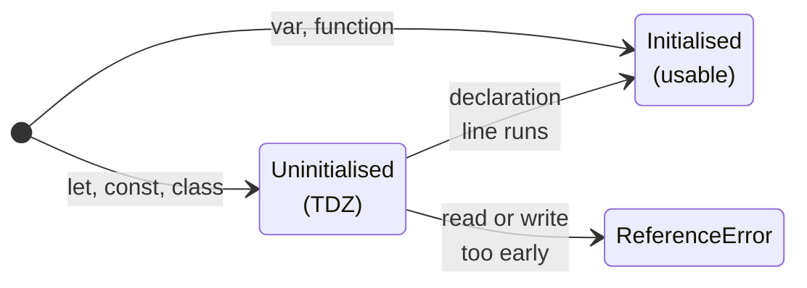
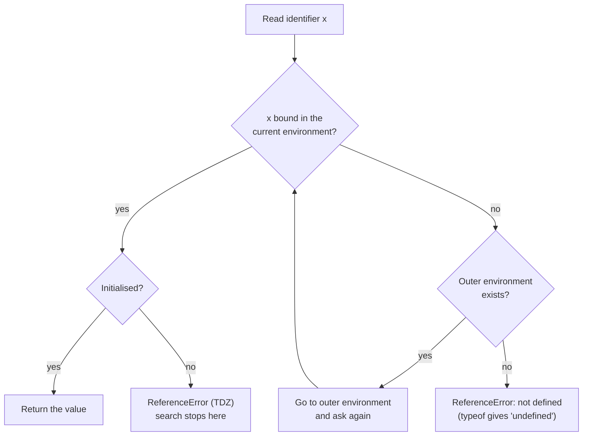

# Chapter 2: Hoisting & Temporal Dead Zone

## 2.1 Definition and why interviewers ask it

**Hoisting is the visible effect of instantiation: every declaration in a scope is registered before that scope's code runs, so the name exists from the start of the scope. `var` and function declarations are usable immediately, while `let`, `const` and `class` exist but cannot be touched until their declaration line runs (the temporal dead zone).**

This is one of the most reliably reported topics in JavaScript-fundamentals rounds (commonly reported), usually as "what does this print?" snippets. It checks whether you know the mechanism from Chapter 1 or only the slogan "declarations move to the top". The follow-up "is `let` hoisted?" separates the two.

## 2.2 Core concept

### Plain language

Picture a party guest list that is written *before* the party starts. Every name is on the list from the beginning, so the doorman knows each person exists. But the guests behave differently. `var` guests are already inside the room, standing there with nothing in their hands (`undefined`). Function guests are inside and fully equipped. `let`, `const` and `class` guests are on the list but locked outside until their own entry line is reached, and anyone who calls for them early gets an error.

### Precise version

| Declaration | Scope | Created at | Initial value | Redeclare in same scope | Becomes a global-object property (classic script) |
|---|---|---|---|---|---|
| `var x` | function (or global) | scope entry | `undefined` | allowed | yes |
| `function f() {}` | function (block in strict mode) | scope entry | the function object | allowed, last one wins | yes (at top level) |
| `let x`, `const x` | block | block entry | **uninitialised** (TDZ) | `SyntaxError` | no |
| `class C {}` | block | block entry | **uninitialised** (TDZ) | `SyntaxError` | no |
| `var f = function () {}` or `var f = () => {}` | function | scope entry | `undefined` (only the *name* is hoisted) | allowed | yes |
| `import { x } from '...'` | module | module link time | live binding to the exporting module | `SyntaxError` | no |

**Temporal dead zone (TDZ).** The period from the start of a scope until the `let`, `const` or `class` declaration is evaluated. In that period the binding exists but is *uninitialised*, and any read or write throws `ReferenceError: Cannot access 'x' before initialization`. It is *temporal*, not spatial: what matters is when code **runs**, not where it is written. A function body may mention a `let` declared below it, and that is fine as long as the function is called after the declaration has run.

**Initialisation is not the same as declaration.** `let x;` (no value) still leaves the TDZ when the line runs and sets `x` to `undefined`. And `var x = 5;` is two things: a hoisted declaration plus an assignment that stays in place.

**Why the TDZ exists.** It turns use-before-define bugs into loud errors instead of silent `undefined`, and it makes `const` coherent: a `const` can never be observed holding `undefined` first and a real value later.

**Block-level functions.** A function declaration inside `{ }` is block-scoped in strict mode. In sloppy mode a legacy rule (Annex B of the specification) also creates a `var`-like binding in the enclosing function, set to `undefined` at entry and assigned when the block is evaluated. Code that behaves differently in strict and sloppy mode here is a common trap.

## 2.3 How it works internally

1. **Early errors first.** Before anything runs, the engine parses the whole script. Conflicting declarations (`let a; var a;`) are `SyntaxError`s, so *nothing* in the file executes, not even statements above the clash.
2. **Instantiation at scope entry.** This happens for the global scope (`GlobalDeclarationInstantiation`), each function call (`FunctionDeclarationInstantiation`) and each block (`BlockDeclarationInstantiation`):
   - `var` names are created and set to `undefined`;
   - function declarations are created and initialised with function objects;
   - `let`, `const` and `class` names are created **uninitialised**.
3. **Evaluation.** When execution reaches `let x = 1;`, the initialiser runs and the binding is *initialised*. That moment ends the TDZ. `var x = 1;` merely assigns.
4. **Reading a name.** The engine looks in the current environment record, then walks `[[OuterEnv]]` links outward (Figure 2.2). Finding a binding that is uninitialised stops the search with a `ReferenceError`. It does **not** continue outward to an outer variable with the same name. This is why an inner `let x` shadows an outer `x` for the *entire block*, including the dead zone above it (Question 2.8).
5. **`typeof`.** `typeof` on a name that resolves to *nothing* returns `"undefined"` without throwing. On a name in the TDZ it throws, because the binding was found.
6. **Same-name function and `var`.** One shared binding. The function declaration initialises it. The `var` does not reset it. The later `var x = 1` assignment overwrites it when execution reaches it.

**In V8.** An uninitialised binding is represented by an internal sentinel (the "hole"). Reads of `let`/`const`/`class` bindings check for it unless the compiler can prove the binding is already initialised, in which case the check is removed. You do not need this detail for most interviews, but it explains why TDZ costs almost nothing in practice.

## 2.4 Diagrams

### Binding lifecycle: three starting states



> **How to explain this to the interviewer**
>
> 1. Draw two circles, "Uninitialised" and "Initialised", and an arrow between them labelled "declaration line runs".
> 2. Draw the start arrow into **Initialised** for `var` and functions, and into **Uninitialised** for `let`, `const` and `class`.
> 3. Draw an arrow from "Uninitialised" to an error box and say: "the dead zone is just the time spent in that left-hand circle".
>
> **Takeaway:** everything is hoisted. What differs is the state the binding starts in.

### How the engine reads a name



> **How to explain this to the interviewer**
>
> 1. Start with "Read x" and draw the first decision: is `x` in the current scope?
> 2. Follow the "no" loop outward, and say each hop is one `[[OuterEnv]]` link, the scope chain.
> 3. At "yes", point at the second decision, initialised or not, and say: "this is the only place TDZ is checked".
>
> **Takeaway:** a binding found in the TDZ stops the search. It never falls through to an outer variable.

### What the environment record holds, moment by moment

```ascii Environment record contents at scope entry and after each statement
 Source:  1  console.log(a, typeof f);     // prints: undefined function
          2  var a = 1;
          3  let b = 2;
          4  function f() {}

 +------+----------+-----------------+-----------------+-----------------+
 | name | kind     | 1. scope entry  | 2. after line 2 | 3. after line 3 |
 +------+----------+-----------------+-----------------+-----------------+
 | a    | var      | undefined       | 1               | 1               |
 | b    | let      | <uninitialised> | <uninitialised> | 2               |
 | f    | function | function f      | function f      | function f      |
 +------+----------+-----------------+-----------------+-----------------+
 Column 1 is what instantiation builds BEFORE line 1 runs. Line 1 reads it.
```

> **How to explain this to the interviewer**
>
> 1. Draw a three-row table with the names `a`, `b`, `f` and one column headed "before line 1".
> 2. Fill the column: `a = undefined`, `b = TDZ`, `f = function`. Say: "this is what hoisting means".
> 3. Add a second column "after line 2" and update only `a`. Then say: "the assignment stays where it was written".
>
> **Takeaway:** one table filled before execution explains every hoisting puzzle.

### The dead zone is about time, not position

```ascii The TDZ ends when the declaration runs, wherever the reading code is written
   block entered                        let x = 1 runs
        |                                    |
        v                                    v
   -----+====== TDZ: x is uninitialised =====+-------- x is usable ---------->  time
        |  any read or write throws          |

   {
     const early = () => x;     // creating the function is fine (nothing is read)
     console.log(x);            // runs inside the TDZ  ->  ReferenceError
     let x = 1;                 // TDZ ends here
     console.log(early());      // runs after the TDZ   ->  1
   }
```

> **How to explain this to the interviewer**
>
> 1. Draw a time arrow and mark two points on it: "block entered" and "`let x = 1` runs".
> 2. Hatch the stretch between them and label it TDZ.
> 3. Point at the function that mentions `x` above the declaration and say: "writing it there is legal. Only calling it inside the hatched stretch fails".
>
> **Takeaway:** TDZ is a window in running time, not a region of source text.

### Whiteboard version

```ascii Whiteboard version: what each declaration is before its line runs (60 seconds)
 +-----------------------+----------------------+
 | var x                 | undefined            |
 | function f() {}       | the function itself  |
 | let / const / class   | TDZ: any use throws  |
 +-----------------------+----------------------+
   everything is hoisted; only the starting state differs
```

## 2.5 Code examples

### Example 1: `var` is `undefined`, a function is ready

```js
console.log(typeof hello, typeof answer);
function hello() { return 'hi'; }
var answer = 42;
console.log(typeof hello, typeof answer);
```

```text output
function undefined
function number
```

**Why:** instantiation initialises `hello` with the function and `answer` with `undefined`. The assignment `answer = 42` runs on line 3.

### Example 2: a function expression is only as hoisted as its variable

```js
try {
  greet();
  var greet = function () { return 'hi'; };
} catch (e) {
  console.log(e.name + ': ' + e.message);
}
```

```text output
TypeError: greet is not a function
```

**Why:** only the name `greet` is hoisted, with the value `undefined`. Calling `undefined` is a `TypeError`, not a `ReferenceError`.

### Example 3: the TDZ and `typeof`

```js
console.log(typeof neverDeclared);
try {
  console.log(typeof inTdz);
} catch (e) {
  console.log(e.name + ': ' + e.message);
}
let inTdz = 1;
```

```text output
undefined
ReferenceError: Cannot access 'inTdz' before initialization
```

**Why:** an unresolvable name makes `typeof` return `"undefined"`. A name that resolves to an uninitialised binding throws. `typeof` is not safe inside a TDZ.

### Example 4: temporal, not positional

```js
function read() { return v; }       // mentions v before it is declared
const before = (() => { try { return read(); } catch (e) { return e.name; } })();
let v = 1;
console.log(before, read());
```

```text output
ReferenceError 1
```

**Why:** `read` is called twice. The first call runs before `let v = 1` and fails. The second runs after and succeeds. The function body never changed.

### Example 5: a block-level function in sloppy mode

```js
function sloppy() {
  const before = typeof k;
  { function k() {} }
  return [before, typeof k];
}
function strict() {
  'use strict';
  { function k() {} }
  return typeof k;
}
console.log(sloppy(), strict());
```

```text output
[ 'undefined', 'function' ] undefined
```

**Why:** in sloppy mode, Annex B also makes `k` a function-scoped `var` that is `undefined` until the block runs. In strict mode, `k` exists only inside the block.

### Example 6: `const` is about the binding, not the value

```js
const o = { a: 1 };
o.a = 2;                                  // fine: the object is mutable
try { o = {}; } catch (e) { console.log(e.name + ': ' + e.message); }
console.log(o);
```

```text output
TypeError: Assignment to constant variable.
{ a: 2 }
```

**Why:** `const` forbids rebinding. It does not freeze the object (Chapter 18 covers `Object.freeze`). Reassigning an initialised `const` is a `TypeError`. Touching it in the TDZ is a `ReferenceError`.

## 2.6 Common mistakes and gotchas

- **"`let` and `const` are not hoisted."** They are. The TDZ is the proof: an inner `let x` blocks an outer `x` for the whole block (Question 2.8).
- **"Hoisting moves the code or the value."** Only the *declaration* is registered early. Assignments stay in place. `var a = 1` is a hoisted `a` plus a later assignment.
- **Calling a function expression early.** `var f = function () {}` or `var f = () => {}` gives `TypeError: f is not a function`, not a `ReferenceError`. A function *declaration* works.
- **`var` inside an `if` that never runs** is still hoisted to the function. `if (false) { var x = 1 }` still creates `x` as `undefined`.
- **Assuming `typeof` is always safe.** It is safe only for names that resolve to nothing, not for the TDZ.
- **Default parameters have a TDZ too.** `function f(a = b, b = 1)` throws when `a`'s default reads `b`, because parameters initialise left to right.
- **Block functions differ between strict and sloppy mode** (Example 5). Modules and classes are strict by default.
- **Reusing a name as `var` and `function`.** The function wins at entry, then the `var` assignment overwrites it when reached (Chapter 1, Question 1.8).
- **Treating `const` as deep immutability.** It is not (Example 6).
- **Believing a redeclaration error is reported where it happens.** Early errors reject the whole script, so earlier `console.log` lines never run.

## 2.7 Quick revision cheat sheet

- Every declaration is **instantiated** at scope entry. "Hoisting" is the popular name for that.
- `var`: starts as `undefined`. Function declaration: starts as the function. `let`, `const`, `class`: start **uninitialised** (TDZ).
- TDZ = from scope entry until the declaration runs. Reading or writing throws `ReferenceError`. It is about **time**, not text position.
- A found-but-uninitialised binding stops the lookup. It never falls through to an outer variable of the same name.
- `typeof undeclared` is `"undefined"`. `typeof` of a TDZ name throws.
- Function expressions and arrows are only hoisted as a `var`, so an early call is a `TypeError`.
- Same-name `var` and function share one binding. The function initialises it, and the `var` assignment overwrites it later.
- `import` declarations are hoisted too: the imported module runs before the importing module's own code.

## 2.8 Interview questions

*Key: ★ = very frequently reported. "Typically asked in" lines say which round a question tends to appear in; where no single source could be pinned down, the question is labelled "commonly reported". Draw-it hints refer to the figures in section 2.4.*

#### Conceptual

### Q2.1 ★ Easy: What is hoisting? Does JavaScript physically move code to the top?

*Typically asked in: JavaScript fundamentals round, often the very first question (commonly reported).*

> **Model answer**
>
> No, nothing is moved. Before a scope runs, the engine goes through it and creates a binding for every declaration. That is instantiation, and "hoisting" is the popular name for its effects. A `var` is created with the value `undefined`, a function declaration is created with the whole function, and `let`, `const` and `class` are created but left uninitialised. Because the names exist before execution, you can read a `var` early and get `undefined`, call a declared function early, and get a `ReferenceError` for a `let` in its dead zone.

**Key points to mention**

- Declarations are registered at scope entry. Assignments stay where they are written.
- The three starting states: `undefined`, the function, uninitialised.
- Mention "instantiation" as the spec word.
- Draw it: Figure 2.3.

### Q2.2 ★ Easy: What are the differences between `var`, `let` and `const`?

*Typically asked in: JavaScript fundamentals round (commonly reported).*

> **Model answer**
>
> `var` is function-scoped, hoisted with the value `undefined`, can be redeclared, and at the top level of a classic script becomes a property of the global object. `let` and `const` are block-scoped, hoisted but uninitialised until their line runs (the TDZ), cannot be redeclared in the same scope, and do not become global-object properties. `const` additionally needs an initialiser and cannot be reassigned, though an object it points to can still be mutated. In modern code I default to `const`, use `let` when I must reassign, and avoid `var`.

**Key points to mention**

- Function scope vs block scope.
- Hoisting behaviour: `undefined` vs TDZ.
- Redeclaration and global-property differences.
- `const` is binding immutability, not value immutability.

### Q2.3 ★ Medium: What is the temporal dead zone, and why does it exist? Is `let` hoisted?

*Typically asked in: JavaScript fundamentals round (commonly reported).*

> **Model answer**
>
> The TDZ is the time between entering a scope and the point where a `let`, `const` or `class` declaration is evaluated. In that window the binding exists but is uninitialised, so reading or writing it throws a `ReferenceError`. And yes, `let` is hoisted. If it were not, an inner `let x` would let you read an outer `x` above it, but instead the inner binding shadows the outer one for the whole block and throws. The TDZ exists to turn use-before-define bugs into loud errors, and to make `const` meaningful, since it can never be seen as `undefined` first.

**Key points to mention**

- Defined in time (execution order), not by position in the file.
- The shadowing proof that `let` is hoisted.
- Why: catches bugs, supports `const`.
- Draw it: Figure 2.4.

### Q2.4 ★ Easy: How do function declarations and function expressions differ with respect to hoisting?

*Typically asked in: JavaScript fundamentals round (commonly reported).*

> **Model answer**
>
> A function declaration is instantiated with its complete function object at scope entry, so you can call it before the line where it is written. A function expression, including an arrow function assigned to a variable, is just a value, so only the variable's name is hoisted. With `var` the name is `undefined` until the assignment runs, so an early call throws `TypeError: x is not a function`. With `let` or `const` the early call hits the TDZ and throws `ReferenceError`.

**Key points to mention**

- Declaration: fully hoisted. Expression: only the variable.
- The error type differs: `TypeError` (var) vs `ReferenceError` (let/const).
- Same applies to arrow functions and class expressions.

### Q2.5 Medium: Are classes hoisted?

*Typically asked in: JavaScript fundamentals round, as a follow-up (commonly reported).*

> **Model answer**
>
> Yes, in the same way as `let`. A `class` declaration creates a binding at the start of its block, but it stays uninitialised until the class definition is evaluated. So `new A()` above `class A {}` throws `ReferenceError: Cannot access 'A' before initialization`. That differs from a function declaration, which is usable early. A class *expression* assigned to a variable follows that variable's rules.

**Key points to mention**

- Classes behave like `let`: hoisted, TDZ.
- Contrast with function declarations.
- Consequence: define classes before using them, or use them inside functions called later.

### Q2.6 Medium: Why does `typeof` on an undeclared variable return `"undefined"` but throw inside the TDZ?

*Typically asked in: JavaScript fundamentals round, as a follow-up (commonly reported).*

> **Model answer**
>
> `typeof` has a special case for an unresolvable reference, a name that exists in no scope: it returns `"undefined"` instead of throwing. That was meant for feature-testing globals. A name in the TDZ is different, because the lookup *did* find a binding, it is just uninitialised, and reading an uninitialised binding always throws. So `typeof` stays safe for truly undeclared names but is not safe for `let`, `const` or `class` before their declaration.

**Key points to mention**

- Unresolvable reference vs resolvable-but-uninitialised.
- Historic use of `typeof` for feature detection.
- Draw it: Figure 2.2.

#### Output prediction

### Q2.7 ★ Easy: What does this print?

*Typically asked in: JavaScript fundamentals round (commonly reported).*

```js
try {
  foo();
  var foo = function () { return 'hi'; };
} catch (e) {
  console.log(e.name + ': ' + e.message);
}
```

```text output
TypeError: foo is not a function
```

> **Model answer**
>
> `TypeError: foo is not a function`. The `var foo` is hoisted and initialised to `undefined`, but the assignment of the function happens on the second line, after the call. So on the first line the engine tries to call `undefined`. If `foo` had been written as `function foo() {}`, the call would have worked.

**Key points to mention**

- Only the declaration is hoisted, not the function value.
- Error type is `TypeError`, not `ReferenceError`.
- Contrast with a function declaration.

### Q2.8 ★ Medium: What does this print?

*Typically asked in: JavaScript fundamentals round (commonly reported).*

```js
let x = 1;
{
  try { console.log(x); } catch (e) { console.log(e.name); }
  let x = 2;
}
```

```text output
ReferenceError
```

```ascii Why Q2.8 throws: the block's own x is found first, and it is uninitialised
   BLOCK ENVIRONMENT (entered at the {)         OUTER ENVIRONMENT
 +----------------------------------+         +------------------+
 | x = <uninitialised>   (TDZ)      |--outer->| x = 1            |
 +----------------------------------+         +------------------+
   console.log(x) looks here FIRST, finds x, sees it is uninitialised
   and throws. It never walks outward to the outer x = 1.
```

> **Model answer**
>
> `ReferenceError`, not `1`. Entering the block creates its own `x`, uninitialised, because `let x = 2` is inside it. The `console.log(x)` finds that block-level `x` first. The lookup stops there and throws, because the binding is uninitialised. It does not fall through to the outer `x = 1`. This is the standard proof that `let` is hoisted to the top of its block.

**Key points to mention**

- Inner `let` shadows from the start of the block, including above its line.
- Found-but-uninitialised stops the lookup.
- Draw it: Figure 2.6 or Figure 2.2.

### Q2.9 ★ Medium: What does this print?

*Typically asked in: JavaScript fundamentals round (commonly reported).*

```js
var x = 'outer';
function test() {
  console.log(x);
  if (false) {
    var x = 'inner';
  }
}
test();
```

```text output
undefined
```

> **Model answer**
>
> `undefined`, not `'outer'`. `var` is function-scoped, not block-scoped, and declarations are hoisted whether or not the code that contains them ever runs. So `test` gets its own local `x`, initialised to `undefined`, which shadows the global one. The `if (false)` branch never executes, so `'inner'` is never assigned, and the `console.log` reads the local `undefined`.

**Key points to mention**

- `var` ignores block boundaries (`if`, `for`, `{}`).
- Hoisting is static: it depends on the source text, not on which branches run.
- With `let` inside the `if`, the log would print `'outer'`.

### Q2.10 Medium: What does this print in a sloppy-mode script?

*Typically asked in: JavaScript fundamentals round, as a trick question (commonly reported).*

```js
console.log(typeof g);
if (true) {
  function g() {}
}
console.log(typeof g);
```

```text output
undefined
function
```

> **Model answer**
>
> `undefined` then `function`. In sloppy mode, a function declared inside a block also gets a `var`-style binding in the surrounding function, which starts as `undefined`. That is why the first `typeof` shows `undefined`, not `function`. When the block is evaluated, the function is copied to that outer binding, so the second `typeof` shows `function`. In strict mode, `g` would exist only inside the block, so both lines would print `undefined`. The practical advice is not to declare functions in blocks.

**Key points to mention**

- Annex B web-compatibility rule, sloppy mode only.
- The function is *not* usable before the block runs.
- Strict mode and modules: block-scoped, so `undefined` outside.

### Q2.11 Medium: What does this print?

*Typically asked in: JavaScript fundamentals round (commonly reported).*

```js
function show() { return 1; }
var result = show();
function show() { return 2; }
console.log(result, show());
```

```text output
2 2
```

> **Model answer**
>
> `2 2`. Both function declarations are instantiated at scope entry, and when two share a name the later one wins, so `show` is the function returning 2 before any line runs. The first call therefore returns 2 as well, even though the definition returning 1 appears above it.

**Key points to mention**

- Declarations are processed before execution. Source order only decides which duplicate wins.
- Last declaration wins.
- A `var` of the same name would not reset the binding.

### Q2.12 Hard: What does this print?

*Typically asked in: JavaScript rounds as a senior-leaning follow-up (commonly reported).*

```js
function f(a = b, b = 1) { return [a, b]; }
try { f(); } catch (e) { console.log(e.name); }
console.log(f(5));
```

```text output
ReferenceError
[ 5, 1 ]
```

> **Model answer**
>
> The first call throws a `ReferenceError`, then the second prints `[5, 1]`. Parameters with defaults behave like `let` bindings that initialise from left to right. In `f()`, the default for `a` reads `b`, but `b` has not been initialised yet, so it is in its TDZ. In `f(5)`, `a` gets 5 directly, so its default is never evaluated, and `b` takes its default of 1.

**Key points to mention**

- Parameters are initialised left to right, and each has a TDZ until then.
- A default is evaluated only when the argument is `undefined`.
- Reordering so each default reads only *earlier* parameters (`f(b = 1, a = b)`) works.

#### Implement it yourself

### Q2.13 Medium: Model hoisting: write `instantiate(decls)` that builds a scope and enforces TDZ rules.

*Typically asked in: not a standard question. Included as a practice exercise that tests whether you understand the mechanism, and it fits a "walk me through how you'd model this" follow-up.*

**Problem.** Given a list of declarations, build a scope object that behaves like a JavaScript scope: `var` starts `undefined`, function declarations start as the function, `let`/`const`/`class` are uninitialised, and illegal redeclarations throw `SyntaxError`. Provide `get`, `initialise` (the declaration line running) and `set` (later assignment).

**Solution.**

```js
function instantiate(decls) {
  const env = new Map(); // name -> { kind, initialised, value }
  const lexical = new Set(['let', 'const', 'class']);

  for (const { kind, name, value } of decls) {
    const prev = env.get(name);
    const clash = prev && (lexical.has(kind) || lexical.has(prev.kind));
    if (clash) throw new SyntaxError(`Identifier '${name}' has already been declared`);

    if (kind === 'var') {
      if (!prev) env.set(name, { kind, initialised: true, value: undefined });
      // an existing var/function keeps its value: var never resets a binding
    } else if (kind === 'function') {
      env.set(name, { kind, initialised: true, value }); // last declaration wins
    } else {
      env.set(name, { kind, initialised: false, value: undefined }); // TDZ
    }
  }

  const lookup = (name) => {
    const b = env.get(name);
    if (!b) throw new ReferenceError(`${name} is not defined`);
    if (!b.initialised) {
      throw new ReferenceError(`Cannot access '${name}' before initialization`);
    }
    return b;
  };

  return {
    get: (name) => lookup(name).value,
    // the declaration line runs: leaves the TDZ
    initialise(name, value) {
      const b = env.get(name);
      if (!b) throw new ReferenceError(`${name} is not defined`);
      b.initialised = true;
      b.value = value;
    },
    // a later assignment: not allowed in the TDZ, not allowed for const
    set(name, value) {
      const b = lookup(name);
      if (b.kind === 'const') throw new TypeError('Assignment to constant variable.');
      b.value = value;
    },
  };
}

const show = (fn) => {
  try { console.log(fn()); } catch (e) { console.log(e.name + ': ' + e.message); }
};
const env = instantiate([
  { kind: 'var', name: 'a' },
  { kind: 'let', name: 'b' },
  { kind: 'function', name: 'f', value: function f() {} },
]);
show(() => [env.get('a'), typeof env.get('f')]);
show(() => env.get('b'));
env.initialise('b', 2);
show(() => env.get('b'));
show(() => instantiate([{ kind: 'let', name: 'z' }, { kind: 'var', name: 'z' }]));
show(() => env.get('nope'));
```

```text output
[ undefined, 'function' ]
ReferenceError: Cannot access 'b' before initialization
2
SyntaxError: Identifier 'z' has already been declared
ReferenceError: nope is not defined
```

> **Model answer**
>
> I represent a scope as a map from name to a binding with a kind, an `initialised` flag and a value. Instantiation is one pass over the declarations. `var` creates an initialised binding holding `undefined`, but only if the name is new, so it never resets an existing one. A function declaration creates or overwrites an initialised binding, so the last one wins. `let`, `const` and `class` create an uninitialised binding. If a name collides and either side is lexical, I throw `SyntaxError`. Reads check the flag and throw a TDZ `ReferenceError`, and `initialise` flips it, which models the declaration line running. The pass is O(n) time and space, and each lookup is O(1).

**Key points to mention**

- The three starting states map directly to `initialised` and `value`.
- Conflicts are detected at instantiation, before anything runs.
- Edge cases: `var` then function (function wins), function then `var` (value kept), `const` reassignment (`TypeError`), writing during the TDZ (`ReferenceError`).
- Not modelled here: scope chain (`outer` pointer), block scopes, parameters. Adding an `outer` reference to `get` gives the full lookup of Figure 2.2.

#### Follow-up traps

### Q2.14 Hard: "So `const` makes a value constant, and a `const` object is hoisted differently?"

*Typically asked in: follow-up after the `var`/`let`/`const` question (commonly reported).*

> **Model answer**
>
> Neither is right. `const` makes the *binding* constant: you cannot reassign the name, and trying throws a `TypeError`. The value can still change if it is mutable, so `const o = {}; o.a = 1` works. For hoisting, a `const` behaves exactly like `let`: it is instantiated at scope entry, uninitialised, and in the TDZ until its line runs. Using it earlier throws `ReferenceError`, not `TypeError`. The two errors mark two different situations: `ReferenceError` means "not initialised yet", `TypeError` means "initialised and read-only".

**Key points to mention**

- Binding vs value (`Object.freeze` for shallow immutability, Chapter 18).
- Same TDZ rules as `let`. A `const` must have an initialiser.
- Which error in which situation.

### Q2.15 Hard: "Are `import` statements hoisted? What happens if I `console.log` before an `import` line?"

*Typically asked in: follow-up in module-aware rounds (commonly reported).*

```js norun
// dep.mjs
console.log('dep runs');
export const x = 1;
export function hi() { return 'hi'; }

// main.mjs
console.log('main starts', typeof hi, typeof x);
import { x, hi } from './dep.mjs';
console.log(hi(), x);
```

```text output
dep runs
main starts function number
hi 1
```

> **Model answer**
>
> Yes. Import declarations are hoisted to the top of the module, whatever line they sit on. The module system first loads and links all dependencies and creates the imported bindings, then runs `dep.mjs`, and only then runs the body of `main.mjs`. So "dep runs" prints before "main starts", and the log above the import already sees `hi` as a function and `x` as 1. The bindings are live views of the exporter's variables, not copies. The one exception is circular imports, where an exported `let`, `const` or `class` may still be in its TDZ when read (Chapter 19). Dynamic `import()` is the way to load a module later.

**Key points to mention**

- Imports run before the importing module's own code.
- Bindings are live, and a circular import can expose TDZ.
- Static `import` is not conditional. `import()` is the dynamic form.

#### Sources and further reading

- ECMAScript specification: `GlobalDeclarationInstantiation`, `FunctionDeclarationInstantiation`, `BlockDeclarationInstantiation`, and Annex B.3.3 (block-level functions in sloppy mode): <https://tc39.es/ecma262/>
- MDN, "Hoisting": <https://developer.mozilla.org/en-US/docs/Glossary/Hoisting>
- MDN, `let`, section "Temporal dead zone (TDZ)": <https://developer.mozilla.org/en-US/docs/Web/JavaScript/Reference/Statements/let>
- javascript.info, "The old var": <https://javascript.info/var>
- Kyle Simpson, *You Don't Know JS Yet: Scope & Closures*, the chapter on the lifecycle of variables (hoisting, TDZ).
- Public interview write-ups consulted for question frequency: GeeksforGeeks, "JavaScript Function Interview Questions" (hoisting, TDZ) <https://www.geeksforgeeks.org/javascript/javascript-function-interview-questions/>; dev.to, "10 Core Questions on Hoisting, Scope & Closures" <https://dev.to/jackm_345442a09fb53b/master-your-next-javascript-interview-10-core-questions-on-hoisting-scope-closures-4p4c>. Question wording in this book is original.
