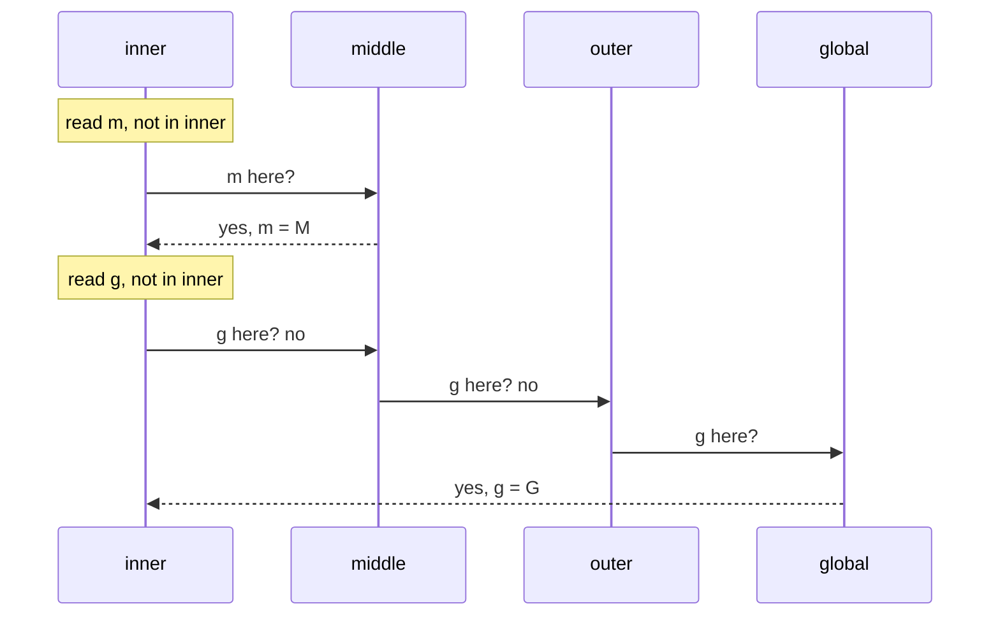

# Chapter 3: Scope, Lexical Environment & Scope Chain

## 3.1 Definition and why interviewers ask it

**Scope is the rule that decides which names are visible at a given point in the source. JavaScript uses lexical (static) scope: visibility is fixed by where code is written, not by who calls it. At runtime the engine implements the rule with a chain of Lexical Environments. Each one is an Environment Record (the bindings of one scope) plus an `[[OuterEnv]]` link to the enclosing environment, and "the scope chain" is that linked list.**

This chapter turns Chapters 1 and 2 into a model you can reason with. Interviewers ask "lexical vs dynamic scope", "explain the scope chain" and shadowing puzzles because the answers show whether you understand *which environment a function sees* before they move on to closures (Chapter 4) and `this` (Chapter 5). They are standard questions in JavaScript-fundamentals rounds (commonly reported), usually as a definition question followed by an output-prediction snippet.

## 3.2 Core concept

### Plain language

Think of nested rooms in a building, each with a noticeboard. To find a piece of information you look at the board in your own room first. If it is not there, you walk to the room that *contains* yours and look again, and so on out to the lobby. The floor plan was fixed when the building was drawn. It does not change depending on which room you were in when somebody phoned you. A function's "containing room" is where the function was **written**, not where it was **called from**.

### Precise version

**Scope kinds**

| Scope | A new one is created when | Holds | Notes |
|---|---|---|---|
| Global (script) | A classic script starts | `var` and function declarations (as global-object properties); `let`, `const`, `class` (in a separate declarative record) | One composite record (Chapter 1). |
| Module | An ES module is evaluated | All top-level declarations and imports | Nothing becomes a global-object property. Top-level `this` is `undefined`. |
| Function | **Each call** | Parameters, `arguments`, `var`, function declarations, and the body's top-level `let`/`const`/`class` | Node.js CommonJS files run inside a function, so their top level is a function scope. |
| Block | A `{ }` block, a loop body, or a `switch` body is entered | `let`, `const`, `class`, and block-level function declarations | `var` ignores blocks. |
| Catch clause | A `catch (e)` clause is entered | The catch parameter | The `{ }` after it is a further, nested block scope. |
| Class static block | A class is defined and its `static { }` block runs | Its own `var`, function and lexical declarations | Behaves like a function body. `this` is the class. |
| `eval` | A direct `eval` runs | `let`/`const`/`class` always stay inside. `var` stays inside only in strict mode. | Chapter 1, Example 4. |
| `with` | A `with (obj)` statement runs | The properties of `obj` act as variables | Sloppy mode only (a `SyntaxError` in strict mode). Avoid. |

**Lexical vs dynamic scope.**

- *Lexical (static)*: a function's free variables are looked up in the scopes that surround its **definition**. The chain can be read off the source text.
- *Dynamic*: free variables are looked up through the **call stack**, so the same function can see different variables depending on who called it. Bash and early Lisps work this way.

JavaScript is lexical. The proof is two lines: define `show` at top level, call it from a function that has its own variable of the same name, and see which one `show` reads (Example 1). The only dynamic-looking parts of the language are `this` (decided by how a function is called, Chapter 5) and the legacy `with`/sloppy `eval` features.

**Lexical Environment.** The pair *(Environment Record, outer reference)*. Editions up to ES2019 define "Lexical Environment" as a specification type. Newer editions drop that wrapper type and put the outer link on the record itself as `[[OuterEnv]]`, but the idea and the term (`LexicalEnvironment` component of an execution context) are unchanged. Use whichever term the interviewer uses.

**Environment Record types**

| Record | Used for | Extra fields or behaviour |
|---|---|---|
| Declarative | Blocks, catch clauses, loop iterations, function-expression name | Plain name-to-value map. Bindings can be mutable or immutable, and initialised or not (TDZ). |
| Function | One per function call | A declarative record plus `[[ThisValue]]`, `[[ThisBindingStatus]]`, `[[FunctionObject]]`, `[[NewTarget]]`. Arrow functions leave `this` unbound and look it up outward. |
| Module | One per module | A declarative record whose imports are *indirect*, read-only bindings that point into the exporting module's record. |
| Object | `with` statements, and the object half of the global record | Bindings are the properties of a *binding object* (`globalThis`, or the `with` target). |
| Global | The top of every chain in a classic script | Composite: an Object record (`var`, functions, built-ins) plus a Declarative record (`let`, `const`, `class`). Its `[[OuterEnv]]` is `null`. |

**Block scopes create a new environment per entry.** Each time execution enters a block that has lexical declarations, the engine creates a *fresh* declarative record whose `[[OuterEnv]]` is the environment that was current, makes it current, and restores the previous one on exit. Entering the same block twice creates two separate records. This is what makes `let` in a loop body safe to capture (Chapter 4).

**Shadowing.** An inner binding with the same name hides the outer one *for the whole inner scope*, including the part above its declaration (Chapter 2, TDZ). The outer variable still exists. It is just not reachable by that name from inside.

**Illegal shadowing (a `SyntaxError` before anything runs).** A `let`/`const`/`class` cannot share a name with a `var`, function or parameter *in the same scope*, and a `var` declared in an inner block hoists into the function scope, so it counts as being in the function scope.

| Code | Result | Why |
|---|---|---|
| `function f() { let x; { var x; } }` | `SyntaxError` | The inner `var x` hoists to the function scope, where `let x` already lives. |
| `function f(x) { let x; }` | `SyntaxError` | A body-level `let` clashes with the parameter. |
| `function f(x) { var x; }` | allowed | `var` may redeclare a parameter and keeps its value. |
| `function f(x) { { var x; } }` | allowed | Same: `var x` merges with the parameter. |
| `var x; { let x; }` | allowed | `let x` is in a *different* (inner) scope, so it legally shadows. |
| `try {} catch (e) { let e; }` | `SyntaxError` | The catch body clashes with the catch parameter (a plain `var e` there is allowed by a legacy rule). |

**Implicit globals.** Assigning to a name that resolves nowhere is an *unresolvable reference*. In sloppy mode the assignment creates a configurable property on the global object. In strict mode it throws `ReferenceError`. Reading an unresolvable name always throws.

**Named function expression (NFE).** `const f = function me() { ... }` creates an extra one-binding environment between the surrounding scope and the function's call environments. It holds `me` as an *immutable* binding. So `me` is visible only inside the function, `me = 1` is silently ignored in sloppy mode and throws `TypeError` in strict mode, and a `var me` or parameter `me` inside the body shadows it.

**IIFE and the module pattern.** Before `let` and ES modules, the only way to get a private scope was a function. An immediately invoked function expression runs once, keeps its variables private, and returns whatever should be public. That is the module pattern (Example 5). It still appears in legacy code, bundler output and interviews. Today a block scope or an ES module covers most uses.

**Parameter scope vs body scope.** If a function has *simple* parameters, the parameters and the body's `var`s share one environment. If it has defaults, destructuring or a rest parameter, the specification creates a separate environment for the parameters and another for the body's `var`s. Default-value expressions are evaluated in the parameter scope, so they cannot see the body's declarations (Example 4, and Chapter 1, Question 1.10).

**Scope vs execution context vs `this`.**

| Concept | What it is | Decided | Lifetime |
|---|---|---|---|
| Scope | The static region of source where a name is visible | By source text | Fixed at parse time |
| Environment (record + outer) | The runtime object holding the bindings of one scope entry | Created per call or block entry | Until unreachable (can outlive the call via a closure) |
| Execution context | The running record that points at the current environments | Created per call | Only while on the call stack |
| `this` | A binding kept in the nearest non-arrow function (or global/module) environment | By **how the function is called** (arrows: lexically) | Per call |

## 3.3 How it works internally

### A. How environments are created and chained

1. **Script or module start.** The engine creates the global (or module) environment. Its `[[OuterEnv]]` is `null` for the global record, and the global environment for a module record.
2. **Function call.** `[[Call]]` creates a function Environment Record. Its `[[OuterEnv]]` is the function object's `[[Environment]]` internal slot, which was set when the function object was *created* (when the `function` expression or declaration was evaluated). That single rule is lexical scoping. The call site plays no part.
3. **Instantiation.** Parameters, `arguments`, `var`s, functions and lexical names are created in that record (Chapter 1, section 1.3).
4. **Block entry.** `BlockDeclarationInstantiation` creates a new declarative record for the block's `let`, `const`, `class` and function declarations, with `[[OuterEnv]]` set to the current environment. The running context's `LexicalEnvironment` now points to it. On exit, normally or through an exception, the previous environment is restored. A block with nothing to declare gets no observable scope, and engines do not allocate one.
5. **`for (let ...)`.** The loop head has its own record. On every iteration the engine creates a *new* record and copies the loop variables into it. Each iteration therefore has its own `i` (Chapter 4 uses this to fix the classic `setTimeout` loop).
6. **`catch (e)`.** A declarative record holds `e`. The catch block is a further block scope inside it.
7. **Named function expression.** A one-binding declarative record holding the function's own name is inserted between the surrounding environment and the function. The function object's `[[Environment]]` points at it.
8. **Leaving.** When a function returns or a block exits, the *context* or *current-environment pointer* is restored. The environment records are not destroyed. They stay alive only as long as something still points at them (a closure, Chapter 4). Otherwise the garbage collector reclaims them (Chapter 16).

### B. How a name is resolved

Chapter 2 (Figure 2.2) already shows the algorithm: check the current record, then follow `[[OuterEnv]]` until a record has the name or the chain ends. This chapter adds three points.

1. The walk starts at the *current* `LexicalEnvironment` of the running context, which is the innermost block or function being executed.
2. The result of the walk is a *Reference* (an environment plus a name). Reading it gets the value, and assigning to it sets the value in whichever record owns the binding, not in the current one. That is why an inner function can change an outer variable.
3. If the chain ends without a match, the reference is *unresolvable*. A read throws `ReferenceError`. A write throws in strict mode and creates a global-object property in sloppy mode. `typeof` on an unresolvable name returns `"undefined"`.

### C. What engines do differently

The specification describes a name lookup at run time, but engines do the walk **at compile time** wherever they can. V8 analyses the scopes of the whole function when it parses it and decides, for each variable, whether it can live in a register or stack slot (no closure captures it), in a heap context object (a closure captures it) or needs a slow dynamic lookup (the function contains `eval` or `with`). Resolved variables are then accessed by a fixed (depth, slot) position, not by name. The observable behaviour is identical to the specification's walk, so reason with the chain in an interview. It is also why `eval` and `with` make code slower: they force the dynamic path.

## 3.4 Diagrams

### Scope chain and lexical environments for three nested functions

```ascii Environment records linked by [[OuterEnv]] while inner() runs
 CODE (classic script)                ENVIRONMENT RECORDS, innermost first

 const g = 'G';                       +-----------------------------------+
 function outer(p) {                  | FUNCTION ENV of inner()           |
   const o = 'O';                     |   arguments = []                  |
   function middle() {                |   [[ThisValue]] = globalThis      |
     let m = 'M';                     |   [[OuterEnv]] ---------------+   |
     function inner() {               +-------------------------------+---+
       return g + o + m + p;                                          |
     }                                                                v
     return inner();                  +-----------------------------------+
   }                                  | FUNCTION ENV of middle()          |
   return middle();                   |   arguments = []                  |
 }                                    |   m = 'M'   inner = function      |
 outer('P');                          |   [[OuterEnv]] ---------------+   |
                                      +-------------------------------+---+
 Reading g + o + m + p:                                               |
   m  found in middle  (1 hop)                                        v
   p  found in outer   (2 hops)       +-----------------------------------+
   o  found in outer   (2 hops)       | FUNCTION ENV of outer('P')        |
   g  found in global  (3 hops)       |   p = 'P'   arguments = ['P']     |
                                      |   o = 'O'   middle = function     |
                                      |   [[OuterEnv]] ---------------+   |
                                      +-------------------------------+---+
                                                                      |
                                                                      v
                                      +-----------------------------------+
                                      | GLOBAL ENV (composite)            |
                                      |   object part: outer = function  |
                                      |   declarative part: g = 'G'       |
                                      |   [[OuterEnv]] = null             |
                                      +-----------------------------------+
```

> **How to explain this to the interviewer**
>
> 1. Draw four boxes stacked top to bottom, innermost function first, and write the function name and its own variables in each (`m`, then `p` and `o`, then `g`).
> 2. Draw an arrow from each box to the next one down and label it `[[OuterEnv]]`. Say: "each arrow points to where that function was *written*".
> 3. Pick one variable (`g`) and trace it from the top box down three arrows until it is found. End on `null`.
>
> **Takeaway:** the scope chain is a linked list of environment records, and name lookup is a walk along it.

### Resolving names from a nested call



> **How to explain this to the interviewer**
>
> 1. Draw four vertical lines labelled inner, middle, outer and global, left to right.
> 2. For `m`, draw one arrow to the right and one answer arrow back. For `g`, draw an arrow that hops across all three lines before the answer returns.
> 3. Say: "The cost of a lookup grows with the number of hops, and the first match wins, which is exactly shadowing."
>
> **Takeaway:** a lookup stops at the nearest environment that has the name.

### Lexical scope vs dynamic scope

```ascii Same code, two lookup rules: JavaScript follows the DEFINITION chain, not the call stack
 const x = 'global';
 function show()   { return x; }                 // written at top level
 function caller() { const x = 'local'; return show(); }
 caller();

  CALL STACK when show() reads x          DEFINITION CHAIN of show (what JS uses)
  (a DYNAMIC-scope language uses this)

  +------------------------+              +------------------------+
  | show()                 | -- next? --> | show env               |
  +------------------------+     |        |   [[OuterEnv]] -----+  |
  | caller()   x = 'local' | <---+        +---------------------+--+
  +------------------------+                                    |
  | Global     x = 'global'|              +---------------------v--+
  +------------------------+              | Global     x = 'global'|
                                          +------------------------+
  dynamic scope would answer 'local'      JavaScript answers 'global'
```

> **How to explain this to the interviewer**
>
> 1. Draw the call stack on the left (`show` on top of `caller` on top of `Global`) and the definition chain on the right (`show` pointing straight to `Global`).
> 2. Mark the `x = 'local'` box in `caller` with a cross on the right-hand side: "`show` was not written inside `caller`, so `caller`'s variables are not in its chain".
> 3. Say: "A dynamic-scope language would print `local`. JavaScript prints `global`."
>
> **Takeaway:** the chain is built from where functions are written, never from who called them.

### One environment per block entry

```ascii Each block entry creates a new environment record (loop with two iterations)
 function run() {                   ENVIRONMENTS ALIVE DURING EACH ITERATION
   var v = 1;
   for (let i = 0; i < 2; i++) {
     const sq = i * i;              ITERATION 1                ITERATION 2
     use(sq);                      +----------------+         +----------------+
   }                               | BLOCK ENV      |         | BLOCK ENV      |
   { let t = 'x'; }                |   sq = 0       |         |   sq = 1       |
 }                                 +-------+--------+         +-------+--------+
                                           | outer                    | outer
 Three kinds of record:                    v                          v
  - FUNCTION ENV (once per call)   +----------------+         +----------------+
  - LOOP ENV (new copy per         | LOOP ENV       |         | LOOP ENV       |
    iteration, holds i)            |   i = 0        |         |   i = 1        |
  - BLOCK ENV (new per entry)      +-------+--------+         +-------+--------+
                                           | outer                    | outer
 The block { let t } is a fourth,          +------------+-------------+
 separate record, created and                           v
 dropped when that block runs.             +---------------------------+
                                           | FUNCTION ENV of run()     |
                                           |   v = 1                   |
                                           +---------------------------+
```

> **How to explain this to the interviewer**
>
> 1. Draw the function environment once at the bottom, with `v = 1`.
> 2. Draw two short stacks above it, one per iteration. Each stack has a loop box (`i`) and a block box (`sq`), and both stacks point down at the same function box.
> 3. Say: "A closure created in iteration 1 keeps *its own* `i` and `sq`. That is why `let` fixes the loop-and-closure bug (Chapter 4)."
>
> **Takeaway:** a block with `let`/`const` gets a new record every time it is entered.

### Which kind of environment record sits where

```ascii Environment record types and what each one stores
 Environment Record
  |
  +-- Declarative record      name -> value map: block, catch, loop, NFE name
  |     |
  |     +-- Function record   + [[ThisValue]], [[FunctionObject]], [[NewTarget]]
  |     |                       one per call
  |     |
  |     `-- Module record     + imports as read-only links into other modules
  |
  +-- Object record           names ARE properties of a "binding object"
  |                             used by: with (obj), and the global object
  |
  `-- Global record           composite, the top of a classic script's chain
        |-- Object part         var, function declarations, built-ins  (globalThis)
        `-- Declarative part    let, const, class
```

> **How to explain this to the interviewer**
>
> 1. Draw a box labelled "Environment Record" with three arrows down to Declarative, Object and Global.
> 2. Under Declarative add Function and Module, and say: "Function adds `this`; Module adds import links".
> 3. Point at Global and say: "It is built from an Object part and a Declarative part, which is why top-level `var` becomes `globalThis.x` but `let` does not".
>
> **Takeaway:** most scopes are plain declarative records. Only global and `with` use an object as storage.

### Whiteboard version

```ascii Whiteboard version: the scope chain (draw in 90 seconds)
  inner env --outer--> middle env --outer--> outer env --outer--> Global --> null
   (own vars)           m                     p, o                g

  look here first; if missing, follow outer.
  outer = where the function was WRITTEN, not where it was called.
```

## 3.5 Code examples

### Example 1: proof that JavaScript is lexically scoped

```js
const x = 'global';
function show() { return x; }              // defined at top level
function caller() {
  const x = 'local';                       // not in show's chain
  return show();
}
console.log(caller());
```

```text output
global
```

**Why:** `show`'s `[[Environment]]` is the global environment, because that is where it was created. A call from inside `caller` does not change it. With dynamic scope the answer would be `local`.

### Example 2: a block creates a new environment each time it is entered

```js
const readers = [];
let n = 0;
while (n < 3) {
  const snapshot = n * 10;                 // new binding on every entry to the block
  readers.push(() => snapshot);
  n++;
}
console.log(readers.map((read) => read()), n);
```

```text output
[ 0, 10, 20 ] 3
```

**Why:** the loop body is entered three times, so there are three separate `snapshot` bindings. Each closure points at the record of its own entry. The outer variable `n` lives in one record only.

### Example 3: catch clause, class static block and `with`

```js
class Config {
  static ready;
  static {
    var scratch = 'static-block-only';     // var is scoped to the static block
    Config.ready = [this === Config, scratch];
  }
}
try { throw new Error('boom'); } catch (err) { var fromCatch = err.message; }
const probe = new Function('o', 'with (o) { a = 2; b = 3; } return [o.a, typeof b];');
const patched = { a: 1 };
const result = probe(patched);
delete globalThis.b;                       // b was created as an implicit global
console.log(Config.ready, typeof scratch, typeof err, fromCatch, result);
```

```text output
[ true, 'static-block-only' ] undefined undefined boom [ 2, 'number' ]
```

**Why:** the static block has its own scope, so `scratch` does not escape and `this` is the class. `err` exists only in the catch clause, but the `var` inside it hoists out. In the sloppy `with` block, `a = 2` writes to the object because `a` is one of its properties. `b` is not, so `b = 3` falls through to an implicit global (cleaned up on the next line). The `with` code is built with `new Function` so that this example still parses when the file is a strict ES module, where a literal `with` would be a `SyntaxError`.

### Example 4: default parameters have their own scope

```js
const x = 'outer';
function f(a = x, b = () => typeof helper) {
  const x = 'body';                        // lives in the body scope
  function helper() {}                     // also body scope
  return [a, b(), x];
}
console.log(f());
```

```text output
[ 'outer', 'undefined', 'body' ]
```

**Why:** because the parameter list contains expressions, the parameters get their own scope in front of the body. `a = x` is evaluated there, so it sees the outer `x`, not the body's `const x`. The arrow `b` was created in the parameter scope, so it cannot see `helper` either.

### Example 5: IIFE and the module pattern

```js
const counter = (function () {
  let count = 0;                           // private: only the returned functions see it
  return {
    increment() { return ++count; },
    reset() { count = 0; },
  };
})();
counter.increment();
counter.increment();
console.log(counter.increment(), typeof count, counter.count);
counter.reset();
console.log(counter.increment());
```

```text output
3 undefined undefined
1
```

**Why:** the IIFE creates one function scope per run. `count` lives in its record. The two returned methods keep that record alive (Chapter 4), but nothing outside can name `count`.

### Example 6: scope does not decide `this`

```js
const o = {
  name: 'o',
  regular() { return typeof this === 'object' ? this.name : 'no this'; },
  arrow: () => typeof this,                // arrow: this comes from the surrounding scope
};
const detached = o.regular;
console.log(o.regular(), detached.call({ name: 'other' }), o.arrow());
```

```text output
o other object
```

**Why:** `regular` gets `this` from how it is called, and `call` supplies a different one, so the same scope chain gives different `this` values. The arrow function has no `this` binding, so the lookup walks outward to the module-level `this` of this CommonJS file, which is the `module.exports` object. In an ES module it would be `undefined`.

## 3.6 Common mistakes and gotchas

- **"Scope is created when a function is defined."** The *scope* (the region of source) is static, but the *environment record* that holds the values is created **per call** (and per block entry). Two calls to one function have two records (Question 3.13).
- **Reading the scope chain as the call stack.** The chain follows where code is written. The call stack follows who called whom. They differ whenever a function is passed around or returned.
- **Believing `var` is block-scoped, or that `let` is function-scoped.** `var` stops at the function (or global, or static block). `let`, `const` and `class` stop at the nearest block.
- **Forgetting that a block-level `var` can cause a `SyntaxError`.** `function f() { let x; { var x; } }` fails at parse time because `var x` hoists to the function scope (Question 3.11).
- **Accidental globals.** `a = 1` without a declaration creates a global in sloppy mode, and `var a = b = 1` declares only `a`. Use `'use strict'` (modules and classes are strict already).
- **Assigning to a named function expression's name** and expecting it to change. It is silently ignored in sloppy mode and a `TypeError` in strict mode (Question 3.9).
- **Treating braces as a scope.** Function bodies, class bodies, object literals and `switch` bodies each behave differently. A `switch` has *one* block shared by all its `case` clauses (Question 3.14).
- **Block-level functions** behave differently in sloppy and strict mode (Question 3.10). Do not declare functions in blocks.
- **Forgetting the parameter scope.** A default value cannot see `var`s or functions declared in the body (Example 4).
- **Assuming `this` is part of the scope chain.** It is not looked up by name. Arrow functions get it from the nearest enclosing non-arrow function or the global/module level.
- **Using `eval` or `with` and wondering why code is slow.** They make name resolution dynamic, so the engine cannot use fixed slots.

## 3.7 Quick revision cheat sheet

- **Scope** = static visibility rule. **Environment** = runtime record of one scope entry plus `[[OuterEnv]]`. **Scope chain** = the environments linked by `[[OuterEnv]]`.
- JavaScript is **lexical**: a function's `[[OuterEnv]]` is the environment where it was **created**, never where it was called.
- Lookup: current record, then outward, first match wins. Unresolvable read: `ReferenceError`. Unresolvable write: global property in sloppy mode, `ReferenceError` in strict mode.
- **Records:** declarative (blocks, catch), function (adds `this`), module (import links), object (`with`, global), global (object plus declarative).
- A block with `let`/`const`/`class` gets a **new record per entry**. `for (let ...)` gets a fresh copy per iteration.
- `var` ignores blocks. `let x` plus an inner-block `var x` in the same function is a `SyntaxError`. `var` may redeclare a parameter.
- Named function expression: its name is an **immutable** binding visible only inside the function.
- Default parameters get their own scope. `this` is not part of the scope chain.

## 3.8 Interview questions

*Key: ★ = very frequently reported. "Typically asked in" lines say which round a question tends to appear in; where no single source could be pinned down the question is labelled "commonly reported". Draw-it hints refer to the figures in section 3.4 (Figures 3.1 to 3.6).*

#### Conceptual

### Q3.1 Easy: What is scope? What kinds of scope does JavaScript have?

*Typically asked in: JavaScript fundamentals round (commonly reported).*

> **Model answer**
>
> Scope decides where a name is visible. JavaScript has global scope, function scope, and block scope for `let`, `const` and `class`, plus module scope for ES modules and scope for `catch` parameters. Newer additions are class static blocks, and `eval` and `with` are legacy dynamic cases. `var` is function-scoped. `let` and `const` are block-scoped, so they are visible only in the nearest `{ }`. Scope is lexical: it is decided by where the code is written. At runtime each scope entry gets an environment record, and the records are linked into the scope chain.

**Key points to mention**

- Global, module, function, block, catch, static block (and legacy `eval`, `with`).
- `var` function-scoped, `let`/`const`/`class` block-scoped.
- Scope is static. The environment that implements it is created at runtime.
- Draw it: Figure 3.1 or the whiteboard figure (Figure 3.6).

### Q3.2 ★ Medium: What is the difference between lexical scope and dynamic scope? How can you prove JavaScript is lexical?

*Typically asked in: JavaScript fundamentals round, closures lead-in (commonly reported).*

> **Model answer**
>
> With lexical scope, a function looks up free variables in the scopes that surround where it was written. With dynamic scope, it looks them up through the call stack, so the answer depends on the caller. JavaScript is lexical. To prove it I define `show()` at top level that returns `x`, then call it from another function that has its own local `x`. `show` returns the global `x`, because its outer environment was fixed when the function was created. Dynamic scope would return the caller's `x`. The one dynamic-looking thing is `this`, which depends on the call.

**Key points to mention**

- The `[[Environment]]` slot of a function object is set at creation time.
- The proof snippet (Example 1) and the figure with two lookup paths.
- `this` is the exception that is decided at call time. Arrow functions make it lexical.
- Draw it: Figure 3.3.

### Q3.3 ★ Medium: Explain the scope chain. How does the engine resolve a variable?

*Typically asked in: JavaScript fundamentals round (commonly reported).*

> **Model answer**
>
> Every scope at runtime is an environment record with a pointer to its enclosing environment, `[[OuterEnv]]`. Following those pointers from the innermost one outward is the scope chain, ending at the global record, whose outer is `null`. To resolve a name the engine checks the current record, then the next one out, and stops at the first record that has the name. That is why inner names shadow outer ones. If it runs off the end, a read throws `ReferenceError`. A function's chain starts from where it was defined, which is lexical scoping.

**Key points to mention**

- Linked list of environment records through `[[OuterEnv]]`.
- First match wins (shadowing), found-but-uninitialised stops the search (Chapter 2).
- Writes go to the record that owns the binding.
- Unresolvable: read throws, sloppy write creates a global.
- Engines resolve most names at compile time into slots.
- Draw it: Figures 3.1 and 3.2.

### Q3.4 Hard: What is a Lexical Environment and what kinds of Environment Record exist?

*Typically asked in: senior-leaning JavaScript fundamentals round (commonly reported).*

> **Model answer**
>
> A lexical environment pairs an environment record, the map of names to values for one scope, with a reference to the outer environment. The record types are declarative, for blocks and catch clauses, function, which adds `this`, the function object and `new.target`, module, whose imports are live read-only links, and object, which uses a binding object, as `with` does. The global record combines an object part for `var` and functions and a declarative part for `let`, `const` and `class`. That is why top-level `var` shows up on `window` but `let` does not.

**Key points to mention**

- Record plus outer pointer. Newer spec editions fold the pointer into the record as `[[OuterEnv]]`.
- Function record stores `this`, which is why arrows skip a level when resolving it.
- Global is composite. Module imports are immutable, indirect bindings.
- Execution context holds `LexicalEnvironment` and `VariableEnvironment` that point at records.
- Draw it: Figure 3.5.

### Q3.5 Medium: What is an IIFE and why was it used? What replaces it today?

*Typically asked in: JavaScript fundamentals round (commonly reported).*

> **Model answer**
>
> An immediately invoked function expression defines a function and calls it at once, so it runs once inside a fresh function scope. Before `let`, `const` and ES modules, that was the only way to avoid polluting the global scope, to keep variables private, and to implement the module pattern by returning only the public API. The parentheses make the parser treat `function` as an expression, not a declaration. Today a block with `let`/`const` or an ES module gives the same isolation. I still use an IIFE when I need an `async` wrapper or a one-off computed value.

**Key points to mention**

- Own function scope per run, private variables, controlled exports (Example 5).
- Parentheses (or `!`, `void`) force expression parsing.
- Replacements: blocks, modules, class private fields.
- Also seen in bundler output and as a fix for loop closures in old code (Chapter 4).

#### Output prediction

### Q3.6 ★ Medium: What does this print? (shadowing and nested functions)

*Typically asked in: JavaScript fundamentals round (commonly reported).*

```js
const x = 'global';
function outer() {
  const x = 'outer';
  function inner() { console.log(x); }
  {
    const x = 'block';
    console.log(x);
    inner();
  }
  function shadow(x) {
    var x;                      // redeclares the parameter: no reset
    console.log(x);
    { let x = 'inner block'; }
    return x;
  }
  console.log(shadow('param'));
}
outer();
console.log(x);
```

```text output
block
outer
param
param
global
```

```ascii Q3.6: four x bindings, one per scope, and who reads which
   GLOBAL ENV           x = 'global'     <-- the last console.log(x)
        ^ outer
   outer() ENV          x = 'outer'      <-- inner() reads this one
        ^ outer              ^ outer
   BLOCK ENV            shadow(x) ENV    x = 'param'
     x = 'block'          (var x merges with the parameter)
   1st log reads it      3rd log reads it, 4th prints its return value
```

> **Model answer**
>
> `block`, `outer`, `param`, `param`, `global`. The first log is in the block, which has its own `x`, so it prints `block`. `inner()` was written in `outer`'s function scope, not in the block, so its chain skips the block and finds `outer`'s `x`. In `shadow`, `var x` merges with the parameter and does not reset it, so it logs `param`, and the inner block's `let x` never affects the return value. The last line is back at the global scope.

**Key points to mention**

- `inner` resolves `x` through its definition site, so the block's `x` is invisible to it.
- `var` redeclaring a parameter keeps the argument's value.
- Each scope entry has its own record, so five bindings of `x` coexist.
- Draw it: Figure 3.7 (above) or Figure 3.1.

### Q3.7 ★ Medium: What do these loops leave behind?

*Typically asked in: JavaScript fundamentals round (commonly reported).*

```js
for (var i = 0; i < 3; i++) {}
for (let j = 0; j < 3; j++) {}
console.log(typeof i, i, typeof j);

const viaVar = [];
const viaLet = [];
for (var a = 0; a < 3; a++) viaVar.push(() => a);
for (let b = 0; b < 3; b++) viaLet.push(() => b);
console.log(viaVar.map((f) => f()), viaLet.map((f) => f()));
```

```text output
number 3 undefined
[ 3, 3, 3 ] [ 0, 1, 2 ]
```

> **Model answer**
>
> First line: `number 3 undefined`. `var i` belongs to the enclosing scope, so it survives the loop with its final value 3. `let j` lives in the loop's own scope and is gone afterwards. `typeof j` is `"undefined"` because the name resolves nowhere. Second line: all `var` closures share the single `a`, which is 3 when they run. With `let`, the engine creates a fresh binding per iteration, copying the value forward, so each closure sees its own `b`. Chapter 4 covers the capture mechanics.

**Key points to mention**

- `var` is function-scoped, `let` is loop- and block-scoped.
- Per-iteration binding: a new record per iteration, initialised from the previous one.
- `typeof` of an unresolvable name is `"undefined"`.
- Forward reference: Chapter 4, questions on `setTimeout` loops.

### Q3.8 Medium: What does this print? (implicit globals)

*Typically asked in: JavaScript fundamentals round (commonly reported).*

```js
function sloppy() {
  leaked = 1;                  // no declaration
  var a = b = 2;               // means: var a; b = 2;
}
function strict() {
  'use strict';
  try { oops = 1; } catch (e) { return e.name + ': ' + e.message; }
}
sloppy();
console.log(typeof leaked, typeof a, typeof b);
console.log(strict());
delete globalThis.leaked;
delete globalThis.b;
```

```text output
number undefined number
ReferenceError: oops is not defined
```

> **Model answer**
>
> `number undefined number`, then a `ReferenceError`. In sloppy mode, assigning to a name that resolves nowhere creates a property on the global object, so `leaked` becomes global. `var a = b = 2` is parsed as `b = 2` followed by `var a`, so only `a` is local and `b` leaks. In strict mode the same assignment throws `ReferenceError: oops is not defined`, because an unresolvable reference is not allowed to create a global. ES modules and classes are strict by default.

**Key points to mention**

- Unresolvable write: create global (sloppy) vs `ReferenceError` (strict).
- The chained-assignment trap `var a = b = 2`.
- Implicit globals are configurable, so `delete` works, unlike `var` globals.
- Fix: `'use strict'`, modules, and a linter rule (`no-undef`).

### Q3.9 Medium: What does this print? (named function expression)

*Typically asked in: JavaScript fundamentals round, as a trick question (commonly reported).*

```js
const fact = function me(n) { return n <= 1 ? 1 : n * me(n - 1); };
console.log(fact(5), typeof me);

const sloppy = function me() { me = 42; return typeof me; };
const strict = function me() {
  'use strict';
  try { me = 42; } catch (e) { return e.name; }
};
console.log(sloppy(), strict());
```

```text output
120 undefined
function TypeError
```

```ascii Q3.9: the name me lives in its own one-binding environment
   CALL ENV of me() --outer--> NFE ENV: me = function (immutable) --outer--> module
   assignment me = 42 finds the binding in the NFE ENV; it is read-only.
   sloppy: write silently ignored      strict: TypeError
```

> **Model answer**
>
> `120 undefined`, then `function TypeError`. A named function expression gets its own tiny environment holding the function's name, placed between the surrounding scope and the call environment. So `me` works for recursion inside, but `typeof me` outside is `"undefined"`. That binding is immutable. In sloppy mode `me = 42` is silently ignored, so the type stays `function`. In strict mode the same assignment throws `TypeError`. A function *declaration* is different: its name is an ordinary mutable binding in the surrounding scope.

**Key points to mention**

- The name is visible only inside the function.
- Immutable binding: silent no-op (sloppy) vs `TypeError` (strict).
- A parameter or `var` with the same name shadows it.
- Draw it: Figure 3.8 (above).

### Q3.10 Hard: What does this print? (function declarations in blocks)

*Typically asked in: JavaScript fundamentals round, as a hard follow-up (commonly reported).*

```js
function sloppy() {
  const before = typeof f;
  let inside;
  {
    inside = typeof f;
    function f() {}
    f = 'changed';
  }
  return [before, inside, typeof f];
}
function strict() {
  'use strict';
  { function f() {} }
  return typeof f;
}
console.log(sloppy(), strict());
```

```text output
[ 'undefined', 'function', 'function' ] undefined
```

> **Model answer**
>
> `sloppy()` returns `['undefined', 'function', 'function']` and `strict()` returns `undefined`. A function declaration in a block is initialised at block entry, so `typeof f` inside the block is `function`. In sloppy mode a legacy rule also creates a `var` named `f` in the function, which is `undefined` until the declaration is evaluated, hence `before`. When that line is reached the function is copied to the outer `var`. The later `f = 'changed'` writes only to the block's own binding, so the outer one stays a function. In strict mode `f` is block-scoped only.

**Key points to mention**

- Block-level functions are initialised at block entry (like `let`, but with a value).
- Annex B (sloppy mode only) copies the value out when the declaration is evaluated.
- Strict mode, modules and classes: purely block-scoped.
- Advice: use a `const` function expression or declare the function at the top level of its function.

### Q3.11 Hard: Which of these throw a `SyntaxError`? (illegal shadowing)

*Typically asked in: JavaScript fundamentals round, as a follow-up to Q3.6 (commonly reported).*

```js
const cases = [
  'function f() { let x; { var x; } }',
  'function f(x) { let x; }',
  'function f(x) { var x; }',
  'function f(x) { { var x; } }',
  'var x; { let x; }',
  'try {} catch (e) { let e; }',
  'for (let i = 0; i < 1; i++) { var i; }',
  'for (let i = 0; i < 1; i++) { let i; }',
];
for (const src of cases) {
  let result = 'ok';
  try { new Function(src); } catch (e) { result = e.name; }
  console.log(result.padEnd(12), src);
}
```

```text output
SyntaxError  function f() { let x; { var x; } }
SyntaxError  function f(x) { let x; }
ok           function f(x) { var x; }
ok           function f(x) { { var x; } }
ok           var x; { let x; }
SyntaxError  try {} catch (e) { let e; }
SyntaxError  for (let i = 0; i < 1; i++) { var i; }
ok           for (let i = 0; i < 1; i++) { let i; }
```

> **Model answer**
>
> A `SyntaxError` appears whenever a `let`, `const` or `class` shares a scope with a `var`, parameter or function of the same name. A `var` in an inner block counts as living in the function scope, so lines 1 and 7 fail, and `let x` against a parameter fails. A `var` may redeclare a parameter, and merges with it. A `let` in an inner block is a different scope from the outer `var`, so it legally shadows. `for (let i...) { let i }` is also fine, because the body block is a new scope inside the loop's scope. These errors are early errors, found at parse time.

**Key points to mention**

- Rule of thumb: `var` hoists out of blocks, then it is compared with the `let`s of the function scope.
- Parameters and `var`: allowed. Parameters and `let`: not.
- Early errors: nothing in the script runs.
- The case `var x; { let x; }` is *shadowing*, not a redeclaration.

#### Implement it yourself

### Q3.12 ★ Medium: Implement a tiny scope-chain resolver with `define`, `lookup` and `assign`.

*Typically asked in: JavaScript round or machine-coding warm-up, as a "model how the engine does it" exercise (commonly reported).*

**Problem.** Write a `Scope` class with a parent pointer. `define(name, value, kind)` creates a binding in this scope, `lookup(name)` walks outward and returns the value or throws `ReferenceError`, and `assign(name, value)` changes the nearest binding (respecting `const`). Then use it to show that a function's parent scope is the scope where it was *defined*.

**Solution.**

```js
class Scope {
  constructor(parent = null, label = 'scope') {
    this.parent = parent;                 // the [[OuterEnv]] link
    this.label = label;
    this.bindings = new Map();            // name -> { value, kind }
  }
  define(name, value, kind = 'let') {
    if (this.bindings.has(name)) {
      throw new SyntaxError(`Identifier '${name}' has already been declared`);
    }
    this.bindings.set(name, { value, kind });
    return this;
  }
  resolve(name) {                         // the scope that owns the binding, or null
    for (let s = this; s; s = s.parent) if (s.bindings.has(name)) return s;
    return null;
  }
  lookup(name) {
    const owner = this.resolve(name);
    if (!owner) throw new ReferenceError(`${name} is not defined`);
    return owner.bindings.get(name).value;
  }
  assign(name, value, { strict = true } = {}) {
    const owner = this.resolve(name);
    if (!owner) {
      if (strict) throw new ReferenceError(`${name} is not defined`);
      let root = this;
      while (root.parent) root = root.parent;
      root.bindings.set(name, { value, kind: 'var' });   // implicit global
      return;
    }
    const binding = owner.bindings.get(name);
    if (binding.kind === 'const') throw new TypeError('Assignment to constant variable.');
    binding.value = value;
  }
}

// A "function" remembers the scope it was DEFINED in and builds a child per call.
const makeFn = (definedIn, body) => () => body(new Scope(definedIn, 'call'));

const globalScope = new Scope(null, 'global').define('x', 'global x');
const show = makeFn(globalScope, (s) => s.lookup('x'));
const caller = makeFn(globalScope, (s) => {
  s.define('x', 'caller x');              // shadows in caller's own scope only
  return [show(), s.lookup('x')];
});
console.log(caller());

const counter = makeFn(globalScope, (s) => {
  s.assign('x', 'changed');               // writes to the global binding, not a copy
  return s.lookup('x');
});
const report = (fn) => {
  try { console.log(fn()); } catch (e) { console.log(e.name + ': ' + e.message); }
};
report(counter);
report(() => globalScope.lookup('x'));
report(() => globalScope.define('K', 1, 'const').assign('K', 2));
report(() => globalScope.lookup('missing'));
globalScope.assign('leak', 7, { strict: false });
report(() => globalScope.lookup('leak'));
```

```text output
[ 'global x', 'caller x' ]
changed
changed
TypeError: Assignment to constant variable.
ReferenceError: missing is not defined
7
```

> **Model answer**
>
> A scope is a map of bindings plus a parent pointer. `define` adds to the current map only and refuses duplicates. `resolve` walks parent pointers and returns the first scope that has the name. `lookup` reads from that owner or throws `ReferenceError`. `assign` writes in the owner, so inner code can change outer variables, rejects `const`, and in sloppy mode creates a binding at the root for an unresolvable name. The key line is that each call creates `new Scope(definedIn)`, where `definedIn` was captured at definition, not at the call site. That is lexical scoping. Lookup costs O(depth).

**Key points to mention**

- Parent pointer is set at function creation, not at call time. This is the whole lexical-scope rule.
- `assign` mutates the owning scope, not the current one. `define` always targets the current one.
- Edge cases: duplicate `define` (`SyntaxError`), `const`, undeclared read, sloppy vs strict assignment.
- Complexity: `define` O(1), `lookup` and `assign` O(depth). Engines turn this into (depth, slot) at compile time.
- Not modelled here: TDZ (Chapter 2), blocks as scopes, `this`.

#### Follow-up traps

### Q3.13 Medium: "Is a scope created per function definition or per function call?"

*Typically asked in: follow-up after the scope-chain question (commonly reported).*

```js
function count(n) {
  const local = n * 2;
  if (n > 0) count(n - 1);
  console.log(n, local);
}
count(2);
```

```text output
0 0
1 2
2 4
```

> **Model answer**
>
> It depends on what you call a scope. The *region of source* where names are visible is fixed once, at parse time, per function definition. But the *environment record* that stores the values is created per call. That is why the recursive `count` has three live `local` variables with three different values: each call got its own record, all with the same `[[OuterEnv]]`, the environment where `count` was defined. The nesting is static, the instances are dynamic.

**Key points to mention**

- Static scope (source region) vs runtime environment (instance).
- Each call creates a new function Environment Record.
- All instances of one function share the same outer link, so they see the same outer variables.
- This is exactly why closures can hold separate state (Chapter 4).

### Q3.14 Hard: "Does every pair of curly braces create a scope?"

*Typically asked in: follow-up after block scope questions (commonly reported).*

> **Model answer**
>
> No. A function body, a block statement, a loop body, a `catch` clause and a `switch` body create scope, while an object literal's braces and a class body's braces are not blocks in that sense. Even among real blocks, the scope only matters if the block contains `let`, `const`, `class` or a function declaration. A block with only `var` and expressions has no observable scope, and engines do not allocate one. Two traps: a `switch` has one block shared by all `case` clauses, so `let` in two cases of one `switch` collides, and `var` ignores every block.

**Key points to mention**

- Braces of object literals and `if (x) stmt` without braces are not blocks.
- Observable scope exists only when there is something lexical to declare.
- `switch` shares one scope across cases. Wrap each `case` body in braces to isolate it.
- `var` ignores blocks; function declarations in blocks are the Annex B exception.

### Q3.15 Medium: "Is `this` part of the scope chain? How do scope, execution context and `this` relate?"

*Typically asked in: follow-up between scope and `this` questions (commonly reported).*

> **Model answer**
>
> `this` is not a variable, so it is not looked up by name along the chain. Scope is the static rule for names. The environment is the runtime object holding those names. The execution context is the per-call record that points at the current environments. `this` is stored in the nearest non-arrow function environment, or the global or module level, and its value comes from how the function was called. Arrow functions have no `this` binding, so the engine walks outward to the nearest environment that has one. So arrows get a *lexical* `this`, everything else a *call-time* one.

**Key points to mention**

- Scope: static. Environment: per entry. Context: per call. `this`: per call, from the call site.
- The only link between them: `this` resolution walks the environment chain for arrows.
- Chapter 5 gives the decision flowchart for `this`.

#### Sources and further reading

- ECMAScript specification: Environment Records, `NewFunctionEnvironment`, `BlockDeclarationInstantiation`, `ForBodyEvaluation` / `CreatePerIterationEnvironment`, `FunctionDeclarationInstantiation`, `ResolveBinding`, Annex B.3: <https://tc39.es/ecma262/>
- MDN, "Scope": <https://developer.mozilla.org/en-US/docs/Glossary/Scope>
- MDN, "Closures" (lexical scoping section): <https://developer.mozilla.org/en-US/docs/Web/JavaScript/Closures>
- MDN, `with` statement and `eval` caveats: <https://developer.mozilla.org/en-US/docs/Web/JavaScript/Reference/Statements/with>
- javascript.info, "Variable scope, closure": <https://javascript.info/closure>
- Kyle Simpson, *You Don't Know JS Yet: Scope & Closures* (lexical scope, the scope chain, shadowing, nested scopes, function-name scope).
- Frequency evidence: only search-result snippets were available in this session because the pages themselves returned HTTP 403. Titles seen in search results include GeeksforGeeks, "JavaScript Function Interview Questions and Answers" (lexical scope, closures) <https://www.geeksforgeeks.org/javascript/javascript-function-interview-questions/>, and TechPrep, "96 JavaScript Interview Questions and Answers" (global, function and block scope) <https://www.techprep.app/blog/javascript-interview-questions>. Question wording in this book is original.
