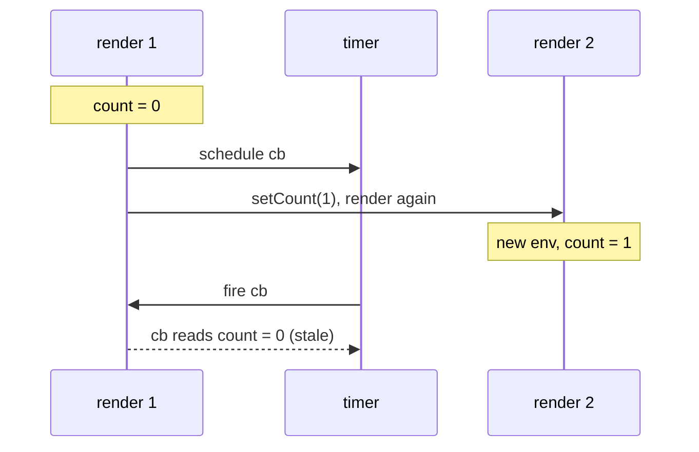

# Chapter 4: Closures

## 4.1 Definition and why interviewers ask it

**A closure is a function object together with the Lexical Environment it was created in. The function keeps a reference to that environment (its `[[Environment]]` internal slot), so it can read and write the variables that were in scope where it was *defined*, even after the outer function has returned and its execution context has been popped. A closure captures variables (bindings), not values.**

Closures are the most reliably reported JavaScript fundamentals topic (commonly reported). The questions come in four recurring shapes: "what is a closure", the `var` loop with `setTimeout` puzzle, "build a private counter", and "can closures cause memory leaks". Senior rounds add stale closures in React-style code and what a closure keeps alive in memory. The topic checks whether you can connect scope (Chapter 3), the call stack (Chapter 1) and the heap (Chapter 16) into one picture.

## 4.2 Core concept

### Plain language

When a function is created, it is handed a backpack containing a reference to the place it was born. Wherever the function travels (returned, stored, passed as a callback), the backpack goes with it. When the function later needs a name that is not its own, it looks in the backpack. The backpack holds the *actual variables*, not photocopies of their values, so if the owner changes a variable, the function sees the change, and if the function changes it, everyone else sees that too.

### Precise version

**How a closure comes into existence**

1. When a function object is created (a declaration is instantiated, or a function or arrow expression is evaluated), the engine stores the *currently running Lexical Environment* in the function's `[[Environment]]` internal slot.
2. When the function is called, the new function Environment Record gets `[[OuterEnv]] = F.[[Environment]]` (Chapter 3). The call site is irrelevant.
3. The outer function's execution context is popped when it returns. Its environment record is *not* freed, because the function object still points at it.

Strictly speaking every function object has an `[[Environment]]`, so every function is a closure. In interviews, "closure" means the useful case: an *inner function that uses variables of an outer scope and outlives it*.

**What is captured.** A closure captures **bindings** (named storage slots), not values.

| Situation | What the closure sees |
|---|---|
| The outer code reassigns the variable later | The new value (same binding) |
| The closure assigns to the variable | Everyone sharing the binding sees it |
| Two closures created in the same call | They share the same bindings |
| Two *calls* of the outer function | Separate bindings. The calls do not interfere |
| A value was passed as an **argument** | The *parameter binding* holds a copy of the value at call time. Later changes to the caller's variable are not seen |

**Typical uses**

| Use | Idea | Where in this book |
|---|---|---|
| Data privacy, module pattern | Variables reachable only through returned functions | Example 3 |
| Function factories | `makeMultiplier(3)` returns a configured function | Example 4 |
| Partial application, currying | Fix some arguments now, supply the rest later | Chapter 11 |
| Memoization | A cache hidden in the closure | Question 4.12, Chapter 14 |
| `once`, call limits | A flag hidden in the closure | Question 4.11 |
| Event handlers, callbacks, timers | The callback remembers the context it was registered in | Questions 4.6, 4.10 |
| Iterators, generators, state machines | Position or state kept between calls | Chapter 15 |
| Debounce and throttle | A timer id hidden in the closure | Chapter 13 |

**Loops.** `var i` is one binding for the whole function, so every closure created in the loop shares it and sees its final value. `let i` creates a fresh binding per iteration (Chapter 3), so each closure sees its own. Other fixes: wrap the body in an IIFE that receives `i` as an argument (the parameter is a new binding), pass an extra argument to `setTimeout(fn, delay, arg)`, or use `fn.bind(null, i)`.

**Stale closures.** A function created during one run of some code (a "render") keeps the bindings of *that* run. If the state is later replaced by new bindings (a later render), the old function still reads the old ones. This is not a React bug. It is closure semantics, and it shows up in any framework that re-runs a function to produce new closures each time.

**Memory.**

- A closure keeps its environment reachable. Anything reachable from it (through the bindings) stays alive as long as the closure itself is reachable.
- The specification only says the environment must stay *reachable*. How much of it an engine keeps is an implementation detail. In **V8**, variables that no inner function references live in registers or on the stack and are discarded on return. Variables referenced by at least one inner function are placed in a heap **context object**. All closures created in the same scope point at the **same** context object, and a closure keeps the whole context (and the chain of outer contexts) alive. So a long-lived closure that does not use `big` can still keep `big` alive if a *different*, possibly discarded, closure from the same scope did use it (Figure 4.4, Example 6). A direct `eval` inside the function makes engines treat every variable as possibly captured.
- Typical leaks: listeners and timers that are never removed, caches that only grow, callback arrays that accumulate, closures stored in long-lived objects.
- Fix: remove the listener, `clearInterval`, bound the cache, set the reference to `null` when done, or restructure so the long-lived closure is created in a scope that does not contain the large object (Question 4.10).

**Closures vs objects and classes.** Both bundle state with behaviour.

| | Closure (factory function) | Class instance |
|---|---|---|
| Privacy | True: no way to name the variable from outside | `#private` fields are also true privacy. `_name` is only a convention |
| Memory per instance | Each instance gets its own function objects | Methods are shared on the prototype |
| Inspection and debugging | State is invisible in `console.log` | State is visible |
| Inheritance, `instanceof` | Not built in | Built in (Chapter 6) |
| `this` problems | None, because nothing uses `this` | Detached methods lose `this` (Chapter 5) |

## 4.3 How it works internally

### A. Creating and calling a closure

1. `makeCounter()` is called. A function Environment Record is created with `count = 0`. A context is pushed.
2. Evaluating the arrow function `() => ++count` creates a function object with `[[Environment]]` set to that record (the current lexical environment).
3. `return` pops the context. The record is **not** destroyed: the returned function object is reachable from `next`, and it references the record.
4. `next()` creates a *new* call environment whose `[[OuterEnv]]` is that surviving record. `++count` resolves `count` along the chain, finds it one hop out, and updates the binding in place.
5. Calling `makeCounter()` again creates a different record, so a second counter starts from 0 independently.

### B. What keeps what alive

The garbage collector starts from roots (the stack, globals, the current microtask and timer queues) and marks everything reachable. A timer queue holds the callback, the callback holds `[[Environment]]`, the environment holds its bindings, and the bindings hold objects. Cut any link (clear the timer, drop the reference, remove the listener) and the rest becomes collectable. Chapter 16 covers mark-and-sweep and the generational heap.

### C. V8 context objects (implementation detail)

1. During parsing, V8 does scope analysis. For every variable it decides: stack or register (only the declaring function touches it), **context slot** (some inner function references it), or dynamic lookup (the function contains `eval` or `with`).
2. A scope with at least one context slot gets one heap-allocated context object at entry, holding exactly those slots. Its link to the outer context is the runtime form of `[[OuterEnv]]`.
3. Every closure created in that scope points to that one context. There is no per-closure selection of which slots to keep.
4. Context slots are not reclaimed one by one. They live as long as any closure that points at the context.

This is observable and is why the "unused variable kept alive by a sibling closure" pattern has been reported in V8 for years (see Sources). Treat it as behaviour of V8 today, not as a language rule.

### D. How stale closures arise

1. A function component runs. Its call environment holds `count = 0`. Closures created during this run (an effect callback, a timer callback) point at it.
2. State changes. The component runs *again*. This is a new call with a new environment holding `count = 1`.
3. The old callback still points at the first environment, where `count` will never change. When it eventually runs, it reads `0`.
4. Fixes: register a new callback whenever the value changes (dependency list), keep the latest value in a mutable cell that the callback reads (a ref), or use an updater function that receives the current value as an argument.

## 4.4 Diagrams

### Where the closure keeps its reference

```ascii After makeCounter() returned: the context is gone, the environment survives
 function makeCounter() {            CALL STACK             HEAP
   let count = 0;                   +-------------+
   return () => ++count;            | Global      |     +-------------------------+
 }                                  +-------------+     | FUNCTION OBJECT  next   |
 const next = makeCounter();        (makeCounter's      |  code: () => ++count    |
 next(); next();                     context was POPPED)|  [[Environment]] ---+   |
                                                        +---------------------+---+
 next --------------------------------------------------^                     |
 (a variable in the global                                                    v
  environment points here)                              +-------------------------+
                                                        | ENV RECORD of the       |
                                                        | makeCounter() call      |
                                                        |   count = 2             |
                                                        |   [[OuterEnv]] ---+     |
                                                        +-------------------+-----+
                                                                            v
                                                        +-------------------------+
                                                        | GLOBAL ENV              |
                                                        |   next = (function)     |
                                                        +-------------------------+
 Each makeCounter() call builds its own ENV RECORD: two counters never share count.
```

> **How to explain this to the interviewer**
>
> 1. Draw a stack with only `Global` on it and say: "`makeCounter` has returned, so its context is popped".
> 2. Draw a function object on the heap with an arrow labelled `[[Environment]]` to a box containing `count = 2`.
> 3. Say: "The box survives because the function still points at it. That arrow is the closure."
>
> **Takeaway:** a closure is a function plus a live pointer to its birth environment, and the pointer keeps that environment alive.

### `var` loop vs `let` loop

```ascii Closures created in a loop: one shared binding versus one binding per iteration
 for (var i = 0; i < 3; i++)             for (let i = 0; i < 3; i++)
   fns.push(() => i);                      fns.push(() => i);

 ONE binding for the whole loop          ONE BINDING PER ITERATION

 fns[0] --+                              fns[0] --> LOOP ENV  i = 0 --+
 fns[1] --+--> ENCLOSING ENV             fns[1] --> LOOP ENV  i = 1 --+--> ENCLOSING
 fns[2] --+      i = 3  (loop done)      fns[2] --> LOOP ENV  i = 2 --+     ENV

 called later: 3, 3, 3                   called later: 0, 1, 2
 (all read the same i)                   (each reads its own i)

 Fixes for var:  IIFE (function (n) {...})(i)   - n is a new binding per call
                 setTimeout(fn, 0, i)           - argument copied when scheduled
                 fn.bind(null, i)               - a bound argument is copied
```

> **How to explain this to the interviewer**
>
> 1. Draw three small function boxes on the left, and one environment box labelled `i` on the right. For `var`, draw all three arrows into that one box and write `i = 3` in it.
> 2. Redraw it with three environment boxes, `i = 0`, `i = 1`, `i = 2`, one arrow into each.
> 3. Say: "The loop ends before the callbacks run. With `var` they all read the final value. With `let` each iteration made its own variable."
>
> **Takeaway:** the difference is how many bindings exist, not when the callbacks run.

### Stale closure, step by step



> **How to explain this to the interviewer**
>
> 1. Draw two boxes, "render 1" and "render 2", each with its own `count` (0 and 1). Draw an arrow from a timer box to render 1 only.
> 2. Say: "The timer callback was created during render 1, so it points to render 1's environment."
> 3. Point at `count = 0` and say: "Render 2 made a new variable. It never touched the one this callback reads."
>
> **Takeaway:** each render creates new bindings, and a callback sees only the bindings of the render that created it.

### Closures from one scope share one context object (V8)

```ascii V8: both closures point at ONE context that holds every captured variable
 function build() {                            HEAP
   const big = new Array(1e6);
   const n = 1;                                 small  (function object)
   const useBig = () => big.length;    // 1       |  [[Environment]]
   const small  = () => n;             // 2       v
   return small;      // useBig is dropped   +---------------------+
 }                                            | CONTEXT of build()  |
                                              |   big = ----------->+--> [1e6 items]
 const f = build();                           |   n   = 1           |
                                              +---------------------+
 small never mentions big. But big was captured by useBig, so it lives in the
 shared context, and small keeps that whole context alive. Once useBig is gone,
 big is still reachable through small until small itself is dropped.
```

> **How to explain this to the interviewer**
>
> 1. Draw one context box with two slots, `big` and `n`, and two arrows into it from `useBig` and `small`.
> 2. Cross out `useBig` and say: "it is garbage, but the box it pointed at is still referenced by `small`".
> 3. Say: "That is an engine behaviour in V8, not in the language rules, but it is why a long-lived closure can retain data it never touches."
>
> **Takeaway:** a closure may keep alive more than it uses, because the engine keeps captured variables per scope, not per closure.

### Whiteboard version

```ascii Whiteboard version: what a closure is (draw in 90 seconds)
  STACK: [Global]    HEAP: fn --[[Environment]]--> { count: 2 } --outer--> Global
         (makeCounter popped)

  function = code + pointer to its birth environment
  captures VARIABLES (shared, live), not copies of values
  the environment lives as long as something points to it
```

## 4.5 Code examples

### Example 1: a closure outlives its outer function

```js
function makeCounter() {
  let count = 0;
  return () => ++count;
}
const a = makeCounter();
const b = makeCounter();
a();
a();
console.log(a(), b());
```

```text output
3 1
```

**Why:** each call to `makeCounter` creates its own environment with its own `count`. `a` and `b` point at different environments, so they count independently. Both environments outlived the call that created them.

### Example 2: closures capture variables, not values

```js
let language = 'JS';
const show = () => language;
language = 'TS';                       // reassigned after the closure was created

function pair() {
  let n = 0;
  return { inc: () => ++n, get: () => n };   // two closures, one shared binding
}
const p = pair();
p.inc();
p.inc();
console.log(show(), p.get());
```

```text output
TS 2
```

**Why:** `show` reads the binding `language`, so it sees the later assignment. `inc` and `get` were created in the same call, so they share one `n`.

### Example 3: data privacy with the module pattern

```js
function createAccount(initial) {
  let balance = initial;                 // private: nothing outside can name it
  return {
    deposit(amount) { balance += amount; return balance; },
    get balance() { return balance; },   // read-only view
  };
}
const acct = createAccount(100);
acct.deposit(50);
acct.balance = 0;                        // no setter: silently ignored in sloppy mode
console.log(acct.balance, Object.keys(acct));
```

```text output
150 [ 'deposit', 'balance' ]
```

**Why:** the only access to `balance` is through the two functions that closed over it. The accessor property has no setter, so the assignment does nothing (in strict mode it would throw `TypeError`). The variable cannot be reached from outside, unlike a `_balance` property.

### Example 4: function factory and partial application

```js
const multiplier = (factor) => (x) => x * factor;
const double = multiplier(2);
const triple = multiplier(3);

function partial(fn, ...preset) {
  return (...later) => fn(...preset, ...later);
}
const add3 = (a, b, c) => a + b + c;
console.log(double(5), triple(5), partial(add3, 1, 2)(10));
```

```text output
10 15 13
```

**Why:** `double` and `triple` close over different `factor` bindings. `partial` closes over `fn` and `preset`, so later calls supply only the remaining arguments (Chapter 11).

### Example 5: a stale closure, simulated without React

```js
// A miniature of useState / useRef / useEffect: one component, cells kept between renders.
const cells = [];
let cursor = 0;
let ui;                                           // the latest render result
const timers = [];                                // stands in for setTimeout callbacks

function useState(initial) {
  const k = cursor++;
  if (!(k in cells)) cells[k] = { value: initial };
  const cell = cells[k];
  const set = (next) => {
    cell.value = typeof next === 'function' ? next(cell.value) : next;
    render();
  };
  return [cell.value, set];
}
function useRef(initial) {
  const k = cursor++;
  if (!(k in cells)) cells[k] = { current: initial };
  return cells[k];
}
function useEffect(fn, deps) {
  const k = cursor++;
  const prev = cells[k];
  if (!prev || deps.some((d, i) => !Object.is(d, prev.deps[i]))) {
    cells[k] = { deps };
    fn();                                         // real React runs this after the render
  }
}

function Counter() {
  const [count, setCount] = useState(0);
  const latest = useRef(count);
  latest.current = count;                         // always the newest value
  useEffect(() => {
    // Runs once, during render 1. This arrow closes over THAT render's `count`.
    timers.push({
      stale: () => count,
      fresh: () => latest.current,
      bump: () => setCount((c) => c + 1),         // updater receives the current value
    });
  }, []);
  return { count, setCount };
}
function render() { cursor = 0; ui = Counter(); }

render();
ui.setCount(1);
ui.setCount(2);
const [t] = timers;
console.log('state', ui.count, '| stale', t.stale(), '| fresh', t.fresh());
t.bump();
console.log('after bump', ui.count, '| renders created callbacks:', timers.length);
```

```text output
state 2 | stale 0 | fresh 2
after bump 3 | renders created callbacks: 1
```

**Why:** the effect has an empty dependency list, so it ran only in render 1 and its arrow captured render 1's `count`, which is `0` forever. `fresh` reads a ref, which is one object shared by every render, so it sees `2`. `bump` passes an updater function, so it does not need to read `count` at all. Fixes: list `count` in the dependencies, use a ref, or use the updater form.

### Example 6: a closure can keep alive a variable it never uses (V8)

```js
// Node.js 22 / V8. This is engine behaviour, not a language guarantee.
const v8 = require('v8');
v8.setFlagsFromString('--expose-gc');                 // lets us call gc() below
const gc = require('vm').runInNewContext('gc');

function shared() {
  const big = { payload: new Array(10000).fill(0) };
  const probe = new WeakRef(big);                    // observes big, does not keep it
  const useBig = () => big.payload.length;           // mentions big
  const small = () => 'small';                       // does not mention big
  return { probe, small, useBig };
}
function separate() {
  const big = { payload: new Array(10000).fill(0) };
  const probe = new WeakRef(big);
  const small = () => 'small';                       // nobody mentions big
  return { probe, small };
}
async function bigSurvives(make) {
  let made = make();
  const { probe, small } = made;
  made = null;                                       // drop useBig, keep only small
  for (let i = 0; i < 2; i++) {
    await new Promise((r) => setTimeout(r, 0));      // let WeakRef targets be released
    gc();
  }
  return [probe.deref() !== undefined, small()];
}
(async () => {
  console.log('sibling closure used big:', await bigSurvives(shared));
  console.log('no closure used big:     ', await bigSurvives(separate));
})();
```

```text output
sibling closure used big: [ true, 'small' ]
no closure used big:      [ false, 'small' ]
```

**Why:** in the first case `big` is captured by `useBig`, so V8 stores it in the scope's shared context. `small` points at that context, so `big` stays alive after `useBig` is dropped. In the second case nothing captures `big`, so it stays in the stack frame and is collectable once `separate` returns. Do not rely on this for correctness. It explains memory profiles.

### Example 7: a listener leak and its fix

```js
const { EventEmitter } = require('events');
const bus = new EventEmitter();

function mountLeaky() {
  const bigCache = new Array(1e5).fill('x');
  bus.on('tick', () => bigCache.length);           // never removed: bigCache stays alive
}
function mountClean() {
  const bigCache = new Array(1e5).fill('x');
  const onTick = () => bigCache.length;
  bus.on('tick', onTick);
  return () => bus.off('tick', onTick);            // cleanup releases the closure
}

for (let i = 0; i < 3; i++) mountLeaky();
console.log('after 3 leaky mounts:', bus.listenerCount('tick'));
const unmounts = [mountClean(), mountClean(), mountClean()];
console.log('after 3 clean mounts:', bus.listenerCount('tick'));
unmounts.forEach((unmount) => unmount());
console.log('after 3 unmounts:    ', bus.listenerCount('tick'));
```

```text output
after 3 leaky mounts: 3
after 3 clean mounts: 6
after 3 unmounts:     3
```

**Why:** the emitter is long-lived and holds each listener, each listener holds its environment, and each environment holds a 100,000-item array. The three leaky ones can never be collected. The clean ones are removed by their cleanup function, which cuts the chain.

## 4.6 Common mistakes and gotchas

- **"A closure copies the variable's value."** It keeps a reference to the variable. Reassignments are visible (Example 2). Only function *arguments* are copied, into the parameter binding.
- **`var` in a loop with a callback.** All callbacks share one `i` and see its final value. Use `let`, an IIFE, or pass the value as an argument (Question 4.6).
- **Thinking `let` makes a copy in each iteration for free.** It creates a new binding per iteration and copies the current value into it. That works for the loop variable only. A `var` declared inside the loop body is still one shared binding (Question 4.8).
- **Stale closures in effects and timers.** A callback created in an earlier render reads that render's values. Fix with dependencies, refs, or updater functions (Question 4.9).
- **Believing closures always leak memory.** They only keep alive what they can reach, for as long as they are reachable. Long-lived holders (listeners, timers, caches, global arrays) are the real cause (Question 4.14).
- **Forgetting to clear what registers closures.** `setInterval` without `clearInterval`, `addEventListener` without `removeEventListener`, subscriptions without unsubscribe.
- **Retaining big objects by accident.** A closure may keep a sibling's large variable alive in V8 (Figure 4.4). Create the long-lived closure in a smaller scope, or set the large reference to `null` when done.
- **Unbounded memoization caches.** A `Map` hidden in a closure grows forever. Bound it (LRU) or use a `WeakMap` when keys are objects (Chapter 14).
- **Using `this` and assuming the closure captured it.** Only arrow functions capture `this` (lexically). A regular function inside a method gets its own `this` (Chapter 5).
- **Counting on `console.log` to show private state.** Closure variables do not appear on the object. Use the debugger's "Closure" scope entry to see them.

## 4.7 Quick revision cheat sheet

- **Closure = function object + `[[Environment]]`** (the lexical environment where it was created).
- It captures **variables (bindings), not values**. Reassignments are visible. Arguments are copied into parameters.
- The outer *context* is popped on return, but the *environment* survives while a closure references it.
- Closures from one call share bindings. Separate calls get separate bindings.
- **Loops:** `var` shares one `i` (prints the final value). `let` makes one binding per iteration. Old fixes: IIFE, `setTimeout(fn, 0, i)`, `bind`.
- **Uses:** privacy, factories, partial application, memoization, `once`, handlers, iterators.
- **Stale closure:** a callback keeps the bindings of the run that created it. Fix: dependencies, ref, or updater function.
- **Memory:** a closure keeps its environment (and what it reaches) alive. In V8, captured variables of one scope share one context, so a closure can retain a sibling's variable. Real leaks come from long-lived holders: listeners, timers, caches.

## 4.8 Interview questions

*Key: ★ = very frequently reported. "Typically asked in" lines say which round a question tends to appear in; where no single source could be pinned down the question is labelled "commonly reported". Draw-it hints refer to the figures in section 4.4 (Figures 4.1 to 4.5).*

#### Conceptual

### Q4.1 ★ Easy: What is a closure?

*Typically asked in: JavaScript fundamentals round, often the first question of the round (commonly reported).*

> **Model answer**
>
> A closure is a function bundled with the environment in which it was created. When I define a function inside another function, the inner function keeps a reference to the outer one's variables through its `[[Environment]]` slot. So after the outer function returns, the inner one can still read and update those variables, because the engine keeps that environment alive as long as the function is reachable. The classic example is a counter factory: `count` is private, and every call creates a separate `count`. Closures capture variables, not copies of values.

**Key points to mention**

- Function plus lexical environment (the `[[Environment]]` slot).
- Works after the outer function has returned.
- Captures variables, not values.
- Example: counter or private state.
- Draw it: Figure 4.1.

### Q4.2 Medium: How does a closure work internally? What exactly does it capture?

*Typically asked in: JavaScript fundamentals round, as the follow-up to "what is a closure" (commonly reported).*

> **Model answer**
>
> When the engine creates a function object, it stores the current lexical environment in the function's `[[Environment]]` slot. A later call builds a new environment whose outer link is that slot, so free variables resolve along the definition chain, not the call site. When the outer function returns, its context is popped, but the environment record is still referenced, so the garbage collector keeps it. The closure captures bindings, so reassignments show up. Two closures from the same call share bindings, and two calls produce separate ones.

**Key points to mention**

- `[[Environment]]` is set at creation. The call environment's `[[OuterEnv]]` comes from it.
- Context popped, environment survives.
- Bindings are shared and live (Example 2).
- Link to the scope chain (Chapter 3). Draw it: Figure 4.1.

### Q4.3 Easy: What are practical uses of closures?

*Typically asked in: JavaScript fundamentals round and machine-coding warm-ups (commonly reported).*

> **Model answer**
>
> Anywhere a function needs to remember something. Data privacy and the module pattern: state reachable only through returned functions. Function factories and partial application, like `multiplier(3)`. Memoization, with the cache hidden inside. `once` and call limits, where a flag lives in the closure. Event handlers, timers and callbacks that remember where they were registered. Iterators and state machines that keep position between calls. Debounce and throttle keep their timer id in a closure. Many library APIs and React hooks depend on this behaviour.

**Key points to mention**

- Give two or three concrete examples, not a list of names (counter, `once`, `debounce`).
- The common thread: private, per-instance state without a class.
- Mention the cost: memory held as long as the closure lives.

### Q4.4 Hard: What does a closure keep in memory? How does V8 store closed-over variables?

*Typically asked in: senior-leaning JavaScript rounds, memory and performance discussions (commonly reported).*

> **Model answer**
>
> A closure keeps its environment reachable, and everything reachable from it. In V8, the compiler analyses scopes. Variables no inner function touches live in registers or on the stack and vanish on return. Variables that some inner function references go into a heap context object for that scope. All closures created in that scope point at the same context, and a closure keeps the whole context alive. So a long-lived closure can retain a large variable that only a short-lived sibling used. That is engine behaviour, not a language rule, and it is why I split scopes or null out big references.

**Key points to mention**

- Only captured variables go into heap contexts. Others are on the stack.
- One context per scope, shared by all closures made there.
- Consequence: retention of variables a closure does not use. State it as V8 behaviour.
- `eval` forces conservative allocation.
- Draw it: Figure 4.4. Forward reference: Chapter 16.

### Q4.5 Medium: Closures versus classes or objects: when would you pick each?

*Typically asked in: design discussions and machine-coding rounds (commonly reported).*

> **Model answer**
>
> Both bundle state with behaviour. A closure gives true privacy without `this` problems and is the lightest way to hold small state, for example in a `once`, a debounce or a counter. But each instance creates its own function objects, state is invisible when debugging, and there is no inheritance or `instanceof`. A class shares methods on the prototype, so it is cheaper for many instances, is easier to inspect and extend, and `#private` fields now give real privacy too. I use closures for one-off helpers and classes for many similar objects.

**Key points to mention**

- Privacy: closures and `#private` both give real privacy. `_x` does not.
- Memory: per-instance functions vs shared prototype methods.
- Debugging and inheritance favour classes. `this` binding pitfalls favour closures.
- It is a trade-off, not a rule.

#### Output prediction

### Q4.6 ★ Medium: What does this print? (the loop and `setTimeout` classic, and its fixes)

*Typically asked in: JavaScript fundamentals round (commonly reported).*

```js
for (var i = 0; i < 3; i++) setTimeout(() => console.log('var', i), 0);
for (let j = 0; j < 3; j++) setTimeout(() => console.log('let', j), 0);
for (var k = 0; k < 3; k++) {
  (function (n) { setTimeout(() => console.log('iife', n), 0); })(k);
}
for (var m = 0; m < 3; m++) setTimeout((n) => console.log('arg', n), 0, m);
for (var p = 0; p < 3; p++) setTimeout(console.log.bind(console, 'bind', p), 0);
```

```text output
var 3
var 3
var 3
let 0
let 1
let 2
iife 0
iife 1
iife 2
arg 0
arg 1
arg 2
bind 0
bind 1
bind 2
```

```ascii Q4.6: the loop finishes first, then the timers run (all five loops)
  synchronous part:   5 loops schedule 15 callbacks      i = 3 when the loops end
  later (timers):     callbacks run in schedule order, after the stack is empty

  var loop     3 callbacks --> ONE shared i                     (reads 3, 3, 3)
  let loop     3 callbacks --> i = 0, i = 1, i = 2               (reads 0, 1, 2)
  IIFE loop    3 callbacks --> n = 0, n = 1, n = 2 (parameters)
  arg loop     3 callbacks --> argument copied at schedule time
  bind loop    3 callbacks --> bound argument copied at bind time
```

> **Model answer**
>
> The `var` loop prints `var 3` three times. The whole loop runs synchronously first, leaving `i` at 3, and the timer callbacks run later and all read that one shared `i`. The other four variants print `0 1 2` each. `let` gives each iteration its own binding. The IIFE passes `k` as an argument, creating a new parameter binding per call. `setTimeout`'s third argument and `bind` copy the value at schedule time. Output order follows scheduling order, since the delays are equal.

**Key points to mention**

- Callbacks run after the loop and after the current stack (event loop, Chapter 7).
- `var`: one shared binding. `let`: one per iteration.
- IIFE, `setTimeout` extra argument, `bind`: each copies the value into a new binding.
- Draw it: Figure 4.2 (above).

### Q4.7 ★ Easy: What does this print? (counter with private state and reset)

*Typically asked in: JavaScript fundamentals round (commonly reported).*

```js
function makeCounter(start = 0) {
  let count = start;
  return {
    inc: () => ++count,
    dec: () => --count,
    reset: () => { count = start; return count; },
  };
}
const a = makeCounter();
const b = makeCounter(10);
a.inc(); a.inc();
b.dec();
console.log(a.inc(), b.dec(), a.count);
a.reset();
console.log(a.inc(), b.inc());
```

```text output
3 8 undefined
1 9
```

> **Model answer**
>
> `3 8 undefined`, then `1 9`. Each call to `makeCounter` creates its own environment with its own `count`, so `a` and `b` never interfere. `a` incremented three times in total, giving 3. `b` started at 10 and decremented twice, giving 8. `a.count` is `undefined` because `count` is a variable, not a property, and is reachable only through the three methods. `reset` writes the shared binding back to `start`, so the next `a.inc()` is 1, and `b` continues from 8 to 9.

**Key points to mention**

- Separate environment per call, shared by the methods of that one call.
- Privacy: `a.count` is `undefined`.
- `reset` closes over `start` as well as `count`.
- Draw it: Figure 4.1, twice.

### Q4.8 Hard: What does this print? (closures with hoisting and shadowing)

*Typically asked in: JavaScript fundamentals round, as a harder puzzle (commonly reported).*

```js
var tag = 'global';
function outer() {
  const early = () => tag;          // which tag?
  var tag = 'outer';
  const makeLate = () => { const tag = 'late'; return () => tag; };
  return [early, makeLate()];
}
const [early, late] = outer();
tag = 'changed';
console.log(early(), late(), tag);

const fns = [];
for (var i = 0; i < 2; i++) {
  var v = i * 10;                   // var inside the loop body
  fns.push(() => v);
}
console.log(fns.map((f) => f()));
```

```text output
outer late changed
[ 10, 10 ]
```

> **Model answer**
>
> `outer late changed`, then `[10, 10]`. Inside `outer`, `var tag` is hoisted to the top of the function, so `early` closes over `outer`'s own `tag`, not the global one, and by the time it runs the value is `'outer'`. The later `tag = 'changed'` touches only the global. `late` closes over the block-local `const`. In the loop, `var v` belongs to the enclosing scope, so there is only one `v`. It ends as 10 and both closures read it. Only the `let` loop variable gets a binding per iteration, not variables declared inside the body with `var`.

**Key points to mention**

- Hoisting decides *which* binding a closure resolves to (the function's own `var`).
- Shadowing: the nearest definition in the chain wins.
- `var` in a loop body is shared. `let` or `const` in the body is new per iteration.
- If `early()` were called before `var tag = 'outer'` ran, it would return `undefined`.

### Q4.9 Hard: What does this print? (stale closure)

*Typically asked in: React and frontend rounds, also as a plain-JavaScript puzzle (commonly reported).*

```js
const callbacks = [];
function render(count) {
  const log = () => console.log('count is', count);
  callbacks.push(log);
  return { next: () => render(count + 1) };
}
const ui = render(0);
ui.next().next();
callbacks[0]();
callbacks[2]();
```

```text output
count is 0
count is 2
```

> **Model answer**
>
> `count is 0`, then `count is 2`. Each `render` call has its own environment with its own `count`, and each `log` closes over the one from its own call. `callbacks[0]` was created in the render where `count` was 0, so it stays 0 forever, even though later renders have moved on. That is a stale closure. React state works like this: every render is a new function call, and an effect or timer callback captured in an old render sees that render's state. I fix it with dependencies, a ref that always holds the latest value, or an updater function.

**Key points to mention**

- Each call, each render: a new environment.
- Old callbacks keep old bindings, which never change.
- Fixes: dependency arrays, refs (`latest.current`), functional updates.
- Also see the full hook simulation (Example 5). Draw it: Figure 4.3.

### Q4.10 Medium: What does this print, and what is wrong with it? (a closure memory leak)

*Typically asked in: senior-leaning rounds and performance discussions (commonly reported).*

```js
const { EventEmitter } = require('events');
const bus = new EventEmitter();
function mount() {
  const data = new Array(1e5).fill('x');
  bus.on('tick', () => data.length);
}
mount(); mount(); mount();
console.log(bus.listenerCount('tick'));
```

```text output
3
```

> **Model answer**
>
> It prints `3`, and that is the problem. Every `mount` registers a listener and never removes it. The emitter lives for the whole process, so it holds each listener, each listener holds its environment, and that holds a 100,000-item array. None of it can be collected, and repeated mounting grows memory without bound. The fix is to return an unsubscribe function and call it on unmount, or use an `AbortSignal` with `addEventListener`. I confirm with a heap snapshot comparison. Same pattern: `setInterval` never cleared, and a cache that only grows.

**Key points to mention**

- The leak is the long-lived holder (emitter, timer, global), not closures in themselves.
- Chain: holder, listener, environment, big data.
- Remedies: `off`/`removeEventListener`, `AbortController`, `clearInterval`, bounded caches, `WeakRef`/`WeakMap`.
- How to find it: heap snapshots comparison (Chapter 16).

#### Implement it yourself

### Q4.11 ★ Medium: Implement `once(fn)` and a function that can be called at most `n` times.

*Typically asked in: machine-coding and JavaScript rounds (commonly reported).*

**Problem.** `once(fn)` returns a function that runs `fn` only on the first call and returns the same result on every later call. Generalise it: `limit(n, fn)` runs `fn` for the first `n` calls, then keeps returning the last result.

**Solution.**

```js
function limit(n, fn) {
  let calls = 0;
  let last;
  let target = fn;                       // released after the last allowed call
  return function limited(...args) {
    if (calls < n) {
      calls++;
      last = target.apply(this, args);
      if (calls === n) target = null;    // let fn (and what it closes over) be collected
    }
    return last;
  };
}
const once = (fn) => limit(1, fn);

let initCount = 0;
const init = once(() => { initCount++; return 'ready'; });
console.log(init(), init(), init(), initCount);

const firstTwo = limit(2, (x) => x * 10);
console.log(firstTwo(1), firstTwo(2), firstTwo(3), firstTwo(4));

const obj = { base: 5, add: limit(1, function (x) { return this.base + x; }) };
console.log(obj.add(1), obj.add(100));
```

```text output
ready ready ready 1
10 20 20 20
6 6
```

> **Model answer**
>
> I keep a call counter, the last result and the function in a closure. The returned wrapper checks the counter. While it is below `n`, it increments it, calls `fn` with the original `this` and arguments, and stores the result. After that it just returns the stored result. `once` is `limit(1, fn)`. I increment before calling, so a re-entrant call from inside `fn` cannot run it twice. After the last allowed call I drop the reference to `fn` so it can be collected. Each wrapper has its own counter. Everything is O(1) per call.

**Key points to mention**

- State (`calls`, `last`) lives in the closure, one set per wrapper.
- Preserve `this` and arguments (`apply`, rest parameters).
- Decide and state what happens if `fn` throws. Here the attempt counts, and later calls return the previous result. Retry-on-failure is the alternative.
- Increment before the call to be re-entrancy safe.
- Releasing `fn` after the last call is optional but shows memory awareness.

### Q4.12 Medium: Implement `memoize(fn)`.

*Typically asked in: machine-coding and JavaScript rounds (commonly reported).*

**Problem.** Write `memoize` so repeated calls with the same arguments return a cached result without calling `fn` again.

**Solution.**

```js
function memoize(fn) {
  const cache = new Map();                   // lives in the closure
  return function memoized(...args) {
    const key = args.length === 1 ? args[0] : JSON.stringify(args);
    if (cache.has(key)) return cache.get(key);
    const result = fn.apply(this, args);
    cache.set(key, result);
    return result;
  };
}

let calls = 0;
const slowSquare = (n) => { calls++; return n * n; };
const fastSquare = memoize(slowSquare);
console.log(fastSquare(9), fastSquare(9), fastSquare(9), calls);

const add = memoize((a, b) => { calls++; return a + b; });
console.log(add(1, 2), add(1, 2), add(2, 1), calls);

const fib = memoize((n) => (n < 2 ? n : fib(n - 1) + fib(n - 2)));
console.log(fib(50));
```

```text output
81 81 81 1
3 3 3 3
12586269025
```

> **Model answer**
>
> The cache is a `Map` inside the closure, so it is private and each memoized function has its own. The wrapper builds a key from the arguments, returns the cached value on a hit, and otherwise calls `fn`, stores the result and returns it. The first calls prove it: `slowSquare` ran once, not three times. Recursion works because the recursive call goes through the memoized name. Weak points: `JSON.stringify` keys fail for functions, `undefined`, or objects with different key order, and the cache grows forever, so for long-lived functions I add an LRU limit or a `WeakMap` keyed by object arguments.

**Key points to mention**

- Private cache in the closure.
- Key design: single primitive argument as is, otherwise a serialised key. State the limitations.
- Only valid for pure functions (Chapter 14).
- Unbounded growth is a memory leak. Mitigate with LRU, TTL or `WeakMap`.
- Complexity: O(1) average per hit, plus the key cost.

#### Follow-up traps

### Q4.13 ★ Medium: "A closure copies the value of the variable when it is created, right?"

*Typically asked in: follow-up after "what is a closure" (commonly reported).*

```js
let price = 10;
const read = () => price;
price = 20;

const cart = { total: 1 };
const readTotal = () => cart.total;
cart.total = 2;

function snapshot(value) { return () => value; }   // value is a parameter: a copy
let current = 1;
const frozen = snapshot(current);
current = 2;
console.log(read(), readTotal(), frozen());
```

```text output
20 2 1
```

> **Model answer**
>
> No. A closure keeps a reference to the variable itself. `read` sees `20` because `price` was reassigned after the closure was created, and `readTotal` sees the mutated object. The only copy happens when a value is passed as an argument: `snapshot(current)` copies `1` into the parameter `value`, and the closure captures that parameter, not `current`. So `frozen()` stays `1`. If I want a snapshot, I copy into a new binding, either through a parameter or a `const` inside the loop body. If I want live behaviour, I capture the variable.

**Key points to mention**

- Captured: the binding. Reassignment and mutation are both visible.
- Arguments are copied into parameter bindings, which the closure may then capture.
- A new binding per iteration (`let`/`const` in the body) is the snapshot technique.
- Same answer for "what does it see if the variable is reassigned later?": the latest value.

### Q4.14 Medium: "Do closures cause memory leaks?"

*Typically asked in: follow-up after the closure definition, in senior rounds (commonly reported).*

> **Model answer**
>
> Not by themselves. A closure keeps its environment alive only while the closure is reachable, and once nothing references it, the garbage collector frees both. Leaks happen when something long-lived keeps a closure reachable: a listener that is never removed, an interval that is never cleared, a cache that only grows, or a global array of callbacks. Then everything in the closure's environment stays too, and in V8 that can include variables the closure never uses, because sibling closures share a context. The fix is to release the holder: remove, clear, bound, or set to `null`.

**Key points to mention**

- Leak = unintended reachability from a long-lived root.
- Typical holders: listeners, timers, caches, globals.
- V8 shared context can retain unused sibling variables (state as V8 behaviour).
- Tools: heap snapshots and the allocation timeline in DevTools.

### Q4.15 Easy: "Is every function a closure?"

*Typically asked in: follow-up trap after the closure definition (commonly reported).*

> **Model answer**
>
> Technically yes. Every function object gets an `[[Environment]]` when it is created, even a top-level function whose environment is the global one. In practice people use the word for functions that use variables from an enclosing function scope and run after that scope has finished, because that is the case where it matters. A function that uses only its own parameters and globals is still a closure by the spec, but there is nothing interesting to keep alive. Engines also avoid allocating environments for variables that nothing captures, so a closure that captures nothing costs almost nothing.

**Key points to mention**

- Spec view: all functions have `[[Environment]]`.
- Interview view: inner function using outer variables, outliving them.
- Engines allocate heap contexts only for captured variables (V8).
- Do not over-claim: say which definition you are using.

#### Sources and further reading

- ECMAScript specification: `OrdinaryFunctionCreate` and the `[[Environment]]` internal slot, `NewFunctionEnvironment`, `CreatePerIterationEnvironment`: <https://tc39.es/ecma262/>
- MDN, "Closures": <https://developer.mozilla.org/en-US/docs/Web/JavaScript/Closures>
- javascript.info, "Variable scope, closure": <https://javascript.info/closure>
- MDN, `WeakRef` (used in Example 6 to observe collection): <https://developer.mozilla.org/en-US/docs/Web/JavaScript/Reference/Global_Objects/WeakRef>
- Kyle Simpson, *You Don't Know JS Yet: Scope & Closures* (the chapter on closure).
- V8 retention of unused variables: the Chromium issue "Memory leak via unused context slots" <https://issues.chromium.org/issues/42210841> and the Stack Overflow question "How does this js code leak memory?" <https://stackoverflow.com/questions/40651400/how-does-this-js-code-leak-memory>. Only the search-result excerpts of these two pages were readable in this session. The behaviour was also reproduced in Node.js 22 (Example 6).
- Stale closures in hooks: TkDodo, "Hooks, Dependencies and Stale Closures" <https://tkdodo.eu/blog/hooks-dependencies-and-stale-closures> (search-result excerpt only).
- Frequency evidence (search-result excerpts only, because the pages themselves returned HTTP 403): dev.to, "JavaScript Interview Questions for Senior Developers in 2026" (closures in loops, memory climbing) <https://dev.to/kirandeepjassalcrypto/javascript-interview-questions-for-senior-developers-in-2026-closures-the-event-loop-prototypes-503m>; PracHub, "JavaScript Closure Interview Questions: Stale State, Retained Memory, and Loop Captures" <https://prachub.com/resources/javascript-closure-interview-questions-stale-state-retained-memory-and-loop-captures>; OpenReplay, "10 JS Interview Questions and What They're Really Testing" <https://blog.openreplay.com/10-js-interview-questions-testing/>. Question wording in this book is original.
