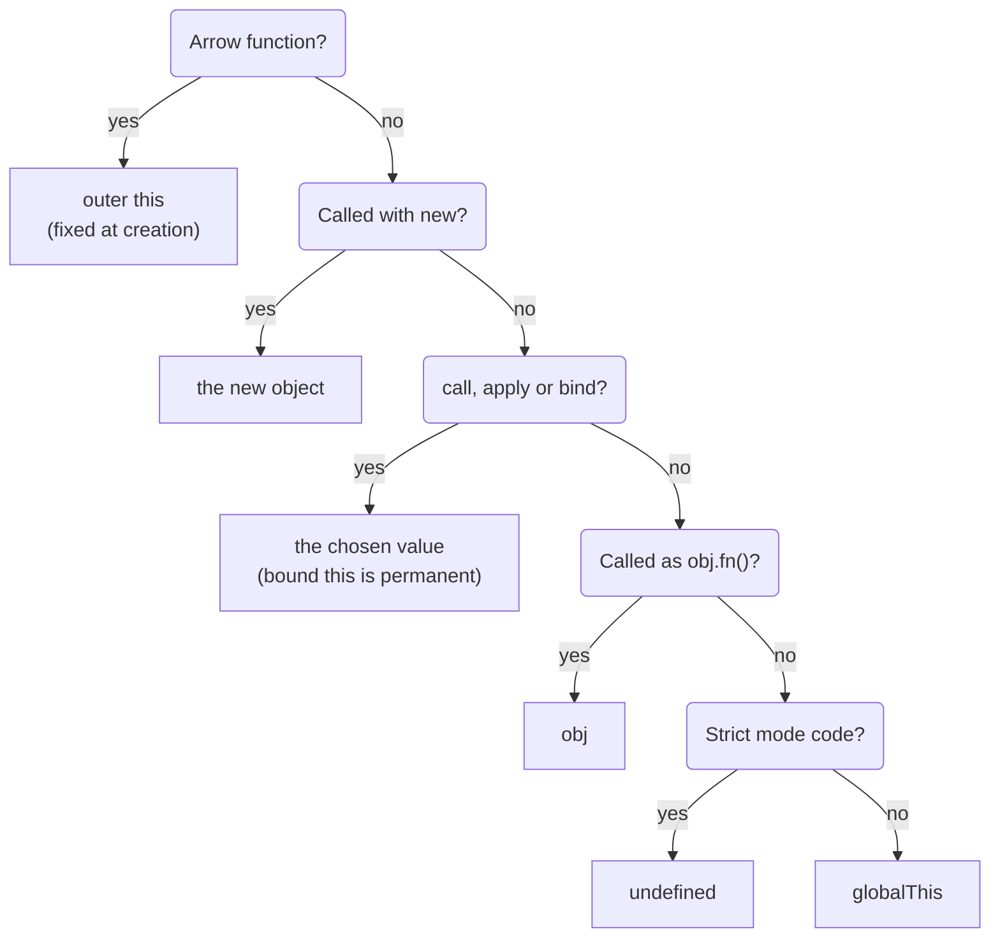
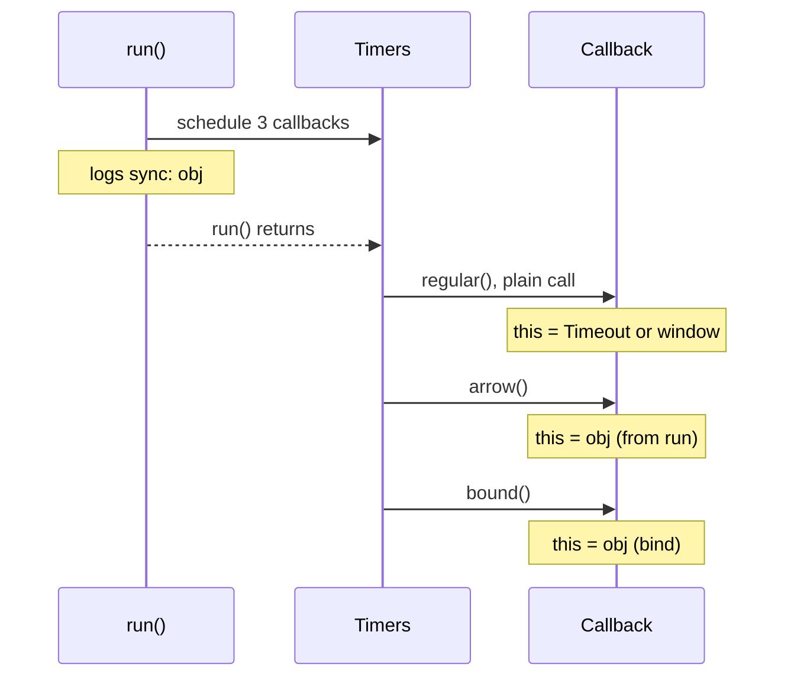

# Chapter 5: The this Keyword & Binding Rules

## 5.1 Definition and why interviewers ask it

**`this` is a per-call value that the engine binds when a function is invoked. Its value is decided by how the function is called (the call site), not by where the function is written. Arrow functions are the exception: they have no `this` of their own and read it from the enclosing scope.**

`this` is one of the most reliably reported topics in JavaScript-fundamentals rounds (commonly reported). It appears in three forms: the "explain `this`" opener, output-prediction snippets (extracted methods, `setTimeout` callbacks, arrow functions inside object literals), and the machine-coding or polyfill round, where you are asked to write `call`, `apply` and `bind` yourself. The topic separates candidates who memorised "`this` is the object before the dot" from those who can explain the rule that sits underneath it and predict the surprising cases.

## 5.2 Core concept

### Plain language

Think of `this` as the answer to "who called me?". A receptionist answers the phone the same way every time, but the person on the other end changes: "Hello, this is Ada's office" when Ada's assistant transfers the call, "Hello, who is this?" when someone dials the number directly. The function body is the receptionist's script. The call decides who `this` refers to. An arrow function is a script with a name badge sewn on: it always uses the identity of the office it was written in, whoever phones.

### Precise version

**Four binding rules plus the arrow exception.** For an ordinary function, the engine checks the call site in this order:

| Priority | Rule | Call-site shape | `this` |
|---|---|---|---|
| 1 | `new` binding | `new F()` | the newly created object (unless `F` returns another object) |
| 2 | Explicit binding | `f.call(x)`, `f.apply(x)`, `f.bind(x)()` | `x` (a bound `this` is permanent) |
| 3 | Implicit binding | `obj.f()`, `obj['f']()`, `(obj.f)()` | `obj`, the base of the property reference |
| 4 | Default binding | `f()` | `undefined` in strict code, `globalThis` in sloppy code |
| n/a | Arrow function | any call form | none of its own: the value of `this` where the arrow was created |

Arrow functions sit outside the ranking. No call form changes their `this`, and `new` on an arrow throws `TypeError`.

**Strict versus sloppy mode.** In sloppy mode, a `this` of `null` or `undefined` is replaced by `globalThis`, and a primitive is wrapped (`5` becomes a `Number` object). In strict mode the value is passed through unchanged. Class bodies, ES modules and any code with `'use strict'` are strict.

**The mechanism: a call through a Reference.** The specification evaluates the callee expression to a *Reference Record* with a base and a name before it reads the function out. `obj.fn` yields a reference with `[[Base]]` = `obj` and `[[ReferencedName]]` = `"fn"`. When the call happens, if the callee is a property reference, `thisValue` is that base. Anything that turns the reference into a plain value first (`(0, obj.fn)`, assignment, storing in a variable) removes the base, so `thisValue` becomes `undefined`.

| Callee expression | Reference base | `this` (strict code) |
|---|---|---|
| `obj.fn()` | `obj` | `obj` |
| `(obj.fn)()` | `obj` (parentheses keep the reference) | `obj` |
| `obj?.fn()` and `obj.fn?.()` | `obj` | `obj` |
| `(0, obj.fn)()` | none (comma operator calls `GetValue`) | `undefined` |
| `(obj.fn = obj.fn)()` | none (assignment yields a value) | `undefined` |
| `const f = obj.fn; f()` | an environment record (the variable `f`) | `undefined` |

**Where `this` is read from.** A `this` expression asks the nearest environment that *has a this binding*: a non-arrow function's environment, the global environment, or a module environment. An arrow function's environment says "no this binding", so the lookup continues outward. That is what "lexical `this`" means, and why `call`, `apply` and `bind` cannot change it.

**`bind` creates a new function.** A bound function is an exotic object that stores the target, a `[[BoundThis]]` and optional preset arguments. Calling it calls the target with the stored `this`. Calling it with `new` ignores the stored `this` and constructs the target.

**Other places `this` appears.**

| Context | `this` |
|---|---|
| Classic script, top level | `globalThis` (`window` in a browser) |
| ES module, top level | `undefined` |
| Node.js CommonJS file, top level | `module.exports` (the module wrapper calls your code with it) |
| Class method called as `obj.m()` | `obj` (methods are **not** auto-bound) |
| Static method `Cls.make()` | `Cls` |
| Getter or setter | the object the property was accessed on (the receiver), which can be an inheriting object |
| DOM event handler (non-arrow function) | `event.currentTarget`, the element the listener is attached to |
| `setTimeout` callback (non-arrow) | `window` in browsers, a `Timeout` object in Node.js |
| `arr.forEach(fn, thisArg)` and similar | `thisArg` |
| Derived-class constructor before `super()` | not initialised: touching `this` throws `ReferenceError` |

## 5.3 How it works internally

### A. An ordinary call, `obj.fn(1, 2)`

1. The engine evaluates the callee `obj.fn`. Because it is a property access, the result is a **Reference Record** `{ [[Base]]: obj, [[ReferencedName]]: "fn" }`, not yet a function.
2. `EvaluateCall` reads the function out of the reference (`GetValue`) and decides `thisValue`: if the reference is a property reference, `thisValue` is its base. If the base is an environment record (a plain identifier call like `fn()`), `thisValue` is `undefined`.
3. The arguments are evaluated and `Call(func, thisValue, args)` runs.
4. `[[Call]]` creates a function environment record and a new execution context (Chapter 1) and pushes it.
5. `OrdinaryCallBindThis` decides what to store as `[[ThisValue]]`:
   - arrow function (lexical `thisMode`): store nothing;
   - strict function: store `thisValue` unchanged;
   - sloppy function: `null` or `undefined` become `globalThis`, other primitives go through `ToObject`.
6. The body runs. Every `this` expression performs `ResolveThisBinding`: starting at the current environment, walk outward until an environment reports that it has a this binding, then read `[[ThisValue]]` from it.

### B. `call`, `apply` and `bind`

- `f.call(x, a, b)` is `Call(f, x, [a, b])`: it skips step 1 and supplies `thisValue` directly. The boxing in step 5 still happens inside `f`, so the callee's strictness decides what it sees.
- `f.apply(x, list)` is the same with the arguments taken from an array or array-like.
- `f.bind(x, a)` returns a **bound function exotic object**. Its `[[Call]]` ignores whatever `thisValue` it receives and calls `Call(target, boundThis, [...boundArgs, ...args])`. Its `[[Construct]]` calls `Construct(target, [...boundArgs, ...args], newTarget)`, where `newTarget` is the target itself if `new` was applied directly to the bound function.
- Binding a bound function again creates a bound function whose target is the first bound function. The innermost `[[BoundThis]]` is the one that reaches the real function, so the first `bind` wins.

### C. `new F(args)`

1. `F.[[Construct]]` is called with `newTarget` = `F`.
2. For an ordinary (base) constructor, the engine creates an empty object whose `[[Prototype]]` is `newTarget.prototype` and uses it as `this` (Chapter 6 covers the steps).
3. The body runs with that `this`.
4. If the body returns an object, that object is the result. Otherwise the new object is.

For a derived class, the object is created by the *base* constructor and `this` stays uninitialised until `super(...)` returns.

### D. Classes, getters, modules

- Class bodies are strict, so an extracted method gets `undefined`, not `globalThis`.
- A getter is called with the receiver: `Reflect.get(target, key, receiver)` uses `receiver` as `this`. That is why an inherited getter sees the inheriting object.
- A CommonJS file is compiled into a function and called with `this` = `module.exports`. An ES module's top-level code is evaluated with `this` = `undefined`.
- A generator function or `async` function gets `this` exactly like any other function, at call time. After an `await`, the saved context resumes with the same `[[ThisValue]]`.

### E. Browser callbacks

When the browser invokes a listener registered with `addEventListener`, it calls it with `this` set to the `currentTarget`. For `setTimeout` the HTML specification passes the `Window` object (or worker global) as `this`. Node.js instead calls the timer callback with the `Timeout` object. Arrow functions ignore all of this.

## 5.4 Diagrams

### Decision flow: how was the function called?



> **How to explain this to the interviewer**
>
> 1. Draw the first diamond, "Arrow function?", and say: "arrows opt out of the whole ranking, so I check them first".
> 2. Walk down the "no" arrows: `new`, then `call`/`apply`/`bind`, then `obj.fn()`, and say that the order is the precedence.
> 3. End at the strict versus sloppy split and say: "this is the plain `f()` case, the one that loses `this`".
>
> **Takeaway:** read the call site, not the function body.

### The Reference behind `obj.fn()`

```ascii The callee is a Reference (base + name); the call takes this from the base
 obj.fn(1, 2)
     |  evaluate the callee expression
     v
 +----------------------------+   GetValue(ref)    +-----------------------+
 | Reference Record           |------------------->| the function object   |
 |  [[Base]]            obj   |                    +-----------+-----------+
 |  [[ReferencedName]]  "fn"  |                                |
 +-------------+--------------+                                | Call(func,
               |  property reference, so                       |   thisValue,
               |  thisValue = [[Base]]                         |   args)
               +-----------------------------------------------+
                                       |
                                       v
                          fn runs with  this = obj

 What the callee expression produces, and the resulting this (strict code):
 +-------------------------+----------------------------------+--------------+
 | call form               | callee value                     | this         |
 +-------------------------+----------------------------------+--------------+
 | obj.fn()                | Reference { obj, "fn" }          | obj          |
 | (obj.fn)()              | same Reference (parens keep it)  | obj          |
 | (0, obj.fn)()           | plain function value             | undefined    |
 | (obj.fn = obj.fn)()     | plain function value             | undefined    |
 | const f = obj.fn; f()   | Reference { <environment>, "f" } | undefined    |
 +-------------------------+----------------------------------+--------------+
```

> **How to explain this to the interviewer**
>
> 1. Draw the box with two fields, base and name, under `obj.fn(...)`. Say: "before the function is called, the engine holds a pair, not a function".
> 2. Draw the arrow from the base to the call and write `this = obj`.
> 3. Point at the table rows with `undefined` and say: "each of these turns the pair into a plain value first, so the base is gone".
>
> **Takeaway:** `this` is the base of the reference at the moment of the call. Anything that separates the function from the reference loses it.

### What `bind` creates

```ascii A bound function stores the target, this and preset arguments
 const bound = target.bind(ctx, 1);

 +----------------------------------+
 | BOUND FUNCTION (exotic object)   |     bound(2)
 |  [[BoundTargetFunction]] target  |-------------------> target runs with
 |  [[BoundThis]]           ctx     |                      this = ctx  (fixed)
 |  [[BoundArguments]]      [1]     |                      args = 1, 2
 |  (no own `prototype`)            |
 |                                  |     new bound(2)
 |                                  |-------------------> Construct(target, [1, 2])
 +----------------------------------+                      this = NEW object
                                                           [[BoundThis]] ignored
   bound.call(other) and bound.bind(other) cannot replace [[BoundThis]]
```

> **How to explain this to the interviewer**
>
> 1. Draw one box for the bound function with three fields: target, `this`, preset arguments.
> 2. Draw two arrows out of it: an ordinary call that uses the stored `this`, and a `new` call that ignores it.
> 3. Say: "`call` on a bound function only changes the arguments. The stored `this` always wins".
>
> **Takeaway:** `bind` freezes `this` for calls, and `new` is the only thing that overrides it.

### How an arrow function finds `this`

```ascii Arrow functions have no this binding: the lookup walks outward
 const obj = {
   name: 'Ada',
   start() { return () => this.name; },   // arrow is created while start() runs
 };
 const getName = obj.start();             // start called with this = obj
 getName.call({ name: 'Bob' });           // 'Ada': call cannot change an arrow

 ENVIRONMENT RECORDS
 +-------------------------------+            +-------------------------------+
 | arrow's function environment  |            | start()'s function environment|
 |  HasThisBinding() = false     |--[[Outer]]>|  HasThisBinding() = true      |
 |  (no [[ThisValue]] stored)    |            |  [[ThisValue]] = obj          |
 +-------------------------------+            +-------------------------------+
   `this` in the arrow: ask own environment, "no this here", move outward,
   find start()'s environment, read obj. The call-site arguments are never used.
```

> **How to explain this to the interviewer**
>
> 1. Draw two boxes: the arrow's environment on the left, the enclosing method's environment on the right, and an outer arrow between them.
> 2. Write `this = obj` only in the right box. Leave the left box without a `this`.
> 3. Trace the lookup with your finger from left to right and say: "the arrow borrows, it never owns".
>
> **Takeaway:** an arrow's `this` is whatever `this` was in the scope where the arrow was created.

### Whiteboard version

```ascii Whiteboard version: call form decides this (draw in under 2 minutes)
   how it is called              this is
 +-----------------------------+------------------------------+
 | new F()                     | the new object               |
 | f.call(x)  f.apply(x)  bind | x (bind: permanent)          |
 | obj.f()                     | obj  (the thing before .f)   |
 | f()                         | undefined | globalThis       |
 | () => {}                    | outer this (call is ignored) |
 +-----------------------------+------------------------------+
   precedence: new > explicit > implicit > default; arrows ignore all four
```

## 5.5 Code examples

### Example 1: one function, several call forms

```js
'use strict';
function who() { return this === undefined ? 'undefined' : this.name; }
const obj = { name: 'obj', who };

console.log(obj.who(), obj['who'](), (obj.who)());
console.log((0, obj.who)(), (obj.who = obj.who)());
const extracted = obj.who;
console.log(extracted());
console.log(obj?.who(), obj.who?.());
```

```text output
obj obj obj
undefined undefined
undefined
obj obj
```

**Why:** the first line keeps the reference (bracket access and parentheses do not break it). The second line turns the reference into a plain value with the comma operator and with assignment. The third is a call through a variable, so there is no base. Optional chaining keeps the base.

### Example 2: default binding and boxing, sloppy versus strict

```js
function sloppy() { return this === globalThis; }
function strict() { 'use strict'; return this; }
console.log(sloppy(), strict());

function sloppyType() { return typeof this; }
function strictType() { 'use strict'; return typeof this; }
console.log(sloppyType.call(5), strictType.call(5));
console.log(sloppy.call(null), strict.call(null), strict.call(undefined));
```

```text output
true undefined
object number
true null undefined
```

**Why:** a sloppy function turns `null` or `undefined` into `globalThis` and wraps primitives in objects. A strict function sees exactly what the caller passed, so `strict.call(null)` is `null`.

### Example 3: arrow functions take `this` from where they are created

```js
const user = {
  name: 'Ada',
  regular() { return this.name; },
  arrow: () => typeof this.name,            // this = module.exports in Node.js
  later() { return [1].map(() => this.name)[0]; },
  laterRegular() { return [1].map(function () { return this === globalThis; })[0]; },
};
console.log(user.regular(), user.arrow(), user.later(), user.laterRegular());

const arrow = () => this;
console.log(arrow.call({ x: 1 }) === module.exports);
```

```text output
Ada undefined Ada true
true
```

**Why:** the arrow in the literal does not see `user`. An object literal is not a scope, so its `this` is the module's `this`, `module.exports` (an empty object), and `.name` is `undefined`. The arrow inside `later` is created while `later` runs with `this = user`. The callback of `laterRegular` is a plain call, so it falls to `globalThis`. `call` has no effect on an arrow.

### Example 4: `bind` is permanent, and `new` is the only override

```js
function show() { return this.id; }
const a = { id: 'A' };
const b = { id: 'B' };
const boundA = show.bind(a);
console.log(boundA(), boundA.call(b), show.bind(a).bind(b)());

function Point(x, y) { this.x = x; this.y = y; }
const BoundPoint = Point.bind({ ignored: true }, 1);
const p = new BoundPoint(2);
console.log(p.x, p.y, p instanceof Point, 'prototype' in BoundPoint);
console.log(BoundPoint.name, BoundPoint.length);
```

```text output
A A A
1 2 true false
bound Point 1
```

**Why:** the bound `this` survives `call` and a second `bind`. With `new`, the stored `this` is ignored and a fresh object is built from `Point` with the preset first argument. The bound function has no `prototype` of its own and its name is prefixed with `bound `. Its `length` is the target's minus the preset arguments.

### Example 5: class methods are not auto-bound

```js
class Counter {
  count = 0;
  inc() { this.count++; return this.count; }
  incArrow = () => { this.count++; return this.count; };
}
const c = new Counter();
const { inc, incArrow } = c;
try { inc(); } catch (e) { console.log(e.name + ': ' + e.message); }
console.log(incArrow(), incArrow.call({ count: 100 }), c.count);
console.log(Object.hasOwn(c, 'inc'), Object.hasOwn(c, 'incArrow'));
```

```text output
TypeError: Cannot read properties of undefined (reading 'count')
1 2 2
false true
```

**Why:** class code is strict, so a plain call gives `this = undefined`. The field arrow captured the instance when the constructor ran, so extraction and `call` do not matter. The cost is one new function object per instance, while `inc` lives once on the prototype.

### Example 6: getters, setters and static methods follow the receiver

```js
const base = {
  first: 'Ada',
  last: 'Lovelace',
  get full() { return this.first + ' ' + this.last; },
  set full(v) { [this.first, this.last] = v.split(' '); },
};
const child = Object.create(base);
child.first = 'Grace';
child.last = 'Hopper';
console.log(base.full, child.full);
child.full = 'Alan Turing';
console.log(Object.keys(child), base.first);

class Shape {
  static create() { return new this(); }
}
class Square extends Shape {}
console.log(Square.create() instanceof Square);
```

```text output
Ada Lovelace Grace Hopper
[ 'first', 'last' ] Ada
true
```

**Why:** the getter lives on `base` but runs with the receiver as `this`, so `child.full` reads `child`'s fields. The setter assigns to `this.first` on `child`, creating own properties there, and `base` is untouched. In a static method `this` is the class it was called on, so `Square.create()` builds a `Square`.

### Example 7: generators and `async` functions

```js
const obj = {
  name: 'obj',
  *gen() { yield this.name; },
  async run() {
    const before = this.name;
    await null;
    return [before, this.name];
  },
};
console.log([...obj.gen()]);
const lost = obj.gen;
console.log([...lost()]);
try { new obj.gen(); } catch (e) { console.log(e.name + ': ' + e.message); }
obj.run().then((r) => console.log(r));
```

```text output
[ 'obj' ]
[ undefined ]
TypeError: obj.gen is not a constructor
[ 'obj', 'obj' ]
```

**Why:** generator and async methods get `this` at call time like any other function. The extracted generator runs as a plain sloppy call, so `this` is `globalThis` and `globalThis.name` is `undefined`. Generators cannot be used with `new`. After `await`, the function resumes with the same saved `this`, so both reads see `obj`.

### Example 8: top level, timers and `thisArg` in Node.js

```js
console.log(this === module.exports, this === globalThis);
console.log((function () { return this === globalThis; })());

setTimeout(function () { console.log(this.constructor.name); }, 0);

[1].forEach(function () { console.log(this.tag); }, { tag: 'thisArg' });
[1].forEach(() => console.log(typeof this.tag), { tag: 'ignored by arrows' });
```

```text output
true false
true
thisArg
undefined
Timeout
```

**Why:** in a CommonJS file the top-level `this` is `module.exports`, not `globalThis`. A plain function inside it is sloppy, so it sees `globalThis`. The timer callback receives Node's `Timeout` object, while a browser passes `window`. `thisArg` works for non-arrow callbacks only.

### Example 9: a constructor that returns something

```js
function ReturnsObject() { this.a = 1; return { b: 2 }; }
function ReturnsPrimitive() { this.a = 1; return 42; }
console.log(new ReturnsObject(), new ReturnsPrimitive());

function Forgot() { this.leaked = true; }
const result = Forgot();            // called without new: sloppy default binding
console.log(result, globalThis.leaked);
delete globalThis.leaked;
```

```text output
{ b: 2 } ReturnsPrimitive { a: 1 }
undefined true
```

**Why:** `new` returns the constructor's own object result and ignores a primitive result. Forgetting `new` in sloppy code runs the body with `this = globalThis`, so the assignment creates a global variable.

## 5.6 Common mistakes and gotchas

- **Reading `this` from where the function is written.** Only arrow functions work that way. For everything else, look at the call.
- **Using an arrow function as an object-literal method.** `{ greet: () => this.name }` does not see the object. Use method shorthand.
- **Using an arrow function as a prototype method or constructor.** `Foo.prototype.m = () => this` captures the outer `this`, and `new` on an arrow throws `TypeError`.
- **Passing a method as a callback.** `arr.map(obj.method)`, `button.addEventListener('click', obj.method)`, `promise.then(obj.method)` and `setTimeout(obj.method, 0)` all detach the method from `obj`. Fix with `bind`, an arrow wrapper, or a field arrow.
- **Nested regular functions.** A callback inside a method is a plain call, so it does not inherit the method's `this`. Use an arrow, or `thisArg` where the API supports it.
- **Expecting `this` to be the element in an arrow event handler.** The arrow's `this` is the outer one. Use `event.currentTarget`.
- **Believing `this` is the function itself.** It is not. A function object is reachable by name, or `arguments.callee` in sloppy mode.
- **Forgetting that `window.name` is `''` in browsers.** The classic puzzle `function f() { return this.name }` prints `''` in a browser (sloppy mode, `this = window`) but `undefined` in Node.js. State the environment before you answer.
- **Calling `bind` and then `call` and expecting a change.** The bound `this` wins.
- **Using `bind` in a render path.** Every `bind` call allocates a new function. Create bound functions once.
- **Assuming strict-mode boxing.** `fn.call(5)` gives a sloppy function `Object(5)` but a strict function the primitive `5`. `typeof this` and `===` comparisons expose it.
- **Touching `this` before `super()`.** A derived constructor throws `ReferenceError` until `super(...)` returns.
- **Relying on top-level `this`.** It is `window` in classic scripts, `undefined` in modules and `module.exports` in CommonJS.
- **Array `thisArg` with an arrow.** The second argument of `forEach`, `map` and friends is ignored for arrows.

## 5.7 Quick revision cheat sheet

- `this` is decided by the **call site**. Arrow functions are the exception: lexical `this`, fixed at creation, immune to `call`, `apply`, `bind` and `new`.
- Precedence for ordinary functions: **`new` > explicit (`call`/`apply`/`bind`) > implicit (`obj.f()`) > default** (`undefined` in strict, `globalThis` in sloppy).
- Mechanism: `obj.f` is a Reference with a base. A call through a property reference uses the base as `this`. `(0, obj.f)()`, `const f = obj.f; f()` and `(obj.f = obj.f)()` lose it. `(obj.f)()` and `obj?.f()` keep it.
- Sloppy mode replaces `null`/`undefined` with `globalThis` and boxes primitives. Strict mode passes the value through.
- `bind` returns a function with a **permanent** `this`. Later `call`, `apply` or `bind` cannot change it, but `new` ignores it.
- Class methods are not auto-bound and class code is strict, so an extracted method sees `undefined`. Field arrow functions fix it at a per-instance memory cost.
- Top level: `window` in classic scripts, `undefined` in ES modules, `module.exports` in Node.js CommonJS. Timer callbacks get `window` in browsers and a `Timeout` object in Node.js. DOM listeners get `currentTarget`.
- Getters and setters run with the receiver. Static methods run with the class they were called on.

## 5.8 Interview questions

*Key: ★ = very frequently reported. "Typically asked in" lines say which round a question tends to appear in; where no single source could be pinned down, the question is labelled "commonly reported". Draw-it hints refer to the figures in section 5.4.*

#### Conceptual

### Q5.1 ★ Easy: What is `this` in JavaScript and how is its value determined?

*Typically asked in: JavaScript fundamentals round, often as the opener (commonly reported).*

> **Model answer**
>
> `this` is a value the engine binds on every function call. It is decided by how the function is called, not by where it is defined. If I call it as `obj.fn()`, `this` is `obj`. If I call it plainly as `fn()`, `this` is `undefined` in strict code and the global object in sloppy code. With `call`, `apply` or `bind` I choose it, and with `new` it is a fresh object. Arrow functions are the exception: they have no `this` of their own and use the one from the enclosing scope, fixed when the arrow is created. So I always read the call site first.

**Key points to mention**

- Call-site rule: decided per call, not per definition.
- The four rules, then the arrow exception.
- Strict versus sloppy for plain calls.
- Draw it: Figure 5.1.

### Q5.2 ★ Medium: What are the binding rules for `this` and what is their precedence?

*Typically asked in: JavaScript fundamentals round (commonly reported).*

> **Model answer**
>
> There are four rules. `new` binding creates a fresh object and uses it as `this`. Explicit binding uses the value I pass to `call`, `apply` or `bind`. Implicit binding uses the object the method was called on, as in `obj.fn()`. Default binding applies when nothing else does: `undefined` in strict mode, `globalThis` in sloppy mode. They are checked in that order, so `new` beats explicit, explicit beats implicit and implicit beats default. A bound function with `new` is the only case where `new` visibly overrides `bind`. Arrow functions sit outside the ranking, because they take `this` lexically.

**Key points to mention**

- Order: `new`, explicit, implicit, default. Arrow functions are outside.
- Example for each rule.
- A bound function called as a method (`obj.bound()`) still uses the bound `this`.
- Draw it: Figure 5.1, or the Whiteboard version (Figure 5.5).

### Q5.3 ★ Easy: How does `this` behave in an arrow function compared with a regular function?

*Typically asked in: JavaScript fundamentals round (commonly reported).*

> **Model answer**
>
> A regular function gets its own `this` on every call, decided by the call site. An arrow function has no `this` binding at all. When its body uses `this`, the engine walks outward through the enclosing scopes and takes the `this` of the first one that has it, which is the value at the moment the arrow was created. Because the arrow never owns a `this`, `call`, `apply` and `bind` cannot change it, and `new` throws a `TypeError`. That makes arrows ideal for callbacks inside methods, and wrong for object-literal methods, prototype methods and constructors.

**Key points to mention**

- No own `this`, `arguments`, `super`, `new.target` or `prototype`.
- Lexical lookup through the environment chain.
- Good for callbacks, bad for methods and constructors.
- Draw it: Figure 5.4.

### Q5.4 ★ Medium: What is the difference between `call`, `apply` and `bind`?

*Typically asked in: JavaScript fundamentals round, usually followed by a polyfill request (commonly reported).*

> **Model answer**
>
> All three set `this` explicitly. `call` invokes the function immediately with `this` and the arguments listed one by one. `apply` also invokes immediately, but takes the arguments as a single array or array-like. `bind` does not invoke anything. It returns a new function with `this`, and optionally some leading arguments, fixed in advance. That bound function cannot be re-bound by later `call` or `apply`, but `new` ignores its bound `this`. I use `call` or `apply` to borrow methods, such as `Array.prototype.slice.call(arguments)`, and `bind` when I pass a method as a callback or want partial application.

**Key points to mention**

- Immediate versus deferred. List versus array.
- `bind` supports partial application and has a permanent `this`.
- Sloppy mode boxes primitives and replaces `null` with the global object.
- Modern alternatives: spread instead of `apply`, arrow functions instead of `bind`.
- Draw it: Figure 5.3.

### Q5.5 Hard: Why does `const f = obj.fn; f()` lose `this`, while `(obj.fn)()` keeps it?

*Typically asked in: senior-leaning JavaScript rounds as a "how does the engine know" follow-up (commonly reported).*

> **Model answer**
>
> It comes from how the spec evaluates a call. `obj.fn` does not produce a function directly. It produces a Reference, a pair of base `obj` and name `"fn"`. The call reads the function out of that pair and, because the base is an object, passes it as `this`. Parentheses alone do not read the value out, so `(obj.fn)()` still has the pair. But `const f = obj.fn` reads the value and stores a bare function, and `f()` is now a call through an identifier whose base is an environment record, which gives `undefined`. The comma operator and assignment do the same value-extraction.

**Key points to mention**

- Reference Record: `[[Base]]` and `[[ReferencedName]]`.
- Operations that call `GetValue` drop the base: `,`, `=`, passing as an argument.
- Parentheses and optional chaining (`a?.b()`, `a.b?.()`) keep it.
- Practical consequence: callbacks and destructured methods lose `this`.
- Draw it: Figure 5.2.

#### Output prediction

### Q5.6 ★ Medium: What does this print? (classic object-literal puzzle)

*Typically asked in: JavaScript fundamentals round (commonly reported).*

```js
const user = {
  name: 'Ada',
  regular() { return this.name; },
  arrow: () => this.name,
  nested() {
    function inner() { return this && this.name; }
    return inner();
  },
  nestedArrow() { return (() => this.name)(); },
};
const { regular } = user;
console.log(user.regular(), user.arrow(), user.nested(), user.nestedArrow(), regular());
```

```text output
Ada undefined undefined Ada undefined
```

> **Model answer**
>
> `Ada undefined undefined Ada undefined`. `user.regular()` is a method call, so `this` is `user`. The arrow in the literal does not capture `user`, because an object literal is not a scope. It captures the surrounding `this`, which in a Node.js module is `module.exports`, an empty object, so `.name` is `undefined`. In `nested`, `inner()` is a plain call, so `this` is the global object, which has no `name`. In `nestedArrow`, the arrow captures `nestedArrow`'s `this`, `user`. The last call is extracted from the object, so it falls back to the global object. In a browser that last read would give `''`, because `window.name` is an empty string.

**Key points to mention**

- Each call site is judged separately.
- Object literals do not create `this` scope. Only functions do.
- Environment matters: `window.name` is `''` in browsers, `undefined` in Node.js.
- Fix `inner` with an arrow, `bind`, or `const self = this`.

### Q5.7 ★ Medium: What does this print? (`setTimeout` and `this`)

*Typically asked in: JavaScript fundamentals round (commonly reported).*

```js
const obj = {
  name: 'obj',
  run() {
    setTimeout(function () { console.log('regular:', this === obj, this.name); }, 0);
    setTimeout(() => console.log('arrow:', this.name), 0);
    setTimeout(function () { console.log('bound:', this.name); }.bind(this), 0);
    console.log('sync:', this.name);
  },
};
obj.run();
```

```text output
sync: obj
regular: false undefined
arrow: obj
bound: obj
```



> **Model answer**
>
> `sync: obj` first, because it runs inside `run`. The three callbacks run later, from the timer queue, after `run` has returned. The first is a regular function that the host calls, not `obj`, so it does not get `obj` as `this`. Node.js calls it with its `Timeout` object, so `this.name` is `undefined`, and a browser calls it with `window`, so `this.name` is `''`. The arrow captured `this` from `run`, which was `obj`. The third was bound to `obj` when it was scheduled. All three timers have the same delay, so they run in the order they were created.

**Key points to mention**

- The timer, not `obj`, invokes the callback.
- Environment difference: `Timeout` object versus `window`.
- Fixes: arrow, `bind`, or `const self = this`.
- Same-delay timers run in creation order.
- Draw it: Figure 5.6.

### Q5.8 ★ Medium: What does this print? (`call`, `apply`, `bind` chaining)

*Typically asked in: JavaScript fundamentals round (commonly reported).*

```js
function show() { return this.id; }
const a = { id: 'A' };
const b = { id: 'B' };
const boundA = show.bind(a);

console.log(boundA(), boundA.call(b), boundA.apply(b), show.bind(a).bind(b)());
const holder = { id: 'C', show: boundA, plain: show };
console.log(holder.show(), holder.plain(), show.call(b));
```

```text output
A A A A
A C B
```

> **Model answer**
>
> `A A A A` and then `A C B`. `boundA` was created by `bind(a)`, and a bound function ignores any `this` that is supplied later. So `call(b)`, `apply(b)` and a second `bind(b)` all still run with `a`. The first `bind` wins. In the second line, `holder.show()` is a method call, but the function is already bound, so it still gives `A`. `holder.plain()` is the unbound function called as a method, so `this` is `holder` and it gives `C`. `show.call(b)` is explicit and gives `B`.

**Key points to mention**

- `bind` is permanent. `bind(a).bind(b)` stays `a`.
- Explicit binding beats implicit, but a bound function beats everything except `new`.
- A bound function stored as a property is still bound.

### Q5.9 Medium: What does this print? (class method as a callback)

*Typically asked in: JavaScript fundamentals round and framework-focused rounds (commonly reported).*

```js
class Button {
  label = 'OK';
  onPlain() { return this.label; }
  onArrow = () => this.label;
  onBound = this.onPlain.bind(this);
}
const btn = new Button();
const { onPlain, onArrow, onBound } = btn;
try { onPlain(); } catch (e) { console.log(e.name + ': ' + e.message); }
console.log(onArrow(), onBound(), onPlain.call(btn));
console.log(Object.hasOwn(btn, 'onPlain'), Object.hasOwn(btn, 'onArrow'));
```

```text output
TypeError: Cannot read properties of undefined (reading 'label')
OK OK OK
false true
```

> **Model answer**
>
> The first call throws `TypeError: Cannot read properties of undefined`. Destructuring pulled the method off the instance, and the plain call has no base. Class bodies are strict, so `this` is `undefined`, not the global object. The other three work. The field arrow `onArrow` captured the instance in the constructor, `onBound` was bound once at construction, and `call(btn)` supplies `this` explicitly. The last line shows the trade-off: `onPlain` lives once on the prototype, while `onArrow` is an own property, so every instance carries its own function object.

**Key points to mention**

- Class methods are not auto-bound.
- Three fixes: field arrow, `bind` in the constructor, or an arrow wrapper at the call site.
- Memory trade-off: shared prototype method versus per-instance function.
- Strict mode inside classes gives `undefined`, not `globalThis`.

#### Implement it yourself

### Q5.10 ★ Medium: Implement `call` and `apply` (polyfills)

*Typically asked in: machine-coding or JavaScript polyfill round (commonly reported).*

**Problem.** Write `Function.prototype.myCall(context, ...args)` and `Function.prototype.myApply(context, argsArray)` without using the built-in `call`, `apply` or `bind`. Handle `null`/`undefined` contexts, primitive contexts, the return value, an exception inside the function, and bad `apply` arguments.

**Solution.** The trick is to use the implicit-binding rule: attach the function to the context object under a unique key, call it as a method, then remove it.

```js
Function.prototype.myCall = function (context, ...args) {
  if (typeof this !== 'function') throw new TypeError('myCall: not a function');
  // sloppy-mode semantics: null/undefined -> globalThis, primitives -> wrapper objects
  const ctx = context === null || context === undefined ? globalThis : Object(context);
  const key = Symbol('fn');                       // cannot clash with existing keys
  Object.defineProperty(ctx, key, { value: this, configurable: true });
  try {
    return ctx[key](...args);                     // implicit binding: this = ctx
  } finally {
    delete ctx[key];                              // clean up even when it throws
  }
};

Function.prototype.myApply = function (context, argsArray) {
  if (typeof this !== 'function') throw new TypeError('myApply: not a function');
  if (argsArray === null || argsArray === undefined) return this.myCall(context);
  if (typeof argsArray !== 'object' && typeof argsArray !== 'function') {
    throw new TypeError('myApply: arguments list must be an array-like object');
  }
  return this.myCall(context, ...Array.from(argsArray));   // supports array-likes
};

function greet(greeting, punct) { return greeting + ', ' + this.name + punct; }
function kind() { return [typeof this, this === globalThis]; }
const ada = { name: 'Ada' };

console.log(greet.myCall(ada, 'Hi', '!'), '|', greet.myApply({ name: 'Bob' }, ['Yo', '?']));
console.log(greet.myApply({ name: 'Cy' }, { length: 2, 0: 'Hey', 1: '.' }));
console.log(kind.myCall(7), kind.myCall(null), kind.myApply(undefined));
const thrower = function () { throw new Error('boom'); };
try { thrower.myCall(ada); } catch (e) { console.log(e.message); }
console.log(Object.getOwnPropertySymbols(ada).length);
try { greet.myApply(ada, 5); } catch (e) { console.log(e.name + ': ' + e.message); }
const frozen = Object.freeze({ name: 'F' });
try { greet.myCall(frozen, 'Hi', '!'); } catch (e) { console.log(e.name); }
```

```text output
Hi, Ada! | Yo, Bob?
Hey, Cy.
[ 'object', false ] [ 'object', true ] [ 'object', true ]
boom
0
TypeError: myApply: arguments list must be an array-like object
TypeError
```

> **Model answer**
>
> I rely on implicit binding. I wrap the context with `Object()` so primitives work, default `null` and `undefined` to the global object, and store the function on it under a fresh Symbol, so I can't overwrite a real property. Then I call `ctx[key](...args)`, which makes `this` equal to `ctx`, and delete the key in a `finally` block so an exception still cleans up. `apply` validates its argument, treats `null` as no arguments, and delegates to `call`, using `Array.from` so array-likes work. This mimics sloppy functions. It always boxes primitives, and a frozen context fails, where `Reflect.apply(fn, ctx, args)` would not. Time is O(n) in the argument count.

**Key points to mention**

- Symbol key: no collisions, hidden from `Object.keys`. Remove it in `finally`.
- Edge cases: `null`/`undefined` context, primitives via `Object(context)`, return value, errors, array-likes, non-function receiver.
- Limits: strict functions would see a primitive natively but an object here. Frozen or non-extensible contexts throw.
- `Reflect.apply(fn, ctx, args)` is the exact production-quality alternative.
- Do not use `apply` inside `myCall` and vice versa without saying which is the base.

### Q5.11 ★ Hard: Implement `bind` (polyfill) with partial application and `new` support

*Typically asked in: machine-coding or JavaScript polyfill round (commonly reported).*

**Problem.** Write `Function.prototype.myBind(context, ...preset)`. The result must fix `this`, prepend preset arguments, work as a constructor (where the bound `this` is ignored), and keep `instanceof` working.

**Solution.**

```js
Function.prototype.myBind = function (context, ...preset) {
  const target = this;
  if (typeof target !== 'function') throw new TypeError('myBind: not a function');

  function bound(...args) {
    const all = [...preset, ...args];                    // partial application
    if (new.target) {                                    // called with new
      return Reflect.construct(target, all, new.target); // bound this is ignored
    }
    return Reflect.apply(target, context, all);          // exact call semantics
  }
  bound.prototype = target.prototype;                    // keeps instanceof working
  return bound;
};

function add(a, b, c) { return this.base + a + b + c; }
const add10 = add.myBind({ base: 10 }, 1);
console.log(add10(2, 3), add10.call({ base: 999 }, 2, 3));

function Point(x, y) { this.x = x; this.y = y; }
const P = Point.myBind({ ignored: true }, 1);
const p = new P(2);
console.log(p, p instanceof Point, p instanceof P);

const twice = add.myBind({ base: 1 }).myBind({ base: 2 }, 5);
console.log(twice(5, 5));

const arrow = (() => typeof this).myBind({});   // arrow: context is ignored
console.log(arrow());
try { new (arrow.myBind())(); } catch (e) { console.log(e.name); }
```

```text output
16 16
Point { x: 1, y: 2 } true true
16
object
TypeError
```

> **Model answer**
>
> `bind` returns a closure over the target, the chosen `this` and the preset arguments. When it is called normally, it forwards `[...preset, ...args]` to the target using `Reflect.apply` with the stored `this`. That gives partial application, and later `call` on the result has no effect because my closure ignores its own `this`. For constructors I check `new.target`. If it is set, I build the object with `Reflect.construct(target, all, new.target)` and drop the bound `this`. I also copy the target's `prototype` onto the bound function, so `instanceof` works with either function. Time is O(n) per call for the argument merge.

**Key points to mention**

- Closure over `target`, `context`, `preset`.
- `new.target` selects the constructor path. The bound `this` is ignored there.
- Edge cases: double bind (inner wins), arrow targets (context ignored, `new` throws), non-function receiver.
- Differences from native: no own `prototype`, name `bound f`, and `length` reduced by the preset count. Mention them, do not necessarily implement.
- Draw it: Figure 5.3.

#### Follow-up traps

### Q5.12 ★ Medium: "Can you change the `this` of an arrow function with `call`, `apply` or `bind`?"

*Typically asked in: follow-up after the arrow-function question (commonly reported).*

```js
const arrow = () => this;           // this = module.exports in a Node.js module
const o = { tag: 'o' };
console.log(arrow.call(o) === o, arrow.call(o) === module.exports);
console.log(arrow.bind(o)() === module.exports);
try { new arrow(); } catch (e) { console.log(e.name + ': ' + e.message); }
```

```text output
false true
true
TypeError: arrow is not a constructor
```

> **Model answer**
>
> No. `call`, `apply` and `bind` can pass a `thisValue`, but an arrow function has no this binding to store it in, so it is ignored. `bind` still returns a new function and still binds the preset arguments, and only the `this` part is a no-op. Using `new` on an arrow throws a `TypeError`, since arrows are not constructors. The only way to get a different `this` is to create the arrow in a scope where `this` is already what I want, for example inside a method or a function called with `call`.

**Key points to mention**

- Arrows have no own `this`, `arguments`, `super`, `new.target`, `prototype`.
- `call`/`bind` still pass arguments, only `this` is ignored.
- Change it by creating the arrow elsewhere.

### Q5.13 Hard: "What is `this` when a bound function is called with `new`?"

*Typically asked in: follow-up after `bind` questions (commonly reported).*

```js
function Person(name, age) { this.name = name; this.age = age; }
const Bound = Person.bind({ name: 'ignored' }, 'Ada');
const p = new Bound(36);
console.log(p.name, p.age, p instanceof Person, p instanceof Bound);
console.log(Reflect.getPrototypeOf(p) === Person.prototype, 'prototype' in Bound);
```

```text output
Ada 36 true true
true false
```

> **Model answer**
>
> It is the new object, not the bound `this`. `new` has the highest priority, so the bound function's `[[Construct]]` ignores the stored `this` and constructs the original function instead. The preset arguments are still applied. Here `p` is built by `Person` with `'Ada'` as the first argument and `36` as the second. `p instanceof Person` is true, and `p instanceof Bound` is also true because `instanceof` on a bound function delegates to its target. A native bound function has no own `prototype` property, which the last output line shows.

**Key points to mention**

- `new` beats `bind`: the only override.
- Preset arguments are kept.
- `instanceof` with a bound function delegates to the target.
- Ties back to polyfills: check `new.target`.

### Q5.14 Medium: "What is `this` at the top level of a module: in a browser script, an ES module and Node.js CommonJS?"

*Typically asked in: JavaScript fundamentals round, as an environment trap (commonly reported).*

```js
console.log(this === module.exports, this === globalThis);
const plain = function () { return this === globalThis; };
console.log(plain(), (() => this === module.exports)());
```

```text output
true false
true true
```

```js norun
// browser, classic <script>:          this === window
// browser, <script type="module">:    this === undefined
// Node.js, ES module (.mjs):          this === undefined
// Node.js, CommonJS (.js / .cjs):     this === module.exports   (the code above)
```

> **Model answer**
>
> It depends on the kind of code. In a classic browser script, top-level `this` is `window`. In an ES module, in both browsers and Node.js, it is `undefined`, because modules are strict and are not run as the global script. In a Node.js CommonJS file, the code is wrapped in a function that is called with `this` set to `module.exports`, so `this` is an empty object, not `globalThis`. That is why arrow functions at the top level of a Node.js file see `module.exports`, and why `this.x = 1` there is the same as `exports.x = 1`. I would never rely on it.

**Key points to mention**

- Three environments, three answers.
- CommonJS is a function wrapper, so top-level `this` is `module.exports` and a plain function inside is still sloppy (`globalThis`).
- Arrows at the top level inherit that value.
- Modules are strict, so there is no global fallback.

#### Sources and further reading

- ECMAScript specification: `EvaluateCall`, `OrdinaryCallBindThis`, `ResolveThisBinding`, Reference Records, bound function exotic objects (`BoundFunctionCreate`) and `Function.prototype.bind`: <https://tc39.es/ecma262/>
- MDN, the `this` operator: <https://developer.mozilla.org/en-US/docs/Web/JavaScript/Reference/Operators/this>
- MDN, `Function.prototype.bind`: <https://developer.mozilla.org/en-US/docs/Web/JavaScript/Reference/Global_Objects/Function/bind>
- javascript.info, "Object methods, `this`": <https://javascript.info/object-methods>; "Reference Type": <https://javascript.info/reference-type>; "Function binding": <https://javascript.info/bind>
- Kyle Simpson, *You Don't Know JS Yet: Objects & Classes* and the earlier *this & Object Prototypes*, which present the four binding rules and their precedence.
- Search results seen (page contents were not fetchable from the authoring sandbox, so only titles and snippets were used) for question frequency: GeeksforGeeks, "Explain call(), apply(), and bind() methods in JavaScript" <https://www.geeksforgeeks.org/explain-call-apply-and-bind-methods-in-javascript/>; dev.to, "Javascript call(), apply(), bind() methods & their polyfills" <https://dev.to/kirteshbansal/call-apply-and-bind-javascript-methods-their-polyfills-k4e>; dev.to, "My Friend Failed an Interview at a Top Company Because of One JavaScript Question: this" <https://dev.to/kelvynthai/my-friend-failed-an-interview-at-a-top-company-because-of-one-javascript-question-this-9k8>; Medium, "Interviewer: Write the polyfill of call, apply, and bind in 2 Different Ways" <https://rahuulmiishra.medium.com/interviewer-write-the-polyfill-of-call-apply-and-bind-in-2-different-ways-844156550be9>. Question wording in this book is original.
