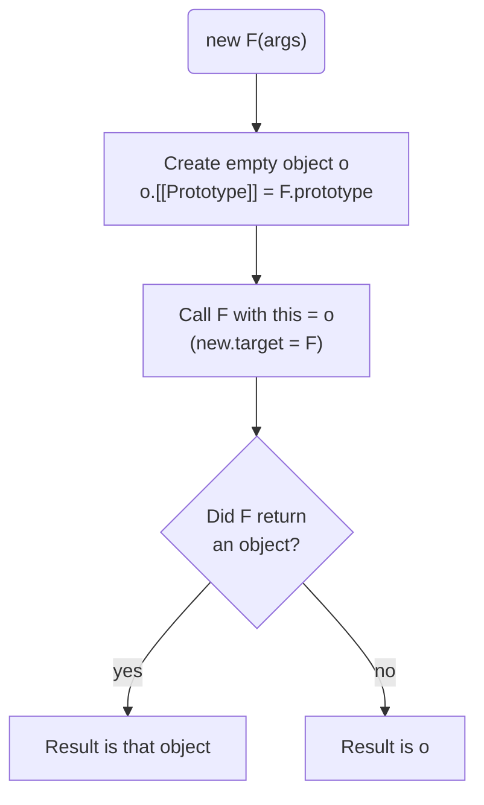
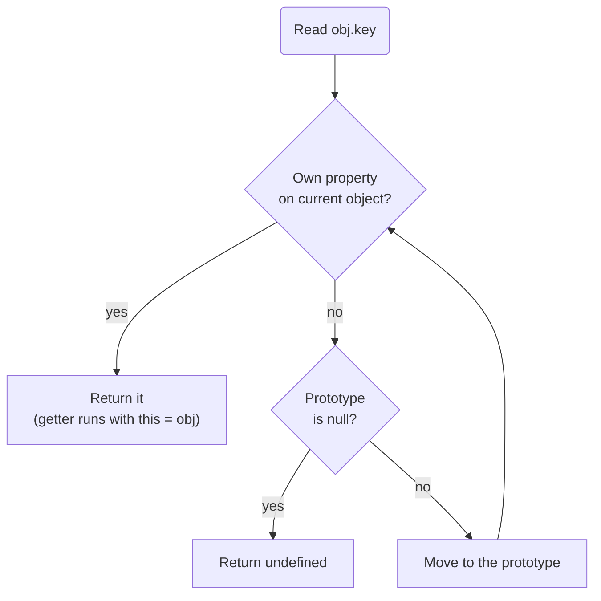

# Chapter 6: Prototypes & Prototypal Inheritance

## 6.1 Definition and why interviewers ask it

**Every object has an internal link, `[[Prototype]]`, to another object (or to `null`). When a property is not found on an object itself, the engine follows that link and keeps going along the chain until it finds the property or reaches `null`. That chain lookup is JavaScript's only inheritance mechanism: `new`, `Object.create` and `class` are different ways to set the links up.**

Prototypes are among the most reliably reported topics in JavaScript-fundamentals and senior frontend rounds (commonly reported). The usual forms are the "difference between `__proto__` and `prototype`" opener, "what does `new` do", "is `class` just syntax", output-prediction snippets, and polyfill tasks (`new`, `instanceof`, `Object.create`, an `extend` helper). Interviewers use it to check whether you can reason about objects without leaning on the `class` keyword. A good answer separates the three similarly named things (`[[Prototype]]`, `__proto__`, `.prototype`) and can draw the chain.

## 6.2 Core concept

### Plain language

Picture a team where each person has a mentor. If you ask someone a question and they do not know the answer, they ask their mentor, who asks theirs, until someone answers or the chain of mentors runs out. A prototype is the mentor. An object's own properties are what that person knows. Inherited properties are what the mentors know. If you teach someone something new, it goes into *their* head only, and their mentor's knowledge does not change.

### Precise version

**Three things with similar names**

| Name | What it is | Who has it |
|---|---|---|
| `[[Prototype]]` | The internal slot holding the link to the prototype object or `null`. The specification's name. | every object |
| `__proto__` | An accessor property on `Object.prototype` that reads and writes `[[Prototype]]`. Legacy, but standardised in Annex B. Prefer `Object.getPrototypeOf` and `Object.setPrototypeOf`. | objects that inherit from `Object.prototype` |
| `.prototype` | An ordinary data property of **functions** (those that can be constructors). It holds the object that `new F()` will use as the `[[Prototype]]` of new instances. | functions and classes |

The sentence to memorise: **`instance.__proto__ === Constructor.prototype`**. `.prototype` is the blueprint link, `__proto__` is the actual link on the instance.

**Property lookup and assignment**

| Operation | Behaviour |
|---|---|
| Read `obj.x` | Check own properties, then each prototype in turn. The first match wins, which is why an own property **shadows** an inherited one. |
| Write `obj.x = v` | Normally creates or updates an **own** property on `obj`. The prototype is not changed. |
| Write when an inherited **setter** exists | The setter is called with `this = obj`. No own property is created. |
| Write when an inherited property is **read-only** | Fails silently in sloppy mode and throws `TypeError` in strict mode. No own property is created. |
| `delete obj.x` | Removes only an own property. An inherited one stays visible. |
| Mutate through the chain (`obj.list.push(1)`) | Reads `list` from the prototype, then mutates the shared object. All inheritors see it. |

**Checking properties**

| Test | Own only? | Includes non-enumerable? | Includes symbols? |
|---|---|---|---|
| `'x' in obj` | no, walks the chain | yes | yes |
| `Object.hasOwn(obj, 'x')` | yes | yes | yes |
| `obj.hasOwnProperty('x')` | yes, but breaks if shadowed or on a null-prototype object | yes | yes |
| `for (k in obj)` | no, walks the chain | no (enumerable only) | no |
| `Object.keys(obj)` | yes | no (enumerable only) | no |

**The built-in chains**

| Value | Chain |
|---|---|
| `{}` | `Object.prototype` then `null` |
| `[]` | `Array.prototype` then `Object.prototype` then `null` |
| `function f(){}` | `Function.prototype` then `Object.prototype` then `null` |
| `new Dog()` | `Dog.prototype` then `Object.prototype` then `null` |
| `Object.create(null)` | `null` immediately (no inherited methods) |

Two facts that surprise people: `Function.prototype` is itself a function (callable, returns `undefined`), and `Object.prototype.__proto__` is `null`, which is what ends every normal chain. Also `Object instanceof Function` and `Function instanceof Object` are both `true`, because `Function`'s own `[[Prototype]]` is `Function.prototype`.

**`constructor`.** Every default `F.prototype` has an own, non-enumerable `constructor` property pointing back to `F`. Instances do not own it. They find it through the chain. If you replace `F.prototype` with a new object literal, that link is gone and `instance.constructor` resolves to `Object` further up.

**Class syntax is sugar, with differences.** A `class` creates a constructor function and puts its methods on `F.prototype`. The differences are real:

| Aspect | Constructor function | `class` |
|---|---|---|
| Call without `new` | allowed (and sloppy `this` leaks to global) | `TypeError` |
| Methods on prototype | enumerable if you assign them | **non-enumerable** |
| Body strictness | sloppy unless declared | always strict |
| Hoisting | function declarations are fully hoisted | in the TDZ until the declaration runs (Chapter 2) |
| `extends` | manual wiring | wires both chains and `super` |
| Fields, `#private`, `static` blocks | not available | available |
| `F.prototype` property | writable | **non-writable** |

**`extends` wires two chains.** `class Dog extends Animal` sets `Dog.prototype.__proto__ = Animal.prototype` (instance methods are inherited) and also `Dog.__proto__ = Animal` (static members are inherited). `super.method()` is resolved from the method's `[[HomeObject]]`: the engine looks up `method` on `HomeObject.[[Prototype]]` and calls it with the current `this`.

**Memory and sharing.** A method placed on the prototype exists once and is shared. A method created in the constructor (`this.say = function () {}`, or a class field arrow function) is a new function object per instance. Shared methods save memory and can be patched in one place. Per-instance functions can capture constructor variables (closures) and can be bound to the instance.

**Performance note.** Engines optimise property access by assuming object shapes and prototype chains stay stable. Changing an existing object's prototype with `Object.setPrototypeOf` or `__proto__ =` is documented by MDN as a slow operation that can hurt the performance of any code that touches that object. Set the prototype when the object is created (`Object.create`, `new`, `class`).

## 6.3 How it works internally

### A. Property read: `[[Get]]` (OrdinaryGet)

1. Look for an own property with that key on the object `O`.
2. If found, return its value. For an accessor property, call its getter with the **original receiver** as `this`, not with the object where the getter was found.
3. If not found, take `parent = O.[[GetPrototypeOf]]()`. If `parent` is `null`, return `undefined`.
4. Otherwise run `parent.[[Get]](key, receiver)`. This is the recursion that walks the chain.

### B. Property write: `[[Set]]` (OrdinarySet)

1. Find the property along the chain, starting at the receiver.
2. If the first match is a **data property** that is read-only, fail.
3. If it is an **accessor property**, call its setter with `this = receiver`.
4. Otherwise (no match, or a writable data property on a prototype), create or update an **own data property** on the receiver. That is why `child.count++` reads the inherited value and writes an own value.

### C. `new F(...args)`

1. `F.[[Construct]](args, newTarget = F)` runs. `new.target` inside the function equals `newTarget`.
2. For an ordinary function, create an empty object `obj` whose `[[Prototype]]` is `newTarget.prototype`. If that property is not an object, the realm's `Object.prototype` is used instead.
3. Call `F` with `this = obj`. Its parameters are bound to `args`.
4. If the body returns an **object** (including a function or array), that object is the result of `new`. If it returns a primitive or nothing, the result is `obj`.

For a **derived class**, step 2 is skipped. The derived constructor runs with `this` uninitialised, and `super(...)` calls the parent's `[[Construct]]` with the same `newTarget`. The base class creates the object, so its `[[Prototype]]` comes from `newTarget.prototype`, which is the derived prototype. Returning a primitive from a derived constructor throws a `TypeError`.

### D. Class evaluation (`ClassDefinitionEvaluation`)

1. If there is an `extends` clause, evaluate it: `protoParent = Parent.prototype`, `constructorParent = Parent`. Without `extends`: `protoParent = Object.prototype`, `constructorParent = Function.prototype`.
2. Create `proto = OrdinaryObjectCreate(protoParent)`.
3. Create the constructor function `F` and set `F.[[Prototype]] = constructorParent` (the second chain).
4. Define `F.prototype = proto` (non-writable) and `proto.constructor = F` (non-enumerable).
5. Define each method on `proto` (or on `F` for `static`) as non-enumerable. Each method stores its `[[HomeObject]]`, which `super` uses.
6. Run static fields and static blocks with `this = F`. Instance fields run at construction: for a base class right after the object is created, for a derived class right after `super(...)` returns.

### E. `instanceof`: `InstanceofOperator(V, target)`

1. If `target` is not an object, throw `TypeError`.
2. Look up `target[Symbol.hasInstance]`. If it exists, return `ToBoolean(Call(it, target, [V]))`. Every function inherits a default one from `Function.prototype`.
3. The default does `OrdinaryHasInstance`: if `V` is not an object, return `false`. Read `P = target.prototype`. Then walk `V.[[GetPrototypeOf]]()` repeatedly and return `true` if any link is `=== P`, or `false` at `null`.
4. For a bound function, `OrdinaryHasInstance` first delegates to the bound target.

### F. `Object.create(proto, descriptors)`

Creates an empty ordinary object with `[[Prototype]] = proto` (an object or `null`, anything else throws `TypeError`), then defines the optional descriptors as in `Object.defineProperties`. Descriptors default to non-writable, non-enumerable and non-configurable.

## 6.4 Diagrams

### The prototype chain, with constructor back-pointers

```ascii Prototype chain of rex = new Dog('Rex'), plus the function chain
 Plain arrows (--->) are [[Prototype]] (what __proto__ reads).

 +--------------+      +---------------------+      +---------------------+
 | rex          |----->| Dog.prototype       |----->| Object.prototype    |---> null
 |  name: 'Rex' |      |  bark()             |      |  hasOwnProperty()   |
 +--------------+      +-----+---------^-----+      |  toString() ...     |
                             |         |            +-----+---------^-----+
                   constructor     .prototype             |         |
                             |         |         constructor     .prototype
                             v         |                  |         |
                       +-----+---------+-----+            v         |
                       | Dog (function)      |      +-----+---------+-----+
                       +----------+----------+      | Object (function)   |
                                  |                 +----------+----------+
                                  |                            |
                                  +-------------+--------------+
                                                |  [[Prototype]] of both
                                                v
                                   +------------------------+
                                   | Function.prototype     |----> Object.prototype
                                   |  call, apply, bind ... |      (a function)
                                   +------------------------+
```

> **How to explain this to the interviewer**
>
> 1. Draw the top row first: `rex`, `Dog.prototype`, `Object.prototype`, `null`, with arrows between them. Say: "this is the chain a property read walks".
> 2. Under `Dog.prototype` draw the function `Dog` with two arrows between them: `.prototype` going up and `constructor` coming back down.
> 3. Draw `Dog` and `Object` both pointing at `Function.prototype`, and say: "this second chain is for the function objects themselves, and it also ends at `Object.prototype`".
>
> **Takeaway:** instances link to `F.prototype`, and `F.prototype.constructor` links back to `F`.

### What `new` does



> **How to explain this to the interviewer**
>
> 1. Draw the first box and write "create `o`, link it to `F.prototype`". Say: "this is where inheritance is set up".
> 2. Draw the second box: run `F` with `this = o`. Say: "the constructor body only fills in own properties".
> 3. Draw the final decision: an object result replaces `o`, anything else is ignored.
>
> **Takeaway:** `new` is "create linked object, run constructor on it, return it unless the constructor returned another object".

### How a property read walks the chain



> **How to explain this to the interviewer**
>
> 1. Draw the first question, "own property here?", and the "yes" exit that returns the value.
> 2. Draw the "no" path to "prototype is `null`?" and the loop back through "move to the prototype".
> 3. Say: "writes do not use this loop. They create the property on the object itself, unless a setter or a read-only property is inherited".
>
> **Takeaway:** reads walk up the chain, writes stay on the receiver.

### `extends` wires two chains

```ascii class Dog extends Animal: instance chain (left) and constructor chain (right)
 class Animal { speak() {}  static create() {} }
 class Dog extends Animal { bark() {} }
 const d = new Dog();

   CHAIN 1: instances and methods          CHAIN 2: constructors and statics

   d                                       Dog (function)
   |  [[Prototype]]                        |  [[Prototype]]
   v                                       v
   Dog.prototype    { bark }               Animal (function)   { create }
   |  [[Prototype]]                        |  [[Prototype]]
   v                                       v
   Animal.prototype { speak }              Function.prototype
   |  [[Prototype]]                        |  [[Prototype]]
   v                                       v
   Object.prototype                        Object.prototype
   |  [[Prototype]]                        |  [[Prototype]]
   v                                       v
   null                                    null

   d.speak()      walks chain 1           Dog.create()    walks chain 2
   super.speak()  starts at the HomeObject's [[Prototype]], in chain 1
```

> **How to explain this to the interviewer**
>
> 1. Draw two vertical chains side by side and label them "instances" and "constructors".
> 2. In the left chain write `d`, `Dog.prototype`, `Animal.prototype`, `Object.prototype`. In the right chain write `Dog`, `Animal`, `Function.prototype`.
> 3. Say: "`extends` sets both links. The left one gives instance methods, the right one gives inherited statics".
>
> **Takeaway:** `Dog.prototype.__proto__ === Animal.prototype` and `Dog.__proto__ === Animal`.

### Whiteboard version

```ascii Whiteboard version: instance, prototype and constructor (draw in under 2 minutes)
   instance --__proto__--> F.prototype --__proto__--> Object.prototype --> null
                              |   ^
                  constructor |   | .prototype
                              v   |
                            +-------+
                            |   F   |
                            +-------+
   new F():  1 make object  2 link to F.prototype  3 run F  4 return it
```

## 6.5 Code examples

### Example 1: three different things

```js
function Dog(name) { this.name = name; }
Dog.prototype.bark = function () { return this.name + ' barks'; };
const rex = new Dog('Rex');

console.log(Object.getPrototypeOf(rex) === Dog.prototype, rex.__proto__ === Dog.prototype);
console.log(Object.getPrototypeOf(Dog) === Function.prototype);
console.log(rex.prototype, typeof Dog.prototype);
console.log(Dog.prototype.constructor === Dog, rex.constructor === Dog);
console.log(Object.hasOwn(rex, 'constructor'), Object.hasOwn(Dog.prototype, 'constructor'));
```

```text output
true true
true
undefined object
true true
false true
```

**Why:** the instance's link is the prototype object of its constructor. The instance itself has no `prototype` property. It finds `constructor` through the chain, because the default prototype object owns it.

### Example 2: shadowing and assignment

```js
const base = { greet() { return 'hi from base'; }, count: 1, list: [] };
const child = Object.create(base);
console.log(child.greet(), Object.hasOwn(child, 'greet'));

child.count++;                 // reads 1 from base, writes an OWN count = 2
child.list.push('x');          // reads the shared array and mutates it
console.log(child.count, base.count, base.list.length, Object.hasOwn(child, 'count'));

delete child.count;            // removes the own property: the inherited one shows again
console.log(child.count);
```

```text output
hi from base false
2 1 1 true
1
```

**Why:** reads walk the chain, writes land on the receiver. `child.count++` is a read followed by a write, so it creates an own property and shadows the inherited one. `push` is a read plus a mutation of an object that lives on `base`, so every inheritor sees it.

### Example 3: the setter and read-only exceptions

```js
'use strict';
const proto = {
  set v(x) { this._v = x * 2; },
  get v() { return this._v; },
};
Object.defineProperty(proto, 'fixed', { value: 1, writable: false });
const o = Object.create(proto);

o.v = 5;                                    // calls the inherited setter with this = o
console.log(o._v, Object.hasOwn(o, 'v'));
try { o.fixed = 2; } catch (e) { console.log(e.name + ': ' + e.message); }
console.log(Object.hasOwn(o, 'fixed'), o.fixed);
```

```text output
10 false
TypeError: Cannot assign to read only property 'fixed' of object '#<Object>'
false 1
```

**Why:** an inherited setter runs instead of creating an own property, with `this` set to the receiver. An inherited read-only data property blocks the assignment too (silently in sloppy mode, with a `TypeError` in strict mode).

### Example 4: `in`, `hasOwn`, `for...in` and `keys`

```js
const parent = { inherited: 1 };
const obj = Object.create(parent, {
  own: { value: 2, enumerable: true },
  hidden: { value: 3 },                    // non-enumerable by default
});

console.log('inherited' in obj, Object.hasOwn(obj, 'inherited'), 'hidden' in obj);
const seen = [];
for (const k in obj) seen.push(k);
console.log(seen, Object.keys(obj), Object.getOwnPropertyNames(obj));
```

```text output
true false true
[ 'own', 'inherited' ] [ 'own' ] [ 'own', 'hidden' ]
```

**Why:** `in` and `for...in` walk the chain, but `for...in` skips non-enumerable keys. `Object.keys` lists own enumerable keys only. `getOwnPropertyNames` includes own non-enumerable keys.

### Example 5: `Object.create(null)` and descriptors

```js
const dict = Object.create(null);
dict.key = 1;
console.log(Object.getPrototypeOf(dict), 'toString' in dict, dict.hasOwnProperty);
try { String(dict); } catch (e) { console.log(e.name + ': ' + e.message); }

const withDesc = Object.create({ shared: true }, {
  id: { value: 7, enumerable: true },
  secret: { value: 'x' },
});
console.log(withDesc, withDesc.shared, withDesc.secret);
console.log(Object.getOwnPropertyDescriptor(withDesc, 'secret').writable);
```

```text output
null false undefined
TypeError: Cannot convert object to primitive value
{ id: 7 } true x
false
```

**Why:** a null-prototype object inherits nothing, so there is no `toString` to convert it to a string, and no `hasOwnProperty` to call. That makes it a safe dictionary. The second argument uses descriptor syntax, where the defaults are `false`, so `secret` is hidden and read-only.

### Example 6: replacing the prototype loses `constructor`

```js
function A() {}
const before = new A();
A.prototype = { hello() { return 'hello'; } };       // a brand-new prototype object
const after = new A();

console.log(typeof before.hello, typeof after.hello);
console.log(before instanceof A, after instanceof A);
console.log(after.constructor === A, after.constructor === Object);

Object.defineProperty(A.prototype, 'constructor', {
  value: A, writable: true, configurable: true,      // non-enumerable, like the default
});
console.log(after.constructor === A);
```

```text output
undefined function
false true
false true
true
```

**Why:** `before` still points at the old prototype object. `instanceof A` compares against the *current* `A.prototype`, so it is `false` for `before`. The new object literal has no own `constructor`, so lookup reaches `Object.prototype.constructor`. Defining `constructor` again repairs it.

### Example 7: `class` is not just a function

```js
function Fn() {}
Fn.prototype.m = function () {};
class Cls { method() {} }

try { Cls(); } catch (e) { console.log(e.name + ': ' + e.message); }
console.log(typeof Cls, Object.keys(Fn.prototype), Object.keys(Cls.prototype));
console.log(Object.getOwnPropertyNames(Cls.prototype));
console.log(Object.getOwnPropertyDescriptor(Cls, 'prototype').writable);
try { new Later(); } catch (e) { console.log(e.name); }
class Later {}
```

```text output
TypeError: Class constructor Cls cannot be invoked without 'new'
function [ 'm' ] []
[ 'constructor', 'method' ]
false
ReferenceError
```

**Why:** a class is a function, but it refuses plain calls, defines its methods as non-enumerable, makes `prototype` read-only and sits in the TDZ before its declaration.

### Example 8: `extends`, `super` and static inheritance

```js
class Animal {
  constructor(name) { this.name = name; }
  speak() { return this.name + ' makes a sound'; }
  static create(name) { return new this(name); }
}
class Dog extends Animal {
  speak() { return super.speak() + ' (woof)'; }
}
const d = Dog.create('Rex');                     // static inherited, this = Dog
console.log(d.speak(), d instanceof Dog);
console.log(Object.getPrototypeOf(Dog) === Animal);
console.log(Object.getPrototypeOf(Dog.prototype) === Animal.prototype);
console.log(Object.getPrototypeOf(Animal) === Function.prototype);
```

```text output
Rex makes a sound (woof) true
true
true
true
```

**Why:** the two links created by `extends` are visible with `getPrototypeOf`. `Dog.create` is found on `Animal` through the constructor chain, and `this` inside it is `Dog`, so `new this(name)` builds a `Dog`.

### Example 9: `instanceof`, `Symbol.hasInstance` and `isPrototypeOf`

```js
class Even { static [Symbol.hasInstance](n) { return n % 2 === 0; } }
console.log(2 instanceof Even, 3 instanceof Even);

function F() {}
const f = new F();
const P = F.prototype;
console.log(f instanceof F, P.isPrototypeOf(f), Object.prototype.isPrototypeOf(f));
console.log('text' instanceof String, new String('text') instanceof String);

Object.setPrototypeOf(f, null);                   // for demonstration only
console.log(f instanceof F, F.prototype.isPrototypeOf(f));
```

```text output
true false
true true true
false true
false false
```

**Why:** `instanceof` first asks `Symbol.hasInstance`. The default implementation walks the chain looking for `F.prototype`. Primitives are never instances. After the link is cut, the walk finds nothing.

### Example 10: the built-in chains

```js
console.log(Object.getPrototypeOf([]) === Array.prototype);
console.log(Object.getPrototypeOf(Array.prototype) === Object.prototype);
console.log(Object.getPrototypeOf(Object.prototype));
console.log(typeof Function.prototype, Function.prototype());
console.log(Object.getPrototypeOf(Function) === Function.prototype);
console.log(Object.getPrototypeOf(Object) === Function.prototype);
console.log(Function instanceof Object, Object instanceof Function);
```

```text output
true
true
null
function undefined
true
true
true true
```

**Why:** every chain ends at `Object.prototype`, whose own link is `null`. `Function.prototype` is a callable object. `Object` and `Function` are themselves functions, so their `[[Prototype]]` is `Function.prototype`, which in turn links to `Object.prototype`. That circle explains why both `instanceof` checks are `true`.

### Example 11: shared prototype methods versus per-instance functions, and mixins

```js
function PerInstance() { this.say = function () { return 'hi'; }; }
function Shared() {}
Shared.prototype.say = function () { return 'hi'; };
console.log(new PerInstance().say === new PerInstance().say);
console.log(new Shared().say === new Shared().say);

const CanFly = { fly() { return this.name + ' flies'; } };
const CanSwim = { swim() { return this.name + ' swims'; } };
class Duck { constructor(name) { this.name = name; } }
Object.assign(Duck.prototype, CanFly, CanSwim);   // copies methods onto the prototype
const duck = new Duck('Donald');
console.log(duck.fly(), duck.swim(), 'fly' in duck, Object.hasOwn(duck, 'fly'));
```

```text output
false
true
Donald flies Donald swims true false
```

**Why:** one function object per instance cannot be equal to another instance's. A mixin copies functions onto a prototype, so the behaviour is shared but the `instanceof` relationship is not (there is no `CanFly` in the chain).

### Example 12: private fields and static blocks

```js
class Counter {
  static #instances = 0;
  static label;
  static { Counter.label = 'counter'; }       // runs once, when the class is defined
  #count = 0;
  constructor() { Counter.#instances++; }
  inc() { return ++this.#count; }
  static get instances() { return Counter.#instances; }
}
const c = new Counter();
new Counter();
console.log(c.inc(), c.inc(), Counter.instances, Counter.label, Object.keys(c));
try { Counter.prototype.inc.call({}); } catch (e) { console.log(e.name); }
```

```text output
1 2 2 counter []
TypeError
```

**Why:** `#private` members are not properties and are not found through the prototype chain. They belong to the instance (or class) that created them, so using a method on the wrong object throws.

### Example 13: `__proto__` in JSON and copying

```js
const payload = JSON.parse('{"__proto__": {"admin": true}, "name": "x"}');
console.log(Object.keys(payload), Object.getPrototypeOf(payload) === Object.prototype);
console.log(payload.admin);

const spread = { ...payload };                 // defines own properties: stays harmless
const assigned = Object.assign({}, payload);   // uses assignment: runs the __proto__ setter
console.log(Object.getPrototypeOf(spread) === Object.prototype, spread.admin);
console.log(Object.getPrototypeOf(assigned) === Object.prototype, assigned.admin);
console.log(({}).admin);
```

```text output
[ '__proto__', 'name' ] true
undefined
true undefined
false true
undefined
```

**Why:** `JSON.parse` creates `__proto__` as a normal own property and does not change the prototype. A copy that uses assignment (`Object.assign`, a hand-written `target[key] = value` loop) triggers the `__proto__` setter. Here that re-links only the copy. A *recursive* merge that walks into `target['__proto__']` reaches `Object.prototype` itself (Question 6.15).

## 6.6 Common mistakes and gotchas

- **Confusing `__proto__` and `prototype`.** `rex.prototype` is `undefined`. `Dog.prototype` is the object that `rex.__proto__` points to.
- **Assigning an object literal to `F.prototype` after creating instances.** Existing instances keep the old prototype, and `constructor` is lost for new ones (Example 6).
- **Putting mutable state on the prototype.** `Dog.prototype.tricks = []` is shared by every instance. Create arrays and objects in the constructor.
- **`this.count++` on an inherited number.** It silently creates an own property that shadows the prototype's value. It does not update the shared one.
- **Using `for...in` without knowing it includes inherited enumerable keys.** Use `Object.keys` or `Object.entries`, or guard with `Object.hasOwn`.
- **Calling `obj.hasOwnProperty(key)` on untrusted data.** The object may shadow it, or have no prototype. Use `Object.hasOwn(obj, key)`.
- **Using `Object.setPrototypeOf` or `__proto__ =` in hot code.** It is documented as slow and it deoptimises. Choose the prototype at creation time with `Object.create` or `class`.
- **Forgetting `Parent.call(this, ...)` in ES5-style inheritance.** The parent's own properties never get initialised on the child instance.
- **Using `Child.prototype = new Parent()`.** It runs the parent constructor once at definition time and shares its instance state. Use `Object.create(Parent.prototype)` instead.
- **Calling a class without `new`.** It throws. A constructor function would silently run with a sloppy `this` and leak globals.
- **Arrow functions as prototype methods or constructors.** An arrow has no `prototype`, and `new` on it throws. As a method, it captures the wrong `this` (Chapter 5).
- **Treating `class` as a different object model.** It is the same prototype chain with stricter syntax. `typeof Cls` is `'function'`.
- **Believing `instanceof` checks "was created by".** It checks whether `F.prototype` is somewhere in the chain right now. Change the chain and the answer changes.
- **Building dictionaries from `{}` and user keys.** A key such as `__proto__`, `constructor` or `toString` collides with inherited names. Use `Map` or `Object.create(null)`.

## 6.7 Quick revision cheat sheet

- `[[Prototype]]` is the link. `__proto__` is the legacy accessor for it. `.prototype` is a function property used by `new`. `rex.__proto__ === Dog.prototype`.
- Reads walk the chain until found or `null`. Writes create an own property on the receiver, except for inherited setters (called) and inherited read-only properties (blocked).
- `new F()`: create an object linked to `F.prototype`, run `F` with `this` set to it, return it unless `F` returned an object.
- `class` is sugar over the same chain, with differences: needs `new`, non-enumerable methods, strict, TDZ, fields and `#private`, and `extends` wires **two** chains (`Child.prototype.__proto__ = Parent.prototype`, `Child.__proto__ = Parent`).
- `instanceof` asks `Symbol.hasInstance`, and by default walks the chain looking for `F.prototype`. `isPrototypeOf` is the same walk without a constructor.
- Every chain ends at `Object.prototype`, whose `[[Prototype]]` is `null`. `Function.prototype` is a function.
- Own checks: `Object.hasOwn(obj, key)`. `in` includes inherited. `Object.create(null)` gives a dictionary with no inherited keys.
- Prototype pollution: an attacker-controlled `__proto__` (or `constructor.prototype`) key in a merge changes `Object.prototype`. Skip those keys, use `Object.create(null)` or `Map`, and prefer `Object.hasOwn`.
- Methods on the prototype are shared (one function). Methods created per instance cost memory but can capture constructor variables.

## 6.8 Interview questions

*Key: ★ = very frequently reported. "Typically asked in" lines say which round a question tends to appear in; where no single source could be pinned down, the question is labelled "commonly reported". Draw-it hints refer to the figures in section 6.4.*

#### Conceptual

### Q6.1 ★ Easy: What is the difference between `__proto__` and `prototype`?

*Typically asked in: JavaScript fundamentals round, a very common opener (commonly reported).*

> **Model answer**
>
> They are different things. `prototype` is a property that only functions have. It holds the object that becomes the `[[Prototype]]` of every instance created with `new`. `__proto__` is a property, inherited from `Object.prototype`, that exposes the real internal link, `[[Prototype]]`, on any object. So for `const rex = new Dog()`, `rex.__proto__ === Dog.prototype`. The instance has `__proto__` but no `prototype`. `__proto__` is legacy, so in real code I use `Object.getPrototypeOf` and avoid changing the link after creation, because that is slow.

**Key points to mention**

- `.prototype` belongs to the constructor. `__proto__` or `[[Prototype]]` belongs to every object.
- The identity `instance.__proto__ === Constructor.prototype`.
- Prefer `Object.getPrototypeOf`, `Object.create` and `class`.
- Draw it: Figure 6.1.

### Q6.2 ★ Medium: Explain prototypal inheritance and the prototype chain.

*Typically asked in: JavaScript fundamentals round (commonly reported).*

> **Model answer**
>
> Every object has an internal link to another object, its prototype. When I read a property, the engine checks the object's own properties first. If it is not there, it follows the link and checks the prototype, then that object's prototype, and so on until it finds the property or reaches `null`, in which case the result is `undefined`. That sequence is the prototype chain. An own property shadows an inherited one with the same name. Writes go to the object itself, not to the prototype. That is all inheritance is in JavaScript: delegation along a chain, and `class` is syntax for building it.

**Key points to mention**

- Lookup walks own, then prototype, then up to `null`.
- Shadowing, and writes create own properties.
- The chain for `{}`, arrays and functions all ends at `Object.prototype`.
- Delegation rather than copying.
- Draw it: Figure 6.1, and Figure 6.3 for the lookup.

### Q6.3 ★ Medium: What does the `new` operator do?

*Typically asked in: JavaScript fundamentals round, often followed by "implement it" (commonly reported).*

> **Model answer**
>
> `new F(args)` does four things. It creates an empty object. It sets that object's `[[Prototype]]` to `F.prototype`. It calls `F` with `this` bound to the new object, so the constructor can add own properties. Finally it returns the new object, unless `F` returned a different object, in which case that object is the result. A returned primitive is ignored. Inside `F`, `new.target` is `F`, which lets code detect a call without `new`. For classes, the same steps apply, but a derived constructor gets its object from the parent through `super()`.

**Key points to mention**

- Four steps, in order.
- Return rule: object result replaces `this`, primitive is ignored.
- `new.target`.
- Classes cannot be called without `new`.
- Draw it: Figure 6.2.

### Q6.4 Medium: Is JavaScript class-based? What is a `class` really, and how does it differ from a constructor function?

*Typically asked in: JavaScript fundamentals round, often as a trap (commonly reported).*

> **Model answer**
>
> No. JavaScript is prototype-based and `class` is syntax over the same mechanism. A class declaration creates a constructor function and puts its methods on `F.prototype`. There are real differences, though. A class throws if called without `new`. Its methods are non-enumerable, and the body is always strict. It sits in the temporal dead zone, so it cannot be used before its declaration. `extends` wires two chains: instances through `Child.prototype`, and statics through `Child.__proto__`. And classes add private fields, static blocks and `super`, which are hard to reproduce with functions alone.

**Key points to mention**

- `typeof class` is `'function'`. It is the same chain.
- Differences: `new` required, non-enumerable methods, strict, TDZ, `prototype` non-writable.
- Two chains for `extends`, and `super` through `[[HomeObject]]`.
- Private fields have no function-style equivalent.
- Draw it: Figure 6.4.

### Q6.5 Medium: What is the difference between `Object.create`, `new` and `class`?

*Typically asked in: JavaScript fundamentals round (commonly reported).*

> **Model answer**
>
> All three create an object whose `[[Prototype]]` is set at creation time. `Object.create(proto)` is the most direct: it makes an empty object linked to `proto`, runs no constructor, and can take property descriptors. `new F()` also links to `F.prototype` but then runs the constructor `F` to initialise own properties. `class` is a cleaner syntax for the constructor-plus-prototype pattern, with `extends` and `super`. I use `Object.create(null)` for dictionaries with no inherited keys, and `class` for ordinary types. I use `Object.create(proto)` when I want pure delegation without a constructor.

**Key points to mention**

- Only `new` and `class` run initialisation code.
- `Object.create(null)` gives no inherited methods. `Object.create(proto, descriptors)` defines properties with `false` defaults.
- Object literals link to `Object.prototype`.
- Inheritance setup in ES5 uses `Object.create(Parent.prototype)`.

#### Output prediction

### Q6.6 ★ Medium: What does this print? (shadowing and shared state)

*Typically asked in: JavaScript fundamentals round (commonly reported).*

```js
function Counter() {}
Counter.prototype.count = 0;
Counter.prototype.items = [];

const a = new Counter();
const b = new Counter();
a.count++;
a.items.push('x');
console.log(a.count, b.count, Counter.prototype.count);
console.log(b.items, a.items === b.items);
console.log(Object.keys(a), Object.keys(b));
```

```text output
1 0 0
[ 'x' ] true
[ 'count' ] []
```

> **Model answer**
>
> `1 0 0`, then `[ 'x' ] true`, then `[ 'count' ] []`. `a.count++` reads the inherited `0`, adds one, and writes the result to a new **own** property on `a`. The prototype keeps `0`, and `b` still sees it. `a.items.push('x')` is different. It reads `items` from the prototype and mutates that shared array, so `b` sees `'x'` too. Only the own `count` appears in `Object.keys(a)`. The rule: assignment creates an own property, mutation of an inherited object is shared.

**Key points to mention**

- `++` is read then write, so it creates an own property.
- Mutating a shared reference affects every instance.
- Fix: create arrays and objects in the constructor.

### Q6.7 ★ Medium: What does this print? (replacing the prototype)

*Typically asked in: JavaScript fundamentals round (commonly reported).*

```js
function Person() {}
Person.prototype.kind = 'old';
const first = new Person();

Person.prototype = { kind: 'new' };
const second = new Person();

console.log(first.kind, second.kind);
console.log(first instanceof Person, second instanceof Person);
console.log(first.constructor === Person, second.constructor === Person);

Person.prototype.kind = 'changed';
console.log(first.kind, second.kind);
```

```text output
old new
false true
true false
old changed
```

> **Model answer**
>
> `old new`, `false true`, `true false`, `old changed`. `first` was linked to the original prototype object, so replacing `Person.prototype` does not affect it. That is why `first.kind` stays `'old'` and `first instanceof Person` is now `false`: `instanceof` compares against the current `Person.prototype`, which is not in `first`'s chain. `second` links to the new object, which is a plain literal without `constructor`, so `second.constructor` resolves to `Object` and the comparison is `false`. The last line mutates the *new* prototype, so only `second` sees it.

**Key points to mention**

- Replacing versus mutating `F.prototype`.
- `instanceof` checks the current `F.prototype`.
- `constructor` is lost with a replaced prototype. Restore it with `defineProperty`.

### Q6.8 Hard: What does this print? (the built-in chain)

*Typically asked in: senior-leaning JavaScript rounds (commonly reported).*

```js
function F() {}
const f = new F();
const fn = () => {};
const bare = Object.create(null);
console.log(f instanceof F, f instanceof Object, F instanceof Function);
console.log(F instanceof Object, Object instanceof Function, Function instanceof Function);
console.log(f.__proto__ === F.prototype, F.__proto__ === Function.prototype);
console.log(F.prototype.__proto__ === Object.prototype, Object.prototype.__proto__);
console.log([] instanceof Object, fn instanceof Object, bare instanceof Object);
```

```text output
true true true
true true true
true true
true null
true true false
```

> **Model answer**
>
> The first two lines are all `true`. `f` links to `F.prototype`, which links to `Object.prototype`, so it is an instance of both. `F` is a function, so its chain runs through `Function.prototype` to `Object.prototype`. `Object` and `Function` are functions too, so `Object instanceof Function` is true, and `Function`'s own link is `Function.prototype`, so `Function instanceof Function` is true. `Object.prototype.__proto__` is `null`, the end of every chain. The last line is `true true false`: arrays and arrow functions inherit from `Object.prototype`, but `Object.create(null)` does not, so `instanceof Object` fails.

**Key points to mention**

- Both `Function instanceof Object` and `Object instanceof Function` hold because of the loop `Function.__proto__ === Function.prototype`.
- Everything ordinary ends at `Object.prototype`. `null`-prototype objects are the exception.
- `instanceof` is a chain test, not a "created by" test.

### Q6.9 Medium: What does this print? (`extends`, `super` and statics)

*Typically asked in: JavaScript fundamentals round, class-focused (commonly reported).*

```js
class A {
  static who() { return 'A.who on ' + this.name; }
  hello() { return 'A.hello'; }
}
class B extends A {
  hello() { return 'B>' + super.hello(); }
}
const b = new B();
console.log(b.hello(), B.who());
const protoOf = Object.getPrototypeOf;
console.log(protoOf(B) === A, protoOf(B.prototype) === A.prototype);
console.log(Object.hasOwn(B, 'who'), 'who' in B, Object.hasOwn(b, 'hello'));
```

```text output
B>A.hello A.who on B
true true
false true false
```

> **Model answer**
>
> `B>A.hello A.who on B`, then `true true`, then `false true false`. `super.hello()` looks up `hello` starting at the prototype of `B.prototype`, which is `A.prototype`, and calls it with the current `this`. The static `who` is not copied to `B`. It is found through `B.__proto__ === A`, and because the call is `B.who()`, `this` is `B`, so `this.name` is `'B'`. That is why `Object.hasOwn(B, 'who')` is `false` while `'who' in B` is `true`. The last value is `false` because `hello` lives on the prototype, not on the instance.

**Key points to mention**

- Two links: `B.prototype.__proto__ === A.prototype` and `B.__proto__ === A`.
- `super.m()` is resolved from `[[HomeObject]]`, with the current `this`.
- Statics are inherited through the constructor chain, not copied.

#### Implement it yourself

### Q6.10 ★ Medium: Implement `myNew(Constructor, ...args)`

*Typically asked in: JavaScript machine-coding or fundamentals round, as a follow-up to "what does `new` do" (commonly reported).*

**Problem.** Write a function that behaves like `new Constructor(...args)`: link the new object to the constructor's prototype, run the constructor with that object as `this`, and honour an object return value. Handle a non-object `prototype` and non-constructors.

**Solution.**

```js
function myNew(Ctor, ...args) {
  if (typeof Ctor !== 'function' || !('prototype' in Ctor)) {
    throw new TypeError(String(Ctor && Ctor.name || Ctor) + ' is not a constructor');
  }
  const isObject = (v) => (typeof v === 'object' && v !== null) || typeof v === 'function';
  // spec: if F.prototype is not an object, fall back to Object.prototype
  const proto = isObject(Ctor.prototype) ? Ctor.prototype : Object.prototype;
  const obj = Object.create(proto);          // steps 1 and 2: create and link
  const result = Ctor.apply(obj, args);      // step 3: run the constructor
  return isObject(result) ? result : obj;    // step 4: object result wins
}

function Person(name) { this.name = name; }
Person.prototype.hi = function () { return 'hi ' + this.name; };
const p = myNew(Person, 'Ada');
console.log(p.hi(), p instanceof Person, Object.getPrototypeOf(p) === Person.prototype);

function ReturnsObject() { this.a = 1; return { b: 2 }; }
function ReturnsPrimitive() { this.a = 1; return 5; }
console.log(myNew(ReturnsObject), myNew(ReturnsPrimitive));

function NoProto() { this.x = 1; }
NoProto.prototype = null;
console.log(Object.getPrototypeOf(myNew(NoProto)) === Object.prototype);

const arrowCtor = () => {};
for (const bad of [arrowCtor, 42]) {
  try { myNew(bad); } catch (e) { console.log(e.name + ': ' + e.message); }
}
try { myNew(class K {}); } catch (e) { console.log(e.name + ': ' + e.message); }
```

```text output
hi Ada true true
{ b: 2 } ReturnsPrimitive { a: 1 }
true
TypeError: arrowCtor is not a constructor
TypeError: 42 is not a constructor
TypeError: Class constructor K cannot be invoked without 'new'
```

> **Model answer**
>
> I follow the four steps literally. I create an object with `Object.create(Ctor.prototype)`, falling back to `Object.prototype` if `prototype` is not an object, which is what the spec does. I call the constructor with `apply` so `this` is that object. Then I check the result: if it is an object or function, I return it, otherwise I return my object. I reject values without a `prototype` property, such as arrow functions. This version cannot construct classes, because class constructors refuse a plain call, and it cannot set `new.target`. `Reflect.construct(Ctor, args, newTarget)` does both. Time is the cost of the constructor plus O(1).

**Key points to mention**

- `Object.create(proto)` creates and links in one step.
- Return rule: object or function wins, primitives are ignored.
- Edge cases: non-object `prototype`, arrow and method functions, non-functions.
- Limits: classes (need `Reflect.construct`), `new.target`, bound functions.

### Q6.11 Medium: Implement `myInstanceOf(value, Constructor)`

*Typically asked in: JavaScript fundamentals or polyfill round (commonly reported).*

**Problem.** Implement `instanceof` without using the operator. Support `Symbol.hasInstance`, primitives, `null`-prototype objects and invalid right-hand sides.

**Solution.**

```js
function myInstanceOf(value, Ctor) {
  const isObject = (v) => (typeof v === 'object' && v !== null) || typeof v === 'function';
  if (!isObject(Ctor)) {
    throw new TypeError("Right-hand side of 'instanceof' is not an object");
  }

  const handler = Ctor[Symbol.hasInstance];
  // every function inherits a default handler: only a custom one changes the algorithm
  if (handler != null && handler !== Function.prototype[Symbol.hasInstance]) {
    return Boolean(handler.call(Ctor, value));
  }
  if (typeof Ctor !== 'function') {
    throw new TypeError("Right-hand side of 'instanceof' is not callable");
  }

  if (!isObject(value)) return false;                 // primitives are never instances
  const proto = Ctor.prototype;
  if (!isObject(proto)) {
    throw new TypeError('Function has non-object prototype in instanceof check');
  }

  let link = Object.getPrototypeOf(value);
  while (link !== null) {                              // walk the chain
    if (link === proto) return true;
    link = Object.getPrototypeOf(link);
  }
  return false;
}

class Animal {}
class Dog extends Animal {}
const d = new Dog();
console.log(myInstanceOf(d, Dog), myInstanceOf(d, Animal), myInstanceOf(d, Object));
const num = new Number(5);
console.log(myInstanceOf([], Array), myInstanceOf(5, Number), myInstanceOf(num, Number));
console.log(myInstanceOf(Object.create(null), Object));
class Even { static [Symbol.hasInstance](n) { return n % 2 === 0; } }
console.log(myInstanceOf(4, Even), myInstanceOf(3, Even));
for (const rhs of [{}, 5]) {
  try { myInstanceOf(d, rhs); } catch (e) { console.log(e.name + ': ' + e.message); }
}
```

```text output
true true true
true false true
false
true false
TypeError: Right-hand side of 'instanceof' is not callable
TypeError: Right-hand side of 'instanceof' is not an object
```

> **Model answer**
>
> `instanceof` has three parts. First, the right side must be an object. Second, if it defines `Symbol.hasInstance`, I call that and convert the result to a boolean. Every function inherits a default, so I only take this path for a custom one. Third, the ordinary algorithm: a primitive on the left is never an instance, then I read `Ctor.prototype` and walk the value's chain with `getPrototypeOf`, returning `true` on the first link that is identical to it, and `false` at `null`. The walk is O(depth of the chain). A native bound function would delegate to its target, which I do not handle here.

**Key points to mention**

- Order: validate right side, `Symbol.hasInstance`, then chain walk.
- Primitives return `false`. `null`-prototype objects return `false` for `Object`.
- Throw if `Ctor.prototype` is not an object.
- Not handled: bound functions.

### Q6.12 Medium: Implement inheritance with `Object.create` (and polyfill `Object.create`)

*Typically asked in: JavaScript fundamentals round on pre-ES6 inheritance, or a polyfill round (commonly reported).*

**Problem.** Write `inherit(Child, Parent)` that wires ES5-style inheritance correctly, then write `objectCreate(proto, props)` as a polyfill for `Object.create`. Keep `constructor` correct and non-enumerable.

**Solution.**

```js
function objectCreate(proto, props) {
  if (proto !== null && typeof proto !== 'object' && typeof proto !== 'function') {
    throw new TypeError('Object prototype may only be an Object or null: ' + String(proto));
  }
  function F() {}
  F.prototype = proto;
  const obj = new F();
  if (proto === null) Object.setPrototypeOf(obj, null);   // F.prototype = null falls back
  if (props !== undefined) Object.defineProperties(obj, props);
  return obj;
}

function inherit(Child, Parent) {
  Child.prototype = objectCreate(Parent.prototype, {
    constructor: { value: Child, writable: true, configurable: true },   // non-enumerable
  });
  Object.setPrototypeOf(Child, Parent);                    // inherit statics too
  return Child;
}

function Animal(name) { this.name = name; }
Animal.prototype.speak = function () { return this.name + ' makes a sound'; };
Animal.count = 0;

function Dog(name, breed) {
  Animal.call(this, name);                                 // initialise inherited own state
  this.breed = breed;
}
inherit(Dog, Animal);                                      // before adding Dog's methods
Dog.prototype.speak = function () { return Animal.prototype.speak.call(this) + ' (woof)'; };

const d = new Dog('Rex', 'lab');
console.log(d.speak(), d instanceof Dog, d instanceof Animal);
console.log(d.constructor === Dog, Object.keys(Dog.prototype), Dog.count);
const keys = [];
for (const k in d) keys.push(k);
console.log(keys);

const withProps = objectCreate({ a: 1 }, { b: { value: 2 } });
console.log(Object.getPrototypeOf(objectCreate(null)), withProps.b, withProps.a);
try { objectCreate(5); } catch (e) { console.log(e.name + ': ' + e.message); }
```

```text output
Rex makes a sound (woof) true true
true [ 'speak' ] 0
[ 'name', 'breed', 'speak' ]
null 2 1
TypeError: Object prototype may only be an Object or null: 5
```

> **Model answer**
>
> For `inherit`, I set `Child.prototype` to a new object whose prototype is `Parent.prototype`, and I add a non-enumerable `constructor` pointing at `Child`. I do not use `new Parent()`, because that would run the parent constructor at definition time and share its state. In the child constructor I call `Parent.call(this, ...)` to initialise inherited own properties. I also link `Child` to `Parent` so statics are inherited. For `Object.create`, the polyfill uses a temporary constructor: set `F.prototype = proto`, return `new F()`. `null` needs `setPrototypeOf`, because `F.prototype = null` falls back to `Object.prototype`.

**Key points to mention**

- `Object.create(Parent.prototype)`, not `new Parent()`.
- Restore `constructor` as non-enumerable, or `for...in` will list it.
- `Parent.call(this, ...)` for own state, and call `inherit` before adding child methods.
- Polyfill edge cases: `null` prototype, a non-object argument, the descriptor argument.

#### Follow-up traps

### Q6.13 Medium: "What happens if a constructor returns a primitive? What if it returns an object?"

*Typically asked in: follow-up after the `new` question (commonly reported).*

```js
function A() { this.x = 1; return 'str'; }
function B() { this.x = 1; return { y: 2 }; }
class C { constructor() { this.x = 1; return [9]; } }
class D extends Object { constructor() { super(); return 1; } }
console.log(new A(), new B(), new C());
try { new D(); } catch (e) { console.log(e.name + ': ' + e.message); }
```

```text output
A { x: 1 } { y: 2 } [ 9 ]
TypeError: Derived constructors may only return object or undefined
```

> **Model answer**
>
> If the constructor returns an object, which includes arrays and functions, `new` returns that object and the one created from `this` is discarded, so it is also not linked to the prototype. If it returns a primitive, the return value is ignored and `new` returns the object created from `this`. Classes follow the same rule for base constructors. A derived class constructor is stricter: returning a non-object other than `undefined` throws a `TypeError`. I would avoid returning from constructors, except for deliberate patterns such as a singleton or a factory.

**Key points to mention**

- Object result replaces `this`. Primitive result is ignored.
- The replaced object is not an instance of the constructor.
- Derived constructors throw on primitive returns.

### Q6.14 Medium: "How do you check that a property is the object's own? What is wrong with `obj.hasOwnProperty(key)`?"

*Typically asked in: JavaScript fundamentals round (commonly reported).*

```js
const o = { hasOwnProperty: () => false, a: 1 };
console.log(o.hasOwnProperty('a'), Object.hasOwn(o, 'a'));
console.log(Object.prototype.hasOwnProperty.call(o, 'a'));
const n = Object.create(null);
n.a = 1;
console.log(Object.hasOwn(n, 'a'), 'a' in n, typeof n.hasOwnProperty);
```

```text output
false true
true
true true undefined
```

> **Model answer**
>
> `Object.hasOwn(obj, key)` is the modern answer: it checks own properties only, enumerable or not, and works on any object. `obj.hasOwnProperty(key)` is fragile, because the object can shadow the method, as in the first line, or have no prototype at all, in which case the method does not exist. The older safe form is `Object.prototype.hasOwnProperty.call(obj, key)`. The `in` operator is different: it includes inherited properties. For lists of keys I use `Object.keys` or `Object.entries`, which are own and enumerable.

**Key points to mention**

- `Object.hasOwn` (ES2022) versus `hasOwnProperty.call`.
- `in` walks the chain, `for...in` walks it for enumerable keys.
- Null-prototype and shadowed-method cases.

### Q6.15 ★ Hard: "What is prototype pollution, and how do you defend against it?"

*Typically asked in: senior frontend, full-stack and security-aware rounds (commonly reported).*

```js
function merge(target, source) {                // a typical unsafe deep merge
  for (const key of Object.keys(source)) {
    if (source[key] && typeof source[key] === 'object') {
      if (!target[key]) target[key] = {};
      merge(target[key], source[key]);
    } else {
      target[key] = source[key];
    }
  }
  return target;
}

const evil = JSON.parse('{"__proto__": {"isAdmin": true}}');
console.log(({}).isAdmin);
merge({}, evil);
console.log(({}).isAdmin, Object.hasOwn({}, 'isAdmin'));
delete Object.prototype.isAdmin;                // clean up so the demo stays contained

function safeMerge(target, source) {
  for (const key of Object.keys(source)) {
    if (key === '__proto__' || key === 'constructor' || key === 'prototype') continue;
    if (source[key] && typeof source[key] === 'object') {
      if (!Object.hasOwn(target, key)) target[key] = {};
      safeMerge(target[key], source[key]);
    } else {
      target[key] = source[key];
    }
  }
  return target;
}
safeMerge({}, evil);
console.log(({}).isAdmin);
```

```text output
undefined
true false
undefined
```

> **Model answer**
>
> Prototype pollution is when untrusted input makes code write properties onto `Object.prototype`, so that every object in the process appears to have them. The usual cause is a recursive merge or a path-setter that follows a key such as `__proto__` or `constructor.prototype`. `JSON.parse` produces `__proto__` as an ordinary own key, and `target['__proto__']` then resolves to `Object.prototype`, which the merge writes into. That can flip checks such as `isAdmin` or change behaviour elsewhere. Defences: skip those keys, check `Object.hasOwn` before descending, use `Object.create(null)` or `Map` for dictionaries, validate input with a schema, freeze `Object.prototype` where possible, and keep dependencies updated.

**Key points to mention**

- Mechanism: attacker-controlled key walks into `Object.prototype`.
- `JSON.parse` makes an own `__proto__` key. Assignment-based copying activates it.
- Defences: key blocklist, own-property checks, `Object.create(null)` or `Map`, schema validation, `Object.freeze(Object.prototype)`, Node's `--disable-proto` flag.
- Impact depends on what later code reads from inherited properties.

#### Sources and further reading

- ECMAScript specification: `OrdinaryGet`, `OrdinarySet`, `[[Construct]]` and `OrdinaryCreateFromConstructor`, `InstanceofOperator`, `OrdinaryHasInstance`, `ClassDefinitionEvaluation` and Annex B `Object.prototype.__proto__`: <https://tc39.es/ecma262/>
- MDN, "Inheritance and the prototype chain": <https://developer.mozilla.org/en-US/docs/Web/JavaScript/Guide/Inheritance_and_the_prototype_chain>
- MDN, `Object.prototype.__proto__` (includes the warning about changing `[[Prototype]]`): <https://developer.mozilla.org/en-US/docs/Web/JavaScript/Reference/Global_Objects/Object/proto>
- MDN, "Prototype pollution": <https://developer.mozilla.org/en-US/docs/Web/Security/Attacks/Prototype_pollution>
- OWASP, "Prototype Pollution Prevention Cheat Sheet": <https://cheatsheetseries.owasp.org/cheatsheets/Prototype_Pollution_Prevention_Cheat_Sheet.html>
- javascript.info, "Prototypal inheritance": <https://javascript.info/prototype-inheritance>; "F.prototype": <https://javascript.info/function-prototype>; "Class inheritance": <https://javascript.info/class-inheritance>
- Kyle Simpson, *You Don't Know JS Yet: Objects & Classes* (prototype chain, `[[Prototype]]` delegation).
- Search results seen (page contents were not fetchable from the authoring sandbox, so only titles and snippets were used) for question frequency: interviewsvector.com, "Prototypal Inheritance and the Prototype Chain in JavaScript" <https://www.interviewsvector.com/javascript/prototypal-inheritance>; ExplainThis, "The most common JavaScript prototype interview questions and answers" <https://www.explainthis.io/en/swe/most-common-js-prototype-questions>; GeeksforGeeks, "Difference between proto and prototype" <https://www.geeksforgeeks.org/difference-between-proto-and-prototype/>; dev.to, "JavaScript Interview Series(6): Prototype & Inheritance" <https://dev.to/jackm_345442a09fb53b/javascript-interview-series6-prototype-inheritance-how-js-object-model-works-597n>. Question wording in this book is original.
