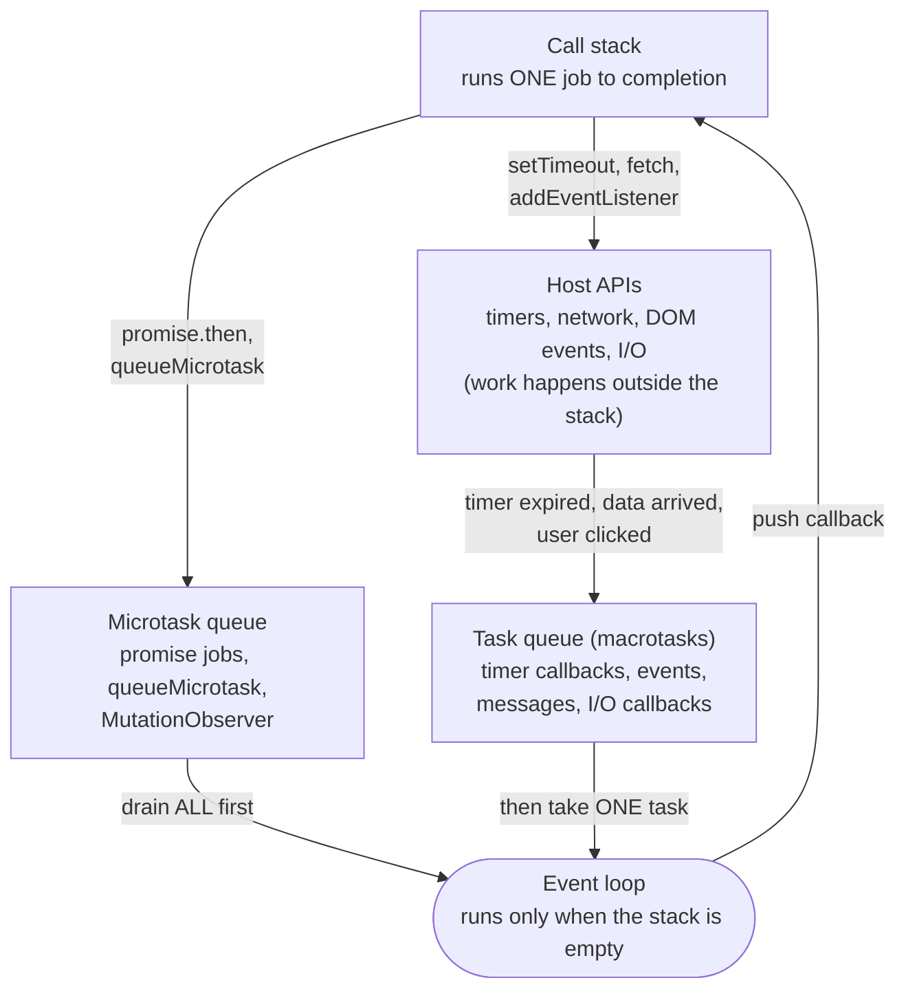
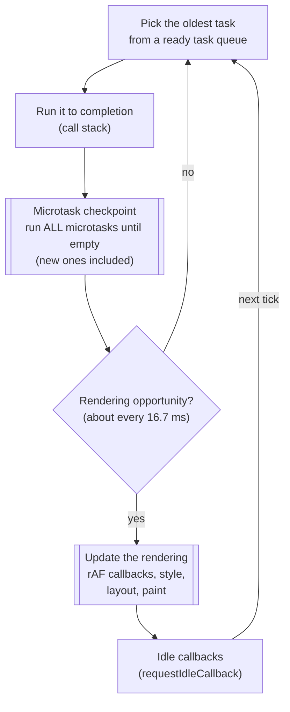
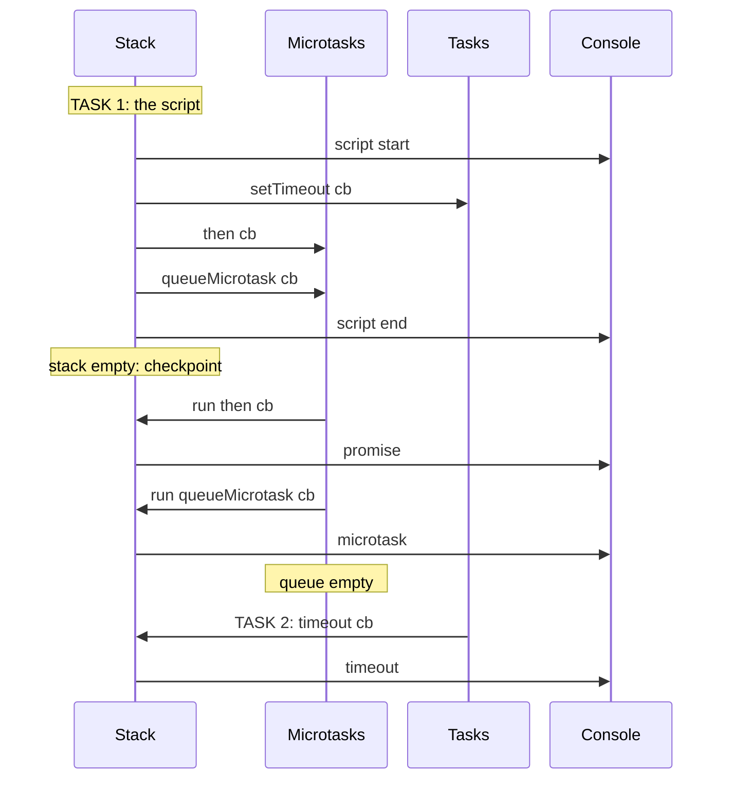
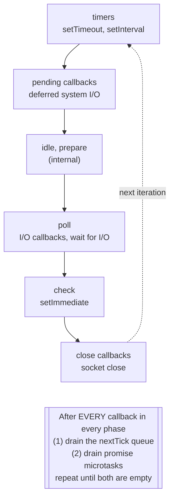

# Chapter 7: Event Loop, Task Queues & Microtasks

## 7.1 Definition and why interviewers ask it

**The event loop is the host-defined algorithm that decides what JavaScript runs next. When the call stack is empty it takes one task from a task queue and runs it to completion, then runs every pending microtask, then (in a browser, when a frame is due) updates the rendering, and repeats.**

This is the single most-asked topic in JavaScript interviews (commonly reported). It appears as "explain the event loop" in the JavaScript-fundamentals round, as output-prediction puzzles mixing `console.log`, `setTimeout` and promises, and as machine-coding tasks such as `sleep`, chunking long work or building a tiny scheduler. Senior rounds add Node.js: `process.nextTick`, `setImmediate` and the libuv phases. The topic is a good filter because the questions look alike while the answers depend on one precise model. If you hold that model, every ordering puzzle becomes mechanical. If you hold only the slogan "microtasks first", the harder variants will trip you up.

## 7.2 Core concept

### Plain language

Picture one cook in a kitchen. The cook can only work on one dish at a time and never abandons a dish halfway (run to completion). Two kinds of notes arrive. Regular order tickets hang on a rail (the task queue): a timer rang, a customer clicked, a delivery arrived. Sticky notes are stuck on the cook's own hand (the microtask queue): "after this dish, also do this small follow-up". When a dish is finished, the cook first clears **every** sticky note, including new sticky notes written while clearing the others. Only then does the cook look up, perhaps wipe the counter for the customers to see (render), and take the next ticket from the rail. The cook never works on a ticket while another dish is in progress. A slow dish makes everyone wait, including the wiping of the counter.

### Precise version

**The pieces.** The ECMAScript specification defines *jobs* and *job queues* but leaves the loop itself to the host. Browsers follow the HTML Standard ("event loop processing model"). Node.js uses libuv. Both share the same shape.

| Piece | Role | Defined by |
|---|---|---|
| Call stack | Runs JavaScript. One frame at a time, always to completion. | Engine (V8, SpiderMonkey, JavaScriptCore) |
| Host APIs ("Web APIs" in a browser) | Timers, network, DOM events, file I/O. They wait and work **outside** the stack. | Browser or Node.js (libuv and its thread pool) |
| Task queue(s) | Callbacks ready to run: timers that expired, events, messages, finished I/O. | Host |
| Microtask queue | Small follow-up jobs that must run before the host does anything else. | Engine jobs plus the host's checkpoint |
| Render step | Style, layout and paint, plus `requestAnimationFrame` callbacks (browsers only). | Browser |

**Tasks versus microtasks.** The HTML Standard says "task", not "macrotask". "Macrotask" is a popular word for "a task that is not a microtask", and interviewers use it, so use it too.

| | Task (macrotask) | Microtask |
|---|---|---|
| Browser sources | `setTimeout`, `setInterval`, DOM events (click, input), `postMessage` and `MessageChannel` messages, network completion, history traversal | Promise reaction jobs (`then`, `catch`, `finally`, `await` continuations), `queueMicrotask`, `MutationObserver` callbacks |
| Node.js sources | Timers, I/O callbacks, `setImmediate`, close callbacks | Promise jobs, `queueMicrotask`, plus the separate `process.nextTick` queue (runs just before them) |
| Queues | Several (one per task source). The browser chooses which ready queue to serve, so it may prefer input over timers. Order is guaranteed only within one queue. | One queue per agent |
| When it runs | One task per loop iteration | The whole queue is drained after every task, and whenever the stack empties after a callback |
| New work added while running | Goes to the back of a task queue and waits for a **later** iteration | Joins the current queue and runs in the **same** checkpoint |

**The browser loop, in order.** (1) Pick the oldest task from a task queue that is ready. (2) Run it to completion. (3) **Microtask checkpoint:** run microtasks until the queue is empty, including those that microtasks add. (4) If a rendering opportunity exists, **update the rendering**: run `requestAnimationFrame` callbacks, then style, layout and paint. (5) If time remains, run idle callbacks (`requestIdleCallback`). (6) Repeat. A rendering opportunity usually comes once per display refresh, about every 16.7 ms on a 60 Hz screen. Browsers skip it when nothing needs painting or when the tab is hidden.

**Consequences worth knowing by heart**

- **Run to completion.** A running job is never interrupted by a timer, event or promise. Those wait until the stack is empty.
- **Rendering can happen between tasks but never between microtasks**, because the render step sits after the checkpoint. A long microtask chain delays painting exactly like a long synchronous loop.
- **Microtask starvation.** A microtask that always queues another microtask means the checkpoint never ends. Timers, input and rendering never run, and the page freezes.
- **Timer delay is a minimum.** `setTimeout(fn, 50)` means "queue `fn` as a task no earlier than 50 ms from now". It runs later if the stack is busy or other tasks are ahead.
- **Timer clamping.** Browsers raise very short delays once timers are nested. The HTML Standard says that when the nesting level is greater than 5 and the delay is under 4 ms, the delay becomes 4 ms. Browsers also throttle timers in background tabs. Chromium has changed these thresholds over time, so quote "about 4 ms after several nested timers" rather than one exact count.
- **Same-delay timers fire in creation order.** Timers with different delays fire by due time, not by the order of the calls.

**Node.js loop (libuv).** Each iteration walks six phases in order: **timers** (expired `setTimeout` and `setInterval` callbacks), **pending callbacks** (some deferred system I/O callbacks), **idle and prepare** (internal), **poll** (retrieve new I/O events and run their callbacks, or wait for them), **check** (`setImmediate` callbacks) and **close callbacks** (for example `socket.on('close')`). Between the callbacks Node drains two queues: first the **`process.nextTick` queue**, then the **promise microtask queue**, and it repeats until both are empty. Since Node 11 this happens between individual timer and `setImmediate` callbacks, as in browsers. Before Node 11 the whole timers phase ran before microtasks.

**Differences between Node.js and the browser**

| Aspect | Browser | Node.js |
|---|---|---|
| Loop definition | HTML Standard processing model | libuv phases |
| Rendering and `requestAnimationFrame` | Yes, between tasks | None |
| Extra queue | None | `process.nextTick`, drained before promise microtasks |
| `setImmediate` | Not standard (legacy Internet Explorer and Edge only) | Runs in the check phase |
| Minimum timer delay | Clamping of nested timers, background throttling | A delay below 1 ms is treated as 1 ms; no nested 4 ms clamp |
| First microtasks | After the first script task | After the main script. In CommonJS `nextTick` runs first. In an ES module, promise jobs run first (Section 7.6) |

## 7.3 How it works internally

### A. One browser loop iteration

1. The host keeps several **task queues**, one per task source. Each has a FIFO order. The loop picks a queue that has a runnable task. The specification lets the browser choose which queue, which is how input events can be favoured over timers.
2. It runs the task. The task usually calls into JavaScript. A *clean up after running script* step performs a microtask checkpoint **whenever the JavaScript stack becomes empty**, not only at the end of the whole task. That is why, after a real user click, microtasks run between two listeners of the same event. When script calls `button.click()` itself, the stack is not empty, so microtasks wait until all listeners have run.
3. **Microtask checkpoint:** while the microtask queue is not empty, take the oldest microtask and run it. A microtask can queue more microtasks. They go to the back of the same queue and run before the checkpoint ends. An exception in one microtask is reported, and the loop continues with the next.
4. **Update the rendering** (only if there is a rendering opportunity). In order: run the `requestAnimationFrame` callbacks that were queued before this frame started (a callback registered inside a callback waits for the next frame), recalculate style, compute layout, paint. Observers such as `ResizeObserver` and `IntersectionObserver` are notified in this step too.
5. If the frame budget has time left, run **idle callbacks** from `requestIdleCallback`, each given a deadline.
6. Go back to step 1. Recent versions of the HTML Standard word the render step as its own scheduled task. The visible order is the same.

### B. What `setTimeout(fn, delay)` really does

1. `setTimeout` returns an id immediately and hands `fn` and `delay` to the host.
2. The host starts a timer. No JavaScript is running for it. The call stack is free.
3. When the timer expires, the host adds a **task** that will call `fn`. It does not interrupt anything.
4. When the loop reaches that task and the stack is empty, `fn` runs. The actual wait is `delay` plus however long the loop was busy.

### C. What a promise reaction does

1. `promise.then(cb)` on an already-settled promise queues a **microtask** for `cb` immediately. On a pending promise, `cb` is stored and queued the moment the promise settles. Chapter 8 covers the details.
2. The microtask runs at the next checkpoint, which is the moment the current stack empties. That is always before the next task and before the next render.
3. An `await` continuation is scheduled the same way (Chapter 9).

### D. One Node.js iteration

1. **Timers:** run every expired timer callback, oldest due time first.
2. **Pending callbacks**, then **idle and prepare** (internal).
3. **Poll:** run I/O callbacks that are ready. If nothing is ready and no `setImmediate` is pending, block here until I/O arrives or the next timer is due.
4. **Check:** run `setImmediate` callbacks.
5. **Close callbacks.** Then the next iteration starts, and the loop exits when nothing is left to wait for.
6. **After every callback in every phase** (and after the main script), Node runs the `process.nextTick` queue to empty, then the microtask queue to empty, and repeats while either has work. A recursive `nextTick` never lets the loop move on, which starves I/O.

### E. Why `setTimeout(fn, 0)` and `setImmediate(fn)` are unordered in the main module

When the main script finishes, Node enters the first iteration. Whether the 1 ms timer has expired by the time the loop reaches the timers phase depends on how long start-up took, so either may run first. Inside an I/O callback the loop is in the poll phase. The next phase is check, so `setImmediate` always runs before the next timers phase.

## 7.4 Diagrams

### The pieces and how work flows between them



> **How to explain this to the interviewer**
>
> 1. Draw the call stack on the left and the host APIs below it. Say: "the engine does not wait for timers or the network, it hands them to the host".
> 2. Draw the two queues on the right. Arrow from host to task queue ("callback is ready"), arrow from the stack to the microtask queue (`then`, `queueMicrotask`).
> 3. Draw the loop as the arrow back to the stack and say the rule: "when the stack is empty, microtasks first and all of them, then one task".
>
> **Takeaway:** the stack never waits. Callbacks wait in queues, and the loop feeds them in one at a time.

### One turn of the browser loop



> **How to explain this to the interviewer**
>
> 1. Draw the loop as a circle of four steps: task, microtasks, render, back to the top.
> 2. Point at the checkpoint box and say: "this box repeats until the queue is empty, so a microtask that queues a microtask runs in the same box".
> 3. Point at the render box and say: "painting can only happen here, after the checkpoint, so it can happen between tasks but never between microtasks".
>
> **Takeaway:** one task, then all microtasks, then maybe a render. That is the whole loop.

### Tracing the classic snippet tick by tick



> **How to explain this to the interviewer**
>
> 1. Name four lanes (Stack, Microtasks, Task queue, Console) and run the script top to bottom on the Stack lane, putting each callback into the right queue.
> 2. When the script ends, say "stack is empty, checkpoint" and empty the microtask lane in order.
> 3. Only then take the timer callback from the task lane.
>
> **Takeaway:** the script itself is the first task, so its microtasks run before any timer.

### Node.js phases and where `nextTick` and promises run



> **How to explain this to the interviewer**
>
> 1. Draw six boxes in a ring and name them in order: timers, pending, idle/prepare, poll, check, close.
> 2. Write `setTimeout` under timers, I/O callbacks under poll and `setImmediate` under check.
> 3. Draw one extra box beside the ring: "after each callback: nextTick queue, then promises". Say: "these two queues are drained between every pair of callbacks, in every phase".
>
> **Takeaway:** phases decide which kind of callback runs next. `nextTick` and promises run in the gaps.

### A frame on the main thread

```ascii Timeline of one 60 Hz frame (about 16.7 ms) on the browser main thread
 vsync                                                              vsync
   |                                                                  |
   v                                                                  v
   +------+---+------+---+------+--------+---------+-------+---------+
   | task | m | task | m | rAF  | style  | layout  | paint | idle    | ...
   | (JS) |   | (JS) |   | cbs  |        |         |       | (rIC)   |
   +------+---+------+---+------+--------+---------+-------+---------+
   |<-- JS: tasks and checkpoints -->|<-- UPDATE THE RENDERING -->|

   m = microtask checkpoint: drains ALL microtasks after every task or callback
   A long task or a long microtask chain pushes "rAF" and "paint" past the vsync:
   the frame is dropped and the page looks frozen.
   setTimeout callbacks are tasks: they run in the left-hand zone, at any point.
```

> **How to explain this to the interviewer**
>
> 1. Draw a 16.7 ms bar and split it into "JavaScript" on the left and "render" on the right.
> 2. Show tasks with a tiny `m` after each. Say: "microtasks drain before the frame is allowed to continue".
> 3. Point at `rAF`: "my animation code goes here, right before style and layout, once per frame. A timer could run anywhere in the left zone".
>
> **Takeaway:** all JavaScript shares the same 16.7 ms as rendering, so any long job costs you frames.

### Whiteboard version

```ascii Whiteboard version: the event loop in one picture (draw in 90 seconds)
   host: timers, network, events --> TASK queue          (stack = where JS runs)
   promise.then, queueMicrotask  --> MICROTASK queue

        +--> 1. run ONE task on the stack ---+
        |                                    v
   4. next tick                  2. run ALL microtasks (until empty)
        ^                                    |
        +---- 3. render? (rAF, layout) <-----+
```

## 7.5 Code examples

### Example 1: microtasks drain completely before the next task

```js
setTimeout(() => console.log('timer 1'), 0);
queueMicrotask(() => {
  console.log('micro 1');
  queueMicrotask(() => {
    console.log('micro 2 (queued by micro 1)');
    queueMicrotask(() => console.log('micro 3 (queued by micro 2)'));
  });
});
setTimeout(() => console.log('timer 2'), 0);
```

```text output
micro 1
micro 2 (queued by micro 1)
micro 3 (queued by micro 2)
timer 1
timer 2
```

**Why:** the script is the first task. At its end, the checkpoint runs `micro 1`, which adds `micro 2` to the same queue, which adds `micro 3`. The queue must be empty before the loop looks at the timers, even though both timers were registered earlier.

### Example 2: run to completion

```js
setTimeout(() => console.log('timer callback (due after 0 ms)'), 0);
const start = Date.now();
while (Date.now() - start < 30) {
  // busy wait: the call stack never empties, so nothing else can run
}
console.log('sync code finished, waited at least 30 ms:', Date.now() - start >= 30);
```

```text output
sync code finished, waited at least 30 ms: true
timer callback (due after 0 ms)
```

**Why:** the timer expired long before the loop ended, but its callback is a task. It cannot start until the running script task finishes. In a browser the page would also be unable to paint or handle clicks for those 30 ms.

### Example 3: the delay is a minimum, not a promise

```js
const t0 = Date.now();
setTimeout(() => {
  const lateBy = Date.now() - t0 - 10;
  console.log('asked for 10 ms, ran at least 30 ms late:', lateBy >= 30);
}, 10);
while (Date.now() - t0 < 40) {
  // block for 40 ms
}
```

```text output
asked for 10 ms, ran at least 30 ms late: true
```

**Why:** the callback is only queued when its timer expires, and it runs when the stack is free. The 40 ms loop pushed it at least 30 ms past its due time.

### Example 4: timers fire in due-time order, not call order

```js
setTimeout(() => console.log('100 ms'), 100);
setTimeout(() => console.log('50 ms'), 50);
setTimeout(() => console.log('10 ms, first'), 10);
setTimeout(() => console.log('10 ms, second'), 10);
setTimeout(() => console.log('0 ms'), 0);
```

```text output
0 ms
10 ms, first
10 ms, second
50 ms
100 ms
```

**Why:** timers are ordered by their due time. Timers with equal delays keep their creation order. Delays that differ by tens of milliseconds make the order stable.

### Example 5: a basic `async`/`await` case (full detail in Chapter 9)

```js
async function f() {
  console.log('f start');
  await null;
  console.log('f after await');
}
console.log('1');
f();
Promise.resolve().then(() => console.log('then'));
setTimeout(() => console.log('timeout'), 0);
console.log('2');
```

```text output
1
f start
2
f after await
then
timeout
```

**Why:** `f` runs synchronously until `await`. Awaiting `null` queues the continuation as a microtask, and it was queued before the `then` callback. So the continuation runs first, then `then`, and the timer comes last.

### Example 6: Node.js, `nextTick` before promises (CommonJS main script)

```js
process.nextTick(() => console.log('nextTick 1'));
Promise.resolve().then(() => {
  console.log('promise 1');
  process.nextTick(() => console.log('nextTick queued by promise 1'));
}).then(() => console.log('promise 2'));
process.nextTick(() => {
  console.log('nextTick 2');
  Promise.resolve().then(() => console.log('promise queued by nextTick 2'));
});
queueMicrotask(() => console.log('queueMicrotask'));
console.log('sync');
```

```text output
sync
nextTick 1
nextTick 2
promise 1
queueMicrotask
promise queued by nextTick 2
promise 2
nextTick queued by promise 1
```

**Why:** after the script, Node empties the `nextTick` queue first (`nextTick 1`, `nextTick 2`). Then it empties the microtask queue completely, including the promise queued by `nextTick 2` and the chained `promise 2`. The `nextTick` queued by `promise 1` has to wait until that microtask drain finishes, then the loop checks the `nextTick` queue again.

### Example 7: Node.js, ordering inside an I/O callback

```js
const fs = require('fs');
fs.readFile(__filename, () => {
  console.log('I/O callback (poll phase)');
  setTimeout(() => console.log('setTimeout 0'), 0);
  setImmediate(() => console.log('setImmediate'));
  process.nextTick(() => console.log('nextTick'));
  Promise.resolve().then(() => console.log('promise'));
});
```

```text output
I/O callback (poll phase)
nextTick
promise
setImmediate
setTimeout 0
```

**Why:** after the I/O callback returns, Node drains `nextTick`, then promises. The loop then moves from poll to the **check** phase, so `setImmediate` runs. The timers phase is only reached on the next iteration.

### Example 8: Node.js, microtasks run between timer callbacks (Node 11 and later)

```js
setTimeout(() => {
  console.log('timer 1');
  Promise.resolve().then(() => console.log('promise from timer 1'));
  process.nextTick(() => console.log('nextTick from timer 1'));
}, 0);
setTimeout(() => console.log('timer 2'), 0);
```

```text output
timer 1
nextTick from timer 1
promise from timer 1
timer 2
```

**Why:** both timers are due in the same timers phase. Since Node 11 the `nextTick` and promise queues drain after each callback, so `timer 2` waits. Node 10 and earlier printed `timer 1`, `timer 2`, then the two microtask lines, which differed from browsers.

### Example 9: browser only, `requestAnimationFrame` versus promises and timers

```js norun
// Browser behaviour: run in a page, for example from a click handler.
button.addEventListener('click', () => {
  console.log('click start');
  setTimeout(() => console.log('timeout'), 0);
  requestAnimationFrame(() => console.log('rAF'));
  Promise.resolve().then(() => console.log('promise'));
  console.log('click end');
});
```

```text output (browser behaviour)
click start
click end
promise
timeout        <- 'timeout' and 'rAF' may swap: their order is not guaranteed
rAF
```

**Why:** `promise` is a microtask, so it always comes first, as soon as the click callback returns. `timeout` is a task. `rAF` runs in the next "update the rendering" step. Which of the two comes first depends on whether a frame is due before the timer task is picked, so never rely on their relative order. Node.js has no `requestAnimationFrame` and no render step, so this snippet cannot run there.

## 7.6 Common mistakes and gotchas

- **"Promises are faster than timers."** Neither is faster. Promise callbacks are queued in a list that is emptied **before** the loop picks the next task. That is a priority rule, not speed.
- **Saying "the event loop is in the JavaScript engine."** V8 has the stack, heap and microtask queue. The loop is part of the host: the browser or libuv in Node.js.
- **`setTimeout(fn, 0)` is not immediate.** It is "queue as a task, no earlier than now". It also yields to the browser, so rendering and input can happen first.
- **Assuming the delay is exact.** It is a lower bound. Busy stacks, background tabs and nested-timer clamping all add delay.
- **Treating `await` in a loop as non-blocking for the page.** `while (true) { await null; }` never leaves the microtask queue, so the page still freezes. Only a task boundary (`setTimeout`, a message, I/O) lets the browser render.
- **Using `setInterval` for animation.** It can drift, ignores frames and runs in hidden tabs. Use `requestAnimationFrame`.
- **Mixing up `process.nextTick` and `setImmediate`.** The names are swapped from what you expect: `nextTick` fires **before** the loop continues, `setImmediate` fires in the **next** check phase.
- **Recursive `process.nextTick` or recursive `queueMicrotask`.** Both starve the rest of the program (I/O, timers, rendering). Break the chain with `setImmediate` or `setTimeout`.
- **Expecting `setTimeout(0)` and `setImmediate` order to be stable.** In the main module it is not. Inside an I/O callback `setImmediate` is always first.
- **ES module versus CommonJS in Node.** In a CommonJS main script `nextTick` callbacks run before promise callbacks. In an ES module the module code itself runs inside a promise job, so promise callbacks run **before** `nextTick` callbacks.
- **Forgetting that a user click and `el.click()` differ.** After a real click, microtasks run between listeners. When script calls `el.click()`, they run after every listener has finished, because the stack is not empty (browser behaviour).
- **Believing worker threads share the loop.** Each Worker (and each Node `worker_threads` thread) has its own event loop and stack.

## 7.7 Quick revision cheat sheet

- **Model:** one call stack, a host that waits, task queues, a microtask queue, and a loop that moves callbacks onto the stack when it is empty.
- **One iteration:** ONE task, then ALL microtasks (including new ones), then maybe render (`requestAnimationFrame`, style, layout, paint), then idle callbacks.
- **Microtasks:** promise reactions, `await` continuations, `queueMicrotask`, `MutationObserver`. **Tasks:** timers, DOM events, messages, I/O, `setImmediate`.
- **Run to completion:** nothing interrupts running code. A long task or an endless microtask chain freezes rendering and input.
- **Timers:** the delay is a minimum. Same delay keeps creation order. Nested timers get clamped (about 4 ms) in browsers. Node turns 0 into 1.
- **Node:** timers, pending, idle/prepare, poll, check, close. `nextTick` queue first, then promises, drained after every callback (Node 11 and later). In an I/O callback `setImmediate` beats `setTimeout`.
- **Animation:** `requestAnimationFrame`, not timers. Yield long work with `setTimeout`, `MessageChannel` or `scheduler.yield()`.
- **Language:** JavaScript runs one job at a time, but the host is concurrent, so "single-threaded, non-blocking" is the right phrase.

## 7.8 Interview questions

*Key: ★ = very frequently reported. "Typically asked in" lines say which round a question tends to appear in; where no single source could be pinned down the question is labelled "commonly reported". Draw-it hints refer to the figures in section 7.4. All ordering outputs were run on Node 22; browser-only snippets are marked as browser behaviour.*

#### Conceptual

### Q7.1 ★ Medium: Explain the event loop.

*Typically asked in: JavaScript fundamentals round, one of the most commonly reported questions.*

> **Model answer**
>
> JavaScript runs on one thread with one call stack, so it does one thing at a time and never interrupts a running function. Waiting work such as timers, network and I/O is handed to the host, the browser or Node, which does it outside the stack. When it is done, the host puts a callback in a task queue. The event loop checks whenever the stack is empty: it takes one task and runs it to completion. Then it runs all pending microtasks, meaning promise callbacks and `queueMicrotask`, until that queue is empty. In a browser it may then render a frame, and then it picks the next task.

**Key points to mention**

- Stack, host APIs, task queue, microtask queue, and the loop that connects them.
- ONE task, then ALL microtasks, then maybe render.
- The loop belongs to the host (HTML Standard, libuv), not to V8.
- Run to completion: callbacks wait for an empty stack.
- Draw it: Figures 7.1, 7.2 and 7.6.

### Q7.2 ★ Medium: What is the difference between a microtask and a macrotask? Which APIs produce each?

*Typically asked in: JavaScript fundamentals round (commonly reported).*

> **Model answer**
>
> Both are callbacks that wait for an empty stack, but they have different priority. A macrotask, which the HTML Standard just calls a task, is one entry in a task queue: timers, DOM events, messages, I/O. The loop runs one per iteration. A microtask is a small follow-up job: promise reactions, `await` continuations, `queueMicrotask` and `MutationObserver`. After every task, the loop empties the whole microtask queue, including microtasks queued by microtasks, before it renders or takes the next task. So a promise callback always beats a `setTimeout(fn, 0)` that was scheduled at the same time.

**Key points to mention**

- Sources of each kind (a table you can recite).
- "One task per iteration, all microtasks per checkpoint".
- Microtasks can starve the loop. Tasks cannot, because each new task waits for the next iteration.
- Rendering happens between tasks, not between microtasks.
- Draw it: Figure 7.2.

### Q7.3 ★ Medium: In Node.js, what is the difference between `process.nextTick`, a promise callback, `setImmediate` and `setTimeout(fn, 0)`?

*Typically asked in: Node.js / full-stack round, senior-leaning (commonly reported).*

> **Model answer**
>
> They are four different queues. `process.nextTick` has its own queue, drained right after the current operation, before promise jobs, so it has the highest priority. Promise callbacks and `queueMicrotask` run next, from the microtask queue. Both queues are drained after every callback in every phase. `setImmediate` runs in the check phase, right after the poll phase, and `setTimeout` runs in the timers phase of an iteration. From the main module, timeout versus immediate is not deterministic. Inside an I/O callback `setImmediate` always wins. I avoid recursive `nextTick`, since it starves I/O.

**Key points to mention**

- Order: `nextTick` queue, then promise microtasks, then phases (timers, poll, check ...).
- Both queues are drained between callbacks since Node 11.
- Main-module timeout versus immediate is unordered, I/O-callback order is fixed.
- ES module caveat: promises run before `nextTick` in the entry module.
- Draw it: Figure 7.4. See Question 7.8 for the output.

### Q7.4 ★ Medium: Why does `while (true) {}` freeze a web page? What changes if the loop body is a promise or `await`?

*Typically asked in: JavaScript fundamentals round, and front-end performance rounds (commonly reported).*

```js norun
// All three freeze the tab. Do not run them in a real page.
while (true) {}                                   // 1. synchronous loop

function spin() { queueMicrotask(spin); }         // 2. endless microtask chain
spin();

(async () => { while (true) { await null; } })(); // 3. await in an endless loop
```

> **Model answer**
>
> The page's JavaScript, style, layout, painting and input handling share one main thread. A running task is never interrupted, so a loop that never ends keeps the stack occupied, the loop never gets to the render step, and no click or timer callback can start. Wrapping the work in promises does not help. Each promise job is a microtask, and the checkpoint only ends when the queue is empty, so an endless chain never lets the browser render either. To stay responsive I split work into chunks and yield with a real task boundary such as `setTimeout`, a `MessageChannel` message or `scheduler.yield()`, or I move it to a Web Worker.

**Key points to mention**

- One main thread shared by script and rendering. Run to completion.
- Microtask loops starve rendering and timers, since the checkpoint never completes.
- `await` only yields to the microtask queue, not to the loop.
- Fixes: chunking with a task boundary, `requestIdleCallback`, Web Worker, moving work to the server.
- Related: Question 7.11 for the chunking code.

#### Output prediction

### Q7.5 ★ Easy: What is the output order?

*Typically asked in: JavaScript fundamentals round (commonly reported).*

```js
console.log('script start');
setTimeout(() => console.log('timeout'), 0);
Promise.resolve().then(() => console.log('promise'));
queueMicrotask(() => console.log('microtask'));
console.log('script end');
```

```text output
script start
script end
promise
microtask
timeout
```

> **Model answer**
>
> `script start`, `script end`, `promise`, `microtask`, `timeout`. The script is the first task, so its two `console.log` lines run synchronously. The timer is handed to the host and queued as a task later. `then` and `queueMicrotask` both queue microtasks, in call order. When the script ends, the stack is empty and the checkpoint runs both microtasks. Only then does the loop pick the timer task. The order is synchronous code, then microtasks, then tasks.

**Key points to mention**

- The script itself is a task, microtasks follow it directly.
- Microtasks keep their queue order: `then` before `queueMicrotask` because it was called first.
- `setTimeout(0)` is a task: it loses to every microtask.
- Draw it: Figure 7.3.

### Q7.6 ★ Medium: Two promise chains and a nested promise. What is the output order?

*Typically asked in: JavaScript fundamentals round (commonly reported).*

```js
Promise.resolve().then(() => {
  console.log('p1');
  Promise.resolve().then(() => console.log('p1.inner'));
}).then(() => console.log('p2'));

Promise.resolve().then(() => console.log('q1')).then(() => console.log('q2'));

console.log('sync');
```

```text output
sync
p1
q1
p1.inner
p2
q2
```

```ascii Microtask queue after each step (front on the left)
 script end   : [p1-cb, q1-cb]
 run p1-cb    : [q1-cb, p1.inner-cb]          p1 returned, so p2-cb is queued next
                [q1-cb, p1.inner-cb, p2-cb]
 run q1-cb    : [p1.inner-cb, p2-cb, q2-cb]
 run p1.inner : [p2-cb, q2-cb]
 run p2-cb    : [q2-cb]
 run q2-cb    : []
```

> **Model answer**
>
> `sync` first. Then the microtask queue holds the first callbacks of both chains. `p1` runs, queues `p1.inner` straight away, and when `p1` returns its derived promise resolves and queues `p2`. Then `q1` runs and queues `q2`. The queue is now `p1.inner`, `p2`, `q2`, and they run in that order. The rule is that each `.then` callback becomes a microtask when the previous promise settles, so two chains advance one step at a time, taking turns.

**Key points to mention**

- Same-depth callbacks of different chains interleave.
- A callback queued during a microtask goes to the back of the same queue.
- A `.then` after a callback is queued only after that callback returns.
- Write the queue after every step. That is the whole technique.

### Q7.7 ★ Medium: Timers and promises mixed: `setTimeout` inside a promise, a promise inside a `setTimeout`, and different delays. What is printed?

*Typically asked in: JavaScript fundamentals round (commonly reported).*

```js
setTimeout(() => console.log('timeout 100'), 100);
setTimeout(() => console.log('A: timeout 0'), 0);
Promise.resolve().then(() => {
  console.log('promise 1');
  setTimeout(() => console.log('timeout 0, from the promise'), 0);
});
setTimeout(() => {
  console.log('B: timeout 0');
  Promise.resolve().then(() => console.log('promise from B'));
}, 0);
setTimeout(() => console.log('C: timeout 0'), 0);
setTimeout(() => console.log('timeout 20'), 20);
```

```text output
promise 1
A: timeout 0
B: timeout 0
promise from B
C: timeout 0
timeout 0, from the promise
timeout 20
timeout 100
```

```ascii Queues over time (T = task queue ordered by due time, M = microtasks)
 end of script   M: [promise 1]    T: [A, B, C, 20, 100]      (A, B, C due at 0 ms)
 run promise 1   adds timer "from the promise" (due after the 0 ms timers)
 task A          logs A
 task B          logs B, queues microtask "promise from B"
 checkpoint      logs "promise from B"           <- before C, between two tasks
 task C          logs C
 task "from the promise", then timeout 20, then timeout 100
```

> **Model answer**
>
> The script ends with one microtask and several timers pending, so `promise 1` is first. The timers run as tasks ordered by due time: A, B and C in creation order. After B, the loop does a microtask checkpoint, so `promise from B` prints before C. The timer created inside the promise was registered later than A, B and C, so it comes after them, but it still beats the 20 ms and 100 ms timers because its delay is 0. Timers fire by due time, not by the order of the `setTimeout` calls.

**Key points to mention**

- Microtasks run between two tasks, not at the end of all tasks.
- Timers with the same delay keep creation order. A later-created 0 ms timer still joins the back of the 0 ms group.
- Different delays: due time decides the order.
- Never assert timer order when delays differ by only a millisecond or two.

### Q7.8 ★ Hard: Node.js: in what order do `nextTick`, promise, `setImmediate` and `setTimeout` callbacks run in the main module and inside an I/O callback?

*Typically asked in: Node.js / full-stack round (commonly reported).*

```js
const fs = require('fs');
console.log('1: sync');
fs.readFile(__filename, () => {
  console.log('5: I/O callback');
  setTimeout(() => console.log('9: setTimeout 0'), 0);
  setImmediate(() => console.log('8: setImmediate'));
  process.nextTick(() => console.log('6: nextTick'));
  Promise.resolve().then(() => console.log('7: promise'));
});
Promise.resolve().then(() => console.log('3: promise'));
process.nextTick(() => console.log('2: nextTick'));
queueMicrotask(() => console.log('4: queueMicrotask'));
```

```text output
1: sync
2: nextTick
3: promise
4: queueMicrotask
5: I/O callback
6: nextTick
7: promise
8: setImmediate
9: setTimeout 0
```

```ascii Where each line runs (Node.js, CommonJS main script)
 main script ........ 1: sync
 after the script ... nextTick queue: 2          (always before promises)
                      microtask queue: 3, 4      (call order)
 poll phase ......... I/O callback runs: 5
 after that callback  nextTick queue: 6, then promises: 7
 check phase ........ 8: setImmediate            (next phase after poll)
 next loop, timers .. 9: setTimeout 0
```

> **Model answer**
>
> The main script prints `1` and registers everything. After it ends, Node drains the `nextTick` queue, so `2`, then the promise microtasks in call order, `3` and `4`. When the file is read, the I/O callback runs in the poll phase and prints `5`. After that callback, Node again drains `nextTick` (`6`), then promises (`7`). The loop moves from poll to the check phase, where `setImmediate` runs (`8`). The timers phase only comes in the next iteration, so `setTimeout` is last (`9`). Inside an I/O callback, immediate before timeout is guaranteed.

**Key points to mention**

- `nextTick` queue, then microtasks, after the script and after every callback.
- Poll leads to check, so immediate beats timeout inside I/O callbacks.
- From the main module, timeout versus immediate is unordered, so this snippet avoids them there.
- ES module entry file: promises run before `nextTick`.
- Draw it: Figure 7.4.

### Q7.9 Hard: A long promise chain is running and a `setTimeout(fn, 0)` is waiting. When does the timer fire? What if the chain never ends?

*Typically asked in: JavaScript fundamentals round, as a follow-up on starvation (commonly reported).*

```js
let steps = 0;
setTimeout(() => console.log('timeout fired, steps so far:', steps), 0);
let chain = Promise.resolve();
for (let i = 0; i < 1000; i++) chain = chain.then(() => { steps++; });
chain.then(() => console.log('chain finished, steps:', steps));
```

```text output
chain finished, steps: 1000
timeout fired, steps so far: 1000
```

The chain above has 1000 links but it ends. This version queues microtasks without end. Here it stops after 100,000 so that it can run:

```js
let n = 0;
setTimeout(() => console.log('timeout ran after', n, 'microtasks'), 0);
function spin() {
  if (++n < 100000) queueMicrotask(spin);   // remove the condition and the timer never runs
}
queueMicrotask(spin);
```

```text output
timeout ran after 100000 microtasks
```

> **Model answer**
>
> The timer waits for the whole chain. Each `then` callback is a microtask, and a callback that finishes queues the next link, so the queue never becomes empty until the last link has run. The checkpoint completes only then, and only after that does the loop take the timer task. All 1000 steps run first. If the chain never ends, the timer, user input and rendering never get a turn. The page is frozen, even though no single microtask is slow. Fix it by yielding with a task, for example `setTimeout`, between batches.

**Key points to mention**

- Microtasks queued by microtasks run in the same checkpoint.
- Timers cannot interrupt, they only get the next task slot.
- Starvation affects timers, I/O, input and rendering.
- Breaking the chain with a task boundary restores responsiveness.

#### Implement it yourself

### Q7.10 ★ Easy: Implement `sleep(ms)`, then add cancellation.

*Typically asked in: JavaScript round or machine-coding warm-up (commonly reported).*

**Problem.** Write `sleep(ms)` that returns a promise resolving after `ms` milliseconds so that `await sleep(100)` pauses an async function without blocking the thread. Then accept an `AbortSignal` so the wait can be cancelled.

**Solution.**

```js
const sleep = (ms, signal) =>
  new Promise((resolve, reject) => {
    if (signal?.aborted) return reject(signal.reason);
    const id = setTimeout(() => {
      signal?.removeEventListener('abort', onAbort);
      resolve();
    }, ms);
    function onAbort() {
      clearTimeout(id);
      reject(signal.reason);
    }
    signal?.addEventListener('abort', onAbort, { once: true });
  });

async function main() {
  const t0 = Date.now();
  console.log('before');
  await sleep(50);
  console.log('after 50 ms:', Date.now() - t0 >= 45);

  const ctrl = new AbortController();
  const pending = sleep(10000, ctrl.signal);
  setTimeout(() => ctrl.abort(new Error('cancelled')), 5);
  try {
    await pending;
  } catch (e) {
    console.log(e.message);
  }
}
main();
```

```text output
before
after 50 ms: true
cancelled
```

> **Model answer**
>
> `sleep` wraps `setTimeout` in a promise: the executor starts the timer and calls `resolve` when it fires. Awaiting it suspends the async function, so the stack is free and the loop can run other work, and the timer callback later queues the continuation. For cancellation I accept an `AbortSignal`. If it is already aborted I reject at once, otherwise I listen for `abort`, clear the timer and reject with the signal's reason. I remove the listener when the timer fires so nothing leaks. The delay is a minimum, not a guarantee.

**Key points to mention**

- Non-blocking, unlike a busy-wait loop.
- Clear the timer on cancel and remove the listener on completion.
- Delay is at least `ms`. Do not use it for precise timing.
- Alternative: `require('timers/promises').setTimeout(ms)` in Node.

### Q7.11 ★ Medium: Process a huge array without freezing the UI by splitting the work into chunks and yielding.

*Typically asked in: machine-coding round or front-end performance round (commonly reported).*

**Problem.** `data.map(heavy)` over 100,000 items blocks the main thread for a second. Process the array so that clicks, timers and painting can happen between pieces of work.

**Solution.** Do a fixed-size chunk synchronously, then yield to the event loop with a **task** boundary, then continue. A microtask (`await null`) would not let the browser render.

```js
// Yield to the event loop. In a browser prefer scheduler.yield() when available.
const yieldToMain = () =>
  globalThis.scheduler?.yield
    ? globalThis.scheduler.yield()
    : new Promise((resolve) => setTimeout(resolve, 0));

async function processInChunks(items, worker, chunkSize = 1000) {
  const results = [];
  for (let i = 0; i < items.length; i += chunkSize) {
    const end = Math.min(i + chunkSize, items.length);
    for (let j = i; j < end; j++) results.push(worker(items[j]));
    console.log(`chunk done: ${i} to ${end - 1}`);
    if (end < items.length) await yieldToMain();
  }
  return results;
}

setTimeout(() => console.log('-- another task ran between chunks --'), 0);
const data = Array.from({ length: 2500 }, (_, i) => i);
processInChunks(data, (x) => x * 2).then((r) => console.log(r.length, r[2499]));
```

```text output
chunk done: 0 to 999
-- another task ran between chunks --
chunk done: 1000 to 1999
chunk done: 2000 to 2499
2500 4998
```

> **Model answer**
>
> I run a bounded chunk of items synchronously, then yield to the event loop and continue. The yield has to be a task, not a microtask, so the browser gets a chance to handle input and render. `scheduler.yield()` is the modern way where it exists, with `setTimeout(0)` or a `MessageChannel` message as fallbacks. In the demo the other timer runs between the first and second chunk. A fixed chunk size is simple, but a time budget works better: keep processing until about 8 to 10 ms have passed, then yield. For heavy computation I would move it to a Web Worker.

**Key points to mention**

- Task boundary, not a microtask, so rendering and input get a turn.
- Yield options: `scheduler.yield()`, `setTimeout`, `MessageChannel` (avoids timer clamping), `requestIdleCallback` for low-priority work.
- Chunk by count, or by time budget with `performance.now()`.
- Results stay in order. Add cancellation (`AbortSignal`) for real UIs.
- Complexity is unchanged, O(n). Latency per chunk is bounded.

### Q7.12 Hard: Build a tiny event-loop simulator with a task queue, a microtask queue and timers.

*Typically asked in: machine-coding round or senior JavaScript round (commonly reported).*

**Problem.** Write a class that has `setTimeout`, `queueMicrotask` and a `run(script)` method. It must reproduce the real ordering: run the script as the first task, drain all microtasks, then run due timers one task at a time with a microtask checkpoint after each. Use a virtual clock so the result is deterministic.

**Solution.**

```js
class MiniLoop {
  constructor() {
    this.tasks = [];   // task queue (FIFO)
    this.micro = [];   // microtask queue (FIFO)
    this.timers = [];  // { due, seq, fn }
    this.clock = 0;    // virtual time in ms
    this.seq = 0;      // tie-breaker: creation order
    this.output = [];
  }
  log(msg) { this.output.push(msg); }
  queueMicrotask(fn) { this.micro.push(fn); }
  setTimeout(fn, delay = 0) {
    this.timers.push({ due: this.clock + Math.max(1, delay), seq: this.seq++, fn });
  }
  checkpoint() {
    while (this.micro.length) this.micro.shift()(); // drains new arrivals too
  }
  run(script) {
    this.tasks.push(script);
    for (;;) {
      if (!this.tasks.length) {
        if (!this.timers.length) break;                 // nothing left: loop ends
        this.clock = Math.min(...this.timers.map((t) => t.due)); // idle: jump ahead
      }
      const due = this.timers
        .filter((t) => t.due <= this.clock)
        .sort((a, b) => a.due - b.due || a.seq - b.seq);
      this.timers = this.timers.filter((t) => t.due > this.clock);
      due.forEach((t) => this.tasks.push(t.fn));        // expired timers become tasks
      this.tasks.shift()();                             // ONE task, run to completion
      this.checkpoint();                                // then ALL microtasks
    }
    return this.output;
  }
}

const loop = new MiniLoop();
const log = (m) => loop.log(m);
const out = loop.run(() => {
  log('script start');
  loop.setTimeout(() => {
    log('timeout 10');
    loop.queueMicrotask(() => log('micro from timeout 10'));
  }, 10);
  loop.setTimeout(() => log('timeout 0'), 0);
  loop.queueMicrotask(() => {
    log('micro 1');
    loop.queueMicrotask(() => log('micro 1.1'));
  });
  loop.setTimeout(() => log('timeout 5'), 5);
  log('script end');
});
console.log(out.join('\n'));
```

```text output
script start
script end
micro 1
micro 1.1
timeout 0
timeout 5
timeout 10
micro from timeout 10
```

> **Model answer**
>
> I keep three structures: a task queue, a microtask queue and a list of timers with a due time and a sequence number. `run` pushes the script as the first task. Each iteration takes exactly one task, runs it, then drains the microtask queue with a `while` loop that also sees microtasks added meanwhile. Timers become tasks once their due time has been reached, sorted by due time then creation order. When no task is ready, I jump the virtual clock to the earliest timer. The loop ends when both queues are empty. A real loop adds task sources and rendering, but the skeleton is this.

**Key points to mention**

- One task, then drain all microtasks. The drain loop must re-check the length.
- Timers are ordered by due time, then by creation order.
- A virtual clock makes tests deterministic. A real loop sleeps until the next timer.
- Extensions: a render step with `requestAnimationFrame` queue, `nextTick` queue, `clearTimeout`, a `MessageChannel`.
- Complexity: sorting due timers each iteration is O(k log k). A priority queue would be better for many timers.

#### Follow-up traps

### Q7.13 ★ Medium: Is `setTimeout(fn, 0)` really 0 ms?

*Typically asked in: follow-up after the classic ordering question (commonly reported).*

```js
setTimeout(() => console.log('a (1 ms)'), 1);
setTimeout(() => console.log('b (0 ms)'), 0);
setTimeout(() => console.log('c (2 ms)'), 2);
```

```text output
a (1 ms)
b (0 ms)
c (2 ms)
```

> **Model answer**
>
> No. The delay is a minimum, and several things add to it. The callback is only queued as a task after the timer expires and runs when the stack is free, so a busy page delays it. Browsers clamp nested timers: per the HTML Standard, once timers are nested more than about five levels and the delay is under 4 ms, it is raised to 4 ms. Background tabs are throttled harder. Implementations also differ: Node treats a delay below 1 ms as 1 ms, so the snippet prints `a` before `b` in Node, because both are 1 ms timers in creation order. Browsers may differ.

**Key points to mention**

- A lower bound, never exact timing.
- The task cannot start before the stack is empty.
- Nested-timer clamp (about 4 ms), background throttling, and engine differences (Chromium has changed its thresholds over time).
- Node: delay below 1 ms becomes 1 ms, so `setTimeout(a, 1)` and `setTimeout(b, 0)` run in creation order. Do not depend on that in browsers.
- For immediate follow-up work use a microtask. For per-frame work use `requestAnimationFrame`.

### Q7.14 ★ Medium: Is JavaScript asynchronous or single-threaded?

*Typically asked in: JavaScript fundamentals round, as a trick question (commonly reported).*

> **Model answer**
>
> Both statements are true at different levels. The language runs your code on a single thread per agent: one call stack, so only one piece of JavaScript executes at a time. It is asynchronous in the sense that the host does the waiting. Timers, network requests and file reads are handled by the browser or by Node with libuv and its thread pool, outside your stack, and their callbacks come back through queues and the event loop. Real parallelism exists too, but it is explicit: Web Workers, worker threads and Atomics with SharedArrayBuffer. Each worker has its own stack and loop, and they communicate by messages.

**Key points to mention**

- Single-threaded execution, concurrent host. Concurrency is not parallelism.
- The thread pool and OS async I/O live in libuv or the browser, not in your JavaScript.
- Workers: separate agent, separate loop, message passing, structured clone.
- Say "non-blocking I/O with a single-threaded event loop" for Node.

### Q7.15 Hard: Does the browser render between microtasks? Where do `requestAnimationFrame` callbacks run relative to promises?

*Typically asked in: senior front-end performance round (commonly reported).*

```js norun
// Browser behaviour. Suppose this runs inside a task that starts at the top of a frame.
requestAnimationFrame(() => console.log('rAF'));
Promise.resolve().then(() => console.log('promise 1'));
setTimeout(() => console.log('timeout'), 0);
Promise.resolve().then(() => console.log('promise 2'));
```

```text output (browser behaviour)
promise 1
promise 2
timeout        <- timeout and rAF may swap; the two promises always come first
rAF
```

> **Model answer**
>
> No. Painting is a step that comes after the microtask checkpoint, so the browser cannot render between two microtasks, however many there are. A long chain delays the frame like a long synchronous loop. Rendering can happen between tasks. `requestAnimationFrame` callbacks run in the render step, so they run after all pending promise callbacks of the current task. Relative to `setTimeout`, nothing is guaranteed: either can run first depending on whether a frame is due. That is why DOM changes in a loop of `await`s may not appear until the loop yields to a task.

**Key points to mention**

- Order inside one iteration: task, all microtasks, then rAF, style, layout, paint.
- rAF callbacks run once per frame, before paint. Timers and rAF are not ordered against each other.
- Use rAF for visual updates (it pauses in hidden tabs). Timers keep drifting.
- `requestIdleCallback` runs only when the frame has spare time and may be starved. Safari has historically not shipped it, so feature-detect it.
- Draw it: Figures 7.2 and 7.5.

#### Sources and further reading

- HTML Standard, "Event loops" (processing model, tasks, microtask checkpoint, update the rendering) and "Timers": <https://html.spec.whatwg.org/multipage/webappapis.html#event-loops>
- ECMAScript specification, "Jobs and Host Operations to Enqueue Jobs": <https://tc39.es/ecma262/>
- Node.js documentation, "The Node.js Event Loop, Timers, and process.nextTick()": <https://nodejs.org/learn/asynchronous-work/event-loop-timers-and-nexttick>
- Jake Archibald, "Tasks, microtasks, queues and schedules" (jakearchibald.com) and the talk "In The Loop" (JSConf.Asia 2018).
- javascript.info, "Event loop: microtasks and macrotasks": <https://javascript.info/event-loop>
- MDN, "Using microtasks in JavaScript with queueMicrotask()", "Window: setTimeout() method" and "requestAnimationFrame()".
- Chromium blink-dev threads on timer clamping: "Remove clamping of setTimeout(..., 0)" <https://groups.google.com/a/chromium.org/g/blink-dev/c/7xXO407jFPA/m/S-p7NlUUEAAJ> and "Increased max nesting level for setTimeout(0)" <https://groups.google.com/a/chromium.org/g/blink-dev/c/-TjeYs7shTQ>.
- Public interview write-ups seen in web searches for question frequency (page text was not opened, only the search result summaries): ExplainThis, "The Most Common JavaScript Event Loop Interview Questions" <https://www.explainthis.io/en/swe/js-event-loop-questions>; dev.to, "The Event Loop: Microtasks, Macrotasks & Output Prediction" <https://dev.to/zeeshanali0704/the-event-loop-microtasks-macrotasks-output-prediction-20fd>; Interviews Vector, "How the JavaScript Event Loop Works: Microtasks vs Macrotasks" <https://www.interviewsvector.com/javascript/javascript-event-loop>; Plain English, "6 Interview Questions That Combine Promise and setTimeout" <https://plainenglish.io/blog/6-interview-questions-that-combine-promise-and-settimeout-34c430fc297e>. Question wording in this book is original.
- Kyle Simpson, *You Don't Know JS Yet: Async & Performance*.
