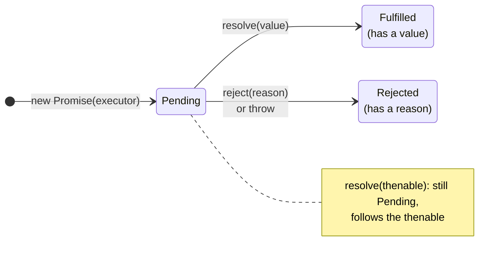
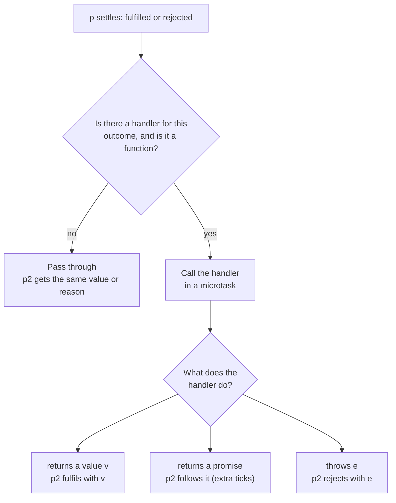
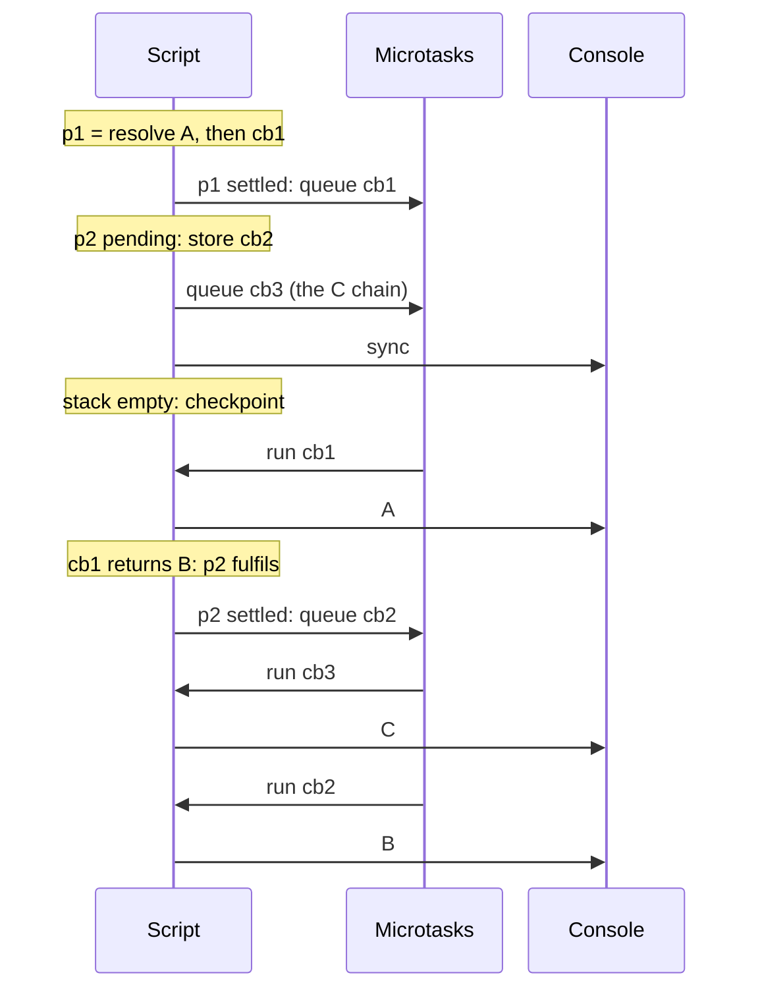

# Chapter 8: Promises Internals

## 8.1 Definition and why interviewers ask it

**A promise is an object that stands for the eventual result of an asynchronous operation. It is in exactly one of three states (pending, fulfilled or rejected), it changes state at most once, and it lets you attach reactions (`then`, `catch`, `finally`) that the engine always runs asynchronously, as microtasks.**

Promises are asked in every JavaScript round (commonly reported), in three forms. The JavaScript-fundamentals round asks "what is a promise, what are its states, what does `then` return". The output-prediction round gives chains, rejections and timer mixes. The machine-coding round asks you to implement `Promise.all`, `allSettled`, `race`, `any`, `promisify`, or a whole minimal `Promise` class. The last one is the strongest signal: if you can write `MyPromise` from memory, you understand states, reaction queues, chaining and the resolution procedure.

## 8.2 Core concept

### Plain language

A promise is a receipt for something you ordered. When you place the order, you get the receipt at once, and the dish is not ready (pending). Later the kitchen either delivers the dish (fulfilled) or tells you it cannot (rejected). The outcome is final: the kitchen cannot change its mind. You can hand the receipt to several people, and each can leave instructions ("when it arrives, do this"). Every instruction is carried out later, in a queue, even if the dish is already on the counter when you write it. Each instruction itself produces a new receipt, which is why you can chain "then do this, then that".

### Precise version

**States and fate**

| Term | Meaning |
|---|---|
| **pending** | Initial state. No result yet. |
| **fulfilled** | Finished with a value. Final. |
| **rejected** | Finished with a reason (usually an `Error`). Final. |
| **settled** | Fulfilled or rejected. Nothing can change it again. |
| **resolved** | The promise's fate is locked in: either it is settled, or `resolve(x)` was called and it is now following `x`. A promise that is resolved to another pending promise is **still pending**. |

"Resolved" is not the same as "fulfilled". `resolve(5)` fulfils the promise. `resolve(otherPromise)` resolves it (further `resolve` or `reject` calls are ignored) but it stays pending until `otherPromise` settles, and then it copies that outcome.

**The constructor.** `new Promise(executor)` calls `executor(resolve, reject)` **synchronously**, before the constructor returns. If the executor throws, the promise is rejected with that error (unless it was already resolved). Only the first call to `resolve` or `reject` has an effect.

**The promise resolution procedure** (what `resolve(x)` does):

| `x` is | Result |
|---|---|
| the promise itself | rejected with `TypeError` (chaining cycle) |
| not an object or function | fulfilled with `x` |
| an object whose `then` getter throws | rejected with that error |
| an object or function with a callable `then` (a **thenable**, native promises included) | queue a **job** that calls `x.then(resolveFn, rejectFn)`; the promise stays pending until one of them is called |
| any other object | fulfilled with `x` |

The queued job is what the specification calls `NewPromiseResolveThenableJob`. It is a microtask. That is why resolving with another promise costs **extra ticks** (Section 8.3, Question 8.7).

**What `then` does.** `p.then(onFulfilled, onRejected)` always returns a **new promise** `p2` and registers a reaction on `p`.

| Handler outcome | State of `p2` |
|---|---|
| handler returns a plain value `v` | fulfilled with `v` |
| handler returns a promise or thenable | `p2` follows it (extra ticks) |
| handler throws `e` | rejected with `e` |
| no handler for the outcome (missing, or not a function) | `p2` copies `p`'s outcome: this is **pass-through** |

`catch(f)` is exactly `then(undefined, f)`. `finally(f)` is `then(v => Promise.resolve(f()).then(() => v), e => Promise.resolve(f()).then(() => { throw e; }))`, in effect:

- `f` receives **no argument**.
- If `f` returns normally (even `return 'x'`), the original value or reason passes through unchanged.
- If `f` throws or returns a rejected promise, **that** rejection replaces the outcome.
- If `f` returns a promise, the chain waits for it.

**Reactions run as microtasks, always.** If `p` is already settled when you call `then`, the reaction job is queued at once. If `p` is pending, the reaction is stored and queued when `p` settles. In both cases the callback runs after the current synchronous code, at the next microtask checkpoint (Chapter 7). A callback is never run synchronously, which gives you one consistent timing ("never zalgo").

**Combinators** (all return a new promise and accept any iterable; non-promise items are wrapped with `Promise.resolve`):

| Method | Fulfils when | Rejects when | Empty input |
|---|---|---|---|
| `Promise.all` | all fulfil: array of values **in input order** | the **first** rejection (fail fast; others keep running) | fulfils with `[]` |
| `Promise.allSettled` | always, after all settle: `{status, value}` or `{status, reason}` objects | never | fulfils with `[]` |
| `Promise.race` | the first to settle, if fulfilled | the first to settle, if rejected | **stays pending forever** |
| `Promise.any` | the first to **fulfil** | all reject: `AggregateError` with an `errors` array | rejects with an empty `AggregateError` |

`Promise.resolve(x)` returns `x` itself when `x` is a native promise (same constructor), otherwise a new promise resolved to `x`. `Promise.reject(x)` always creates a new rejected promise. `Promise.withResolvers()` (ES2024, available in Node 22) returns `{ promise, resolve, reject }` so you can settle a promise from outside its executor.

**Unhandled rejections.** When a promise is rejected and has no rejection handler, the host is told. Browsers fire `unhandledrejection` on the global object (and `rejectionhandled` if a handler is attached later). Node.js emits `process.on('unhandledRejection')`. Since Node 15 the default behaviour is to **throw**: with no `unhandledRejection` listener the rejection becomes an uncaught exception and the process exits with code 1.

**Promises versus callbacks**

| | Callbacks | Promises |
|---|---|---|
| Control flow | You pass control to someone else (inversion of control). They may call you twice, late or never. | You keep control. A promise settles once, and reactions are scheduled by the engine. |
| Composition | Nesting ("callback hell"). Manual counters for parallel work. | `then` chains, `Promise.all` and friends, `async`/`await`. |
| Errors | Convention (`err` first). Each level must forward errors. | A rejection travels down the chain to the nearest handler. |
| Timing | Can be sync or async (inconsistent). | Always async (microtask). |
| Cost | Cheapest, no allocation. | One object per step, extra microtask hop. |
| Repeated events | Natural: a callback can fire many times. | Not suited: a promise settles once (use events, streams or async iterators). |

**Cancellation.** A promise cannot be cancelled. You can stop **waiting** for it (`Promise.race` with a timeout) but the work behind it keeps running. To cancel work, pass an `AbortSignal` to the operation (`fetch(url, { signal })`) and let it reject with an `AbortError`.

## 8.3 How it works internally

### A. Creating and settling

1. `new Promise(executor)` creates the object with `[[PromiseState]]` = pending, empty lists of fulfil reactions and reject reactions, and a pair of **resolving functions** that share one "already resolved" flag.
2. The executor runs synchronously with those two functions. If it throws, the engine calls the reject function (a no-op when the flag is already set).
3. `resolve(x)` sets the flag at once, then applies the resolution procedure (Section 8.2). A plain value leads to **FulfillPromise**. A thenable leads to a queued job.
4. `reject(r)` sets the flag and runs **RejectPromise**.
5. Fulfilling or rejecting stores the result, changes the state, moves the stored reactions into the microtask queue (one job per reaction, in registration order), and drops the lists.
6. If a promise is rejected while it has no reject reaction, the host's rejection tracker is notified. Attaching a handler later notifies it again ("handled").

### B. Calling `then`

1. A **derived promise** `p2` is created, together with its resolving functions (a "capability").
2. A **reaction record** is built for each handler: the handler (or "none"), and `p2`'s resolve and reject functions.
3. If `p` is pending, the records are appended to its reaction lists. If `p` is fulfilled or rejected, one job is queued immediately.
4. `then` returns `p2` without waiting.

### C. Running a reaction job

1. A microtask takes the matching record. If the handler is missing: resolve or reject `p2` with the same value (pass-through).
2. Otherwise call the handler with the settled value or reason. If it **returns** `v`, call `p2`'s resolve with `v`, which runs the resolution procedure (so a returned promise is followed). If it **throws** `e`, call `p2`'s reject with `e`.
3. Settling `p2` queues the reactions registered on `p2`, and the chain advances one link.

### D. Why resolving with a promise costs extra ticks

Take `new Promise(res => res(inner))` where `inner` is already fulfilled, and a reaction `outer.then(cb)`:

1. **Tick 1:** the thenable job runs and calls `inner.then(resolveOuter, rejectOuter)`. `inner` is fulfilled, so that queues a reaction job.
2. **Tick 2:** the reaction job calls `resolveOuter(value)`, which fulfils `outer` and queues `cb`.
3. **Tick 3:** `cb` runs.

With a plain value, `cb` would run in tick 1. So a native promise costs **two extra ticks**. The same two ticks apply when a `then` handler **returns** a promise. This is observable (Questions 8.7) and is one reason `await promise` was optimised: `await` uses `PromiseResolve`, which reuses a native promise and needs no thenable job (Chapter 9).

### E. Unhandled rejection detection

The engine calls `HostPromiseRejectionTracker(promise, "reject")` when a promise is rejected without a handler, and `"handle"` when a handler is added later. The host decides what to do with it. Browsers collect candidates during a task and, after the microtask checkpoint, fire `unhandledrejection` for those still unhandled. Node.js does the same after draining the `nextTick` and microtask queues. A handler added in the same synchronous run, or in a microtask, is in time. A handler added in a later task, such as a timer, is too late.

## 8.4 Diagrams

### The three states



> **How to explain this to the interviewer**
>
> 1. Draw three circles: Pending on the left, Fulfilled and Rejected on the right, with one arrow from Pending to each.
> 2. Label the arrows `resolve(value)` and `reject(reason)`, and say: "there is no arrow out of the two right-hand circles, settling is final".
> 3. Add the note: "`resolve(otherPromise)` does not fulfil. The promise is resolved but stays pending until the other one settles".
>
> **Takeaway:** a promise settles exactly once. "Resolved" means "locked in", not "fulfilled".

### How a value or an error moves through a chain



> **How to explain this to the interviewer**
>
> 1. Start with "p settles" and the question "is there a handler for this outcome?". Say that `then(onF, onR)` picks `onF` for a value and `onR` for a reason, and that `catch` is `then(undefined, onR)`.
> 2. Follow "no": the outcome slides down the chain unchanged. That is how an error skips every `then` until a `catch`.
> 3. Follow "yes": three exits (value, promise, throw). Say: "a `catch` that returns normally turns the chain back to fulfilled".
>
> **Takeaway:** each link decides the next promise's state from what its handler returns or throws.

### Microtask scheduling for a short snippet



> **How to explain this to the interviewer**
>
> 1. Write the snippet on the left: `Promise.resolve('A').then(cb1).then(cb2)`, then `Promise.resolve().then(cb3)`, then `console.log('sync')`.
> 2. Run the script top to bottom: `cb1` and `cb3` are queued at once, but `cb2` is only **stored**, because its promise is still pending.
> 3. Drain the queue: `cb1` runs and **then** `cb2` is queued, behind `cb3`. The output is `sync A C B`.
>
> **Takeaway:** a `then` callback is queued only when its promise settles, so chains advance one step per turn.

### The cost of resolving with a promise

```ascii Microtask ticks until outer.then(cb) runs (inner is already fulfilled)
 plain value:   new Promise(res => res(42))
   tick 1  | cb runs
 native promise: new Promise(res => res(innerPromise))
   tick 1  | thenable job: calls inner.then(resolveOuter) -> queues a reaction job
   tick 2  | reaction job: resolveOuter(value)          -> outer fulfils, queues cb
   tick 3  | cb runs
 same cost when a then handler RETURNS a promise: 2 extra ticks
 await promise (native, Chapter 9): no thenable job, 1 tick
```

> **How to explain this to the interviewer**
>
> 1. Draw two rows, "plain value" and "promise", with ticks as boxes.
> 2. In the promise row, write the three jobs: thenable job, reaction job, your callback.
> 3. Say: "this is why a callback after `resolve(promise)` loses a race against a plain chain that is two links long".
>
> **Takeaway:** following another promise takes two extra microtask turns, and the spec requires it.

### Whiteboard version

```ascii Whiteboard version: states and then (draw in 90 seconds)
  pending --resolve(v)--> fulfilled(v) --.then(f)--> NEW promise p2
     |                                    f returns x: p2 resolves to x
     +----reject(e)----> rejected(e)  --.catch(g)--> NEW promise p3
                                          g returns normally: fulfilled
  settles ONCE.  callbacks ALWAYS run later, as microtasks.
```

## 8.5 Code examples

### Example 1: the executor runs synchronously, reactions do not

```js
console.log('1 before');
const p = new Promise((resolve) => {
  console.log('2 executor runs now');
  resolve('value');
  console.log('3 still inside the executor');
});
p.then((v) => console.log('5 then:', v));
console.log('4 after');
```

```text output
1 before
2 executor runs now
3 still inside the executor
4 after
5 then: value
```

**Why:** the constructor calls the executor before returning, and `resolve` does not stop the executor. The `then` callback is a microtask, so it waits for all synchronous code.

### Example 2: reading the state, and "resolved" is not "fulfilled"

```js
const util = require('util');
const pending = new Promise(() => {});
const ok = Promise.resolve(42);
const bad = Promise.reject('no');
bad.catch(() => {}); // mark as handled
const resolvedToPending = new Promise((resolve) => resolve(pending));

console.log(util.inspect(pending));
console.log(util.inspect(ok));
console.log(util.inspect(bad));
console.log(util.inspect(resolvedToPending), '<- resolved, yet still pending');
```

```text output
Promise { <pending> }
Promise { 42 }
Promise { <rejected> 'no' }
Promise { <pending> } <- resolved, yet still pending
```

**Why:** code cannot read a promise's state, but `util.inspect` can in Node. `resolvedToPending` was resolved to a promise that never settles, so it follows it forever.

### Example 3: a promise settles once

```js
console.log('A');
const p = new Promise((resolve, reject) => {
  resolve('first');
  reject(new Error('ignored'));
  resolve('second');
  throw new Error('also ignored');
});
p.then((v) => console.log('then', v)).catch((e) => console.log('catch', e.message));
console.log('B');
```

```text output
A
B
then first
```

**Why:** the first `resolve` sets the "already resolved" flag. The later `reject`, `resolve` and the thrown error are ignored silently. Never rely on that: it hides bugs.

### Example 4: `then` returns a new promise, and what its state becomes

```js
const p = Promise.resolve(1);
const a = p.then((v) => v + 1);                       // returns a value
const b = p.then((v) => Promise.resolve(v + 10));     // returns a promise
const c = p.then(() => { throw new Error('oops'); }); // throws
const d = p.then();                                   // no handler: pass-through
console.log(a === p, a instanceof Promise);
Promise.allSettled([a, b, c, d]).then((r) =>
  console.log(r.map((x) => (x.status === 'fulfilled' ? x.value : x.reason.message)))
);
```

```text output
false true
[ 2, 11, 'oops', 1 ]
```

**Why:** each `then` call creates its own derived promise, and all four derive from the same `p`. They are independent branches, not a single chain.

### Example 5: chaining pitfalls

```js
async function main() {
  // 1. Non-function arguments to then are ignored: the value passes through.
  console.log(await Promise.resolve(1).then(2).then(Promise.resolve(3)));

  // 2. Forgetting to return: the next link receives undefined.
  console.log(await Promise.resolve('x').then((v) => { v + '!'; }));

  // 3. then(fn()) calls fn NOW. Its result (not a function) is ignored.
  const save = (x) => { console.log('save ran immediately with', x); return 'saved'; };
  console.log(await Promise.resolve('data').then(save('early')));
}
main();
```

```text output
1
undefined
save ran immediately with early
data
```

**Why:** `then` only accepts functions and silently ignores anything else. `then(save('early'))` evaluates `save('early')` while building the chain. Pass the function itself, or an arrow function: `then((d) => save(d))`.

### Example 6: error flow and `finally`

```js
Promise.reject('E1')
  .then(() => console.log('skipped 1'))
  .catch((e) => { console.log('catch', e); return 'recovered'; })
  .finally(() => { console.log('finally'); return 'ignored'; })
  .then((v) => { console.log('then', v); throw new Error('E2'); })
  .then(() => console.log('skipped 2'))
  .catch((e) => console.log('catch', e.message))
  .finally(() => console.log('done'));
```

```text output
catch E1
finally
then recovered
catch E2
done
```

**Why:** the rejection skips every `then` without a rejection handler until the first `catch`. That `catch` returns a value, so the chain is fulfilled again. `finally` runs, ignores its own return value and passes `'recovered'` on.

### Example 7: the four combinators

```js
const delay = (ms, v, fail) =>
  new Promise((resolve, reject) => setTimeout(fail ? reject : resolve, ms, v));
const show = (label, p) => p.then(
  (v) => console.log(label, 'fulfilled', v),
  (e) => console.log(label, 'rejected', e.name === 'AggregateError' ? e.errors : e)
);

async function main() {
  await show('all       ', Promise.all([delay(20, 'a'), delay(10, 'b'), 3]));
  await show('all       ', Promise.all([delay(20, 'a'), delay(10, 'bad', true)]));
  await show('allSettled', Promise.allSettled([delay(10, 'a'), delay(5, 'bad', true)]));
  await show('race      ', Promise.race([delay(20, 'slow'), delay(10, 'fast')]));
  await show('race      ', Promise.race([delay(20, 'slow'), delay(10, 'bad', true)]));
  await show('any       ', Promise.any([delay(10, 'bad', true), delay(20, 'ok')]));
  await show('any       ', Promise.any([delay(10, 'bad1', true), delay(5, 'bad2', true)]));
  await show('all []    ', Promise.all([]));
  await show('any []    ', Promise.any([]));
}
main();
```

```text output
all        fulfilled [ 'a', 'b', 3 ]
all        rejected bad
allSettled fulfilled [
  { status: 'fulfilled', value: 'a' },
  { status: 'rejected', reason: 'bad' }
]
race       fulfilled fast
race       rejected bad
any        fulfilled ok
any        rejected [ 'bad1', 'bad2' ]
all []     fulfilled []
any []     rejected []
```

**Why:** `all` keeps input order (`'a'` first although `'b'` finished first) and fails on the first rejection. `allSettled` never rejects. `race` copies whichever settles first. `any` ignores rejections until all have failed, then rejects with an `AggregateError` whose `errors` keep input order.

### Example 8: errors in promise code versus timers

```js
process.on('uncaughtException', (e) => console.log('uncaughtException:', e.message));

new Promise(() => { throw new Error('thrown in the executor'); })
  .catch((e) => console.log('caught:', e.message));

new Promise(() => {
  setTimeout(() => { throw new Error('thrown in a timer'); }, 0);
}).catch((e) => console.log('never printed:', e.message));
```

```text output
caught: thrown in the executor
uncaughtException: thrown in a timer
```

**Why:** the executor runs inside the constructor, which converts a synchronous throw into a rejection. The timer callback runs later, in its own task, with no promise machinery around it, so the error is an ordinary uncaught exception.

### Example 9: unhandled rejections in Node.js

```js
const { spawnSync } = require('child_process');
const r = spawnSync(process.execPath, ['-e', "Promise.reject(new Error('boom'))"], {
  encoding: 'utf8',
});
console.log('default behaviour, exit code:', r.status);
console.log('stderr mentions boom:', r.stderr.includes('boom'));

process.on('unhandledRejection', (reason) => {
  console.log('unhandledRejection event:', reason.message);
});
const late = Promise.reject(new Error('handled too late'));
setTimeout(() => late.catch(() => console.log('handler attached in a later task')), 10);
```

```text output
default behaviour, exit code: 1
stderr mentions boom: true
unhandledRejection event: handled too late
handler attached in a later task
```

**Why:** since Node 15 an unhandled rejection with no listener terminates the process with exit code 1. With a listener, Node reports the rejection after the microtask queue drains. The handler added 10 ms later is too late to prevent that report.

### Example 10: browser equivalent (browser only)

```js norun
// Browser behaviour: the global events for rejections nobody handled.
window.addEventListener('unhandledrejection', (event) => {
  console.log('unhandled:', event.reason); // event.promise is the promise
  event.preventDefault();                  // suppress the console error
});
window.addEventListener('rejectionhandled', (event) => {
  console.log('handled later:', event.reason);
});
Promise.reject(new Error('nobody catches me'));
```

```text output (browser behaviour)
unhandled: Error: nobody catches me
```

**Why:** the browser fires `unhandledrejection` after the microtask checkpoint when no handler was attached. If a handler is attached later, `rejectionhandled` fires.

### Example 11: identity of `Promise.resolve`, and `withResolvers`

```js
const p = Promise.resolve(1);
console.log(Promise.resolve(p) === p, new Promise((resolve) => resolve(p)) === p);

const { promise, resolve } = Promise.withResolvers();
promise.then((v) => console.log('withResolvers ->', v));
resolve('done');
```

```text output
true false
withResolvers -> done
```

**Why:** `Promise.resolve` returns a native promise unchanged. The constructor always makes a new one. `withResolvers` exposes `resolve` and `reject` outside the executor, replacing the old "deferred" pattern.

### Example 12: a returned promise costs two extra ticks

```js
Promise.resolve().then(() => { console.log('A1'); return Promise.resolve('x'); })
  .then(() => console.log('A2'));
Promise.resolve().then(() => console.log('B1'))
  .then(() => console.log('B2'))
  .then(() => console.log('B3'))
  .then(() => console.log('B4'));
```

```text output
A1
B1
B2
B3
A2
B4
```

**Why:** `A2` would normally follow `A1` after one tick, between `B1` and `B2`. Returning a promise adds the thenable job and the reaction job, so `A2` lands after `B3`.

## 8.6 Common mistakes and gotchas

- **Forgetting `return` inside `then`.** The next link gets `undefined` and runs before the inner promise settles. Return the promise.
- **Nesting instead of chaining.** `p.then(a => q(a).then(b => ...))` rebuilds callback hell. Return the inner promise and chain flat.
- **`.then(fn())` instead of `.then(fn)`.** `fn()` runs at once and its result is ignored if it is not a function. The same goes for `.then(promise)`: a non-function argument is silently dropped.
- **Using `async` in the executor.** `new Promise(async (resolve) => { ... })` swallows errors thrown after an `await`: they reject the executor's own hidden promise, not yours, and nobody handles it. Make the outer function `async` instead.
- **Thinking `catch` ends the chain.** A `catch` that returns normally makes the chain fulfilled again. Re-throw if the error must continue.
- **Throwing in `setTimeout` or any later callback inside a promise.** The promise cannot catch it. Wrap the callback in `try/catch` and call `reject`.
- **Missing a rejection handler on a promise stored in a variable.** If you create a rejected promise and attach `catch` in a later task, the host has already reported it as unhandled. Attach handlers in the same synchronous run, or use `await` right away.
- **Treating `Promise.all` as "cancel the rest on failure".** It rejects early but the other operations keep running. Use `allSettled` when you need every result.
- **Assuming `race` ignores later rejections.** The first to settle wins. A rejection that arrives first rejects the race, even if another promise would have fulfilled.
- **Empty arrays.** `Promise.all([])` and `allSettled([])` fulfil with `[]`, `any([])` rejects, `race([])` never settles.
- **Believing promises are lazy.** A promise starts its work when it is created, not when you call `then`. To defer the work, wrap it in a function.
- **Expecting a promise to fire more than once.** It settles once. Use events, streams or async iterators for repeated values.
- **Using `await` in a loop for independent work.** It runs the steps one after another. Start them together and `await Promise.all(...)`.

## 8.7 Quick revision cheat sheet

- **States:** pending, then fulfilled or rejected, once. Settled means final. **Resolved** means locked in, and may still be pending (resolved to a pending promise).
- **Executor:** runs synchronously. A throw becomes a rejection (unless already resolved). Only the first `resolve` or `reject` counts.
- **`then(onF, onR)`:** returns a NEW promise. Missing or non-function handlers pass the outcome through. Return a value: fulfilled. Return a promise: follow it. Throw: rejected.
- **Timing:** reactions are always microtasks, even for an already settled promise. Resolving with a native promise or returning one costs two extra ticks.
- **`catch(f)` = `then(undefined, f)`.** **`finally(f)`:** no argument, passes the outcome through, unless it throws or returns a rejected promise.
- **Combinators:** `all` (fail fast, ordered, `[]` for empty), `allSettled` (never rejects), `race` (first to settle, empty stays pending), `any` (first fulfilment, else `AggregateError`).
- **Unhandled rejections:** browser `unhandledrejection` event. Node `unhandledRejection`, and since Node 15 the default is to throw and exit with code 1.
- **No cancellation.** Use `AbortController`. `race` with a timeout stops waiting but not the work.

## 8.8 Interview questions

*Key: ★ = very frequently reported. "Typically asked in" lines say which round a question tends to appear in; where no single source could be pinned down the question is labelled "commonly reported". Draw-it hints refer to the figures in section 8.4. All outputs were run on Node 22.*

#### Conceptual

### Q8.1 ★ Easy: What is a promise? What are its states?

*Typically asked in: JavaScript fundamentals round (commonly reported).*

> **Model answer**
>
> A promise is an object that represents the eventual result of an asynchronous operation. It has three states: pending while the work is in progress, then fulfilled with a value or rejected with a reason. Once it is fulfilled or rejected, it is settled, and it can never change again. I attach reactions with `then`, `catch` and `finally`. The engine always runs them asynchronously as microtasks, even if the promise was already settled. One subtlety: "resolved" is not "fulfilled". If I resolve a promise with another pending promise, it is locked in but still pending until the other one settles.

**Key points to mention**

- Pending, fulfilled, rejected. Settled means final, no way back.
- Reactions are microtasks. The executor is synchronous.
- Resolved versus fulfilled.
- Fixes inversion of control and gives composition and error propagation.
- Draw it: Figure 8.1.

### Q8.2 ★ Medium: How does promise chaining work? What does `then` return?

*Typically asked in: JavaScript fundamentals round (commonly reported).*

> **Model answer**
>
> `then` always returns a new promise, so calls can be chained. That new promise is settled by what the handler does. If the handler returns a value, the new promise is fulfilled with it. If it returns a promise or thenable, the new promise follows it. If it throws, the new promise is rejected. If there is no handler for the outcome, because I passed nothing or a non-function, the outcome passes through to the next link. That is how a rejection skips every `then` until a `catch`. Each handler runs as a microtask, only after the previous promise settles.

**Key points to mention**

- A new promise per `then`. `p.then(...)` branches are independent.
- Value, promise, throw, pass-through (table in Section 8.2).
- A `catch` that returns normally recovers the chain.
- Always `return` inside `then`. Never nest.
- Draw it: Figure 8.2.

### Q8.3 ★ Medium: Compare `Promise.all`, `allSettled`, `race` and `any`. When would you use each?

*Typically asked in: JavaScript fundamentals round and machine-coding warm-up (commonly reported).*

> **Model answer**
>
> `all` waits for every promise and returns the values in input order, but rejects as soon as one rejects: use it when all results are needed. `allSettled` waits for all and never rejects. It returns a status object for each: use it when failures are acceptable and I want a report. `race` settles with the first promise to settle, success or failure: I use it for timeouts. `any` fulfils with the first fulfilment and ignores rejections, and only if all fail it rejects with an `AggregateError`: use it for redundant sources, like mirrored servers. For empty input `all` and `allSettled` resolve with `[]`, `any` rejects, and `race` never settles.

**Key points to mention**

- Table: resolves when, rejects when, empty input.
- `all` is fail-fast but does not cancel the others.
- `AggregateError.errors` keeps input order.
- Non-promise values are allowed, they count as already fulfilled.
- Use cases: parallel requests, reports, timeouts, fallbacks.

### Q8.4 Medium: How do you handle errors with promises? What is an unhandled rejection?

*Typically asked in: JavaScript fundamentals round and Node.js round (commonly reported).*

> **Model answer**
>
> A rejection travels down the chain until a handler takes it: either the second argument of `then` or, more commonly, a `catch` at the end. A throw inside any handler also becomes a rejection. A synchronous throw inside the executor does too, but a throw in a later callback like `setTimeout` is not caught by the promise. If a promise rejects and nothing handles it, that is an unhandled rejection. Browsers fire an `unhandledrejection` event. Node emits `unhandledRejection`, and since Node 15, by default, it throws and exits with code 1. So I always end chains with `catch` or use `try/catch` with `await`.

**Key points to mention**

- Propagation to the nearest handler. A `catch` that returns recovers.
- What is not caught: asynchronous throws outside the promise machinery.
- Browser and Node events, and the Node 15 default.
- Handlers must be attached in the same run, or soon after, to avoid the report.
- `finally` for cleanup, it does not swallow errors.

#### Output prediction

### Q8.5 ★ Easy: What does each `then` receive, and what is printed?

*Typically asked in: JavaScript fundamentals round (commonly reported).*

```js
Promise.resolve(1)
  .then((v) => { console.log('a', v); return v + 1; })
  .then((v) => { console.log('b', v); })
  .then((v) => { console.log('c', v); return Promise.resolve(10); })
  .then((v) => { console.log('d', v); throw new Error('x'); })
  .then(() => console.log('skipped'))
  .catch((e) => { console.log('e', e.message); })
  .then((v) => console.log('f', v));
```

```text output
a 1
b 2
c undefined
d 10
e x
f undefined
```

```ascii Value flowing through the chain
 resolve(1) -> a: gets 1, returns 2 -> b: gets 2, returns nothing
   -> c: gets undefined, returns a promise (10) -> d: gets 10, THROWS
   -> then(skipped): no rejection handler, passes the error on
   -> catch: gets Error('x'), returns nothing -> f: gets undefined
```

> **Model answer**
>
> `a 1`, `b 2`, `c undefined`, `d 10`, `e x`, `f undefined`. Each handler receives what the previous one returned. `b` returns nothing, so `c` receives `undefined`. `c` returns a promise, so the next link waits for it and receives the unwrapped value 10. `d` throws, so the promise after it is rejected, and the next `then` has no rejection handler, so the error passes through it unchanged to the `catch`. The `catch` returns nothing, so the chain is fulfilled again and `f` runs with `undefined`.

**Key points to mention**

- Returned values flow forward. Returned promises are unwrapped.
- A throw skips all fulfilment handlers.
- `catch` recovers. What follows gets its return value.

### Q8.6 ★ Medium: Several `then` callbacks on settled promises. What is the output order?

*Typically asked in: JavaScript fundamentals round (commonly reported).*

```js
const p = new Promise((resolve) => {
  console.log('1 executor');
  resolve('value');
});
p.then((v) => console.log('3 then on p, first'));
Promise.resolve().then(() => console.log('4 other chain, step 1'))
  .then(() => console.log('6 other chain, step 2'));
p.then(() => console.log('5 then on p, second'));
console.log('2 sync end');
```

```text output
1 executor
2 sync end
3 then on p, first
4 other chain, step 1
5 then on p, second
6 other chain, step 2
```

```ascii Microtask queue (front on the left)
 after the script : [ then on p #1 | other step 1 | then on p #2 ]
 run #1           : [ other step 1 | then on p #2 ]
 run other step 1 : [ then on p #2 | other step 2 ]     <- step 2 queued only now
 run #2           : [ other step 2 ]
 run other step 2 : [ ]
```

> **Model answer**
>
> The executor runs synchronously, so `1` prints first, then `2` at the end of the script. `p` is already fulfilled, so each `then` on it queues a job immediately, in call order: the first `then` on `p`, step 1 of the other chain, and the second `then` on `p`. Step 2 of the other chain is not queued yet, because its promise is still pending. It is queued when step 1 finishes, behind the second `then` on `p`. So the order is 3, 4, 5, 6.

**Key points to mention**

- Executor is synchronous, reactions are asynchronous.
- A reaction on a settled promise is queued at once, in registration order.
- The next link is queued only after the previous callback returns.
- Write the queue after each step.

### Q8.7 ★ Hard: Resolving with a promise: why does this print `outer then` after `tick 2`?

*Typically asked in: senior JavaScript round (commonly reported).*

```js
new Promise((resolve) => resolve(Promise.resolve('inner')))
  .then(() => console.log('outer then'));

Promise.resolve().then(() => console.log('tick 1'))
  .then(() => console.log('tick 2'))
  .then(() => console.log('tick 3'))
  .then(() => console.log('tick 4'));
```

```text output
tick 1
tick 2
outer then
tick 3
tick 4
```

```ascii Microtask queue (front on the left); TJ = thenable job, RJ = reaction job
 after the script : [ TJ(outer) | tick 1 ]
 run TJ           : [ tick 1 | RJ ]            TJ calls inner.then(resolveOuter)
 run tick 1       : [ RJ | tick 2 ]
 run RJ           : [ tick 2 | outer then ]    RJ fulfils outer, queues its callback
 run tick 2       : [ outer then | tick 3 ]
 run outer then   : [ tick 3 ]
```

> **Model answer**
>
> Resolving a promise with another promise does not fulfil it directly. The spec queues a thenable job, which calls `inner.then(...)`. Since `inner` is already fulfilled, that queues a second job, which finally fulfils `outer` and queues the callback. So `outer then` needs three ticks instead of one, two extra. The other chain advances one link per tick, so `tick 1` and `tick 2` print before it and `tick 3` after. A plain value would have printed `outer then` first. The same two extra ticks apply when a `then` handler returns a promise.

**Key points to mention**

- NewPromiseResolveThenableJob, then the reaction job: 2 extra ticks.
- Also applies to returning a promise from `then`.
- Interleaving is decided by counting ticks, not by wall time.
- `await` on a native promise avoids this cost (Chapter 9).
- Draw it: Figure 8.4.

### Q8.8 Medium: Errors, `catch` and `finally`: what is printed?

*Typically asked in: JavaScript fundamentals round (commonly reported).*

```js
Promise.reject('E1')
  .then(() => console.log('skipped 1'))
  .catch((e) => { console.log('catch', e); return 'recovered'; })
  .finally(() => { console.log('finally'); return 'ignored'; })
  .then((v) => { console.log('then', v); throw new Error('E2'); })
  .then(() => console.log('skipped 2'))
  .catch((e) => console.log('catch', e.message))
  .finally(() => console.log('done'));
```

```text output
catch E1
finally
then recovered
catch E2
done
```

```ascii State of the promise after each link
 reject(E1)   -> then(skipped 1)  : rejected(E1)    (no rejection handler)
 catch        -> returns recovered: fulfilled(recovered)
 finally      -> returns ignored  : fulfilled(recovered)   (return value dropped)
 then         -> throws E2        : rejected(E2)
 then(skipped2)                   : rejected(E2)    (pass-through)
 catch        -> returns nothing  : fulfilled(undefined)
 finally      -> prints done      : fulfilled(undefined)
```

> **Model answer**
>
> `catch E1`, `finally`, `then recovered`, `catch E2`, `done`. The rejection skips the first `then`, because it has no rejection handler. The first `catch` handles it and returns `'recovered'`, so the chain is fulfilled again. `finally` runs but receives no argument, and its return value `'ignored'` is discarded, so `'recovered'` passes through to the `then`. That `then` throws `E2`, which skips the next `then` and lands in the second `catch`. The last `finally` just runs. `finally` never changes the value unless it throws or returns a rejected promise.

**Key points to mention**

- `catch` that returns recovers the chain.
- `finally`: no argument, passes the outcome through.
- Rejections skip `then` links without a rejection handler.
- Strings can be rejection reasons, but use `Error` objects in real code (stack traces).

#### Implement it yourself

### Q8.9 ★ Medium: Implement `Promise.all`.

*Typically asked in: machine-coding round and polyfill round (commonly reported).*

**Problem.** Write `promiseAll(iterable)` that returns a promise for an array of the results **in input order**. It rejects with the first rejection, accepts non-promise values, and resolves with `[]` for empty input. A non-iterable argument rejects with a `TypeError`.

**Solution.**

```js
function promiseAll(iterable) {
  return new Promise((resolve, reject) => {
    const items = [...iterable];            // throws TypeError if not iterable
    const results = new Array(items.length);
    let remaining = items.length;
    if (remaining === 0) return resolve(results);
    items.forEach((item, i) => {
      Promise.resolve(item).then((value) => {
        results[i] = value;                 // keep input order, not finish order
        if (--remaining === 0) resolve(results);
      }, reject);                           // first rejection wins (fail fast)
    });
  });
}

const delay = (ms, v) => new Promise((resolve) => setTimeout(resolve, ms, v));

async function main() {
  const mixed = [delay(30, 'slow'), delay(10, 'fast'), 7, Promise.resolve('now')];
  console.log(await promiseAll(mixed));
  console.log('empty ->', await promiseAll([]));
  try {
    await promiseAll([delay(30, 'a'), Promise.reject(new Error('fail fast'))]);
  } catch (e) {
    console.log(e.message);
  }
  try {
    await promiseAll(5);
  } catch (e) {
    console.log(e.name);
  }
}
main();
```

```text output
[ 'slow', 'fast', 7, 'now' ]
empty -> []
fail fast
TypeError
```

> **Model answer**
>
> I return a new promise. Inside, I copy the iterable to an array, which also throws `TypeError` for non-iterables, and that the executor turns into a rejection. For each item I call `Promise.resolve(item).then(...)` so plain values work. On fulfilment I store the value at its own index, so order follows input order, and decrement a counter. When the counter hits zero I resolve with the array. I pass `reject` as the rejection handler, so the first rejection wins. An empty input must resolve at once, because no callback would ever run. I use a counter, not `results.length`, since results can arrive out of order.

**Key points to mention**

- Index-based assignment, counter for completion (not `push`).
- `Promise.resolve(item)` for non-promise values and thenables.
- Empty input: resolve immediately.
- Fail fast: the first `reject` wins, later calls are ignored. The rest keep running.
- Complexity: O(n) time to attach, O(n) space.

### Q8.10 Medium: Implement `Promise.allSettled`, `Promise.race` and `Promise.any`.

*Typically asked in: machine-coding round and polyfill round (commonly reported).*

**Problem.** Write the three combinators. `allSettled` never rejects and reports every outcome. `race` follows the first promise to settle. `any` fulfils with the first fulfilment and rejects with an `AggregateError` only if all fail.

**Solution.**

```js
const delay = (ms, v, fail) =>
  new Promise((resolve, reject) => setTimeout(fail ? reject : resolve, ms, v));

const allSettled = (iterable) =>
  Promise.all(
    [...iterable].map((x) =>
      Promise.resolve(x).then(
        (value) => ({ status: 'fulfilled', value }),
        (reason) => ({ status: 'rejected', reason })
      )
    )
  );

const race = (iterable) =>
  new Promise((resolve, reject) => {
    for (const x of iterable) Promise.resolve(x).then(resolve, reject); // first settle wins
  });

const any = (iterable) =>
  new Promise((resolve, reject) => {
    const items = [...iterable];
    const errors = new Array(items.length);
    let left = items.length;
    const fail = () => reject(new AggregateError(errors, 'All promises were rejected'));
    if (left === 0) return fail();
    items.forEach((x, i) =>
      Promise.resolve(x).then(resolve, (e) => {
        errors[i] = e;
        if (--left === 0) fail();
      })
    );
  });

async function main() {
  const mix = () => [delay(20, 'ok'), delay(10, 'bad', true), 3];
  console.log(await allSettled(mix()));
  console.log(await race([delay(30, 'slow'), delay(10, 'fast')]));
  console.log(await race(mix()));
  console.log(await any([delay(10, 'e1', true), delay(30, 'ok'), delay(20, 'e2', true)]));
  const err = await any([delay(10, 'e1', true), delay(20, 'e2', true)]).catch((e) => e);
  console.log(err.name, err.errors);
  console.log(await allSettled([]), await any([]).catch((e) => e.errors));
}
main();
```

```text output
[
  { status: 'fulfilled', value: 'ok' },
  { status: 'rejected', reason: 'bad' },
  { status: 'fulfilled', value: 3 }
]
fast
3
ok
AggregateError [ 'e1', 'e2' ]
[] []
```

> **Model answer**
>
> For `allSettled`, I convert every promise so it never rejects: its fulfilment becomes a `{status, value}` object and its rejection becomes `{status, reason}`. Then `Promise.all` on those cannot fail. For `race`, I attach the outer `resolve` and `reject` to every input, and because a promise settles only once, the first to settle wins and later calls are ignored. For `any`, it is `all` reversed: resolve on the first fulfilment, collect rejections by index, and when the counter reaches zero reject with an `AggregateError`. In `race`, a plain value wins immediately. Empty input never settles for `race`.

**Key points to mention**

- `allSettled`: map to non-rejecting promises, then `all`.
- `race`: a single shared executor, "settle once" does the work. Empty input stays pending.
- `any`: mirror of `all`. Errors by index, `AggregateError`.
- Plain values are wrapped with `Promise.resolve`. In `race` they win first.

### Q8.11 ★ Hard: Write a minimal Promises/A+-style `Promise` class.

*Typically asked in: senior JavaScript and machine-coding rounds (commonly reported).*

**Problem.** Implement `MyPromise` with a constructor, `then`, `catch`, `finally`, `resolve` and `reject`. Handlers must run asynchronously, `then` must return a new promise, a returned thenable must be followed, and ordering must match the native `Promise`.

**Solution.**

```js
class MyPromise {
  #state = 'pending';
  #value;
  #reactions = [];

  constructor(executor) {
    if (typeof executor !== 'function') throw new TypeError('Executor must be a function');
    let done = false; // the "already resolved" flag shared by resolve and reject
    const resolve = (x) => { if (!done) { done = true; this.#resolve(x); } };
    const reject = (e) => { if (!done) { done = true; this.#settle('rejected', e); } };
    try { executor(resolve, reject); } catch (e) { reject(e); }
  }

  // The promise resolution procedure.
  #resolve(x) {
    if (x === this) return this.#settle('rejected', new TypeError('Chaining cycle'));
    if (x === null || (typeof x !== 'object' && typeof x !== 'function')) {
      return this.#settle('fulfilled', x);
    }
    let then;
    try { then = x.then; } catch (e) { return this.#settle('rejected', e); }
    if (typeof then !== 'function') return this.#settle('fulfilled', x);
    // Like the spec's NewPromiseResolveThenableJob: call x.then in a microtask.
    queueMicrotask(() => {
      let called = false;
      const res = (y) => { if (!called) { called = true; this.#resolve(y); } };
      const rej = (r) => { if (!called) { called = true; this.#settle('rejected', r); } };
      try { then.call(x, res, rej); } catch (e) { rej(e); }
    });
  }

  #settle(state, value) {
    if (this.#state !== 'pending') return; // one-way, irreversible
    this.#state = state;
    this.#value = value;
    const reactions = this.#reactions;
    this.#reactions = [];
    reactions.forEach((r) => this.#schedule(r));
  }

  #schedule(r) {
    queueMicrotask(() => {
      const ok = this.#state === 'fulfilled';
      const handler = ok ? r.onFulfilled : r.onRejected;
      if (typeof handler !== 'function') return (ok ? r.resolve : r.reject)(this.#value);
      try { r.resolve(handler(this.#value)); } catch (e) { r.reject(e); }
    });
  }

  then(onFulfilled, onRejected) {
    return new MyPromise((resolve, reject) => {
      const reaction = { onFulfilled, onRejected, resolve, reject };
      if (this.#state === 'pending') this.#reactions.push(reaction);
      else this.#schedule(reaction);
    });
  }

  catch(onRejected) { return this.then(undefined, onRejected); }

  finally(fn) {
    if (typeof fn !== 'function') return this.then(fn, fn);
    return this.then(
      (v) => MyPromise.resolve(fn()).then(() => v),
      (e) => MyPromise.resolve(fn()).then(() => { throw e; })
    );
  }

  static resolve(v) { return v instanceof MyPromise ? v : new MyPromise((res) => res(v)); }
  static reject(e) { return new MyPromise((_, rej) => rej(e)); }
}

// Compare our ordering with the native Promise on the same snippet.
function scenario(P) {
  const out = [];
  new P((res) => res(P.resolve('inner'))).then(() => out.push('thenable'));
  P.resolve().then(() => out.push('B1')).then(() => out.push('B2'))
    .then(() => out.push('B3')).then(() => out.push('B4'));
  P.reject(new Error('boom')).finally(() => out.push('finally'))
    .catch((e) => out.push(e.message));
  const cycle = P.resolve().then(() => cycle);
  cycle.catch((e) => out.push(e.name));
  return new Promise((done) => setTimeout(() => done(out), 20));
}

Promise.all([scenario(Promise), scenario(MyPromise)]).then(([native, mine]) => {
  console.log('native :', native.join(' '));
  console.log('mine   :', mine.join(' '));
  console.log('same order:', native.join() === mine.join());
});
```

```text output
native : B1 finally B2 TypeError thenable B3 B4 boom
mine   : B1 finally B2 TypeError thenable B3 B4 boom
same order: true
```

> **Model answer**
>
> The class holds a state, a value and a list of reactions. The executor runs synchronously, guarded by an "already resolved" flag, and a throw rejects. `resolve` follows the resolution procedure: reject on a cycle, fulfil non-objects, and for a thenable call its `then` in a microtask, with a once-only guard. `settle` stores the result and queues every stored reaction as a microtask. `then` returns a new promise: if pending it stores the reaction, otherwise queues it. A reaction calls the handler and resolves the derived promise with its result, rejects on a throw, and passes through when the handler is not a function. `finally` wraps the callback and returns the original outcome.

**Key points to mention**

- Three fields: state, value, reactions. Settle once, never back.
- Handlers always via a microtask (`queueMicrotask`), even when already settled.
- Resolution procedure: self-cycle, thenable (once-only guard, getter errors), plain value.
- Pass-through for missing handlers, new derived promise per `then`.
- Missing here: static combinators, unhandled-rejection tracking, subclassing. Passing the official Promises/A+ suite is the real test.

### Q8.12 Medium: Implement `promisify`, and when would you still use callbacks?

*Typically asked in: Node.js round and machine-coding round (commonly reported).*

**Problem.** Convert a Node-style function `fn(args..., callback)`, where `callback(err, value)`, into one that returns a promise.

**Solution.**

```js
function promisify(fn) {
  return function (...args) {
    return new Promise((resolve, reject) => {
      fn.call(this, ...args, (err, value) => (err ? reject(err) : resolve(value)));
    });
  };
}

// A callback-style API: (args..., callback(err, result))
function getUser(id, callback) {
  setTimeout(() => {
    if (id <= 0) return callback(new Error('invalid id ' + id));
    callback(null, { id, name: 'user' + id });
  }, 5);
}

const getUserAsync = promisify(getUser);

async function main() {
  console.log(await getUserAsync(1));
  try {
    await getUserAsync(0);
  } catch (e) {
    console.log(e.message);
  }
  const [a, b] = await Promise.all([getUserAsync(2), getUserAsync(3)]);
  console.log(a.name, b.name);
}
main();
```

```text output
{ id: 1, name: 'user1' }
invalid id 0
user2 user3
```

> **Model answer**
>
> `promisify` returns a wrapper that creates a promise and calls the original function with my arguments plus a callback. The callback rejects if `err` is set, otherwise resolves with the value. I keep `this` with `fn.call(this, ...)`, so methods still work. That removes the nesting and gives me `await`, `Promise.all` and error propagation. Node's `util.promisify` does the same, with extra support for functions that return several values. I still use callbacks for events that fire many times, like `on('data')`, for hot paths where one allocation per call matters, and where an API is only callback-based.

**Key points to mention**

- Error-first convention: reject on `err`, resolve on the value.
- Preserve `this`. Handle a callback that is called more than once (a promise ignores later calls).
- A synchronous throw in `fn` also rejects, since it happens inside the executor.
- Trade-offs: composition, error flow, consistent async timing versus allocation and single-shot limits.
- Built in: `util.promisify`, `fs.promises`, `timers/promises`.

#### Follow-up traps

### Q8.13 ★ Medium: Is the promise executor asynchronous? What is the difference between "resolve" and "fulfil"?

*Typically asked in: JavaScript fundamentals round, as a follow-up (commonly reported).*

> **Model answer**
>
> No. The executor runs synchronously inside the constructor, before `new Promise` returns. Only the `then` callbacks are asynchronous. A promise created with `new Promise(fn)` is not "async" by itself, it only becomes async when `fn` starts something asynchronous, like a timer. As for the words: to fulfil is to move the promise to the fulfilled state with a value. To resolve means calling `resolve(x)`, which locks the promise's fate. If `x` is a plain value, the promise is fulfilled. If `x` is a promise or thenable, the promise is resolved but stays pending and follows `x`. Later `resolve` or `reject` calls are ignored.

**Key points to mention**

- Executor: synchronous. Reactions: asynchronous.
- Resolved means locked in. Fulfilled means settled with a value.
- Example 2 shows a resolved but pending promise.
- An `async` executor is a bug pattern: its errors are lost.

### Q8.14 Medium: What does `return` inside `finally` do, and what if `finally` throws?

*Typically asked in: JavaScript fundamentals round, as a follow-up (commonly reported).*

> **Model answer**
>
> A normal `return` in `finally` is ignored: the promise keeps the original value or reason, and the callback gets no argument, so it cannot even look at it. Two things change the outcome. If `finally` throws, or returns a rejected promise, that new rejection replaces the original result. And if it returns a promise, the chain waits for it before continuing, then passes the original outcome on. So `finally` is for cleanup, not transformation. The `try`/`finally` statement differs: there a `return` in `finally` overrides the earlier return.

**Key points to mention**

- No argument, return value dropped, original outcome passes through.
- Throw or rejected promise replaces the outcome.
- Waits for a returned promise (delays the chain).
- Contrast with `try { return 1 } finally { return 2 }`, which returns 2.

### Q8.15 Medium: Can you cancel a promise? How do you implement a timeout?

*Typically asked in: JavaScript fundamentals round and front-end design round (commonly reported).*

```js
const delay = (ms) => new Promise((resolve) => setTimeout(resolve, ms));
let slowWorkFinished = false;
async function slowWork() {
  await delay(30);
  slowWorkFinished = true;
  return 'slow result';
}
const timeout = (ms) =>
  new Promise((_, reject) => setTimeout(() => reject(new Error('timeout')), ms));

Promise.race([slowWork(), timeout(10)])
  .catch((e) => console.log('race result:', e.message));
setTimeout(() => console.log('slow work still finished:', slowWorkFinished), 50);
```

```text output
race result: timeout
slow work still finished: true
```

Real cancellation needs the operation to cooperate, here through an `AbortSignal`:

```js
const delay = (ms) => new Promise((resolve) => setTimeout(resolve, ms));
async function abortableWork(signal) {
  for (let i = 0; i < 5; i++) {
    await delay(10);
    signal.throwIfAborted(); // stop at the next checkpoint
  }
  return 'done';
}
const ctrl = new AbortController();
abortableWork(ctrl.signal).then(console.log, (e) => console.log('rejected with', e.name));
setTimeout(() => ctrl.abort(), 25);
```

```text output
rejected with AbortError
```

> **Model answer**
>
> No. A promise has no cancel method: it is a read-only view of a result, and once pending it only settles. `Promise.race` with a timeout promise stops me waiting, but the original work still runs to the end, as the first demo shows. To cancel the work itself, I pass an `AbortSignal`, as `fetch` accepts. The operation listens for abort, stops, and rejects with an `AbortError`. In my own code I check `signal.throwIfAborted()` at safe points. `AbortSignal.timeout(ms)` gives a ready-made timeout signal.

**Key points to mention**

- No cancellation in the Promise API (and none planned in the core).
- `race` with a timer only abandons the result.
- `AbortController` and `AbortSignal` is the standard mechanism.
- Clear timers, release resources, ignore stale results.

#### Sources and further reading

- ECMAScript specification, "Promise Objects" (promise resolve functions, `NewPromiseResolveThenableJob`, `PerformPromiseThen`, `HostPromiseRejectionTracker`): <https://tc39.es/ecma262/>
- Promises/A+ specification, including the promise resolution procedure: <https://promisesaplus.com/>
- MDN, "Promise" and "Using promises" (combinators, `withResolvers`, error handling), and "AbortController".
- javascript.info, "Promise" and "Promise API": <https://javascript.info/promise-basics> and <https://javascript.info/promise-api>
- Node.js documentation, "Process: unhandledRejection" and the `--unhandled-rejections` modes.
- V8 blog, "Faster async functions and promises": <https://v8.dev/blog/fast-async>
- Public interview write-ups seen in web searches for question frequency (page text was not opened, only the search result summaries): PracHub, "JavaScript Promise Interview Questions: Ordering, Rejection, and Cancellation Boundaries" <https://prachub.com/resources/javascript-promise-interview-questions-ordering-rejection-and-cancellation-boundaries>; Interviews Vector, "JavaScript Promises: The Complete Interview Guide" <https://www.interviewsvector.com/javascript/promises>; Interviews Vector, "Implement Promise.race from Scratch" <https://www.interviewsvector.com/javascript/promise-race>; GreatFrontEnd, "Promise.all" <https://www.greatfrontend.com/questions/javascript/promise-all>; dev.to, "Master JavaScript Promises: 10 Tricky Output Questions Every Developer Must Know! (Part 2)" <https://dev.to/hitheshkumar/master-javascript-promises-10-tricky-output-questions-every-developer-must-know-part-2-9dk>. Question wording in this book is original.
- Kyle Simpson, *You Don't Know JS Yet: Async & Performance*.
