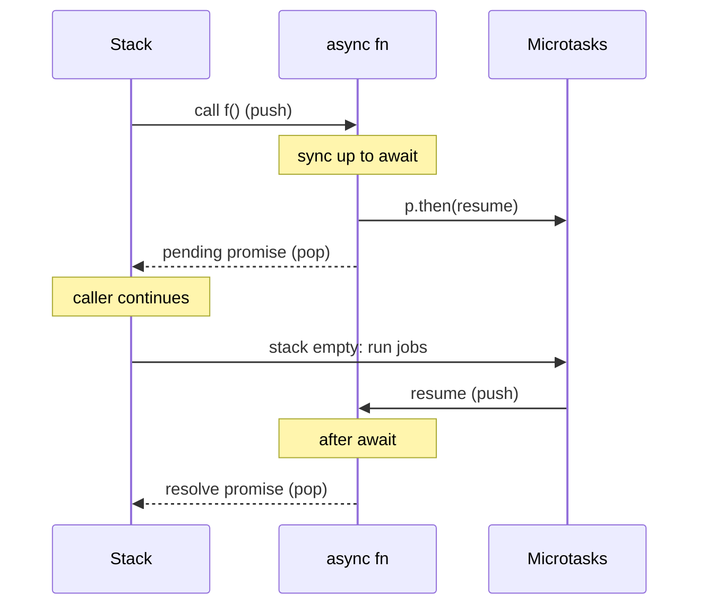
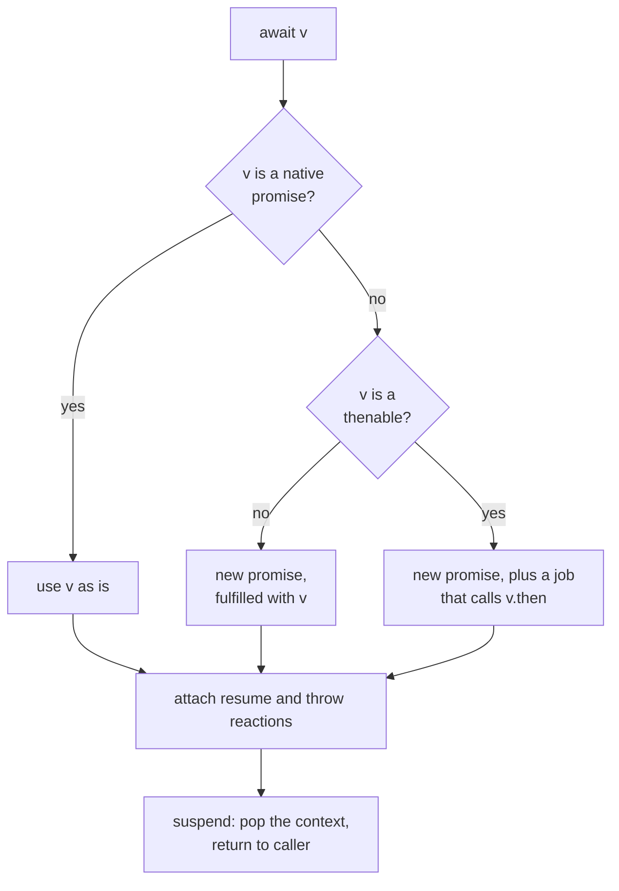
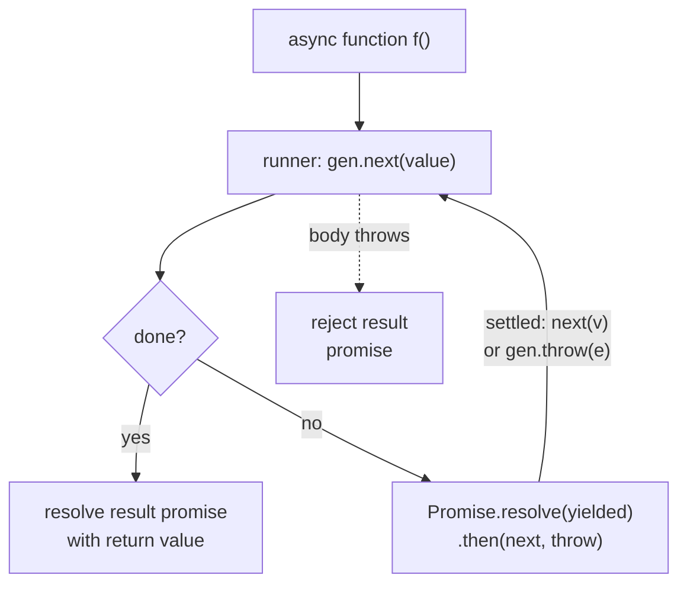
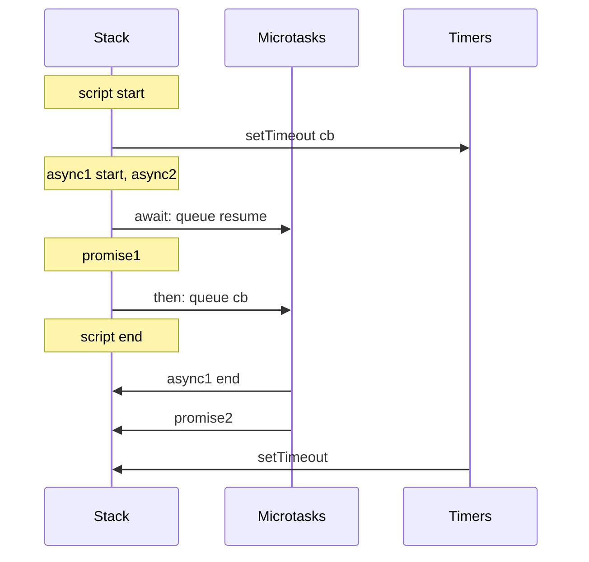

# Chapter 9: async/await Internals

## 9.1 Definition and why interviewers ask it

**`async`/`await` is syntax that lets you write promise-based code as straight-line code. An `async` function always returns a promise, and `await` suspends that function's execution context until a promise settles, then resumes it later through the microtask queue. Nothing blocks the thread.**

Interviewers use it to test whether you understand that `await` is a promise reaction, not a pause button. The usual probes are an output-order puzzle (the `async1`/`async2` snippet), "how would you implement `async`/`await` with generators", "why is my loop slow" (sequential versus parallel), and "why did my `try`/`catch` not catch this" (`return` versus `return await`). All of them appear in JavaScript-fundamentals and machine-coding rounds (commonly reported). Chapter 7 (event loop) and Chapter 8 (promises) are prerequisites, and this chapter builds directly on Chapter 1, Question 1.15.

## 9.2 Core concept

### Plain language

Think of ordering food at a counter with a buzzer. You place the order (`await`), take the buzzer and step aside so the next customer can be served. You have not stopped existing; your place in the process is simply parked. When the kitchen finishes, the buzzer goes off, and you return to the counter exactly where you left off. The counter (the call stack) is free for other people the whole time. `async` functions park their state the same way, and the buzzer is a promise reaction job in the microtask queue.

### Precise version

| Piece | What the specification says |
|---|---|
| `async function f() {}` | Calling it creates a promise capability, runs the body **synchronously** until the first `await`, and returns the promise. |
| `return v` | Resolves the function's promise with `v`. If `v` is a promise or thenable, the function's promise *adopts* it (extra ticks). |
| `throw e` | Rejects the function's promise with `e`. The caller never sees a synchronous exception. |
| `await v` | `promise = PromiseResolve(%Promise%, v)`, then `PerformPromiseThen(promise, resume, throwInto)`, then the current execution context is suspended and removed from the stack. |
| Resume | A promise reaction job pushes the saved context back on the stack and continues after the `await`, with the value (or by throwing the rejection reason at that point). |
| `try`/`catch`/`finally` | Work as in synchronous code, because a rejection is *thrown into* the function at the `await` expression. |

**`PromiseResolve` decides the cost of `await`.** If `v` is already a native promise (its `constructor` is `%Promise%`), it is used as is. Any other value is wrapped in a new promise resolved with `v`, which makes a plain value cost one tick and a thenable cost extra ticks (the engine must call its `then` in a job).

**Ticks.** A *tick* here means one round of the microtask queue (one hop through a promise reaction job). Since the ES2019 spec change, `await nativePromise` and `await 42` each resume after **one** tick. Before, `await nativePromise` wrapped the promise in a new promise first and resumed after **three** ticks. Measured on Node 22 in Section 9.5, Example 4.

**Not a separate mechanism.** There is no "async runtime" besides promises, the microtask queue and a way to suspend a function body. `async`/`await` is the same machinery as generators (Chapter 15) plus a promise-driving loop. Engines implement it natively, but the generator model is exact enough to reason with, and it is the answer to "how does it work under the hood".

**What `async` does not do.** It does not run code on another thread, it does not make synchronous code faster, and it does not make the first part of the function asynchronous. Only the code after each `await` runs later.

## 9.3 How it works internally

### A. Calling an async function

1. A new function execution context is created and pushed, exactly as in Chapter 1.
2. The engine creates the function's **result promise** (pending) and holds its resolve and reject functions.
3. The body runs synchronously, line by line. Everything before the first `await` runs inside the caller's call, in the caller's tick.
4. If the body reaches the end or `return v`, the result promise is resolved with `v`. If it throws, the result promise is rejected.
5. At the first `await`, the function returns the (still pending) result promise to the caller, as described next.

### B. What `await v` does

1. `PromiseResolve(%Promise%, v)`: if `v` is a native promise, use it. Otherwise create a new promise and resolve it with `v`. If `v` is a thenable, a job is queued to call `v.then(resolve, reject)`.
2. Attach two reactions to that promise with `PerformPromiseThen`: *fulfilled* resumes the function with the value, *rejected* resumes it by throwing the reason.
3. **Suspend:** save the position in the body and the function's environments, and **pop the execution context**. Control returns to whoever called or resumed the function: the original caller (first await) or the microtask job runner (later awaits).
4. When the promise settles, its reaction job is placed in the microtask queue (immediately, if it was already settled).
5. The event loop runs that job after the current stack empties. The job **pushes the saved context back** and continues after the `await`.
6. If the promise was rejected, the resume step throws the reason at the `await` expression. A surrounding `try`/`catch` handles it. If nothing does, the function's result promise is rejected.

### C. How `return` settles the result promise

`return v` calls the result promise's resolve function with `v`. Resolving with a **non-thenable** fulfils it at once. Resolving with a **promise** queues a `NewPromiseResolveThenableJob`, which calls `v.then(...)` one tick later, and the result promise settles one tick after `v` does. That is why `return somePromise` takes two ticks longer than `return value`, and one tick longer than `return await somePromise` (Question 9.8).

### D. The desugaring

An async function is behaviourally a generator body driven by a loop:

1. Each `await expr` becomes `yield expr`.
2. A runner calls `gen.next(value)`. When the generator yields, the runner does `Promise.resolve(yielded).then(next, throwInto)`.
3. When the generator returns, the runner resolves the result promise. When it throws, the runner rejects it.
4. The runner needs one extra step compared with the real thing: a `throwInto` that calls `gen.throw(reason)` so `try`/`catch` inside the body works.

Babel and TypeScript used this transformation for years (`regenerator` and `__awaiter`/`__generator`) to compile `async` for old targets. Engines now do it natively without a visible generator object. Section 9.5, Example 3 shows the hand-written equivalent, and Question 9.10 asks you to build the runner.

### E. The one-tick optimisation

Originally, `await v` was specified as "create a new promise, resolve it with `v`, then attach reactions to it". For a native promise `v` that means the thenable-job round trip: three ticks. The V8 team proposed skipping the wrapper when `v` is already a native promise, and the change was adopted into ECMAScript 2019. V8 shipped it in late 2018 (V8 7.2), so Node.js 12 and later behave that way. Code that depends on the *old* ordering is a sign of a bad test, but interviews still ask about it.

### F. Top-level `await`

In an ES module, the module body acts like an async function. The module's evaluation becomes asynchronous: a module that imports one with top-level `await` waits for it to settle before its own body runs. This does not block the thread or the event loop, only the evaluation of the modules that depend on it (Chapter 19).

## 9.4 Diagrams

### Where `await` suspends and resumes



> **How to explain this to the interviewer**
>
> 1. Draw three vertical lines: "Stack", "async fn", "Microtasks". Draw the call arrow, and write "runs synchronously up to the first `await`" beside it.
> 2. Draw the `await` arrow to Microtasks and label it `p.then(resume)`. Then draw the dashed return to the stack and say: "the function is popped, and the caller gets a pending promise back".
> 3. Draw the arrow from Microtasks back to the function and say: "it is pushed again only when the stack is empty".
>
> **Takeaway:** `await` registers a continuation and leaves the stack. It never blocks.

### What `await v` does with the value



> **How to explain this to the interviewer**
>
> 1. Draw the first decision, "native promise?", with "yes" going straight to the reaction box.
> 2. Draw the "no" branch and split it into plain value (wrapped, already fulfilled) and thenable (extra job to call `then`).
> 3. Join all three into one box, "attach reactions, suspend", and say: "the three paths cost 1, 1 and 2 or more ticks".
>
> **Takeaway:** `await` never inspects the value for timing. It normalises it to a promise first.

### async/await desugared into a generator and a runner



> **How to explain this to the interviewer**
>
> 1. Draw a box labelled "generator body" where `await` is written as `yield`, and a loop box labelled "runner" around it.
> 2. Draw the loop: `next(value)`, the generator yields a promise, the runner waits with `.then`, and the result feeds the next `next(value)`.
> 3. Mark the two exits: "done" resolves the result promise, "throws" rejects it. Add the rejection path `gen.throw(e)` so `try`/`catch` works inside.
>
> **Takeaway:** an async function is a generator that a promise-driven loop keeps resuming.

### Tick cost of different awaits

```ascii Which microtask round resumes after each kind of await (round 1 is the first)
 microtask round:                        1         2         3
                                       +---------+---------+---------+
 await 42                              | resume  |         |         |
 await nativePromise (settled)         | resume  |         |         |
 await thenable                        |   .     | resume  |         |
 await new Promise(r => r(nativeP))    |   .     |   .     | resume  |
   (this is what await nativeP cost    +---------+---------+---------+
    before the ES2019 change)

 When the async function's own result promise is observed with .then():
 return 1                              |  then() callback runs in round 1
 return await nativePromise            |  ... round 2
 return nativePromise                  |  ... round 3
```

> **How to explain this to the interviewer**
>
> 1. Draw three columns, rounds 1 to 3, and put a tick mark in round 1 for `await 42` and `await promise`.
> 2. Add the thenable row in round 2, and say: "the engine must first call `then` in a job".
> 3. Add the last block, `return value` versus `return await p` versus `return p`, in rounds 1, 2 and 3.
>
> **Takeaway:** resume costs one tick for plain values and settled native promises, and more for thenables and for returned promises.

### Sequential versus parallel

```ascii Two jobs, A (30 ms) and B (10 ms), awaited one after the other versus together
 time (ms)   0         10        20        30        40
             |         |         |         |         |
 SEQUENTIAL  await jobA(); await jobB();
   A         [========= waiting 30 ms =========]
   B                                           [= 10 =]        total: 40 ms

 PARALLEL    await Promise.all([jobA(), jobB()]);
   A         [========= waiting 30 ms =========]
   B         [= 10 =]                                          total: 30 ms
                      ^ B is done here, but Promise.all waits for A

 Same code, one change: start both jobs BEFORE the first await.
   const a = jobA(); const b = jobB();   // both timers start now
   await a; await b;                     // the wait is max(30, 10), not 30 + 10
```

> **How to explain this to the interviewer**
>
> 1. Draw a time axis and two bars for the sequential case, the second bar starting where the first ends. Write the total, A plus B.
> 2. Draw the parallel case with both bars starting at zero. Write the total, the maximum.
> 3. Point at the code: "the delay only runs when the promise is *created*, so create both before awaiting either".
>
> **Takeaway:** `await` does not start work. Creating the promise starts it, and `await` only decides when you wait.

### Whiteboard version

```ascii Whiteboard version: async function = generator + runner (draw in 90 seconds)
  async function f() {          function* f() {         runner(f):
    const a = await p;    ==>     const a = yield p;     next(v) --> yield p
    return a + 1;                 return a + 1;          p.then(next) <-- loop
  }                             }                        done: resolve(result)
```

## 9.5 Code examples

### Example 1: an async function always returns a promise

```js
async function ok() { return 1; }
async function bad() { throw new Error('nope'); }
async function pass() { return Promise.resolve('inner'); }

const p = ok();
console.log(p instanceof Promise, p);
const q = bad();                       // does not throw here
q.catch((e) => console.log('rejected with', e.message));
pass().then((v) => console.log('pass fulfils with', v));
console.log('sync part done');
```

```text output
true Promise { 1 }
sync part done
rejected with nope
pass fulfils with inner
```

**Why:** `return 1` fulfils the result promise immediately. `throw` becomes a rejection, so the call site sees no exception. `return Promise.resolve(...)` does not produce a promise of a promise: the result promise adopts the inner one, which takes two more ticks (hence it is last).

### Example 2: the body is synchronous until the first `await`

```js
async function f() {
  console.log('1 f starts, synchronously');
  await null;
  console.log('3 f resumes later');
}
f();
console.log('2 the caller continues first');
```

```text output
1 f starts, synchronously
2 the caller continues first
3 f resumes later
```

**Why:** `await null` registers a continuation and pops `f`. The caller carries on, the stack empties, and the microtask resumes `f`.

### Example 3: hand-desugared with generators

```js
// A classic spawn runner (the shape Babel and TypeScript generated for async functions).
function spawn(genFn) {
  return new Promise((resolve, reject) => {
    const gen = genFn();
    function step(advance) {
      let result;
      try { result = advance(); } catch (e) { return reject(e); }
      if (result.done) return resolve(result.value);
      Promise.resolve(result.value).then(
        (v) => step(() => gen.next(v)),
        (e) => step(() => gen.throw(e))
      );
    }
    step(() => gen.next());
  });
}

const getUser = async (id) => ({ id, name: 'Ada' });
const getOrders = async (user) => [user.name + '#1', user.name + '#2'];

// What you write:
async function totalNative(id) {
  const user = await getUser(id);
  const orders = await getOrders(user);
  return orders.length;
}

// What it means: await becomes yield, and the runner does the waiting.
function totalDesugared(id) {
  return spawn(function* () {
    const user = yield getUser(id);
    const orders = yield getOrders(user);
    return orders.length;
  });
}

Promise.all([totalNative(7), totalDesugared(7)]).then((r) => console.log(r));
```

```text output
[ 2, 2 ]
```

**Why:** both functions run the same sequence of steps. The generator is suspended at each `yield`, and the runner resumes it with `next(value)` (or `throw(reason)`) when the promise settles. Real engines skip the visible generator object, but the observable behaviour is the same, apart from the exact tick counts in Example 4.

### Example 4: counting microtask ticks

```js
// ticker logs "tick N" once per microtask round. A log line appearing after
// "tick N" means "resumed in round N".
function ticker(max) {
  let p = Promise.resolve();
  for (let i = 1; i <= max; i++) p = p.then(() => console.log('tick ' + i));
}
const native = Promise.resolve('n');
const thenable = { then(resolve) { resolve('t'); } };
const oldStyle = (v) => new Promise((resolve) => resolve(v)); // the pre-ES2019 await

async function resumeAfter(label, getValue) {
  await getValue();
  console.log('  ' + label);
}

ticker(4);
resumeAfter('await 42', () => 42);
resumeAfter('await native promise', () => native);
resumeAfter('await thenable', () => thenable);
resumeAfter('old-style await of a native promise', () => oldStyle(native));
```

```text output
tick 1
  await 42
  await native promise
tick 2
  await thenable
tick 3
  old-style await of a native promise
tick 4
```

**Why:** `await 42` and `await native` resume in round 1. The thenable needs a job to call `thenable.then`, so it resumes in round 2. Wrapping a native promise in a new promise (what `await` used to do) costs three rounds. This is the measurable form of the "3 ticks versus 1 tick" fact.

### Example 5: error handling, and the unhandled rejection you create by not awaiting

```js
process.on('unhandledRejection', (reason) => {
  console.log('unhandledRejection: ' + reason.message);
});

async function fails() { throw new Error('boom'); }

async function main() {
  try {
    await fails();
  } catch (e) {
    console.log('caught: ' + e.message);
  }
  fails();                       // not awaited, no catch: nobody handles the rejection
  console.log('main finished');
}
main();
```

```text output
caught: boom
main finished
unhandledRejection: boom
```

**Why:** `await` turns a rejection into a thrown exception at that line, so `try`/`catch` works. A promise that rejects with no handler attached by the time the microtask queue drains is reported. Node.js 15 and later would terminate the process on it by default if no `unhandledRejection` handler were installed. Browsers fire `unhandledrejection` on `window` and log an error.

### Example 6: `return` versus `return await` with `try`, `catch` and `finally`

```js
const delay = (ms, v) => new Promise((resolve) => {
  setTimeout(() => { console.log('  settled ' + v); resolve(v); }, ms);
});
const failLater = () => new Promise((_, reject) => {
  setTimeout(() => reject(new Error('boom')), 5);
});

async function plainReturn() {
  try { return failLater(); } catch (e) { return 'caught inside'; }
}
async function awaitedReturn() {
  try { return await failLater(); } catch (e) { return 'caught inside'; }
}
async function finallyPlain() {
  try { return delay(10, 'a'); } finally { console.log('  finally a'); }
}
async function finallyAwaited() {
  try { return await delay(10, 'b'); } finally { console.log('  finally b'); }
}

(async () => {
  console.log(await awaitedReturn());
  try { await plainReturn(); } catch (e) { console.log('caller caught ' + e.message); }
  await finallyPlain();
  await finallyAwaited();
})();
```

```text output
caught inside
caller caught boom
  finally a
  settled a
  settled b
  finally b
```

**Why:** `return failLater()` hands the pending promise to the caller and leaves the `try` block immediately, so the rejection happens outside it. `return await` keeps the function inside the `try` until the promise settles. The same rule moves `finally`: with plain `return`, `finally` runs before the awaited work finishes (`finally a` before `settled a`). With `return await`, it runs after (`settled b` before `finally b`).

### Example 7: sequential versus parallel

```js
const sleep = (ms) => new Promise((r) => setTimeout(r, ms));
async function job(name, ms) {
  console.log(name + ' start');
  await sleep(ms);
  console.log(name + ' end');
  return name;
}

async function sequential() { await job('A', 30); await job('B', 10); }
async function parallel() { await Promise.all([job('A', 30), job('B', 10)]); }
async function startFirst() {
  const a = job('A', 30);           // both timers start here
  const b = job('B', 10);
  await a;
  await b;
}

(async () => {
  await sequential(); console.log('--');
  await parallel(); console.log('--');
  await startFirst();
})();
```

```text output
A start
A end
B start
B end
--
A start
B start
B end
A end
--
A start
B start
B end
A end
```

**Why:** in `sequential`, job B is not even created until A has finished. In the other two, both timers start before the first wait. `startFirst` is as fast as `Promise.all`, but if `b` rejected while you were still awaiting `a`, nobody would be handling it yet (an unhandled rejection). Prefer `Promise.all` or `Promise.allSettled`.

### Example 8: `forEach(async ...)` does not wait

```js
const sleep = (ms) => new Promise((r) => setTimeout(r, ms));
const work = async (n) => { await sleep(10 * (4 - n)); return n * 2; };   // 30, 20, 10 ms
const items = [1, 2, 3];

(async () => {
  const viaForEach = [];
  items.forEach(async (n) => { viaForEach.push(await work(n)); });
  console.log('right after forEach:', viaForEach);
  await sleep(60);
  console.log('later, completion order:', viaForEach);

  const viaForOf = [];
  for (const n of items) viaForOf.push(await work(n));
  console.log('for...of:', viaForOf);

  console.log('map + Promise.all:', await Promise.all(items.map(work)));
})();
```

```text output
right after forEach: []
later, completion order: [ 6, 4, 2 ]
for...of: [ 2, 4, 6 ]
map + Promise.all: [ 2, 4, 6 ]
```

**Why:** `forEach` ignores the promises its callback returns, so it returns at once and the results arrive in completion order. `for...of` with `await` is sequential and ordered. `map` plus `Promise.all` is concurrent, and `Promise.all` keeps the results in input order, however they finish.

### Example 9: top-level `await` is for modules, and `await` needs an async function

```js
try {
  new Function('function f() { await g(); }');       // await in a non-async function
} catch (e) {
  console.log(e.name + ': ' + e.message);
}

(async () => {
  // A module body can use top-level await. A data: URL gives us a tiny module to try.
  const mod = await import('data:text/javascript,export default await Promise.resolve(42)');
  console.log('module value', mod.default);
})();
```

```text output
SyntaxError: await is only valid in async functions and the top level bodies of modules
module value 42
```

**Why:** `await` is only allowed in async functions and module bodies. The `import()` promise settles only after the module's own `await` has finished, which shows that importers wait for a module with top-level `await`.

### Example 10: `this` after an `await`, and async arrow functions

```js
'use strict';
const user = {
  name: 'Ada',
  async afterAwait() { await null; return this.name; },
  arrowInside() { return (async () => { await null; return this.name; })(); },
};

(async () => {
  console.log(await user.afterAwait(), await user.arrowInside());
  const { afterAwait } = user;                 // detached: loses its receiver
  try { await afterAwait(); } catch (e) { console.log(e.name + ': ' + e.message); }
})();
```

```text output
Ada Ada
TypeError: Cannot read properties of undefined (reading 'name')
```

**Why:** `this` is part of the suspended context, so it survives an `await`. An async arrow function has no `this` of its own, it uses the enclosing one, as any arrow does (Chapter 5). A detached async method gets `undefined` in strict mode, and the `TypeError` becomes a rejection, not a synchronous throw.

### Example 11: `await` does not yield to timers when the promises are already settled

```js
setTimeout(() => console.log('timer'), 0);
(async () => {
  for (let i = 0; i < 1000; i++) await null;      // 1000 microtask hops
  console.log('loop done');
})();
console.log('sync end');
```

```text output
sync end
loop done
timer
```

**Why:** every `await null` queues another microtask, and the event loop drains the whole microtask queue before it takes the next timer task. A long loop of awaits on settled values starves timers and rendering, even though no single line blocks.

### Example 12: cancellation with `AbortController`

```js
function sleep(ms, { signal } = {}) {
  return new Promise((resolve, reject) => {
    if (signal && signal.aborted) return reject(signal.reason);
    const timer = setTimeout(resolve, ms);
    if (signal) {
      signal.addEventListener('abort', () => {
        clearTimeout(timer);
        reject(signal.reason);
      }, { once: true });
    }
  });
}

(async () => {
  const ac = new AbortController();
  setTimeout(() => ac.abort(), 10);
  try { await sleep(5000, { signal: ac.signal }); } catch (e) { console.log(e.name); }

  try {
    await sleep(5000, { signal: AbortSignal.timeout(10) });
  } catch (e) {
    console.log(e.name);
  }
})();
```

```text output
AbortError
TimeoutError
```

**Why:** a promise cannot be cancelled from outside. The work has to cooperate by accepting an `AbortSignal`, clearing its timer or request, and rejecting with `signal.reason`. `ac.abort()` gives an `AbortError`. `AbortSignal.timeout(ms)` aborts with a `TimeoutError`.

### Example 13: `for await...of` and async generators

```js
const sleep = (ms) => new Promise((r) => setTimeout(r, ms));
async function* countdown(n) {
  while (n > 0) { await sleep(5); yield n--; }
}

(async () => {
  for await (const x of countdown(3)) console.log('got', x);
  const mixed = [sleep(20).then(() => 'slow'), 'fast'];
  for await (const x of mixed) console.log('from array', x);
})();
```

```text output
got 3
got 2
got 1
from array slow
from array fast
```

**Why:** `for await` awaits each value in turn. Over an async generator, it waits for each `yield`. Over an array of promises, it still waits in array order, so `'fast'` is delayed by `'slow'`. Chapter 15 explains the async iteration protocol.

## 9.6 Common mistakes and gotchas

- **Thinking `await` blocks the thread.** It suspends only the current async function. The rest of the program keeps running.
- **Awaiting independent work one after another.** `await a(); await b();` runs them sequentially. Start both, then await them: `Promise.all([a(), b()])`.
- **`array.forEach(async ...)`.** `forEach` ignores returned promises, so nothing waits and errors become unhandled rejections. Use `for...of` (sequential) or `Promise.all(array.map(...))` (parallel).
- **`return promise` inside `try`/`catch`.** The `catch` never sees the rejection. Use `return await` there (and `finally` ordering changes too).
- **`return await` everywhere.** Outside `try` blocks it only adds a tick and an extra promise (Question 9.5). Use it where you need the catch or the ordering.
- **Forgetting that `async` functions never throw synchronously.** `try { f(); } catch {}` cannot catch an async function's error. You need `await` or `.catch`.
- **Fire-and-forget without a handler.** An unawaited call that rejects is an unhandled rejection, which terminates Node.js 15+ by default. Attach `.catch`, or `void`-call it deliberately with a handler.
- **Unlimited parallelism.** `Promise.all(thousandsOfItems.map(fetch))` can exhaust sockets or hit rate limits. Limit the concurrency (Question 9.11).
- **Parallel `Promise.all` and partial failure.** It rejects on the first rejection, but the other operations keep running. Use `Promise.allSettled` when you need every outcome.
- **`await` in a non-async function.** `SyntaxError`. In a classic script `await` can be an ordinary identifier, so the error message depends on the context.
- **Top-level `await` in CommonJS.** Not allowed. It works only in ES modules (`.mjs`, or `"type": "module"`).
- **Assuming a timeout cancels the work.** `Promise.race` with a timer only stops *waiting*. The losing operation continues unless it listens to an `AbortSignal`.
- **Relying on exact tick counts across engines or versions.** The one-tick `await` is in the specification now, but code that depends on interleaving of unrelated promise chains is fragile.

## 9.7 Quick revision cheat sheet

- `async` function = always returns a promise: `return v` fulfils, `throw e` rejects, nothing throws synchronously.
- The body runs synchronously until the first `await`.
- `await v` = `PromiseResolve(v)` + `PerformPromiseThen(resume, throwInto)`, then the context is **popped**. A microtask **pushes** it again.
- Cost: `await 42` and `await nativePromise` = 1 tick (ES2019 and later; it was 3 for promises). A thenable costs more. `return promise` costs 2 extra ticks over `return value`.
- Under the hood it is a generator driven by a promise runner: `await` becomes `yield`, and the runner calls `next` or `throw`.
- Parallel: create the promises first (`Promise.all`, `allSettled`). `await` in a loop is sequential, `forEach(async)` does not wait.
- Inside `try`, use `return await` to catch the rejection. Without it, `catch` and `finally` run too early.
- Top-level `await` is for ES modules only and delays dependents, not the thread. Cancel with `AbortController`, because promises cannot be cancelled.

## 9.8 Interview questions

*Key: ★ = very frequently reported. "Typically asked in" lines say which round a question tends to appear in; where no single source could be pinned down, the question is labelled "commonly reported". Draw-it hints refer to the figures in section 9.4.*

#### Conceptual

### Q9.1 ★ Medium: How does `async`/`await` work under the hood?

*Typically asked in: JavaScript fundamentals round and async-focused interviews (commonly reported).*

> **Model answer**
>
> An async function creates a result promise and runs its body synchronously until the first `await`. At `await`, the engine turns the value into a promise, attaches a continuation to it with `then`, and suspends the function: its context is popped and its state is saved. The caller gets the pending promise back. When the awaited promise settles, a microtask resumes the function after the `await`. A rejection is thrown at that point, so `try`/`catch` works. The model is a generator driven by a runner, where `await` is `yield`. Engines do this natively.

**Key points to mention**

- Synchronous until the first `await`, then suspend and pop (Chapter 1, Question 1.15).
- `PromiseResolve` plus `PerformPromiseThen`, resumed by a microtask.
- The generator plus promise-runner mental model (Figures 9.1 and 9.3).
- Nothing blocks, and no extra thread.

### Q9.2 Easy: What is the difference between `async`/`await` and promises? Is it just syntax?

*Typically asked in: JavaScript fundamentals round (commonly reported).*

> **Model answer**
>
> `async`/`await` is built on promises and does not replace them. An async function returns a promise, and `await` consumes one. What it adds is syntax: sequential-looking code, normal `try`/`catch`/`finally`, loops with `await` inside, and no nested `then` chains. It also changes timing slightly, because the code after `await` is always a microtask. Promise combinators like `Promise.all` and `Promise.race` are still needed for parallelism. It is not faster than promises, and an `await` adds a promise and a tick that a hand-written chain might avoid.

**Key points to mention**

- Same machinery, different surface.
- Better error handling and debuggability (readable async stack traces).
- You still need `Promise.all` for concurrency.
- No speed benefit, tiny overhead per `await`.

### Q9.3 ★ Medium: How do you run async operations sequentially versus in parallel? Why does `forEach(async ...)` not wait?

*Typically asked in: JavaScript fundamentals and machine-coding rounds (commonly reported).*

> **Model answer**
>
> `await` inside a loop gives sequential execution: each operation starts after the previous finishes. For parallel work I create all the promises first, usually with `Promise.all(items.map(fn))`, and await the combined promise, so the total time is the slowest task, not the sum. `forEach` does not wait because it calls the callback, ignores the returned promise and returns `undefined`. The async callbacks run on their own and errors become unhandled rejections. I use `for...of` with `await` for ordered work, and `map` with `Promise.all` for parallel work, with a concurrency limit when the list is large.

**Key points to mention**

- The timer or request starts when the promise is *created*, not when awaited.
- `Promise.all` preserves input order and fails fast. `allSettled` collects everything.
- `forEach`, `filter`, `reduce` ignore or misuse promises. `for...of` is the sequential tool.
- Draw it: Figure 9.5.

### Q9.4 Medium: How do you handle errors with `async`/`await`? What happens to a rejection that nobody handles?

*Typically asked in: JavaScript fundamentals and design rounds (commonly reported).*

> **Model answer**
>
> I wrap awaits in `try`/`catch`, because a rejection is thrown at the `await`. I use `finally` for cleanup, and a `.catch` on the call when I want one handler per call site, for example `const user = await getUser().catch(() => null)`. An async function never throws synchronously, so a plain `try` around an unawaited call catches nothing. If a rejection has no handler by the time the microtask queue drains, it is an unhandled rejection. Node.js 15 and later exits with an error. Browsers log it and fire `unhandledrejection`. I always await or attach a handler.

**Key points to mention**

- Rejection is thrown into the function at the `await`.
- `Promise.all` rejects with the first error, `allSettled` never rejects.
- Unhandled rejections: Node.js 15+ crashes by default, `process.on('unhandledRejection')`, browser `unhandledrejection`.
- Rethrow or wrap errors with context (`new Error(msg, { cause })`).

### Q9.5 Medium: What is the difference between `return promise` and `return await promise` inside `try`/`catch`/`finally`?

*Typically asked in: JavaScript fundamentals round, as a follow-up on error handling (commonly reported).*

> **Model answer**
>
> With `return promise`, the function hands the pending promise to its result promise and exits the `try` block straight away. A later rejection is outside the `try`, so `catch` never runs, and `finally` runs before the work completes. With `return await promise`, the function stays inside the `try` until the promise settles, so `catch` handles a rejection and `finally` runs afterwards. Outside a `try`, the two behave the same for the caller, but `return await` costs an extra tick and a promise, so I use it only when I need the catch or the ordering.

**Key points to mention**

- Example 6 shows both, including `finally`.
- Tick difference: `return await p` is 1 tick behind `return value`, `return p` is 2 behind (Question 9.8).
- Linters flag `return await` outside `try`, and others require it. The rule is "inside try, yes".

#### Output prediction

### Q9.6 ★ Medium: What is the output order? (the classic `async1`/`async2` puzzle)

*Typically asked in: JavaScript fundamentals round, event-loop section (commonly reported; this exact snippet appears in many public write-ups).*

```js
async function async1() {
  console.log('async1 start');
  await async2();
  console.log('async1 end');
}
async function async2() {
  console.log('async2');
}
console.log('script start');
setTimeout(() => console.log('setTimeout'), 0);
async1();
new Promise((resolve) => {
  console.log('promise1');
  resolve();
}).then(() => console.log('promise2'));
console.log('script end');
```

```text output
script start
async1 start
async2
promise1
script end
async1 end
promise2
setTimeout
```



> **Model answer**
>
> Synchronous code runs first: `script start`, then `async1` runs up to its `await`, so `async1 start` and `async2` print. `async2()` returns an already fulfilled promise, so `await` queues the continuation at once as a microtask. Then `promise1` prints during the executor, the `then` callback is queued after the continuation, and `script end` prints. The stack is empty, so the microtasks run in queue order: `async1 end`, then `promise2`. The timer is a macrotask and runs last. Before the ES2019 change, `async1 end` came after `promise2`.

**Key points to mention**

- A `Promise` executor and an async function's start run synchronously.
- `await` of a native promise costs one tick in current engines, so `async1 end` goes first.
- All microtasks drain before the next macrotask, `setTimeout(..., 0)` included.
- Verified on Node 22. Draw it: the sequence diagram above.

### Q9.7 Hard: Two chains run in the same ticks. What is the output order?

*Typically asked in: senior-leaning JavaScript rounds, event-loop follow-up (commonly reported).*

```js
const p = Promise.resolve();
(async () => {
  await p;
  console.log('A1');
  await p;
  console.log('A2');
})();
p.then(() => console.log('B1'))
  .then(() => console.log('B2'))
  .then(() => console.log('B3'));
```

```text output
A1
B1
A2
B2
B3
```

```ascii Which job runs in which microtask round
 round 1   [ resume A (await p) ]  [ B1 callback ]        -> prints A1, B1
 round 2   [ resume A (await p) ]  [ B2 callback ]        -> prints A2, B2
 round 3                           [ B3 callback ]        -> prints B3
 Jobs inside one round run in the order they were queued. The async IIFE was
 called first, so its resume job was queued before B1.
```

> **Model answer**
>
> `A1 B1 A2 B2 B3`. Both chains advance one step per microtask round, because `await` on a native promise costs one tick, the same as a `then` hop. In round 1, the queue holds A's resume job (queued first, when the async function awaited) and B1. They print `A1` and `B1`. Each queues its next step. Round 2 prints `A2` and `B2`. B has a third step, so `B3` comes last. With the pre-ES2019 three-tick `await`, A's steps would be three rounds apart, and the order would be `B1 B2 A1 B3 A2` (I simulated it by awaiting `new Promise(r => r(p))`).

**Key points to mention**

- Count rounds, not statements: one round per `await` or `then`.
- Within a round, queue order decides, and queue order follows call order.
- Interleaving between *independent* chains is deterministic but fragile. Do not rely on it in real code.
- Draw it: the round table above.

### Q9.8 Hard: `return promise` versus `return await promise`: in what order do these settle?

*Typically asked in: senior-leaning JavaScript rounds, microtask follow-up (commonly reported).*

```js
const p = Promise.resolve('v');
async function viaReturn() { return p; }
async function viaAwait() { return await p; }

viaReturn().then(() => console.log('viaReturn'));
viaAwait().then(() => console.log('viaAwait'));
Promise.resolve()
  .then(() => console.log('t1'))
  .then(() => console.log('t2'))
  .then(() => console.log('t3'))
  .then(() => console.log('t4'));
```

```text output
t1
viaAwait
t2
viaReturn
t3
t4
```

```ascii Microtask rounds for the three chains
 round 1   viaReturn: job calls p.then(...)     viaAwait: resumes, returns   t1
 round 2   viaReturn: reaction resolves result   viaAwait: result .then ->   t2
                                                 prints "viaAwait"
 round 3   viaReturn: result .then -> prints "viaReturn"                     t3
```

> **Model answer**
>
> `t1`, `viaAwait`, `t2`, `viaReturn`, `t3`, `t4`. In `viaAwait`, the function resumes in round 1 and returns a plain value, so its result promise fulfils then, and the outside `then` callback runs in round 2. In `viaReturn`, returning a promise makes the result promise adopt `p` through a thenable job: that job runs in round 1, the reaction it registers runs in round 2 and fulfils the result promise, and the outside `then` runs in round 3. So `return promise` is two ticks slower than a plain return and one tick slower than `return await`.

**Key points to mention**

- Resolving a promise with a promise costs the thenable job plus one more hop.
- `return await p` settles one round earlier than `return p`.
- Measured on Node 22 with the `ticker` technique of Example 4, and summarised in the tick table (Figure 9.4).
- It matters for ordering puzzles, not for application design.

### Q9.9 Medium: What does this print? Does the first `try`/`catch` catch anything?

*Typically asked in: JavaScript fundamentals round, error-handling segment (commonly reported).*

```js
process.on('unhandledRejection', () => console.log('unhandled rejection'));

async function f() { throw new Error('x'); }

try {
  f();
} catch (e) {
  console.log('caught sync');
}
f().catch(() => console.log('caught async'));
console.log('end');
```

```text output
end
caught async
unhandled rejection
```

> **Model answer**
>
> `end`, `caught async`, `unhandled rejection`. An async function never throws synchronously, so the `try`/`catch` around `f()` cannot catch anything and `caught sync` never prints. That first call returns a rejected promise that nobody handles. The second call has `.catch` attached, so its handler runs as a microtask after `end`. The unhandled-rejection report for the first promise comes only after the microtask queue has drained. Without the `process.on` handler, Node.js 15 and later would crash the process there.

**Key points to mention**

- `throw` inside `async` means rejection, not exception.
- The `.catch` callback is a microtask, so it runs after the synchronous `end`.
- Unhandled-rejection detection happens after microtasks drain.
- Fix: `await f()` inside the `try`, or attach `.catch`.

#### Implement it yourself

### Q9.10 ★ Medium: Implement `run(generatorFn)`, a co-style runner that makes generators behave like `async` functions.

*Typically asked in: machine-coding or JavaScript round, "implement async/await using generators" (commonly reported).*

**Problem.** `run(function* () { const x = yield promise; ... })` must return a promise. Each `yield` waits for the yielded value (a promise or a plain value). A rejection must be thrown into the generator at the `yield` so `try`/`catch` works. The return value of the generator resolves the result.

**Solution.** Advance the generator with `next` or `throw`, and resume from `then`.

```js
function run(genFn, ...args) {
  return new Promise((resolve, reject) => {
    const gen = genFn.apply(this, args);

    function handle(result) {
      if (result.done) return resolve(result.value);
      return Promise.resolve(result.value).then(onFulfilled, onRejected);
    }
    function onFulfilled(value) {
      let result;
      try { result = gen.next(value); } catch (e) { return reject(e); }
      return handle(result);
    }
    function onRejected(reason) {
      let result;
      try { result = gen.throw(reason); } catch (e) { return reject(e); }
      return handle(result);
    }
    onFulfilled();                    // start: first next() ignores its argument
  });
}

const wait = (ms, v) => new Promise((r) => setTimeout(r, ms, v));
const fail = (ms) => new Promise((_, rej) => setTimeout(rej, ms, new Error('bad')));

run(function* (a, b) {
  const x = yield wait(5, a);
  const y = yield b;                  // plain values work too
  try {
    yield fail(5);
  } catch (e) {
    console.log('caught inside generator:', e.message);
  }
  return x + y;
}, 1, 2).then((sum) => console.log('result', sum));

run(function* () { throw new Error('sync throw'); })
  .catch((e) => console.log('rejected:', e.message));
```

```text output
rejected: sync throw
caught inside generator: bad
result 3
```

> **Model answer**
>
> `run` returns a promise and holds the generator. A step function calls `gen.next(value)` and, if the generator is not done, wraps the yielded value in `Promise.resolve` and continues from `then`. On fulfilment, it calls `next` with the value. On rejection, it calls `gen.throw(reason)`, which makes the exception appear at the `yield`, so the generator's own `try`/`catch` can handle it. When `done` is true, I resolve with the return value. If `next` or `throw` itself throws, I reject. That is `async`/`await`, with `yield` standing for `await`.

**Key points to mention**

- `gen.throw` is what makes `try`/`catch` work. Forgetting it is the usual bug.
- First `next()` takes no value. Errors thrown synchronously by the generator must reject the promise (see the second demo).
- Wrap yielded values with `Promise.resolve` so plain values and thenables work.
- Complexity: O(number of yields), one microtask hop per `yield`. The stack does not grow, because each step is a fresh microtask.
- Draw it: Figure 9.3.

### Q9.11 Medium: Implement an `asyncPool(limit, items, worker)` that runs at most `limit` tasks at once and keeps result order.

*Typically asked in: machine-coding round (commonly reported). The full treatment is in Chapter 23.*

**Problem.** Run `worker(item, index)` for every item, with at most `limit` running at the same time. Return results in input order. If a worker rejects, the returned promise rejects.

**Solution.** Start `limit` runners. Each loops, taking the next unclaimed index until none is left.

```js
async function asyncPool(limit, items, worker) {
  const results = new Array(items.length);
  let next = 0;
  async function runner() {
    while (next < items.length) {
      const i = next++;                         // claim an index (no await in between)
      results[i] = await worker(items[i], i);
    }
  }
  const count = Math.min(limit, items.length);
  await Promise.all(Array.from({ length: count }, runner));
  return results;
}

const sleep = (ms) => new Promise((r) => setTimeout(r, ms));
let active = 0;
let peak = 0;
asyncPool(2, [30, 10, 20, 10, 5], async (ms, i) => {
  active++; peak = Math.max(peak, active);
  await sleep(ms);
  active--;
  return 'task' + i;
}).then((r) => console.log(r, 'peak concurrency', peak));
```

```text output
[ 'task0', 'task1', 'task2', 'task3', 'task4' ] peak concurrency 2
```

> **Model answer**
>
> I start `limit` runner loops. Each runner claims the next index with `next++`, awaits the worker, stores the result at that index, and repeats until the list is exhausted. The claim and the increment happen without an `await` between them, so with a single thread two runners can never take the same index. Storing by index keeps the input order even though tasks finish at different times. `Promise.all` over the runners rejects on the first error. Concurrency never exceeds `limit`, and a fast task frees its slot immediately.

**Key points to mention**

- Worker-loop pattern: no queue data structure needed, only a shared index.
- Results by index, not by completion.
- Failure: first rejection rejects the whole pool, but already-started tasks keep running (add a stop flag or `AbortSignal` if needed).
- Edge cases: empty list, `limit` greater than length, `limit` less than 1 (validate). Time is about total work divided by `limit`, memory O(n).

### Q9.12 Medium: Write `sleep(ms)` and `withTimeout(promise, ms)`. What does the timeout actually cancel?

*Typically asked in: machine-coding round, async utilities (commonly reported).*

**Problem.** `withTimeout` returns a promise that settles like `promise`, or rejects with a `TimeoutError` if `promise` has not settled within `ms`. Clean up the timer.

**Solution.** Race the promise against a timer, and clear the timer in `finally`.

```js
const sleep = (ms, value) => new Promise((r) => setTimeout(r, ms, value));

class TimeoutError extends Error {
  constructor(ms) { super('Timed out after ' + ms + ' ms'); this.name = 'TimeoutError'; }
}

function withTimeout(promise, ms) {
  let timer;
  const timeout = new Promise((_, reject) => {
    timer = setTimeout(() => reject(new TimeoutError(ms)), ms);
  });
  return Promise.race([promise, timeout]).finally(() => clearTimeout(timer));
}

(async () => {
  console.log(await withTimeout(sleep(10, 'fast'), 100));
  try {
    await withTimeout(sleep(200, 'slow'), 20);
  } catch (e) {
    console.log(e.name + ': ' + e.message);
  }
  try {
    await withTimeout(Promise.reject(new Error('own failure')), 100);
  } catch (e) {
    console.log(e.name + ': ' + e.message);
  }
})();
```

```text output
fast
TimeoutError: Timed out after 20 ms
Error: own failure
```

> **Model answer**
>
> I create a second promise that rejects with a `TimeoutError` after `ms` and pass both to `Promise.race`. Whichever settles first wins. I clear the timer in `finally`, otherwise a fast success leaves a pending timer that keeps a Node.js process alive. The important caveat: this only stops *waiting*. The original operation keeps running, because promises cannot be cancelled. For real cancellation, I pass an `AbortSignal` into the operation, for example `fetch(url, { signal: AbortSignal.timeout(ms) })`.

**Key points to mention**

- `Promise.race` plus `finally(clearTimeout)`.
- Timeout does not cancel the work: use `AbortController`.
- A losing rejection is already handled by `race`, so it does not become an unhandled rejection.
- Edge cases: `ms` of 0, a non-promise input (`race` accepts values), a thenable that never settles.

#### Follow-up traps

### Q9.13 Easy: "Does `await` block the thread?"

*Typically asked in: follow-up after any async/await question (commonly reported).*

> **Model answer**
>
> No. `await` suspends only the async function it is in. The function's context is popped, the call stack frees up, and the event loop keeps handling other tasks, such as clicks, timers and other requests, until the promise settles. Only the code after the `await` waits. There is one subtlety: if you await values that are already settled in a long loop, each step is a microtask, and the engine drains all microtasks before the next timer or render, so you can still starve the event loop (Example 11). Heavy synchronous work blocks the thread, with or without `await`.

**Key points to mention**

- Suspends the function, not the thread.
- Microtask loops can starve timers and rendering.
- CPU-bound work needs a worker or chunking, not `async`.

### Q9.14 Medium: "What does an async function return if it returns a promise? Is the result a promise of a promise?"

*Typically asked in: follow-up on promise resolution (commonly reported).*

> **Model answer**
>
> No, promises never nest. Returning a promise resolves the function's result promise with it, and resolving with a thenable makes the result promise adopt the inner state. The caller sees one promise that settles as the inner one does. The adoption costs two extra microtask ticks compared with returning a plain value. A returned rejected promise rejects the result promise, but inside a `try` block it bypasses `catch`, because the function has already left the block. That is the `return` versus `return await` difference.

**Key points to mention**

- Resolve procedure unwraps thenables (Chapter 8).
- Extra ticks: thenable job plus reaction (Question 9.8).
- Practical consequence: `catch` does not run unless you `return await`.

### Q9.15 Medium: "Is top-level `await` blocking? Can I use it in a CommonJS file?"

*Typically asked in: modules follow-up, increasingly reported with ES module adoption (commonly reported).*

> **Model answer**
>
> It does not block the thread or the event loop. It makes the module's evaluation asynchronous, so any module that imports it waits until the `await` has settled before running its own code, while unrelated modules and other tasks proceed. It works only in ES modules, so `.mjs` files or `"type": "module"`. A CommonJS file gets a `SyntaxError`, since the wrapper function is not async and `require` is synchronous. In practice, it is good for setup such as loading configuration. A slow or never-settling top-level `await` delays everything that depends on that module.

**Key points to mention**

- Module evaluation becomes async: dependants wait, siblings do not.
- Modules only (ES2022). CommonJS: use an async IIFE or `import()`.
- A promise that never settles stalls the dependants silently.
- Chapter 19 covers the module graph.

#### Sources and further reading

- ECMAScript specification, `Await`, `AsyncFunctionStart`, `PromiseResolve`, `PerformPromiseThen`, `NewPromiseResolveThenableJob`: <https://tc39.es/ecma262/>
- V8 blog, "Faster async functions and promises" (the three-ticks-to-one optimisation, later adopted into the specification): <https://v8.dev/blog/fast-async>
- V8 feature explainer, "Top-level await": <https://v8.dev/features/top-level-await>
- MDN, `async function`, `await`, and `AbortSignal`: <https://developer.mozilla.org/en-US/docs/Web/JavaScript/Reference/Statements/async_function>, <https://developer.mozilla.org/en-US/docs/Web/JavaScript/Reference/Operators/await>
- javascript.info, "Async/await": <https://javascript.info/async-await>
- Jake Archibald, "Tasks, microtasks, queues and schedules" (jakearchibald.com), and the "In The Loop" talk.
- Public write-ups used to check which questions recur (seen in search results; the pages themselves could not be fetched from the authoring sandbox): the `async1`/`async2` ordering question in the Advanced-Frontend "Daily-Interview-Question" repository, issue 7 <https://github.com/Advanced-Frontend/Daily-Interview-Question/issues/7>; dev.to, "Demystifying the JS Event Loop: A ByteDance Interview Question to Deeply Understand async/await, Promise, and RAF" <https://dev.to/childrentime/demystifying-the-js-event-loop-a-bytedance-interview-question-to-deeply-understand-asyncawait-326g>; dev.to, "How async/await works in JavaScript, tick by tick" <https://dev.to/pmckeetx/how-asyncawait-works-in-javascript-tick-by-tick-1e20>. Question wording in this book is original.
