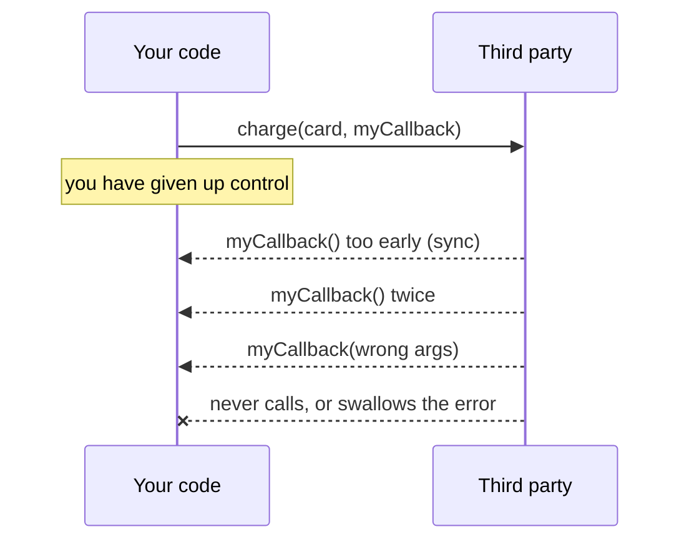
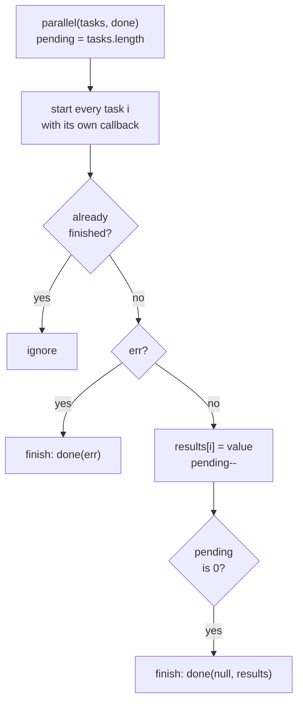

# Chapter 10: Callbacks, Callback Hell & Inversion of Control

## 10.1 Definition and why interviewers ask it

**A callback is a function you pass to other code so that code can call it later. It is JavaScript's oldest way of continuing work after something finishes. The costs are that you give up control over when, how often and whether your function runs (inversion of control), and that dependent steps nest into a pyramid (callback hell).**

Interviewers ask about callbacks as the lead-in to promises and `async`/`await`: "why were promises invented?" has the answer "inversion of control and callback hell". They also ask for hands-on utilities (`promisify`, `once`, `series`, `parallel`, `waterfall`) in machine-coding rounds, and for output-prediction snippets that mix synchronous callbacks with `setTimeout` (commonly reported). Chapters 7 (event loop), 8 (promises) and 9 (async/await) cover what replaced callbacks, and Chapter 23 collects more implementation problems.

## 10.2 Core concept

### Plain language

You hand a courier your phone number and say "call me when the parcel arrives". Your number is the callback. Two things follow. First, you can do other things meanwhile, which is the whole point. Second, you trust the courier to call once, when the parcel has really arrived, with the right information, and not to call your neighbour by mistake. If the courier calls you three times, calls immediately before leaving, or never calls, you cannot do much about it. That lost control is *inversion of control*.

### Precise version

| Term | Meaning |
|---|---|
| Callback | A function value passed as an argument and invoked by the receiving code. Functions are first-class values, so this needs no special syntax. |
| Synchronous callback | Invoked before the receiving function returns, on the caller's stack: `arr.map(fn)`, `arr.sort(cmp)`, `str.replace(re, fn)`, a `Promise` executor. |
| Asynchronous callback | Invoked after the receiving function has returned, from the event loop on a fresh stack: `setTimeout`, `fs.readFile`, DOM event handlers, `process.nextTick`. |
| Continuation-passing style | "Return" by calling a callback with the result. Asynchronous APIs have to do this, since the result does not exist when the function returns. |
| Error-first (Node-style) callback | Signature `cb(err, result)`. `err` is `null` or `undefined` on success. Always the first parameter. |
| Callback hell (pyramid of doom) | Dependent async steps nested in each other's callbacks, so code drifts right and every level repeats the error check. |
| Inversion of control | You pass your continuation to code you do not control. That code decides if, when, how often and with what it calls you. |
| Zalgo | An API that calls its callback synchronously in some cases and asynchronously in others. The name comes from Isaac Schlueter's post on designing APIs for asynchrony. |

**The Node.js error-first convention.** The first argument is the error (`null` when there was none), the remaining ones are results, the callback is the last parameter, and it is called exactly once. Node.js core APIs follow it, and `util.promisify` assumes it.

**Why you cannot `try`/`catch` an asynchronous callback.** A `try` block protects the stack frames that are active while it runs. An asynchronous callback is called later from the event loop, when the frame holding the `try` is long gone. A throw inside it propagates to the top of a fresh stack, where the host reports it (Node.js: `uncaughtException`, browsers: `window.onerror`). That is why error-first callbacks pass errors as *arguments* and why promises capture throws and turn them into rejections.

**The trust problem (Kyle Simpson, *You Don't Know JS: Async & Performance*).** When you pass a callback to a third party, you are trusting it not to:

1. call it too early (synchronously, before you are ready);
2. call it too late, or never;
3. call it too few or too many times;
4. pass the wrong arguments or lose the environment (`this`);
5. swallow errors or exceptions.

Defensive code against all of these (flags, timers, try/catch) is repetitive and easy to get wrong. A promise puts that defence in one place (Section 10.3, part F).

**Ways out of callback hell.**

| Technique | Idea | Limitation |
|---|---|---|
| Name the functions and keep them at the top level | Flat code, each step has a name | Control flow is spread out, shared state needs closures or a context object |
| Modularise | One function per concern, each with a `(args, cb)` signature | Still manual error plumbing |
| Control-flow helpers (`async.series`, `parallel`, `waterfall`) | The loop and the error bookkeeping live in one tested helper | Another callback API to learn |
| Promises | Chain with `then`, errors flow down to one `catch`, resolution is once and asynchronous | Needs adapters for callback APIs (`promisify`) |
| `async`/`await` | Straight-line code with `try`/`catch` | Same as promises underneath |

## 10.3 How it works internally

### A. A synchronous callback

1. `arr.map(fn)` is called and pushed on the stack.
2. `map` calls `fn` for each element. Each call pushes a frame *above* `map`.
3. `fn` returns, its frame pops, and `map` continues. When `map` returns, the whole call is finished.

The callback always runs inside the dynamic extent of its caller, so a `throw` in `fn` propagates through `map` to whoever called `map`, and a surrounding `try`/`catch` works.

### B. An asynchronous callback

1. `setTimeout(fn, 0)` or `fs.readFile(path, fn)` is called. It registers the work and your callback with the host (the timer system, or the file system layer) and **returns immediately**. The current stack finishes and may pop completely.
2. The host does the waiting. In Node.js, file system calls are run by libuv, typically on a thread pool, and the callback is delivered back to the main thread through the event loop.
3. When the work is ready, the host queues a task that will call `fn` (Chapter 7).
4. The event loop runs that task only when the call stack is empty. `fn` is invoked from the loop, on a new stack whose bottom frame is the callback itself. The function that registered it is no longer there.
5. The callback still sees its variables through its closure (Chapter 4), which is how an asynchronous callback keeps its context without a stack.

### C. Why it breaks error handling

The `try` block in step 1 belongs to a frame that has already popped by step 4. An exception thrown in `fn` has nowhere to go but the host's top level. That is a design constraint of callbacks, not a bug, and the reason for the `(err, result)` convention.

### D. Releasing Zalgo

Suppose `getData(key, cb)` calls `cb` immediately when the value is cached and asynchronously when it is not. Callers write code like this:

```text
let ready = false;
getData(key, () => use(ready));   // sync on a cache hit: ready is still false
ready = true;                      // async on a miss: ready is already true
```

The same code behaves differently depending on invisible state. Fixes, in order of preference: **always asynchronous** (defer the cached case with `queueMicrotask`, `process.nextTick` or `setTimeout`), or **always synchronous** if the function does no I/O. Promises make it impossible by construction: `then` callbacks always run asynchronously, even on an already-settled promise.

### E. Composition helpers (series, parallel, waterfall)

All of them have the same skeleton: keep a counter or an index, call each task with a *completion callback* that records the result, and call `done` exactly once, either on the first error or when every task has finished.

- **Series**: run task `i`, and when its callback fires, start task `i + 1`. Results go in an array. Total time is the sum.
- **Parallel**: start every task now, count completions, store each result at its own index. Total time is the maximum.
- **Waterfall**: like series, but the results of task `i` become the arguments of task `i + 1`.

The guards that matter: call `done` once only (a later error after a first error must be ignored), never call it twice, and decide whether `done` is allowed to run synchronously (it should not).

### F. How promises restore trust

| Trust problem | Promise guarantee |
|---|---|
| Called too early | `then` callbacks are always queued as microtasks, never run synchronously. |
| Called too late or never | Not solved by the promise itself (a promise can stay pending), but `Promise.race` with a timer expresses a timeout in one place. |
| Called too many times | A promise settles once. Later `resolve`/`reject` calls are ignored. |
| Wrong arguments | A promise has one fulfilment value (or one rejection reason). |
| Swallowed errors | A throw in an executor or in a `then` callback turns into a rejection that flows down the chain. |
| Third party hands you a thenable | `Promise.resolve(thenable)` or `await` wraps it in a real promise, whose guarantees then apply to you. |

The inversion is reversed: instead of *giving* your continuation away, you *receive* a value that represents the future result, and you attach your continuation to it yourself, on your terms.

## 10.4 Diagrams

### Pyramid of doom versus flat code

```ascii Nested callbacks drift right; named functions keep everything at one level
 PYRAMID (each step nested in the previous callback)

   getUser(id, (err, user) => {
     if (err) return done(err);
     getOrders(user, (err, orders) => {
       if (err) return done(err);
       getTotal(orders, (err, total) => {
         if (err) return done(err);
         done(null, total);
       });
     });
   });
                       ^ error check repeated at every level, shape grows with steps

 FLAT (named steps, one level of indentation)

   function onUser(err, user) {
     if (err) return done(err);
     getOrders(user, onOrders);
   }
   function onOrders(err, orders) {
     if (err) return done(err);
     getTotal(orders, onTotal);
   }
   function onTotal(err, total) { ... }    // same shape, then done(null, total)
   getUser(id, onUser);

 AFTER PROMISES / async await (same three steps)

   const user = await getUser(id);
   const orders = await getOrders(user);
   return getTotal(orders);              // one try/catch covers all three
```

> **How to explain this to the interviewer**
>
> 1. Draw the pyramid first, with three nested levels, and write `if (err)` at every level.
> 2. Draw the flat version next to it: three named functions at the same indentation, each pointing to the next.
> 3. Add the `await` version in three lines and say: "same dependency order, one error handler".
>
> **Takeaway:** callback hell is about dependent steps and repeated error plumbing, not only about indentation.

### Inversion of control



> **How to explain this to the interviewer**
>
> 1. Draw two boxes, "your code" and "third-party code", and an arrow from you to them labelled with the callback you hand over.
> 2. Draw return arrows from them back to you and write the failure modes beside them: early, twice, wrong arguments, never.
> 3. Say: "I cannot guarantee any of these, so I write guard code. A promise gives those guarantees once, in the language".
>
> **Takeaway:** passing a callback transfers control of *when* and *how often* your code runs.

### The Zalgo problem

```ascii A callback that is sometimes sync and sometimes async (cache hit versus miss)
 caller code:    getData('k', cb);   console.log('after call');

 CACHE MISS (async)               CACHE HIT (sync, the bug)
 ------------------               -------------------------
 1. getData starts                1. getData starts
 2. returns, stack unwinds        2. finds the value in cache
 3. 'after call' printed          3. calls cb() NOW, inside getData
 4. later, host calls cb          4. 'after call' printed last
 order:  after call, cb           order:  cb, after call

 FIX: defer the hit as well.
   if (cache.has(key)) { queueMicrotask(() => cb(cache.get(key))); return; }
 Now both paths print: after call, cb.
```

> **How to explain this to the interviewer**
>
> 1. Draw two timelines side by side, "miss" and "hit", each with the same two events: "cb runs" and "caller's next line".
> 2. Show that the order of the two events is reversed between the timelines.
> 3. Cross out the "hit" order, and add the deferred call that makes it match.
>
> **Takeaway:** an API must pick one timing for its callback and keep to it.

### Parallel helper algorithm



> **How to explain this to the interviewer**
>
> 1. Draw "start every task" as a loop box, and next to it a counter `pending = tasks.length` and an array `results`.
> 2. Draw the callback as a small decision: "already finished? ignore", "error? finish with it", otherwise "store at index i, decrement".
> 3. Point at the "pending = 0" box and say: "the last callback to arrive finishes the whole thing, whichever task it was".
>
> **Takeaway:** parallel is a counter plus a results array indexed by task, with a once-only `done`.

### Series algorithm

```ascii series(tasks, done): one task at a time, stop on the first error
   i = 0
   +--> i === tasks.length ? ------ yes ----> done(null, results)
   |            | no
   |            v
   |      tasks[i](cb) ------ cb(err) ------> done(err)      (stop)
   |            | cb(null, value)
   |            v
   |      results.push(value);  i++
   +------------+
 Total time = sum of the task times. For parallel it is the maximum.
```

> **How to explain this to the interviewer**
>
> 1. Draw the loop with an index `i` and the exit test at the top.
> 2. Draw the two branches out of the task call: error stops, success pushes and increments.
> 3. Say: "the next task starts only inside the previous task's callback, which is why it is sequential".
>
> **Takeaway:** series is recursion through callbacks, one step per completion.

### Whiteboard version

```ascii Whiteboard version: who controls the callback (draw in 60 seconds)
 callback:    me ----(fn)----> library      library decides: when? how often?
 promise:     me <---(p)------ library      I decide: p.then(fn), once, always async
```

## 10.5 Code examples

### Example 1: synchronous versus asynchronous callbacks

```js
const fs = require('fs');

console.log('start');
[1, 2].map((n) => { console.log('map callback', n); return n; });
setTimeout(() => console.log('timer callback'), 0);
fs.readFile(__filename, () => console.log('readFile callback'));
console.log('end');
```

```text output
start
map callback 1
map callback 2
end
timer callback
readFile callback
```

**Why:** `map` calls its callback before it returns, so those lines appear in order with the rest of the code. The timer and file callbacks are called later by the event loop, after `end`. (The relative order of the timer and the file callback is a property of Node's loop phases and is not a guarantee. This example is stable only because reading a file takes longer than a zero-delay timer.)

### Example 2: releasing Zalgo, and the fix

```js
const cache = new Map();

function getZalgo(key, cb) {
  if (cache.has(key)) return cb(cache.get(key));            // sync on a hit
  setTimeout(() => { cache.set(key, key + '!'); cb(cache.get(key)); }, 0);
}
function getSafe(key, cb) {
  if (cache.has(key)) return queueMicrotask(() => cb(cache.get(key)));   // async always
  setTimeout(() => { cache.set(key, key + '!'); cb(cache.get(key)); }, 0);
}

function consumer(name, get, key) {
  let ready = false;
  get(key, () => console.log(name, 'ready =', ready));
  ready = true;                       // the caller finishes its setup AFTER the call
}

consumer('zalgo miss', getZalgo, 'a');
setTimeout(() => {
  consumer('zalgo hit ', getZalgo, 'a');   // callback runs before ready = true
  consumer('safe hit  ', getSafe, 'a');    // callback runs after
}, 10);
```

```text output
zalgo miss ready = true
zalgo hit  ready = false
safe hit   ready = true
```

**Why:** on a miss, the callback comes later, so `ready` is already `true`. On a hit, `getZalgo` calls it immediately, so `ready` is still `false`. `getSafe` defers the hit with `queueMicrotask`, so both paths behave the same.

### Example 3: error-first pitfalls

```js
// Pitfall 1: forgot to return after reporting the error, so the callback runs twice.
function parseBad(text, cb) {
  let data;
  try { data = JSON.parse(text); } catch (e) { cb(e); }          // missing return
  cb(null, data);
}
parseBad('{oops', (err, data) => console.log(err ? 'error ' + err.name : 'data ' + data));

// Fixed: return after cb(err), and call the callback from outside the try block.
function parseGood(text, cb) {
  let data;
  try { data = JSON.parse(text); } catch (e) { return cb(e); }
  cb(null, data);
}
parseGood('{"a":1}', (err, data) => {
  console.log(err ? 'error' : 'data ' + JSON.stringify(data));
});
parseGood('{oops', (err) => console.log(err ? 'error ' + err.name : 'no error'));
```

```text output
error SyntaxError
data undefined
data {"a":1}
error SyntaxError
```

**Why:** `parseBad` calls `cb(e)` and then carries on to `cb(null, undefined)`. The consumer sees an error and then a "success" with no data. `return cb(e)` stops the function. Calling `cb` inside the `try` is also a mistake: an exception thrown by the callback itself would be caught and the callback would be called again with that error.

### Example 4: you cannot `try`/`catch` an asynchronous callback

```js
process.once('uncaughtException', (e) => console.log('top level got:', e.message));

try {
  setTimeout(() => { throw new Error('boom'); }, 0);
  console.log('try block finished normally');
} catch (e) {
  console.log('never printed');
}

[1].forEach(() => {
  try {
    throw new Error('sync callback error');
  } catch (e) {
    console.log('caught:', e.message);
  }
});
```

```text output
try block finished normally
caught: sync callback error
top level got: boom
```

**Why:** the `try` block ends right after scheduling the timer. When the timer callback throws, that frame is gone and the error reaches the process-level handler. Without a handler, Node.js would print the error and exit. A synchronous callback runs inside the `try`, so a catch around it works.

### Example 5: the same three steps as a pyramid, flat functions and `async`/`await`

```js
const { promisify } = require('util');

// Fake callback-style API: each call finishes on a later tick.
const getUser = (id, cb) => setTimeout(() => cb(null, { id, name: 'Ada' }), 1);
const getOrders = (user, cb) => setTimeout(() => cb(null, [10, 20, 12]), 1);
const sum = (xs) => xs.reduce((a, b) => a + b);
const getTotal = (orders, cb) => setTimeout(() => cb(null, sum(orders)), 1);

// 1. Pyramid
function pyramid(done) {
  getUser(1, (err, user) => {
    if (err) return done(err);
    getOrders(user, (err, orders) => {
      if (err) return done(err);
      getTotal(orders, (err, total) => {
        if (err) return done(err);
        done(null, total);
      });
    });
  });
}

// 2. Flat: named functions
function flat(done) {
  function onUser(err, user) { if (err) return done(err); getOrders(user, onOrders); }
  function onOrders(err, orders) { if (err) return done(err); getTotal(orders, done); }
  getUser(1, onUser);
}

// 3. Promisified and awaited
async function modern() {
  const user = await promisify(getUser)(1);
  const orders = await promisify(getOrders)(user);
  return promisify(getTotal)(orders);
}

pyramid((e, t) => console.log('pyramid', t));
flat((e, t) => console.log('flat   ', t));
modern().then((t) => console.log('modern ', t));
```

```text output
pyramid 42
flat    42
modern  42
```

**Why:** all three run the dependent steps in order. The flat version only changes where the functions are written, and `modern` also moves error handling to a single `try`/`catch` (not shown) around the awaits. The three interleave on the timers, but each prints when it finishes. They have the same step count, so the print order is stable here.

### Example 6: a third party breaks the contract, and a promise guards you

```js
// Untrusted library: calls back twice, once synchronously, and passes extra junk.
function charge(amount, cb) {
  cb(null, 'charged ' + amount);      // too early (sync)
  setTimeout(() => cb(null, 'charged ' + amount + ' again'), 0);   // too many times
}

let direct = 0;
charge(10, () => { direct++; });
setTimeout(() => console.log('plain callback ran', direct, 'times'), 5);

// Wrap it once in a promise: first resolve wins, and the then-callback is always async.
const log = [];
new Promise((resolve, reject) => {
  charge(10, (err, value) => (err ? reject(err) : resolve(value)));
}).then((v) => log.push(v));
log.push('sync part of caller done');
setTimeout(() => console.log(log), 5);
```

```text output
plain callback ran 2 times
[ 'sync part of caller done', 'charged 10' ]
```

**Why:** the plain callback runs twice (a double charge in real life). Passing `resolve` instead means the second call is ignored, and the `then` callback runs after the caller's synchronous code, even though `charge` called back synchronously.

### Example 7: `util.promisify`, `util.callbackify` and the `promisify.custom` special case

```js
const util = require('util');

const readLater = (name, cb) => setTimeout(() => cb(null, name + ' contents'), 1);
util.promisify(readLater)('a.txt').then((v) => console.log('promisified:', v));

const doubleAsync = async (n) => n * 2;
util.callbackify(doubleAsync)(21, (err, v) => console.log('callbackified:', err, v));

// setTimeout has a custom promisified form: (delay, value).
util.promisify(setTimeout)(1, 'timer value').then((v) => console.log('setTimeout:', v));
```

```text output
callbackified: null 42
promisified: a.txt contents
setTimeout: timer value
```

**Why:** `promisify` appends an error-first callback and wraps the call in a promise. `callbackify` goes the other way, and invokes the callback on a later tick (`process.nextTick`) so it is never synchronous. `setTimeout` does not follow the `(err, value)` convention, so Node attaches a custom promisified version (`util.promisify.custom`) to it.

### Example 8: event emitters are synchronous callbacks

```js
const EventEmitter = require('events');
const bus = new EventEmitter();

bus.on('data', (x) => console.log('listener 1 got', x));
bus.on('data', (x) => console.log('listener 2 got', x));
bus.once('data', () => console.log('once listener (runs only the first time)'));

console.log('before emit');
bus.emit('data', 1);
console.log('after emit');
bus.emit('data', 2);

try {
  bus.emit('error', new Error('nobody listens'));
} catch (e) {
  console.log('thrown:', e.message);
}
```

```text output
before emit
listener 1 got 1
listener 2 got 1
once listener (runs only the first time)
after emit
listener 1 got 2
listener 2 got 2
thrown: nobody listens
```

**Why:** `emit` calls the listeners one after another before it returns, in registration order. It is a synchronous callback list, so a listener that throws interrupts `emit`. An `'error'` event with no listener is thrown, which is an `EventEmitter`-specific rule.

### Example 9: callbacks and `this`

```js
class Counter {
  constructor() { this.n = 0; }
  inc() { this.n++; return this.n; }
}
const c = new Counter();
const callLater = (cb) => cb();                     // calls cb as a plain function

try { callLater(c.inc); } catch (e) { console.log(e.name + ': ' + e.message); }
console.log(callLater(c.inc.bind(c)), callLater(() => c.inc()));

// Array methods accept a thisArg for non-arrow callbacks.
const scale = { k: 10 };
console.log([1, 2].map(function (x) { return x * this.k; }, scale));
```

```text output
TypeError: Cannot read properties of undefined (reading 'n')
1 2
[ 10, 20 ]
```

**Why:** `this` depends on how the callback is *called*, and `callLater` calls it as a bare function, so a method passed by reference loses its receiver (`undefined`, because class bodies are strict). Fix it with `bind`, an arrow wrapper, or a class field arrow function. `map` can set `this` through its optional second argument, but an arrow callback ignores it.

## 10.6 Common mistakes and gotchas

- **Not returning after `cb(err)`.** The function carries on and calls the callback a second time. Write `return cb(err)`.
- **Calling the callback inside a `try` block.** An exception thrown by the callback itself is caught by your own `catch`, which then calls the callback again. Keep `cb(...)` outside `try`.
- **Zalgo.** Do not call a callback synchronously on one path and asynchronously on another. Defer with `queueMicrotask`, `process.nextTick` (Node.js) or `setTimeout`.
- **Throwing from an asynchronous callback.** It cannot be caught by the caller. Pass the error to the callback instead (`cb(err)`).
- **Assuming callbacks are asynchronous.** `map`, `forEach`, `sort`, `replace` and `EventEmitter#emit` call them synchronously.
- **Callbacks that lose `this`.** `setTimeout(obj.method, 0)` calls `method` without the receiver. Use `bind` or an arrow function.
- **Forgetting a single callback exit.** In branches with several early returns, make sure every path calls `cb` exactly once. A path that never calls it leaves the caller waiting forever.
- **Passing a function that takes extra parameters.** `['1', '2', '3'].map(parseInt)` gives `[1, NaN, NaN]`, because `map` passes `(value, index, array)` and `parseInt` reads the index as a radix.
- **Deep recursion in `series` over synchronous tasks.** If every task calls back synchronously, a long task list can overflow the stack. Defer, or loop.
- **Mixing styles in one API.** Offering both a callback and a returned promise is fine (as in many libraries), but a function that does both for the same call leads to double handling.
- **Treating `process.nextTick` as a drop-in for promises.** In Node.js, `nextTick` callbacks run before promise jobs and can starve the event loop if they keep scheduling themselves.

## 10.7 Quick revision cheat sheet

- **Callback** = a function passed to be called later. Sync (`map`) runs on the caller's stack, async (`setTimeout`, I/O) runs on a fresh stack from the event loop.
- **Error-first:** `cb(err, result)`, called once, `return cb(err)`, `cb` outside `try`.
- **Cannot `try`/`catch` an async callback**: the frame is gone. Pass errors as arguments.
- **Callback hell:** dependent steps nested, repeated error checks. Fix with named functions, helpers, promises, `async`/`await`.
- **Inversion of control:** you hand your continuation to code you do not control. Risks: early, late, never, twice, wrong args, swallowed errors.
- **Promises restore trust:** settle once, always asynchronous, one value, throws become rejections, thenables are normalised.
- **Zalgo:** a callback that is sometimes sync and sometimes async. Make it always async.
- **Helpers:** `series` (sum of times), `parallel` (max of times, results by index), `waterfall` (output feeds the next input). `done` runs once, errors short-circuit.

## 10.8 Interview questions

*Key: ★ = very frequently reported. "Typically asked in" lines say which round a question tends to appear in; where no single source could be pinned down, the question is labelled "commonly reported". Draw-it hints refer to the figures in section 10.4.*

#### Conceptual

### Q10.1 ★ Easy: What is a callback, and why are callbacks used in JavaScript?

*Typically asked in: JavaScript fundamentals round (commonly reported).*

> **Model answer**
>
> A callback is a function passed as an argument so that the receiving code can call it later. It works because functions are first-class values. Callbacks are used for two reasons. Synchronously, they customise behaviour: the comparator for `sort`, or the mapper for `map`. Asynchronously, they are how a single-threaded language continues after something slow finishes, such as a timer, a network response or a file read, without blocking. The caller registers its continuation and returns at once, and the event loop calls the callback when the result is ready. Promises and `async`/`await` are later wrappers around the same idea.

**Key points to mention**

- First-class functions plus closures make callbacks work.
- Sync callbacks (`map`) versus async callbacks (`setTimeout`).
- Async callbacks run from the event loop on an empty stack.
- Costs: inversion of control and nesting, which led to promises.

### Q10.2 ★ Medium: What is callback hell, and how do you avoid it?

*Typically asked in: JavaScript fundamentals round, async lead-in (commonly reported).*

> **Model answer**
>
> Callback hell, or the pyramid of doom, is code where each async step is nested inside the previous step's callback. The code drifts right, each level repeats its own error check, and it is hard to read, test and change. To avoid it I first name the callbacks and keep them at the top level, then split steps into small functions. A control-flow helper such as `series` or `waterfall` removes hand-written plumbing. The real fix is to promisify the APIs and use promise chains or `async`/`await`, which flatten the code and route every error to one `catch`.

**Key points to mention**

- It is about dependent steps and error plumbing, not just indentation.
- The ladder: named functions, modules, helpers, promises, `async`/`await`.
- Parallel independent steps do not need nesting at all (`Promise.all`).
- Draw it: Figure 10.1.

### Q10.3 ★ Medium: What is inversion of control in the context of callbacks, and why is it a problem?

*Typically asked in: JavaScript fundamentals round, "why were promises introduced?" (commonly reported).*

> **Model answer**
>
> When I pass a callback to someone else's code, I hand over control of my program's continuation. The library decides if my function runs, when, how many times, with which arguments, and what happens if it throws. I am trusting it not to call early, late or never, not to call twice, and not to swallow errors. A double call on a payment function is a real bug. I can add guard flags and timers, but that is repetitive code in every place I use a callback. Promises invert it back: the library returns a promise, and I attach my handler myself, with once-only, always-async guarantees.

**Key points to mention**

- Kyle Simpson's trust list: early, late, never, too few or too many times, wrong args or `this`, swallowed errors.
- Defensive code (`once`, timeouts) is boilerplate.
- Promises: settle once, async `then`, errors propagate, thenables normalised.
- Draw it: Figure 10.2.

### Q10.4 Medium: What is the error-first callback convention, and what mistakes does it invite?

*Typically asked in: Node.js-flavoured JavaScript rounds (commonly reported).*

> **Model answer**
>
> The callback is the last argument, and its first parameter is the error, `null` on success, followed by the results. It exists because you cannot `try`/`catch` an asynchronous operation, so the error has to travel as a value. The common mistakes are: forgetting `return` after `cb(err)` so the callback fires twice; calling the callback inside a `try` so a throw in the consumer is caught and the callback is called again; calling it synchronously on some paths; never calling it on a branch; and throwing instead of passing the error. A good implementation calls it exactly once, always asynchronously.

**Key points to mention**

- `(err, result)`, last parameter, called once.
- `return cb(err)` and `cb` outside `try` (Example 3).
- Error-first is what `util.promisify` expects.
- Compare with `'error'` events on `EventEmitter`.

### Q10.5 ★ Medium: What is "releasing Zalgo"? How do you make a callback API consistent?

*Typically asked in: Node.js and senior JavaScript rounds (commonly reported).*

> **Model answer**
>
> Zalgo is an API whose callback is sometimes called synchronously, say on a cache hit, and sometimes asynchronously, on a miss. The caller cannot reason about ordering: variables set after the call are visible in one case and not in the other, and stack depth and exceptions differ too. The fix is to choose one timing. Normally that is always asynchronous: defer the synchronous path with `queueMicrotask`, `process.nextTick` in Node.js, or `setTimeout`. If the function does no I/O at all, make it always synchronous and return the value. Promises avoid the problem by design, because `then` callbacks always run asynchronously.

**Key points to mention**

- Inconsistent timing breaks the caller's assumptions.
- Fix: always async (microtask or `nextTick`), or return a value synchronously.
- Origin: Isaac Schlueter's "Designing APIs for Asynchrony".
- Draw it: Figure 10.3.

#### Output prediction

### Q10.6 ★ Easy: What is the output order?

*Typically asked in: JavaScript fundamentals round (commonly reported).*

```js
console.log('1');
[1, 2].forEach((n) => console.log('forEach', n));
setTimeout(() => console.log('timeout'), 0);

function doThing(cb) { console.log('doThing'); cb(); }
doThing(() => console.log('sync callback'));

process.nextTick(() => console.log('nextTick'));
Promise.resolve().then(() => console.log('promise'));
console.log('2');
```

```text output
1
forEach 1
forEach 2
doThing
sync callback
2
nextTick
promise
timeout
```

```ascii Order of execution
 current stack (sync):   1, forEach 1, forEach 2, doThing, sync callback, 2
 after the stack empties:
   nextTick queue   ->   nextTick        (Node.js only; runs before promise jobs)
   microtask queue  ->   promise
 next event loop turn:
   timers phase     ->   timeout
```

> **Model answer**
>
> `1`, `forEach 1`, `forEach 2`, `doThing`, `sync callback`, `2`, then `nextTick`, `promise`, `timeout`. The `forEach` callback and the callback passed to `doThing` are synchronous, so they run in line, on top of their callers. The timer, the `nextTick` callback and the promise reaction are all deferred until the current script finishes. In Node.js, the `nextTick` queue is drained first, then the promise microtasks, and only then the timer. In a browser there is no `nextTick`, so the order would be `promise`, then `timeout`.

**Key points to mention**

- A callback is synchronous unless the receiver defers it.
- Order after sync code: `nextTick`, microtasks, then timers.
- `setTimeout(fn, 0)` is a macrotask, never "immediate".
- `process.nextTick` is Node-specific.

### Q10.7 Medium: What does this print? Where is the Zalgo?

*Typically asked in: senior-leaning JavaScript rounds, async design (commonly reported).*

```js
const cache = {};
function load(key, cb) {
  if (key in cache) cb(cache[key]);
  else setTimeout(() => { cache[key] = key + '!'; cb(cache[key]); }, 0);
}

load('a', (v) => {
  console.log('first', v);
  load('a', (w) => console.log('inner', w));
  console.log('after inner load');
});
console.log('end');
```

```text output
end
first a!
inner a!
after inner load
```

> **Model answer**
>
> `end`, `first a!`, `inner a!`, `after inner load`. The outer `load` finds an empty cache, so its callback is deferred by a timer and `end` prints first. When the callback runs, the cache is filled. The inner `load` is a cache hit, so it calls its callback synchronously, and `inner a!` prints before the `console.log` on the next line. That reversed order, compared with the asynchronous first call, is Zalgo: the same function call produced two different timings. A microtask or timer around the hit path would make the inner callback print after `after inner load`.

**Key points to mention**

- First call: async (miss). Second call: sync (hit).
- Same API, two orders: that is the bug.
- Fix: `queueMicrotask(() => cb(cache[key]))`.
- Order here is deterministic: only one timer is involved.

### Q10.8 Medium: What does this print, and what is wrong?

*Typically asked in: Node.js-flavoured JavaScript rounds (commonly reported).*

```js
function double(x, cb) {
  if (typeof x !== 'number') cb(new Error('not a number'));
  cb(null, x * 2);
}
double('a', (err, v) => console.log(err ? 'error: ' + err.message : 'value ' + v));
```

```text output
error: not a number
value NaN
```

> **Model answer**
>
> It prints two lines, `error: not a number` and then `value NaN`. The function reports the error but does not return, so execution continues and calls the callback again with `x * 2`, which is `NaN` for a string. The consumer sees both a failure and a success. The fix is `return cb(new Error(...))`, or an `else` branch. The rule behind it: an error-first callback must be called exactly once on every path. In real code, the second call might trigger a duplicate write or a second response.

**Key points to mention**

- Missing `return` after `cb(err)`.
- The callback fires twice with contradictory outcomes.
- Fix with `return`, and test every branch for exactly one call.
- Same bug class as sending two HTTP responses.

#### Implement it yourself

### Q10.9 ★ Medium: Implement `promisify(fn)`, which turns an error-first callback function into a promise-returning one.

*Typically asked in: machine-coding or JavaScript round (commonly reported).*

**Problem.** `promisify(fn)` returns a function that accepts the same arguments as `fn` without the callback, and returns a promise that resolves with the callback's result or rejects with its error. Keep `this`.

**Solution.** Append a callback that settles the promise.

```js
function promisify(fn) {
  return function (...args) {
    return new Promise((resolve, reject) => {
      fn.call(this, ...args, (err, ...values) => {
        if (err) return reject(err);
        resolve(values.length > 1 ? values : values[0]);   // several results: an array
      });
    });
  };
}

const store = {
  data: { a: 1 },
  get(key, cb) { setTimeout(() => cb(null, this.data[key]), 1); },     // uses this
  fail(cb) { setTimeout(() => cb(new Error('disk error')), 1); },
  pair(cb) { setTimeout(() => cb(null, 'x', 'y'), 1); },
  broken() { throw new Error('threw synchronously'); },
};
store.get = promisify(store.get);
store.fail = promisify(store.fail);
store.pair = promisify(store.pair);
store.broken = promisify(store.broken);

(async () => {
  console.log(await store.get('a'));
  try { await store.fail(); } catch (e) { console.log('rejected:', e.message); }
  console.log(await store.pair());
  try { await store.broken(); } catch (e) { console.log('rejected:', e.message); }
})();
```

```text output
1
rejected: disk error
[ 'x', 'y' ]
rejected: threw synchronously
```

> **Model answer**
>
> `promisify` returns a wrapper that creates a promise and calls the original with the caller's arguments plus one extra callback. The callback rejects if its first argument is truthy, otherwise it resolves with the result. I call the original with `fn.call(this, ...)`, so method calls keep their receiver. A synchronous throw inside the executor automatically becomes a rejection. With several result values I resolve with an array, whereas `util.promisify` only keeps the first, unless a custom promisified form exists. The wrapper only works for functions that follow the error-first convention and call back once.

**Key points to mention**

- Error-first only. Functions like `setTimeout` need a custom form.
- Keep `this` with `call`, and catch sync throws (the executor does it).
- Multi-value callbacks: decide array versus first value.
- Complexity: O(1) overhead per call, one promise per call.

### Q10.10 Medium: Implement `once(fn)` and use it to guard a callback against being called more than once.

*Typically asked in: machine-coding round warm-up (commonly reported).*

**Problem.** `once(fn)` returns a function that calls `fn` the first time, and afterwards ignores calls (returning the first result). Use it to make an untrusted callback-taking function safe.

**Solution.** A flag and a cached result in a closure.

```js
function once(fn) {
  let called = false;
  let result;
  return function (...args) {
    if (called) return result;
    called = true;
    result = fn.apply(this, args);
    return result;
  };
}

function flaky(cb) {                 // untrusted: calls back twice
  cb(null, 'first');
  cb(null, 'second');
}

const calls = [];
flaky(once((err, v) => calls.push(v)));
console.log(calls);

const init = once(() => { console.log('initialising'); return 42; });
console.log(init(), init());
```

```text output
[ 'first' ]
initialising
42 42
```

> **Model answer**
>
> `once` closes over a `called` flag and a `result`. The returned wrapper checks the flag. On the first call, it sets the flag before running `fn`, then stores and returns the result. Later calls skip `fn` and return the stored result. I set the flag *before* calling `fn`, so a re-entrant call from inside `fn` cannot run it twice. I forward `this` and the arguments with `apply`. Wrapping a callback in `once` repairs the "called twice" trust problem, but it cannot fix "never" or "too early".

**Key points to mention**

- Closure state: `called`, `result`.
- Set the flag first (re-entrancy). If `fn` throws, decide whether to allow a retry.
- Doesn't fix a callback that is never called, or one called synchronously.
- O(1) time and space.

### Q10.11 ★ Medium: Implement `series(tasks, done)` and `parallel(tasks, done)` for error-first tasks.

*Typically asked in: machine-coding round (commonly reported).*

**Problem.** Each task is `(cb) => ...` and calls `cb(err, value)`. `series` runs them one at a time, `parallel` all at once. In both, `done(err, results)` is called exactly once, results are in task order, the first error ends everything, and `done` is never called synchronously.

**Solution.** A once-only, deferred `finish`, an index for series, and a counter for parallel.

```js
function makeFinish(done) {
  let finished = false;
  return (err, results) => {
    if (finished) return;                         // later calls are ignored
    finished = true;
    queueMicrotask(() => done(err, results));     // never synchronous
  };
}

function series(tasks, done) {
  const finish = makeFinish(done);
  const results = [];
  (function next(i) {
    if (i === tasks.length) return finish(null, results);
    tasks[i]((err, value) => {
      if (err) return finish(err);
      results.push(value);
      next(i + 1);
    });
  })(0);
}

function parallel(tasks, done) {
  const finish = makeFinish(done);
  const results = new Array(tasks.length);
  let pending = tasks.length;
  if (pending === 0) return finish(null, results);
  tasks.forEach((task, i) => {
    task((err, value) => {
      if (err) return finish(err);
      results[i] = value;
      if (--pending === 0) finish(null, results);
    });
  });
}

const later = (ms, v, fail) => (cb) =>
  setTimeout(() => (fail ? cb(new Error(v)) : cb(null, v)), ms);

series([later(20, 'a'), later(5, 'b')], (e, r) => console.log('series  ', e, r));
parallel([later(20, 'a'), later(5, 'b')], (e, r) => console.log('parallel', e, r));
parallel([later(20, 'a'), later(5, 'oops', true)], (e, r) => {
  console.log('failing ', e.message, r);
});
parallel([], (e, r) => console.log('empty   ', e, r));
```

```text output
empty    null []
failing  oops undefined
parallel null [ 'a', 'b' ]
series   null [ 'a', 'b' ]
```

> **Model answer**
>
> Both share a `finish` function that ignores calls after the first and defers `done` with `queueMicrotask`, so there is no double call and no Zalgo. `series` is recursive: `next(i)` starts task `i`, and its callback records the result and calls `next(i + 1)`. An error calls `finish(err)` and the chain stops. `parallel` starts every task, keeps a `pending` counter, and stores each result at its own index, so order is by task, not by completion. The last arrival makes the counter zero and finishes. An empty list must still call `done`. Series takes the sum of the task times, parallel takes the maximum.

**Key points to mention**

- Single-completion guard, and the deferred `done`.
- Results by index in parallel, because completion order varies.
- On an error in parallel, the other tasks still run. The helper just ignores them.
- Edge cases: empty array, a task that calls back twice (guard per task if needed), a task that throws (wrap in `try`/`catch`), long synchronous series can deepen the stack.
- Draw it: Figures 10.4 and 10.5.

### Q10.12 Medium: Implement `waterfall(tasks, done)`, where each task's result becomes the next task's arguments.

*Typically asked in: machine-coding round, follow-up to `series` (commonly reported).*

**Problem.** `tasks[0]` receives only a callback. Each later task receives the previous task's results followed by its own callback. `done(err, ...lastResults)` is called once.

**Solution.** Like `series`, but thread the arguments through.

```js
function waterfall(tasks, done) {
  let finished = false;
  const finish = (err, ...results) => {
    if (finished) return;
    finished = true;
    queueMicrotask(() => done(err, ...results));
  };
  (function next(i, args) {
    if (i === tasks.length) return finish(null, ...args);
    let task = tasks[i];
    try {
      task(...args, (err, ...results) => (err ? finish(err) : next(i + 1, results)));
    } catch (e) {
      finish(e);
    }
  })(0, []);
}

const step = (fn) => (...args) => {
  const cb = args.pop();
  setTimeout(() => cb(null, fn(...args)), 1);
};

waterfall(
  [step(() => 2), step((x) => x * 10), step((x) => 'result ' + (x + 1))],
  (err, value) => console.log(err, value)
);

waterfall(
  [step(() => 1), () => { throw new Error('task threw'); }],
  (err) => console.log('error:', err.message)
);
```

```text output
error: task threw
null result 21
```

> **Model answer**
>
> `waterfall` is `series` with data flow. `next(i, args)` calls task `i` with the previous results spread in front of a fresh callback. When the callback fires without an error, it calls `next(i + 1, results)`, where `results` is whatever that task passed. An error short-circuits to `done`. When the index reaches the end, `done` gets the last task's results. I wrap the task call in `try`/`catch` so a synchronous throw becomes a normal error, and I use a once-only, deferred `finish`, as in `series`. Total time is the sum.

**Key points to mention**

- Rest and spread carry the argument lists.
- Same guards as `series`: once-only, deferred, error short-circuit.
- A task that throws synchronously must be caught, or `done` never fires.
- Promise equivalent: `tasks.reduce((p, t) => p.then(t), Promise.resolve())`.
- In the demo, the error line prints first only because that chain has fewer timer steps.

#### Follow-up traps

### Q10.13 ★ Medium: "Why can't you `try`/`catch` an error thrown in an asynchronous callback?"

*Typically asked in: follow-up after callbacks or error handling (commonly reported).*

> **Model answer**
>
> A `try` block only covers the stack frames that run while it is active. When I register an asynchronous callback, the surrounding function returns and its frame, with the `try`, is popped. Later the event loop calls my callback from an empty stack, and an exception thrown there has no `catch` below it, so it goes to the host's top-level handler: `uncaughtException` in Node.js, `window.onerror` in a browser. That is why callback APIs pass errors as the first argument, and why promises and `async`/`await` exist: a rejection can be attached to a handler that is still reachable, and `await` brings the `catch` back.

**Key points to mention**

- `try`/`catch` is stack-based, an async callback has a different stack (Example 4).
- Solutions: `cb(err)`, `.catch`, `await` inside `try`.
- Synchronous callbacks (`forEach`) are still covered.
- Last-resort handlers do not recover the program.

### Q10.14 Easy: "Are callbacks always asynchronous?"

*Typically asked in: follow-up to the first callbacks question (commonly reported).*

> **Model answer**
>
> No. A callback is only a function that someone else calls. Whether it is asynchronous depends on the code that receives it. `map`, `filter`, `forEach`, `sort`, `replace` with a function, the `Promise` executor, and `EventEmitter#emit` listeners all run synchronously, before the receiving function returns. `setTimeout`, I/O callbacks and `process.nextTick` run later. An API should not mix the two for the same function: that is Zalgo. I check the documentation, or test with a log after the call, whenever the order matters.

**Key points to mention**

- Sync: array methods, executor, `emit`. Async: timers, I/O, events.
- Mixing both in one function is a design bug.
- `then` callbacks are always async: that is a promise guarantee.

### Q10.15 ★ Medium: "How do promises solve the inversion-of-control problem?"

*Typically asked in: follow-up in promises and async rounds (commonly reported).*

> **Model answer**
>
> A promise changes who holds the continuation. Instead of passing my callback into a library, the library returns a promise, and I call `then` myself. The promise then enforces the guarantees I would otherwise code by hand: it settles only once, so later `resolve` calls are ignored. `then` callbacks always run asynchronously, so no early calls. There is one result or reason, and an exception in a handler becomes a rejection instead of being lost. If something hands me a thenable I cannot trust, `Promise.resolve` wraps it. The guarantee that does not exist is "called at all", so I still add a timeout with `Promise.race`.

**Key points to mention**

- Control returns to the caller: `p.then(mine)`.
- Once-only, always-async, one value, errors propagate.
- `Promise.resolve(thenable)` normalises untrusted thenables.
- A promise can still hang forever: use a timeout and `AbortController`.

#### Sources and further reading

- Kyle Simpson, *You Don't Know JS: Async & Performance* (the "Callbacks" and "Promises" chapters introduce inversion of control and the trust issues).
- Isaac Schlueter, "Designing APIs for Asynchrony" (the "Zalgo" article): <https://blog.izs.me/2013/08/designing-apis-for-asynchrony/>
- Node.js documentation: `util.promisify`, `util.callbackify`, `events`, `process.nextTick`, and "The Node.js Event Loop": <https://nodejs.org/en/learn/asynchronous-work/event-loop-timers-and-nexttick>
- MDN, "Callback function": <https://developer.mozilla.org/en-US/docs/Glossary/Callback_function>
- javascript.info, "Introduction: callbacks": <https://javascript.info/callbacks>
- ECMAScript specification, Promise Jobs and `HostEnqueuePromiseJob`: <https://tc39.es/ecma262/>
- Public write-ups used to check which questions recur (seen in search results; the pages themselves could not be fetched from the authoring sandbox): GeeksforGeeks, "How to Avoid Callback Hell in Node.js?" <https://www.geeksforgeeks.org/node-js/how-to-avoid-callback-hell-in-node-js/>; GeeksforGeeks, "Callback Hell in JavaScript" <https://www.geeksforgeeks.org/javascript/what-is-callback-hell-in-javascript/>; dev.to, "Understanding Callback Hell: The Problem, Solutions and Code Examples" <https://dev.to/amanjotsingh/understanding-callback-hell-the-problem-solutions-and-code-examples-3loh>; "Don't release Zalgo!" <https://oren.github.io/articles/zalgo/>. Question wording in this book is original.
