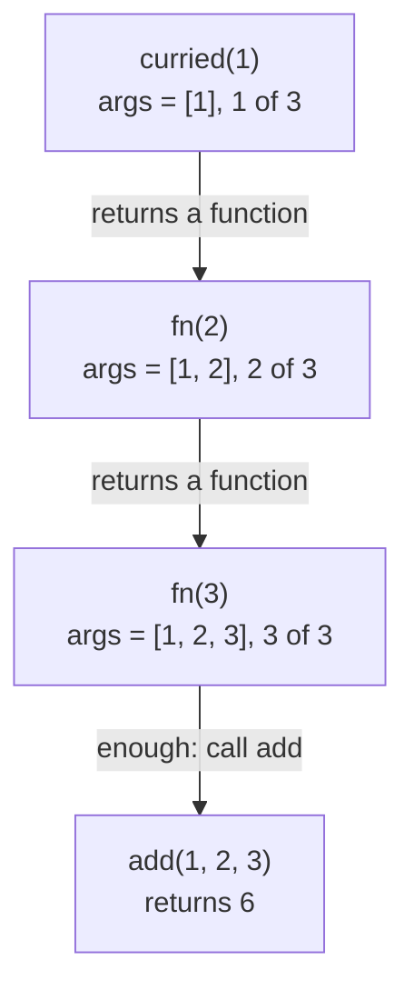
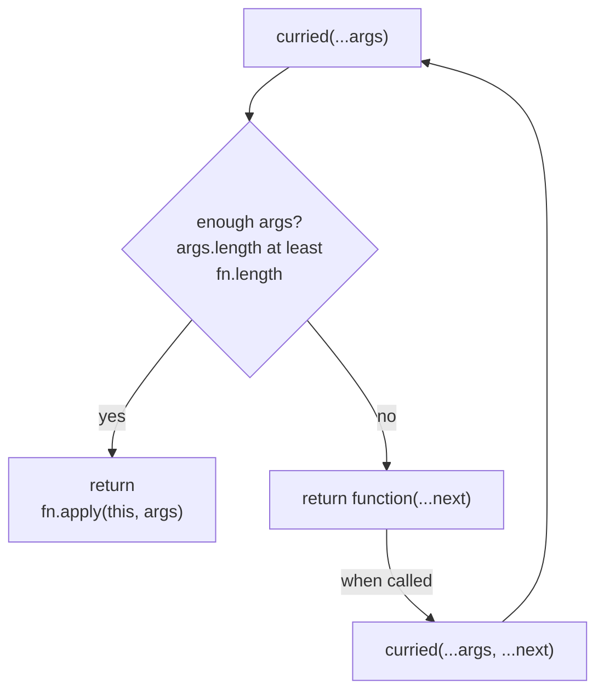
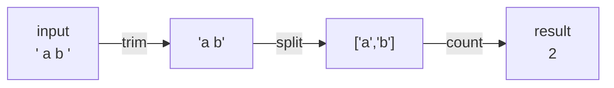

# Chapter 11: Currying, Partial Application & Function Composition

## 11.1 Definition and why interviewers ask it

**Currying turns a function of several arguments into a chain of functions that each take some of the arguments (`f(a, b, c)` becomes `f(a)(b)(c)`). Partial application fixes some arguments now and returns a function that takes the rest later. Composition joins functions so the output of one is the input of the next: `compose(f, g)(x)` is `f(g(x))`.**

These are staple machine-coding and JavaScript-round questions (commonly reported): "implement `curry`", "implement `curry` with placeholders", "make `sum(1)(2)(3)()` work", "implement `compose` and `pipe`". They test closures, `fn.length`, rest and spread, `reduce`, and the difference between currying and partial application, which many candidates blur. They also show whether you can reason about a function's *arity* when default and rest parameters are involved.

## 11.2 Core concept

### Plain language

Currying is a sandwich shop that takes the order one ingredient at a time. After each ingredient you get back a new "order in progress", and the kitchen starts only when the order is complete. Partial application is a pre-set combo: you fix "no onions" once, and every later order starts from that. Composition is the assembly line: bread passes from the slicer to the toaster to the filler, and each station takes only what the previous one produced.

### Precise version

| Term | Definition | Example |
|---|---|---|
| Arity | The number of parameters a function declares. `fn.length` reports the count of parameters *before* the first default or rest parameter. | `(a, b = 1, c) => {}` has `length` 1 |
| Currying | Transforming `f(a, b, c)` into `f(a)(b)(c)`. In the strict definition each call takes exactly one argument. In JavaScript libraries, "curried" usually also lets one call take several arguments (`f(a, b)(c)`). | `curry(add)(1)(2)(3)` |
| Partial application | Fixing *some* arguments of a function to get a function of the remaining ones. The result may take any number of further arguments in one call. | `partial(add, 1)(2, 3)` |
| `bind` | Partial application plus a fixed `this`: `fn.bind(thisArg, ...preset)`. | `add.bind(null, 1)(2, 3)` |
| Composition | `compose(f, g, h)(x) = f(g(h(x)))`: right to left. | `compose(inc, double)(3)` is 7 |
| Pipe | Same idea, written left to right: `pipe(f, g, h)(x) = h(g(f(x)))`. | `pipe(double, inc)(3)` is 7 |
| Point-free style | Defining functions without naming their arguments, by composing curried functions. | `const total = pipe(map(price), sum)` |

**The mechanism is closures.** A curried function does not store the arguments in a special structure. Each call creates a function execution context (Chapter 1) whose environment holds the arguments received so far, and returns an inner function that closes over that environment (Chapter 4). The next call concatenates its own arguments to the closed-over array and decides again whether there are enough. The "accumulated arguments" are just a variable captured by a closure.

**Why `fn.length`.** The standard `curry(fn)` compares the number of collected arguments with `fn.length`. That is why functions with default or rest parameters need an explicit arity argument (Question 11.13).

**Composition rules of thumb.**

- Every function except the first must take **one** argument, because a function returns one value. (The first may take several: `pipe(add, double)(1, 2)`.)
- Currying and composition work together: a curried function with its leading arguments fixed becomes a unary function, which is what `pipe` needs. That is why libraries put the *data last*: `map(fn)(list)`, not `map(list, fn)`.
- `compose` is right to left because it mirrors mathematical notation `f ∘ g`, which reads "f after g" and matches how the call is nested in code, `f(g(x))`.

**Where you see it.** Redux's `compose` (used to combine store enhancers and middleware), lodash's `_.curry` and `lodash/fp`, Ramda's `R.curry`, `R.pipe`, `R.compose` and the placeholder `R.__`. A native pipeline operator (`|>`) has been a TC39 proposal for years and is not part of the language.

## 11.3 How it works internally

### A. A curried call chain

Take `const c = curry(add)` with `add(a, b, c)` and `add.length === 3`.

1. `curry(add)` returns the function `curried`. Its closure holds `fn = add`.
2. `c(1)`: a new execution context for `curried` is created, with `args = [1]`. Since `1 < 3`, it returns a new inner function. That inner function's `[[OuterEnv]]` is the context of this call, so `args = [1]` stays alive on the heap.
3. `c(1)(2)`: the inner function runs with `next = [2]` and calls `curried.apply(this, [1].concat([2]))`. Another new context, `args = [1, 2]`, again fewer than 3, so another inner function is returned.
4. `...(3)`: `args = [1, 2, 3]`, which reaches `fn.length`, so `curried` calls `add.apply(this, [1, 2, 3])` and returns 6.

No state is mutated: each partial application creates a new array, so `const add1 = c(1)` can be reused many times and the calls do not interfere.

### B. The check `args.length >= fn.length`

- `>=` (not `===`) is what allows extra arguments (`c(1)(2)(3, 4)` passes four to `add`, which ignores the fourth).
- `fn.length` is read once, when `curry` runs. A function with default or rest parameters reports a smaller number (`(a, b = 2) => a + b` has length 1), so `curry` calls it too early.

### C. Placeholders

With placeholders, "enough arguments" means *enough non-placeholder arguments in the first `arity` positions*. Each new call fills the earliest remaining placeholder slots first, and extra arguments are appended.

### D. Infinite currying

A function whose arity is unknown cannot be curried by `fn.length`. Two termination conventions exist:

1. **Empty call.** `sum(1)(2)(3)()` returns the total only when called with no arguments. Every earlier call returns a function.
2. **Coercion.** `+sum(1)(2)(3)` or `` `${sum(1)(2)(3)}` `` returns the total because the returned function has a `Symbol.toPrimitive` (or `valueOf`/`toString`) method. This works because `+`, template literals and `==` convert objects to primitives, and a function is an object.

### E. How `compose` and `pipe` run

`pipe(f, g, h)` returns a function. When called with `x`, it runs `reduce` over `[f, g, h]` starting from `x`: the accumulator is the current value, and each step applies the next function. `compose` does the same over the reversed list (`reduceRight`). Both are O(n) in the number of functions, and the stack depth is constant, because the calls are sequential and not nested.

The Redux-style `fns.reduce((a, b) => (...args) => a(b(...args)))` builds a *nested* function instead: the result is `(...args) => f(g(h(...args)))`, so calling it nests n frames. For a handful of middleware functions this does not matter.

### F. Async composition

An async pipeline chains the steps with `then`, so each function may return a value or a promise: `fns.reduce((p, f) => p.then(f), Promise.resolve(x))`. Every step runs in a microtask, even when all functions are synchronous, and a rejection or a throw skips the remaining steps down to the first `catch` (Chapter 8).

## 11.4 Diagrams

### How arguments accumulate across calls



> **How to explain this to the interviewer**
>
> 1. Draw four boxes in a column: one per call, each with `args = [...]` written inside.
> 2. Between the first boxes, write "returns a function that remembers args". Between the last two, write "args.length reached fn.length".
> 3. Say: "the array is not stored anywhere special. Each call's scope keeps it alive, and the next call copies it plus the new arguments".
>
> **Takeaway:** currying is a chain of closures, each one holding the arguments gathered so far.

### Closure-held argument arrays

```ascii Each partial application keeps its own immutable args array alive via a closure
 const add1 = c(1);     const add12 = add1(2);     const r = add12(3);

 HEAP (environments kept alive by the functions that close over them)

 curried(1) env        curried(1,2) env          curried(1,2,3) env
 +---------------+     +---------------+         +---------------+
 | args = [1]    |<-+  | args = [1, 2] |<-+      | args = [1,2,3]|--> add(1,2,3) = 6
 | fn   = add    |  |  | fn   = add    |  |      +---------------+
 +---------------+  |  +---------------+  |
        ^           |         ^           |
 add1 --+           |  add12 -+           |    (the arrays are never mutated:
  (inner function)  |   (inner function)  |     concat builds a NEW array)
                    +--- each inner function's [[OuterEnv]] points to its env

 add1 and add12 stay usable: add1(5)(6) and add1(7)(8) never see each other.
```

> **How to explain this to the interviewer**
>
> 1. Draw one box per call with its `args` array inside, and an arrow from each returned function to the box it closes over.
> 2. Point at `add1` and say: "it still points at `args = [1]`, so I can call it again and again".
> 3. Say that the final call has no returned function, it just calls `add` with the full array.
>
> **Takeaway:** immutability of the arrays is what makes a partially applied function safe to reuse.

### The `curry` algorithm



> **How to explain this to the interviewer**
>
> 1. Draw the single decision, "enough arguments?", and the "yes" exit that calls the original function.
> 2. Draw the "no" branch: return a new function, and when it is called, loop back to the decision with the arguments concatenated.
> 3. Say: "`fn.length` is the target. That is also the weakness: it ignores default and rest parameters".
>
> **Takeaway:** curry is a recursive check of "have I got enough yet?" through closures.

### Data flow through `pipe`



> **How to explain this to the interviewer**
>
> 1. Draw an input box on the left, then one box per intermediate value, with an arrow named after the function between them.
> 2. Write the *value* in every box and the function name on every arrow, to show what each function receives and returns.
> 3. Say: "`pipe` reads in execution order. `compose(count, split, trim)` is the same chain written right to left".
>
> **Takeaway:** a pipeline is one value travelling through a row of unary functions.

### `compose` versus `pipe`

```ascii The same three functions, written in the two orders
 functions:   double = x => x * 2    inc = x => x + 1    square = x => x * x

 pipe(double, inc, square)(3)        reads in the order things happen
   3 --double--> 6 --inc--> 7 --square--> 49

 compose(square, inc, double)(3)     reads like nested calls: square(inc(double(3)))
   3 --double--> 6 --inc--> 7 --square--> 49      (rightmost runs first)

 compose(double, inc, square)(3)     a different pipeline, different result
   3 --square--> 9 --inc--> 10 --double--> 20
 Rule: compose(...fns) === pipe(...fns.reverse())
```

> **How to explain this to the interviewer**
>
> 1. Write one pipeline with arrows left to right, and the value after each step.
> 2. Write the same chain as nested calls, `square(inc(double(3)))`, and underline `double`: "innermost call runs first".
> 3. Say: "`compose` is `pipe` with the list reversed. I choose `pipe` when I want the code to read in execution order".
>
> **Takeaway:** the two differ only in argument order, not in what they do.

### Whiteboard version

```ascii Whiteboard version: curry and pipe on one slide (draw in 90 seconds)
 curry:   f(1)  --[1]-->  g(2)  --[1,2]-->  h(3)  --[1,2,3]-->  add(1,2,3)
          each arrow = args kept in a closure, call when length >= fn.length
 pipe:    x --> f --> g --> h --> result      compose = same, written h(g(f(x)))
```

## 11.5 Code examples

### Example 1: arity and `fn.length`

```js
const add = (a, b, c) => a + b + c;
console.log(add.length);
console.log(((a, b = 2, c) => {}).length);        // stops at the first default
console.log(((a, ...rest) => {}).length);         // rest does not count
console.log(((a, { b, c }) => {}).length);        // destructuring still counts as one
console.log(add.bind(null, 1).length);            // bound arguments are subtracted
console.log(add.bind(null, 1, 2, 3, 4).length);   // never below zero
```

```text output
3
1
1
2
2
0
```

**Why:** `length` counts the parameters before the first default or rest parameter. A bound function's `length` is the target's length minus the bound arguments, with a floor of zero. These are the numbers `curry` relies on.

### Example 2: currying, partial application and `bind` side by side

```js
const add3 = (a, b, c) => a + b + c;

const curried = (a) => (b) => (c) => add3(a, b, c);              // strict currying
const partial = (fn, ...preset) => (...later) => fn(...preset, ...later);

console.log(curried(1)(2)(3));
console.log(partial(add3, 1)(2, 3));          // later arguments in any grouping
console.log(partial(add3, 1, 2)(3));
console.log(add3.bind(null, 1)(2, 3));       // bind is partial application
console.log(typeof curried(1, 2, 3));        // strict curry takes ONE argument per call
```

```text output
6
6
6
6
function
```

**Why:** currying always returns a function that takes the next argument, until the last one. Partial application can fix any number of leading arguments and takes the rest in one call. The last line shows the strict version ignoring extra arguments and returning a function.

### Example 3: the standard `curry`

```js
function curry(fn) {
  return function curried(...args) {
    if (args.length >= fn.length) return fn.apply(this, args);
    return function (...next) {
      return curried.apply(this, args.concat(next));
    };
  };
}

const add = curry((a, b, c) => a + b + c);
console.log(add(1)(2)(3), add(1, 2)(3), add(1)(2, 3), add(1, 2, 3));
console.log(add(1)(2)(3, 4));                       // extra arguments are passed along
const add10 = add(10);                              // a reusable partial
console.log(add10(1)(2), add10(5)(5));
try { add(1)(2)(3)(4); } catch (e) { console.log(e.name + ': ' + e.message); }
```

```text output
6 6 6 6
6
13 20
TypeError: add(...)(...)(...) is not a function
```

**Why:** each call either has enough arguments (and calls `add`) or returns another collector. `add(1)(2)(3)` returns a number, so the fourth call tries to call `6` and throws. `add10` is safe to reuse, because the argument array is copied, never mutated.

### Example 4: arguments accumulating, traced

```js
function curry(fn) {
  return function curried(...args) {
    console.log('  call with', args.length, 'new arg(s); total so far:', args);
    if (args.length >= fn.length) return fn.apply(this, args);
    return (...next) => curried.apply(this, args.concat(next));
  };
}

const volume = curry((l, w, h) => l * w * h);
console.log('result', volume(2)(3)(4));
```

```text output
  call with 1 new arg(s); total so far: [ 2 ]
  call with 2 new arg(s); total so far: [ 2, 3 ]
  call with 3 new arg(s); total so far: [ 2, 3, 4 ]
result 24
```

**Why:** the "total so far" array grows by concatenation at each call. The log shows what each closure is holding when `curried` is re-entered.

### Example 5: `this` and curry

```js
'use strict';
function curry(fn) {
  return function curried(...args) {
    if (args.length >= fn.length) return fn.apply(this, args);
    return function (...next) { return curried.apply(this, args.concat(next)); };
  };
}
// Variant: remember the receiver of the FIRST call.
function curryKeepThis(fn) {
  return function curried(...args) {
    const self = this;
    if (args.length >= fn.length) return fn.apply(self, args);
    return function (...next) { return curried.apply(self, args.concat(next)); };
  };
}

const make = (curryFn) => ({
  k: 100,
  add: curryFn(function (a, b) { return this.k + a + b; }),
});
const plain = make(curry);
const kept = make(curryKeepThis);

console.log(plain.add(1, 2));                        // one call: this = plain
try { console.log(plain.add(1)(2)); } catch (e) { console.log(e.name + ': ' + e.message); }
console.log(kept.add(1)(2));
```

```text output
103
TypeError: Cannot read properties of undefined (reading 'k')
103
```

**Why:** `this` is set by *how each call is made*. In `plain.add(1)(2)` the second call is a plain function call, so `this` is `undefined` in strict mode. The first variant only preserves `this` for the final call. `curryKeepThis` captures the receiver of the first call instead. Neither is "right": decide and document it.

### Example 6: curry with placeholders

```js
function curry(fn, arity = fn.length) {
  const PH = curry.placeholder;
  return function curried(...args) {
    const ready = args.length >= arity && args.slice(0, arity).every((a) => a !== PH);
    if (ready) return fn.apply(this, args);
    return function (...next) {
      const merged = args.map((a) => (a === PH && next.length ? next.shift() : a));
      return curried.apply(this, merged.concat(next));
    };
  };
}
curry.placeholder = Symbol('placeholder');
const _ = curry.placeholder;

const join3 = curry((a, b, c) => [a, b, c].join('-'));
console.log(join3(1)(2)(3));
console.log(join3(_, 2)(1)(3));
console.log(join3(_, _, 3)(1)(2));
console.log(join3(1, _, 3)(2));
console.log(join3(_, 'b')(_, 'c')('a'));
```

```text output
1-2-3
1-2-3
1-2-3
1-2-3
a-b-c
```

**Why:** a placeholder keeps its slot. The next call fills the earliest remaining placeholders first, and any leftover arguments are appended. The function runs only when the first `arity` positions are all real values.

### Example 7: infinite currying, and the `valueOf` trap

```js
function sum(...first) {
  const total = first.reduce((a, b) => a + b, 0);
  const next = (...more) => (more.length === 0 ? total : sum(total, ...more));
  next[Symbol.toPrimitive] = () => total;      // used by +, template literals and ==
  return next;
}

console.log(sum(1)(2)(3)());            // terminated by an empty call
console.log(sum(1, 2)(3, 4)());         // several arguments per call
console.log(+sum(1)(2)(3), `${sum(4)(5)}`, sum(1)(2) + 10);
const add5 = sum(5);                    // not mutated, so it is reusable
console.log(add5(1)(), add5(2)());

// Trap: valueOf alone is not enough for string conversion.
const f = () => {};
f.valueOf = () => 3;
console.log(+f, String(f).slice(0, 6));
```

```text output
6
10
6 9 13
6 7
3 () => 
```

**Why:** each call returns a new function that closes over the running total. With `Symbol.toPrimitive`, `+`, template literals and `+ 10` all get the total. With only `valueOf`, `+f` works, but `String(f)` asks for `toString` first (hint "string"), which returns the function's source text.

### Example 8: `compose`, `pipe` and tracing

```js
const pipe = (...fns) => (...args) => {
  if (fns.length === 0) return args[0];
  const [first, ...rest] = fns;
  return rest.reduce((value, fn) => fn(value), first(...args));   // first may take many
};
const compose = (...fns) => pipe(...[...fns].reverse());

const log = [];
const tag = (name) => (x) => { log.push(name); return x; };
console.log(compose(tag('f'), tag('g'), tag('h'))(0), log.join(' '));
log.length = 0;
console.log(pipe(tag('f'), tag('g'), tag('h'))(0), log.join(' '));

const double = (x) => x * 2;
const inc = (x) => x + 1;
console.log(pipe((a, b) => a + b, double, inc)(1, 2));     // first function: two arguments
console.log(compose(inc, double)(3), pipe(inc, double)(3));
console.log(pipe()(42));                                    // no functions: identity

// tap: run a side effect, pass the value on (for debugging a pipeline)
const trace = (label) => (x) => { console.log(label + ':', x); return x; };
console.log(pipe(double, trace('after double'), inc)(5));
```

```text output
0 h g f
0 f g h
7
7 8
42
after double: 10
11
```

**Why:** `compose` runs the functions right to left, `pipe` left to right. The first function in `pipe` may take several arguments. `inc(double(3))` is 7 but `double(inc(3))` is 8, so the order matters. `trace` returns its input so it can sit anywhere in the chain.

### Example 9: composing with curried functions (data last)

```js
const curry = (fn) => function curried(...args) {
  return args.length >= fn.length ? fn(...args) : (...next) => curried(...args, ...next);
};
const pipe = (...fns) => (x) => fns.reduce((v, f) => f(v), x);

// Data-last, curried helpers: fix the configuration first, supply the data last.
const map = curry((fn, list) => list.map(fn));
const filter = curry((pred, list) => list.filter(pred));
const reduce = curry((fn, init, list) => list.reduce(fn, init));
const prop = curry((key, obj) => obj[key]);

const orders = [
  { id: 1, price: 30, paid: true },
  { id: 2, price: 50, paid: false },
  { id: 3, price: 20, paid: true },
];

const paidTotal = pipe(
  filter(prop('paid')),
  map(prop('price')),
  reduce((a, b) => a + b, 0)
);
console.log(paidTotal(orders));
```

```text output
50
```

**Why:** `filter(prop('paid'))` is a function waiting for a list, which is exactly the unary shape `pipe` needs. `paidTotal` is defined without mentioning its argument (point-free style). The price is that readers must know the argument order of each helper.

### Example 10: async `pipe`

```js
const pipeAsync = (...fns) => (x) => fns.reduce((p, f) => p.then(f), Promise.resolve(x));

const sleep = (ms, v) => new Promise((r) => setTimeout(r, ms, v));
const fetchUser = async (id) => { await sleep(5); return { id, name: 'Ada' }; };
const getName = (user) => user.name;             // a plain synchronous function
const shout = async (s) => s.toUpperCase() + '!';
const explode = () => { throw new Error('step failed'); };

pipeAsync(fetchUser, getName, shout)(7).then((v) => console.log('ok:', v));

pipeAsync(fetchUser, explode, shout)(7)
  .then((v) => console.log('never', v))
  .catch((e) => console.log('failed:', e.message));
```

```text output
ok: ADA!
failed: step failed
```

**Why:** each step receives the previous step's resolved value, whether the function is synchronous or returns a promise. A throw or rejection skips the remaining steps and lands in the first `catch`. All steps run in microtasks, even synchronous ones, so the result of `pipeAsync` is always a promise.

### Example 11: Redux-style `compose` and middleware order

```js
const compose = (...fns) => {
  if (fns.length === 0) return (a) => a;
  if (fns.length === 1) return fns[0];
  return fns.reduce((a, b) => (...args) => a(b(...args)));
};

const log = [];
const base = (action) => { log.push('base ' + action); return action; };
const middleware = (name) => (next) => (action) => {
  log.push(name + ' in');
  const result = next(action);
  log.push(name + ' out');
  return result;
};

const dispatch = compose(middleware('A'), middleware('B'))(base);
dispatch('go');
console.log(log.join(' | '));
```

```text output
A in | B in | base go | B out | A out
```

**Why:** `compose(A, B)(base)` is `A(B(base))`. A function is wrapped by B first and by A second, so A is the outermost layer and runs first on the way in. The right-to-left order of `compose` produces a left-to-right call order for middleware.

### Example 12: `fn.length` surprises that break `curry`

```js
function curry(fn, arity = fn.length) {
  return function curried(...args) {
    return args.length >= arity ? fn.apply(this, args)
      : (...next) => curried.apply(this, args.concat(next));
  };
}

const withDefault = (a, b = 10) => a + b;          // length 1
const variadic = (...nums) => nums.reduce((s, n) => s + n, 0);   // length 0

console.log(curry(withDefault)(1));                // runs at once: b = 10
try { curry(withDefault)(1)(2); } catch (e) { console.log(e.name); }
console.log(curry(withDefault, 2)(1)(2));          // explicit arity fixes it
console.log(curry(variadic)(), curry(variadic, 3)(1)(2)(3));
```

```text output
11
TypeError
3
0 6
```

**Why:** the default makes `length` 1, so `curry(withDefault)(1)` already satisfies it and calls the function (result 11, a number), and the next `(2)` fails with a `TypeError`. Passing an explicit `arity` is the standard fix, and it is what lodash and Ramda offer as `curryN`.

## 11.6 Common mistakes and gotchas

- **Calling partial application "currying".** `partial(add, 1)(2, 3)` takes two arguments at once, so it is partial application, not currying. Strict currying takes one argument per call. Say which one you mean.
- **Trusting `fn.length`.** Default and rest parameters shorten it, and `arguments`-based functions report 0. Offer an explicit `arity` parameter.
- **Passing a curried function straight to `map`.** `map` supplies `(value, index, array)`, so a curried function sees three arguments in one call (Question 11.6). Wrap it, or use a `unary` helper.
- **`compose` order.** `compose(f, g)(x)` is `f(g(x))`. Mixing it up with `pipe` is the most common slip, and logging with a tracing step finds it quickly.
- **Functions in a pipeline that take more than one argument.** Only the first function may. Curry the others, or wrap them.
- **Forgetting `return` in `tap` or `trace`.** The next function receives `undefined`.
- **Mutating the accumulated array.** Using `args.push(...next)` in a curry implementation changes state shared by every reuse of the partial function. Always build a new array.
- **Losing `this`.** Arrow functions have no `this` of their own, and each stage of a curried call is a separate call. Decide whether the first or the last receiver wins (Example 5).
- **Infinite currying without a terminator.** `sum(1)(2)(3)` returns a function. You need the empty call or coercion to get a number, and `console.log` of it prints the function.
- **`valueOf` without `toString`.** String conversion of the returned function prints its source (Example 7). Prefer `Symbol.toPrimitive`.
- **Async functions in a synchronous `pipe`.** The next step gets a promise, not the value. Use an async pipe.
- **Over-using point-free style.** Heavy currying and composition can hurt readability and stack traces, and each curried call allocates closures. Use it where reuse makes it pay off.

## 11.7 Quick revision cheat sheet

- **Arity** = number of declared parameters. `fn.length` stops at the first default or rest parameter.
- **Currying:** `f(a, b, c)` to `f(a)(b)(c)`. **Partial application:** fix some arguments, take the rest in one call. **`bind`:** partial application plus `this`.
- **Mechanism:** closures. Each call's scope holds the arguments so far. The next call concatenates and checks `args.length >= fn.length`.
- **Standard `curry`:** `fn.length` check, `fn.apply(this, args)`, return a collector otherwise. Always build new arrays.
- **Placeholders:** keep the slot, fill the earliest placeholders first, run when the first `arity` slots are real values.
- **Infinite currying:** terminate with an empty call or with `Symbol.toPrimitive` (add `toString` if you use `valueOf`).
- **`pipe`** is left to right, **`compose`** is right to left: `compose(...fns) = pipe(...fns.reverse())`. Implement with `reduce` or `reduceRight`.
- Functions after the first take **one** argument. Data goes last. Use `tap` to debug. Async pipe: `reduce((p, f) => p.then(f), Promise.resolve(x))`.

## 11.8 Interview questions

*Key: ★ = very frequently reported. "Typically asked in" lines say which round a question tends to appear in; where no single source could be pinned down, the question is labelled "commonly reported". Draw-it hints refer to the figures in section 11.4.*

#### Conceptual

### Q11.1 ★ Easy: What is the difference between currying and partial application?

*Typically asked in: JavaScript fundamentals and functional-programming rounds (commonly reported).*

> **Model answer**
>
> Currying transforms a function of n arguments into a chain of functions, so `f(a, b, c)` becomes `f(a)(b)(c)`. In the strict form each call takes one argument. Partial application fixes some arguments of a function now and returns a function that takes the remaining ones, in any grouping. `bind` with arguments does that. So currying changes the *shape* of the function, while partial application *uses* a function with some arguments pre-filled. In JavaScript, `curry` helpers usually accept several arguments per call and so behave like repeated partial application. Both rely on closures.

**Key points to mention**

- Curry: one argument per call, a unary chain. Partial: any number of preset arguments, one call for the rest.
- Library "curry" is looser than the strict definition.
- `bind` = partial application plus `this`.
- Closures hold the arguments (Figure 11.1).

### Q11.2 ★ Medium: How does currying work internally? Where are the arguments stored?

*Typically asked in: JavaScript fundamentals round, closures follow-up (commonly reported).*

> **Model answer**
>
> There is no special storage. A curried function returns an inner function, and the inner function closes over the variables of the call that created it, which include the array of arguments received so far. When the next call comes, the inner function concatenates its new arguments to that array and checks whether there are enough, comparing with `fn.length`. If so it calls the original function. If not it returns another inner function that closes over the longer array. Because each stage builds a new array, a partially applied function can be reused without side effects.

**Key points to mention**

- Closures keep the environments alive after the calls return (Chapter 4).
- `args.length >= fn.length` decides.
- New arrays, never mutated, so partials are reusable.
- Draw it: Figures 11.1 and 11.2.

### Q11.3 Medium: Why is currying useful? What are the downsides?

*Typically asked in: JavaScript fundamentals round and design discussions (commonly reported).*

> **Model answer**
>
> Currying lets me fix configuration once and reuse the specialised function: `const getPrice = prop('price')` or `const isAdmin = hasRole('admin')`. It produces unary functions, which fit `map`, `filter` and `pipe` without wrapper lambdas, and it enables point-free composition. The downsides are readability for people who do not know the argument order, extra closures and calls (a small cost), a more awkward stack trace, and trouble with variadic and default parameters, because `fn.length` is unreliable. I use it for small, reusable helpers and avoid it in code where plain arguments are clearer.

**Key points to mention**

- Reuse, specialisation, and unary shape for composition.
- Data-last argument order.
- Cost: readability, allocations, `fn.length` limits.
- Libraries: lodash `_.curry`, Ramda, lodash/fp.

#### Output prediction

### Q11.4 ★ Easy: What does this print?

*Typically asked in: JavaScript fundamentals round (commonly reported).*

```js
function curry(fn) {
  return function curried(...args) {
    if (args.length >= fn.length) return fn.apply(this, args);
    return (...next) => curried.apply(this, args.concat(next));
  };
}
const add = curry((a, b, c) => a + b + c);

console.log(add(1)(2)(3), add(1, 2)(3), add(1)(2, 3), add(1, 2, 3));
console.log(typeof add(1)(2), typeof add(1)(2)(3), add(1)(2)(3, 4));
```

```text output
6 6 6 6
function number 6
```

> **Model answer**
>
> The first line prints `6` four times: every grouping of the three arguments reaches `fn.length` and calls the function. On the second line, `add(1)(2)` has only two arguments, so it is still a function. `add(1)(2)(3)` is the number 6. `add(1)(2)(3, 4)` collects four arguments, which is at least three, so it calls the original with `(1, 2, 3, 4)` and the extra argument is ignored. Calling `add(1)(2)(3)(4)` would throw `TypeError`, because that result is a number.

**Key points to mention**

- `>=`, not `===`: extra arguments are passed through.
- A result below the arity is a function.
- Over-calling (a fourth call) throws `TypeError: ... is not a function`.
- Draw it: Figure 11.3.

### Q11.5 Medium: What are these `length` values?

*Typically asked in: JavaScript fundamentals round, function trivia (commonly reported).*

```js
function add(a, b, c) {}
console.log(
  add.length,
  ((a, b = 2, c) => {}).length,
  ((a, ...rest) => {}).length,
  ((...all) => {}).length,
  ((a, { b, c }) => {}).length,
  add.bind(null, 1).length
);
```

```text output
3 1 1 0 2 2
```

> **Model answer**
>
> `3 1 1 0 2 2`. `length` counts the parameters before the first default value or rest parameter. `add` has three. `(a, b = 2, c)` stops at `b`, so it is 1, even though `c` follows. `(a, ...rest)` counts only `a`. `(...all)` is 0. A destructured parameter counts as one, so `(a, { b, c })` is 2. A bound function's length is the target's length minus the number of bound arguments, so `add.bind(null, 1)` is 2. This is why `curry` breaks with defaults and rest parameters.

**Key points to mention**

- Stops at the first default or rest parameter.
- Destructuring counts as one parameter.
- `bind` subtracts, floor of zero.
- `arguments` use inside the body does not change `length`.

### Q11.6 Medium: What does this print? Why is passing a curried function to `map` risky?

*Typically asked in: JavaScript fundamentals round, a `parseInt`-style trap (commonly reported).*

```js
function curry(fn) {
  return function curried(...args) {
    if (args.length >= fn.length) return fn.apply(this, args);
    return (...next) => curried.apply(this, args.concat(next));
  };
}
const add = curry((a, b) => a + b);

console.log([1, 2, 3].map(add));
console.log([1, 2, 3].map(add(10)));
console.log(typeof [1, 2, 3].map((x) => add(x))[0]);
```

```text output
[ 1, 3, 5 ]
[ 11, 12, 13 ]
function
```

> **Model answer**
>
> `map` calls its callback with `(value, index, array)`. In the first line, `add` receives three arguments at once, so `args.length` is 3 and the function runs immediately as `add(value, index, array)`. The extra `array` is ignored and the result is `value + index`: 1, 3, 5. That is the same trap as `['1','2','3'].map(parseInt)`. In the second line, `add(10)` is a function waiting for its second argument, and `map` supplies `(value, index, array)`, so the function runs with `10` and the value: 11, 12, 13. The third line wraps `add` in a lambda, which gives the intended partially applied functions.

**Key points to mention**

- `map` passes three arguments, so a curried function can complete early.
- Fix: wrap in a lambda or use a `unary` helper.
- With an arity-aware curry, extra arguments are silently dropped, which hides the bug.

### Q11.7 Medium: What does this async `pipe` print, and in what order?

*Typically asked in: senior-leaning JavaScript rounds, async function composition (commonly reported).*

```js
const pipeAsync = (...fns) => (x) => fns.reduce((p, f) => p.then(f), Promise.resolve(x));
const show = (tag) => (v) => { console.log(tag, v); return v; };

const run = pipeAsync(
  show('a'),
  (v) => new Promise((resolve) => setTimeout(resolve, 5, v + 1)),
  show('b'),
  (v) => v * 2,
  show('c')
);
run(1).then((v) => console.log('result', v));
console.log('sync end');
```

```text output
sync end
a 1
b 2
c 4
result 4
```

> **Model answer**
>
> `sync end` comes first. Even the first function does not run synchronously, because it is attached with `then` to an already resolved promise, so it runs as a microtask after the script. That prints `a 1`. The second step returns a promise that resolves after 5 ms with 2, so the chain waits. Then `b 2` prints, the synchronous doubling gives 4, and `c 4` prints, followed by `result 4`. The key points are that every step is deferred by at least one microtask, and that the value passed along is the resolved value of the previous step.

**Key points to mention**

- `Promise.resolve(x).then(f)`: the first function also runs asynchronously.
- A returned promise is awaited before the next step.
- A throw or rejection skips later steps down to `catch`.
- Result is always a promise, even with no async functions.

#### Implement it yourself

### Q11.8 ★ Medium: Implement `curry(fn)`.

*Typically asked in: machine-coding or JavaScript round (commonly reported).*

**Problem.** `curry(fn)` returns a function that can be called with the arguments of `fn` in any grouping: `f(1)(2)(3)`, `f(1, 2)(3)`, `f(1)(2, 3)`, `f(1, 2, 3)`. It must call `fn` once enough arguments are collected, pass extra arguments through, and keep `this`.

**Solution.** Collect arguments in a closure until `fn.length` is reached.

```js
function curry(fn) {
  return function curried(...args) {
    if (args.length >= fn.length) return fn.apply(this, args);
    return function (...next) {
      return curried.apply(this, args.concat(next));
    };
  };
}

const volume = curry((l, w, h) => l * w * h);
console.log(volume(2)(3)(4), volume(2, 3)(4), volume(2)(3, 4), volume(2, 3, 4));

const flat = volume(2, 3);                 // reusable partial
console.log(flat(1), flat(10));

const counter = {
  base: 100,
  add: curry(function (a, b) { return this.base + a + b; }),
};
console.log(counter.add(1, 2));
console.log(volume.length, volume(1).length);   // the curried wrappers report length 0
```

```text output
24 24 24 24
6 60
103
0 0
```

> **Model answer**
>
> `curry` returns a function `curried` that gathers arguments. If it already has `fn.length` or more, it calls the original with `fn.apply(this, args)`. Otherwise it returns a new function that, when called, calls `curried` again with the old arguments concatenated with the new ones. The collected arguments live in the closure, and `concat` creates a new array each time, so partials are reusable. `>=` lets extra arguments through. `this` is forwarded with `apply`, but only the receiver of the final call, which is a limitation. Complexity is O(n) per call chain for n arguments.

**Key points to mention**

- Base case: `args.length >= fn.length`. Recursive case: return a collector.
- Immutable accumulation (`concat`, not `push`).
- `fn.length` limits: defaults and rest (offer an `arity` parameter).
- `this` support is partial (Example 5). Edge cases: zero-arity function (called on the first call), more arguments than needed.
- Draw it: Figure 11.3.

### Q11.9 ★ Hard: Implement `curry` with placeholder support, so `f(_, 2)(1)(3)` works.

*Typically asked in: machine-coding round, follow-up to `curry` (commonly reported).*

**Problem.** Support a placeholder value (`curry.placeholder`, aliased to `_`). A placeholder reserves the position of an argument to be supplied by a later call. The function runs only when every one of the first `fn.length` positions holds a real value.

**Solution.** Merge the new arguments into the earliest placeholder slots, and append the rest.

```js
function curry(fn, arity = fn.length) {
  const PH = curry.placeholder;
  return function curried(...args) {
    const ready = args.length >= arity && args.slice(0, arity).every((a) => a !== PH);
    if (ready) return fn.apply(this, args);
    return function (...next) {
      const merged = args.map((a) => (a === PH && next.length ? next.shift() : a));
      return curried.apply(this, merged.concat(next));
    };
  };
}
curry.placeholder = Symbol('placeholder');
const _ = curry.placeholder;

const f = curry((a, b, c, d) => [a, b, c, d].join(''));
console.log(f(1, 2, 3, 4));
console.log(f(_, 2)(1)(3)(4));
console.log(f(_, _, 3)(_, 2)(1)(4));
console.log(f(1)(_, 3)(2, 4));
console.log(f(_, _, _, 4)(1, 2, 3));
console.log(typeof f(_, _, _, _)(1, 2, 3));
```

```text output
1234
1234
1234
1234
1234
function
```

> **Model answer**
>
> I extend the same algorithm. Each call receives the earlier arguments, which may contain placeholders, and the new arguments. I build the merged list by walking the earlier list: each placeholder slot takes the next new argument, if any, and the leftovers are appended. Then I check for readiness: at least `arity` arguments and no placeholder among the first `arity`. If ready, call the function, otherwise return another collector. I use a unique `Symbol` as the placeholder, so no real value can be confused with it. Lodash does the same with `_.curry.placeholder` and Ramda with `R.__`.

**Key points to mention**

- Placeholder is a unique sentinel (Symbol), so values like `undefined` still work.
- Fill earliest placeholders first, then append.
- Ready = enough arguments and no placeholder in the first `arity` positions.
- Copy `next` before `shift()` (rest creates a new array, so it is safe here).
- Edge cases: placeholders beyond the arity, all placeholders, repeated placeholder calls.

### Q11.10 ★ Medium: Implement infinite currying, so `sum(1)(2)(3)()` returns 6, and `+sum(1)(2)(3)` too.

*Typically asked in: machine-coding or JavaScript round (commonly reported).*

**Problem.** `sum` takes any number of arguments per call and any number of calls. It returns the total when called with no arguments, and the returned function must also convert to the total when used with `+` or in a template string.

**Solution.** Return a function closed over the running total, and give it a `Symbol.toPrimitive`.

```js
function sum(...first) {
  const total = first.reduce((a, b) => a + b, 0);
  const next = (...more) => (more.length === 0 ? total : sum(total, ...more));
  next[Symbol.toPrimitive] = () => total;
  return next;
}

console.log(sum(1)(2)(3)(), sum(1, 2)(3, 4)(), sum()());
console.log(+sum(1)(2)(3), `${sum(10)(20)}`, sum(5)(5) * 2);

const base = sum(100);
console.log(base(1)(), base(2)());
```

```text output
6 10 0
6 30 20
101 102
```

> **Model answer**
>
> Each call returns a function that closes over the running total. If that function is called with no arguments, it returns the total, and that is the termination condition. With arguments, it returns `sum` again with the total and the new arguments, so the chain continues. To also allow `sum(1)(2)(3)` without the final `()`, I add a `Symbol.toPrimitive` method that returns the total, so `+`, template strings and arithmetic coerce the function to a number. Nothing is mutated, so `base = sum(100)` can be reused. The trade-off: `console.log(sum(1)(2))` still prints a function.

**Key points to mention**

- Termination: empty call, or coercion.
- `Symbol.toPrimitive` (or `valueOf` plus `toString`) for the coercion route.
- Immutability gives reusable partials.
- Edge cases: `sum()()` is 0, non-numbers (validate), string `+` concatenation if types mix.
- Draw it: Figure 11.1 (same accumulation, no fixed length).

### Q11.11 ★ Medium: Implement `compose` and `pipe`.

*Typically asked in: JavaScript and machine-coding rounds (commonly reported).*

**Problem.** `pipe(f, g, h)(x)` is `h(g(f(x)))`. `compose(f, g, h)(x)` is `f(g(h(x)))`. The first function to run may take several arguments, the others take one. With no functions, return the input.

**Solution.** `reduce` over the functions, starting from the result of the first.

```js
const pipe = (...fns) => (...args) => {
  if (fns.length === 0) return args[0];
  const [first, ...rest] = fns;
  return rest.reduce((value, fn) => fn(value), first(...args));
};
const compose = (...fns) => pipe(...[...fns].reverse());

// The classic one-argument forms, for comparison:
const pipe1 = (...fns) => (x) => fns.reduce((v, f) => f(v), x);
const compose1 = (...fns) => (x) => fns.reduceRight((v, f) => f(v), x);

const double = (x) => x * 2;
const inc = (x) => x + 1;
const square = (x) => x * x;

console.log(pipe(double, inc, square)(3));
console.log(compose(square, inc, double)(3));
console.log(pipe1(double, inc, square)(3), compose1(double, inc, square)(3));
console.log(pipe((a, b) => a + b, double)(1, 2), pipe()('same'));
```

```text output
49
49
49 20
6 same
```

> **Model answer**
>
> `pipe` returns a function that runs the first function with all the arguments, then reduces over the remaining functions, feeding each the previous result. That lets the first function be multi-argument. `compose` is `pipe` with the list reversed, or equivalently `reduceRight`. The result is O(n) in the number of functions with constant stack depth. With an empty list I return the first argument unchanged. Everything after the first function must be unary, because a function returns one value. For async steps I use `then` instead, and for debugging I add a `tap` step that logs and returns its input.

**Key points to mention**

- `reduce` for `pipe`, `reduceRight` (or reverse) for `compose`.
- Only the first function may take several arguments.
- Edge cases: no functions (identity), one function, non-function input (validate), a function that returns `undefined`.
- `compose(...fns) === pipe(...fns.reverse())`.
- Draw it: Figures 11.4 and 11.5.

### Q11.12 Medium: Implement `partial(fn, ...preset)`. How is it related to `bind`?

*Typically asked in: JavaScript round, `bind` follow-up (commonly reported).*

**Problem.** `partial(fn, ...preset)` returns a function that calls `fn` with `preset` followed by the arguments of the later call. Compare with `fn.bind(thisArg, ...preset)`.

**Solution.** Close over the preset list, and forward `this`.

```js
function partial(fn, ...preset) {
  return function (...later) {
    return fn.apply(this, [...preset, ...later]);
  };
}

const greet = function (greeting, punctuation, name) {
  return greeting + ', ' + name + punctuation + ' (this: ' + (this && this.tag) + ')';
};

const hello = partial(greet, 'Hello', '!');
console.log(hello('Ada'));
console.log(hello.call({ tag: 'caller' }, 'Grace'));          // partial forwards this
console.log(greet.bind({ tag: 'bound' }, 'Hi', '?')('Alan')); // bind fixes this
console.log(greet.bind({ tag: 'bound' }, 'Hi', '?').call({ tag: 'other' }, 'Alan'));
console.log(partial(greet, 'A').length, greet.bind(null, 'A').length);
```

```text output
Hello, Ada! (this: undefined)
Hello, Grace! (this: caller)
Hi, Alan? (this: bound)
Hi, Alan? (this: bound)
0 2
```

> **Model answer**
>
> `partial` closes over the preset arguments and, when called, concatenates them with the later ones and invokes the original with `apply`, forwarding `this`. `bind` is native partial application that also fixes `this` permanently: a later `call` cannot override it, as the fourth line shows. Differences: a bound function's `length` is reduced by the bound argument count and it works with `new`, while my wrapper reports `length` 0. Partial application also lets me pre-fill only the leading arguments. For other positions I need placeholders or a wrapper lambda.

**Key points to mention**

- `partial` = closure over presets + `apply`.
- `bind` also fixes `this` and cannot be re-bound.
- `length`, `name`, and `new` behave differently on bound functions.
- Only leading arguments (use placeholders or lambdas otherwise).

#### Follow-up traps

### Q11.13 ★ Medium: "What breaks `curry` when a function has default or rest parameters?"

*Typically asked in: follow-up after implementing `curry` (commonly reported).*

> **Model answer**
>
> The implementation reads `fn.length`, and that does not count the parameters from the first default or rest parameter onward. A function `(a, b = 10)` has length 1, so the curried version runs after the first argument and the later `(2)` throws because the result is not a function. A rest function `(...nums)` has length 0, so it runs immediately with no arguments. A function that reads `arguments` has no declared parameters at all. The fix is an explicit arity, `curry(fn, 3)`, which lodash calls `_.curry(fn, arity)` and Ramda calls `curryN`.

**Key points to mention**

- `length` stops at the first default or rest parameter (Example 12).
- Variadic functions have no natural arity: you must supply one.
- Explicit arity is the standard fix.
- A fixed-arity wrapper is often clearer than relying on `length`.

### Q11.14 Medium: "Does `curry` preserve `this`?"

*Typically asked in: follow-up after implementing `curry` (commonly reported).*

> **Model answer**
>
> It depends on how it is written. With the common implementation that uses `fn.apply(this, args)`, the final call's receiver is used, and each intermediate call is a separate call with its own `this`. So `obj.add(1, 2)` works, but `obj.add(1)(2)` calls the last stage as a plain function and loses `obj` (it becomes `undefined` in strict mode). Arrow-function versions do not forward `this` at all. To keep the receiver of the first call, capture `const self = this` at the start. Or sidestep the problem with `bind` or `call` at the call site.

**Key points to mention**

- `this` is set per call, and each stage is its own call (Example 5).
- Arrow-based curry ignores `this`.
- Options: capture the first receiver, or bind before currying.
- Document the choice.

### Q11.15 Easy: "Why is `compose` right to left?"

*Typically asked in: functional-programming follow-up (commonly reported).*

> **Model answer**
>
> It follows mathematical function composition, `(f ∘ g)(x) = f(g(x))`, and the shape of the call itself. In `f(g(h(x)))`, `h` is the innermost call and runs first, and `compose(f, g, h)` lists the functions in the order they appear when written as nested calls. It is a convention. `pipe` is the same operation with the list reversed, and many people prefer it because the code reads in execution order. Redux's `compose` is right to left, so that middleware written as `compose(a, b)(base)` yields `a(b(base))`, with `a` outermost.

**Key points to mention**

- Mirrors `f(g(x))` and mathematical notation.
- `compose(...fns) === pipe(...fns.reverse())`.
- Choose by readability. Redux and Ramda provide both orders.
- Draw it: Figure 11.5.

#### Sources and further reading

- MDN, `Function.prototype.length`, `Function.prototype.bind`, and `Symbol.toPrimitive`: <https://developer.mozilla.org/en-US/docs/Web/JavaScript/Reference/Global_Objects/Function/length>
- javascript.info, "Currying and partials" and "Decorators and forwarding, call/apply": <https://javascript.info/currying-partials>
- lodash documentation, `_.curry` (arity argument and `_.curry.placeholder`) and the lodash/fp guide: <https://lodash.com/docs/#curry>
- Ramda documentation, `R.curry`, `R.curryN`, `R.pipe`, `R.compose`, and the placeholder `R.__`: <https://ramdajs.com/docs/>
- Redux source, `compose` utility (used for middleware and store enhancers): <https://github.com/reduxjs/redux>
- ECMAScript specification, `Function` instances' `length` property and `BoundFunctionCreate`: <https://tc39.es/ecma262/>
- Public write-ups used to check which questions recur (seen in search results; the pages themselves could not be fetched from the authoring sandbox): "Implement curry(): The Classic Closure Exercise" <https://www.interviewsvector.com/javascript/currying>; dev.to, "Currying !!Wonder of Closures in JavaScript" <https://dev.to/gunjangidwani/currying-wonder-of-closures-in-javascript-4nn8>; Plain English, "Infinite Currying in JavaScript" <https://plainenglish.io/blog/infinite-currying-in-javascript>; Stack Overflow, "Javascript infinite currying for addition which supports infinite invocations and infinite arguments per invocation?" <https://stackoverflow.com/questions/53505619/javascript-infinite-currying-for-addition-which-supports-infinite-invocations-an>. Question wording in this book is original.
