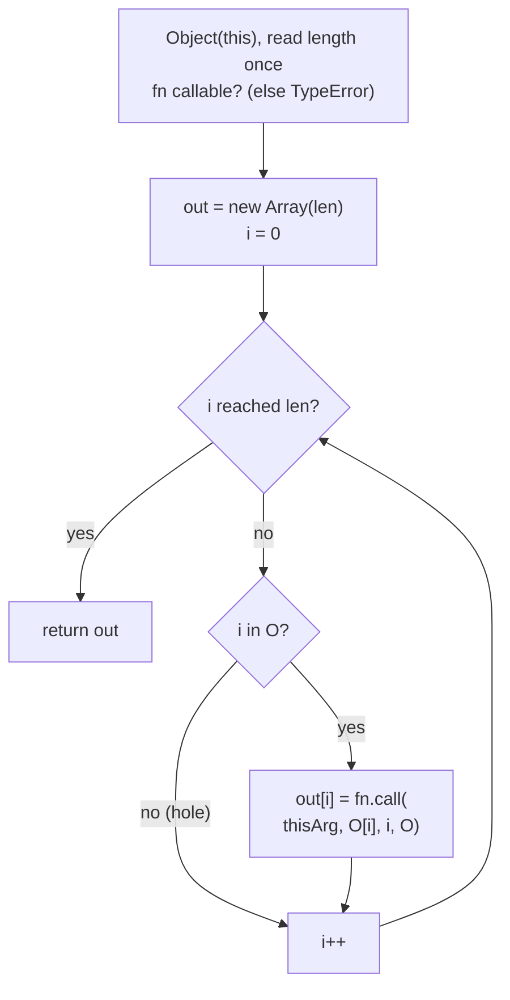

# Chapter 12: Higher-Order Functions: map, filter, reduce

## 12.1 Definition and why interviewers ask it

**A higher-order function is a function that takes one or more functions as arguments, returns a function, or both. It is possible because JavaScript functions are first-class values: they can be stored in variables, passed around, returned and given properties like any other object. `map`, `filter` and `reduce` are the standard array examples.**

Interviewers ask it for three reasons. It is a warm-up that every candidate must answer cleanly ("what is a higher-order function?"). It leads into "implement `map`, `filter` or `reduce` yourself", one of the most frequently reported polyfill exercises in JavaScript rounds and machine-coding warm-ups (commonly reported). And it hides small traps that separate people who know the specification from people who only use the methods: the `['1','2','3'].map(parseInt)` puzzle, sparse arrays, mutation during iteration, `reduce` on an empty array, and `forEach(async ...)`.

## 12.2 Core concept

### Plain language

Think of a factory line. The conveyor belt is the array. `map` is a stamping machine: every item goes in, a stamped item comes out, and the belt is exactly as long as before. `filter` is a sieve: only items that pass the test continue. `reduce` is a snowball: it rolls over each item in turn and picks something up, so at the end you hold one thing (a number, an object, even another array). `forEach` is a worker who looks at each item and does something with it on the side, but hands nothing back. In every case, *you* supply the machine's behaviour as a function. That is what "higher-order" means.

### Precise version

**First-class functions.** A function is an object that can be called. Because of that, you can pass it as an argument (a *callback*), return it from another function (a *factory* or *decorator*), and keep it in data structures. A higher-order function is any function that does the first or the second. Other examples you already use: `setTimeout`, `addEventListener`, `Array.prototype.sort(compareFn)`, `Function.prototype.bind`, `Promise.then`.

**The array iteration methods.** All of them call your callback as `callback(element, index, array)`. All accept an optional `thisArg` as the last argument, except `reduce` and `reduceRight`, which take an optional `initialValue` instead.

| Method | Returns | Skips holes? | Stops early? | What the callback result means |
|---|---|---|---|---|
| `forEach` | `undefined` | yes | only by throwing | ignored |
| `map` | new array, same length, holes stay holes | yes | no | the new element |
| `filter` | new array, length 0 to n | yes | no | truthy keeps the element |
| `reduce`, `reduceRight` | one accumulated value | yes | no | the next accumulator |
| `some` | boolean | yes | on the first truthy result | truthiness |
| `every` | boolean | yes | on the first falsy result | truthiness |
| `find`, `findIndex` | element or `undefined`, index or `-1` | **no** (a hole is visited as `undefined`) | on the first truthy result | truthiness |

**Rules shared by these methods (from the specification).**

- The callback must be callable, otherwise `TypeError` (checked up front, so even an empty array throws).
- The array's `length` is read **once**, before the first callback. The iteration range is fixed at `[0, length)`. Elements appended later are never visited.
- Each element is read **when it is visited**, so a callback that changes a later element makes the loop see the new value. An element deleted before it is reached is skipped.
- Only indexes that exist (`i in array`) are visited, except `find` and `findIndex`. A hole is not the same as `undefined`.
- The methods are *generic*: `Array.prototype.map.call('abc', fn)` and calls on any array-like `{ length: 2, 0: 'a', 1: 'b' }` work, because they use only `length` and indexed property access.
- They do not mutate the array themselves. Your callback might.
- `map` and `filter` create their result with `ArraySpeciesCreate`, so on a subclass of `Array` the result is an instance of the same subclass.

**`reduce` in detail.**

- Signature: `reduce(callback(accumulator, element, index, array), initialValue?)`.
- With `initialValue`, the first call gets `accumulator = initialValue` and the element at the first index.
- **Without** `initialValue`, the first present element becomes the first accumulator and iteration starts at the *next* index (index 1 for a dense array). A one-element array returns that element and never calls the callback.
- An empty array (or one with only holes) and no `initialValue`: `TypeError: Reduce of empty array with no initial value`.
- "No initial value" means the argument was **omitted**. `reduce(fn, undefined)` *does* pass `undefined` as the start, which usually gives `NaN` with numbers.
- `reduceRight` is the same, but visits indexes from `length - 1` down to `0`.
- `reduce` is a *fold*. Any other array method can be written with it, but it cannot stop early.

**The `parseInt` trap.** `map` passes three arguments, `parseInt(string, radix)` takes two. So `['1','2','3'].map(parseInt)` calls `parseInt('1', 0)`, `parseInt('2', 1)`, `parseInt('3', 2)`. Radix `0` means "default to 10", so the first call gives `1`. Radix `1` is outside the valid range 2 to 36, so the second call is `NaN`. In radix 2 the digit `3` is invalid, so the third call is `NaN`. Result: `[1, NaN, NaN]`.

**Cost.** Each method makes one pass: O(n) callback calls (plus the cost of each callback). `map` and `filter` allocate a new array, O(n) extra space. `reduce` needs O(1) extra space beyond the accumulator, but a reducer that copies the accumulator on every step (`[...acc, x]`) turns it into O(n²). `some`, `every` and `find` stop at the first decisive element.

**Chains.** `a.map(f).filter(g).map(h)` allocates one intermediate array per stage and walks the data once per stage. That is fine for small arrays. For large data, or when you only need the first few results, use a single `reduce`, a plain loop, or a lazy pipeline: generators, or the iterator helpers (`Iterator.prototype.map`, `filter`, `take`, `toArray`), which exist in Node 22 and recent browsers.

**Async callbacks.** These methods never await anything. `forEach(async ...)` starts every callback and returns at once. `map(async ...)` returns an array of promises. Chapter 9 covers the correct patterns; Question 12.13 gives the short version.

## 12.3 How it works internally

### A. The shared skeleton of the iteration methods

This is the algorithm in the specification for `Array.prototype.map`, in plain steps. `forEach`, `filter`, `some`, `every` and `reduce` follow the same shape.

1. `O = ToObject(this)`. `null` or `undefined` throws `TypeError`. A string primitive is wrapped in a `String` object (that is why `map.call('abc', fn)` works).
2. `len = LengthOfArrayLike(O)`: read `O.length` once, convert to an integer, clamp to `0 .. 2^53 - 1`.
3. If `callback` is not callable, throw `TypeError`.
4. Create the result array `A` with `ArraySpeciesCreate(O, len)` (same length for `map`, empty for `filter`).
5. For `k` from `0` to `len - 1`:
   1. `present = HasProperty(O, k)`. If the index does not exist (a hole, or deleted), **skip it**.
   2. `value = Get(O, k)`: read the element now.
   3. Call `callback` with `this = thisArg` and arguments `(value, k, O)`.
   4. `map` stores the result at index `k` of `A`. `filter` appends `value` if the result is truthy. `forEach` ignores it.
6. Return `A` (`map`, `filter`), `undefined` (`forEach`), or a boolean (`some`, `every`).

Consequences you can state in an interview: the length is fixed at step 2; a hole is never passed to the callback; values are read late (step 5.2); `thisArg` is only used by the callback if it is a non-arrow function.

### B. `reduce`

1. Steps 1 to 3 as above.
2. If `initialValue` was **not supplied**: scan forward for the first present index. If none exists, throw `TypeError`. Otherwise `accumulator = O[thatIndex]` and `k = thatIndex + 1`.
3. If supplied, `accumulator = initialValue` and `k = 0`.
4. For each remaining present index `k`: `accumulator = callback(accumulator, O[k], k, O)`. Note the callback is called with `this = undefined`.
5. Return `accumulator`.

### C. `find` and `findIndex`

Same loop, but there is no `HasProperty` check: every index from `0` to `len - 1` is visited and holes are read as `undefined`. Both stop at the first truthy result.

### D. `some`, `every`, `find`: short-circuit

`some` returns `true` at the first truthy callback result and never visits the rest. `every` returns `false` at the first falsy one. On an empty array `some` is `false` and `every` is `true` (vacuous truth), and the callback is never called.

### E. Chains versus lazy pipelines

Each array method is eager. `map(...).filter(...)` finishes the whole `map` pass and builds a full array before `filter` starts. An iterator pipeline is pull-based: `take(2)` asks `filter` for one value, `filter` asks `map`, `map` asks the source. Each element travels the entire pipeline before the next one starts, and the source is never read beyond what the consumer needs (Example 7).

### F. What V8 does

Engines may inline the built-in iteration methods in optimised code, and a hand-written `for` loop is not automatically faster. Measure with realistic data before replacing `map` or `filter` for performance reasons. For interviews, the cost model above (one pass per stage, one new array per `map`/`filter`) is the right level.

## 12.4 Diagrams

### Data flow: map, filter, reduce on a small array

```ascii Data flow of map, filter and reduce on [1, 2, 3, 4, 5]
  INPUT       MAP: x * 2          FILTER: x > 4            REDUCE: acc + x, acc = 0
  +---+       +----+
  | 1 |------>|  2 |-- 2 > 4?  no  --> dropped
  | 2 |------>|  4 |-- 4 > 4?  no  --> dropped
  | 3 |------>|  6 |-- 6 > 4?  yes --> [ 6 ]--+
  | 4 |------>|  8 |-- 8 > 4?  yes --> [ 8 ]--+--> 0+6=6, 6+8=14, 14+10=24
  | 5 |------>| 10 |-- 10 > 4? yes --> [ 10]--+
  +---+       +----+
  5 items     5 items (new array)     3 items (new array)      1 value: 24
```

> **How to explain this to the interviewer**
>
> 1. Draw the input column and one arrow per element into a second column, and say: "map keeps the length, one output per input".
> 2. Cross out the first two items of the second column and say: "filter returns a subset; the callback only answers yes or no".
> 3. Draw the three survivors collapsing into one number and say: "reduce carries an accumulator across them".
>
> **Takeaway:** map is one-to-one, filter is many-to-fewer, reduce is many-to-one.

### The map polyfill algorithm



> **How to explain this to the interviewer**
>
> 1. Draw the two guard checks at the top: convert `this` and read the length once, then test that the callback is a function.
> 2. Draw the loop and the `i in O` diamond, and say: "this is what makes holes stay holes".
> 3. Point at the assignment box and say: "result goes at the same index, so the length is preserved, and `thisArg` is applied with `call`".
>
> **Takeaway:** the callable check and the length read happen once, before any element is visited.

### Reduce accumulator trace

```ascii Accumulator trace for [1, 2, 3, 4].reduce(fn) with and without an initial value
 (a) reduce((acc, x) => acc + x, 10)       (b) reduce((acc, x) => acc + x)
 +------+-----+---+-----+--------+         +------+-----+---+-----+--------+
 | call | acc | x | idx | return |         | call | acc | x | idx | return |
 +------+-----+---+-----+--------+         +------+-----+---+-----+--------+
 |  1   | 10  | 1 |  0  |   11   |         | (acc starts as element 0 = 1) |
 |  2   | 11  | 2 |  1  |   13   |         |  1   |  1  | 2 |  1  |   3    |
 |  3   | 13  | 3 |  2  |   16   |         |  2   |  3  | 3 |  2  |   6    |
 |  4   | 16  | 4 |  3  |   20   |         |  3   |  6  | 4 |  3  |  10    |
 +------+-----+---+-----+--------+         +------+-----+---+-----+--------+
   4 elements -> 4 calls -> 20                4 elements -> 3 calls -> 10
   [].reduce(fn, 10) -> 10 (no calls)         [].reduce(fn) -> TypeError
```

> **How to explain this to the interviewer**
>
> 1. Draw the column headings `acc`, `x`, `idx`, `return` and fill the left table row by row. Point out that each row's `return` becomes the next row's `acc`.
> 2. Draw the right table and write "acc starts as element 0, idx starts at 1". Note that it has one call fewer.
> 3. Write the two edge cases underneath: empty array with an initial value gives the initial value, without one throws.
>
> **Takeaway:** the return value of one call is the `acc` of the next, and omitting the initial value costs one call.

### The iteration range is fixed at the start

```ascii Why forEach does not see pushed elements and skips shifted ones
 [10, 20, 30, 40].forEach((v, i) => { if (i === 0) arr.push(50) })
   len read once = 4              index:   0    1    2    3    4
                                  value:  10   20   30   40   50  <- pushed at i = 0
                                  visited: Y    Y    Y    Y    NO (4 >= len 4)

 [10, 20, 30, 40].forEach((v, i) => { if (i === 0) arr.shift() })
   len read once = 4              before:  10   20   30   40
                                  after:   20   30   40   --       (shift at i = 0)
                                  index:    0    1    2    3
                                  visited: 10  30   40   NO (3 in arr? no: skipped)
                                           ^    ^ 20 is never visited
```

> **How to explain this to the interviewer**
>
> 1. Draw an array with index numbers underneath and write "len = 4, read once" above it.
> 2. Show the push case: the new element sits at index 4, which is outside the range, so it is not visited.
> 3. Show the shift case: everything moves left, the loop's index moves right, so one element is skipped and the last index no longer exists.
>
> **Takeaway:** never add or remove elements of the array you are iterating. Iterate a copy, or build a new array.

### Whiteboard version

```ascii Whiteboard version: the three shapes (draw in 60 seconds)
 map     [a, b, c]  --f-->  [f(a), f(b), f(c)]       same length
 filter  [a, b, c]  --p-->  [a, c]                    subset (p true)
 reduce  [a, b, c]  --g-->  g(g(g(init, a), b), c)    one value
```

## 12.5 Code examples

### Example 1: callback arguments and `thisArg`

```js
const calls = [];
const out = ['a', 'b'].map(function (value, index, array) {
  calls.push([value, index, array.length, this.tag]);
  return value + index;
}, { tag: 'T' });
console.log(out);
console.log(calls);

// An arrow function ignores thisArg: its `this` is fixed lexically.
const viaArrow = [1].map(() => this === module.exports, { tag: 'T' });
console.log(viaArrow);
```

```text output
[ 'a0', 'b1' ]
[ [ 'a', 0, 2, 'T' ], [ 'b', 1, 2, 'T' ] ]
[ true ]
```

**Why:** the callback receives the element, its index and the array itself. `thisArg` becomes `this` inside a regular function. The arrow keeps its lexical `this` (here the CommonJS `module.exports`, in a browser script `window`), so the supplied `thisArg` has no effect on it.

### Example 2: return values of the family

```js
const nums = [1, 2, 3, 4];
console.log(nums.map((n) => n * 2));
console.log(nums.filter((n) => n % 2 === 0));
console.log(nums.reduce((sum, n) => sum + n, 0));
console.log(nums.forEach((n) => n));
console.log(nums.some((n) => n > 3), nums.every((n) => n > 0));
console.log(nums.find((n) => n > 2), nums.findIndex((n) => n > 9));
```

```text output
[ 2, 4, 6, 8 ]
[ 2, 4 ]
10
undefined
true true
3 -1
```

**Why:** `map` returns a new array of equal length, `filter` a subset, `reduce` a single value, `forEach` always `undefined`. `find` gives the element (or `undefined`) and `findIndex` gives `-1` when nothing matches.

### Example 3: the `parseInt` trap, call by call

```js
const calls = ['1', '2', '3'].map((s, i) => `parseInt('${s}', ${i}) = ${parseInt(s, i)}`);
console.log(calls.join('\n'));
console.log(['1', '2', '3'].map(parseInt));
console.log(['1', '2', '3'].map(Number));
console.log(['1', '2', '3'].map((s) => parseInt(s, 10)));
```

```text output
parseInt('1', 0) = 1
parseInt('2', 1) = NaN
parseInt('3', 2) = NaN
[ 1, NaN, NaN ]
[ 1, 2, 3 ]
[ 1, 2, 3 ]
```

**Why:** `map` passes the index as the second argument, and `parseInt` reads it as the radix. Radix `0` falls back to 10, radix `1` is invalid, and `3` is not a binary digit. `Number` takes one argument and ignores the rest. The explicit wrapper `(s) => parseInt(s, 10)` is the safest fix.

### Example 4: holes are skipped, `find` is the exception

```js
const sparse = [1, , 3];
let visits = 0;
sparse.forEach(() => { visits++; });
console.log(visits);
console.log(sparse.map((x) => x * 2));
console.log(sparse.filter(() => true));
console.log(sparse.reduce((a, b) => a + b));
console.log(1 in sparse, Object.keys(sparse));

const findVisited = [];
sparse.find((v, i) => { findVisited.push(i); return false; });
console.log(findVisited);
console.log(sparse.some((v) => v === undefined), sparse.findIndex((v) => v === undefined));
```

```text output
2
[ 2, <1 empty item>, 6 ]
[ 1, 3 ]
4
false [ '0', '2' ]
[ 0, 1, 2 ]
false 1
```

**Why:** `forEach`, `map`, `filter`, `reduce` and `some` skip index 1 because the property does not exist, and `map` keeps the hole in its result. `find` and `findIndex` visit every index, so they see `undefined` at index 1.

### Example 5: mutation while iterating

```js
const visited = (arr, mutate) => {
  const seen = [];
  arr.forEach((v, i) => { seen.push(v); mutate(arr, i); });
  return seen;
};
console.log(visited([1, 2, 3], (a, i) => { if (i === 0) a.push(4); }));
console.log(visited([1, 2, 3, 4], (a, i) => { if (i === 0) a.shift(); }));
console.log(visited([1, 2, 3], (a, i) => { if (i === 0) a[2] = 'X'; }));
console.log(visited([1, 2, 3], (a, i) => { if (i === 0) delete a[1]; }));
```

```text output
[ 1, 2, 3 ]
[ 1, 3, 4 ]
[ 1, 2, 'X' ]
[ 1, 3 ]
```

**Why:** the pushed `4` is outside the range fixed at the start. After `shift`, element `2` has moved to index 0, which was already passed, so it is skipped. A later element is read when visited, so `'X'` is seen. A deleted index is no longer present, so it is skipped.

### Example 6: reduce for objects, grouping, flattening and pipelines

```js
// 1. array of pairs -> object
const obj = [['a', 1], ['b', 2]].reduce((acc, [k, v]) => { acc[k] = v; return acc; }, {});

// 2. group by a key
const words = ['apple', 'avocado', 'banana', 'blueberry', 'cherry'];
const byLetter = words.reduce((acc, w) => {
  (acc[w[0]] ||= []).push(w);
  return acc;
}, {});

// 3. flatten one level
const flat = [[1, 2], [3], [4, 5]].reduce((acc, xs) => acc.concat(xs), []);

// 4. a pipeline: left-to-right composition (Chapter 11)
const pipe = (...fns) => (x) => fns.reduce((v, f) => f(v), x);
const slug = pipe((s) => s.trim(), (s) => s.toLowerCase(), (s) => s.replace(/\s+/g, '-'));

console.log(obj);
console.log(byLetter);
console.log(flat);
console.log(slug('  Hello Big World '));
```

```text output
{ a: 1, b: 2 }
{
  a: [ 'apple', 'avocado' ],
  b: [ 'banana', 'blueberry' ],
  c: [ 'cherry' ]
}
[ 1, 2, 3, 4, 5 ]
hello-big-world
```

**Why:** `reduce` can carry any value as the accumulator, not only a number. Always pass the initial value for object and array accumulators, and always return the accumulator from the callback.

### Example 7: eager chain versus lazy iterator pipeline (Node 22)

```js
const data = [1, 2, 3, 4, 5, 6, 7, 8];

const eagerCalls = { map: 0, filter: 0 };
const eager = data
  .map((x) => { eagerCalls.map++; return x * 2; })
  .filter((x) => { eagerCalls.filter++; return x > 4; })
  .slice(0, 2);

const lazyCalls = { map: 0, filter: 0 };
const lazy = data.values()
  .map((x) => { lazyCalls.map++; return x * 2; })
  .filter((x) => { lazyCalls.filter++; return x > 4; })
  .take(2)
  .toArray();

console.log(eager, eagerCalls);
console.log(lazy, lazyCalls);
```

```text output
[ 6, 8 ] { map: 8, filter: 8 }
[ 6, 8 ] { map: 4, filter: 4 }
```

**Why:** the array chain runs `map` over all eight elements, builds an eight-element array, then runs `filter` over all of them. The iterator pipeline pulls one element at a time and stops once `take(2)` has its two values, so each callback runs only four times and no intermediate arrays exist. Iterator helpers are standard in Node 22 and recent browsers; check compatibility tables for older targets.

### Example 8: `forEach(async)` does not wait, `Promise.all(map)` does

```js
const log = [];
const tick = (v) => Promise.resolve(v);

async function main() {
  [1, 2].forEach(async (n) => { await tick(n); log.push('forEach ' + n); });
  log.push('after forEach');

  await Promise.all([1, 2].map(async (n) => { await tick(n); log.push('map ' + n); }));
  log.push('after Promise.all');

  for (const n of [1, 2]) { await tick(n); log.push('for-of ' + n); }
  log.push('after for-of');
  console.log(log.join('\n'));
}
main();
```

```text output
after forEach
forEach 1
forEach 2
map 1
map 2
after Promise.all
for-of 1
for-of 2
after for-of
```

**Why:** `forEach` ignores the promises its callbacks return, so `'after forEach'` is logged before any `await` resumes. `Promise.all(map(...))` waits for all callbacks, which run concurrently. A `for...of` loop with `await` runs them one after another. See Chapter 9.

## 12.6 Common mistakes and gotchas

- **`map(parseInt)`.** `map` passes `(value, index, array)`, so any function that takes optional extra parameters (`parseInt`, `Number.prototype.toFixed`, a function with a default second parameter) can misbehave. Wrap it: `map((s) => parseInt(s, 10))`.
- **Using `map` for side effects.** If you ignore the returned array, use `forEach` or `for...of`. `map` allocates a result you throw away and signals the wrong intent.
- **Using `forEach` when you need a result, or when you need to stop.** `return` inside the callback only ends that call (it behaves like `continue`). `break` is a syntax error. Use a `for...of` loop, or `some`/`every`/`find` for early exit.
- **Forgetting `return` in a block-bodied arrow.** `map((x) => { x * 2 })` returns `undefined` for every element. Wrap object literals in parentheses: `map((x) => ({ x }))`.
- **`reduce` with no initial value.** It throws on an empty array, and for non-numeric accumulators the first element is used as the accumulator, which is rarely what you want. Pass an initial value by default.
- **Forgetting to return the accumulator.** A reducer that ends with `acc.push(x)` returns a number (the new length) and breaks the second iteration. Return `acc`.
- **Copying the accumulator on every step.** `reduce((acc, x) => [...acc, x], [])` or `({ ...acc, [k]: v })` is O(n²). Mutate a fresh accumulator that you own.
- **Mutating the array while iterating.** Appended elements are not visited, removals shift later elements out of the visit order (Figure 12.4).
- **Assuming `thisArg` works with arrows.** It does not. `reduce` has no `thisArg` at all.
- **`filter(Boolean)` surprises.** It drops `0`, `''`, `NaN`, `null`, `undefined` and `false`, not only missing values.
- **Treating a hole as `undefined`.** Most methods skip holes, `find` does not, and `Array.from`, spread and `for...of` turn holes into `undefined`.
- **Async callbacks.** `forEach(async)` fires and forgets, `map(async)` returns promises (Example 8).
- **Assuming a chain is free.** Each stage walks the data again and allocates a new array.

## 12.7 Quick revision cheat sheet

- **Higher-order function:** takes a function as an argument, returns a function, or both. Works because functions are first-class values.
- **Callback signature:** `(value, index, array)`. Optional `thisArg` last (not for `reduce`, and ignored by arrows).
- **`map`:** new array, same length, holes preserved. **`filter`:** new array, subset. **`forEach`:** returns `undefined`, cannot be stopped or awaited. **`some`/`every`/`find`:** short-circuit.
- **Spec rules:** `length` read once, elements read when visited, holes skipped (except `find`/`findIndex`), callable check up front, generic on array-likes.
- **`reduce`:** `initialValue` omitted means first element is the accumulator and iteration starts at index 1. Empty array without it throws `TypeError`. `reduce(fn, undefined)` is *not* "omitted".
- **Traps:** `['1','2','3'].map(parseInt)` is `[1, NaN, NaN]`. Mutation during iteration skips or misses elements.
- **Cost:** one pass and O(n) per stage, a new array per `map`/`filter`. Use one `reduce`, a loop or iterator helpers for big lazy pipelines.
- **Async:** `forEach(async)` does not wait. Use `await Promise.all(arr.map(async ...))` or `for...of` (Chapter 9).

## 12.8 Interview questions

*Key: ★ = very frequently reported. "Typically asked in" lines say which round a question tends to appear in; where no single source could be pinned down, the question is labelled "commonly reported". Draw-it hints refer to the figures in section 12.4.*

#### Conceptual

### Q12.1 ★ Easy: What is a higher-order function? Give examples.

*Typically asked in: JavaScript fundamentals round, often as the opening question (commonly reported).*

> **Model answer**
>
> A higher-order function either takes a function as an argument, returns a function, or does both. It works in JavaScript because functions are first-class values: I can store them in variables, pass them in and return them. `map`, `filter`, `reduce`, `sort` with a comparator and `setTimeout` take functions. `bind`, a `debounce` wrapper or a currying helper return functions. I use them to separate "how to iterate or wrap" from "what to do for each item", so the same loop logic is reused with different behaviour. Closures usually make the returned functions useful, because they remember their configuration.

**Key points to mention**

- Takes a function, returns a function, or both.
- First-class functions are the language feature behind it.
- Examples on both sides: callbacks (`map`, `sort`, event listeners) and factories (`bind`, `debounce`, `memoize`).
- Closures keep the returned function's configuration.

### Q12.2 ★ Easy: What is the difference between `map`, `forEach`, `filter` and `reduce`? When do you use each?

*Typically asked in: JavaScript fundamentals round (commonly reported).*

> **Model answer**
>
> `forEach` runs a function for each element for its side effects and returns `undefined`, so I can't chain it. `map` transforms: it returns a new array of the same length, one output per input. `filter` selects: the callback returns true or false and the result is a new array containing only the elements that passed. `reduce` folds the array into one value of any shape, using an accumulator that is passed from call to call. None of them change the original array on their own. I choose by intent: side effects with `forEach` or `for...of`, transformation with `map`, subset with `filter`, summary or grouping with `reduce`.

**Key points to mention**

- Return values: `undefined`, same-length array, shorter array, single value.
- All pass `(value, index, array)`, and the original array is not mutated by the method itself.
- `reduce` can express the others, but readability usually favours the specific method.
- Draw it: Figure 12.1.

### Q12.3 Medium: How do these methods treat sparse arrays and `thisArg`? What about `some`, `every`, `find`?

*Typically asked in: JavaScript fundamentals round, as a deeper follow-up (commonly reported).*

> **Model answer**
>
> A hole is a missing index, not an `undefined` value. `forEach`, `map`, `filter`, `reduce`, `some` and `every` check whether the index exists and skip holes, and `map` keeps the hole in the result so the length is preserved. `find` and `findIndex` do not check, so they visit holes as `undefined`. `some` stops at the first truthy result and `every` at the first falsy one. `thisArg` is the optional last argument, used as `this` for a regular callback and ignored by an arrow. `reduce` has no `thisArg`; its second argument is the initial value.

**Key points to mention**

- `i in array` is the check; `find`/`findIndex` are the exception.
- `map` preserves holes. `filter` and `reduce` just never see them.
- Short-circuit: `some` on first true, `every` on first false, `find` on first match.
- Empty array: `some` is `false`, `every` is `true`.

### Q12.4 ★ Medium: What happens with `reduce` when you do not give an initial value? What if the array is empty?

*Typically asked in: JavaScript fundamentals round (commonly reported).*

> **Model answer**
>
> Without an initial value, `reduce` uses the first element as the starting accumulator and begins calling the callback at index 1, so an array of four numbers produces three calls. A one-element array returns that element without calling the callback at all. An empty array has no first element, so it throws `TypeError: Reduce of empty array with no initial value`. "Omitted" is literal: `reduce(fn, undefined)` counts as supplied, and `1 + undefined` is `NaN`. I always pass an initial value, especially for objects and arrays, because the first element is rarely the right accumulator type.

**Key points to mention**

- No initial value: `acc = arr[0]`, loop starts at index 1.
- Empty array: `TypeError`. With an initial value, it returns that value.
- `undefined` as an explicit initial value is a real value.
- Draw it: Figure 12.3.

#### Output prediction

### Q12.5 ★ Medium: What does this print?

*Typically asked in: JavaScript fundamentals round (commonly reported).*

```js
console.log(['1', '2', '3'].map(parseInt));
```

```text output
[ 1, NaN, NaN ]
```

> **Model answer**
>
> `[1, NaN, NaN]`. `map` calls its callback with three arguments: the value, the index and the array. `parseInt` takes a string and a radix, so the index becomes the radix. The calls are `parseInt('1', 0)`, `parseInt('2', 1)` and `parseInt('3', 2)`. Radix 0 means "use 10", so the first is 1. Radix 1 is invalid because the range is 2 to 36, so it gives `NaN`. In base 2 the digit 3 does not exist, so the last is `NaN` too. The fix is `map((s) => parseInt(s, 10))` or `map(Number)`.

**Key points to mention**

- `map` passes `(value, index, array)`, `parseInt` reads the second argument as radix.
- Radix `0` means 10, radix `1` is invalid, `'3'` is not a binary digit.
- Fix: a wrapper with an explicit radix, or `Number`.
- Same family of trap: any function with optional extra parameters.

### Q12.6 ★ Medium: Which elements does `forEach` visit here, and what is the final array?

*Typically asked in: JavaScript fundamentals round, mutation puzzle (commonly reported).*

```js
const a = [1, 2, 3];
const seenA = [];
a.forEach((v, i) => { seenA.push(v); if (i === 0) a.push(4); });
console.log(seenA, a);

const b = [1, 2, 3, 4];
const seenB = [];
b.forEach((v, i) => { seenB.push(v); if (i === 0) b.shift(); });
console.log(seenB, b);
```

```text output
[ 1, 2, 3 ] [ 1, 2, 3, 4 ]
[ 1, 3, 4 ] [ 2, 3, 4 ]
```

> **Model answer**
>
> The first loop visits `1, 2, 3` and the array ends as `[1, 2, 3, 4]`. The method reads `length` once before the first call, so the range is fixed at three indexes and the pushed `4` is never visited. In the second loop the range is four indexes. At index 0 the callback shifts, so every element moves left: index 1 now holds 3, index 2 holds 4, and index 3 no longer exists and is skipped. The loop visits `1, 3, 4` and the `2` is never seen. The lesson is not to mutate the array you iterate.

**Key points to mention**

- `length` is captured once, so appended elements are never visited.
- Elements are read at visit time, and missing indexes are skipped.
- Shifting makes the loop skip an element.
- Safe approaches: iterate a copy (`[...arr]`) or build a new array.
- Draw it: Figure 12.4.

### Q12.7 Medium: What does this print?

*Typically asked in: JavaScript fundamentals round, sparse-array puzzle (commonly reported).*

```js
const arr = [1, , 3, undefined];
console.log(arr.length);
console.log(arr.map(() => 'v'));
console.log(arr.filter(() => true));
console.log(arr.reduce((n) => n + 1, 0));
console.log(arr.findIndex((v) => v === undefined), arr.indexOf(undefined));
```

```text output
4
[ 'v', <1 empty item>, 'v', 'v' ]
[ 1, 3, undefined ]
3
1 3
```

> **Model answer**
>
> The length is 4. `map` skips the hole at index 1 and keeps it empty in the result, so I get `'v'`, an empty slot, `'v'`, `'v'`. `filter` never calls the callback for the hole, so only three elements pass, including the real `undefined` at index 3. `reduce` counts callback calls, which is three. `findIndex` visits every index, so it finds the hole as `undefined` at index 1, while `indexOf` skips holes and finds the real `undefined` at index 3. A hole and an `undefined` value look similar but behave differently.

**Key points to mention**

- A hole is a missing property, `undefined` is a stored value.
- `map` preserves holes, `filter` and `reduce` skip them.
- `find`/`findIndex` visit holes, `indexOf` skips them, `includes` treats them as `undefined`.
- Holes come from `[1, , 3]`, `new Array(3)`, `delete arr[i]` and `length` increases.

### Q12.8 Easy: What does this print?

*Typically asked in: JavaScript fundamentals round (commonly reported).*

```js
console.log([1, 2, 3].map((x) => { x * 2; }));
console.log([1, 2, 3].map((x) => ({ x })));
const result = ['a', 'b'].map(console.log);
console.log(result);
```

```text output
[ undefined, undefined, undefined ]
[ { x: 1 }, { x: 2 }, { x: 3 } ]
a 0 [ 'a', 'b' ]
b 1 [ 'a', 'b' ]
[ undefined, undefined ]
```

> **Model answer**
>
> The first line is three `undefined` values: the braces make a block body, and without `return` the arrow returns `undefined`. The second wraps the object literal in parentheses, so the arrow returns the object and I get three objects. In the third, `map` calls `console.log(value, index, array)`, so each call prints the element, its index and the whole array. `console.log` returns `undefined`, so `map` gives back an array of two `undefined` values, which the last line prints.

**Key points to mention**

- Block body needs `return`. Parentheses make an object literal an expression.
- `map` always passes three arguments, so passing `console.log` directly prints all three.
- The return value of `map` is built from callback return values.

#### Implement it yourself

### Q12.9 ★ Hard: Implement `Array.prototype.map`, `filter`, `reduce`, `forEach`, `some`, `every` and `find` the way the specification describes them.

*Typically asked in: JavaScript round and machine-coding warm-up, "write a polyfill" (commonly reported). Chapter 23 revisits it as a machine-coding problem.*

**Problem.** Write the methods so they honour `thisArg`, skip holes, throw `TypeError` for a non-callable callback or a `null` receiver, work on array-likes, and (for `reduce`) tell an omitted initial value from `undefined`. State the complexity.

**Solution.**

```js
'use strict';
// Spec steps 1-3 shared by every method: ToObject, LengthOfArrayLike, IsCallable.
function prepare(self, fn, name) {
  if (self == null) {
    throw new TypeError(`Array.prototype.${name} called on null or undefined`);
  }
  const O = Object(self);
  const n = Math.trunc(Number(O.length)) || 0;
  const len = Math.min(Math.max(n, 0), Number.MAX_SAFE_INTEGER);
  if (typeof fn !== 'function') throw new TypeError(`${String(fn)} is not a function`);
  return [O, len];
}

const polyfills = {
  myForEach(fn, thisArg) {
    const [O, len] = prepare(this, fn, 'forEach');
    for (let i = 0; i < len; i++) {
      if (i in O) fn.call(thisArg, O[i], i, O);
    }
  },
  myMap(fn, thisArg) {
    const [O, len] = prepare(this, fn, 'map');
    const out = new Array(len);                  // same length, holes stay holes
    for (let i = 0; i < len; i++) {
      if (i in O) out[i] = fn.call(thisArg, O[i], i, O);
    }
    return out;
  },
  myFilter(fn, thisArg) {
    const [O, len] = prepare(this, fn, 'filter');
    const out = [];
    for (let i = 0; i < len; i++) {
      if (i in O) {
        const v = O[i];                          // read once: the callback may change O[i]
        if (fn.call(thisArg, v, i, O)) out.push(v);
      }
    }
    return out;
  },
  myReduce(fn, ...init) {                        // rest args tell "omitted" from undefined
    const [O, len] = prepare(this, fn, 'reduce');
    let i = 0;
    let acc;
    if (init.length > 0) {
      acc = init[0];
    } else {
      while (i < len && !(i in O)) i++;          // the first PRESENT element seeds acc
      if (i >= len) throw new TypeError('Reduce of empty array with no initial value');
      acc = O[i++];
    }
    for (; i < len; i++) {
      if (i in O) acc = fn(acc, O[i], i, O);     // reduce has no thisArg
    }
    return acc;
  },
  mySome(fn, thisArg) {
    const [O, len] = prepare(this, fn, 'some');
    for (let i = 0; i < len; i++) {
      if (i in O && fn.call(thisArg, O[i], i, O)) return true;
    }
    return false;
  },
  myEvery(fn, thisArg) {
    const [O, len] = prepare(this, fn, 'every');
    for (let i = 0; i < len; i++) {
      if (i in O && !fn.call(thisArg, O[i], i, O)) return false;
    }
    return true;
  },
  myFind(fn, thisArg) {
    const [O, len] = prepare(this, fn, 'find');
    for (let i = 0; i < len; i++) {              // find does NOT skip holes
      const v = O[i];
      if (fn.call(thisArg, v, i, O)) return v;
    }
    return undefined;
  },
};
for (const [name, impl] of Object.entries(polyfills)) {
  Object.defineProperty(Array.prototype, name, {
    value: impl, writable: true, configurable: true,   // non-enumerable
  });
}

const show = (fn) => {
  try { console.log(fn()); } catch (e) { console.log(e.name + ': ' + e.message); }
};
show(() => [1, 2, 3].myMap(function (x) { return x * this.k; }, { k: 10 }));
show(() => [1, , 3].myMap((x) => x * 2));
show(() => [1, , 3].myFilter(() => true));
show(() => [1, 2, 3, 4].myReduce((a, b) => a + b));
show(() => [].myReduce((a, b) => a + b));
show(() => [].myReduce((a, b) => a + b, 0));
show(() => [1, 2, 3].myReduce((a, b) => a + b, undefined));
show(() => [1, 2].myMap('nope'));
show(() => Array.prototype.myMap.call(null, (x) => x));
show(() => Array.prototype.myMap.call('abc', (c) => c + c));
show(() => Array.prototype.myFilter.call({ length: 3, 0: 'a', 2: 'c' }, Boolean));
const seen = [];
show(() => [1, 2, 3, 4].mySome((x) => { seen.push(x); return x === 2; }));
console.log(seen);
const findSeen = [];
[1, , 3].myFind((v, i) => { findSeen.push(i); return false; });
console.log(findSeen, [].myEvery(() => false));
```

```text output
[ 10, 20, 30 ]
[ 2, <1 empty item>, 6 ]
[ 1, 3 ]
10
TypeError: Reduce of empty array with no initial value
0
NaN
TypeError: nope is not a function
TypeError: Array.prototype.map called on null or undefined
[ 'aa', 'bb', 'cc' ]
[ 'a', 'c' ]
true
[ 1, 2 ]
[ 0, 1, 2 ] true
```

> **Model answer**
>
> All of them follow one skeleton. Convert `this` with `Object`, read `length` once and clamp it, and throw `TypeError` if the callback is not a function. Then loop from 0 to `len - 1`, skipping any index where `i in O` is false, and call `fn.call(thisArg, O[i], i, O)`. `map` writes into `new Array(len)` at the same index so holes stay holes. `filter` pushes the element when the result is truthy. `some` and `every` return as soon as the result is decisive. `find` skips the `in` check. For `reduce` I use a rest parameter to tell an omitted initial value from `undefined`, and seed the accumulator from the first present element. All are O(n) time, `map` and `filter` use O(n) space, and the others O(1).

**Key points to mention**

- Edge cases: `null` receiver, non-callable callback (even for an empty array), holes, `thisArg`, array-likes and strings, late reads.
- `reduce`: omitted versus `undefined`, empty array error, no `thisArg`.
- Not covered by this simplified version: `ArraySpeciesCreate` (subclass results) and the exact V8 error messages.
- Complexity: O(n) time. Extra space O(n) for `map` and `filter`, O(1) for the rest. `some`, `every` and `find` stop early.
- Use a non-enumerable property (`defineProperty`) when patching a built-in prototype, and never override a native method in production code.
- Draw it: Figure 12.2.

### Q12.10 Medium: Implement `map` and `filter` using only `reduce`.

*Typically asked in: JavaScript round, functional-programming follow-up (commonly reported).*

**Problem.** Show that `reduce` is a universal fold by writing `mapWith` and `filterWith` on top of it, without loops, and explain why some implementations are accidentally quadratic.

**Solution.**

```js
const mapWith = (arr, fn, thisArg) =>
  arr.reduce((out, v, i, a) => { out[i] = fn.call(thisArg, v, i, a); return out; },
    new Array(arr.length));            // preallocated: holes stay holes

const filterWith = (arr, pred, thisArg) =>
  arr.reduce((out, v, i, a) => {
    if (pred.call(thisArg, v, i, a)) out.push(v);
    return out;
  }, []);

console.log(mapWith([1, 2, 3], (x) => x * 2));
console.log(mapWith([1, , 3], (x) => x * 2));
console.log(filterWith([1, 2, 3, 4, 5], (x) => x % 2));

// The tempting version copies the accumulator on every step: O(n^2).
const slowMap = (arr, fn) => arr.reduce((out, v) => [...out, fn(v)], []);
const big = Array.from({ length: 20000 }, (_, i) => i);
console.log(slowMap(big, (x) => x + 1).length, mapWith(big, (x) => x + 1).length);

// reduce cannot stop early: find via reduce still visits every element.
let visited = 0;
const firstOver = (arr, n) => arr.reduce((found, v) => {
  visited++;
  return found !== undefined ? found : (v > n ? v : undefined);
}, undefined);
console.log(firstOver([1, 5, 9, 12, 20], 4), visited);
```

```text output
[ 2, 4, 6 ]
[ 2, <1 empty item>, 6 ]
[ 1, 3, 5 ]
20000 20000
5 5
```

> **Model answer**
>
> The accumulator holds the output. For `map`, each step writes `fn(v)` at the same index and returns the accumulator. I preallocate with `new Array(arr.length)` so a sparse input keeps its holes. For `filter`, each step pushes the element when the predicate is true, and the accumulator starts as `[]`. What matters is that the reducer always returns the accumulator. The version that spreads the accumulator each time copies it on every step, so it is O(n²) and 20,000 elements already means about 200 million copied slots. Mine is O(n). The limitation is that `reduce` cannot short-circuit, so `some`, `every` and `find` built this way scan every element.

**Key points to mention**

- Both are folds into a new array. Return the accumulator from every call.
- Avoid `[...acc, x]` and `concat` inside the reducer (O(n²)). Mutate an accumulator you created.
- `reduce` visits every element, so it cannot replace `some`, `every` or `find` without extra flags.
- Holes: preallocate and assign by index to preserve them.
- Complexity: O(n) time, O(n) space.

### Q12.11 Medium: Implement `groupBy` and `flatten` with `reduce`.

*Typically asked in: JavaScript round and machine-coding warm-up (commonly reported).*

**Problem.** `groupBy(items, keyFn)` returns an object of arrays keyed by `keyFn(item)`. `flatten(arr, depth)` flattens nested arrays to the given depth (default: all levels).

**Solution.**

```js
const groupBy = (items, keyFn) =>
  items.reduce((groups, item) => {
    const key = keyFn(item);
    (groups[key] ||= []).push(item);
    return groups;
  }, Object.create(null));              // no inherited keys such as "constructor"

const flatten = (arr, depth = Infinity) =>
  arr.reduce((out, x) => {
    if (Array.isArray(x) && depth > 0) out.push(...flatten(x, depth - 1));
    else out.push(x);
    return out;
  }, []);

const people = [
  { name: 'Ada', team: 'core' },
  { name: 'Lin', team: 'web' },
  { name: 'Sam', team: 'core' },
];
const names = (g) => JSON.stringify(g, (k, v) => (v && v.name ? v.name : v));
console.log(names(groupBy(people, (p) => p.team)));
console.log(names(Object.groupBy(people, (p) => p.team)));
console.log(flatten([1, [2, [3, [4]]]]));
console.log(flatten([1, [2, [3, [4]]]], 1));
console.log(flatten([1, [2, , 3]]));
```

```text output
{"core":["Ada","Sam"],"web":["Lin"]}
{"core":["Ada","Sam"],"web":["Lin"]}
[ 1, 2, 3, 4 ]
[ 1, 2, [ 3, [ 4 ] ] ]
[ 1, 2, 3 ]
```

> **Model answer**
>
> For `groupBy`, the accumulator is an object. For each item I compute its key, create the array for that key if it does not exist yet, push the item and return the object. I start from `Object.create(null)` so keys such as `constructor` don't collide with inherited properties. For `flatten`, the accumulator is the output array. If an element is an array and the depth allows, I recurse with `depth - 1` and push its flattened items. Otherwise I push the element. Native `Object.groupBy` (Node 21+) and `Array.prototype.flat` do the same. Both are O(n) in the total number of elements.

**Key points to mention**

- Return the accumulator every time, give it a correct initial value.
- `Object.create(null)` or a `Map` avoids prototype-key collisions.
- Flatten: base case is a non-array or depth 0. Spreading a huge child into `push(...)` can exceed the argument limit for very large arrays, so use a loop for those.
- Holes are dropped by `reduce` (as `flat` does).
- Native equivalents: `Object.groupBy`, `Map.groupBy`, `flat`.

#### Follow-up traps

### Q12.12 Easy: "Does `map` mutate the original array?"

*Typically asked in: JavaScript fundamentals round, follow-up (commonly reported).*

> **Model answer**
>
> The method does not, it always builds a new array. But my callback can mutate things. If the elements are objects, `map((o) => { o.n++; return o; })` changes the same objects that the original array holds, because the new array contains the same references. The two arrays are different, the objects inside are shared. So `map` is non-mutating for the array itself and shallow with respect to elements. To stay pure I return new objects, for example `({ ...o, n: o.n + 1 })`. The same goes for `filter`, `slice` and `concat`. By contrast `sort`, `reverse`, `splice`, `push` and `pop` do mutate.

**Key points to mention**

- New array, shared element references (shallow).
- Return a copy of each object for an immutable update.
- Mutating methods: `sort`, `reverse`, `splice`, `push`, `pop`, `shift`, `unshift`, `fill`, `copyWithin`. Non-mutating copies: `toSorted`, `toReversed`, `toSpliced`, `with`.
- `forEach` returns `undefined`, so it exists only for side effects.

### Q12.13 Medium: "Why does `forEach(async ...)` not wait? How do I run async work over an array correctly?"

*Typically asked in: JavaScript round, async follow-up (commonly reported).*

```ascii Three ways to run async work over an array
 forEach(async)    start 1 -- start 2 -- start 3    forEach returns undefined NOW
                      |          |          |       (code after it runs at once)
                   pending    pending    pending ... settle later, nobody listens

 Promise.all(     same three starts, but map returns [p1, p2, p3]
   map(async))    and Promise.all waits for all of them (concurrent)

 for...of+await   start 1 -> wait -> start 2 -> wait -> start 3  (sequential)
```

> **Model answer**
>
> `forEach` calls the callback and ignores whatever it returns. An `async` callback returns a promise at its first `await`, so `forEach` sees nothing to wait for and returns `undefined` straight away. The remaining work runs later, and errors become unhandled rejections. For concurrent work I use `await Promise.all(arr.map(async (x) => ...))`, because `map` returns the promises. If order or limited concurrency matters I use `for...of` with `await`, or a pool. Use `Promise.allSettled` if one failure must not reject everything. Chapter 9 covers the details.

**Key points to mention**

- `forEach` discards return values, so it cannot await.
- Fix: `Promise.all(map(async))` for concurrent, `for...of` + `await` for sequential.
- Errors thrown after `await` inside `forEach` are unhandled rejections.
- All `map(async)` callbacks start immediately (Example 8).

### Q12.14 Easy: "Can you break out of a `forEach` loop?"

*Typically asked in: JavaScript fundamentals round, follow-up (commonly reported).*

> **Model answer**
>
> Not directly. `break` and `continue` are statements that need an enclosing loop, and the callback is a separate function, so using them is a syntax error. `return` inside the callback only ends that one call, so it acts like `continue`. The only way to stop `forEach` is to throw an exception and catch it outside, which is a poor practice. If I need early exit, I use a `for...of` loop with `break`, or `some` (return `true` to stop), `every` (return `false`) or `find`. These stop at the first decisive element. If I only need to skip elements, `filter` first.

**Key points to mention**

- `return` is `continue`. `break` in a callback is a `SyntaxError`.
- Throwing works but is a hack.
- Use `for...of`, `some`, `every` or `find` for early exit.
- Same reason `reduce` cannot stop early.

### Q12.15 Medium: "You chain `map`, `filter` and `map` over a million items and only need the first ten results. What is the cost, and what would you do?"

*Typically asked in: senior JavaScript or performance-oriented round (commonly reported).*

> **Model answer**
>
> Each array method is eager. The chain walks all million items three times and allocates two intermediate arrays of up to a million entries, even though I only need ten results. Time is O(3n) and extra memory O(n) per stage. Options: a single `for...of` loop that stops when I have ten; a single `reduce` for fusing steps when I need all items; or a lazy pipeline with iterator helpers, `source.values().map(f).filter(g).take(10).toArray()`, or a generator. They pull one item at a time through every stage, so the work stops once ten items have been found. For small arrays I would not bother, readability wins.

**Key points to mention**

- Eager chain: one pass and one new array per stage.
- Lazy: pull-based, stops at `take(n)` (Example 7).
- Fusing steps into a loop or `reduce` removes intermediate arrays but loses short-circuiting in `reduce`.
- Premature optimisation: measure first.
- Iterator helpers are in Node 22 and recent browsers.

#### Sources and further reading

- ECMAScript specification: `Array.prototype.map`, `filter`, `forEach`, `reduce`, `some`, `every`, `find`, `ArraySpeciesCreate`, `LengthOfArrayLike`: <https://tc39.es/ecma262/>
- MDN, `Array.prototype.map`, `reduce`, `forEach` and "Indexed collections / sparse arrays" in the JavaScript reference: <https://developer.mozilla.org/en-US/docs/Web/JavaScript/Reference/Global_Objects/Array>
- MDN, "Iterator helpers" (`Iterator.prototype.map`, `filter`, `take`, `toArray`): <https://developer.mozilla.org/en-US/docs/Web/JavaScript/Reference/Global_Objects/Iterator>
- javascript.info, "Array methods": <https://javascript.info/array-methods>
- Public interview write-ups that appeared in search results for these topics (listings only, the pages themselves were not retrievable in the authoring environment): GeeksforGeeks, "JavaScript Higher Order Functions" <https://www.geeksforgeeks.org/javascript/javascript-higher-order-functions/>; GeeksforGeeks, "JavaScript Function Interview Questions and Answers" <https://www.geeksforgeeks.org/javascript/javascript-function-interview-questions/>; Medium, "Write polyfill for forEach(), map(), filter() and reduce() method" <https://medium.com/@jay.shankar20/write-polyfill-for-foreach-map-filter-and-reduce-method-da361e3ed967>; Medium, "Most Asked Polyfills in JavaScript Interviews" <https://vivekmoradiya.medium.com/most-asked-polyfills-in-javascript-interviews-bad3ec868ead>. Question wording in this book is original.
