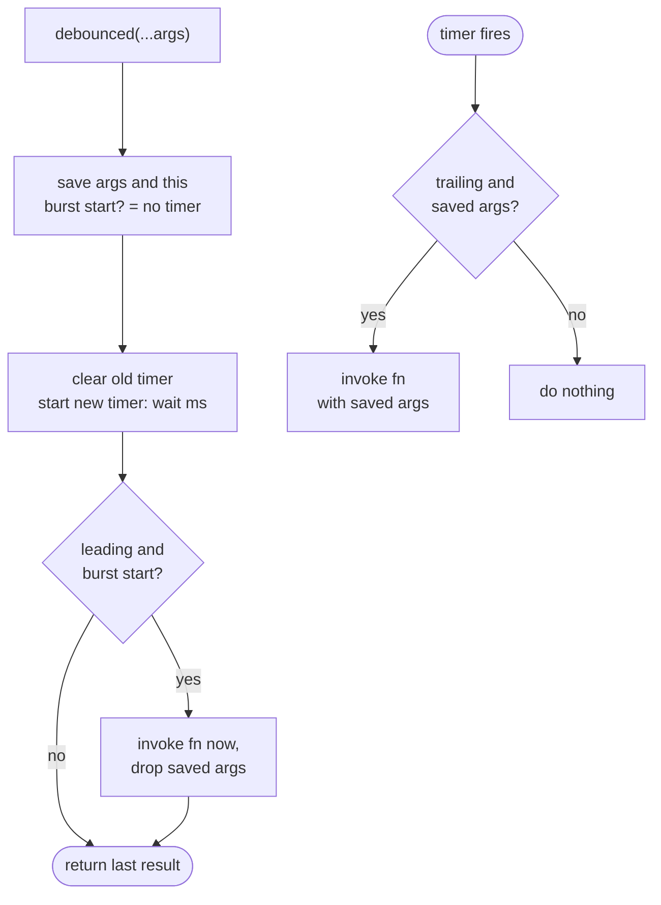
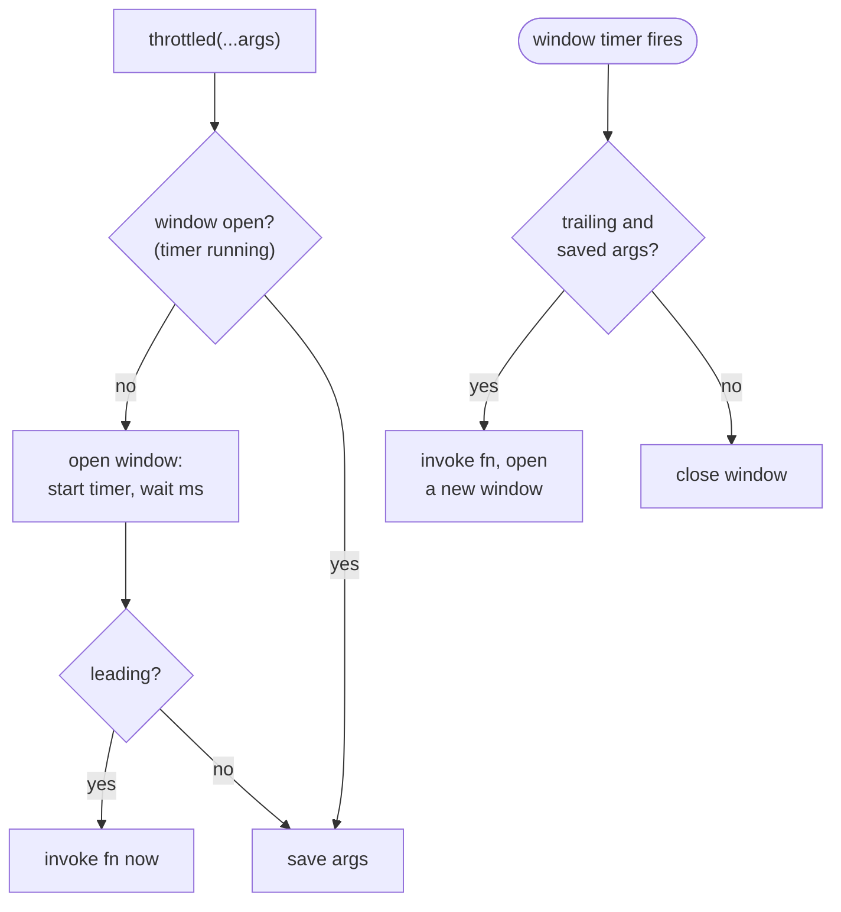
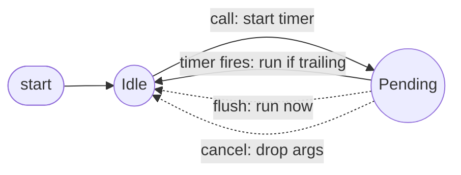

# Chapter 13: Debouncing & Throttling

## 13.1 Definition and why interviewers ask it

**Debouncing and throttling are two ways to limit how often a function runs in response to a rapid stream of events. A debounced function waits until the events stop for N milliseconds and then runs once. A throttled function runs at most once every N milliseconds while events keep coming.**

This is one of the most frequently reported "implement it yourself" problems in JavaScript and frontend machine-coding rounds (commonly reported), and "what is the difference between debounce and throttle?" is a standard fundamentals question. It tests closures (the timer id lives in a closure), `this` and argument forwarding, timers and the event loop, and whether you can reason about edge cases: leading and trailing calls, cancelling, and what happens in a React component that re-renders.

## 13.2 Core concept

### Plain language

Picture an elevator door. **Debounce** is a door that stays open as long as people keep walking in. Each new arrival restarts the countdown, and the door closes only after N seconds with nobody new, so the elevator leaves once per group. **Throttle** is a lift that departs on a fixed timetable, every N seconds, whether people are still arriving or not. Search-as-you-type wants the first behaviour (act once the user has finished), scroll tracking wants the second (act regularly while the user is still scrolling).

### Precise version

| | Debounce | Throttle |
|---|---|---|
| Rule | Run after N ms with **no** new call | Run at most once per N ms |
| While events keep coming | Never runs (the timer keeps restarting), unless `maxWait` is set | Runs regularly, once per window |
| Number of runs for a burst | One (or two with leading and trailing) | About `duration / N` |
| Which arguments it uses | The last call's | The first (leading) or the latest in the window (trailing) |
| Typical uses | Search-as-you-type, autosave, validation, "resize ended", form double-submit guard | Scroll or mousemove handlers, drag, window resize feedback, game input, rate-limited API calls |

**Leading and trailing edge.** A *burst* is a run of calls in which no gap is longer than the wait. The *leading edge* is the start of the burst, the *trailing edge* is its end.

| `leading` | `trailing` | Debounce | Throttle |
|---|---|---|---|
| `false` | `true` | Classic. Runs once, N ms after the last call, with the last arguments. | Does not run at the start. Runs at the end of each window with the latest arguments. |
| `true` | `false` | Runs immediately at the start of a burst. Ignores the rest until a quiet gap of N ms. | At most once per window, at its start. Calls inside the window are dropped. |
| `true` | `true` | Runs at the start, and again at the end **only if there was at least one more call** after the first. | The default for lodash: runs at once, then once per window with the latest arguments, and ends with the final value. |
| `false` | `false` | Never runs. | Never runs. |

**Return value.** The wrapper cannot return the result of a call that has not run yet. The usual contract (and lodash's) is to return the result of the *last invocation*, which is `undefined` before the first one.

**`this` and arguments.** The wrapper must be a regular function and forward `this` and the arguments with `apply`. An arrow function wrapper has the `this` of the code that *created* it, so an object method that was debounced loses its receiver.

**Extras.**

- `cancel()`: drop the pending call and reset the state. Use it when a component unmounts.
- `flush()`: run the pending call now. Use it before navigating away, so a pending autosave is not lost.
- `pending()`: is a call waiting?
- `maxWait` (debounce): guarantee a run at least every `maxWait` ms even if calls never stop. lodash's `throttle` is exactly `debounce` with `leading: true`, `trailing: true` and `maxWait: wait`.

**Throttle implementations.** *Timestamp-based*: remember the time of the last run and run only when `now - last >= wait`. Simple, no timers, leading only, and it can lose the final event. *Timer-based*: a timer defines a window, and the latest call in a window is kept for the trailing run. *Hybrid* (the one in this chapter): the first call runs immediately and opens a window, and the latest call during the window runs when the timer fires. *`requestAnimationFrame`-based*: coalesce calls so the handler runs at most once per frame, right before the next repaint. Best for visual updates.

**Pitfalls.** Creating a new debounced function on every React render (each has its own timer, so nothing is debounced). Not cancelling on unmount. Arrow-function wrappers that lose `this`. Clearing the wrong timer id. Leading and trailing both firing for a single call (must be suppressed). Debouncing the *state update* of a controlled input, which makes typing lag, instead of debouncing the *effect* (the request).

## 13.3 How it works internally

### A. Why a closure and a timer

`debounce(fn, wait)` returns a function that closes over private state: the timer id, the latest arguments, the latest `this`, and the last result. Every call of the wrapper reads and writes that same state, which is why one debounced function instance means one shared timer. Two separately created wrappers never affect each other.

### B. Debounce, step by step

1. The wrapper is called. It remembers `args` and `this` (the latest call wins).
2. It records whether this call starts a burst (`timer === undefined`).
3. It clears the previous timer and starts a new one for `wait` ms. This restart is the entire "debounce" effect.
4. If `leading` is on and this call starts a burst, it runs `fn` now and clears the saved arguments, so the trailing edge does not repeat it.
5. When the timer finally fires (a quiet gap of `wait` ms passed), it sets `timer = undefined`. If `trailing` is on and arguments are still saved, it runs `fn` with them. The burst is over.

### C. Throttle, step by step (hybrid)

1. The wrapper is called. If no window is open (`timer === undefined`), it opens one by starting a timer for `wait` ms.
2. If `leading` is on, it runs `fn` now and the call is done. Otherwise it saves the arguments.
3. If a window is already open, it only saves the latest arguments (this is the call that is "dropped" unless trailing is on).
4. When the window timer fires: if `trailing` is on and arguments are saved, run `fn` with them and **open a new window** (so the next call right after is still throttled). If nothing is saved, the window closes and the next call is a leading call again.

### D. Where `maxWait` comes in

Plain debounce can starve: if calls keep arriving closer together than `wait`, `fn` never runs. With `maxWait`, the timer delay is `min(wait, maxWait - timeSinceBurstStart)`, so it fires no later than `maxWait` after the burst began. (lodash measures from the last invocation instead of from the burst start. The effect is the same in practice.)

### E. Timers, the event loop and time

The delay passed to `setTimeout` is a *minimum*. The callback is a macrotask: it waits until the current task finishes and the call stack is empty (Chapter 7). A busy main thread delays it. `setTimeout(fn, 0)` is still asynchronous: Node treats delays below 1 as 1, and browsers may clamp further (and throttle timers in background tabs). So a debounced function with `wait = 0` still runs after the current synchronous code, not during it.

### F. `requestAnimationFrame` throttling

`requestAnimationFrame(cb)` schedules `cb` just before the browser's next repaint, typically 60 times per second on a 60 Hz display, and not at all in a hidden tab. A rAF throttle stores the latest arguments, schedules one frame callback if none is pending, and in that callback runs `fn` with the latest arguments. It is time-independent: you get at most one run per frame, which is the right rate for anything that changes pixels. It is the wrong tool for network calls or for non-visual work, and does not run in background tabs.

### G. Testing without real time

Real timers make tests slow and flaky. The implementations in this chapter take a *clock* (`setTimeout`, `clearTimeout`, `now`) as a parameter. In tests and in this book a `FakeClock` with virtual time replaces it, and `tick(ms)` runs due timers in order. Jest and Vitest fake timers (`useFakeTimers`, `advanceTimersByTime`) work the same way.

### H. Differences from lodash

The versions here follow the documented behaviour of lodash `debounce` and `throttle` for `leading`, `trailing`, `cancel`, `flush`, `pending` and the "last result" return value, but they are shorter. lodash additionally supports `maxWait` inside the same function, compares `Date.now()` values to cope with system-clock changes, and measures `maxWait` from the last invocation. In production, use the library version or a well-tested one.

## 13.4 Diagrams

### Debounce (trailing): one call after the burst

```ascii Debounce (trailing), wait 240 ms: event stream versus invocations
 time (ms)  0         200       400       600       800       1000      1200
            +---------+---------+---------+---------+---------+---------+-------
 events     o    o    o    o    o    o    o                        o
 timer                                    |<- 240ms ->|
 fn calls                                             X                        X
                                                      e600                     e1100
```

> **How to explain this to the interviewer**
>
> 1. Draw the time axis and the event row: seven events 100 ms apart, then one event at 1100 ms.
> 2. Draw the 240 ms box after the last event of the burst and say: "every event restarts this timer, so nothing runs while events keep coming".
> 3. Put `X` where the box ends, 240 ms after the last event, and say: "it runs once with the last arguments, `e600`".
>
> **Takeaway:** trailing debounce runs once per burst, after the burst has ended.

### Debounce (leading): one call at the start of the burst

```ascii Debounce (leading only), wait 240 ms: event stream versus invocations
 time (ms)  0         200       400       600       800       1000      1200
            +---------+---------+---------+---------+---------+---------+-------
 events     o    o    o    o    o    o    o                        o
 quiet gap                                |<- 240ms ->|            |<- 240ms ->|
 fn calls   X                                                      X
            e0                                                     e1100
```

> **How to explain this to the interviewer**
>
> 1. Draw the same event row. Put `X` on the very first event only.
> 2. Draw the 240 ms quiet gap after the last event of the burst and say: "calls inside the burst are ignored until this gap has passed".
> 3. Point at the event at 1100 ms: it comes after a quiet gap, so it is a new burst and runs at once.
>
> **Takeaway:** leading debounce reacts immediately and then goes quiet until the burst ends.

### Throttle (leading): at most one call per window

```ascii Throttle (leading only), wait 240 ms: event stream versus invocations
 time (ms)  0         200       400       600       800       1000      1200
            +---------+---------+---------+---------+---------+---------+-------
 events     o    o    o    o    o    o    o                        o
 window     [--window--]   [--window--]   [--window--]             [--window--]
 fn calls   X              X              X                        X
            e0             e300           e600                     e1100
```

> **How to explain this to the interviewer**
>
> 1. Draw the event row and put `X` on the first event. Draw a 240 ms window starting there.
> 2. Cross out the events inside the window. The next event after the window ends (at 300 ms) runs and opens a new window.
> 3. Point at the last event of the burst, at 600 ms: it runs because it falls after a window. An event that falls inside one is lost.
>
> **Takeaway:** leading-only throttle caps the rate but can drop the final event of a burst.

### Throttle (leading + trailing): a steady rhythm with the last value delivered

```ascii Throttle (leading + trailing), wait 240 ms: event stream versus invocations
 time (ms)  0         200       400       600       800       1000      1200
            +---------+---------+---------+---------+---------+---------+-------
 events     o    o    o    o    o    o    o                        o
 window     [--window--][--window--][--window--][--window--]       [--window--]
 fn calls   X           X           X           X                  X
            e0          e200        e400        e600               e1100
```

> **How to explain this to the interviewer**
>
> 1. Draw the first call running at once (`X` at 0 ms) and a window of 240 ms behind it.
> 2. At each window end, put an `X` labelled with the latest event seen inside the window (`e200`, `e400`, `e600`) and open the next window.
> 3. Point at the end: after `e600` the window closes with nothing saved, so the isolated event at 1100 ms runs immediately as a new leading call.
>
> **Takeaway:** leading + trailing throttle runs steadily during the burst and never loses the final value.

### Debounce algorithm



> **How to explain this to the interviewer**
>
> 1. Draw the left column: save the arguments, clear the old timer, start a new one. Say: "this restart is the debounce".
> 2. Add the leading branch: only the first call of a burst invokes immediately.
> 3. Draw the timer as a separate entry point on the right and say: "the trailing run only happens if arguments are still saved, which is why leading + trailing does not run twice for a single call".
>
> **Takeaway:** each call restarts the timer, and the timer's callback is where the trailing run happens.

### Throttle algorithm



> **How to explain this to the interviewer**
>
> 1. Draw the first decision, "is a window open?". If not, open one and run now (leading).
> 2. If one is open, say: "the call is not run, only its arguments are remembered, each call overwriting the last".
> 3. Draw the timer branch: at the end of the window the saved arguments run and a new window opens, otherwise the window closes.
>
> **Takeaway:** the window timer is what turns "extra calls" into a fixed rhythm.

### State of a debounced function: idle, pending, cancel and flush



> **How to explain this to the interviewer**
>
> 1. Draw two circles, Idle and Pending, with "call" going from Idle to Pending.
> 2. Draw the three ways out of Pending: the timer fires (solid line), `flush()` runs the call now and `cancel()` throws it away (dashed lines).
> 3. Add a note: "a further call while Pending only restarts the timer, it does not change state".
>
> **Takeaway:** `cancel` and `flush` are the two manual exits from Pending, and they exist for unmounting and navigating away.

### Whiteboard version

```ascii Whiteboard version: debounce versus throttle on one event stream (60 seconds)
 time (100 ms per column) -->
 events     ooooooo....o
 debounce   ........X....X     once per burst, after the quiet gap
 throttle   X..X..X....X       steady rhythm while events continue
```

## 13.5 Code examples

### Example 1: a fake clock with virtual time

```js
class FakeClock {
  constructor() { this.time = 0; this.timers = []; this.nextId = 1; }
  now() { return this.time; }
  setTimeout(fn, ms = 0) {
    const id = this.nextId++;
    this.timers.push({ id, fn, due: this.time + Math.max(0, ms) });
    this.timers.sort((a, b) => a.due - b.due || a.id - b.id);   // earliest first
    return id;
  }
  clearTimeout(id) { this.timers = this.timers.filter((t) => t.id !== id); }
  tick(ms) {
    const target = this.time + ms;
    while (this.timers.length && this.timers[0].due <= target) {
      const t = this.timers.shift();
      this.time = t.due;                  // time jumps to the timer's due time
      t.fn();                             // a timer may schedule more timers
    }
    this.time = target;
  }
}

const clock = new FakeClock();
const log = [];
clock.setTimeout(() => log.push('B@' + clock.now()), 200);
const id = clock.setTimeout(() => log.push('never'), 100);
clock.setTimeout(() => {
  log.push('A@' + clock.now());
  clock.setTimeout(() => log.push('C@' + clock.now()), 50);
}, 100);
clock.clearTimeout(id);
clock.tick(99);  console.log(log, clock.now());
clock.tick(1);   console.log(log, clock.now());
clock.tick(500); console.log(log, clock.now());
```

```text output
[] 99
[ 'A@100' ] 100
[ 'A@100', 'C@150', 'B@200' ] 600
```

**Why:** nothing runs until `tick` advances virtual time, and timers run in due-time order, with their `now()` set to the due time. A timer created inside a timer (`C`) is also run if it falls within the tick. The cancelled timer never runs. No real time passes, so the output is the same on every machine. The rest of this chapter reuses this class and passes it to the implementations as their `clock`.

### Example 2: the same event stream through four strategies

```js
class FakeClock {
  constructor() { this.time = 0; this.timers = []; this.nextId = 1; }
  now() { return this.time; }
  setTimeout(fn, ms = 0) {
    const id = this.nextId++;
    this.timers.push({ id, fn, due: this.time + Math.max(0, ms) });
    this.timers.sort((a, b) => a.due - b.due || a.id - b.id);   // earliest first
    return id;
  }
  clearTimeout(id) { this.timers = this.timers.filter((t) => t.id !== id); }
  tick(ms) {
    const target = this.time + ms;
    while (this.timers.length && this.timers[0].due <= target) {
      const t = this.timers.shift();
      this.time = t.due;                  // time jumps to the timer's due time
      t.fn();                             // a timer may schedule more timers
    }
    this.time = target;
  }
}

function debounce(fn, wait, { leading = false, trailing = true } = {}, clock) {
  let timer, lastArgs, lastThis;
  return function debounced(...args) {
    const startOfBurst = timer === undefined;
    lastArgs = args;
    lastThis = this;
    clock.clearTimeout(timer);                     // every call restarts the timer
    timer = clock.setTimeout(() => {
      timer = undefined;
      if (trailing && lastArgs) fn.apply(lastThis, lastArgs);
      lastArgs = lastThis = undefined;
    }, wait);
    if (leading && startOfBurst) {
      fn.apply(lastThis, lastArgs);
      lastArgs = lastThis = undefined;             // consumed: no second run at the end
    }
  };
}

function throttle(fn, wait, { leading = true, trailing = true } = {}, clock) {
  let timer, lastArgs, lastThis;
  function endOfWindow() {
    timer = undefined;
    if (trailing && lastArgs) {
      const args = lastArgs;
      const self = lastThis;
      lastArgs = lastThis = undefined;
      fn.apply(self, args);
      timer = clock.setTimeout(endOfWindow, wait); // a trailing run opens a new window
    }
  }
  return function throttled(...args) {
    if (timer === undefined) {
      timer = clock.setTimeout(endOfWindow, wait);
      if (leading) { fn.apply(this, args); return; }
    }
    lastArgs = args;
    lastThis = this;
  };
}

const WAIT = 240;
function run(make, events) {
  const clock = new FakeClock();
  const calls = [];
  const h = make(clock, (arg) => calls.push(`${clock.now()}ms ${arg}`));
  for (const t of events) { clock.tick(t - clock.now()); h('e' + t); }
  clock.tick(2000);
  return calls.join(' | ');
}
const stream = [0, 100, 200, 300, 400, 500, 600, 1100];
const both = { leading: true, trailing: true };
const strategies = {
  'debounce trailing': (c, f) => debounce(f, WAIT, {}, c),
  'debounce leading': (c, f) => debounce(f, WAIT, { leading: true, trailing: false }, c),
  'debounce lead+trail': (c, f) => debounce(f, WAIT, both, c),
  'throttle leading': (c, f) => throttle(f, WAIT, { leading: true, trailing: false }, c),
  'throttle lead+trail': (c, f) => throttle(f, WAIT, both, c),
  'throttle trailing': (c, f) => throttle(f, WAIT, { leading: false, trailing: true }, c),
};
for (const [name, make] of Object.entries(strategies)) {
  console.log(name.padEnd(20), run(make, stream));
}

// Edge cases: leading + trailing debounce, and wait = 0
console.log('one call      ', run(strategies['debounce lead+trail'], [0]));
console.log('two calls     ', run(strategies['debounce lead+trail'], [0, 50]));
const zero = new FakeClock();
const zeroCalls = [];
const d0 = debounce((x) => zeroCalls.push(x), 0, {}, zero);
d0('a'); d0('b'); d0('c');
console.log(zeroCalls.length);                   // nothing ran synchronously
zero.tick(0);
console.log(zeroCalls);
```

```text output
debounce trailing    840ms e600 | 1340ms e1100
debounce leading     0ms e0 | 1100ms e1100
debounce lead+trail  0ms e0 | 840ms e600 | 1100ms e1100
throttle leading     0ms e0 | 300ms e300 | 600ms e600 | 1100ms e1100
throttle lead+trail  0ms e0 | 240ms e200 | 480ms e400 | 720ms e600 | 1100ms e1100
throttle trailing    240ms e200 | 480ms e400 | 720ms e600 | 1340ms e1100
one call       0ms e0
two calls      0ms e0 | 290ms e50
0
[ 'c' ]
```

**Why:** all six rows use the same eight events, 100 ms apart from 0 to 600 and one at 1100, and a wait of 240 ms. Debounce runs once per burst, with the last arguments (`e600`). Leading debounce runs on the first event of each burst and ignores the rest. Throttle with leading and trailing runs every window with the newest event (`e200`, `e400`, `e600`), so it ends with the final value, while leading-only throttle drops events that land inside a window. Leading plus trailing debounce runs once for a single call, and twice for two calls (the second run uses `e50`, 240 ms after it). With `wait = 0` nothing runs synchronously: the three calls are coalesced into one run on the next tick.

### Example 3: a `requestAnimationFrame` throttle (browser)

```js norun
function rafThrottle(fn) {
  let frame = 0;
  let lastArgs;
  let lastThis;
  function throttled(...args) {
    lastArgs = args;                       // always keep the latest arguments
    lastThis = this;
    if (frame) return;                     // a frame is already scheduled
    frame = requestAnimationFrame(() => {
      frame = 0;
      fn.apply(lastThis, lastArgs);
    });
  }
  throttled.cancel = () => { cancelAnimationFrame(frame); frame = 0; };
  return throttled;
}

const onScroll = rafThrottle(() => updateProgressBar(window.scrollY));
window.addEventListener('scroll', onScroll, { passive: true });
// on teardown: window.removeEventListener('scroll', onScroll); onScroll.cancel();
```

**Why:** many `scroll` events can arrive between two frames, but only one callback is queued, and it uses the latest arguments. Browsers also dispatch `scroll` and `resize` events as part of their rendering update, so for those two events the browser already limits their rate. This snippet is display-only because `requestAnimationFrame` needs a browser.

## 13.6 Common mistakes and gotchas

- **Creating the debounced function on every render.** In a React component, `const onChange = debounce(search, 300)` in the render body builds a new wrapper, with a new timer, on each render, so nothing is ever debounced (Question 13.7). Create it once with `useMemo` or `useRef`, or outside the component.
- **Not cancelling on unmount.** A pending call can fire after the component is gone and update state or touch a detached node. Call `debounced.cancel()` in the effect cleanup (Question 13.14).
- **Arrow-function wrappers.** `return (...args) => fn.apply(this, args)` uses the `this` of the code that created the wrapper, not of the caller (Question 13.6).
- **Clearing the wrong timer id.** Keep one `timer` variable per wrapper instance, assign the new id every time and clear the old one before replacing it. Do not share it between instances, and set it back to `undefined` when it fires.
- **Leading + trailing double fire.** A single call must run once, not twice. Clear the saved arguments when the leading call runs (Question 13.13).
- **Debouncing the wrong thing.** Debounce the request, not the controlled input's `setState`, or typing feels laggy.
- **Stale closures.** A debounced callback that closes over props or state keeps the version it was created with. Read the latest value from a ref, or pass values as arguments.
- **Using `Date.now()` in tests.** Use an injected clock or fake timers so tests do not sleep.
- **Assuming `wait` is exact.** It is a lower bound. The event loop can delay the callback.
- **Treating the return value as the result of this call.** The wrapper returns the previous invocation's result.
- **Leaking captured arguments.** A pending debounced call keeps its arguments alive until it fires or is cancelled.
- **Using debounce where you need regular updates.** A progress bar or a live search-while-scrolling needs throttle, or debounce with `maxWait`.

## 13.7 Quick revision cheat sheet

- **Debounce:** run once after N ms of silence, with the latest arguments. Restart the timer on every call.
- **Throttle:** run at most once per N ms window. Keeps the rhythm during a burst.
- **Leading/trailing:** leading runs at the start of a burst, trailing at the end. Both: trailing only if there was a further call.
- **Wrapper contract:** regular function, `apply(this, args)`, return the last result, expose `cancel`, `flush`, `pending`.
- **Throttle variants:** timestamp (simple, leading only, may lose the last event), timer window (leading and trailing), rAF (once per frame, visual work).
- **`maxWait`:** bounds debounce starvation. lodash `throttle` is `debounce` with `maxWait = wait`.
- **React:** create the wrapper once (`useMemo`/`useRef`), cancel in cleanup, keep the callback fresh through a ref.
- **Testing:** inject the clock or use fake timers, never real sleeps. `wait = 0` is still asynchronous.

## 13.8 Interview questions

*Key: ★ = very frequently reported. "Typically asked in" lines say which round a question tends to appear in; where no single source could be pinned down, the question is labelled "commonly reported". Draw-it hints refer to the figures in section 13.4.*

#### Conceptual

### Q13.1 ★ Easy: What is the difference between debouncing and throttling? Give a use case for each.

*Typically asked in: JavaScript fundamentals round and frontend machine-coding round (commonly reported).*

> **Model answer**
>
> Both limit how often a handler runs, but with different rules. Debounce waits for a pause: it restarts a timer on every event and runs the function once, after N milliseconds with no new events. I use it for search-as-you-type, autosave, and "window resize finished", where only the final state matters. Throttle runs the function at most once every N milliseconds, however many events arrive, so it keeps a steady rhythm during the burst. I use it for scroll, mousemove or drag handlers, where I need updates while the user is still acting. Debounce can run zero times during a long burst, throttle always keeps running.

**Key points to mention**

- Debounce: quiet period, last call wins, one run per burst.
- Throttle: fixed maximum rate, steady rhythm.
- Examples for each, and what each loses (throttle drops intermediate calls, debounce delays).
- Draw it: Figures 13.1 and 13.4, or the whiteboard figure.

### Q13.2 Medium: What do the `leading` and `trailing` options do, and what happens for each combination?

*Typically asked in: machine-coding round, as the follow-up to "implement debounce" (commonly reported).*

> **Model answer**
>
> `leading` runs the function at the start of a burst, `trailing` at the end. For debounce the default is trailing only: one run after the quiet gap. Leading only runs immediately on the first call and ignores the rest until things go quiet, which suits a submit button. With both on, it runs at the start and runs again at the end only if there was at least one more call, so a single call does not fire twice. For throttle, leading plus trailing gives an immediate run, a steady rhythm and a final run with the last arguments. With both off, nothing ever runs.

**Key points to mention**

- Burst = calls with gaps shorter than `wait`.
- Leading + trailing must not double-fire for one call.
- Throttle with trailing never loses the final value, without it the last event can be dropped.
- Draw it: Figures 13.2 and 13.4.

### Q13.3 Medium: What are the ways to implement throttle, and how do they differ?

*Typically asked in: machine-coding round, follow-up (commonly reported).*

> **Model answer**
>
> The timestamp approach stores the time of the last run and runs only if `now - last >= wait`. It needs no timer, but it is leading-only and can drop the final event, so the UI can end up showing a stale value. The timer approach opens a window with `setTimeout`, remembers the latest arguments during it, and runs them when the window ends. That gives a trailing call, and the hybrid of the two gives leading plus trailing. A third approach uses `requestAnimationFrame` to run at most once per frame, which is ideal for visual updates. In production I would use lodash's version or a tested one.

**Key points to mention**

- Timestamp: simple, no trailing call, final event may be lost.
- Timer window: trailing call, needs `cancel`.
- Hybrid: leading + trailing, the lodash default.
- rAF: frame-aligned, visual work only, paused in hidden tabs.
- Draw it: Figure 13.6.

### Q13.4 Medium: For each of these, would you use debounce, throttle, rAF, or nothing: search box, infinite scroll, window resize layout, drag a slider, submit button, scroll progress bar?

*Typically asked in: frontend design discussion or machine-coding round (commonly reported).*

> **Model answer**
>
> Search box: debounce, around 200 to 400 ms, plus cancelling stale requests. Infinite scroll: throttle, or better, an `IntersectionObserver`, which needs no scroll handler at all. Resize that triggers an expensive layout: debounce so it runs when resizing stops, or throttle if live feedback matters, and a `ResizeObserver` may fit better. Dragging a slider that updates the screen: rAF throttle, once per frame. Submit button: leading-edge debounce to block double clicks, or just disable the button. Scroll progress bar: rAF throttle, or CSS scroll-driven animations. The rule: match the rate to what the user can perceive.

**Key points to mention**

- Debounce when only the final state matters, throttle when intermediate updates matter, rAF for pixels.
- Check whether a platform feature removes the need (`IntersectionObserver`, `ResizeObserver`, CSS).
- Cancel or ignore stale async results too.
- Passive scroll listeners keep scrolling smooth.

#### Output prediction

### Q13.5 ★ Medium: Events arrive at 0, 100, 200, 400 and 1000 ms. What do the debounced and throttled handlers print, and when?

*Typically asked in: JavaScript fundamentals or machine-coding round (commonly reported).*

```js
class FakeClock {
  constructor() { this.time = 0; this.timers = []; this.nextId = 1; }
  now() { return this.time; }
  setTimeout(fn, ms = 0) {
    const id = this.nextId++;
    this.timers.push({ id, fn, due: this.time + Math.max(0, ms) });
    this.timers.sort((a, b) => a.due - b.due || a.id - b.id);   // earliest first
    return id;
  }
  clearTimeout(id) { this.timers = this.timers.filter((t) => t.id !== id); }
  tick(ms) {
    const target = this.time + ms;
    while (this.timers.length && this.timers[0].due <= target) {
      const t = this.timers.shift();
      this.time = t.due;                  // time jumps to the timer's due time
      t.fn();                             // a timer may schedule more timers
    }
    this.time = target;
  }
}

const clock = new FakeClock();
const out = [];
const debounce = (fn, wait) => {
  let t;
  return (x) => { clock.clearTimeout(t); t = clock.setTimeout(() => fn(x), wait); };
};
const throttle = (fn, wait) => {
  let last = -Infinity;
  return (x) => { if (clock.now() - last >= wait) { last = clock.now(); fn(x); } };
};
const d = debounce((x) => out.push(`D:${x}@${clock.now()}`), 300);
const t = throttle((x) => out.push(`T:${x}@${clock.now()}`), 300);
for (const [at, x] of [[0, 'a'], [100, 'b'], [200, 'c'], [400, 'd'], [1000, 'e']]) {
  clock.tick(at - clock.now());
  d(x);
  t(x);
}
clock.tick(1000);
console.log(out.join(' '));
```

```text output
T:a@0 T:d@400 D:d@700 T:e@1000 D:e@1300
```

> **Model answer**
>
> `T:a@0 T:d@400 D:d@700 T:e@1000 D:e@1300`. The throttle runs on `a` at once. `b` (100) and `c` (200) are less than 300 ms later, so they are dropped. `d` at 400 is 400 ms after the last run, so it runs. `e` at 1000 runs too. The debounce keeps restarting: after `c` at 200 its timer was due at 500, but `d` arrives at 400 and pushes it to 700, so only `d` runs, at 700. Then `e` at 1000 runs at 1300. The gap between `c` and `d` is 200 ms, shorter than the wait, so they belong to the same burst.

**Key points to mention**

- Debounce: look at the gaps between events. A gap shorter than `wait` keeps the burst alive.
- Throttle: compare each event with the time of the last *run*.
- Debounce results come `wait` ms after the last event of each burst, with its argument.
- `D:d@700` happens after `T:d@400` although both use `d`.

### Q13.6 Medium: Why does one of these debounced methods print `undefined`?

*Typically asked in: JavaScript round, `this` follow-up (commonly reported).*

```js
'use strict';
class FakeClock {
  constructor() { this.time = 0; this.timers = []; this.nextId = 1; }
  now() { return this.time; }
  setTimeout(fn, ms = 0) {
    const id = this.nextId++;
    this.timers.push({ id, fn, due: this.time + Math.max(0, ms) });
    this.timers.sort((a, b) => a.due - b.due || a.id - b.id);   // earliest first
    return id;
  }
  clearTimeout(id) { this.timers = this.timers.filter((t) => t.id !== id); }
  tick(ms) {
    const target = this.time + ms;
    while (this.timers.length && this.timers[0].due <= target) {
      const t = this.timers.shift();
      this.time = t.due;                  // time jumps to the timer's due time
      t.fn();                             // a timer may schedule more timers
    }
    this.time = target;
  }
}

const clock = new FakeClock();
const log = [];

function debounceArrow(fn, wait) {
  let t;
  return (...args) => {                    // arrow: `this` is the one of debounceArrow
    clock.clearTimeout(t);
    t = clock.setTimeout(() => fn.apply(this, args), wait);
  };
}
function debounceRegular(fn, wait) {
  let t;
  return function (...args) {              // regular: `this` is the caller
    const self = this;
    clock.clearTimeout(t);
    t = clock.setTimeout(() => fn.apply(self, args), wait);
  };
}
function handler(q) { log.push(`${this && this.name}:${q}`); }

const a = { name: 'A', onInput: debounceArrow(handler, 100) };
const b = { name: 'B', onInput: debounceRegular(handler, 100) };
a.onInput('x');
b.onInput('y');
clock.tick(100);
console.log(log);
```

```text output
[ 'undefined:x', 'B:y' ]
```

> **Model answer**
>
> `['undefined:x', 'B:y']`. The wrapper from `debounceArrow` is an arrow function, so it has no `this` of its own. It uses the `this` of the surrounding `debounceArrow` call, which was a plain call in strict mode, so `undefined`. Calling `a.onInput('x')` does not change that, so the handler sees no receiver. The regular function in `debounceRegular` gets `this` from how it is called: `b.onInput('y')` makes `this` the object `b`. The timer callback is an arrow, which is right here, because it must keep the captured `self`. Wrappers must be regular functions, and the inner timer callback must be an arrow or use a saved reference.

**Key points to mention**

- Arrow functions take `this` from where they are created, regular functions from how they are called.
- The wrapper is the one that must see the caller's `this`. The inner timer callback should use the saved value.
- Always forward both: `fn.apply(self, args)`.
- In sloppy mode the arrow case would see the global object instead of `undefined`, which is still wrong.

### Q13.7 ★ Medium: This simulates a component that rebuilds its handler on every render. What does it print, and what does the fix print?

*Typically asked in: React-flavoured frontend round (commonly reported).*

```js
class FakeClock {
  constructor() { this.time = 0; this.timers = []; this.nextId = 1; }
  now() { return this.time; }
  setTimeout(fn, ms = 0) {
    const id = this.nextId++;
    this.timers.push({ id, fn, due: this.time + Math.max(0, ms) });
    this.timers.sort((a, b) => a.due - b.due || a.id - b.id);   // earliest first
    return id;
  }
  clearTimeout(id) { this.timers = this.timers.filter((t) => t.id !== id); }
  tick(ms) {
    const target = this.time + ms;
    while (this.timers.length && this.timers[0].due <= target) {
      const t = this.timers.shift();
      this.time = t.due;                  // time jumps to the timer's due time
      t.fn();                             // a timer may schedule more timers
    }
    this.time = target;
  }
}

function simulate(makeHandlerOnRender) {
  const clock = new FakeClock();
  const requests = [];
  const search = (q) => requests.push(`${q}@${clock.now()}`);
  const debounce = (fn, wait) => {
    let t;
    return (x) => { clock.clearTimeout(t); t = clock.setTimeout(() => fn(x), wait); };
  };
  const stable = debounce(search, 100);          // created once
  let handler = makeHandlerOnRender(debounce, search, stable);
  for (const [at, q] of [[0, 'a'], [50, 'ab'], [100, 'abc']]) {
    clock.tick(at - clock.now());
    handler(q);                                  // user types -> onChange
    handler = makeHandlerOnRender(debounce, search, stable);   // state change -> re-render
  }
  clock.tick(1000);
  return requests;
}

const rebuild = (debounce, search) => debounce(search, 100);
console.log('new wrapper per render:', simulate(rebuild));
console.log('wrapper created once:  ', simulate((debounce, search, stable) => stable));
```

```text output
new wrapper per render: [ 'a@100', 'ab@150', 'abc@200' ]
wrapper created once:   [ 'abc@200' ]
```

> **Model answer**
>
> The buggy version prints `['a@100', 'ab@150', 'abc@200']`: three requests. Each keystroke calls a freshly created wrapper that has its own timer and has never been called before, so there is nothing to cancel, and every timer fires. The fixed version prints only `['abc@200']`, because all keystrokes go through one wrapper whose timer keeps being restarted. In React I create the wrapper once with `useMemo` or `useRef`, not in the render body, and I cancel it in the effect cleanup.

**Key points to mention**

- State lives in the closure, so a new wrapper means a new timer and no shared state.
- Fix: `useMemo(() => debounce(fn, wait), [])` or `useRef`. Keep the latest callback in a ref to avoid a stale closure.
- Cancel in cleanup. Debounce the request, not the input's state update.
- `useCallback(debounce(fn, wait), [])` also returns the first wrapper, but the `debounce(...)` call still builds a throwaway wrapper on every render. `useMemo(() => debounce(fn, wait), [])` avoids that.

#### Implement it yourself

### Q13.8 ★ Hard: Implement `debounce(fn, wait, { leading, trailing })` with `cancel`, `flush` and `pending`.

*Typically asked in: frontend machine-coding round (commonly reported).*

**Problem.** The wrapper must preserve `this` and the arguments, use the *latest* arguments, support leading and trailing edges (a single call must not fire twice with both on), return the last result, and expose `cancel`, `flush` and `pending`.

**Solution.** The clock is a parameter so the demo is deterministic. By default it uses the real timers.

```js
class FakeClock {
  constructor() { this.time = 0; this.timers = []; this.nextId = 1; }
  now() { return this.time; }
  setTimeout(fn, ms = 0) {
    const id = this.nextId++;
    this.timers.push({ id, fn, due: this.time + Math.max(0, ms) });
    this.timers.sort((a, b) => a.due - b.due || a.id - b.id);   // earliest first
    return id;
  }
  clearTimeout(id) { this.timers = this.timers.filter((t) => t.id !== id); }
  tick(ms) {
    const target = this.time + ms;
    while (this.timers.length && this.timers[0].due <= target) {
      const t = this.timers.shift();
      this.time = t.due;                  // time jumps to the timer's due time
      t.fn();                             // a timer may schedule more timers
    }
    this.time = target;
  }
}
const realClock = {
  setTimeout: (f, ms) => setTimeout(f, ms),
  clearTimeout: (id) => clearTimeout(id),
  now: () => Date.now(),
};

function debounce(fn, wait, options = {}, clock = realClock) {
  const { leading = false, trailing = true } = options;
  let timer, lastArgs, lastThis, result;

  function invoke() {
    const args = lastArgs;
    const self = lastThis;
    lastArgs = lastThis = undefined;        // consumed: trailing must not repeat it
    result = fn.apply(self, args);
    return result;
  }

  function debounced(...args) {
    const startOfBurst = timer === undefined;
    lastArgs = args;
    lastThis = this;                        // regular function: the caller's `this`
    clock.clearTimeout(timer);              // restart the timer on every call
    timer = clock.setTimeout(() => {
      timer = undefined;
      if (trailing && lastArgs) invoke();
      lastArgs = lastThis = undefined;
    }, wait);
    if (leading && startOfBurst) invoke();
    return result;                          // the result of the LAST invocation
  }

  debounced.cancel = () => {
    clock.clearTimeout(timer);
    timer = lastArgs = lastThis = undefined;
  };
  debounced.flush = () => {
    if (timer === undefined) return result;
    clock.clearTimeout(timer);
    timer = undefined;
    if (trailing && lastArgs) invoke();
    lastArgs = lastThis = undefined;
    return result;
  };
  debounced.pending = () => timer !== undefined;
  return debounced;
}

// ---- demo on virtual time
const clock = new FakeClock();
const log = [];
const saveFn = (text) => {
  log.push(`${clock.now()}ms save(${text})`);
  return text.length;
};
const save = debounce(saveFn, 200, {}, clock);

save('h'); clock.tick(100);
save('he'); clock.tick(100);
const early = save('hel');
console.log(early, save.pending());
clock.tick(199); console.log(log.length);
clock.tick(1);   console.log(log, save.pending());

save('x'); save.cancel(); clock.tick(1000);
console.log(log.length, save.pending());
save('y');
console.log(save.flush(), log[log.length - 1]);

const both = debounce((n) => log.push(`both(${n})`), 100, { leading: true }, clock);
both(1); clock.tick(500);
both(2); both(3); clock.tick(500);
console.log(log.slice(-3));
```

```text output
undefined true
0
[ '400ms save(hel)' ] false
1 false
1 1400ms save(y)
[ 'both(1)', 'both(2)', 'both(3)' ]
```

> **Model answer**
>
> The state is in a closure: timer id, latest arguments, latest `this` and last result. Each call stores its arguments and `this`, clears the old timer and starts a new one. When the timer fires, it runs `fn` with the saved arguments if `trailing` is on. If `leading` is on and this call starts a burst, it runs immediately and clears the saved arguments, so the trailing edge sees nothing and a single call runs once. The wrapper is a regular function that uses `apply`. `cancel` clears the timer and the state, `flush` runs the pending call now, and `pending` reports whether a timer exists. Each call is O(1).

**Key points to mention**

- Regular function wrapper, `fn.apply(this, args)`, latest arguments win.
- Clear saved arguments after a leading call to avoid double-firing.
- Return the last result, which is `undefined` until the first run.
- `cancel` must clear the timer and the saved state. `flush` must not run when nothing is pending.
- Edge cases: `wait = 0` (still async), `fn` throwing, calls after `cancel`, the wrapper used as a method of different objects.
- Complexity: O(1) time and space per call.

### Q13.9 ★ Medium: Implement `throttle(fn, wait)`: the timestamp version and the leading + trailing version.

*Typically asked in: frontend machine-coding round (commonly reported).*

**Problem.** Write both variants. Show an event stream where the timestamp version loses the final event and the hybrid version delivers it.

**Solution.**

```js
class FakeClock {
  constructor() { this.time = 0; this.timers = []; this.nextId = 1; }
  now() { return this.time; }
  setTimeout(fn, ms = 0) {
    const id = this.nextId++;
    this.timers.push({ id, fn, due: this.time + Math.max(0, ms) });
    this.timers.sort((a, b) => a.due - b.due || a.id - b.id);   // earliest first
    return id;
  }
  clearTimeout(id) { this.timers = this.timers.filter((t) => t.id !== id); }
  tick(ms) {
    const target = this.time + ms;
    while (this.timers.length && this.timers[0].due <= target) {
      const t = this.timers.shift();
      this.time = t.due;                  // time jumps to the timer's due time
      t.fn();                             // a timer may schedule more timers
    }
    this.time = target;
  }
}
const realClock = {
  setTimeout: (f, ms) => setTimeout(f, ms),
  clearTimeout: (id) => clearTimeout(id),
  now: () => Date.now(),
};

// Variant 1: timestamp-based, leading only. No timers.
function throttleTs(fn, wait, clock = realClock) {
  let last, result;
  return function throttled(...args) {
    const t = clock.now();
    if (last === undefined || t - last >= wait) {
      last = t;
      result = fn.apply(this, args);
    }
    return result;
  };
}

// Variant 2: timer window, leading + trailing (both optional) and cancel.
function throttle(fn, wait, options = {}, clock = realClock) {
  const { leading = true, trailing = true } = options;
  let timer, lastArgs, lastThis, result;

  function endOfWindow() {
    timer = undefined;
    if (trailing && lastArgs) {
      const args = lastArgs;
      const self = lastThis;
      lastArgs = lastThis = undefined;
      result = fn.apply(self, args);
      timer = clock.setTimeout(endOfWindow, wait);   // the trailing run opens a new window
    }
  }

  function throttled(...args) {
    if (timer === undefined) {
      timer = clock.setTimeout(endOfWindow, wait);   // open a window
      if (leading) {
        result = fn.apply(this, args);
        return result;
      }
    }
    lastArgs = args;                                 // in a window: keep the latest
    lastThis = this;
    return result;
  }
  throttled.cancel = () => {
    clock.clearTimeout(timer);
    timer = lastArgs = lastThis = undefined;
  };
  return throttled;
}

function demo(label, make) {
  const clock = new FakeClock();
  const calls = [];
  const h = make(clock, (x) => calls.push(`${clock.now()}:${x}`));
  for (const t of [0, 100, 200, 300, 400, 500]) {
    clock.tick(t - clock.now());
    h('e' + t);
  }
  clock.tick(1000);
  console.log(label.padEnd(10), calls.join('  '));
}
demo('timestamp', (clock, f) => throttleTs(f, 240, clock));
demo('hybrid', (clock, f) => throttle(f, 240, {}, clock));
demo('trailing', (clock, f) => throttle(f, 240, { leading: false }, clock));
```

```text output
timestamp  0:e0  300:e300
hybrid     0:e0  240:e200  480:e400  720:e500
trailing   240:e200  480:e400  720:e500
```

> **Model answer**
>
> The timestamp version remembers when it last ran. A call runs only if at least `wait` ms have passed, otherwise it is dropped. It is O(1) and needs no timers, but it never makes a trailing call, so with events at 0 to 500 and a wait of 240 it runs at 0 and 300 and loses `e500`. The window version opens a timer on the first call. Inside the window it just stores the latest arguments. When the timer fires it runs the stored call and opens a new window, so the burst ends with `e500`. Leading and trailing are options, and `cancel` clears the timer and the saved arguments.

**Key points to mention**

- Timestamp: leading only, no timer, can lose the last event.
- Window: save latest args, trailing run at the end of the window, open a new window after a trailing run.
- Preserve `this` and arguments, return the last result.
- Edge cases: `leading: false`, `cancel`, a trailing run that itself is followed by calls, system clock changes for the timestamp version (`performance.now()` is monotonic).
- Complexity: O(1) per call. Draw it: Figures 13.3, 13.4 and 13.6.

### Q13.10 Hard: Add a `maxWait` option to `debounce`, so a continuous burst still runs at least every `maxWait` ms.

*Typically asked in: senior frontend or machine-coding round, follow-up (commonly reported).*

**Problem.** A user types continuously for several seconds. A plain debounce (wait 250 ms) never runs. Add `maxWait` so the handler runs at least every 450 ms during the burst, with the latest arguments, and still runs once at the end.

**Solution.** Compute the timer delay as `min(wait, maxWait - elapsedSinceBurstStart)`.

```js
class FakeClock {
  constructor() { this.time = 0; this.timers = []; this.nextId = 1; }
  now() { return this.time; }
  setTimeout(fn, ms = 0) {
    const id = this.nextId++;
    this.timers.push({ id, fn, due: this.time + Math.max(0, ms) });
    this.timers.sort((a, b) => a.due - b.due || a.id - b.id);   // earliest first
    return id;
  }
  clearTimeout(id) { this.timers = this.timers.filter((t) => t.id !== id); }
  tick(ms) {
    const target = this.time + ms;
    while (this.timers.length && this.timers[0].due <= target) {
      const t = this.timers.shift();
      this.time = t.due;                  // time jumps to the timer's due time
      t.fn();                             // a timer may schedule more timers
    }
    this.time = target;
  }
}

function debounce(fn, wait, { maxWait } = {}, clock) {
  let timer, burstStart, lastArgs, lastThis;

  function fire() {
    const args = lastArgs;
    const self = lastThis;
    timer = burstStart = lastArgs = lastThis = undefined;   // the burst is over
    fn.apply(self, args);
  }

  return function debounced(...args) {
    const now = clock.now();
    if (burstStart === undefined) burstStart = now;
    lastArgs = args;
    lastThis = this;
    clock.clearTimeout(timer);
    const untilMax = maxWait === undefined ? Infinity : maxWait - (now - burstStart);
    timer = clock.setTimeout(fire, Math.min(wait, Math.max(0, untilMax)));
  };
}

function run(options) {
  const clock = new FakeClock();
  const calls = [];
  const h = debounce((x) => calls.push(`${clock.now()}:${x}`), 250, options, clock);
  for (let t = 0; t <= 1000; t += 100) {       // typing every 100 ms for one second
    clock.tick(t - clock.now());
    h('e' + t);
  }
  clock.tick(2000);
  return calls.join('  ');
}
console.log('plain  ', run({}));
console.log('maxWait', run({ maxWait: 450 }));
```

```text output
plain   1250:e1000
maxWait 450:e400  950:e900  1250:e1000
```

> **Model answer**
>
> Plain debounce keeps restarting its timer, so during continuous typing it runs once, at the very end. For `maxWait` I remember when the burst began. On each call the timer delay becomes the smaller of `wait` and the time left until `burstStart + maxWait`. So after 400 ms the timer is set for 50 ms, and it fires at 450 ms with the latest arguments. Firing ends the burst, and the next call starts a new one. During the one-second typing demo this gives runs at 450 and 950, then a normal trailing run. lodash defines it the same way: its `throttle` is a debounce with `maxWait` equal to `wait`.

**Key points to mention**

- Track the start of the burst, cap the timer delay, reset the state when firing.
- `maxWait` should be at least `wait` (lodash enforces this).
- Debounce with `maxWait = wait` plus leading is a throttle.
- Complexity: O(1) per call.
- Differences from lodash: lodash measures from the last invocation, handles leading and trailing together and copes with clock changes.

### Q13.11 Easy: Implement `once`, `before(n, fn)` and `after(n, fn)`.

*Typically asked in: JavaScript round, warm-up next to debounce and throttle (commonly reported).*

**Problem.** `once(fn)` runs `fn` only on the first call and returns that first result afterwards. `before(n, fn)` allows the first `n - 1` calls, then keeps returning the last result. `after(n, fn)` ignores the first `n - 1` calls and runs `fn` from the n-th call on.

**Solution.**

```js
function before(n, fn) {
  let calls = 0;
  let result;
  return function limited(...args) {
    if (calls < n - 1) {                 // the first n - 1 calls run
      calls++;
      result = fn.apply(this, args);
    }
    return result;                       // afterwards: the last result, fn is not called
  };
}
const once = (fn) => before(2, fn);      // once = before(2): exactly one call runs

function after(n, fn) {
  let calls = 0;
  return function gated(...args) {
    calls++;
    if (calls >= n) return fn.apply(this, args);
  };
}

let id = 0;
const nextId = once(() => ++id);
console.log(nextId(), nextId(), nextId(), id);

const seen = [];
const third = before(4, (x) => { seen.push(x); return x * 10; });
console.log(third(1), third(2), third(3), third(4), third(5), seen);

const ready = [];
const afterTwo = after(3, (x) => { ready.push(x); return 'ran ' + x; });
console.log(afterTwo('a'), afterTwo('b'), afterTwo('c'), afterTwo('d'), ready);

const obj = { n: 5, get: once(function () { return this.n; }) };
console.log(obj.get());
```

```text output
1 1 1 1
10 20 30 30 30 [ 1, 2, 3 ]
undefined undefined ran c ran d [ 'c', 'd' ]
5
```

> **Model answer**
>
> `once` is a closure over a flag and the result. The first call sets the flag, runs `fn` with `apply` so `this` and the arguments are kept, and stores the result. Later calls return the stored result without running `fn`. I write the general case as `before(n, fn)`: run the first `n - 1` calls, then return the last result, so `once` is `before(2, fn)`. `after(n, fn)` counts calls and runs `fn` only from the n-th call onward, which is useful when waiting for several async tasks to finish. Everything is O(1) per call. `once` is also the leading-only extreme: a throttle whose window never ends.

**Key points to mention**

- Closure holds the state: a call counter and the last result.
- Preserve `this` and arguments with `apply`, return the cached result.
- Decide what happens if `fn` throws: the counter has already advanced, so the failure is not retried (unlike a retry wrapper).
- Release the reference to `fn` after the final call if it holds large state.
- Same pattern family as memoize (Chapter 14).

#### Follow-up traps

### Q13.12 Easy: "What happens if `wait` is 0? Does a debounced function then run synchronously?"

*Typically asked in: follow-up after the debounce implementation (commonly reported).*

> **Model answer**
>
> No. It still uses `setTimeout`, so the callback is a macrotask that runs after the current synchronous code and after any pending microtasks. If I call the wrapper three times in a row with `wait` 0, the first two timers are cleared, and one run happens afterwards with the last arguments. So it still coalesces calls made in the same tick. In Node a delay under 1 ms becomes 1 ms and browsers may clamp further, so it is a small delay, not zero. If I truly want a run per call without delay, I do not wrap it at all. With `leading: true` the first call runs synchronously.

**Key points to mention**

- `setTimeout(fn, 0)` is a macrotask, not a synchronous call (Chapter 7).
- Same-tick calls are still coalesced into one.
- Leading edge is the only synchronous path.
- `queueMicrotask` or a promise would batch before rendering, but is a different tool.

### Q13.13 Medium: "With both `leading` and `trailing` on, does the function fire twice for a single call?"

*Typically asked in: follow-up after the options question (commonly reported).*

> **Model answer**
>
> It must not, and a correct implementation fires once. The leading call runs the function and then clears the saved arguments. At the end of the burst the timer fires, finds nothing saved and skips the trailing run. If a second call arrives inside the wait, it saves its arguments again, so the timer's trailing run happens with those. So one call gives one run, two calls give a leading run and a trailing run. lodash documents the same rule: the trailing run happens only if the debounced function was called more than once during the wait. A naive version that saves arguments before the leading run and never clears them runs twice, and that is the bug the question probes.

**Key points to mention**

- Clear the saved arguments when the leading call consumes them.
- One call: one run. Two or more calls in the burst: leading run plus trailing run.
- The same idea applies to throttle with leading and trailing on.
- Test it: call once, advance time, count the runs.

### Q13.14 Medium: "How do you cancel on unmount in React? What if I cleared the wrong timer?"

*Typically asked in: React-flavoured frontend round (commonly reported).*

```js norun
function Search({ onSearch }) {
  const latest = useRef(onSearch);
  useEffect(() => { latest.current = onSearch; });          // newest callback

  const debounced = useMemo(
    () => debounce((q) => latest.current(q), 300),           // created once per component
    []
  );
  useEffect(() => () => debounced.cancel(), [debounced]);    // cleanup on unmount

  return <input onChange={(e) => debounced(e.target.value)} />;
}
```

> **Model answer**
>
> I create the debounced function once, with `useMemo` or `useRef`, so there is one timer. The effect that returns `debounced.cancel` runs on unmount, so a pending call cannot fire after the component is gone and set state or touch the DOM. To avoid a stale closure the debounced function calls through a ref that always holds the latest callback. Clearing the wrong timer happens when the timer id is a shared or local variable, say one created per call or per render. Then `clearTimeout` clears an old, already finished timer and the live one keeps running. The id must live in the wrapper's closure, be replaced on every call, and be reset when it fires.

**Key points to mention**

- Create once (`useMemo`, `useRef`), cancel in cleanup, call the latest callback through a ref.
- One timer id per wrapper, cleared before replacement, reset to `undefined` on fire.
- In Strict Mode development, effects run twice, so cleanup and setup must be safe to repeat.
- `flush` on blur or navigation if the pending call must not be lost.
- Stale async responses still need an abort or ignore flag (`AbortController`).

#### Sources and further reading

- lodash documentation for `_.debounce` and `_.throttle` (options `leading`, `trailing`, `maxWait`, methods `cancel`, `flush`): <https://lodash.com/docs/#debounce>
- MDN, `Window.requestAnimationFrame()`: <https://developer.mozilla.org/en-US/docs/Web/API/Window/requestAnimationFrame>
- MDN, `setTimeout()` and the notes on delays and nesting: <https://developer.mozilla.org/en-US/docs/Web/API/Window/setTimeout>
- Node.js documentation, Timers (`setTimeout` delay handling): <https://nodejs.org/api/timers.html>
- javascript.info, "Decorators and forwarding, call/apply" (includes the debounce and throttle decorator tasks): <https://javascript.info/call-apply-decorators>
- Jake Archibald, "Tasks, microtasks, queues and schedules" (why a timer callback waits for the stack to clear): <https://jakearchibald.com/2015/tasks-microtasks-queues-and-schedules/>
- Public interview write-ups that appeared in search results for these topics (listings only, the pages themselves were not retrievable in the authoring environment): GeeksforGeeks, "Difference between Debouncing and Throttling" <https://www.geeksforgeeks.org/difference-between-debouncing-and-throttling/>; dev.to, "Debounce and Throttle in JavaScript: The Complete Guide" <https://dev.to/parsajiravand/debounce-and-throttle-in-javascript-the-complete-guide-2o61>; PracHub, "Debounce and Throttle Interview Exercise: Leading, Trailing, Cancel, and Flush" <https://prachub.com/resources/debounce-and-throttle-interview-exercise-leading-trailing-cancel-and-flush>; Medium, "Debounce vs Throttle: Most Asked JavaScript Interview Question Explained with Examples" <https://medium.com/@ankit.exe/debounce-vs-throttle-most-asked-javascript-interview-question-explained-with-examples-412c654b961e>. Question wording in this book is original.
