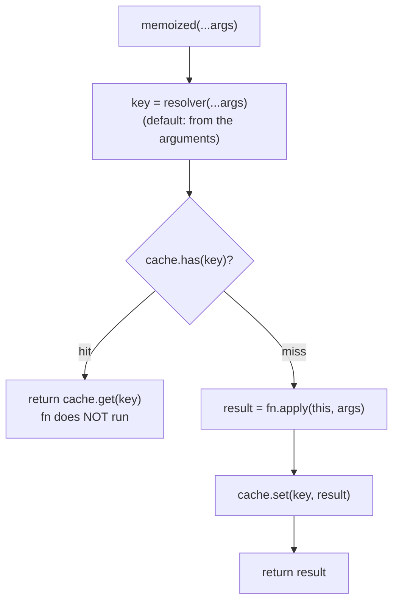

# Chapter 14: Memoization & Pure Functions

## 14.1 Definition and why interviewers ask it

**A pure function returns the same output for the same arguments and has no side effects. Memoization is caching a function's results, keyed by its arguments, so a repeated call with the same arguments returns the stored result instead of recomputing it. It is only correct for pure functions.**

"Implement `memoize`" is one of the most frequently reported machine-coding and JavaScript-round exercises (commonly reported). It is popular because the first version takes five minutes and every follow-up probes a real design decision: how to build the cache key for several arguments, what to do with object arguments, how to bound the cache, what happens with `this`, with async functions and with impure functions. "What is a pure function?" is a standard fundamentals question that leads into Redux reducers, React rendering and `useMemo`.

## 14.2 Core concept

### Plain language

Memoization is a notebook next to a calculator. Before computing `37 * 41`, you look in the notebook. If the answer is written there, you read it. If not, you compute it, write it down, and return it. The notebook only helps if the answer to `37 * 41` never changes. If the answer depends on the time, a random number, or a setting someone can change, the notebook will give you a wrong answer that looks right. That is why purity comes first.

### Precise version

**Pure function.** Both conditions must hold:

1. **Deterministic:** the return value depends only on the arguments. Same input, same output.
2. **No side effects:** it does not change anything outside itself (no mutation of arguments or outer variables, no I/O, no DOM, no logging, no network).

| Source of impurity | Example | Why it breaks purity |
|---|---|---|
| Reads mutable outer state | `x => x * taxRate` where `taxRate` can change | Output depends on more than the arguments |
| Time | `Date.now()`, `new Date()` | Output changes between calls |
| Randomness | `Math.random()`, `crypto.randomUUID()` | Output changes between calls |
| Mutates an argument | `arr => arr.sort()` | Side effect, and the caller's data changes |
| Mutates outer state | `counter++` | Side effect |
| I/O | `fetch`, `console.log`, `localStorage`, DOM access | Observable effect outside the function |
| Throws or depends on environment | `process.env.X`, `window.innerWidth` | Hidden input |

**Referential transparency.** A call can be replaced by its result without changing the program's behaviour. `add(2, 3)` can be replaced by `5` anywhere. Pure functions are referentially transparent, and memoization is that substitution done at runtime.

**Why purity pays off.**

- **Memoization:** a result can be cached safely.
- **Testing:** no setup or mocks. Give inputs, check the output.
- **Parallelism:** there is no shared state to race on, so a pure computation can be moved to a Web Worker or a thread pool.
- **Predictable state:** a Redux reducer `(state, action) => newState` must be pure. React expects component rendering to be pure (Strict Mode renders twice in development to expose violations). Equal inputs let React and Redux skip work by comparing references.

**Memoization.** A wrapper around a function holds a cache. On each call it builds a *key* from the arguments. If the key is in the cache, it returns the stored result. If not, it calls the function, stores the result and returns it. The trade is memory for time.

**Cache key design: the hard part.**

| Strategy | Works for | Pitfalls |
|---|---|---|
| `Map` keyed by the single argument | One primitive argument | `Map` compares keys with SameValueZero: `NaN` equals `NaN`, `+0` equals `-0`. Objects compare by identity. |
| `args.join(',')` | Small primitive tuples | Collisions: `('a,b', 'c')` and `('a', 'b,c')`. `undefined` and `null` both become `''`. Objects become `'[object Object]'`. |
| `JSON.stringify(args)` | Plain JSON-like data | `undefined`, functions and symbols become `null` in arrays, `NaN` and `Infinity` become `null`, `-0` becomes `0`, object key order changes the key, `Map` and `Set` become `{}`, cycles and `BigInt` throw, and it costs O(size of arguments) per call. |
| Custom resolver `(…args) => key` | Anything | You are responsible for correctness. The key must be unique for every distinct input, and cheap. |
| Nested `Map` (a trie) | Several primitive arguments | Needs one level per argument. Cache entries are never freed. |
| `WeakMap` for object arguments | Object arguments compared by identity | Only objects can be keys. Entries disappear when the key object is garbage collected. Not iterable. No `size`. |

lodash's `_.memoize` uses only the **first argument** as the key by default, which surprises people who memoize a multi-argument function. It exposes the cache as `memoized.cache` and takes a resolver as the second parameter.

**`this`.** A wrapper that ignores `this` in its key shares one cache entry between all receivers. Either forward `this` and include it in the key, or memoize per instance.

**Memoizing recursion.** The recursive calls must go through the *memoized* function. Fibonacci with a cache drops from O(2^n) calls to O(n): every `fib(k)` is computed once and later calls are lookups.

**Bounding the cache.** An unbounded cache is a memory leak in a long-running page or server. Options: **LRU** (evict the least recently used entry when `size > max`), **TTL** (an entry expires after N ms), a **WeakMap** keyed by an object so the entry dies with it, or clearing the cache at a lifecycle boundary (per request, per route).

**Async functions.** Cache the **promise**, not the resolved value. Concurrent callers then share one in-flight request (this prevents the *thundering herd*: N simultaneous calls triggering N requests). Evict the entry when the promise **rejects**, otherwise one failure is cached forever.

**Cache invalidation.** Memoization has no way to know that the world changed. If results can become stale, you need a TTL, an explicit `cache.clear()`, a version in the key, or you should not memoize.

**When memoization is wrong or useless.** The function is impure. It is cheap (the key computation and lookup cost more than the function). Almost every call has new arguments (a large key space, a low hit rate). Results are huge. The arguments are mutable objects that are changed in place (the key looks the same, the content differs).

**The same idea in React and Redux.**

| Tool | What it caches | Comparison |
|---|---|---|
| `useMemo(fn, deps)` | The result of `fn` for the latest `deps` (one entry) | `Object.is` on each dependency |
| `useCallback(fn, deps)` | The function itself, equal to `useMemo(() => fn, deps)` | `Object.is` on each dependency |
| `React.memo(Component)` | The last rendered output for the last props | Shallow comparison of props (`Object.is` per prop) |
| `reselect` `createSelector` | The last result of a selector for the last input values | Reference equality of the input selectors' results. Classic versions keep one entry. Recent versions changed the default memoizer, so check the version in use. |

React treats `useMemo` as a performance hint, not a semantic guarantee: it may discard the cache, so the code must still be correct without it.

## 14.3 How it works internally

### A. One call of a memoized function

1. The wrapper receives `args` (and `this`).
2. It builds `key` from the arguments (the default key function or your resolver).
3. `cache.has(key)`: for a `Map` this is a hash lookup, O(1) on average, with SameValueZero equality. Use `has`, not a truthiness test on `get`, otherwise a legitimately cached `undefined`, `0` or `false` is recomputed.
4. **Hit:** return the stored value. The original function does not run.
5. **Miss:** run `fn.apply(this, args)`, store `cache.set(key, result)` and return `result`. If `fn` throws, nothing is stored and the exception propagates, so the next call tries again.

Cost per call: building the key plus O(1) average for the lookup. The saving is the cost of `fn` on every hit.

### B. Where the cache lives

The cache is a variable in the wrapper's closure (Chapter 4). It lives as long as the wrapper is reachable. A module-level memoized function therefore keeps its entries, and everything they reference, for the life of the page or process. This is why unbounded caches leak (Chapter 16).

### C. Recursion and the call tree

`fib(5)` without a cache calls `fib(4)` and `fib(3)`, and `fib(4)` calls `fib(3)` again. The tree has 15 calls for `n = 5`, and about 2.7 million for `n = 30`. With the cache, each distinct value is computed once. For `n = 5` there are 6 computations and 9 calls in total, 3 of which are cache hits that return at once (Figure 14.2). Total calls grow as 2n - 1.

### D. `WeakMap` and a trie of arguments

For object arguments identity is the natural key. A `WeakMap` holds its keys weakly: it does not keep a key alive, and when the key object becomes unreachable the entry (the value, and everything only reachable from it) becomes collectable. That is why `WeakMap` cannot be iterated or sized: its contents depend on when the garbage collector ran. For several arguments, build a trie: one level per argument, using a `WeakMap` at a level when the argument is an object and a `Map` when it is a primitive (Figure 14.3). The result is stored at the node reached after the last argument, so the *number* of arguments is part of the key.

### E. LRU with a plain `Map`

A `Map` iterates in insertion order. On a hit, `delete(key)` and `set(key, value)` again moves the entry to the end. On insertion past `max`, `cache.keys().next().value` is the first key, the least recently used, and is deleted (Figure 14.4). Both operations are O(1).

### F. Async memoization

The cached value is the promise returned by the first call. A second call before it settles gets the same promise, so the work happens once. On rejection the handler removes the entry (only if the cache still holds that same promise, in case it was replaced), so the next call retries. This is request deduplication, and it is also the thundering-herd fix.

### G. What V8 does

Nothing special: memoization is ordinary user code. `Map` and `WeakMap` are hash tables built into the engine. `WeakMap` entries are cleared by the garbage collector, at a time you cannot predict or observe directly.

## 14.4 Diagrams

### Memoize lookup: hit or miss



> **How to explain this to the interviewer**
>
> 1. Draw the call, then the key box, and say: "all the design decisions are in how this key is built".
> 2. Draw the diamond with two arrows. The hit arrow skips the function entirely.
> 3. On the miss path write the order: compute, store, return. Add "use `has`, not truthiness, so a cached `undefined` or `0` is a hit".
>
> **Takeaway:** memoization is a lookup in front of a function, and the key decides whether it is correct.

### Fibonacci call tree: 15 calls versus 9

```ascii fib(5) call tree without memoization (15 calls) and with it (9 calls, 6 computed)
 WITHOUT MEMOIZATION: 15 calls         WITH MEMOIZATION: 9 calls
 fib(5)                                fib(5)
  +- fib(4)                             +- fib(4)
  |   +- fib(3)                         |   +- fib(3)
  |   |   +- fib(2)                     |   |   +- fib(2)
  |   |   |   +- fib(1)                 |   |   |   +- fib(1)    computed
  |   |   |   +- fib(0)                 |   |   |   +- fib(0)    computed
  |   |   +- fib(1)                     |   |   +- fib(1)        HIT, no subtree
  |   +- fib(2)                         |   +- fib(2)            HIT, no subtree
  |       +- fib(1)                     +- fib(3)                HIT, no subtree
  |       +- fib(0)
  +- fib(3)                             Removed: 6 calls (the repeated subtrees of
      +- fib(2)                         fib(3) and fib(2)). Distinct values: 6.
      |   +- fib(1)                     For n = 30: 2,692,537 calls -> 59 calls.
      |   +- fib(0)
      +- fib(1)
```

> **How to explain this to the interviewer**
>
> 1. Draw the left tree down to `fib(1)` and `fib(0)`. Circle the repeated `fib(3)` and `fib(2)` subtrees.
> 2. Draw the right tree: the left spine is computed once, and then each right child is a single box marked HIT.
> 3. Say: "without the cache the tree doubles at each level, O(2^n). With it every value is computed once, O(n)".
>
> **Takeaway:** a cache turns a tree of overlapping subproblems into a single chain of lookups.

### Cache keyed by object identity: a trie of WeakMap and Map

```ascii Argument trie for f(objA), f(objA, 2) and f(objB, 2): WeakMap for objects, Map for primitives
 root
  +-- WeakMap (object arguments, held weakly)
        +-- objA --> node A  [result of f(objA) = 6]
        |             +-- Map (primitive arguments, held strongly)
        |                   +-- 2 --> node A2  [result of f(objA, 2) = 12]
        +-- objB --> node B  (no result: f(objB) was never called)
                      +-- Map
                            +-- 2 --> node B2  [result of f(objB, 2) = 8]

 Garbage collection: if nothing else references objA, the whole objA subtree
 (node A, node A2 and their results) can be collected. Nothing leaks.
 The depth of the node is part of the key: f(objA) and f(objA, undefined) differ.
```

> **How to explain this to the interviewer**
>
> 1. Draw the root with a WeakMap beneath it, with `objA` and `objB` as keys.
> 2. Under each object draw a `Map` for the next argument and the result stored at the end of the path.
> 3. Say: "the WeakMap does not keep `objA` alive, so when `objA` is dropped, its whole branch goes with it".
>
> **Takeaway:** key object arguments by identity in a `WeakMap`, so the cache cannot outlive its inputs.

### LRU cache order in a plain Map

```ascii Map insertion order as LRU order, max = 3 (leftmost = next to evict)
   start               [ a ][ b ][ c ]        a is least recently used
   get(a)  hit         [ b ][ c ][ a ]        delete(a), set(a): moved to end
   set(d)  miss        [ b ][ c ][ a ][ d ]   size 4 is above max 3
   evict first key     [ c ][ a ][ d ]        b was the least recently used
   get(c)  hit         [ a ][ d ][ c ]
                         ^         ^
              keys().next().value   most recently used
```

> **How to explain this to the interviewer**
>
> 1. Draw a row of boxes and mark the left end "evict first" and the right end "most recent".
> 2. Show a hit: take the box out and put it back at the right end.
> 3. Show an insert past the limit: the left box is dropped. Say: "a `Map` already iterates in insertion order, so no linked list is needed".
>
> **Takeaway:** delete-and-reinsert on every hit makes a `Map` an O(1) LRU cache.

### Whiteboard version

```ascii Whiteboard version: memoize in four lines (draw in 60 seconds)
 memoize(fn):  cache = new Map()                  <- closure
   wrapper(...args):  key = f(args)
                      if cache.has(key) -> return cache.get(key)     (hit)
                      r = fn.apply(this, args); cache.set(key, r); return r   (miss)
```

## 14.5 Code examples

### Example 1: pure and impure functions

```js
const add = (a, b) => a + b;                      // pure

let total = 0;
const addToTotal = (n) => (total += n);           // impure: writes outer state

const taxRate = { value: 0.2 };
const withTax = (p) => p * (1 + taxRate.value);   // impure: reads state that can change

const sortedCopy = (arr) => [...arr].sort((a, b) => a - b);   // pure: sorts a copy
const sortInPlace = (arr) => arr.sort((a, b) => a - b);       // impure: mutates arg

const input = [3, 1, 2];
console.log(sortedCopy(input), input);
console.log(sortInPlace(input), input);
console.log(add(2, 3) === add(2, 3), addToTotal(5), addToTotal(5));
console.log(withTax(100));
taxRate.value = 0.5;
console.log(withTax(100));
```

```text output
[ 1, 2, 3 ] [ 3, 1, 2 ]
[ 1, 2, 3 ] [ 1, 2, 3 ]
true 5 10
120
150
```

**Why:** `add` can always be replaced by its result. `addToTotal` returns a different number on identical calls because it changes outer state. `withTax` changes its answer when `taxRate` is edited, so memoizing it would return stale data. `sortInPlace` changes the caller's array, which is a side effect.

### Example 2: a basic memoize and call counts for Fibonacci

```js
function memoize(fn) {
  const cache = new Map();
  return function (x) {
    if (cache.has(x)) return cache.get(x);       // has(): a cached undefined is a hit
    const result = fn.call(this, x);
    cache.set(x, result);
    return result;
  };
}

let naiveCalls = 0;
function naiveFib(n) {
  naiveCalls++;
  return n < 2 ? n : naiveFib(n - 1) + naiveFib(n - 2);
}

let memoCalls = 0;
const fib = memoize((n) => {
  memoCalls++;
  return n < 2 ? n : fib(n - 1) + fib(n - 2);    // recursion goes through the memoized fib
});

console.log(naiveFib(5), naiveCalls);
console.log(fib(5), memoCalls);
naiveCalls = 0;
memoCalls = 0;
console.log(naiveFib(30), naiveCalls);
console.log(fib(30), memoCalls);
memoCalls = 0;
console.log(fib(30), memoCalls);
```

```text output
5 15
5 6
832040 2692537
832040 25
832040 0
```

**Why:** `fib(5)` makes 15 calls without a cache, and 6 computations with one (`fib(5)` to `fib(0)`, each once; the 3 hits are not counted because the function body does not run). For `n = 30` the naive version makes 2,692,537 calls. The memoized one computes only the 25 values it does not hold yet (6 to 30; 0 to 5 were cached by the first call), 31 distinct values in total. A second `fib(30)` is a pure lookup: 0 computations. The recursion calls the memoized `fib`, not the raw function. If it called the raw one, there would be no saving.

### Example 3: `WeakMap` keys must be objects, and it cannot be inspected

```js
const wm = new WeakMap();
const key = { id: 1 };
wm.set(key, 'cached');
console.log(wm.get(key), wm.has({ id: 1 }), wm.has(key));
try { wm.set('str', 1); } catch (e) { console.log(e.name + ': ' + e.message); }
console.log(wm.size, typeof wm[Symbol.iterator], typeof wm.forEach);
```

```text output
cached false true
TypeError: Invalid value used as weak map key
undefined undefined undefined
```

**Why:** keys are matched by identity, so a different object with the same content is a miss. Primitives are rejected. A `WeakMap` has no `size`, no iterator and no `forEach`, because its content depends on garbage collection, which is not observable.

### Example 4: a one-entry memoized selector (the `reselect` idea)

```js
function createSelector(inputs, compute) {
  let lastArgs;
  let lastResult;
  return (state) => {
    const args = inputs.map((select) => select(state));
    if (lastArgs && args.every((a, i) => Object.is(a, lastArgs[i]))) return lastResult;
    lastArgs = args;
    lastResult = compute(...args);
    return lastResult;
  };
}

let runs = 0;
const expensive = createSelector(
  [(s) => s.items, (s) => s.minPrice],
  (items, min) => { runs++; return items.filter((i) => i.price >= min); }
);

const items = [{ price: 5 }, { price: 15 }];
const state1 = { items, minPrice: 10, unrelated: 1 };
const a = expensive(state1);
const b = expensive({ ...state1, unrelated: 2 });     // same inputs by reference
const c = expensive({ ...state1, minPrice: 1 });       // one input changed
console.log(runs, a === b, a === c, c.length);
const d = expensive({ items: [...items], minPrice: 1 }); // equal content, new array
console.log(runs, c === d);
```

```text output
2 true false 2
3 false
```

**Why:** the selector compares its input values with `Object.is` and keeps only the last result. An unrelated state change is a hit, and `a === b` shows that the same array reference is returned, which lets `React.memo` or `useMemo` skip work downstream. A copied `items` array has the same content but a new reference, so it is a miss. This is also how `useMemo` and `React.memo` compare.

## 14.6 Common mistakes and gotchas

- **Memoizing an impure function.** The cache hides changes in the outside world. A memoized function that reads a setting, the clock, or random values returns stale or frozen results (Question 14.5).
- **Using `JSON.stringify(args)` as a universal key.** It merges `NaN`, `null`, `undefined` and functions in arrays, ignores `-0`, depends on key order, throws on cycles and `BigInt`, and is slow for large arguments (Question 14.14).
- **Joining arguments with a separator.** `('a,b', 'c')` and `('a', 'b,c')` collide, and `undefined` and `null` both become the empty string.
- **Testing the cache with truthiness.** `if (cache[key])` recomputes cached `0`, `''`, `false` and `undefined`. Use `Map.has`.
- **Using a plain object as the cache.** Keys become strings (`1` and `'1'` collide), and keys like `__proto__` or `constructor` misbehave. Use `Map`, or `Object.create(null)`.
- **Ignoring `this`.** One cache shared by all receivers gives wrong results for methods (Question 14.6). Memoize per instance or include the receiver in the key.
- **Recursing into the unmemoized function.** The memoized wrapper must be the one that recurses.
- **Returning a shared mutable object.** Every hit returns the same reference, so one caller's mutation changes the cached value for everyone (Question 14.8). Freeze the result or return copies.
- **An unbounded cache.** Entries accumulate for the life of the page or server. Bound it (LRU, TTL), scope it to a lifecycle, or use a `WeakMap`.
- **Caching a rejected promise.** One network error stays in the cache forever. Evict on rejection (Question 14.12).
- **Memoizing cheap functions.** If building the key costs as much as the call, the cache makes things slower and uses memory.
- **Creating the memoized function inside a render.** In React, `const f = memoize(g)` in the component body makes a new, empty cache on every render.
- **Treating `useMemo` as a guarantee.** React may drop cached values. Correctness must not depend on the cache.
- **Mutating an object used as a key (or in deps) in place.** The reference is the same, so the cache sees no change.

## 14.7 Quick revision cheat sheet

- **Pure function:** same arguments, same result, no side effects. Enables memoization, easy tests, parallelism and predictable state (Redux reducers, React render).
- **Impure sources:** outer mutable state, time, randomness, I/O, mutating arguments.
- **Memoize:** closure + `Map`. Build key, `has` (not truthiness), return stored value or compute, store, return.
- **Keys:** single primitive = the value. Several arguments = `JSON.stringify` (JSON-safe data only), a resolver, or a nested `Map` trie. Objects by identity = `WeakMap`. `Map` uses SameValueZero (`NaN` found, `+0` equals `-0`).
- **Recursion:** recurse through the memoized function. Fibonacci O(2^n) becomes O(n).
- **Bounds:** LRU with `Map` delete-and-reinsert, TTL with a timestamp, `WeakMap` for object keys.
- **Async:** cache the promise, evict on rejection, concurrent callers share one request.
- **When not to:** impure, cheap, low hit rate, huge results. React: `useMemo`, `useCallback`, `React.memo` and selectors are the same idea with a one-entry shallow comparison.

## 14.8 Interview questions

*Key: ★ = very frequently reported. "Typically asked in" lines say which round a question tends to appear in; where no single source could be pinned down, the question is labelled "commonly reported". Draw-it hints refer to the figures in section 14.4.*

#### Conceptual

### Q14.1 ★ Easy: What is a pure function, and why does it matter?

*Typically asked in: JavaScript fundamentals round (commonly reported).*

> **Model answer**
>
> A pure function always returns the same result for the same arguments, and has no side effects: it does not mutate its inputs or outside state, and does no I/O. So `add(a, b)` is pure, while a function that reads `Date.now()`, a global setting, or pushes into an outer array is not. It matters because purity makes code predictable and easy to test, with no mocks. It allows safe caching, because a call can be replaced by its result, and safe parallel execution, as there is no shared state. It also underpins Redux reducers and React rendering, where equal inputs must give equal outputs so frameworks can skip work.

**Key points to mention**

- Deterministic and side-effect free. Referential transparency.
- Impure examples: time, random, mutation, I/O, reading outer mutable state.
- Benefits: memoization, testing, parallelism, predictable state.
- Redux reducers and React render should be pure.

### Q14.2 ★ Easy: What is memoization, and how is it different from caching in general?

*Typically asked in: JavaScript fundamentals or machine-coding round (commonly reported).*

> **Model answer**
>
> Memoization is a function-level cache. The function remembers its own results, keyed by its arguments, so a repeat call with the same arguments returns the stored value instead of recomputing it. It trades memory for speed and it is only valid for pure functions. I implement it with a higher-order function that closes over a `Map`. General caching is broader: it can be anywhere, such as HTTP caches or a CDN, usually has an invalidation or expiry policy, and often caches results that depend on changing data. Memoization assumes a given input always has the same answer.

**Key points to mention**

- Function-level, keyed by arguments, relies on purity.
- A higher-order function and a closure over the cache.
- Space for time. Hit and miss paths.
- Draw it: Figure 14.1.

### Q14.3 Medium: How do `useMemo`, `useCallback`, `React.memo` and `reselect` relate to memoization?

*Typically asked in: React-flavoured frontend round (commonly reported).*

> **Model answer**
>
> They are memoization with a cache of one entry and a cheap comparison. `useMemo(fn, deps)` keeps the last result and recomputes only when a dependency changes by `Object.is`. `useCallback(fn, deps)` is the same for the function itself, which keeps its reference stable for children. `React.memo` caches a component's output and skips the render when the props are shallow-equal. A `reselect` selector keeps the last result and recomputes only when its input selectors return new references. All rely on purity, and all fail if you mutate in place or create a new object every render, because the reference comparison then always sees a change. React may also discard `useMemo` values, so it is an optimisation, not a guarantee.

**Key points to mention**

- One entry, comparison by `Object.is` or shallow equality, not by deep equality.
- Purity is required. Immutable updates keep references stable.
- New object or array literals in props or deps defeat the cache (Example 4).
- `useMemo` is a hint, not a semantic guarantee.

### Q14.4 ★ Medium: Why does memoization change Fibonacci from O(2^n) to O(n)? Show it.

*Typically asked in: JavaScript round, dynamic-programming warm-up (commonly reported).*

> **Model answer**
>
> The plain recursion recomputes the same subproblems. `fib(5)` calls `fib(4)` and `fib(3)`, and `fib(4)` calls `fib(3)` again, so the call tree roughly doubles at each level: 15 calls for `n = 5` and about 2.7 million for `n = 30`. With a cache, each distinct value `fib(0)` to `fib(n)` is computed exactly once, because later requests are lookups. That is n + 1 computations and about 2n - 1 calls, so O(n) time, with O(n) extra space for the cache and the recursion depth. The recursion must call the memoized function, not the original, otherwise nothing changes.

**Key points to mention**

- Overlapping subproblems are the condition for memoization to help.
- Count: 15 calls versus 9 for `n = 5` (6 computed). 2,692,537 versus 59 calls for `n = 30`.
- O(n) time, O(n) space. Recursion depth still O(n), so very large `n` can overflow the stack.
- This is top-down dynamic programming. A bottom-up loop needs O(1) space.
- Draw it: Figure 14.2.

#### Output prediction

### Q14.5 ★ Medium: A memoized function reads a setting. What does this print?

*Typically asked in: JavaScript fundamentals round (commonly reported).*

```js
function memoize(fn) {
  const cache = new Map();
  return (x) => {
    if (!cache.has(x)) cache.set(x, fn(x));
    return cache.get(x);
  };
}

let taxPercent = 10;
const withTax = memoize((price) => price + (price * taxPercent) / 100);

console.log(withTax(100));
taxPercent = 20;
console.log(withTax(100), withTax(200));
```

```text output
110
110 240
```

> **Model answer**
>
> It prints `110`, then `110 240`. The first call computes with a rate of 10 and caches 110 under the key 100. After the rate changes to 20, `withTax(100)` hits the cache and returns the stale 110, although the right answer is now 120. `withTax(200)` has no entry, so it computes with the new rate and gives 240, which makes the results inconsistent. The function reads mutable outer state, so it is impure, and memoization is invalid for it. The fix is to pass the rate as an argument and include it in the key.

**Key points to mention**

- Impure input (outer variable) is invisible to the key.
- Stale results for old keys, fresh results for new keys: inconsistent state.
- Fix: make the dependency an argument, or clear the cache when it changes, or do not memoize.

### Q14.6 ★ Medium: What does this print? Two objects share one memoized method.

*Typically asked in: JavaScript round, `this` follow-up (commonly reported).*

```js
const memoize = (fn) => {
  const cache = new Map();
  return function (x) {
    if (!cache.has(x)) cache.set(x, fn.call(this, x));
    return cache.get(x);
  };
};

const a = { factor: 2, scale: memoize(function (x) { return x * this.factor; }) };
const b = { factor: 10, scale: a.scale };

console.log(a.scale(5), b.scale(5), a.scale(6), b.scale(6));
```

```text output
10 10 12 12
```

> **Model answer**
>
> It prints `10 10 12 12`. The wrapper is a regular function, so `this` is correctly forwarded to the method, and `a.scale(5)` is 5 times 2 = 10. But the cache key is only the argument, and `a.scale` and `b.scale` are the same wrapper with the same cache. So `b.scale(5)` finds the entry for 5, created for `a`, and returns 10 instead of 50. Likewise `b.scale(6)` returns 12 instead of 60. The result depends on `this`, which makes it a hidden argument that the key ignores. I would memoize per instance, for example inside the constructor, or add the receiver to the key with a `WeakMap`.

**Key points to mention**

- `this` is an implicit input: it must be part of the key, or the function must not use it.
- Shared wrapper means shared cache.
- Per-instance memoization: create the memoized function in the constructor.
- A `WeakMap` per receiver, or a trie with `this` as the first level.

### Q14.7 Medium: What does this print? Compare `Map` keys with `JSON.stringify` keys.

*Typically asked in: JavaScript round, key design follow-up (commonly reported).*

```js
const m = new Map();
m.set(NaN, 'nan');
m.set(0, 'zero');
console.log(m.get(NaN), m.get(-0), m.has('0'));

const key = (...args) => JSON.stringify(args);
console.log(key(NaN) === key(null), key(undefined) === key(null));
console.log(key(1, '2') === key('1', 2), key(() => 1) === key(null));
console.log(key({ a: 1, b: 2 }) === key({ b: 2, a: 1 }));
console.log([1, '2,3'].join() === [1, 2, 3].join());
```

```text output
nan zero false
true true
false true
false
true
```

> **Model answer**
>
> The `Map` line is `nan zero false`. `Map` uses SameValueZero, so `NaN` finds `NaN`, `-0` finds the entry for `0`, and the string `'0'` is a different key. For `JSON.stringify` keys, `NaN`, `undefined` and a function inside an array all serialise to `null`, so those pairs print `true`, a collision that would return a wrong cached result. `1, '2'` versus `'1', 2` keeps the types apart: `false`. Objects with the same properties in a different order give different strings: `false`, a needless miss. And joining with commas makes `[1, '2,3']` equal `[1, 2, 3]`: `true`, another collision.

**Key points to mention**

- `Map`: SameValueZero. `NaN` equals `NaN`, `+0` equals `-0`, objects by identity.
- JSON keys collide for `NaN`, `null`, `undefined`, functions. Order of object keys matters.
- `join` collisions through separators.
- Use a resolver or a trie when the arguments are not plain JSON data.

### Q14.8 Medium: What does this print? The memoized function returns an object.

*Typically asked in: JavaScript round, follow-up (commonly reported).*

```js
function memoize(fn) {
  const cache = new Map();
  return (id) => {
    if (!cache.has(id)) cache.set(id, fn(id));
    return cache.get(id);
  };
}

let created = 0;
const getUser = memoize((id) => { created++; return { id, tags: [] }; });

const first = getUser(1);
first.tags.push('admin');
const second = getUser(1);

console.log(second.tags, second === first, created);
```

```text output
[ 'admin' ] true 1
```

> **Model answer**
>
> It prints `[ 'admin' ] true 1`. The second call is a cache hit, so it returns the same object that was stored, not a copy. When the first caller pushed `'admin'` into `tags`, it changed the cached value itself, and every later caller now sees that change. The function was created only once. Memoization returns references, so the result must be treated as read-only. I either `Object.freeze` it (deeply, if needed), return a copy on each hit with `structuredClone`, or design the function to return immutable data.

**Key points to mention**

- Hits return the same reference, so the cache holds shared mutable state.
- Mutating the result corrupts the cache for all callers.
- Fixes: freeze, copy on read, or immutable data (Chapter 18).
- Same issue with memoized selectors and `useMemo` results.

#### Implement it yourself

### Q14.9 ★ Hard: Implement `memoize(fn, resolver)` for multiple arguments, with edge cases handled.

*Typically asked in: JavaScript round and frontend machine-coding round (commonly reported).*

**Problem.** Return a function that caches results. It must work for several arguments, accept an optional key resolver, preserve `this`, treat a cached `undefined` as a hit, and expose the cache. Show where the default key breaks.

**Solution.**

```js
function memoize(fn, resolver) {
  const cache = new Map();
  function memoized(...args) {
    const key = resolver ? resolver.apply(this, args) : JSON.stringify(args);
    if (cache.has(key)) return cache.get(key);      // has(): undefined/0/false still hit
    const result = fn.apply(this, args);            // if fn throws, nothing is cached
    cache.set(key, result);
    return result;
  }
  memoized.cache = cache;                           // lets callers inspect or clear it
  return memoized;
}

let calls = 0;
const add = memoize((a, b) => { calls++; return a + b; });
console.log(add(1, 2), add(1, 2), add(2, 1), calls, add.cache.size);

const noop = memoize(() => { calls++; });           // returns undefined
noop();
noop();
console.log(calls);                                 // 3: noop ran once

// The default key merges NaN and null (both become null in JSON):
const kind = memoize((x) => { calls++; return typeof x; });
console.log(kind(NaN), kind(null));

// A resolver fixes it, and also keys objects by an id instead of by content:
const byValue = memoize((x) => String(x), (x) => x);   // Map handles NaN and null
calls = 0;
console.log(byValue(NaN), byValue(NaN), byValue(null));
const area = memoize((s) => { calls++; return s.w * s.h; }, (s) => s.id);
console.log(area({ id: 'a', w: 2, h: 3 }), area({ id: 'a', w: 9, h: 9 }), calls);
```

```text output
3 3 3 2 2
3
number number
NaN NaN null
6 6 1
```

> **Model answer**
>
> I close over a `Map`. The wrapper builds a key, either from a resolver or by serialising the argument list, and checks `cache.has(key)`, using `has` so that a cached `undefined` or `0` counts as a hit. On a miss it calls `fn.apply(this, args)`, stores the result and returns it. If `fn` throws, nothing is stored. I expose the cache as a property so it can be cleared. The default `JSON.stringify` key is fine for plain data, but it merges `NaN` with `null` and cannot hold object identity, so I let the caller pass a resolver. Time per call is O(1) for the lookup plus the cost of building the key.

**Key points to mention**

- Closure over a `Map`, `has` rather than a truthiness test, `apply` for `this` and arguments.
- Key strategy and its limits: JSON (see Question 14.14), resolver, nested `Map` or `WeakMap` (Question 14.10).
- `this` is not part of the key unless the resolver includes it (Question 14.6).
- Errors are not cached. The cache is unbounded (Question 14.11). Results are shared references (Question 14.8).
- Complexity: O(1) average lookup plus key cost. Space O(distinct keys).
- Draw it: Figure 14.1.

### Q14.10 Hard: Memoize a function whose arguments are objects, without leaking memory.

*Typically asked in: senior JavaScript or machine-coding round, key-design follow-up (commonly reported).*

**Problem.** `area(rect, scale)` takes an object and an optional number. Cache results by the identity of the object, so the entry disappears when the object is garbage collected.

**Solution.** Build a trie, with a `WeakMap` level for object arguments and a `Map` level for primitives (Figure 14.3).

```js
const isObject = (v) => (typeof v === 'object' && v !== null) || typeof v === 'function';

function memoizeRefs(fn) {
  const root = {};
  return function memoized(...args) {
    let node = root;
    for (const arg of args) {
      const store = isObject(arg)
        ? (node.weak ??= new WeakMap())        // objects: held weakly
        : (node.strong ??= new Map());         // primitives: held strongly
      let next = store.get(arg);
      if (!next) {
        next = {};
        store.set(arg, next);
      }
      node = next;
    }
    if (!node.done) {                          // the result lives at the end of the path
      node.value = fn.apply(this, args);
      node.done = true;
    }
    return node.value;
  };
}

let calls = 0;
const area = memoizeRefs((r, scale) => { calls++; return r.w * r.h * (scale ?? 1); });
const rect = { w: 2, h: 3 };

console.log(area(rect), area(rect), calls);
console.log(area({ w: 2, h: 3 }), calls);           // equal content, different identity
console.log(area(rect, 2), area(rect, 2), calls);
console.log(area(rect, undefined), calls);          // argument count is part of the key
try { new WeakMap().set(1, 'x'); } catch (e) { console.log(e.name + ': ' + e.message); }
```

```text output
6 6 1
6 2
12 12 3
6 4
TypeError: Invalid value used as weak map key
```

> **Model answer**
>
> Object keys must be compared by identity and held weakly, so I use a `WeakMap`. For several arguments I build a trie: each argument selects the next node, from a `WeakMap` when it is an object and a `Map` when it is a primitive, and the result is stored on the node at the end of the path. Because the object is a `WeakMap` key, the entry is collected with it, so the cache cannot leak. Two objects with equal content are different keys, which is the intended meaning. The cost is O(number of arguments) per call. Primitives in the path are held strongly, so a high-cardinality primitive argument needs a bound.

**Key points to mention**

- `WeakMap` holds its keys weakly. It has no `size` or iteration, and its keys must be objects.
- Identity semantics: equal content, different object means a miss. Mutating a keyed object in place does not invalidate its entry.
- The trie handles any argument count, and the count is part of the key.
- Edge cases: functions as keys (allowed), `null` (primitive path), `f(a)` versus `f(a, undefined)`.
- Complexity: O(k) per call for k arguments. Space O(distinct paths), freed for dead objects.
- Draw it: Figure 14.3.

### Q14.11 Hard: Add a size limit (LRU) and an expiry time (TTL) to `memoize`.

*Typically asked in: senior JavaScript or machine-coding round (commonly reported).*

**Problem.** A memoized function must keep at most `max` entries, evicting the least recently used, and each entry expires `ttl` ms after it was computed. Make the time source injectable so it can be tested.

**Solution.** Use `Map` insertion order for recency (Figure 14.4).

```js
function memoizeBounded(fn, { max = 3, ttl = Infinity, now = Date.now } = {}) {
  const cache = new Map();                     // key -> { value, expires }
  function memoized(x) {
    const hit = cache.get(x);
    if (hit && hit.expires > now()) {
      cache.delete(x);                         // refresh recency: move to the end
      cache.set(x, hit);
      return hit.value;
    }
    cache.delete(x);                           // drop an expired entry, if any
    const value = fn.call(this, x);
    cache.set(x, { value, expires: now() + ttl });
    if (cache.size > max) cache.delete(cache.keys().next().value);   // evict the oldest
    return value;
  }
  memoized.keys = () => [...cache.keys()];
  return memoized;
}

let t = 0;                                     // virtual time, no real clock
let calls = 0;
const square = memoizeBounded((x) => { calls++; return x * x; },
  { max: 3, ttl: 100, now: () => t });

square(1); square(2); square(3);
console.log(square.keys(), calls);
square(1);                                     // hit: 1 becomes most recent
console.log(square.keys(), calls);
square(4);                                     // miss: evicts 2, the least recent
console.log(square.keys(), calls);
square(2);                                     // 2 was evicted: miss again, evicts 3
console.log(square.keys(), calls);
t = 150;                                       // everything computed at t = 0 has expired
square(4);
console.log(square.keys(), calls);
```

```text output
[ 1, 2, 3 ] 3
[ 2, 3, 1 ] 3
[ 3, 1, 4 ] 4
[ 1, 4, 2 ] 5
[ 1, 2, 4 ] 6
```

> **Model answer**
>
> A `Map` iterates in insertion order, so I use it as the LRU list. On a hit, I delete and re-insert the key, which moves it to the end. On a miss, I compute, insert, and if `size` is above `max` I delete the first key from `cache.keys()`, the least recently used. For TTL each entry stores an expiry time. A hit on an expired entry counts as a miss, and the entry is replaced. Time is injected, so the test uses a variable instead of waiting. All steps are O(1). Expired entries that are never read stay until evicted, so for long TTLs I would add a periodic sweep.

**Key points to mention**

- Delete-then-set refreshes recency. `keys().next().value` is the LRU victim.
- TTL is stored per entry. Here it counts from the computation and is not extended by hits (sliding expiry is a design choice).
- Inject the clock for tests. Do not use `Date.now()` directly.
- Expired entries are only removed lazily. Add a sweep, or rely on LRU.
- Multi-argument keys need a key function. Memory limit by entries, not bytes.

### Q14.12 Hard: Memoize an async function. How do you avoid duplicate requests and cached failures?

*Typically asked in: senior JavaScript or machine-coding round (commonly reported).*

**Problem.** `load(id)` fetches data. Three concurrent calls for the same id must trigger one request. A failed request must not be cached.

**Solution.** Cache the promise, and remove it on rejection.

```js
function memoizeAsync(fn) {
  const cache = new Map();                      // key -> Promise
  return function memoized(x) {
    if (cache.has(x)) return cache.get(x);      // in flight, or settled: share it
    const promise = (async () => fn.call(this, x))();   // sync throws become rejections
    cache.set(x, promise);
    promise.catch(() => {
      if (cache.get(x) === promise) cache.delete(x);    // evict failures only
    });
    return promise;
  };
}

async function main() {
  let requests = 0;
  let failing = true;
  const load = memoizeAsync(async (id) => {
    requests++;
    await null;                                  // stands in for the network
    if (failing) throw new Error('boom');
    return 'user' + id;
  });

  const herd = await Promise.allSettled([load(1), load(1), load(1)]);
  console.log(herd.map((r) => r.status + ':' + (r.reason ? r.reason.message : r.value)));
  console.log('requests after 3 concurrent calls:', requests);

  failing = false;
  console.log(await load(1), await load(1));     // retried once, then cached
  console.log('requests in total:', requests);

  let plain = 0;
  const unmemoized = async (id) => { plain++; await null; return id; };
  await Promise.all([unmemoized(1), unmemoized(1), unmemoized(1)]);
  console.log('without memoization:', plain);
}
main();
```

```text output
[ 'rejected:boom', 'rejected:boom', 'rejected:boom' ]
requests after 3 concurrent calls: 1
user1 user1
requests in total: 2
without memoization: 3
```

> **Model answer**
>
> I cache the promise itself, not the resolved value. The first call starts the work and stores its promise. Any call that arrives while it is pending, or after it has resolved, gets the same promise, so three concurrent calls make one request, which solves the thundering herd. I attach a `catch` that deletes the entry if the promise rejects, so a failure is not cached forever and the next call retries. The check that the cached promise is still the same one avoids deleting a newer entry. I still need a TTL or an invalidation call for data that changes, and an abort path if callers can cancel.

**Key points to mention**

- Cache the promise, so in-flight requests are deduplicated.
- Evict on rejection, guarded by identity.
- Wrap `fn` in an `async` function so a synchronous throw also becomes a rejection.
- Staleness: add a TTL or an explicit `invalidate`. Consider a size bound.
- One consumer's `abort` should not cancel others sharing the promise.

#### Follow-up traps

### Q14.13 Easy: "Is `Math.random()` pure? Is `console.log`? What about a function that only reads a global constant?"

*Typically asked in: JavaScript fundamentals round, follow-up (commonly reported).*

> **Model answer**
>
> `Math.random()` is not pure: the same call gives different results, so it is not deterministic, and a function that uses it is impure too. `console.log` is a side effect, since it writes to the outside world, so a function that logs is impure even if its return value is deterministic. A function that reads a global *constant*, such as `const PI = 3.14`, behaves purely in practice, because the constant never changes. If it reads a global `let` or a mutable object, it is impure, because the result depends on something other than the arguments. A useful test is whether I can replace the call with its return value without changing the program.

**Key points to mention**

- Deterministic plus no side effects.
- Time, random, I/O and logging are impure. Reading immutable constants is fine.
- Mutating an argument is a side effect.
- Referential transparency as the test.

### Q14.14 Medium: "Why is `JSON.stringify` a risky cache key?"

*Typically asked in: follow-up after the memoize implementation (commonly reported).*

> **Model answer**
>
> Because it is lossy. `NaN`, `Infinity`, `undefined` and functions inside arrays all become `null`, so different calls share a key. `-0` becomes `0`. Object properties serialise in insertion order, so two equal objects can produce different keys and miss for no reason. `Map` and `Set` become `{}`, so all of them collide. A `Date` becomes a string. Cyclic structures and `BigInt` throw. It also costs time proportional to the size of the arguments on every call, even for hits, so for large objects the key can cost more than the function. For primitives I use a `Map` keyed by the value, for objects a `WeakMap` by identity, or I write a resolver.

**Key points to mention**

- Collisions: `null`, `NaN`, `undefined`, functions, `Map`, `Set`. Misses: key order.
- Throws on cycles and `BigInt`.
- O(size) per call.
- Alternatives: `Map` for primitives, `WeakMap` or a trie for objects, a resolver with ids.

### Q14.15 Medium: "Is memoization always faster? When would you not use it?"

*Typically asked in: follow-up, design discussion (commonly reported).*

> **Model answer**
>
> No. Every call pays for building the key and the lookup, and every miss also pays for the store. If the function is cheap, or the arguments rarely repeat, memoizing is slower and uses memory for no gain. The hit rate decides. It is also wrong for impure functions, because the cache returns stale data, and dangerous without a bound, because an unbounded cache is a memory leak. Large results, huge key spaces, or arguments that are mutated in place also work against it. I would measure first, memoize the expensive pure function with a repeating input, and bound the cache with an LRU or TTL.

**Key points to mention**

- Cost model: key building plus lookup against the cost of the function, multiplied by hit rate.
- Wrong for impure functions, mutable arguments and results that change.
- Memory: bound with LRU, TTL, `WeakMap`, or scope the cache to a lifecycle.
- Measure with realistic inputs before and after.
- Often a better algorithm or a data structure beats caching.

#### Sources and further reading

- ECMAScript specification: `Map` (SameValueZero equality), `WeakMap`, and `JSON.stringify` serialisation rules: <https://tc39.es/ecma262/>
- MDN, `WeakMap`: <https://developer.mozilla.org/en-US/docs/Web/JavaScript/Reference/Global_Objects/WeakMap>
- MDN, `Map` (key equality and insertion order): <https://developer.mozilla.org/en-US/docs/Web/JavaScript/Reference/Global_Objects/Map>
- MDN, `JSON.stringify()`: <https://developer.mozilla.org/en-US/docs/Web/JavaScript/Reference/Global_Objects/JSON/stringify>
- React documentation, `useMemo`, `useCallback` and `memo`: <https://react.dev/reference/react/useMemo>
- lodash documentation for `_.memoize` (first argument is the default key, `cache` property, resolver): <https://lodash.com/docs/#memoize>
- Reselect documentation (memoized selectors): <https://github.com/reduxjs/reselect>
- Public interview write-ups that appeared in search results for these topics (listings only, the pages themselves were not retrievable in the authoring environment): GreatFrontEnd, "Memoize" <https://www.greatfrontend.com/interviews/study/gfe75/questions/javascript/memoize>; dev.to, "JavaScript Interviews: Implement Memoization in JavaScript" <https://dev.to/amitkhonde/javascript-interviews-implement-memoization-in-javascript-eaf>; dev.to, "JS interview in 2 minutes / Memoization" <https://dev.to/hexnickk/js-interview-in-2-minutes-memoization-p37>; Interviews Vector, "Implement memoize(): Cache by Argument Key" <https://www.interviewsvector.com/javascript/custom-memoize-function>. Question wording in this book is original.
