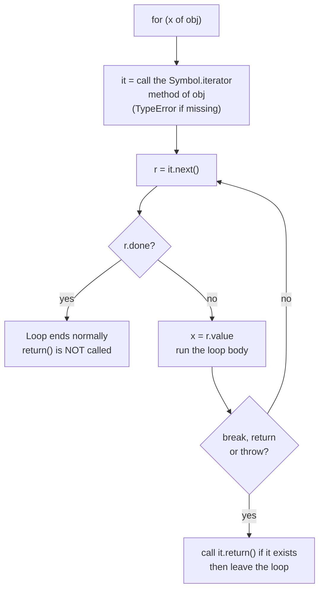
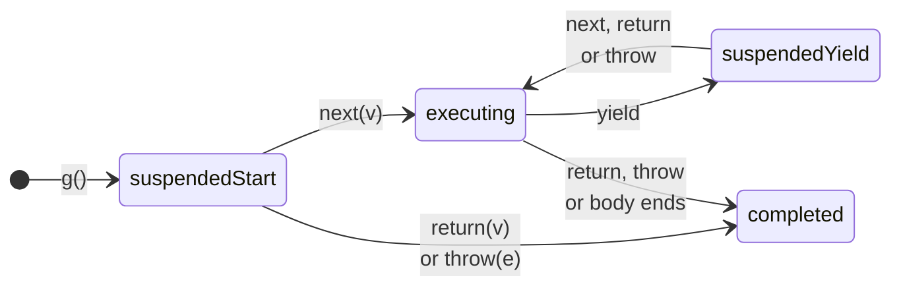
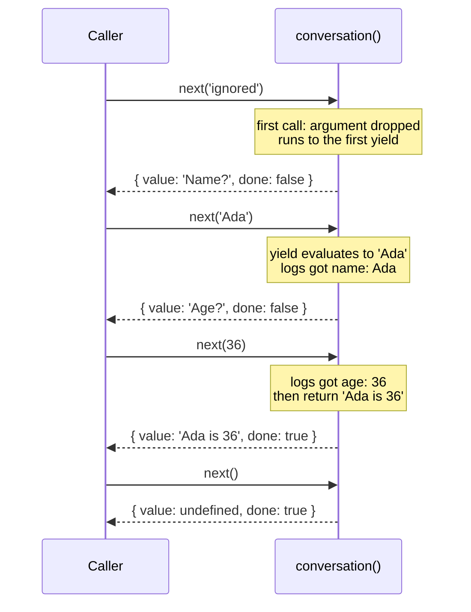

# Chapter 15: Iterators, Generators & the Iteration Protocols

## 15.1 Definition and why interviewers ask it

**An iterable is an object with a `[Symbol.iterator]()` method that returns an iterator. An iterator is an object with a `next()` method that returns `{ value, done }`. A generator is a function declared with `function*` that can pause at each `yield` and be resumed later. Calling it returns a generator object, which is both an iterator and an iterable.**

These two protocols are the single mechanism behind `for...of`, spread, destructuring, `Array.from`, `Map` and `Set` constructors, `Promise.all` and `yield*`. Interviewers ask about them because they test whether you know what those everyday syntaxes actually call, and because generators are the cleanest example of a function whose execution context is *suspended and resumed* (Chapter 1) instead of being popped. Generators also explain how `async`/`await` was built (Chapter 9). Reported as a mid-level topic in JavaScript-fundamentals rounds and as the base for implement-it-yourself problems such as `range`, `take` and `zip` in machine-coding rounds (commonly reported).

## 15.2 Core concept

### Plain language

An iterable is a book. An iterator is a bookmark with one ability: "give me the next page". The book can hand out a fresh bookmark every time you ask (`[Symbol.iterator]()`), so two readers can read the same book independently. A bookmark itself is used up once you reach the last page.

A generator is a function with a built-in bookmark. When it reaches `yield`, it hands a value to the caller and freezes exactly where it stands, local variables included. The next `next()` call thaws it and it carries on from that line. The caller can even slip a value *into* the frozen line.

### Precise version

**The two protocols**

| Protocol | Requirement | Return value |
|---|---|---|
| Iterable | Method at key `Symbol.iterator`, callable with no arguments | An object that satisfies the iterator protocol |
| Iterator | `next(arg?)` method | A result object `{ value, done }`. `done: true` ends the sequence. `value` on the final result is the sequence's *return value* (usually `undefined`) |
| Iterator (optional) | `return(v?)` | Called when the consumer stops early. Releases resources. Must return an object |
| Iterator (optional) | `throw(e?)` | Lets the consumer inject an error. Rarely implemented by hand. Generators implement it |

An iterator that also has `[Symbol.iterator]() { return this; }` is an *iterable iterator*. That is why you can write `for (const x of arr.values())`. Generator objects, array iterators, `Map` and `Set` iterators all are.

**What consumes an iterable**

| Consumer | Notes |
|---|---|
| `for (const x of it)` | Closes the iterator (calls `return()`) on `break`, `return` or a `throw` in the body |
| `[...it]`, `f(...it)` | Drains the iterator. Spreading in an object literal `{...o}` is **not** iteration |
| `const [a, b] = it` | Takes only as many values as there are targets, then calls `return()` if the iterator is not done |
| `Array.from(it)` | Accepts iterables and array-likes. Uses the iterable path first |
| `new Map(it)`, `new Set(it)`, `new WeakMap(it)`, `new WeakSet(it)` | `Map` expects an iterable of `[key, value]` pairs |
| `Object.fromEntries(it)` | Iterable of `[key, value]` pairs |
| `Promise.all`, `race`, `allSettled`, `any` | Accept any iterable of promises or values |
| `yield* it` | Delegates to another iterable inside a generator |

**Built-in iterables**

| Value | Iterates | Notes |
|---|---|---|
| `Array`, `TypedArray` | elements | `.values()`, `.keys()`, `.entries()` also return iterators |
| `String` | **code points**, not UTF-16 code units | `[...'a😀'].length` is 2, while `'a😀'.length` is 3 |
| `Map` | `[key, value]` pairs in insertion order | `.keys()`, `.values()` too |
| `Set` | values in insertion order | |
| `arguments` | elements | An array-like that is also iterable |
| `NodeList`, `HTMLCollection` (browsers) | nodes | Not arrays, so no `.map`, but spreadable |
| Plain objects | **nothing** | Not iterable. `for...of` and `[...obj]` throw `TypeError` |

**Array-like vs iterable.** An array-like has a numeric `length` and indexed keys (`{ 0: 'a', length: 1 }`). An iterable has `[Symbol.iterator]`. They are independent: strings, arrays and `arguments` are both, `{ 0: 'a', length: 1 }` is only an array-like, and a `Set` is only an iterable. `Array.from` accepts either.

**Generator methods**

| Call | Effect |
|---|---|
| `g.next(v)` | Resume. The paused `yield` expression evaluates to `v`. The argument of the **first** call is ignored, because no `yield` is waiting for it yet |
| `g.return(v)` | Resume with a *return* completion at the paused `yield`. `finally` blocks run. Result is `{ value: v, done: true }` unless a `finally` yields |
| `g.throw(e)` | Resume with a *throw* completion at the paused `yield`. A `try`/`catch` around the `yield` can handle it |

**Generator states.** Every generator object is in exactly one of four states: `suspendedStart` (created, body not started), `suspendedYield` (paused at a `yield`), `executing` (running right now), `completed` (finished, returned or threw). Calling `next()` on an `executing` generator throws `TypeError: Generator is already running`. After `completed`, `next()` returns `{ value: undefined, done: true }` forever.

**`yield*`.** `yield* iterable` forwards every value, and every `next(v)`, `throw(e)` and `return(v)` call, to the inner iterator. The expression itself evaluates to the inner iterator's **return value** (the `value` of its final `{ done: true }` result).

**Async variants.** `Symbol.asyncIterator` marks an *async iterable*. Its iterator's `next()` returns a **promise** of `{ value, done }`. `for await (const x of src)` consumes it. An `async function*` returns an async generator object that implements this protocol and may use `await` inside.

**Iterator helpers (ES2025).** `Iterator.prototype` gained lazy methods `map`, `filter`, `take`, `drop`, `flatMap` (they return iterators) and eager ones `toArray`, `forEach`, `reduce`, `some`, `every`, `find`, plus `Iterator.from()`. They exist on Node 22 (tested for this book on 22.23) and current evergreen browsers. Check your target runtime before relying on them, and note that they are **iterator** methods, not iterable ones: call them on `arr.values()` or a generator object, not on the array.

## 15.3 How it works internally

### A. What `for (const x of obj) { ... }` does

1. **GetIterator.** The engine reads `obj[Symbol.iterator]` and calls it. If it is missing or not callable, it throws `TypeError: obj is not iterable`. The returned object must be an object, otherwise `TypeError`. The engine reads `iterator.next` **once** and keeps it.
2. **Step.** It calls `next()` and checks that the result is an object. If `result.done` is truthy, the loop ends.
3. **Bind and run.** `result.value` is bound to `x` (a fresh binding per iteration for `let`/`const`) and the body runs.
4. **Repeat** from step 2.
5. **Early exit.** If the body ends with `break`, `return`, or a `throw`, the engine performs **IteratorClose**: it calls `iterator.return()` if that method exists, then leaves the loop. If the exit was a `throw`, an error thrown by `return()` is ignored and the original error propagates. On `break` or `return`, an error from `return()` propagates.
6. **Normal completion** (`done: true`) does **not** call `return()`. The iterator already finished.

Array destructuring and `yield*` follow the same pattern. `Array.from` (when its mapping function throws) and the `Map`/`Set` constructors (when adding an entry throws) also close the iterator.

### B. What a generator call does

1. `function* g(a, b) { ... }` is called. The engine runs **parameter binding and defaults immediately** (`FunctionDeclarationInstantiation`), then creates the generator object. The generator's prototype is `g.prototype`, which inherits from `%GeneratorPrototype%`, which has `next`, `return`, `throw` and inherits `[Symbol.iterator]` from `%IteratorPrototype%` (returns `this`). **No statement of the body runs yet.** State is `suspendedStart`.
2. The generator object keeps a private execution context (Chapter 1): the environments, `this`, and the position in the body.

### C. What `next(v)` does

1. If the state is `executing`, throw `TypeError`. If `completed`, return `{ value: undefined, done: true }`.
2. Otherwise set the state to `executing` and **push the saved execution context** onto the call stack. If this is the first call, run the body from the top and ignore `v`. If the generator was paused at a `yield`, that `yield` expression now evaluates to `v`.
3. Run until one of three things happens:
   - `yield expr`: **pop** the context (it is saved, not destroyed), set state `suspendedYield`, and return `{ value: expr, done: false }` to the caller.
   - `return expr` or the end of the body: state `completed`, return `{ value: expr, done: true }`.
   - an uncaught exception: state `completed`, the exception propagates to the caller of `next()`.

### D. `return(v)` and `throw(e)`

1. In `suspendedStart`: the generator goes straight to `completed`. No body code runs, so no `finally` runs. `return(v)` gives `{ value: v, done: true }`. `throw(e)` throws `e` to the caller.
2. In `suspendedYield`: the saved context resumes, but the paused `yield` behaves as if it were a `return v` statement (or `throw e` statement). Enclosing `finally` blocks run. A `finally` can swallow the return with its own `return`, or can `yield` again, in which case `return()` gives `{ value, done: false }` and the generator stays alive.
3. In `completed`: `return(v)` gives `{ value: v, done: true }`. `throw(e)` throws `e`.

### E. `yield*`

`yield* inner` obtains the inner iterator, then loops: it calls `inner.next(received)`, and if the result is not done it yields that result's value to *its* caller and waits for the next `next(v)` to forward. `throw` and `return` are forwarded to the inner iterator's `throw` and `return` if present. When the inner result is `done`, `yield*` evaluates to `result.value`.

### F. Async generators and `for await`

An async generator object queues calls: each `next()` returns a promise immediately, and the body continues only when the previous request has settled. `yield v` inside an async generator awaits `v` first. `for await (const x of src)` looks up `src[Symbol.asyncIterator]`. If missing it falls back to `src[Symbol.iterator]` and awaits each value, so `for await (const v of [promiseA, promiseB])` works.

### G. Generators and `async`/`await`

Before `async`/`await` existed, libraries such as `co` drove a generator with a loop: `yield somePromise`, wait for it, then call `next(result)` or `throw(error)`. `await` is that mechanism built into the language. The saved-context idea is identical, which is why Chapter 1 (Question 1.15) and Chapter 9 describe `await` in generator terms. Question 15.13 builds the runner and Chapter 9 (Question 9.10) goes deeper.

### H. In V8

V8 compiles a generator body to bytecode like any other function. At a `yield` it saves the interpreter registers of the frame into the generator object (the `SuspendGenerator` bytecode) and returns. On resume (`ResumeGenerator`) it restores them. Only the *observable* rules above matter in an interview.

## 15.4 Diagrams

### The protocol shapes

```ascii Iterable, iterator, result object, and the generator object that is all three
  ITERABLE                   ITERATOR                         RESULT OBJECT
 +-----------------------+  +----------------------------+   +-----------------+
 | [Symbol.iterator]() --+->| next(arg?)  --------------+--->| value : any     |
 |  returns an iterator  |  | return(v?)   (optional)    |   | done  : boolean |
 +-----------------------+  | throw(e?)    (optional)    |   +-----------------+
                            +----------------------------+

  GENERATOR OBJECT   g = gen()
 +---------------------------------------------------------------------+
 | next(v)  return(v)  throw(e)        <- iterator methods             |
 | [Symbol.iterator]() { return this } <- so g is also an iterable     |
 | hidden state: suspendedStart | suspendedYield | executing | completed|
 | hidden saved execution context (variables, this, position in body)  |
 +---------------------------------------------------------------------+

  for (x of g) ==> g[Symbol.iterator]() returns g, then g.next() until done
```

> **How to explain this to the interviewer**
>
> 1. Draw three boxes left to right: iterable, iterator, result object. Label the arrows "returns".
> 2. Under them draw the generator object and say: "it has `next` so it is an iterator, and its `[Symbol.iterator]` returns itself, so it is also an iterable".
> 3. Point at the hidden saved context: "that is the suspended execution context from Chapter 1".
>
> **Takeaway:** iterable makes iterators, iterators make result objects, and a generator object is both at once.

### What `for...of` does under the hood



> **How to explain this to the interviewer**
>
> 1. Draw the first box ("get the iterator") and the `next()` box under it, then the `done?` diamond.
> 2. Draw the loop back arrow from the body to `next()`. Mark the "yes" exit as "normal end, no `return()`".
> 3. Draw the second diamond and say: "if the body leaves early, the engine calls `return()` so the iterator can clean up".
>
> **Takeaway:** `for...of` is a `next()` loop plus a cleanup call that only happens on early exit.

### Generator state machine



> **How to explain this to the interviewer**
>
> 1. Draw four circles and name them. Add the start arrow into `suspendedStart` and say: "calling `g()` runs no body code".
> 2. Draw the pair of arrows between `executing` and `suspendedYield`: `yield` goes one way, `next` goes back.
> 3. Draw the exits to `completed` and say: "once completed it never runs again, and calling `next()` while `executing` is a `TypeError`".
>
> **Takeaway:** a generator is a state machine whose only way to pause is `yield`.

### Tracing `next(v)` between caller and generator



> **How to explain this to the interviewer**
>
> 1. Draw two vertical lines, Caller and Generator. Draw `next('ignored')` going right and write "dropped" beside it.
> 2. Draw each reply going left with its `yield` value. Then draw the next `next('Ada')` going right and say: "this value becomes the result of the `yield` expression that is paused".
> 3. End with the `done: true` reply and the final `next()` that returns `undefined`.
>
> **Takeaway:** `yield` sends a value out, and the next `next(v)` sends a value in at the same place.

### Whiteboard version

```ascii Whiteboard version: a generator is a function with a bookmark (draw in 60 seconds)
   caller                         generator
 +--------+   next(in)  --->   +-----------------------+
 |        |                    | ... code ...          |
 |        |   <--- out         | x = yield out;  [||]  |  <- paused here
 +--------+  {value, done}     | ... resumes here ...  |
                               +-----------------------+
   for...of / spread / destructuring call next() for you
```

## 15.5 Code examples

### Example 1: built-in iterators and code points

```js
const s = 'a😀b';
console.log(s.length, [...s].length, [...s]);
const it = [10, 20][Symbol.iterator]();
console.log(it.next(), it.next(), it.next());
console.log(it[Symbol.iterator]() === it, Object.prototype.toString.call(it));
```

```text output
4 3 [ 'a', '😀', 'b' ]
{ value: 10, done: false } { value: 20, done: false } { value: undefined, done: true }
true [object Array Iterator]
```

**Why:** the string iterator walks code points, so the emoji (two UTF-16 code units) counts as one element. The array iterator is itself iterable (`it[Symbol.iterator]() === it`), which is why an iterator can be used in `for...of`.

### Example 2: array-likes, iterables and `Array.from`

```js
const arrayLike = { 0: 'a', 1: 'b', length: 2 };
console.log(Array.from(arrayLike), Array.prototype.map.call(arrayLike, (x) => x + x));
try { [...arrayLike]; } catch (e) { console.log(e.name); }
function args() { return [...arguments]; }
console.log(args(1, 2), new Map([[1, 'a']]).entries().next());
console.log(Array.from({ length: 3 }, (_, i) => i * i));
```

```text output
[ 'a', 'b' ] [ 'aa', 'bb' ]
TypeError
[ 1, 2 ] { value: [ 1, 'a' ], done: false }
[ 0, 1, 4 ]
```

**Why:** `Array.from` accepts array-likes, so it works on `arrayLike`. Spread needs `[Symbol.iterator]`, which the array-like lacks, so it throws. `arguments` has an iterator, and `Array.from({ length: 3 }, fn)` is the usual way to build a sequence from nothing.

### Example 3: generators are lazy, and a generator object is its own iterator

```js
function* count() {
  console.log('start');
  let n = 0;
  while (true) {
    console.log('yielding', n);
    yield n++;
  }
}
const g = count();
console.log('created');
console.log(g[Symbol.iterator]() === g);
console.log(g.next().value, g.next().value);
```

```text output
created
true
start
yielding 0
yielding 1
0 1
```

**Why:** calling `count()` runs nothing, so `start` appears only at the first `next()`. The two `next()` calls are evaluated before `console.log` prints their values. An infinite `while (true)` is safe because the generator only advances when asked.

### Example 4: parameters run at call time, the body at the first `next()`

```js
function* gen(a = console.log('default evaluated at call')) {
  console.log('body starts at first next()');
}
const it = gen();
console.log('after the call');
it.next();
```

```text output
default evaluated at call
after the call
body starts at first next()
```

**Why:** the engine binds parameters (and runs default expressions) before it creates the generator object. Only the body waits.

### Example 5: re-entrancy, `this`, `new` and arrows

```js
let it;
function* selfCall() {
  try { it.next(); } catch (e) { console.log(e.name + ': ' + e.message); }
  yield 1;
}
it = selfCall();
it.next();

function* gen() { yield this; }
const obj = { gen };
console.log(obj.gen().next().value === obj);
try { new gen(); } catch (e) { console.log(e.name + ': ' + e.message); }
try { eval('const f = *() => {}'); } catch (e) { console.log(e.name); }
```

```text output
TypeError: Generator is already running
true
TypeError: gen is not a constructor
SyntaxError
```

**Why:** the generator is in the `executing` state while its own body runs, so a nested `next()` is rejected. `this` is bound by how the generator function is *called* (`obj.gen()`), as for any function (Chapter 5). Generator functions cannot be constructors. There is no arrow-generator syntax, so the `eval` is a `SyntaxError`.

### Example 6: an async generator and `for await`

```js
async function* ticker(n) {
  for (let i = 1; i <= n; i++) {
    await null; // stand-in for real asynchronous work
    yield i;
  }
}
(async () => {
  for await (const t of ticker(3)) console.log('tick', t);
  for await (const v of [Promise.resolve('a'), 'b']) console.log(v);
  console.log(typeof ticker(1)[Symbol.asyncIterator], typeof ticker(1)[Symbol.iterator]);
})();
```

```text output
tick 1
tick 2
tick 3
a
b
function undefined
```

**Why:** `ticker()` returns an async generator, which has `Symbol.asyncIterator` but no `Symbol.iterator`. `for await` also accepts a plain iterable and awaits each value it produces.

### Example 7: iterator helpers on Node 22

```js
function* naturals() { let n = 1; while (true) yield n++; }
const squares = naturals()
  .filter((n) => n % 2 === 1)
  .map((n) => n * n)
  .drop(1)
  .take(3)
  .toArray();
console.log(squares);
console.log(new Set([1, 2, 3]).values().map((x) => x * 10).toArray());
console.log([1, 2, 3].values().reduce((a, b) => a + b), typeof [1, 2, 3].map);
console.log(typeof [1, 2, 3].take);
```

```text output
[ 9, 25, 49 ]
[ 10, 20, 30 ]
6 function
undefined
```

**Why:** `filter`, `map`, `drop` and `take` are lazy and chain on an infinite generator. `take(3)` stops the pipeline, and `toArray()` drains it. The helpers live on `Iterator.prototype`, so they work on `Set.prototype.values()` results and generator objects but not on arrays themselves (`[1, 2, 3].take` is `undefined`). Call `.values()` first. This example needs Node 22 or a recent browser.

## 15.6 Common mistakes and gotchas

- **Treating an iterator as reusable.** Once drained, `[...it]` gives `[]`. Iterate the *iterable* again to get a fresh iterator, or recreate the generator.
- **Passing a value to the first `next()`.** It is discarded. To seed a generator, pass arguments to the generator function instead.
- **Expecting `for...of` to see the return value.** `return 'x'` in a generator gives `{ value: 'x', done: true }`, and `for...of` and spread ignore any result with `done: true`. Only `yield*` and a manual `next()` loop see it.
- **Assuming `break` leaves a generator reusable.** `break` calls `return()`, which completes the generator and runs its `finally`. Array iterators have no `return()`, so those *can* be resumed after a `break` (Question 15.15).
- **Spreading a plain object.** `[...obj]` and `for (x of obj)` throw `TypeError`. `{ ...obj }` works but is property copying, not iteration. Use `Object.entries(obj)` or add `[Symbol.iterator]`.
- **Arrow functions as generators.** There is no `*() => {}` syntax. Use a `function*` expression or a generator method.
- **Using `new` on a generator function** (`TypeError`) or calling `next()` re-entrantly (`TypeError: Generator is already running`).
- **Yielding inside a callback.** `yield` is only legal directly in the generator body, not inside nested `forEach(function ...)` callbacks. Use a `for...of` loop or `yield*`.
- **Forgetting `yield*` for delegation.** `yield inner()` yields the generator *object*, not its values.
- **Expecting iterator helpers on arrays.** `[1, 2].map` is the array method. `[1, 2].values().map` is the iterator helper, and returns an iterator, not an array.
- **Relying on `String.length` for emoji.** `length` counts UTF-16 code units. Iteration counts code points, and neither counts user-perceived characters (grapheme clusters, for example flags and skin-tone emoji).
- **Forgetting that async iteration is sequential.** `for await` awaits each step before starting the next. It does not parallelise.

## 15.7 Quick revision cheat sheet

- **Iterable:** has `[Symbol.iterator]()` returning an iterator. **Iterator:** has `next()` returning `{ value, done }`, optionally `return()` and `throw()`.
- **Consumers:** `for...of`, spread, destructuring, `Array.from`, `Map`/`Set` constructors, `Promise.all`, `yield*`. Plain objects are not iterable. Array-likes need `Array.from`.
- **`for...of`:** `next()` until `done`. On `break` / `throw` / `return` it calls `iterator.return()`. Normal completion does not.
- **Generator:** `function*` returns a generator object (iterator and iterable). The body does not run until the first `next()`. Parameters bind at call time.
- **States:** `suspendedStart`, `suspendedYield`, `executing`, `completed`. `yield` pops the context but keeps it. `next()` pushes it again.
- **Two-way:** `next(v)` becomes the result of the paused `yield`. The first `next(v)` argument is ignored. `return(v)` and `throw(e)` act at the paused `yield`, so `finally` runs.
- **`yield*`** delegates and evaluates to the inner return value. It forwards `next`, `throw` and `return`.
- **Async:** `Symbol.asyncIterator`, `async function*`, `for await`. Generators plus a runner are the ancestor of `async`/`await`.

## 15.8 Interview questions

*Key: ★ = very frequently reported. "Typically asked in" lines say which round a question tends to appear in; where no single source could be pinned down the question is labelled "commonly reported". Draw-it hints refer to the figures in section 15.4.*

#### Conceptual

### Q15.1 ★ Easy: What is the difference between an iterable and an iterator?

*Typically asked in: JavaScript fundamentals round (commonly reported).*

> **Model answer**
>
> An iterable is an object that knows how to produce an iterator: it has a method under `Symbol.iterator` that returns one. An iterator is the cursor. It has a `next()` method that returns `{ value, done }`, and `done: true` signals the end. Arrays, strings, Maps and Sets are iterables. Each call to their `Symbol.iterator` method gives a fresh iterator, so you can loop over them many times. The iterator itself is single-use. Many iterators, like generator objects, are also iterable because their `Symbol.iterator` returns `this`, which is why you can pass them to `for...of`.

**Key points to mention**

- Iterable: factory for iterators. Iterator: stateful cursor with `next()`.
- Result object shape `{ value, done }`.
- Iterable iterators return `this` from `[Symbol.iterator]`.
- Optional `return()` and `throw()`.
- Draw it: Figure 15.1.

### Q15.2 ★ Medium: How does `for...of` work under the hood?

*Typically asked in: JavaScript fundamentals round (commonly reported).*

> **Model answer**
>
> `for...of` calls `obj[Symbol.iterator]()` to get an iterator, then repeatedly calls `next()`. While `done` is false it assigns `value` to the loop variable and runs the body. When `done` is true the loop ends normally. If the body exits early through `break`, `return` or a thrown error, the engine calls the iterator's `return()` method if it has one, so the iterator can release resources. Normal completion does not call `return()`. If `Symbol.iterator` is missing, such as on a plain object, the result is a `TypeError`. Spread, destructuring and `Array.from` use the same protocol.

**Key points to mention**

- `GetIterator`, then a `next()` loop, then `IteratorClose` on abrupt exit only.
- `return()` is optional, and generators implement it with `finally` support.
- Same protocol for spread, destructuring, `Array.from`, `Map`/`Set`, `Promise.all`.
- Draw it: Figure 15.2.

### Q15.3 ★ Medium: What is a generator, and how does it keep its state between calls?

*Typically asked in: JavaScript fundamentals round (commonly reported).*

> **Model answer**
>
> A generator function, declared with `function*`, returns a generator object without running its body. Each `next()` runs the body until the next `yield`, which hands a value to the caller and pauses. The generator object holds the suspended execution context: the local variables, `this` and the position in the code. That context is popped off the call stack at `yield`, not destroyed, and pushed again on the next `next()`. So state lives in ordinary local variables. The generator can also receive values through `next(value)`, and it is both an iterator and an iterable.

**Key points to mention**

- Lazy: nothing runs until the first `next()`.
- Suspended execution context (Chapter 1), not a stored copy of the variables.
- Four states, and `Generator is already running` on re-entry.
- Two-way communication through `yield` and `next(v)`.
- Draw it: Figures 15.3 and 15.5.

### Q15.4 Medium: Which values are iterable? What is the difference between an array-like and an iterable?

*Typically asked in: JavaScript fundamentals round (commonly reported).*

> **Model answer**
>
> Arrays, typed arrays, strings, Maps, Sets, `arguments`, generator objects, and in browsers NodeLists, are iterable. Plain objects are not. An array-like has a `length` and indexed properties, so you can loop with an index, but it has no `Symbol.iterator`. An iterable has the iterator method but may have no length or indexes, like a Set. Many values are both: arrays, strings and `arguments`. `Array.from` handles either kind, while spread and `for...of` need an iterable. Strings iterate by code point, so emoji are not split.

**Key points to mention**

- Two independent protocols: `length` plus indexes vs `Symbol.iterator`.
- `Array.from(arrayLike)` and `Array.from(iterable)`.
- Strings iterate code points. Maps yield `[key, value]` pairs.
- `{ ...obj }` is not iteration.

### Q15.5 Hard: What are async iterators and `for await...of`? How do they differ from sync ones?

*Typically asked in: senior JavaScript rounds and async follow-ups (commonly reported).*

> **Model answer**
>
> An async iterable has a `Symbol.asyncIterator` method that returns an async iterator whose `next()` returns a promise of `{ value, done }`. `for await...of` calls it and awaits each step, so you can consume data that arrives over time, such as paginated API responses or Node.js readable streams. An `async function*` is the easy way to write one: it can use `await` and `yield` in the same body. Compared with a sync iterator, each step is asynchronous and strictly sequential. `for await` also accepts a sync iterable and awaits each value. `break` still calls `return()`.

**Key points to mention**

- `Symbol.asyncIterator`, promise-returning `next()`.
- Async generators queue overlapping `next()` calls.
- `for await` works inside `async` functions (or at module top level).
- Sequential by design. Use `Promise.all` for parallel work.
- Early `break` closes the iterator.

#### Output prediction

### Q15.6 ★ Medium: What does this print? What happens to the first `next()` argument?

*Typically asked in: JavaScript fundamentals round (commonly reported).*

```js
function* conversation() {
  const name = yield 'Name?';
  console.log('got name:', name);
  const age = yield 'Age?';
  console.log('got age:', age);
  return `${name} is ${age}`;
}
const it = conversation();
console.log(it.next('ignored'));
console.log(it.next('Ada'));
console.log(it.next(36));
console.log(it.next());
```

```text output
{ value: 'Name?', done: false }
got name: Ada
{ value: 'Age?', done: false }
got age: 36
{ value: 'Ada is 36', done: true }
{ value: undefined, done: true }
```

> **Model answer**
>
> The first `next('ignored')` starts the body and runs to the first `yield`, so it returns `{ value: 'Name?', done: false }`. The argument is dropped, because no `yield` is waiting to receive it. The second call, `next('Ada')`, makes the paused `yield` expression evaluate to `'Ada'`, so `name` is `'Ada'`. The body logs it and pauses at the next `yield`. `next(36)` fills `age`, and the function returns a string, which arrives as `{ value: 'Ada is 36', done: true }`. After that the generator is completed and returns `undefined` with `done: true`.

**Key points to mention**

- A value sent with `next(v)` is the *result* of the `yield` that is paused, not of the next one.
- The first call's argument is lost. Pass initial data as generator parameters.
- `return` provides the final `value` with `done: true`.
- Draw it: Figure 15.4.

### Q15.7 Medium: What does this print? What does `yield*` evaluate to?

*Typically asked in: JavaScript fundamentals round, as a harder follow-up (commonly reported).*

```js
function* inner() {
  const x = yield 'a';
  console.log('inner got', x);
  return 'inner-result';
}
function* outer() {
  const r = yield* inner();
  console.log('outer got', r);
  yield* [1, 2];
  return 'done';
}
const it = outer();
console.log(it.next());
console.log(it.next('X'));
console.log(it.next());
console.log(it.next());
console.log(it.next());
```

```text output
{ value: 'a', done: false }
inner got X
outer got inner-result
{ value: 1, done: false }
{ value: 2, done: false }
{ value: 'done', done: true }
{ value: undefined, done: true }
```

> **Model answer**
>
> `yield*` delegates to another iterable. The first `next()` runs `outer`, which enters `inner` and passes its yielded `'a'` straight out. The second call, `next('X')`, is forwarded into `inner`, so `x` is `'X'` and it logs. `inner` then returns `'inner-result'`. That return value is *not* yielded. It becomes the value of the `yield*` expression, so `r` is `'inner-result'` and `outer` logs it. Next `yield* [1, 2]` yields 1 and 2 one by one, then `outer` returns `'done'`. Note that `'inner-result'` never appears in a `{ value, done: false }` result.

**Key points to mention**

- `yield*` forwards `next(v)` to the inner iterator.
- Its value is the inner iterator's return value.
- `yield*` works on any iterable, including arrays and strings.
- Spread and `for...of` would show only the yielded values, never the return values.

### Q15.8 ★ Hard: What does this print? Trace `throw()` and `return()` through `try`/`finally`.

*Typically asked in: senior JavaScript rounds, as a hard output-prediction question (commonly reported).*

```js
function* worker() {
  try {
    while (true) {
      try {
        const job = yield 'ready';
        console.log('job', job);
      } catch (e) {
        console.log('caught', e);
      }
    }
  } finally {
    console.log('cleanup');
  }
}
const w = worker();
console.log(w.next());
console.log(w.next('A'));
console.log(w.throw('oops'));
console.log(w.return('bye'));
console.log(w.next('B'));
```

```text output
{ value: 'ready', done: false }
job A
{ value: 'ready', done: false }
caught oops
{ value: 'ready', done: false }
cleanup
{ value: 'bye', done: true }
{ value: undefined, done: true }
```

> **Model answer**
>
> `w.next()` starts the worker and pauses at `yield 'ready'`. `w.next('A')` resumes with `job = 'A'`, logs it, loops, and pauses again. `w.throw('oops')` resumes the generator by throwing at the paused `yield`. The inner `catch` handles it and logs `caught oops`, then the loop yields again, so `throw()` returns a normal `{ done: false }` result. `w.return('bye')` resumes with a return completion at the `yield`. The inner `try` has no `finally`, so the return passes through, the outer `finally` logs `cleanup`, and the call gives `{ value: 'bye', done: true }`. After that, `next` returns `undefined` with `done: true`.

**Key points to mention**

- `throw(e)` raises at the paused `yield`, and a surrounding `catch` can keep the generator alive.
- `return(v)` acts like a `return` statement at the paused `yield`, so `finally` blocks run (and a `finally` may even `yield`).
- On a generator in `suspendedStart`, `return()` and `throw()` skip the body, so no `finally` runs.
- A completed generator returns `{ undefined, true }` from `next()`.

### Q15.9 Medium: What does this print? Why is the second spread empty?

*Typically asked in: JavaScript fundamentals round (commonly reported).*

```js
function* nums() { yield 1; yield 2; yield 3; }
const it = nums();
console.log([...it], [...it]);
const gen = nums();
const [a, b] = gen;
console.log(a, b, gen.next());
```

```text output
[ 1, 2, 3 ] []
1 2 { value: undefined, done: true }
```

> **Model answer**
>
> A generator object is an iterator, and its `Symbol.iterator` returns itself. The first spread drains it to completion. The second spread asks for an iterator again, gets the same completed object, and finds `done: true` immediately, so the result is an empty array. In the second part, destructuring takes two values, `1` and `2`. Because the generator is not yet done, destructuring calls `return()` on it, which completes it. So `gen.next()` is already `{ value: undefined, done: true }` and the `3` is lost.

**Key points to mention**

- Iterators are single-use. A generator *function* is the reusable thing: call it again.
- Spread over an iterator that returns itself cannot restart it.
- Destructuring closes the iterator after taking enough values.
- Contrast: arrays and Sets are iterables that create a fresh iterator per loop.

#### Implement it yourself

### Q15.10 ★ Medium: Make a plain object iterable.

*Typically asked in: JavaScript fundamentals and machine-coding warm-up rounds (commonly reported).*

**Problem.** Given `{ lead: 'Ada', dev: 'Linus', qa: 'Grace' }`, make `for...of`, spread, destructuring and `new Map(obj)` work, yielding `[key, value]` pairs. Show both the hand-written iterator and the generator shortcut.

**Solution.**

```js
// A: implement the iterator protocol by hand
const teamA = {
  lead: 'Ada', dev: 'Linus', qa: 'Grace',
  [Symbol.iterator]() {
    const entries = Object.entries(this); // symbol keys are skipped by Object.entries
    let i = 0;
    return {
      next: () => (i < entries.length
        ? { value: entries[i++], done: false }
        : { value: undefined, done: true }),
      [Symbol.iterator]() { return this; }, // makes the iterator itself iterable
    };
  },
};

// B: the generator shortcut (a generator method is a valid iterator factory)
const teamB = {
  lead: 'Ada', dev: 'Linus', qa: 'Grace',
  *[Symbol.iterator]() { yield* Object.entries(this); },
};

for (const [role, name] of teamA) console.log(role, '=', name);
console.log([...teamB]);
const [first] = teamB;
console.log(first, new Map(teamB).get('qa'));
console.log([...teamA].length === [...teamA].length); // a fresh iterator each time
```

```text output
lead = Ada
dev = Linus
qa = Grace
[ [ 'lead', 'Ada' ], [ 'dev', 'Linus' ], [ 'qa', 'Grace' ] ]
[ 'lead', 'Ada' ] Grace
true
```

> **Model answer**
>
> I add a method under `Symbol.iterator` that returns an object with `next()`. It snapshots `Object.entries(this)` and keeps an index in a closure, returning `{ value, done: false }` until the end, then `{ value: undefined, done: true }`. Each call to `[Symbol.iterator]()` creates a new index, so the object can be looped many times. Because the entries are pairs, `new Map(obj)` works too. The shorter version is a generator method, `*[Symbol.iterator]() { yield* Object.entries(this); }`, which gives the same protocol with no bookkeeping.

**Key points to mention**

- Iterable = method returning an iterator. State belongs in the iterator, not on the object, so each loop gets its own cursor.
- Add `[Symbol.iterator]() { return this; }` to the iterator if it must be usable directly in `for...of`.
- The symbol key is skipped by `Object.entries`, `Object.keys` and `JSON.stringify`, but `{ ...obj }` copies it. Use `Object.defineProperty` with `enumerable: false` to hide it.
- Complexity O(n) time, O(n) for the snapshot (the generator can avoid it with a `for...in` or live `Object.keys` read).

### Q15.11 Medium: Implement `range(start, end, step)` as an iterable class and as a generator.

*Typically asked in: machine-coding round warm-up (commonly reported).*

**Problem.** `range(0, 5)` yields 0 to 4, `range(10, 0, -3)` yields 10, 7, 4, 1. `end` is exclusive. A zero step is an error. The class version must be reusable (loop it twice). The generator version must support an infinite `end`.

**Solution.**

```js
class Range {
  constructor(start, end, step = 1) {
    if (step === 0) throw new RangeError('step must not be 0');
    Object.assign(this, { start, end, step });
  }
  [Symbol.iterator]() {
    const { start, end, step } = this;
    let current = start;
    return {
      next() {
        const inRange = step > 0 ? current < end : current > end;
        if (!inRange) return { value: undefined, done: true };
        const value = current;
        current += step;
        return { value, done: false };
      },
      [Symbol.iterator]() { return this; },
    };
  }
}

function* range(start, end, step = 1) {
  if (step === 0) throw new RangeError('step must not be 0');
  const count = Math.max(0, Math.ceil((end - start) / step));
  for (let i = 0; i < count; i++) yield start + i * step; // multiply: no float drift
}

const r = new Range(0, 5);
console.log([...r], [...r]);
console.log([...new Range(10, 0, -3)], [...range(10, 0, -3)]);
console.log([...range(0, 1, 0.25)], [...range(5, 5)]);
const inf = range(100, Infinity, 100);
console.log(inf.next().value, inf.next().value);
try { range(0, 3, 0).next(); } catch (e) { console.log(e.name + ': ' + e.message); }
```

```text output
[ 0, 1, 2, 3, 4 ] [ 0, 1, 2, 3, 4 ]
[ 10, 7, 4, 1 ] [ 10, 7, 4, 1 ]
[ 0, 0.25, 0.5, 0.75 ] []
100 200
RangeError: step must not be 0
```

> **Model answer**
>
> For the class I implement `[Symbol.iterator]()` so that each call returns a new iterator with its own `current`. That makes the range reusable. `next()` checks the bound in the right direction for a positive or negative step, and returns the current value and advances. The generator is shorter: it computes the number of steps with `ceil((end - start) / step)` and yields `start + i * step`, which avoids adding a float step repeatedly. An infinite `end` gives an infinite count, which is still fine because values are produced lazily. A zero step is rejected up front, since it would loop forever.

**Key points to mention**

- Class: reusable iterable, fresh cursor per call. Generator: concise, but each call gives a one-shot iterator.
- Direction depends on the sign of `step`. Exclusive `end`. Empty range when the bounds do not allow movement.
- Float steps: compute `start + i * step`, not repeated addition.
- Note that the generator's `RangeError` is thrown on the first `next()`, not at the call. Wrap it in a normal function if you want to fail eagerly.
- O(1) memory, O(n) time to consume.

### Q15.12 ★ Medium: Write lazy `take`, `zip`, `chunk` and `flatten` generators, plus an infinite Fibonacci and ID generator.

*Typically asked in: machine-coding round (commonly reported).*

**Problem.** Build small composable generators that work on any iterable, including infinite ones. `take(it, n)` yields at most `n` items. `zip(a, b, ...)` yields arrays of one item from each until the shortest ends. `chunk(it, size)` yields arrays of `size`. `flatten(it, depth)` yields nested iterables flat, except strings.

**Solution.**

```js
function* fib() {
  let [a, b] = [0, 1];
  while (true) { yield a; [a, b] = [b, a + b]; }
}
function* ids(prefix) {
  let n = 1;
  while (true) yield `${prefix}-${n++}`;
}
function* take(iterable, n) {
  if (n <= 0) return;
  let i = 0;
  for (const v of iterable) { // leaving the loop calls return() on the source
    yield v;
    if (++i >= n) return;
  }
}
function* zip(...iterables) {
  const its = iterables.map((x) => x[Symbol.iterator]());
  try {
    while (true) {
      const results = its.map((it) => it.next());
      if (results.some((r) => r.done)) return;
      yield results.map((r) => r.value);
    }
  } finally {
    for (const it of its) if (typeof it.return === 'function') it.return();
  }
}
function* chunk(iterable, size) {
  let buf = [];
  for (const v of iterable) {
    buf.push(v);
    if (buf.length === size) { yield buf; buf = []; }
  }
  if (buf.length) yield buf;
}
function* flatten(iterable, depth = Infinity) {
  for (const v of iterable) {
    const nested = depth > 0 && v != null && typeof v !== 'string'
      && typeof v[Symbol.iterator] === 'function';
    if (nested) yield* flatten(v, depth - 1);
    else yield v;
  }
}

console.log([...take(fib(), 10)]);
console.log([...zip(ids('user'), 'abc', fib())]);
console.log([...chunk(take(fib(), 7), 3)]);
console.log([...flatten([1, [2, [3, ['four']]], new Set([5])])]);
console.log([...flatten([1, [2, [3]]], 1)]);
const src = ids('x');
console.log([...take(src, 2)], src.next());
```

```text output
[
  0, 1,  1,  2,  3,
  5, 8, 13, 21, 34
]
[ [ 'user-1', 'a', 0 ], [ 'user-2', 'b', 1 ], [ 'user-3', 'c', 1 ] ]
[ [ 0, 1, 1 ], [ 2, 3, 5 ], [ 8 ] ]
[ 1, 2, 3, 'four', 5 ]
[ 1, 2, [ 3 ] ]
[ 'x-1', 'x-2' ] { value: undefined, done: true }
```

> **Model answer**
>
> Each function is a generator, so nothing runs until a consumer pulls, and each takes any iterable, so they compose lazily: `chunk(take(fib(), 7), 3)` only ever computes seven Fibonacci numbers. `take` counts and returns after `n` items. Returning from inside `for...of` calls the source's `return()`, which closes it. `zip` holds one iterator per input and stops as soon as any is done, closing all of them in `finally`. `chunk` buffers `size` items. `flatten` recurses with `yield*` and treats strings as leaves, because a string is iterable and would recurse forever.

**Key points to mention**

- Lazy and composable, O(1) memory for `take`, `zip`, `chunk` (apart from the chunk buffer).
- `take` must stop *after* the n-th item, without pulling an extra one from the source.
- `zip` stops at the shortest input and should close the others.
- `flatten` needs the string guard and a depth limit to avoid infinite recursion on cyclic structures.
- The last demo shows that `take` closed the source via `return()`, since `src.next()` is done.

### Q15.13 Hard: Write a short generator-based async runner so `yield promise` behaves like `await`.

*Typically asked in: senior JavaScript rounds, as an async-await internals question (commonly reported).*

**Problem.** Write `run(genFn, ...args)` that returns a promise. Each yielded promise is awaited, and its result is sent back into the generator. A rejection must be thrown into the generator so `try`/`catch` works. Chapter 9 (Question 9.10) discusses the same runner in more depth.

**Solution.**

```js
function run(genFn, ...args) {
  return new Promise((resolve, reject) => {
    const it = genFn(...args);
    function step(method, arg) {
      let result;
      try { result = it[method](arg); } catch (e) { return reject(e); }
      if (result.done) return resolve(result.value);
      Promise.resolve(result.value).then(
        (v) => step('next', v),
        (e) => step('throw', e),
      );
    }
    step('next');
  });
}

const delay = (ms, v) => new Promise((r) => setTimeout(r, ms, v));
const fail = (ms) =>
  new Promise((_, rej) => setTimeout(rej, ms, new Error('network down')));

function* main(base) {
  const a = yield delay(5, base);
  const b = yield delay(5, a * 2);
  try {
    yield fail(5);
  } catch (e) {
    console.log('recovered:', e.message);
  }
  return a + b;
}

run(main, 10).then((v) => console.log('result', v));
```

```text output
recovered: network down
result 30
```

> **Model answer**
>
> The runner creates the generator and drives it with a `step` function. It calls `next`, and if the result is not done it wraps the yielded value in `Promise.resolve` and waits. On fulfilment it calls `step('next', value)`, which becomes the result of the `yield` expression. On rejection it calls `step('throw', error)`, so the error is raised at the `yield` and an ordinary `try`/`catch` catches it. When the generator finishes, the runner resolves with its return value, and any uncaught exception rejects the outer promise. That is what `async`/`await` does natively, with the engine as the driver.

**Key points to mention**

- `yield` is `await`, the runner is the language's job queue.
- Use `throw` to propagate rejections so `try`/`catch` works.
- Wrap yielded values in `Promise.resolve` so plain values work too.
- Real `await` takes a different microtask path (Chapter 9) and cancels nothing. A runner can also stop early by calling `it.return()`.
- Edge cases: synchronous exceptions in the generator body, non-promise yields, and a generator that never yields.

#### Follow-up traps

### Q15.14 Medium: "Why can you spread a `Set` but not a plain object?"

*Typically asked in: follow-up after the iterable question (commonly reported).*

```js
const s = new Set([1, 2]);
const o = { a: 1 };
console.log([...s], { ...o });
try { [...o]; } catch (e) { console.log(e.name); }
try { for (const x of o) { console.log(x); } } catch (e) { console.log(e.name); }
console.log(typeof s[Symbol.iterator], typeof o[Symbol.iterator]);
```

```text output
[ 1, 2 ] { a: 1 }
TypeError
TypeError
function undefined
```

> **Model answer**
>
> Array spread and `for...of` use the iteration protocol, which needs a `[Symbol.iterator]` method. A `Set` has one, so spread works. A plain object does not, and the language never gave it one, partly because it is unclear whether iteration should mean keys, values or entries. So both spread and `for...of` throw `TypeError`. Object spread `{ ...o }` is a different operation. It copies own enumerable properties and does not use iteration, so it works. To loop over an object, use `Object.keys`, `Object.values` or `Object.entries`, or give it a `Symbol.iterator`.

**Key points to mention**

- Array spread and `for...of` iterate. Object spread copies properties.
- Plain objects have no `Symbol.iterator` by design. Use `Object.entries(obj)`.
- Function-call spread `f(...o)` also needs an iterable.
- The V8 error text, such as `o is not iterable`, is engine-specific. Check `e.name` instead.

### Q15.15 Hard: "What does `return()` do on `break`? Is it called on normal completion, on `throw`, on destructuring?"

*Typically asked in: follow-up after the `for...of` question (commonly reported).*

```js
const iterable = {
  [Symbol.iterator]() {
    let i = 0;
    return {
      next() { i += 1; return { value: i, done: i > 3 }; },
      return(v) { console.log('return() called'); return { value: v, done: true }; },
    };
  },
};
for (const x of iterable) { if (x === 2) break; }
console.log('--');
for (const x of iterable) { /* runs to completion */ }
console.log('--');
try {
  for (const x of iterable) throw new Error('boom');
} catch (e) {
  console.log(e.message);
}
console.log('--');
const [p] = iterable;
console.log(p);
console.log('--');
const arr = [1, 2, 3][Symbol.iterator]();
for (const x of arr) { if (x === 1) break; }
console.log([...arr]);
```

```text output
return() called
--
--
return() called
boom
--
return() called
1
--
[ 2, 3 ]
```

> **Model answer**
>
> `return()` is the iterator's cleanup hook, and the engine calls it when the consumer stops before `done: true`. So it runs on `break`, on `return` from inside the loop, on a `throw` in the body, and on destructuring that takes fewer values than the iterator has. It does not run when the loop finishes normally. For a generator, `return()` completes the generator and runs `finally` blocks, which is how a `for...of` over a file-reading generator closes the file on `break`. Array iterators have no `return()`, so the last case continues where it left off and prints `[2, 3]`.

**Key points to mention**

- Early exit triggers `return()`, normal completion does not.
- For a `throw`, an error from `return()` is suppressed and the original error wins. For `break`, it propagates.
- Destructuring and `yield*` also close iterators.
- Generators use this for `finally` cleanup. Array iterators have no `return()` and so stay resumable.

#### Sources and further reading

- ECMAScript specification: "Iteration" (iterator interfaces, `GetIterator`, `IteratorClose`), "Generator Objects" and "Async Generator Objects": <https://tc39.es/ecma262/>
- MDN, "Iteration protocols": <https://developer.mozilla.org/en-US/docs/Web/JavaScript/Reference/Iteration_protocols>
- MDN, "Generator" and `function*`; "Iterator helpers" (`Iterator.prototype.map` and friends) under the JavaScript reference at <https://developer.mozilla.org/>
- javascript.info, "Iterables", "Generators" and "Async iteration and generators": <https://javascript.info/iterable>, <https://javascript.info/generators>, <https://javascript.info/async-iterators-generators>
- Kyle Simpson, *You Don't Know JS Yet*, and Axel Rauschmayer, *Exploring ES6* (iteration chapters), for generators as coroutines.
- Public interview write-ups seen in search results for question frequency (page text was not opened): PracHub, "JavaScript Iterator Interview Questions: Generators, Early Exit, and Cleanup" <https://prachub.com/resources/javascript-iterator-interview-questions-generators-early-exit-and-cleanup>; TechKoala Insights, "JavaScript Generators and Iterators Explained for Senior Developer Interviews" <https://interviews.techkoalainsights.com/javascript/javascript-generators-and-iterators-explained-for-senior/>. Question wording in this book is original.
