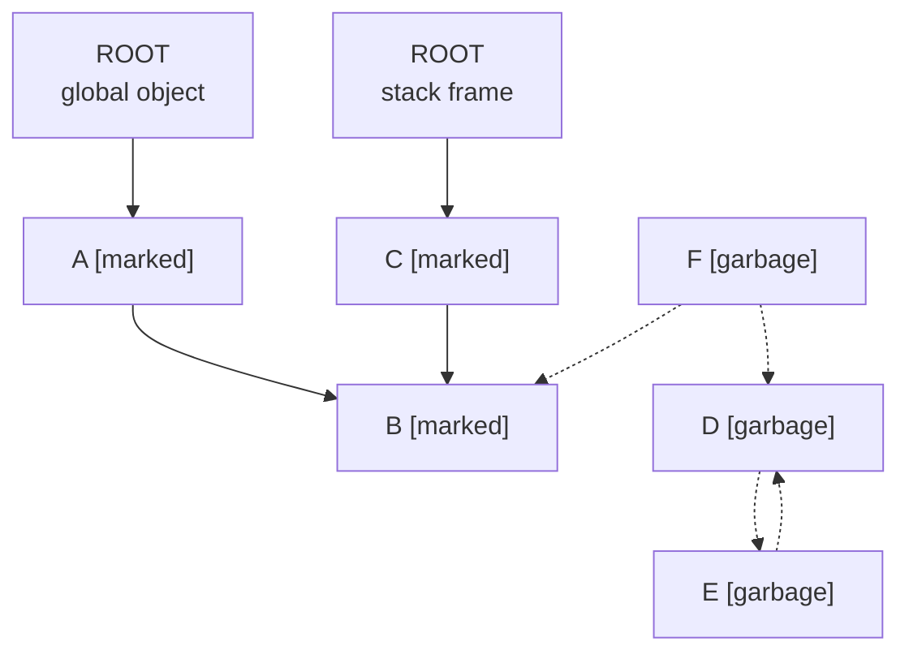
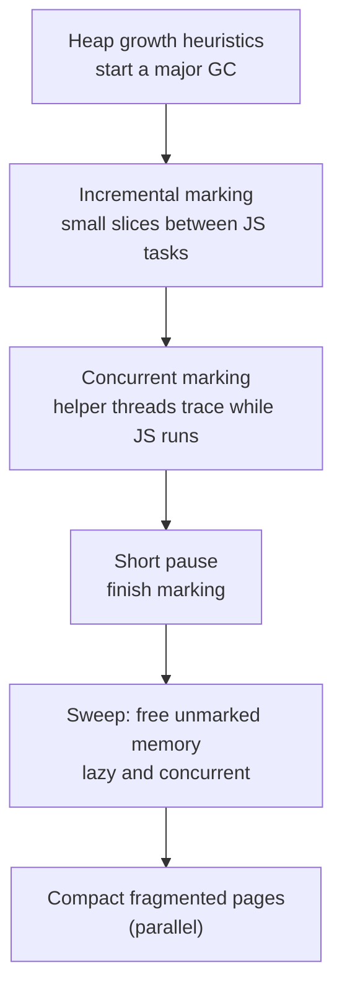

# Chapter 16: Garbage Collection & Memory Management

## 16.1 Definition and why interviewers ask it

**Garbage collection (GC) is the engine's automatic reclamation of heap memory that the program can no longer reach. JavaScript has no `free()`: memory is allocated when you create values, and released some time after nothing reachable refers to them. "Alive" means *reachable from a root*, not "still needed by the programmer".**

Interviewers ask about it for two reasons. It checks whether you can explain how the runtime works beyond syntax (mark-and-sweep, generations, why reference counting is not used). And it is the base for practical questions: "this page gets slower the longer it is open, why?", "how do you find a memory leak?", "when would you use a `WeakMap`?". It is reported as a mid-to-senior topic in JavaScript-fundamentals and front-end-performance rounds, and in Node.js backend rounds (commonly reported).

## 16.2 Core concept

### Plain language

Imagine a library where books can only be found by starting from the catalogue (the roots) and following references: "see also book B", "see also book C". The librarian walks every chain from the catalogue and puts a sticker on each book she reaches. Any book without a sticker cannot be reached by anybody, so it can be thrown out. Two unstickered books that point to *each other* are still thrown out, because nobody can get to either one.

A memory leak is a book that is still reachable from the catalogue by a forgotten reference, so it never gets thrown out, even though nobody will ever read it again.

### Precise version

**Memory lifecycle.** Every value follows three steps: *allocate* (creating an object, array, closure or string), *use* (read and write), *release*. In JavaScript the first two are explicit and the last is done by the garbage collector. The ECMAScript specification does not define how or when memory is reclaimed. It is an engine concern (V8, SpiderMonkey, JavaScriptCore). The only language-level hooks are the weak-reference features of Chapter 20.

**Stack vs heap (the interview model).**

| | Stack | Heap |
|---|---|---|
| Holds | Call frames: local variables, arguments, return address. Primitive values and *references* (pointers) | Objects, arrays, functions, closures' captured environments, and large or variable-size values such as strings |
| Lifetime | Freed automatically when the frame pops (Chapter 1) | Lives until the GC finds it unreachable |
| Managed by | Push and pop | Garbage collector |

This is a teaching model. In V8, small integers are stored directly in tagged values, and numbers outside that range, strings and every object live in the heap. Variables that a closure captures live in a heap-allocated context object rather than in the frame (Chapter 1, Section 1.3E). The model is still the right one to reason with: **a reference on the stack points to an object on the heap.**

**Reachability.** The GC starts from the **roots** and follows every reference. An object is *reachable* if some path of references leads to it. Roots include:

- the global object (`globalThis`), and what it references;
- the variables and temporaries in the **current stack frames and registers** (every function currently running, and the closures they hold);
- engine-internal roots such as built-in objects and **handles** that native code uses to refer to heap objects;
- host roots that the environment keeps, for example pending timers, registered event listeners and in-flight I/O callbacks.

Anything not reachable is garbage. Note what this definition does **not** say: it does not say "unused". An object you will never touch again, but which is still referenced from a long-lived `Map`, is alive. The GC cannot read your intent.

**Strategies compared**

| Technique | Idea | Handles cycles | Main cost |
|---|---|---|---|
| Reference counting | Each object keeps a count of references to it. Free it at zero | **No** (two objects pointing at each other never reach zero) | Counter update on every pointer write, plus leaked cycles |
| Mark-and-sweep | Mark everything reachable from the roots, then free everything unmarked | Yes | Time proportional to the live objects (mark) and to the heap (sweep). Leaves holes |
| Mark-sweep-compact | As above, then move survivors together to remove holes | Yes | Moving objects and updating every pointer to them |
| Copying (semi-space) | Copy live objects into an empty space, then discard the old space whole | Yes | Needs twice the space. Cost is proportional to *live* data, so it is cheap when most objects die |
| Generational | Keep young and old objects apart. Collect the young ones often | Yes | Needs a write barrier to track old-to-young pointers |

**Fragmentation.** Mark-and-sweep frees objects wherever they happen to be, which leaves small gaps. A large allocation may fail even though total free space is enough. *Compaction* moves live objects together to restore large free blocks.

**V8 (Orinoco) in one paragraph.** V8 relies on the **generational hypothesis**: most objects die young. The heap is split into a small **young generation** and a large **old generation**. The young generation is collected frequently by a **scavenger**, a copying collector that works on two semi-spaces. Objects that survive are copied once inside the young generation, and an object that survives a second collection is **promoted** to the old generation. The old generation is collected by a **mark-sweep-compact** collector. To keep the main thread responsive, V8 does much of that work **in parallel** (several threads at once while JavaScript is stopped), **incrementally** (in small slices interleaved with JavaScript) and **concurrently** (on helper threads while JavaScript keeps running). The aim is to cut the pauses that cause **jank**: a dropped frame, visible when work takes longer than about 16.6 ms at 60 frames per second.

**Memory leaks.** A leak is memory that stays reachable although the program no longer needs it. It grows over time and shows up as rising `heapUsed`, more frequent and longer GC pauses, and finally an out-of-memory crash. Typical causes:

| Cause | Why it stays reachable | Fix |
|---|---|---|
| Accidental globals (`x = 1` without a declaration in sloppy mode) | Properties of the global object are roots | `'use strict'`, modules, always declare |
| Forgotten `setInterval` / `setTimeout` | The host timer table holds the callback and everything it closes over | `clearInterval` on teardown |
| Event listeners never removed | The target holds the handler, the handler holds its closure | `removeEventListener`, or `{ signal }` with `AbortController` |
| Detached DOM nodes | A JS variable, array or closure still points at a node removed from the page | Drop the reference when removing the node |
| Closures capturing large scopes | A closure keeps its whole environment alive, including variables it does not use if another closure in the same scope uses them (Chapter 4) | Null the big variable, split scopes, avoid capturing |
| Unbounded caches / `Map`s / arrays | The collection is the root's descendant and only grows | Size limit (LRU), TTL, `WeakMap` for object keys |
| Dev-tools console retention | Objects logged in an open DevTools console are kept so they can be expanded | Check with DevTools closed |
| Long-lived promises and handlers | A pending promise holds its reaction callbacks, and each callback holds its closure | Settle or cancel, avoid racing a never-settling promise repeatedly |

**Weak references (brief; Chapter 20 has the detail).** A `WeakMap` or `WeakSet` holds its keys weakly: an entry does not keep its key alive. `WeakRef` gives a weak pointer whose `deref()` may return `undefined` once the target is collected. `FinalizationRegistry` can call a callback after collection. **When (or whether) a weak target is collected is up to the engine.** Never base program logic on it. Use these for caches and metadata only.

**Tuning knob.** In Node.js, `--max-old-space-size=<MB>` sets the old-generation size limit. Its default depends on the Node.js version and the memory of the machine. Raising it delays an out-of-memory crash and fixes no leak.

## 16.3 How it works internally

### A. Mark-and-sweep, step by step

1. **Pause or snapshot.** The collector decides to run, usually because an allocation could not be satisfied or a heap-growth limit was reached.
2. **Mark.** Start with the set of roots. For each root, set a "marked" bit on the object it refers to and push it on a worklist. Repeatedly take an object from the worklist and mark every object it references that is not already marked. The "already marked" check is what makes **cycles** harmless: a cycle is traversed once.
3. **Sweep.** Walk the heap. Every object without a mark is garbage: its memory goes on a free list. Marked objects have their mark cleared for the next cycle.
4. **Compact (optionally).** Move survivors together and rewrite every pointer to them, so free memory forms large blocks again.

Question 16.10 implements steps 2 and 3 on a small object graph.

### B. Reference counting and its failure

Each object stores a counter. Assigning a reference increments it and dropping one decrements it. When it reaches zero the object is freed and its outgoing references are decremented in turn. If `a.other = b` and `b.other = a`, each has a count of 1 from the other, even after every variable stopped referring to them. Neither reaches zero, so they leak. Modern JavaScript engines do not use reference counting for the JavaScript heap, because of this and because every pointer write would pay for a counter update.

### C. V8 young generation: the scavenger

1. New objects are allocated in the **new space** (the "nursery") by moving a pointer forward (a very cheap bump allocation). New space has two **semi-spaces**: one is active for allocation, the other is empty.
2. When the active semi-space fills up, a **scavenge** (minor GC) runs. Its roots are the normal roots *plus* references from the **old generation into the young generation**. These come from a **remembered set** that the **write barrier** maintains: each time a pointer is stored into an old object, the barrier records it if the target is young.
3. Live young objects are **copied** out of the active ("from") semi-space. The first time an object survives, it is copied to the other ("to") semi-space. If it already survived a previous scavenge, it is **promoted** to the old generation instead.
4. Everything left in the from-space is garbage and is discarded **in one step**, without visiting dead objects. The two semi-spaces swap roles.

Because the cost depends on how much survives, not on how much was allocated, this is fast when most objects die young. The scavenger runs its copying work with several threads in parallel while JavaScript is stopped, and the pauses are typically short.

### D. V8 old generation: major GC

The old generation uses **mark-sweep-compact**. To avoid one long stop-the-world pause on a big heap, V8 spreads the work:

1. **Incremental marking.** Marking starts in small steps interleaved with JavaScript on the main thread. Because the program mutates the object graph between steps, the **write barrier** also records changes so the collector does not miss a newly stored reference to an unmarked object.
2. **Concurrent marking.** Helper threads continue tracing the heap **while JavaScript keeps running** on the main thread. V8's own measurements for concurrent marking report a large reduction in main-thread marking time.
3. **Finalisation.** A short pause on the main thread completes marking (the roots are re-scanned and leftover work is finished).
4. **Sweeping.** Unmarked memory is released **lazily** (pages are swept as needed) and concurrently.
5. **Compaction.** When pages are very fragmented, V8 evacuates live objects from them, using several threads in parallel, so that free memory is contiguous.

The names in Node.js `--trace-gc` output reflect this split: `Scavenge` lines are minor collections, `Mark-Compact` lines are major ones.

### E. What triggers a collection

There is no timer and no schedule you can rely on. A minor GC starts when the new space cannot satisfy an allocation (`--trace-gc` prints `allocation failure`). A major GC starts when heap-growth heuristics decide the old generation has grown enough. Browsers may also use idle time. Code cannot force a collection in production (`global.gc()` exists only with `--expose-gc`, for experiments).

### F. Leaks are reachability, not collector bugs

When a heap snapshot shows an object, the question is always "what chain of references from a root keeps it alive?" The **retaining path** in DevTools shows exactly that chain. **Shallow size** is the memory of the object itself, **retained size** is the memory that would be freed if the object were collected, which includes objects only it keeps alive.

## 16.4 Diagrams

### Stack, heap and roots

```ascii Roots on the stack and global object point into the heap
   ROOTS                                    HEAP (managed by the GC)
 +------------------------------+         +-----------------------------------+
 | GLOBAL OBJECT                |         |                                   |
 |   config ----------------------------->| { theme: 'dark' }                 |
 |   cache ------------------------------>| Map --> { big array }             |
 +------------------------------+         |                                   |
 | STACK (current frames)       |         |                                   |
 |   main():   user --------------------->| { name: 'Ada' }                   |
 |   render(): n = 42 (value)   |         |                                   |
 |             fn ----------------------->| function + env {count}            |
 +------------------------------+         |                                   |
                                          | { old: 'draft' }                  |
                                          | ^ unreachable: garbage            |
                                          +-----------------------------------+
   n = 42 sits in the frame. An object is only ever reached through a
   reference. No path from a root means garbage.
```

> **How to explain this to the interviewer**
>
> 1. Draw two columns, "roots" on the left and "heap" on the right. Put the global object and the stack frames in the left column.
> 2. Draw arrows from variables to heap objects. Keep primitives inside the frame with no arrow.
> 3. Point at one heap object with no incoming arrow and say: "no path from a root, so this one is garbage, whether or not I would ever use it again".
>
> **Takeaway:** alive means reachable from a root, and a reference is just an arrow.

### Reachability graph for mark-and-sweep



> **How to explain this to the interviewer**
>
> 1. Draw the two roots at the top, and follow every solid arrow, writing "marked" on A, B and C.
> 2. Draw the unreachable group D, E and F. Point at the dashed arrows between D and E and say: "a cycle, but no root reaches it".
> 3. Point at the dashed arrow from F to B: "a pointer from garbage into live data keeps nothing alive and does not matter". Then say: "sweep frees everything without a mark".
>
> **Takeaway:** reference counting would keep D and E alive forever, while mark-and-sweep frees them because it starts from the roots.

### Generational heap in V8

```ascii V8 generations: scavenge in the young generation, mark-sweep-compact in the old
 YOUNG GENERATION  (small, collected often by the SCAVENGER, a copying collector)
 +------------------------------------------------------------------+
 |  NEW SPACE                                                       |
 |  +---------------------------+     +---------------------------+ |
 |  | FROM semi-space           |     | TO semi-space (empty)     | |
 |  | new objects allocated     |     |                           | |
 |  | here (bump pointer)       |     |                           | |
 |  | [live][dead][live][dead]  |     |                           | |
 |  +---------------------------+     +---------------------------+ |
 +------------------------------------------------------------------+
        |  scavenge: 1) copy live objects FROM -> TO (first survival)
        |            2) objects that already survived once ->
        v               PROMOTED to the old generation
        |            3) discard all of FROM at once, swap FROM and TO
 +------------------------------------------------------------------+
 | OLD GENERATION  (large, collected rarely by MARK-SWEEP-COMPACT)  |
 |  long-lived objects, promoted survivors, big objects             |
 |  old -> young pointers are tracked by the write barrier into a   |
 |  remembered set, which acts as extra roots for the next scavenge |
 +------------------------------------------------------------------+
 Minor GC = Scavenge (young only).  Major GC = Mark-Compact (whole heap).
```

> **How to explain this to the interviewer**
>
> 1. Draw two boxes: a small "young" box on top split into FROM and TO, and a big "old" box below.
> 2. Draw an arrow from FROM to TO labelled "survivors copied" and an arrow down to old labelled "survive twice, promoted". Say that the whole FROM space is dropped at once.
> 3. Say why: "most objects die young, so copying only the survivors is cheap. A big old generation is collected rarely".
>
> **Takeaway:** the generational split makes the common case, short-lived objects, cheap.

### Anatomy of a major GC in V8



> **How to explain this to the interviewer**
>
> 1. Draw six boxes top to bottom and name them: start, incremental marking, concurrent marking, short pause, sweep, compact.
> 2. Mark which boxes run alongside JavaScript (incremental slices, concurrent marking, lazy sweep) and which stop it briefly (the finish pause, compaction work).
> 3. Say: "the old collector did all of this in one stop-the-world pause. The point of the split is to avoid dropped frames".
>
> **Takeaway:** V8 breaks one long pause into many short ones, and does part of the work on other threads.

### Pause timeline: stop-the-world vs incremental and concurrent

```ascii Main thread and helper threads over time (each cell is a slice of work)
 A. STOP-THE-WORLD  (one big pause: the page freezes, frames are dropped)
 main   : JS JS JS JS JS [##### mark + sweep, JS frozen #####] JS JS JS JS
 helpers: --------------- idle -----------------------------------------

 B. INCREMENTAL  (many small pauses, same total marking work on one thread)
 main   : JS JS [m] JS JS [m] JS JS [m] JS JS [m] JS [fin] JS JS JS JS
 helpers: --------------- idle -----------------------------------------

 C. INCREMENTAL + CONCURRENT + LAZY SWEEP  (what V8 aims for)
 main   : JS JS [m] JS JS JS JS JS JS JS JS JS [fin] JS JS(sweep) JS JS
 helpers: ........ ==== concurrent marking ==== ...... sweep sweep ......

 [m] = small marking step   [fin] = short pause to finish marking
 Longest main-thread freeze:  A = long,  B = short,  C = shortest
```

> **How to explain this to the interviewer**
>
> 1. Draw two horizontal lanes, "main thread" and "helpers". Draw case A as one wide block on the main lane.
> 2. Draw case B as the same work cut into small blocks, then case C with most of the marking moved onto the helper lane.
> 3. Point at the width of the longest block on the main lane and say: "this is the pause the user feels as jank".
>
> **Takeaway:** GC work does not disappear, but it can be moved off the main thread or cut into pieces.

### Whiteboard version

```ascii Whiteboard version: reachability and the two collectors (draw in 90 seconds)
  ROOT --> A --> B        X <--> Y   (a cycle, no root points in)
  ROOT --> C
   mark from roots = alive    never marked = garbage, swept
  YOUNG: [from | to] --copy survivors--> promote --> OLD: mark-sweep-compact
  leak = still reachable from a root, but no longer needed
```

## 16.5 Code examples

### Example 1: accidental globals

```js
function leaky() { leaked = 'oops'; }
function strict() { 'use strict'; leaked2 = 'oops'; }
leaky();
console.log(typeof leaked, globalThis.leaked, Object.keys(globalThis).includes('leaked'));
try { strict(); } catch (e) { console.log(e.name + ': ' + e.message); }
delete globalThis.leaked;
console.log(typeof leaked);
```

```text output
string oops true
ReferenceError: leaked2 is not defined
undefined
```

**Why:** an assignment to an undeclared name in sloppy mode creates a property on the global object, which is a root, so the value can never be collected until the property is deleted. Strict mode (and ES modules) turn this into a `ReferenceError`. This example uses a Node.js CommonJS file, which is sloppy by default.

### Example 2: a `Map` keeps keys alive, a `WeakMap` does not

```js
const map = new Map();
const weak = new WeakMap();
let key = { id: 1 };
map.set(key, 'meta');
weak.set(key, 'meta');
console.log(map.size, weak.has(key), typeof weak.size, typeof weak[Symbol.iterator]);
try { weak.set('text', 1); } catch (e) { console.log(e.name); }
key = null; // our variable is gone, but the Map still references the object
console.log(map.size, [...map.keys()].length);
```

```text output
1 true undefined undefined
TypeError
1 1
```

**Why:** the `Map` holds a strong reference to its key, so setting `key = null` frees nothing. The `WeakMap` entry stays collectable: that is why a `WeakMap` has no `size`, no iteration and only accepts objects (or non-registered symbols) as keys. If it could be enumerated, the program could observe collection timing.

### Example 3: a timer keeps its callback, and everything it captured, alive

```js
let ticks = 0;
const id = setInterval(() => {
  ticks += 1;
  if (ticks === 3) {
    clearInterval(id); // without this, the timer table keeps the closure forever
    console.log('stopped after', ticks, 'ticks');
  }
}, 1);
```

```text output
stopped after 3 ticks
```

**Why:** a running interval is held by the host's timer machinery, which is a root. The callback's closure, and every variable it captured, stays reachable until `clearInterval`. In a long-lived page or server, a missing `clearInterval` in a teardown path is a classic leak.

### Example 4: removing listeners with `AbortController`

```js
const { getEventListeners } = require('node:events');
const bus = new EventTarget();
let calls = 0;

function mountLeaky() {
  bus.addEventListener('ping', () => { calls += 1; }); // anonymous: cannot be removed
}
function mountClean() {
  const ac = new AbortController();
  bus.addEventListener('ping', () => { calls += 1; }, { signal: ac.signal });
  return () => ac.abort(); // unmount: removes the listener
}

for (let i = 0; i < 3; i++) mountLeaky();
console.log('after leaky mounts:', getEventListeners(bus, 'ping').length);
const unmounts = [mountClean(), mountClean(), mountClean()];
console.log('after clean mounts:', getEventListeners(bus, 'ping').length);
unmounts.forEach((u) => u());
console.log('after unmounts:', getEventListeners(bus, 'ping').length);
bus.dispatchEvent(new Event('ping'));
console.log('calls:', calls);
```

```text output
after leaky mounts: 3
after clean mounts: 6
after unmounts: 3
calls: 3
```

**Why:** the event target holds each handler, and each handler holds its closure. The three leaky listeners can never be removed because no code has a reference to them. `{ signal }` ties a listener's lifetime to an `AbortController`, so one `abort()` removes it. The same option exists on DOM `addEventListener` in modern browsers.

### Example 5: closures and shared environments (needs `--expose-gc`, timing-dependent)

```js norun
// run with: node --expose-gc example.js
function makeShared() {
  const big = new Array(1e6).fill(1);
  const ref = new WeakRef(big);
  const usesBig = () => big.length; // closure A uses big
  const small = () => 'hi';         // closure B does not
  return { small, ref, usesBig };
}
function makeSplit() {
  const big = new Array(1e6).fill(1);
  const ref = new WeakRef(big);
  const small = () => 'hi';         // nothing captures big
  return { small, ref };
}
const a = makeShared();
const keepSmallOnly = a.small;      // drop everything else
a.usesBig = null;
const b = makeSplit();
(async () => {
  for (let i = 0; i < 5; i++) { // a WeakRef target lives until the end of the job
    await new Promise((r) => setTimeout(r, 10));
    global.gc();
  }
  console.log('shared scope: big alive?', a.ref.deref() !== undefined);
  console.log('split scope:  big alive?', b.ref.deref() !== undefined);
  console.log(keepSmallOnly());
})();
```

```text output
shared scope: big alive? true
split scope:  big alive? false
hi
```

**Why:** this is `js norun` because collection timing is not guaranteed. On Node 22 (V8) in this book's test run, the result was as shown: closures created in the same scope **share one environment object**, so `small` keeps `big` alive because `usesBig` captured it, even though `small` never uses it. When no closure captures `big`, it is collectable once the function returns. The engine may optimise differently in other versions, so treat the expected output as typical, not guaranteed. Chapter 4 covers closure environments.

### Example 6: tracing the collector from the command line

```bash
node --trace-gc app.js                    # print every scavenge and mark-compact
node --max-old-space-size=512 app.js      # cap the old generation at about 512 MB
node --expose-gc --inspect app.js         # allow global.gc(), attach Chrome DevTools
```

```text
[pid:0x...] 41 ms: Scavenge 5.3 (5.9) -> 4.7 (6.9) MB, 0.76 / 0.00 ms ... allocation failure
[pid:0x...] 90 ms: Mark-Compact 38.1 (45.0) -> 21.3 (46.0) MB, ... (illustrative line)
```

**Why:** each `--trace-gc` line shows the kind of GC (`Scavenge` is minor, `Mark-Compact` is major), the heap size before and after in MB (committed size in brackets), the time, and the reason. The first line is the format printed by Node 22 in this book's test run, with the process id and timing details trimmed. The second is an illustrative line, not captured output. A heap that keeps growing *after* each `Mark-Compact` suggests a leak. `process.memoryUsage()` reports `rss`, `heapTotal`, `heapUsed`, `external` and `arrayBuffers` from inside the program.

## 16.6 Common mistakes and gotchas

- **"Setting a variable to `null` frees memory."** It removes one reference. The object is freed only after the GC runs *and* no other path reaches it (Question 16.13).
- **"The GC runs on a schedule" or "I can force it".** Collection is triggered by allocation pressure and heap-growth heuristics. `global.gc()` exists only with `--expose-gc` and belongs in experiments, not in production code.
- **"Circular references leak in JavaScript."** Not in any current engine. Mark-and-sweep starts from roots, so an unreachable cycle is collected (Question 16.15).
- **Calling "memory in use" a leak.** Memory rising and then dropping after a GC is normal. A leak is growth that survives full collections and keeps rising.
- **Relying on `WeakRef` / `FinalizationRegistry` for logic.** Collection time is up to the engine, and a callback may never run. Use them for caches and diagnostics only.
- **Testing weak behaviour in a single synchronous script.** A `WeakRef` target stays alive until the end of the current job, so `gc(); ref.deref()` in the same tick often still returns the object. That does not mean it leaked.
- **Capturing too much in a closure.** One closure that uses a big variable keeps it alive for every closure from the same scope (Example 5).
- **Unbounded `Map` caches and memoisation tables.** Without a limit they are a leak by design. Bound them (LRU, TTL) or key a `WeakMap` by object.
- **Forgetting teardown.** Every `setInterval`, `addEventListener`, subscription, WebSocket and `new Worker` needs a matching cleanup.
- **Detached DOM nodes.** Removing a node from the document does not free it if a variable, array, or closure still refers to it. In DevTools, search the heap snapshot for "Detached".
- **Mixing up shallow and retained size.** A small object can retain a huge graph. Sort snapshots by retained size to find the cause.
- **Raising `--max-old-space-size` as the fix.** It delays the crash. Find what is retaining the memory.
- **Believing the DevTools console is free.** Logged objects are retained while the console is open, so a leak that only appears with DevTools open may be the console itself.

## 16.7 Quick revision cheat sheet

- **Alive = reachable from a root** (global object, stack frames and registers, handles, host-held callbacks), not "still needed".
- **Mark-and-sweep:** mark everything reachable from the roots, free the rest. It handles cycles. Compaction fixes fragmentation.
- **Reference counting** frees at zero but cannot free cycles, and costs a counter update on every pointer write. Engines do not use it for the JS heap.
- **V8:** young generation (two semi-spaces, scavenger, copying, promote after surviving twice) plus old generation (mark-sweep-compact).
- **Pause reduction:** parallel, incremental and concurrent marking, lazy sweeping, write barriers and remembered sets to track cross-generation and concurrent changes.
- **Leaks:** accidental globals, timers, listeners, detached DOM, closures over big scopes, unbounded caches, console retention, long-lived promises.
- **Find them:** DevTools heap snapshots (compare, retaining path, retained vs shallow size), allocation timeline, Node `--inspect`, `process.memoryUsage()`, `--trace-gc`, `--expose-gc` for experiments.
- **Weak refs:** `WeakMap`/`WeakSet` for object-keyed metadata, `WeakRef`/`FinalizationRegistry` for caches. Collection timing is non-deterministic, so never depend on it.

## 16.8 Interview questions

*Key: ★ = very frequently reported. "Typically asked in" lines say which round a question tends to appear in; where no single source could be pinned down the question is labelled "commonly reported". Draw-it hints refer to the figures in section 16.4.*

#### Conceptual

### Q16.1 ★ Medium: How does garbage collection work in JavaScript and V8?

*Typically asked in: JavaScript fundamentals and front-end performance rounds (commonly reported).*

> **Model answer**
>
> JavaScript has automatic memory management, and the engine frees any object that is no longer reachable from the roots: the global object, the current stack frames and engine-internal handles. V8 uses a generational design. New objects go into a small young generation, which a scavenger collects often by copying live objects between two semi-spaces. Objects that survive twice are promoted to the old generation, which uses mark-sweep-compact. To avoid long pauses, V8 marks incrementally and concurrently on helper threads, sweeps lazily, and compacts in parallel. Collections are triggered by allocation pressure, not by a timer.

**Key points to mention**

- Reachability from roots is the definition of alive.
- Generational hypothesis: most objects die young.
- Scavenger (minor) vs mark-sweep-compact (major).
- Incremental, concurrent and parallel work reduce jank.
- Draw it: Figures 16.2 and 16.3.

### Q16.2 ★ Easy: Explain the mark-and-sweep algorithm.

*Typically asked in: JavaScript fundamentals round (commonly reported).*

> **Model answer**
>
> Mark-and-sweep runs in two phases. In the mark phase the collector starts from the roots, such as globals and the variables in running functions, and follows every reference, marking each object it reaches. In the sweep phase it walks the heap and frees every object that was not marked, because no path from a root leads to it. Because it works from the roots, an unreachable cycle of objects is freed too. The weaknesses are that marking takes time proportional to the live data, and sweeping leaves fragmented free memory, which compaction can fix.

**Key points to mention**

- Roots, then traverse, then free the unmarked.
- Cycles are handled, since reachability is the test.
- The cost is a pause unless the work is made incremental or concurrent.
- Compaction addresses fragmentation.
- Draw it: Figure 16.2.

### Q16.3 ★ Medium: What is the difference between reference counting and mark-and-sweep? What is the problem with circular references?

*Typically asked in: JavaScript fundamentals round (commonly reported).*

> **Model answer**
>
> Reference counting keeps a counter per object and frees it when the counter hits zero. It is simple and frees memory immediately, but it cannot handle cycles: if `a` points to `b` and `b` points to `a`, each has a count of one even after the program drops all outside references, so both leak. It also adds work to every pointer write. Mark-and-sweep asks a different question: is the object reachable from a root? A cycle that nobody outside can reach is unreachable, so it is collected. That is why modern engines use tracing collectors, and circular references are not a leak in current JavaScript.

**Key points to mention**

- Counter vs reachability.
- Cycle example with `a.other = b; b.other = a`.
- Reference counting costs a counter update on each pointer write.
- Question 16.10 implements both.

### Q16.4 ★ Easy: What is a memory leak in JavaScript? What are the common causes?

*Typically asked in: JavaScript fundamentals and front-end performance rounds (commonly reported).*

> **Model answer**
>
> A leak is memory the program no longer needs but that is still reachable, so the GC cannot free it. Usage keeps growing and even full collections do not bring it back down. Common causes are accidental globals from missing declarations, `setInterval` timers never cleared, event listeners never removed, DOM nodes removed from the page but still referenced from a variable or array, closures that capture large scopes, caches and Maps without a size limit, and long-lived promises or subscriptions holding callbacks. In all cases a root still has a path to the object, so the fix is to cut that path.

**Key points to mention**

- Leak = reachable but unneeded. The GC is correct, the references are the bug.
- Name at least five causes with their fixes.
- Symptoms: rising heap after GC, slowdowns, out-of-memory.
- Strict mode and modules prevent accidental globals.

### Q16.5 Medium: How would you find and fix a memory leak?

*Typically asked in: front-end performance and Node.js backend rounds (commonly reported).*

> **Model answer**
>
> First I confirm that it is a leak: heap size that keeps rising after garbage collections, while repeating the same action. In Chrome DevTools I take a heap snapshot, perform the suspect action several times, take another snapshot and use the comparison view to see which objects were allocated and not freed. I sort by retained size, and open the retaining path of an object to see which reference from a root keeps it alive. The allocation timeline shows when objects were created. In Node.js I attach with `--inspect`, watch `process.memoryUsage()` and use `--trace-gc`. Then I remove the reference, for example by clearing a timer or removing a listener, and measure again.

**Key points to mention**

- Reproduce, snapshot, repeat action, snapshot, compare.
- Retained size vs shallow size, and the retaining path.
- Search for "Detached" DOM nodes. Check the console-retention effect.
- Node: `--inspect`, `process.memoryUsage()`, `--trace-gc`, `--expose-gc` for experiments.
- Verify the fix with a second measurement.

### Q16.6 Medium: What is generational garbage collection and why is it used?

*Typically asked in: senior JavaScript and performance rounds (commonly reported).*

> **Model answer**
>
> It rests on the observation that most objects die young: temporary arrays, closures and results are used briefly and dropped. So the heap is split into a small young generation and a large old generation. New objects are allocated in the young one, which is collected often by a scavenger that copies only the survivors into a clean semi-space. That work is proportional to the survivors, so it is cheap. Objects that survive a couple of collections are promoted to the old generation, which is collected rarely with mark-sweep-compact. Old-to-young pointers are tracked through a write barrier and remembered set, so the young collection does not scan the whole old heap.

**Key points to mention**

- The generational hypothesis.
- Semi-space copying, then promotion after surviving twice.
- Cost depends on survivors, not on garbage.
- Write barrier and remembered set for old-to-young references.
- Draw it: Figure 16.3.

### Q16.7 Medium: What are `WeakMap`, `WeakSet`, `WeakRef` and `FinalizationRegistry`, and when would you use them?

*Typically asked in: senior JavaScript rounds and follow-ups to the leak question (commonly reported).*

> **Model answer**
>
> A `WeakMap` or `WeakSet` holds its keys weakly, so an entry does not keep the key object alive. I use a `WeakMap` to attach private data or a cache to objects without extending their lifetime, for example DOM-node metadata. They can't be iterated and have no `size`, because that would expose collection timing. A `WeakRef` is a weak pointer whose `deref()` returns the object or `undefined`. A `FinalizationRegistry` runs a callback after an object is collected. Collection timing is up to the engine, so I never rely on it for program logic. They are for caches and cleanup hints only.

**Key points to mention**

- Weak keys: objects (or non-registered symbols) only.
- No iteration and no `size` by design.
- `deref()` may return `undefined` at any time. Callbacks may never run.
- Strong `Map` vs `WeakMap` (Example 2). Chapter 20 has the detail.

### Q16.8 Medium: How can closures cause memory leaks?

*Typically asked in: follow-up to the closures question (commonly reported).*

```js norun
function makeShared() {
  const big = new Array(1e6).fill(1);
  const usesBig = () => big.length;
  const small = () => 'hi';
  return { small, usesBig };
}
const { small } = makeShared(); // usesBig is dropped
```

> **Model answer**
>
> A closure keeps alive the environment it was created in. In V8, closures created in the same scope share one environment object. So in the snippet, `small` never uses `big`, but `usesBig` does, and both point at the same environment, so keeping `small` alive keeps the million-element array alive too. The same happens when a long-lived callback, such as a timer, listener or promise handler, captures a big object. The fixes are to set the large variable to `null` when done, to create the closure in a small separate scope that captures only what it needs, and to remove listeners and timers.

**Key points to mention**

- A closure retains its environment record (Chapter 4), not only the variables it names.
- Sibling closures share one environment in V8. This is an optimisation detail, not a language rule.
- Long-lived holders (timers, listeners, caches) turn this into a real leak.
- Verify with a heap snapshot: look at the retaining path through the closure's context.

#### Output prediction

### Q16.9 Medium: What does this print? Which statements affect what the GC can free?

*Typically asked in: JavaScript fundamentals round, as a memory-themed puzzle (commonly reported).*

```js
function leaky() { leaked = 'oops'; }
function strict() { 'use strict'; leaked2 = 'oops'; }
leaky();
console.log(typeof leaked, delete globalThis.leaked, typeof leaked);
try { strict(); } catch (e) { console.log(e.name + ': ' + e.message); }

let key = { id: 1 };
const map = new Map([[key, 'meta']]);
const weak = new WeakMap([[key, 'meta']]);
key = null; // drops our variable only
console.log(map.size, typeof weak.size, weak.has({ id: 1 }));
```

```text output
string true undefined
ReferenceError: leaked2 is not defined
1 undefined false
```

> **Model answer**
>
> The first line prints `string true undefined`. The sloppy assignment `leaked = 'oops'` creates a global property, so `typeof` sees a string. `delete` removes it from the global object, which is a root, so afterwards the value becomes collectable. In strict mode the same assignment throws `ReferenceError`. For the last line, `key = null` removes only our variable. The `Map` still holds the object, so its size stays 1. A `WeakMap` has no `size`, so that is `undefined`, and `weak.has({ id: 1 })` is `false` because a new object literal is a different key. The weak entry itself no longer keeps the object alive.

**Key points to mention**

- Global-object properties are roots.
- Strict mode and modules block accidental globals.
- `null` drops one reference, and the `Map` still holds another.
- Weak collections are not enumerable and have no `size`.
- Objects compare by identity, so a literal is never the same key.

#### Implement it yourself

### Q16.10 ★ Hard: Implement `markAndSweep(roots, heap)` and a reference counter that fails on cycles.

*Typically asked in: senior JavaScript rounds, as a whiteboard "show me you understand it" exercise (commonly reported).*

**Problem.** Model a heap as a `Map` from object id to `{ refs: [ids] }`, and `roots` as an array of ids. Write `markAndSweep(roots, heap)` that deletes every object not reachable from the roots and returns the marked ids and the swept ids. Then write a reference-counting heap and show that it never frees a cycle that `markAndSweep` frees.

**Solution.**

```js
function markAndSweep(roots, heap) {
  const marked = new Set();
  const worklist = [...roots]; // iterative: no recursion depth limit
  while (worklist.length) {
    const id = worklist.pop();
    if (marked.has(id) || !heap.has(id)) continue; // the mark check also stops cycles
    marked.add(id);
    for (const ref of heap.get(id).refs) worklist.push(ref);
  }
  const swept = [];
  for (const id of [...heap.keys()]) {
    if (!marked.has(id)) { swept.push(id); heap.delete(id); }
  }
  return { marked: [...marked].sort(), swept: swept.sort() };
}

function makeRcHeap() {
  const objs = new Map(); // id -> { count, refs }
  const freed = [];
  const decrement = (id) => {
    const o = objs.get(id);
    o.count -= 1;
    if (o.count === 0) {
      freed.push(id);
      objs.delete(id);
      o.refs.forEach(decrement); // freeing an object releases what it points to
    }
  };
  return {
    alloc(id) { objs.set(id, { count: 1, refs: [] }); }, // 1 = held by a variable
    link(from, to) { objs.get(from).refs.push(to); objs.get(to).count += 1; },
    release: decrement, // a variable stops pointing at id
    freed,
    live: () => [...objs.keys()],
  };
}

const graph = () => new Map(Object.entries({
  A: { refs: ['B'] }, B: { refs: [] }, C: { refs: ['B'] },
  D: { refs: ['E'] }, E: { refs: ['D'] }, F: { refs: ['D', 'B'] },
}));

const heap = graph();
console.log(markAndSweep(['A', 'C'], heap));
console.log([...heap.keys()]);

const rc = makeRcHeap();
['a', 'b', 'c', 'd'].forEach((id) => rc.alloc(id));
rc.link('a', 'b'); rc.link('b', 'a'); // cycle
rc.link('c', 'd');                    // chain
['a', 'b', 'c', 'd'].forEach((id) => rc.release(id)); // all variables go away
console.log('rc freed:', rc.freed, 'still live:', rc.live());
console.log('mark-sweep on the same cycle:', markAndSweep([], new Map([
  ['a', { refs: ['b'] }], ['b', { refs: ['a'] }],
])).swept);
```

```text output
{ marked: [ 'A', 'B', 'C' ], swept: [ 'D', 'E', 'F' ] }
[ 'A', 'B', 'C' ]
rc freed: [ 'c', 'd' ] still live: [ 'a', 'b' ]
mark-sweep on the same cycle: [ 'a', 'b' ]
```

> **Model answer**
>
> For mark-and-sweep, I put the roots on a worklist, pop an id, skip it if it is already marked or missing, mark it and push its references. The "already marked" check is what makes cycles safe. Then I walk the heap and delete every id that is not in the marked set. The cost is O(live objects plus references) to mark and O(heap) to sweep. For reference counting, every object has a counter. Linking increments it, releasing decrements it, and at zero the object is freed and its outgoing references are decremented. With `a` and `b` pointing at each other, both stay at one forever, so they leak. The same cycle is swept by mark-and-sweep, because no root reaches it.

**Key points to mention**

- Marked set doubles as cycle protection. Worklist (explicit stack) instead of recursion to avoid stack overflow on deep graphs.
- Complexity: mark O(V + E) over live data, sweep O(heap).
- Reference counting frees `c` then cascades to `d`, but never frees `a` and `b`.
- Edge cases: roots that name missing ids, empty roots (everything is swept), duplicate references.
- Real collectors add compaction, generations and incremental marking (needs tri-colour marking and a write barrier).

### Q16.11 Medium: Implement a bounded cache (LRU) so a memoisation table cannot leak.

*Typically asked in: machine-coding round and senior JavaScript rounds (commonly reported).*

**Problem.** An unbounded `Map` used as a cache grows forever. Write `LRUCache(limit)` with `get`, `set`, `size`, and eviction of the least recently used entry when the limit is exceeded.

**Solution.**

```js
class LRUCache {
  constructor(limit) {
    if (!(limit > 0)) throw new RangeError('limit must be positive');
    this.limit = limit;
    this.map = new Map(); // a Map iterates in insertion order: oldest entry first
  }
  get(key) {
    if (!this.map.has(key)) return undefined;
    const value = this.map.get(key);
    this.map.delete(key); // re-insert to mark as most recently used
    this.map.set(key, value);
    return value;
  }
  set(key, value) {
    this.map.delete(key);
    this.map.set(key, value);
    if (this.map.size > this.limit) {
      this.map.delete(this.map.keys().next().value); // evict the oldest
    }
    return this;
  }
  get size() { return this.map.size; }
}

const cache = new LRUCache(2);
cache.set('a', 1).set('b', 2);
cache.get('a');          // a is now the most recently used
cache.set('c', 3);       // evicts b
console.log([...cache.map.keys()], cache.get('b'), cache.size);
cache.set('d', 4);       // evicts a
console.log([...cache.map.keys()]);
try { new LRUCache(0); } catch (e) { console.log(e.name + ': ' + e.message); }
```

```text output
[ 'a', 'c' ] undefined 2
[ 'c', 'd' ]
RangeError: limit must be positive
```

> **Model answer**
>
> I use a `Map`, because it remembers insertion order. The first key is always the least recently used. On `get`, I delete and re-insert the entry so it moves to the most recent end. On `set`, I do the same and, if the size now exceeds the limit, I delete the first key, which `map.keys().next().value` gives me in constant time. Both operations are O(1) on average, and memory is capped at `limit` entries, so the cache cannot leak. If the keys are objects whose lifetime I do not control, a `WeakMap` is an alternative, but it cannot be size-limited or iterated.

**Key points to mention**

- Why unbounded caches are a leak: they are reachable and only grow.
- `Map` insertion order gives O(1) LRU with delete and re-insert.
- Evict on `set` after exceeding the limit. Updating an existing key must not evict.
- Alternatives: TTL expiry, `WeakMap` for object keys, `WeakRef` values (collection timing is unreliable).
- Edge cases: limit of 1, storing `undefined` values (use `has`), non-positive limit.

### Q16.12 Medium: Show the event-listener leak and fix it with `removeEventListener` and `AbortController`.

*Typically asked in: front-end performance and React/Vue-style component rounds (commonly reported).*

**Problem.** A component adds a `resize` listener when it mounts and never removes it, so every mount leaks its closure. Write the leaky version, then two fixes. Use an `EventTarget` so the example runs on Node.js. In a browser it is the same code with `window`.

**Solution.**

```js
const { getEventListeners } = require('node:events');
const target = new EventTarget();
const count = () => getEventListeners(target, 'resize').length;

// Leaky: the anonymous arrow can never be removed, and it closes over `data`.
function mountLeaky() {
  const data = new Array(1000).fill(0);
  target.addEventListener('resize', () => data.length);
}

// Fix 1: keep the handler reference so it can be removed.
function mountNamed() {
  const data = new Array(1000).fill(0);
  const onResize = () => data.length;
  target.addEventListener('resize', onResize);
  return () => target.removeEventListener('resize', onResize);
}

// Fix 2: one AbortController can remove many listeners at once.
function mountSignal() {
  const ac = new AbortController();
  const data = new Array(1000).fill(0);
  target.addEventListener('resize', () => data.length, { signal: ac.signal });
  target.addEventListener('resize', () => data.length, { signal: ac.signal });
  return () => ac.abort();
}

mountLeaky();
console.log('leaky:', count());
const unmountNamed = mountNamed();
const unmountSignal = mountSignal();
console.log('named + signal mounted:', count());
unmountNamed();
unmountSignal();
console.log('after unmount:', count());
```

```text output
leaky: 1
named + signal mounted: 4
after unmount: 1
```

> **Model answer**
>
> The leak is that the event target is a long-lived object that holds every handler, and each handler closes over the component's data, so nothing from that mount can be freed. The anonymous handler cannot be removed because no code has a reference to it. Fix one is to keep the handler in a variable and call `removeEventListener` with the same function in the unmount path. Fix two is to pass `{ signal }` from an `AbortController` when adding, then call `abort()` once on unmount, which removes all listeners that share the signal. I prefer the signal when there are several listeners or other abortable work such as `fetch`.

**Key points to mention**

- Removal needs the same function reference (and the same `capture` flag in the browser).
- `{ once: true }` also removes a listener after it fires.
- `AbortController` ties many cleanups to one call, and works with `fetch` too.
- In frameworks, put cleanup in the unmount hook (`useEffect` return, `ngOnDestroy`, `onUnmounted`).
- Verify in DevTools by comparing the listener count (Event Listeners panel) or snapshots after mounting and unmounting repeatedly.

#### Follow-up traps

### Q16.13 Medium: "If I set a variable to `null`, is the memory freed?"

*Typically asked in: follow-up after the memory-leak question (commonly reported).*

> **Model answer**
>
> Not directly. Setting the variable to `null` removes that one reference. If it was the last path from a root to the object, the object becomes unreachable and a later garbage collection can free it, but not at that moment, and not at all if anything else still refers to it, like a `Map`, a closure or a listener. The `null` is useful when a long-lived variable would otherwise hold a large object, for example a module-level cache or a captured variable in a closure. For a local variable in a function that is about to return, it does nothing useful, since the frame disappears anyway.

**Key points to mention**

- It drops one reference. It does not call the collector.
- Other references (collections, closures, listeners) keep the object alive.
- Useful for long-lived holders. Pointless for short-lived locals.
- Example 2 shows a `Map` still holding the object after `key = null`.

### Q16.14 Medium: "Does the garbage collector run on a schedule? Can I trigger it?"

*Typically asked in: follow-up to the GC question (commonly reported).*

> **Model answer**
>
> No. There is no fixed schedule. In V8, a minor collection starts when the young generation cannot satisfy an allocation, and a major one starts when heap-growth heuristics say the old generation has grown enough. Browsers can also use idle time. Collection is therefore driven by how much you allocate, and part of the work runs on other threads. The language provides no way to force it. In Node.js, `--expose-gc` adds `global.gc()` for experiments and tests, but production code should not call it, because it triggers an expensive full collection and the engine usually knows better when to run.

**Key points to mention**

- Allocation pressure triggers it. `--trace-gc` shows `allocation failure` for scavenges.
- Timing is not observable or guaranteed in the language, which is why weak references are non-deterministic.
- `global.gc()` is for experiments only.
- Lower allocation rates mean fewer collections.

### Q16.15 Hard: "Are circular references a memory leak in modern JavaScript?"

*Typically asked in: follow-up after the reference-counting question (commonly reported).*

> **Model answer**
>
> No. Modern engines use tracing collectors, which decide by reachability from the roots, not by counting references. Two objects that refer to each other but are unreachable from any root are both collected. The belief comes from reference-counting collectors, such as the ones very old Internet Explorer versions used for DOM objects, where cycles through those objects did leak. A cycle is a leak only if something reachable still points into it, for example a global variable, a timer, or an event listener on a long-lived target. Then the cycle is retained because it is reachable, not because it is circular.

**Key points to mention**

- Reachability, not reference count, is the test.
- The cycle story is historical (reference counting).
- A cycle that a root can reach is retained, as is any other reachable object.
- Mention that `WeakRef` is not needed to break cycles.

#### Sources and further reading

- V8 blog, "Trash talk: the Orinoco garbage collector" <https://v8.dev/blog/trash-talk>; "Concurrent marking in V8" <https://v8.dev/blog/concurrent-marking>; "Jank Busters Part One" <https://v8.dev/blog/jank-busters>; "Jank Busters Part Two (Orinoco)" <https://v8.dev/blog/orinoco>; and "Parallel scavenger" <https://v8.dev/blog/orinoco-parallel-scavenger>. In this session these pages could not be fetched (HTTP 403), so the V8-specific statements rest on the search-result excerpts of those pages plus general knowledge, and are kept to the level of detail those excerpts support.
- MDN, "Memory management": <https://developer.mozilla.org/en-US/docs/Web/JavaScript/Guide/Memory_management>, and MDN pages for `WeakMap`, `WeakRef` and `FinalizationRegistry`.
- Chrome DevTools documentation, "Memory" panel: heap snapshots, allocation timeline, retained vs shallow size: <https://developer.chrome.com/docs/devtools/memory-problems>
- Node.js documentation: command-line options (`--max-old-space-size`, `--trace-gc`, `--expose-gc`, `--inspect`), `process.memoryUsage()`, and the `v8` module: <https://nodejs.org/api/>
- ECMAScript specification, `WeakRef` and `FinalizationRegistry` (the spec explicitly leaves collection timing to the implementation): <https://tc39.es/ecma262/>
- Public interview write-ups seen in search results for question frequency (page text was not opened): TechKoala Insights, "Debug Leaks, Garbage Collection, and V8 Interview Essentials" <https://interviews.techkoalainsights.com/javascript/javascript-memory-management-explained-debug-leaks-v8/>; "Leaks, Garbage Collection, WeakMap, and Interview Tips" <https://interviews.techkoalainsights.com/javascript/javascript-memory-management-explained-leaks-garbage/>; LambdaTest, "A Complete Guide on How To Avoid Memory Leaks In JavaScript" <https://www.lambdatest.com/blog/eradicating-memory-leaks-in-javascript/>. Question wording in this book is original.
