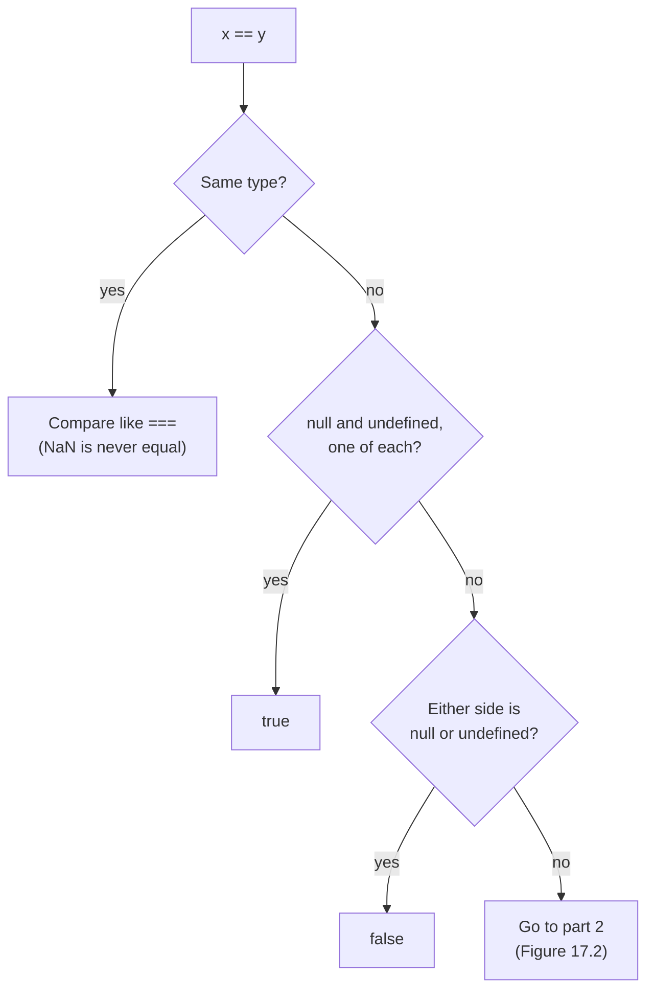
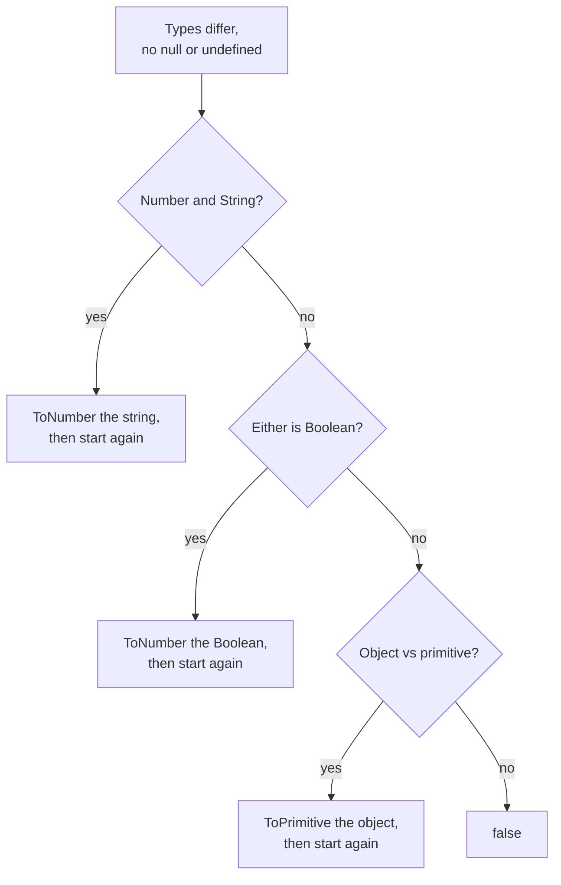
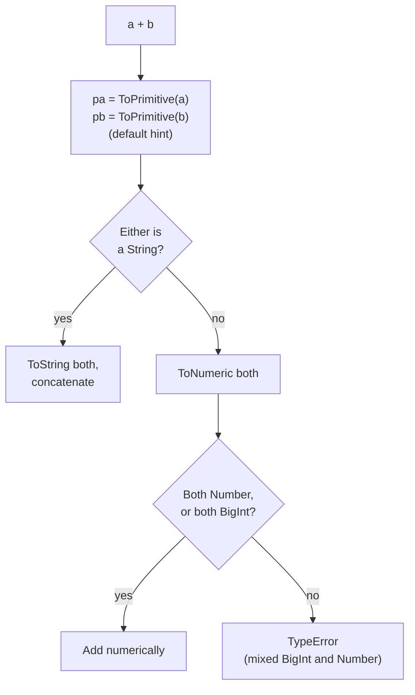
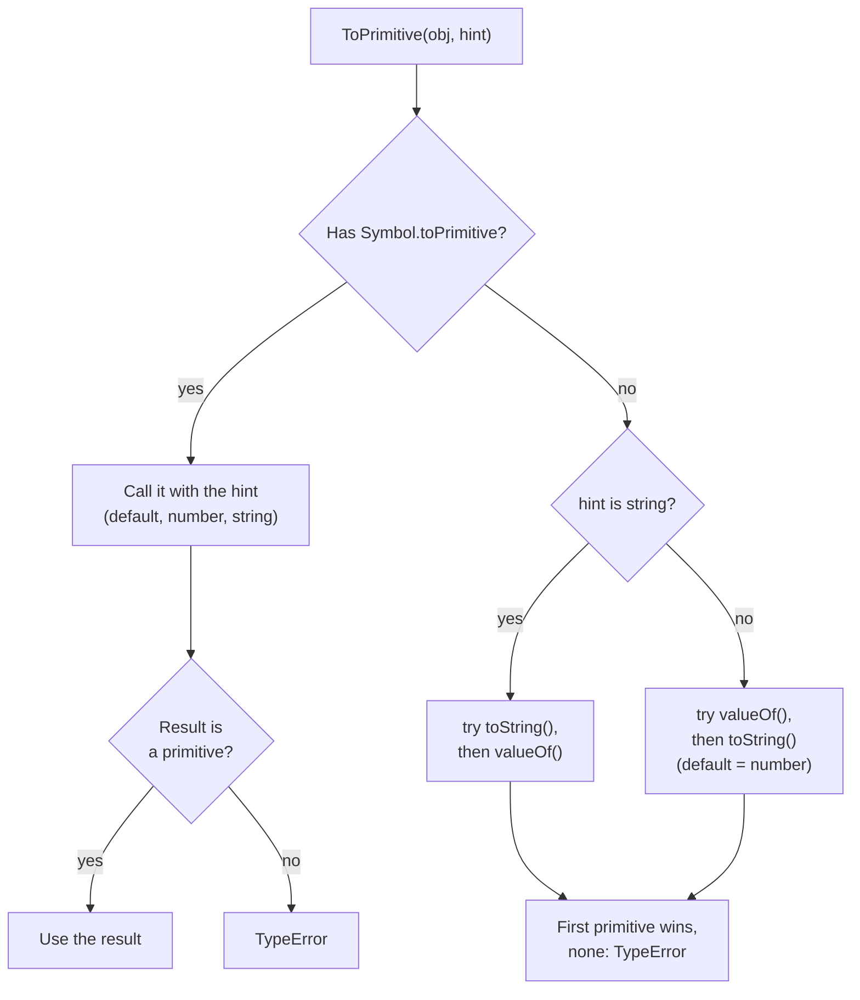

# Chapter 17: Type Coercion, Equality & Number Quirks

## 17.1 Definition and why interviewers ask it

**Type coercion is the automatic (implicit) or explicit conversion of a value from one type to another, performed by a small set of spec-defined abstract operations: `ToPrimitive`, `ToNumber`, `ToString`, `ToBoolean` and `ToPropertyKey`. Operators such as `+`, `==`, `<` and `if` call those operations in a fixed order, so every "weird" JavaScript result is mechanical and can be predicted.**

This is the most reliable source of output-prediction questions in JavaScript-fundamentals rounds: `[] == ![]`, `'5' + 3`, `null >= 0`, `0.1 + 0.2`, `typeof null` (commonly reported). Interviewers use it to separate candidates who memorised a list of oddities from those who can derive each result from the algorithm, and to check whether you pick `===`, `Object.is` and `??` deliberately.

## 17.2 Core concept

### Plain language

JavaScript is a polite host: when an operator receives a value of the "wrong" kind, it quietly converts it instead of complaining. `'5' - 3` turns the text into a number. `'5' + 3` goes the other way, because `+` also means "join text", and text wins. Objects first have to be reduced to a simple value (a *primitive*) before any of this can happen, and the rules for that are where `[] + {}` comes from.

The number quirks come from a different place: every `Number` is a 64-bit binary fraction. Some decimal values, like `0.1`, have no exact binary form, just as 1/3 has no exact decimal form.

### Precise version

**The 8 language types**

| Type | `typeof` result | Notes |
|---|---|---|
| Undefined | `'undefined'` | Also the result for an undeclared name (no `ReferenceError`; a name in the TDZ does throw, Chapter 2) |
| Null | `'object'` | A historic bug that cannot be fixed without breaking the web. Test with `x === null` |
| Boolean | `'boolean'` | |
| String | `'string'` | Sequence of UTF-16 code units |
| Symbol | `'symbol'` | Chapter 20 |
| Number | `'number'` | IEEE-754 double, including `NaN` and `Infinity` (`typeof NaN` is `'number'`) |
| BigInt | `'bigint'` | Arbitrary-precision integer, written `10n` |
| Object | `'object'`, or `'function'` for callable objects | Arrays, dates, regexes, maps: all `'object'`. Classes are functions, so `typeof class {}` is `'function'`. `typeof` has no special result for arrays |

In browsers, the legacy `document.all` is an Annex B oddity: `typeof document.all` is `'undefined'`, it is falsy, and `document.all == null` is `true`, although it is an object.

**The abstract operations**

| Operation | Rule |
|---|---|
| `ToBoolean(v)` | **Falsy:** `false`, `0`, `-0`, `0n`, `''`, `null`, `undefined`, `NaN` (and `document.all` in browsers). **Everything else is truthy**, including `'0'`, `'false'`, `[]`, `{}`, `new Boolean(false)` and functions. Never calls `valueOf` |
| `ToNumber(v)` | `undefined` is `NaN`. `null` is `0`. `true` is `1`, `false` is `0`. A string is trimmed, then `''` is `0`, a valid numeric literal (`'12'`, `'1e3'`, `'0x10'`, `'0b11'`, `'Infinity'`) is its value, anything else is `NaN`. `Symbol` and `BigInt` throw `TypeError`. An object goes through `ToPrimitive(number)` first |
| `ToString(v)` | `undefined` to `'undefined'`, `null` to `'null'`, booleans to `'true'`/`'false'`, `-0` to `'0'`. A `Symbol` throws `TypeError` (but `String(sym)` is allowed). An object goes through `ToPrimitive(string)` |
| `ToPrimitive(obj, hint)` | See below |
| `ToPropertyKey(v)` | `ToPrimitive(v, string)`, then a Symbol stays a Symbol and anything else becomes `ToString`. That is why `obj[{}]` uses the key `'[object Object]'` and `obj[[1, 2]]` uses `'1,2'` |

**`ToPrimitive(input, hint)`.** The hint is `default`, `number` or `string`. For an object:

1. If it has a method at `Symbol.toPrimitive`, call it with the hint as a string. The result must be a primitive, otherwise `TypeError`.
2. Otherwise run `OrdinaryToPrimitive`: for hint `string` try `toString()` then `valueOf()`. For `number` (and `default`, which counts as `number`) try `valueOf()` then `toString()`. The first call that returns a primitive wins. If neither does, `TypeError`.

Plain objects and arrays have a `valueOf` that returns the object itself, which is not a primitive, so in practice `toString()` decides: `{}` becomes `'[object Object]'`, `[1, 2]` becomes `'1,2'`, `[]` becomes `''`. **`Date` is the exception:** it defines `Symbol.toPrimitive` so that hint `default` behaves like `string`. So `date + 1` is string concatenation, while `date - 1` is a number.

| Where | Hint |
|---|---|
| `a + b`, `a == b`, `new Date(value)` input | `default` |
| `a - b`, `a * b`, `a < b`, unary `+a`, `Number(a)` | `number` |
| Template literal `${a}`, `String(a)`, property keys (`obj[a]`) | `string` |

**Operators**

| Operator | Rule |
|---|---|
| `a + b` | `ToPrimitive` both (default). If **either** result is a string, `ToString` both and concatenate. Otherwise `ToNumeric` both. If both are Number or both BigInt, add. Mixed Number and BigInt is a `TypeError` |
| `a - b`, `*`, `/`, `%`, `**` | Always `ToNumeric` (never string concatenation). `'5' - 3` is `2` |
| unary `+a` | `ToNumber`. Throws for BigInt. Unary `-a` and `~a` use `ToNumeric` |
| `a < b`, `>`, `<=`, `>=` | `ToPrimitive` both (number). If **both** are strings, compare code units (so `'10' < '9'` is `true`). Otherwise convert to numbers (BigInt compares mathematically) and compare. Any `NaN` gives `false`. `a >= b` is defined as "not `a < b`", except that an undefined comparison is `false` |
| `a == b` | The loose-equality algorithm below |
| `if`, `while`, `!`, `&&`, `\|\|`, `?:` | `ToBoolean`. `&&` and `\|\|` return one of their operands, not a boolean |
| `a ?? b` | `b` only if `a` is `null` or `undefined`. No other coercion |

**Loose equality `a == b`, in spec order**

1. Same type: compare as `===`. (`NaN == NaN` is `false`.)
2. `null == undefined` and `undefined == null` are `true`. `null` and `undefined` are loosely equal to *nothing else*.
3. Number and String: `ToNumber` the string, compare again.
4. BigInt and String: convert the string to a BigInt (if it fails the result is `false`), compare again.
5. Either side Boolean: `ToNumber` it (`true` becomes `1`), compare again. This is why `'0' == false` is `true` but `'a' == true` is `false`.
6. Object and a String, Number, BigInt or Symbol: `ToPrimitive(object)` (default hint), compare again.
7. BigInt and Number: compare the mathematical values.
8. Otherwise `false`.

**`===`, `SameValueZero` and `SameValue`**

| Comparison | `NaN` vs `NaN` | `+0` vs `-0` | Used by |
|---|---|---|---|
| `===` | different | same | the operator, `indexOf`, `switch` |
| SameValueZero | **same** | same | `includes`, `Map` and `Set` keys, `Array.prototype.includes` |
| SameValue (`Object.is`) | same | **different** | `Object.is` and internal property checks |

`Map` and `Set` also normalise `-0` to `+0` when storing a key.

**Number quirks**

- **IEEE-754 binary64.** One sign bit, 11 exponent bits, 52 fraction bits (53 bits of precision with the implicit leading 1). Values like `0.1`, `0.2` and `0.3` repeat forever in binary, so they are rounded. `0.1 + 0.2` is `0.30000000000000004`. Compare with a tolerance (`Math.abs(a - b) < Number.EPSILON`, valid for values near 1; scale it for larger magnitudes), work in integers (cents), or use a decimal library.
- **Safe integers.** Integers are exact only up to `Number.MAX_SAFE_INTEGER` (2^53 - 1 = 9007199254740991). Beyond it, neighbours collide: `2**53 + 1 === 2**53`.
- **`toFixed(n)`** returns a **string**, formats the *exact binary value* and can look wrong: `(1.005).toFixed(2)` is `'1.00'` because the stored value is slightly below 1.005.
- **`NaN`** is the only value not equal to itself. `typeof NaN` is `'number'` because it is a Number value meaning "invalid numeric result". `isNaN(x)` first coerces `x` with `ToNumber` (`isNaN('abc')` is `true`). `Number.isNaN(x)` does no coercion.
- **`-0`.** Produced by `-0`, `0 * -1`, `Math.round(-0.4)`. `0 === -0`, but `1 / -0` is `-Infinity` and `Object.is(0, -0)` is `false`. `String(-0)` is `'0'`, while `console.log(-0)` in Node.js prints `-0`.
- **`parseInt` vs `Number` vs unary `+`.** `Number('42px')` and `+'42px'` are `NaN` (whole string must be numeric). `parseInt('42px')` is `42` (reads a numeric prefix). `parseInt` converts its argument to a **string** first, so `parseInt(0.0000005)` reads `'5e-7'` and returns `5`. Always pass a radix: `parseInt(s, 10)`. `['1', '2', '3'].map(parseInt)` is `[1, NaN, NaN]`, because `map` passes the index as the radix.
- **Integer division.** `7 / 2` is `3.5`. Use `Math.trunc(7 / 2)` (toward zero) or `Math.floor` (toward minus infinity). `x | 0` truncates but wraps to 32 bits. `%` takes the sign of the dividend: `-5 % 3` is `-2`.

**BigInt**

- Literal `10n` or `BigInt('10')`. `typeof` is `'bigint'`. Arbitrary precision, integers only (`5n / 2n` is `2n`, truncating).
- **No mixing in arithmetic:** `1n + 1` throws `TypeError: Cannot mix BigInt and other types, use explicit conversions`. Unary `+1n` and `Math.max(1n)` also throw.
- **Comparison does work across types:** `2n < 3` and `2n > 1.5` compare mathematically, `2n == 2` is `true`, `2n === 2` is `false` (different types).
- `BigInt(1.5)` is a `RangeError`. `JSON.stringify({ a: 1n })` throws `TypeError: Do not know how to serialize a BigInt`. Convert (`toString()`, or a replacer) before serialising. `Number(2n ** 64n)` loses precision.

## 17.3 How it works internally

### A. Evaluating `a + b`

1. Evaluate `a` and `b` to values.
2. Apply `ToPrimitive` to each, with hint `default`. Primitives pass through unchanged. Objects follow the `Symbol.toPrimitive` / `valueOf` / `toString` rule.
3. If either primitive is a string, apply `ToString` to both (a `Symbol` throws here) and return the concatenation.
4. Otherwise apply `ToNumeric` to both. If one is a BigInt and the other a Number, throw `TypeError`. Otherwise add.

Because step 2 comes first, `[] + {}` is `'' + '[object Object]'`, and `1 + [2]` is `1 + '2'`, which is the string `'12'`.

### B. Evaluating `a == b`

The loop in Section 17.2 runs until both sides have the same type, then compares like `===`. Each step moves the operands closer: Boolean becomes Number, String becomes Number, Object becomes primitive. Example, `[] == ![]`: `![]` is `false` (an object is truthy), so the comparison is `[] == false`. The Boolean becomes `0`, giving `[] == 0`. The array becomes `''`, giving `'' == 0`. The string becomes `0`, giving `0 == 0`, which is `true`. Question 17.9 draws this out.

### C. Relational comparison

For `a < b` the engine runs `ToPrimitive(number)` on both. If both are strings it compares code unit by code unit, so no numeric conversion happens (`'10' < '9'`, `'a' < 'B'` is `false` because `'a'` is 97 and `'B'` is 66). Otherwise it converts both to numbers. `null` becomes `0`, `undefined` becomes `NaN`. `a >= b` is "not (`a < b`)" with the case "comparison undefined" (a `NaN`) returning `false`. So `null >= 0` is `0 >= 0`, which is `true`, but `null == 0` is `false`, because step 2 of loose equality gives `null` no other equal values. `null > 0` is `false` too, so `null` is never greater than `0`, and `>=` reports `true` only because `0 >= 0`.

### D. Truthiness

`if (x)` runs `ToBoolean(x)`, which looks only at the value's type and content. It never calls `valueOf` or `toString`, so `if (new Boolean(false))` runs the branch and `if ([])` runs it too. `x == true` is a different test: it converts `true` to `1` and then compares, so `[] == true` is `false` even though `[]` is truthy.

### E. Why `0.1 + 0.2` is `0.30000000000000004`

`0.1` and `0.2` are each rounded to the nearest double. Their exact sum falls *exactly halfway* between two neighbouring doubles, and the round-half-to-even rule picks the upper one. The nearest double to the literal `0.3` is the lower one, so the two results differ in the last bit (Figure 17.5).

### F. In V8

The spec has only one numeric type (Number). V8 stores small integers directly as "Smis" and other numbers as heap-allocated doubles, and its optimising compiler uses machine integers when it can prove they give the same answer. Observable behaviour is always the specification's double arithmetic.

## 17.4 Diagrams

### How `==` decides, part 1: the early exits



> **How to explain this to the interviewer**
>
> 1. Draw the first diamond, "same type?", and say: "if yes, it is just `===`".
> 2. Draw the `null` and `undefined` diamond and say: "they equal each other and nothing else, so `null == 0` is `false` right here".
> 3. Draw the arrow to part 2 and say: "everything else is converted, one step at a time".
>
> **Takeaway:** `null` and `undefined` never reach the conversion rules.

### How `==` decides, part 2: conversions



> **How to explain this to the interviewer**
>
> 1. Draw the three conversion rules in order: string to number, Boolean to number, object to primitive.
> 2. Write "then start again" in each conversion box, and say: "after each conversion the algorithm restarts at part 1 until both sides have the same type".
> 3. Say that BigInt compares by mathematical value and is left out here.
>
> **Takeaway:** `==` converts one side per step until both types match, then compares like `===`.

### How `+` decides



> **How to explain this to the interviewer**
>
> 1. Write `a + b` and draw the first box: "objects become primitives first".
> 2. Draw the diamond: "is either side a string?". Say "yes" means concatenation, whatever the other side is.
> 3. Draw the "no" path to numeric addition and add that `-`, `*` and `/` skip the diamond and always convert to numbers.
>
> **Takeaway:** `+` is the only arithmetic operator that can turn into string concatenation, and it decides only after objects are reduced to primitives.

### ToPrimitive for objects



> **How to explain this to the interviewer**
>
> 1. Draw the first diamond: "does the object define `Symbol.toPrimitive`?". Mention that `Date` does and treats `default` as `string`.
> 2. Draw the two fall-back orders: `toString` first for string hints, `valueOf` first for number and default hints.
> 3. Say: "a plain object's `valueOf` returns the object, which is not primitive, so `toString` ends up winning, which gives `'[object Object]'`".
>
> **Takeaway:** the hint chooses the order, and the first method that returns a primitive wins.

### IEEE-754 double: why `0.1` is inexact

```ascii A 64-bit double, the binary form of 0.1 and the 0.1 + 0.2 rounding tie
  bit 63     bits 62..52              bits 51..0
 +------+-------------------+-----------------------------------------------+
 | sign |  exponent (11)    |  fraction (52)                                |
 +------+-------------------+-----------------------------------------------+
  value = (-1)^sign x 1.fraction (binary) x 2^(exponent - 1023)

  0.1 in binary  = 1.1001 1001 1001 1001 ... x 2^-4   ("1001" repeats forever)
  stored double  : 0 | 01111111011 | 1001 1001 ... 1001 1010   = 0x3FB999999999999A
                                     52 bits kept, the tail is rounded UP
  exact value    : 0.1000000000000000055511151231257827...  (not 0.1)

  Doubles near 0.3 are 2^-54 (about 5.55e-17) apart. Marks on the number line:

   0.29999999999999998889      0.30000000000000001665      0.30000000000000004441
   +---------------------------+---------------------------+
   |        2.78e-17           |        2.78e-17           |
   double nearest 0.3          exact 0.1 + 0.2             double that 0.1 + 0.2
   (hex ...3333)               (an exact tie)              gives (hex ...3334)
                               round half to even          so 0.1 + 0.2 !== 0.3
```

> **How to explain this to the interviewer**
>
> 1. Draw the three boxes: 1 sign bit, 11 exponent bits, 52 fraction bits.
> 2. Write `0.1 = 1.10011001...` and say: "the pattern repeats forever, like 1/3 in decimal, so 52 bits cut it off and round it".
> 3. Draw the number line with the three marks and say: "the sum lands exactly halfway between two doubles and rounds to the upper one, which is not the double nearest to `0.3`".
>
> **Takeaway:** `0.1 + 0.2 !== 0.3` is correct binary arithmetic on rounded inputs, and it happens in every language that uses doubles.

### Whiteboard version

```ascii Whiteboard version: three rules that explain most coercion puzzles (60 seconds)
  a + b   : objects -> primitive; any string?  YES: join text   NO: add numbers
  a - b   : always numbers          if (x) : falsy = false 0 -0 0n "" null undef NaN
  a == b  : null == undefined only; Boolean, String -> Number; object -> primitive
```

## 17.5 Code examples

### Example 1: `typeof` results

```js
const samples = [undefined, null, true, 'x', 1, 1n, Symbol('s'), {}, [], () => {},
  class A {}, NaN, new Date(), /x/, Math];
const types = samples.map((v) => typeof v);
console.log(types.slice(0, 8).join(' '));
console.log(types.slice(8).join(' '));
console.log(typeof undeclaredName, typeof typeof 1, Array.isArray([]), null === null);
```

```text output
undefined object boolean string number bigint symbol object
object function function number object object object
undefined string true true
```

**Why:** `null` is `'object'` (historic), arrays, dates, regexes and `Math` are all `'object'`, a class is `'function'`, and `NaN` is a Number. An undeclared name gives `'undefined'` without throwing. `typeof` always returns a string, so `typeof typeof 1` is `'string'`.

### Example 2: which hint reaches `Symbol.toPrimitive`

```js
const probe = {
  [Symbol.toPrimitive](hint) {
    console.log('hint:', hint);
    return hint === 'string' ? 'str' : 42;
  },
};
console.log(`${probe}`);
console.log(+probe);
console.log(probe + '');
console.log(probe == 42, probe < 50);
console.log({ [probe]: 1 });
```

```text output
hint: string
str
hint: number
42
hint: default
42
hint: default
hint: number
true true
hint: string
{ str: 1 }
```

**Why:** template literals and property keys ask for `string`, unary `+` and `<` ask for `number`, and `+` and `==` ask for `default`. Note that `probe + ''` produces the string `'42'` because one operand is a string.

### Example 3: `valueOf` and `toString` order

```js
const o = {
  valueOf() { console.log('valueOf'); return 42; },
  toString() { console.log('toString'); return 'str'; },
};
console.log(o + 1);
console.log(`${o}`);
console.log(String(o), o * 2);
const onlyToString = { toString() { return '7'; } }; // inherited valueOf returns the object
console.log(onlyToString * 2, onlyToString + 1);
```

```text output
valueOf
43
toString
str
toString
valueOf
str 84
14 71
```

**Why:** `o + 1` uses the default hint, which behaves like `number`, so `valueOf` runs first. The template literal uses `string`, so `toString` runs first. For `onlyToString`, the inherited `valueOf` returns the object itself, which is not a primitive, so `toString()` supplies `'7'`. Then `* 2` converts it to `14`, while `+ 1` concatenates to `'71'`.

### Example 4: `==` against `===`

```js
const { inspect } = require('node:util');
const pairs = [
  [0, '0'], [0, ''], [0, false], ['0', false], [null, undefined], [null, 0],
  [NaN, NaN], [[], false], [[1], 1], [{}, '[object Object]'], [[], []],
];
for (const [a, b] of pairs) console.log(inspect([a, b]), a == b, a === b);
```

```text output
[ 0, '0' ] true false
[ 0, '' ] true false
[ 0, false ] true false
[ '0', false ] true false
[ null, undefined ] true false
[ null, 0 ] false false
[ NaN, NaN ] false false
[ [], false ] true false
[ [ 1 ], 1 ] true false
[ {}, '[object Object]' ] true false
[ [], [] ] false false
```

**Why:** `[NaN, NaN]` is `false` because `NaN` is never equal to anything. `[0, '0']`, `[0, '']` and `[0, false]` all go through `ToNumber` to `0 == 0`. `[null, 0]` is `false` because `null` is loosely equal only to `undefined`. `[[], []]` is `false` because two different objects have the same type and are compared by identity.

### Example 5: `===`, `SameValueZero` and `Object.is`

```js
console.log(NaN === NaN, Object.is(NaN, NaN), [NaN].includes(NaN), [NaN].indexOf(NaN));
console.log(0 === -0, Object.is(0, -0), [-0].includes(0), 1 / -0);
console.log(new Set([NaN, NaN, 0, -0]).size, new Map([[-0, 'z']]).has(0));
console.log(-0, String(-0), `${-0}`, JSON.stringify(-0), Math.round(-0.4));
```

```text output
false true true -1
true false true -Infinity
2 true
-0 0 0 0 -0
```

**Why:** `includes`, `Set` and `Map` use SameValueZero, so they find `NaN` and treat `-0` as `0`. `indexOf` and `===` use strict equality, so they never find `NaN`. `Object.is` is the only one that tells `0` and `-0` apart. `console.log` shows `-0`, but string conversion drops the sign.

### Example 6: `||` against `??`

```js
const settings = { retries: 0, name: '', debug: false, theme: null };
console.log(settings.retries || 3, settings.retries ?? 3);
console.log(settings.name || 'anon', settings.name ?? 'anon');
console.log(settings.debug || true, settings.debug ?? true);
console.log(settings.theme ?? 'light', settings.missing ?? 'light');
let n = 0;
n ||= 5;
let m = 0;
m ??= 5;
console.log(n, m);
```

```text output
3 0
anon 
true false
light light
5 0
```

**Why:** `||` replaces any *falsy* value, so a valid `0`, `''` or `false` is lost. `??` replaces only `null` and `undefined`. `||=` and `??=` follow the same tests. The trailing space on the second line is the empty string.

### Example 7: floating point and fixes

```js
console.log(0.1 + 0.2, 0.1 + 0.2 === 0.3, 0.3 - 0.1, 0.1 * 3);
console.log(Math.abs(0.1 + 0.2 - 0.3) < Number.EPSILON);
console.log((1.005).toFixed(2), typeof (1.005).toFixed(2), +(1.005).toFixed(2));
console.log(Math.round((1.005 + Number.EPSILON) * 100) / 100);
console.log(0.07 * 100, Math.round(0.07 * 100), (7 + 3) / 100);
console.log(Number.MAX_SAFE_INTEGER, 2 ** 53 === 2 ** 53 + 1);
console.log(Number.isSafeInteger(2 ** 53));
console.log(7 / 2, Math.trunc(-7 / 2), Math.floor(-7 / 2), -7 / 2 | 0, 2 ** 32 | 0, -5 % 3);
```

```text output
0.30000000000000004 false 0.19999999999999998 0.30000000000000004
true
1.00 string 1
1.01
7.000000000000001 7 0.1
9007199254740991 true
false
3.5 -3 -4 -3 0 -2
```

**Why:** the first line shows rounded binary values, and the second line uses a tolerance. `toFixed` returns a string and `1.005` is stored as a bit less than 1.005, so it rounds down. Adding `Number.EPSILON` before scaling gives `1.01` for this case, but is not a general fix. For money, keep integers: `0.07 * 100` is `7.000000000000001`, so round it, or store cents from the start, or use a decimal library. Beyond 2^53, neighbouring integers collapse. `| 0` truncates to 32 bits, which is why `2 ** 32 | 0` is `0`.

### Example 8: `parseInt`, `Number` and unary `+`

```js
console.log(parseInt('42px'), Number('42px'), +'42px', +'', +' 12 ', +'0x10');
console.log(parseInt(0.0000005), parseInt('08'), parseInt('0x1f'), parseInt(null));
console.log(['1', '2', '3'].map(parseInt), ['1', '2', '3'].map(Number));
console.log(Number(null), Number(undefined), Number([]), Number([5]), Number([1, 2]));
console.log(Number(true), Number('1e3'), parseInt('1e3'), Number('12_000'));
```

```text output
42 NaN NaN 0 12 16
5 8 31 NaN
[ 1, NaN, NaN ] [ 1, 2, 3 ]
0 NaN 0 5 NaN
1 1000 1 NaN
```

**Why:** `parseInt` reads a prefix, `Number` and unary `+` need the whole string to be numeric (an empty or blank string is `0`). `parseInt(0.0000005)` converts the number to the string `'5e-7'` first. `map(parseInt)` passes `(value, index)`, so the index becomes the radix: radix 1 is invalid and radix 2 cannot read `'2'` or `'3'`. `Number([5])` goes `[5]` to `'5'` to `5`.

### Example 9: BigInt

```js
console.log(typeof 10n, 5n / 2n, -5n / 2n, 2n ** 64n, 0n ? 'truthy' : 'falsy');
console.log(2n == 2, 2n === 2, 2n > 1.5, 1n < '2', 0n == '');
const failing = [
  () => 1n + 1, () => +1n, () => BigInt(1.5), () => JSON.stringify({ a: 1n }),
];
for (const fn of failing) {
  try { fn(); } catch (e) { console.log(e.name + ': ' + e.message); }
}
console.log(1n + 1n, BigInt(2 ** 53) + 1n, Number(2n ** 64n), '1' + 1n);
```

```text output
bigint 2n -2n 18446744073709551616n falsy
true false true true true
TypeError: Cannot mix BigInt and other types, use explicit conversions
TypeError: Cannot convert a BigInt value to a number
RangeError: The number 1.5 cannot be converted to a BigInt because it is not an integer
TypeError: Do not know how to serialize a BigInt
2n 9007199254740993n 18446744073709552000 11
```

**Why:** BigInt division truncates toward zero. Loose equality and relational operators compare BigInt and Number by mathematical value, but arithmetic refuses to mix them. Unary `+`, `Math.*` and `JSON.stringify` throw. `BigInt(2 ** 53) + 1n` stays exact where the Number version would not. The error texts are V8's wording, so rely on `e.name`.

## 17.6 Common mistakes and gotchas

- **Memorising puzzle answers instead of the algorithm.** Derive every result from `ToPrimitive`, then `+` or `==`, step by step.
- **Thinking `==` compares "truthiness".** `'0' == false` is `true` but `'0'` is truthy. `[] == false` is `true`, while `[]` is truthy. `==` converts to numbers, `if` converts to booleans.
- **Believing `null == 0` or `null >= 0` are consistent.** `==` has a special rule that gives `null` only `undefined`. `>=` converts `null` to `0`. So `null >= 0` is `true`, `null > 0` is `false` and `null == 0` is `false`.
- **Using `+` on form input.** `input.value` is a string, so `value + 1` concatenates. Convert first: `Number(value)`.
- **Using `isNaN` on non-numbers.** `isNaN('abc')` and `isNaN({})` are `true` because of coercion. Use `Number.isNaN`, and `Number.isFinite` instead of the global `isFinite`.
- **`x === NaN`.** Always `false`. Use `Number.isNaN(x)` or `Object.is(x, NaN)`.
- **Using `||` for defaults when `0`, `''` or `false` are valid.** Use `??` (and `??=`).
- **Mixing `??` with `||` or `&&` without parentheses.** It is a `SyntaxError`.
- **Money in floating point.** Keep integers (cents) or use a decimal library. `toFixed` rounds the binary value and returns a string.
- **`parseInt` without a radix**, or on numbers: `parseInt(0.0000005)` is `5`, and `parseInt(1e21)` is `1`. Prefer `Number()` for whole-string conversion.
- **`typeof x === 'object'` to detect objects.** It is also true for `null` and arrays. Check `x !== null` and `Array.isArray`.
- **`{} + []` at the start of a statement.** The `{}` is parsed as an empty block, so you evaluate `+[]`, which is `0`. Wrapped in parentheses or assigned, it is an object, and the result is `'[object Object]'`.
- **Sorting numbers with the default sort.** It compares strings: `[10, 9, 1].sort()` is `[1, 10, 9]`. Pass `(a, b) => a - b`.
- **`JSON.stringify` with BigInt.** It throws. Provide a replacer or `toJSON`.
- **Relying on `-0` being invisible.** `Object.is`, `1 / x` and `console.log` all reveal it, `===` and `String` do not.

## 17.7 Quick revision cheat sheet

- **Falsy:** `false`, `0`, `-0`, `0n`, `''`, `null`, `undefined`, `NaN` (plus `document.all`). Everything else is truthy, including `'0'`, `[]`, `{}`.
- **`typeof`:** `null` is `'object'` (bug), functions and classes are `'function'`, `NaN` is `'number'`, an undeclared name is `'undefined'`.
- **`+`:** `ToPrimitive` both, then if either is a string, concatenate. Otherwise add numbers. `-`, `*`, `/` always use numbers.
- **`ToPrimitive`:** `Symbol.toPrimitive`, else `valueOf` then `toString` (number/default) or `toString` then `valueOf` (string). `Date` defaults to string.
- **`==`:** same type is `===`. `null == undefined` only. String vs Number becomes number. Boolean becomes number first. Object becomes primitive. `NaN` never equal.
- **Compare:** `===` for almost everything. `Object.is` for `NaN` and `-0`. SameValueZero in `includes`, `Set`, `Map`. Relational on two strings compares code units.
- **Numbers:** doubles are inexact (`0.1 + 0.2`), so compare with a tolerance or use integers. `toFixed` returns a string. Safe integers stop at 2^53 - 1. `NaN !== NaN`.
- **BigInt:** `10n`, no mixing in arithmetic (`TypeError`), mixed comparison works, `JSON.stringify` throws. **`??`** replaces only `null` and `undefined`.

## 17.8 Interview questions

*Key: ★ = very frequently reported. "Typically asked in" lines say which round a question tends to appear in; where no single source could be pinned down the question is labelled "commonly reported". Draw-it hints refer to the figures in section 17.4.*

#### Conceptual

### Q17.1 ★ Easy: What is the difference between `==` and `===`?

*Typically asked in: JavaScript fundamentals round, often the first question (commonly reported).*

> **Model answer**
>
> `===` is strict equality: if the types differ the result is `false`, otherwise it compares the values, with `NaN` never equal to itself. `==` is loose equality: when the types differ it converts one side and tries again. `null == undefined` is true and equal to nothing else. A number and a string compare as numbers. A Boolean becomes `0` or `1` first. An object becomes a primitive through `valueOf` or `toString`. That gives surprises such as `'0' == false` and `[] == false`, both `true`. I use `===` by default. The one idiom I accept for `==` is `x == null`, which tests for both `null` and `undefined`.

**Key points to mention**

- `===` does no conversion. `==` follows the algorithm in Figures 17.1 and 17.2.
- `null == undefined` and nothing else.
- `==` can be intransitive: `'0' == 0` and `0 == ''` are true while `'0' == ''` is false.
- Default to `===`, with `x == null` as the common exception.
- Draw it: Figures 17.1 and 17.2.

### Q17.2 ★ Easy: What are the types of `typeof`, and which results are quirky?

*Typically asked in: JavaScript fundamentals round (commonly reported).*

> **Model answer**
>
> JavaScript has eight types: Undefined, Null, Boolean, String, Symbol, Number, BigInt and Object. `typeof` returns `'undefined'`, `'boolean'`, `'string'`, `'symbol'`, `'number'`, `'bigint'`, `'object'` or `'function'`. The quirks: `typeof null` is `'object'`, a legacy bug that stays for compatibility. Arrays, dates and regexes are all `'object'`, so I use `Array.isArray` for arrays. Functions and classes give `'function'` even though they are objects. `typeof NaN` is `'number'`. And `typeof` of an undeclared variable is `'undefined'` rather than a `ReferenceError`, although a variable in its temporal dead zone does throw.

**Key points to mention**

- Eight types, but `typeof` has its own set of results (`'function'` is not a type).
- `null` check: `x === null`.
- Arrays: `Array.isArray`. Precise tags: `Object.prototype.toString.call(x)`.
- Undeclared vs TDZ (Chapter 2).

### Q17.3 ★ Easy: What are the falsy values in JavaScript? Which surprising values are truthy?

*Typically asked in: JavaScript fundamentals round (commonly reported).*

> **Model answer**
>
> There are eight falsy values: `false`, `0`, `-0`, `0n`, the empty string, `null`, `undefined` and `NaN`. In browsers, the legacy `document.all` is falsy too. Everything else is truthy. The surprising truthy values are the strings `'0'` and `'false'`, empty arrays and empty objects, `new Boolean(false)`, and every function. `if` and `&&` use `ToBoolean`, which only looks at the value and never calls `valueOf`. That is different from `==`: `[] == false` is `true` because `==` converts to numbers, yet `[]` is truthy in an `if`.

**Key points to mention**

- The list of eight, and `-0` and `0n` in particular.
- Truthy surprises: `'0'`, `'false'`, `[]`, `{}`, wrapper objects.
- `ToBoolean` vs the `==` conversion path.
- `&&` and `||` return an operand, not a Boolean. `!!x` converts explicitly.

### Q17.4 ★ Medium: What is `NaN`? What is the difference between `isNaN`, `Number.isNaN` and `Object.is`?

*Typically asked in: JavaScript fundamentals round (commonly reported).*

> **Model answer**
>
> `NaN` is the Number value for an invalid numeric result, such as `0 / 0` or `Number('abc')`. It is the only value that is not equal to itself, so `x === NaN` is always `false`. `typeof NaN` is `'number'` because it is a member of the Number type. The global `isNaN` first coerces its argument to a number, so `isNaN('abc')` and `isNaN({})` are `true`, which is misleading. `Number.isNaN` does no coercion and is `true` only for the actual `NaN` value, so I use it. `Object.is(NaN, NaN)` is also `true`, and it additionally tells `0` from `-0`. `includes` finds `NaN`, while `indexOf` does not.

**Key points to mention**

- `NaN !== NaN`. Detect with `Number.isNaN` or `Object.is`.
- Global `isNaN` coerces first. `Number.isNaN` does not.
- `typeof NaN === 'number'`: it is a Number value, "not a valid number".
- `includes` / `Set` / `Map` treat `NaN` as equal (SameValueZero), `indexOf` / `===` do not.

### Q17.5 ★ Medium: How does JavaScript convert objects to primitives, and how does `+` differ from `-`?

*Typically asked in: JavaScript fundamentals round, as the explanation behind output puzzles (commonly reported).*

> **Model answer**
>
> When an operator needs a primitive from an object, the engine runs `ToPrimitive` with a hint. If the object has a `Symbol.toPrimitive` method, that is called with `'default'`, `'number'` or `'string'`. Otherwise it tries `valueOf` and `toString`, in the order `valueOf` then `toString` for number and default hints, and `toString` then `valueOf` for the string hint. The first primitive returned wins. `+` converts both operands with the default hint, and if either result is a string it concatenates, so `[] + {}` is `'[object Object]'`. `-`, `*` and `/` always convert to numbers, so `'5' - 3` is `2`. `Date` is the exception: its default hint acts like string.

**Key points to mention**

- Hints: `+` and `==` use default, `-` and `<` use number, templates and keys use string.
- Order of `valueOf` / `toString` and `Symbol.toPrimitive` taking priority.
- Plain objects end up as `'[object Object]'` and arrays as their joined elements.
- `+` is the only operator that can concatenate.
- Draw it: Figures 17.3 and 17.4.

### Q17.6 Medium: What is the difference between `||` and `??`?

*Typically asked in: JavaScript fundamentals round and code review discussions (commonly reported).*

> **Model answer**
>
> `a || b` returns `b` whenever `a` is falsy: `0`, `''`, `false`, `NaN`, `null` or `undefined`. `a ?? b` returns `b` only when `a` is `null` or `undefined`. So for defaults I use `??` when `0`, an empty string or `false` is a legitimate value: `retries ?? 3` keeps `0`, `retries || 3` replaces it. Both short-circuit and return an operand, not a Boolean. Mixing `??` with `||` or `&&` without parentheses is a syntax error. The assignment forms are `||=` and `??=`, with the same conditions.

**Key points to mention**

- Falsy test vs nullish test.
- Example with `0`, `''` and `false` (Example 6).
- Short-circuit evaluation: the right side is not evaluated if not needed.
- Parentheses are required when mixing with `||` / `&&`.
- Optional chaining `?.` is often paired with `??`.

### Q17.7 ★ Medium: Why is `0.1 + 0.2 !== 0.3`, and how do you deal with it?

*Typically asked in: JavaScript fundamentals round (commonly reported).*

> **Model answer**
>
> JavaScript numbers are IEEE-754 64-bit binary floating point. `0.1` and `0.2` have no exact binary representation, just as 1/3 has no finite decimal one, so each is stored as the nearest double. Their sum is rounded again, and it lands on `0.30000000000000004`, a different double from the one for `0.3`. This is not a JavaScript bug: any language with doubles shows it. To deal with it, I compare with a tolerance such as `Math.abs(a - b) < Number.EPSILON` for values near 1, I keep money as integer cents, or I use a decimal or BigInt-based library. `toFixed` only formats and returns a string.

**Key points to mention**

- 1 sign, 11 exponent, 52 fraction bits. Repeating binary fractions.
- Fixes: epsilon compare, integers (cents), decimal library, round for display only.
- `toFixed` returns a string and may round surprisingly (`1.005`).
- Safe integer limit: 2^53 - 1.
- Draw it: Figure 17.5.

#### Output prediction

### Q17.8 ★ Medium: What does this print? Explain each result with the abstract operations.

*Typically asked in: JavaScript fundamentals round, as a rapid-fire puzzle set (commonly reported).*

```js
const results = {
  "'5' + 3": '5' + 3,
  "'5' - 3": '5' - 3,
  "'5' * '2'": '5' * '2',
  'true + 1': true + 1,
  'null + 1': null + 1,
  'undefined + 1': undefined + 1,
  '[] + {}': [] + {},
  "[1, 2, 3] + ''": [1, 2, 3] + '',
  "'b' + 'a' + +'a' + 'a'": 'b' + 'a' + +'a' + 'a',
};
console.log(results);
console.log(eval('{} + []'), eval('({} + [])'), [] + [] === '');
```

```text output
{
  "'5' + 3": '53',
  "'5' - 3": 2,
  "'5' * '2'": 10,
  'true + 1': 2,
  'null + 1': 1,
  'undefined + 1': NaN,
  '[] + {}': '[object Object]',
  "[1, 2, 3] + ''": '1,2,3',
  "'b' + 'a' + +'a' + 'a'": 'baNaNa'
}
0 [object Object] true
```

> **Model answer**
>
> `'5' + 3` is `'53'`: one operand is a string, so `+` concatenates. `'5' - 3` is `2` and `'5' * '2'` is `10`: `-` and `*` always convert to numbers. `true + 1` is `2`, `null + 1` is `1` because `null` becomes `0`, and `undefined + 1` is `NaN`. `[] + {}`: `[]` becomes `''` and `{}` becomes `'[object Object]'`, so the result is that string. `[1, 2, 3] + ''` is `'1,2,3'`. In `'b' + 'a' + +'a' + 'a'`, the unary `+'a'` is `NaN`, which then becomes the text `'NaN'`, giving `'baNaNa'`. For `{} + []`: at the start of a statement, `{}` is an empty block and `+[]` is `0`. In parentheses it is an object and the result is `'[object Object]'`.

**Key points to mention**

- `+` with any string operand concatenates. Other arithmetic converts to numbers.
- `ToPrimitive` first: arrays join, plain objects give `'[object Object]'`.
- `null` becomes `0`, `undefined` becomes `NaN`, `true` becomes `1`.
- Statement-start `{` is a block, not an object literal. `eval` shows it because its result is the last expression's value.
- Draw it: Figure 17.3.

### Q17.9 ★ Medium: What does this print? Trace `[] == ![]` step by step.

*Typically asked in: JavaScript fundamentals round (commonly reported).*

```js
console.log([] == ![], [] == false, [0] == false, [1] == 1, [] == []);
console.log(null == undefined, null == 0, null == false, '' == 0, '0' == false);
console.log(NaN == NaN, ({}) == '[object Object]', '1' == 1n, [] == '');
```

```text output
true true true true false
true false false true true
false true true true
```

```ascii Step by step: [] == ![]
 [] == ![]        ![] first: an object is truthy, so ![] is false
 [] == false      a Boolean operand is converted with ToNumber
 [] == 0          the object is converted with ToPrimitive: [].toString() is ''
 '' == 0          a String compared with a Number: ToNumber('') is 0
 0 == 0           same type, compare like ===
 true
```

> **Model answer**
>
> For `[] == ![]`, `![]` is evaluated first: an array is an object, so it is truthy and `![]` is `false`. Now it is `[] == false`. A Boolean is converted to a number, so `[] == 0`. The array becomes a primitive through `toString`, which gives `''`, so `'' == 0`. The string becomes the number `0`, and `0 == 0` is `true`. Similarly `[0] == false` goes `'0' == 0`, then `0 == 0`. `null == undefined` is `true`, but `null == 0` and `null == false` are `false`, because `null` is loosely equal only to `undefined`. `NaN == NaN` is `false`, and `[] == []` is `false` because two objects are compared by identity.

**Key points to mention**

- `!` happens before `==`, and it uses `ToBoolean`.
- Boolean to number first, then object to primitive, then string to number.
- `null` and `undefined` equal only each other.
- Two object references are equal only if they are the same object.
- Draw it: Figures 17.1 and 17.2.

### Q17.10 ★ Medium: What does this print? Why is `null >= 0` true while `null == 0` is false?

*Typically asked in: JavaScript fundamentals round, as a follow-up trap (commonly reported).*

```js
console.log(null >= 0, null > 0, null == 0, undefined >= 0, undefined == 0);
console.log('10' < '9', 10 < '9', 'a' < 'B', [2] > 1, '2' > '12', NaN <= NaN);
console.log([10, 9, 1].sort(), [10, 9, 1].sort((a, b) => a - b));
```

```text output
true false false false false
true false false true true false
[ 1, 10, 9 ] [ 1, 9, 10 ]
```

> **Model answer**
>
> Relational operators and `==` use different rules. `>=`, `>` and `<` convert the operands to numbers, where `null` becomes `0` and `undefined` becomes `NaN`. So `null >= 0` is `0 >= 0`, which is `true`, `null > 0` is `false`, and `undefined >= 0` is `NaN >= 0`, which is `false`. Loose equality has a special rule instead: `null` is equal only to `undefined`, so `null == 0` is `false`. When both sides are strings, relational operators compare code units, not numbers: `'10' < '9'` is `true` and `'2' > '12'` is `true`. With one number, the string is converted: `10 < '9'` is `false`. The default `sort` also compares strings.

**Key points to mention**

- Relational: `ToPrimitive`, then both strings are compared by code units, otherwise numbers. Any `NaN` is `false`.
- `==` has the special `null`/`undefined` rule and does not convert `null` to `0`.
- `typeof` and comparison of mixed types should be avoided in real code.
- `sort` default is lexicographic. Pass a comparator for numbers.

#### Implement it yourself

### Q17.11 Medium: Implement `Object.is`, `sameValueZero` and a `uniq` that handles `NaN`.

*Typically asked in: JavaScript fundamentals round and polyfill exercises (commonly reported).*

**Problem.** Without calling `Object.is`, write `is(a, b)` that matches it (`NaN` equals `NaN`, `+0` differs from `-0`). Write `sameValueZero(a, b)` (what `includes` uses). Use them to write `uniq(values)` that removes duplicates including `NaN`.

**Solution.**

```js
function is(a, b) {
  if (a === b) return a !== 0 || 1 / a === 1 / b; // 0 and -0 are === but differ here
  return a !== a && b !== b;                      // only NaN is not equal to itself
}

function sameValueZero(a, b) {
  return a === b || (a !== a && b !== b);         // NaN equals NaN, 0 equals -0
}

function uniq(values) {
  const out = [];
  for (const v of values) {
    if (!out.some((x) => sameValueZero(x, v))) out.push(v);
  }
  return out;
}

console.log(is(NaN, NaN), is(0, -0), is(-0, -0), is('a', 'a'), is({}, {}));
console.log(sameValueZero(NaN, NaN), sameValueZero(0, -0), sameValueZero('1', 1));
console.log(uniq([1, NaN, NaN, 0, -0, '1', 1]));
console.log([...new Set([1, NaN, NaN, 0, -0, '1', 1])]);
```

```text output
true false true true false
true true false
[ 1, NaN, 0, '1' ]
[ 1, NaN, 0, '1' ]
```

> **Model answer**
>
> `Object.is` is strict equality with two corrections. If `a === b`, the values are equal, except that `0` and `-0` must differ, which I test by dividing: `1 / 0` is `Infinity` and `1 / -0` is `-Infinity`. If they are not `===`, they can still be the same value only if both are `NaN`, which I detect with `a !== a`. `sameValueZero` is the simpler version: `a === b` or both `NaN`. `uniq` checks each value against the kept ones using it. That is O(n squared), while a `Set` gives the same result in O(n) because it uses SameValueZero internally.

**Key points to mention**

- `NaN !== NaN` is the trick for detection, as is `1 / x` for the sign of zero.
- Three comparison semantics: strict, SameValueZero, SameValue.
- `Set` and `Map` use SameValueZero and normalise `-0` to `0`.
- Edge cases: `-0`, `NaN`, objects by identity, `'1'` vs `1` are different.

### Q17.12 Medium: Implement a robust `isNumeric` and `toNumberSafe`.

*Typically asked in: JavaScript fundamentals round and form-validation exercises (commonly reported).*

**Problem.** `Number(x)` accepts too much: `Number('')`, `Number(null)`, `Number([])` and `Number(' ')` are all `0`, `Number(true)` is `1`, and `Number('0x10')` is `16`. Write `isNumeric(v)` that accepts only finite numbers and decimal numeric strings (surrounding whitespace allowed), and `toNumberSafe(v, fallback)` that returns the number or the fallback.

**Solution.**

```js
const DECIMAL = /^[+-]?(?:\d+\.?\d*|\.\d+)(?:e[+-]?\d+)?$/i;

function isNumeric(v) {
  if (typeof v === 'number') return Number.isFinite(v);
  if (typeof v === 'bigint') return true;
  return typeof v === 'string' && DECIMAL.test(v.trim()) && Number.isFinite(Number(v));
}

function toNumberSafe(v, fallback = NaN) {
  if (!isNumeric(v)) return fallback;
  return typeof v === 'string' ? Number(v.trim()) : Number(v);
}

const { inspect } = require('node:util');
const inputs = [42, '42', ' 3.5 ', '-.5', '1e3', '', ' ', null, undefined, true, [], [5],
  '0x10', '12px', '1_000', NaN, Infinity, '1e999', 10n];
for (const v of inputs) {
  console.log(inspect(v), isNumeric(v), toNumberSafe(v, -1));
}
```

```text output
42 true 42
'42' true 42
' 3.5 ' true 3.5
'-.5' true -0.5
'1e3' true 1000
'' false -1
' ' false -1
null false -1
undefined false -1
true false -1
[] false -1
[ 5 ] false -1
'0x10' false -1
'12px' false -1
'1_000' false -1
NaN false -1
Infinity false -1
'1e999' false -1
10n true 10
```

> **Model answer**
>
> I make validity a separate question from conversion. For a number it must be finite. For a string I trim it, require a decimal pattern (optional sign, digits with optional fraction, optional exponent), and double-check that `Number` of it is finite, which rejects `'1e999'`. That excludes the empty string, hex and binary forms, underscores and trailing text. All other types, including `null`, booleans and arrays, are rejected, even though `Number()` would convert them to numbers. `toNumberSafe` calls `isNumeric` and only then converts, returning the caller's fallback otherwise.

**Key points to mention**

- `Number()` is too permissive (`''`, `null`, `[]`, `true`, hex), `parseInt` accepts prefixes, `isNaN` coerces.
- Use `Number.isFinite`, not the global `isFinite`.
- Decide up front whether `'1e3'`, hex, leading `+` and whitespace are valid.
- BigInt: accept or reject deliberately; converting loses precision beyond 2^53.
- Edge cases: `-0`, `'  '`, `'.'`, `'1.'`, very long strings.

### Q17.13 Medium: Make `sum(1)(2)(3)` usable as a number using `Symbol.toPrimitive` or `valueOf`.

*Typically asked in: JavaScript machine-coding round, as a currying follow-up (commonly reported).*

**Problem.** `sum(1)(2)(3)` should be callable repeatedly and also behave as the number `6` in `+sum(...)`, comparisons, arithmetic and template literals.

**Solution.**

```js
function sum(total) {
  const next = (n) => sum(total + n);
  next[Symbol.toPrimitive] = () => total; // the hint is ignored: always the running total
  return next;
}

console.log(+sum(1)(2)(3), `${sum(1)(2)}`, sum(1)(2)(3) + 4, sum(5) == 5, sum(1)(2) > 2);
console.log(typeof sum(1), typeof +sum(1));

// valueOf variant (works, but ignores the hint)
function sum2(total) {
  const next = (n) => sum2(total + n);
  next.valueOf = () => total;
  return next;
}
console.log(sum2(1)(2)(3) * 2, `${sum2(1)(2)}`.startsWith('(n)'));
```

```text output
6 3 10 true true
function number
12 true
```

> **Model answer**
>
> A function can carry properties, so each call returns a new function that closes over the running total, and I attach `Symbol.toPrimitive` to it. When the language needs a primitive, for `+`, a comparison or a template literal, it calls that method and gets the total. Arithmetic and comparison use the number or default hint, and the template uses the string hint, but I return the same number and the string conversion makes it `'3'`. The `valueOf` variant works for arithmetic, but a template literal uses the string hint, so `toString` runs first and gives the function's source text. The result is still a function: `typeof sum(1)` is `'function'`, and printing it directly shows a function.

**Key points to mention**

- The hook is `Symbol.toPrimitive` (all hints) or `valueOf`/`toString` (order depends on the hint).
- The return value is a function, so use `+x` or `Number(x)` to extract the number.
- Related to currying with accumulated arguments (Chapter 11).
- Edge cases: zero arguments (`sum(1)()`), the hint for string output, and `console.log` printing the function.

#### Follow-up traps

### Q17.14 Medium: "What does `ToPrimitive` do for a `Date`? Why is `date + 1` a string but `date - 1` a number?"

*Typically asked in: follow-up after the `+` operator question (commonly reported).*

```js
const d = new Date(0);
console.log(typeof (d + 1), typeof (d - 1), d - 1, d == d.toString(), d == d.valueOf());
console.log(+d, d > -1, `${d}` === d.toString());
```

```text output
string number -1 true false
0 true true
```

> **Model answer**
>
> `Date` defines its own `Symbol.toPrimitive`, which treats the `default` hint as `string`, unlike ordinary objects, where `default` means `number`. `+` and `==` use the default hint, so `d + 1` converts `d` to its date string and concatenates, giving a string. `-`, `>` and unary `+` request the `number` hint, which gives the timestamp, so `d - 1` is `-1`. The same rule explains the last pair on the first line: `d == d.toString()` is `true` because both are strings, but `d == d.valueOf()` is `false`, because `d` becomes a string first and then a string is compared with a number, which is `NaN` for a date text.

**Key points to mention**

- `Date.prototype[Symbol.toPrimitive]` maps default to string.
- Use `+d`, `d.getTime()` or `d.valueOf()` for the timestamp. Avoid `d + x`.
- Hint table: `+` / `==` default, `-` / `<` number, template string.
- Printing a date string depends on the time zone, so tests should compare timestamps.

### Q17.15 Hard: "How do BigInt and Number compare? Can I add them? What about `JSON`?"

*Typically asked in: follow-up in senior rounds, after BigInt is mentioned (commonly reported).*

```js
console.log(2n < 3, 2n == 2, 2n === 2, 2n > 1.5, 9007199254740993n > 9007199254740992);
try { 2n + 1; } catch (e) { console.log(e.name); }
console.log(2n + BigInt(1), Number(2n) + 1, typeof (2n * 3n));
try { JSON.stringify({ id: 1n }); } catch (e) { console.log(e.name); }
console.log(JSON.stringify({ id: 1n }, (k, v) => (typeof v === 'bigint' ? String(v) : v)));
```

```text output
true true false true true
TypeError
3n 3 bigint
TypeError
{"id":"1"}
```

> **Model answer**
>
> They compare by mathematical value. `2n < 3` and `2n > 1.5` work, `2n == 2` is `true` because loose equality compares the numeric values, and `2n === 2` is `false` since the types differ. Comparison is exact, so `9007199254740993n > 9007199254740992` is `true` even though the Number side cannot represent the larger value. Arithmetic does not mix: `2n + 1` throws `TypeError`, because an implicit conversion could silently lose precision. I convert explicitly with `BigInt(x)` or `Number(b)`. `JSON.stringify` throws on a BigInt, so I use a replacer or `toJSON` to turn it into a string.

**Key points to mention**

- Mixed comparison is allowed and exact. Mixed arithmetic is a `TypeError`.
- `==` is true across types, `===` is not.
- `BigInt(1.5)` is a `RangeError`. Division truncates. `Math.*` and unary `+` throw.
- `JSON.stringify` needs a replacer or `toJSON` for BigInt.
- `Number(bigint)` loses precision above 2^53.

#### Sources and further reading

- ECMAScript specification: `ToPrimitive`, `OrdinaryToPrimitive`, `ToNumber`, `ToString`, `ToBoolean`, `IsLooselyEqual`, `IsStrictlyEqual`, `SameValue`, `SameValueZero`, "The Addition Operator", "IsLessThan": <https://tc39.es/ecma262/>
- MDN, "Equality comparisons and sameness": <https://developer.mozilla.org/en-US/docs/Web/JavaScript/Equality_comparisons_and_sameness>
- MDN, `Symbol.toPrimitive`, `Number`, `BigInt` and `Number.EPSILON` reference pages under <https://developer.mozilla.org/en-US/docs/Web/JavaScript/Reference/>
- javascript.info, "Type Conversions", "Comparisons" and "Numbers": <https://javascript.info/type-conversions>, <https://javascript.info/comparison>, <https://javascript.info/number>
- Kyle Simpson, *You Don't Know JS Yet: Types & Grammar*, on coercion.
- Public interview write-ups seen in search results for question frequency (page text was not opened): dev.to, "JavaScript Type Coercion — Output-Based Questions ([] + [], NaN === NaN & Friends)" <https://dev.to/amitkumar13/javascript-type-coercion-output-based-questions-nan-nan-friends-3jm6>; Medium, "12 Must-Know JavaScript Quirks Before Your Next Interview" <https://medium.com/@narasimha4789/12-must-know-javascript-quirks-before-your-next-interview-85b43827d189>; freeCodeCamp, "JavaScript type coercion explained" <https://www.freecodecamp.org/news/js-type-coercion-explained-27ba3d9a2839/>. Question wording in this book is original.
