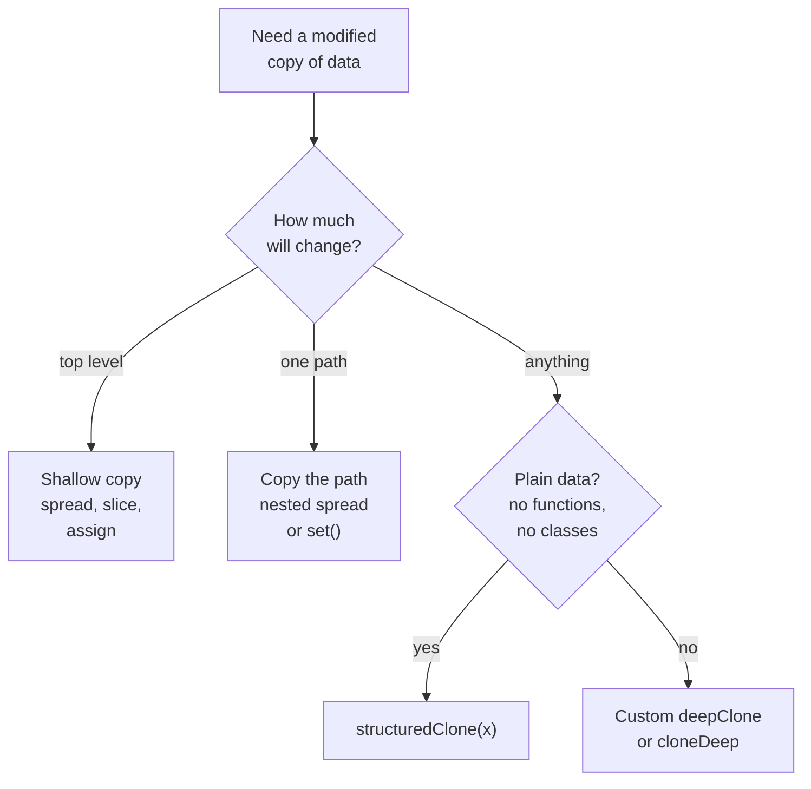
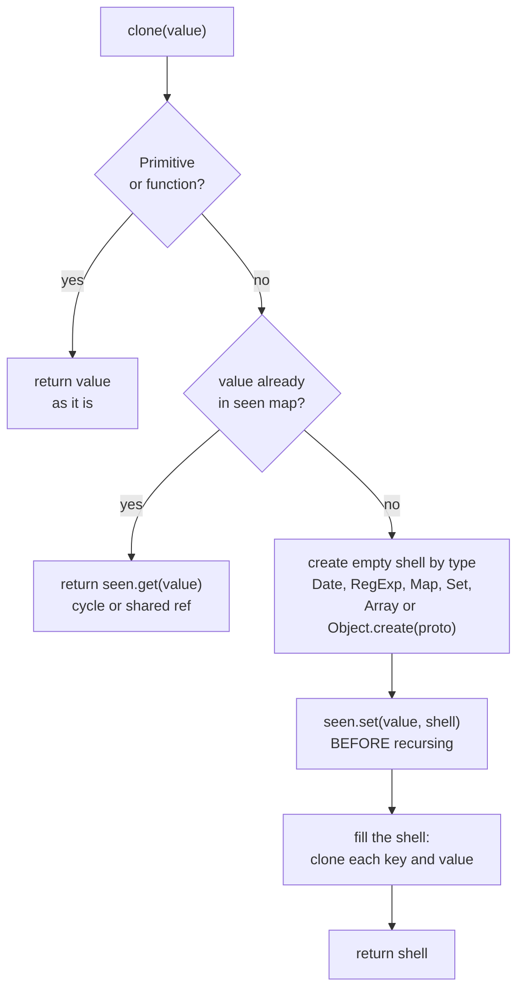

# Chapter 18: Shallow vs Deep Copy, Immutability & structuredClone

## 18.1 Definition and why interviewers ask it

**Objects are handled by reference: assigning one never copies it. A shallow copy makes a new top-level container whose nested objects are still shared with the original. A deep copy duplicates every level, so the two structures share nothing. Immutability is the opposite strategy: instead of copying defensively, you never change a value in place and build a new one for each change.**

This topic appears in almost every JavaScript-fundamentals round (commonly reported), usually as "how do you deep clone an object?" followed by "what is wrong with `JSON.parse(JSON.stringify(x))`?". It also shows up in machine-coding rounds as "implement `deepClone`" and in React/Redux discussions as "why must state be immutable?". It tests whether you understand value versus reference semantics, property attributes, and the real limits of the built-in tools, not just the slogan "spread is shallow".

## 18.2 Core concept

### Plain language

A variable that holds an object holds an *address*, not the object. Think of a shared document link. Copying the link (`b = a`) gives you a second link to the same document, so an edit through either link is visible to both. A **shallow copy** photocopies the first page only: the new page lists the same links to the same attached documents. A **deep copy** photocopies the page and every attached document. **Immutability** is a house rule: nobody edits a document in place, they publish a new version and hand out the new link, which also makes "did anything change?" a simple question to answer (is it the same link?).

### Precise version

**Value versus reference.** Primitives (`number`, `string`, `boolean`, `bigint`, `symbol`, `undefined`, `null`) are immutable values and are copied by value on assignment. Objects, arrays, functions, `Date`, `Map` and `Set` are stored on the heap, and the variable holds a reference. `=`, argument passing and `return` all copy the reference, never the object. JavaScript is always pass-by-value, but for objects the value passed is the reference.

**Copy techniques and what they miss**

| Technique | Copies | Does not do |
|---|---|---|
| `{ ...o }` | own **enumerable** keys, strings and **symbols**; getters are *invoked* and the result stored as a plain data property | prototype (result inherits from `Object.prototype`), non-enumerable keys, accessor-ness, nested objects (shared) |
| `Object.assign({}, o)` | same source keys as spread; but writes with `[[Set]]`, so setters on the *target* run | same gaps as spread |
| `Object.fromEntries(Object.entries(o))` | own enumerable **string** keys only; getters invoked | symbol keys dropped, nested shared |
| `a.slice()`, `a.concat()` | elements; **holes stay holes** | nested elements shared, extra non-index properties dropped |
| `[...a]`, `Array.from(a)` | elements through the iterator; **holes become `undefined`** | nested elements shared, extra non-index properties dropped |

**Deep copy techniques**

| Technique | Strength | Main limits |
|---|---|---|
| `JSON.parse(JSON.stringify(x))` | built in, works everywhere | only JSON data survives (see table below); throws on cycles and `BigInt` |
| `structuredClone(x)` | built in (Node.js 17+ and current browsers), keeps cycles, shared references, `Date`, `RegExp`, `Map`, `Set`, typed arrays | throws on functions, symbols as values, DOM nodes; drops the prototype, symbol keys, non-enumerable keys and accessor-ness |
| hand-written `deepClone` | you choose what to preserve (prototype, descriptors, symbols) | you must handle every special type and cycles yourself |
| library (`lodash.cloneDeep`) | many types covered, battle tested | extra dependency; still cannot clone everything meaningfully (for example, native handles) |

**What `JSON.parse(JSON.stringify(x))` does to values** (all rows verified on Node.js 22):

| Input value | Result after the round trip |
|---|---|
| `undefined`, function, symbol as an object property | the property disappears |
| the same three inside an array | become `null` |
| `NaN`, `Infinity`, `-Infinity` | `null` |
| `-0` | `0` (the sign is lost) |
| `Date` | an ISO string (via `toJSON`), not a `Date` |
| `Map`, `Set`, `RegExp`, `Error`, `ArrayBuffer` | `{}` |
| typed array | an object with index keys (`{"0":1,"1":2}`) |
| class instance | a plain object (prototype and methods lost) |
| circular reference | `TypeError: Converting circular structure to JSON` |
| `BigInt` | `TypeError: Do not know how to serialize a BigInt` |

**What `structuredClone` does.** It implements the HTML *structured clone algorithm* (the same one `postMessage` uses). It copies *data*, not behaviour.

| Input | Result |
|---|---|
| primitives including `BigInt`, `NaN`, `-0`, `undefined` values | copied faithfully |
| `Date`, `RegExp`, `Map`, `Set`, `ArrayBuffer`, typed arrays, boxed primitives | cloned as the same type |
| circular and shared references | preserved (two paths to one object stay two paths to one clone) |
| `Error` (standard types) | cloned as the same standard type with `message` and `cause`; custom own properties are dropped, and an unrecognised `name` falls back to `Error` |
| function, symbol value, `WeakMap`, `Promise`, DOM node | throws `DataCloneError` (a `DOMException`) |
| class instance | a **plain object**: prototype chain dropped, methods and `instanceof` lost, private `#fields` dropped |
| accessor property | the getter is **evaluated** and the value stored as a plain data property |
| symbol keys, non-enumerable properties, inherited properties | ignored |

**Immutability tools**

| Tool | Blocks | Depth |
|---|---|---|
| `const` | rebinding the variable | the binding only; the object is still mutable |
| `Object.preventExtensions(o)` | adding properties (and changing the prototype) | shallow |
| `Object.seal(o)` | the above, plus deleting and reconfiguring properties | shallow |
| `Object.freeze(o)` | the above, plus changing data-property values | shallow |
| `deepFreeze(o)` (hand-written) | freeze applied recursively | whole reachable graph, except internal slots |

**Failing silently versus throwing.** A write that a frozen object rejects returns `false` internally. In **sloppy mode** the assignment is silently ignored. In **strict mode** (modules, classes, `'use strict'`) it throws `TypeError`. Built-in methods such as `Array.prototype.push` always behave as strict, so `frozenArray.push(1)` throws even in sloppy code.

**Immutable update patterns.** To "change" a value you build a new one and reuse (share) every part that did not change. This is *structural sharing*. For nested state you copy only the objects along the path to the changed key (nested spread). Arrays have change-by-copy methods in ES2023 (`toSorted`, `toReversed`, `toSpliced`, `with`), available in Node.js 20+ and current browsers, so you no longer need `[...a].sort()`.

**Why React and Redux want immutability.** They detect change with reference equality (`Object.is`, `===`). If you mutate an object in place, its reference is unchanged and the check "did it change?" says no, so the UI does not update and memoised selectors return stale results. If every change produces a new reference along the changed path, the check is O(1), and unchanged subtrees keep their old references, which lets memoised children skip work.

**Performance, factually.** `Object.freeze` itself costs time proportional to the number of own properties (and `deepFreeze` to the size of the graph). It is not a speed optimisation: no specification or engine guarantees a speed-up, and public benchmarks are old and contradictory. Freeze for correctness. Many teams freeze only in development builds because of the traversal cost.

## 18.3 How it works internally

### A. What `=` does

1. A variable holds either a primitive value or a reference to a heap object.
2. `const b = a;` copies what is *in* the variable. For an object, that is the reference, so `a` and `b` point to one heap object.
3. Function arguments work the same way: the parameter receives a copy of the reference, which is why a function can mutate the caller's object but cannot rebind the caller's variable.

### B. How spread and `Object.assign` copy

1. `{ ...src }` runs the specification's `CopyDataProperties`. It reads `src.[[OwnPropertyKeys]]` (integer keys ascending, then strings, then symbols, in creation order).
2. For each key it checks the property is **enumerable**, reads the value with `[[Get]]` (so a getter *runs*), and creates a plain data property on the new object with `CreateDataProperty`. The new property is `{ writable, enumerable, configurable: true }`, whatever the source's attributes were.
3. `Object.assign(target, src)` does the same reading, but writes with `[[Set]]` on the target. So a setter on the target runs, an inherited setter runs, and a read-only target property makes it throw.
4. A key named `__proto__` that is an *own* property of the source is copied by spread as an ordinary own property. `Object.assign` calls the `__proto__` setter on the target, which changes the target's prototype. That difference matters for objects built from `JSON.parse` of untrusted input.
5. Nothing recurses. Every value, including nested objects, is copied as a reference.

### C. How `JSON.stringify` and `JSON.parse` copy

1. `JSON.stringify` visits each own enumerable string key. For each value it calls `toJSON` if present (this is how `Date` becomes a string), then serialises: `undefined`, functions and symbols are skipped in objects and written as `null` in arrays; non-finite numbers become `null`; `BigInt` throws.
2. A cycle is detected while serialising and throws `TypeError`.
3. `JSON.parse` builds brand-new plain objects and arrays from the text, so the result shares nothing with the original. The independence is real. The *fidelity* is what is lost.

### D. How `structuredClone` copies

1. `StructuredSerialize` walks the value and keeps a **memory map** from each object already seen to its serialised record. A second visit to the same object reuses the record, which is why cycles terminate and shared references stay shared.
2. Each type has a rule: primitives are copied, `Date`/`RegExp`/`Map`/`Set`/buffers and typed arrays are recreated, an ordinary object has its **own enumerable string-keyed** properties read with `[[Get]]` (so getters run), and everything else (functions, symbols, platform objects without clone support) throws `DataCloneError`.
3. `StructuredDeserialize` builds the new graph in the target realm. Because only data was recorded, the prototype chain is gone: every cloned non-built-in object becomes a plain `Object`.
4. With `{ transfer: [buffer] }`, an `ArrayBuffer` is *moved* instead of copied and the original becomes detached (length 0). That is the only way to avoid copying large binary data.

### E. How `Object.freeze` works

1. `SetIntegrityLevel(O, frozen)` first calls `O.[[PreventExtensions]]()`, so no property can ever be added and the prototype can no longer be changed.
2. It then redefines every own property (strings and symbols) as `configurable: false`, and for **data** properties also `writable: false`. Accessor properties keep their getter and setter functions, which still run.
3. `seal` does step 1 and only the `configurable: false` half of step 2. `preventExtensions` does step 1 only.
4. A later write goes through `[[Set]]` or `[[DefineOwnProperty]]`, which returns `false`. Strict-mode code turns `false` into a `TypeError`; sloppy-mode code ignores it.
5. Nested objects are separate objects with their own attributes. Nothing in steps 1 to 3 touches them, so freeze is shallow. Internal slots (the entries of a `Map`, the time value of a `Date`) are not properties at all, so freezing a `Map` does not stop `map.set`.

### F. How a structural-sharing update works

1. To change `state.user.address.city`, create a new `address`, a new `user` pointing at it, and a new `state` pointing at that. Three small copies, one per level on the path.
2. Every other property of those three copies is copied as a *reference*, so siblings such as `state.theme` are the same objects as before (Figure 18.5).
3. The old `state` is untouched and still valid (a free "undo"), and `newState.user !== oldState.user` is the O(1) change signal for every ancestor of the edit.

### G. What V8 does

V8 implements these semantics with hidden classes and property attributes. A frozen object is an ordinary object whose map records the attributes, so most reads are unaffected. Treat anything beyond that (such as "frozen objects are faster") as unproven.

## 18.4 Diagrams

### Reference, shallow copy and deep copy in memory

```ascii Variables on the left, heap objects on the right: assignment, shallow copy, deep copy
 (A) const alias = orig;        ONE object, two names

   VARIABLES                   HEAP
   orig  ----+
             +-------------->  #1 { name: 'Ada', tags: --+ }
   alias ----+                                           |
                                                         v
                                                   #2 [ 'js', 'css' ]

 (B) const shallow = { ...orig };        NEW top object, SHARED nested array

   orig    ---------------->   #1 { name: 'Ada', tags: --+ }
                                                         |
                                                         v
                                                   #2 [ 'js', 'css' ]  <== SHARED
                                                         ^
                                                         |
   shallow ---------------->   #3 { name: 'Ada', tags: --+ }

 (C) const deep = structuredClone(orig);          NOTHING shared

   orig  ---------------->  #1 { name: 'Ada', tags: ---->  #2 [ 'js', 'css' ] }
   deep  ---------------->  #4 { name: 'Ada', tags: ---->  #5 [ 'js', 'css' ] }

 shallow.name = 'Grace'     orig.name unchanged   (top-level key, own copy)
 shallow.tags.push('x')     orig.tags changes too (same array #2)
```

> **How to explain this to the interviewer**
>
> 1. Draw two columns, "variables" on the left and "heap" on the right, and show (A): two arrows into one box.
> 2. In (B) draw two top-level boxes and point both `tags` arrows at the same array. Circle the array and write SHARED.
> 3. In (C) duplicate the array as well, and say: "deep copy means no two paths reach the same box".
>
> **Takeaway:** a shallow copy duplicates one box, a deep copy duplicates every box reachable from it.

### Choosing a copy method



> **How to explain this to the interviewer**
>
> 1. Start with the question that matters most: "how much will change?". Most code only changes one key or one path.
> 2. Take the cheap branches first (shallow, or copy along the path), and say they keep unchanged parts shared on purpose.
> 3. Reserve the deep-copy branch for genuinely arbitrary edits, and split it by whether the data is plain.
>
> **Takeaway:** the cheapest copy that is correct for the edit you are making is the right one, and a full deep clone is rarely it.

### The deepClone algorithm



> **How to explain this to the interviewer**
>
> 1. Draw the three exits: primitive returns itself, a seen object returns its existing clone, anything else gets cloned.
> 2. Point at the box "seen.set BEFORE recursing" and say: "if I registered the clone after filling it, a cycle would recurse forever".
> 3. Mention that the `seen` map also keeps shared (non-circular) references shared in the output.
>
> **Takeaway:** register the empty shell first, fill it second, and cycles take care of themselves.

### What freeze, seal and preventExtensions allow

```ascii Capabilities of each integrity level (YES = allowed, NO = blocked)
 +----------------------------+--------+----------+--------+--------+
 | Operation on an object o   | normal | prevent- | seal   | freeze |
 |                            |        | Extens.  |        |        |
 +----------------------------+--------+----------+--------+--------+
 | add a new property         | YES    | NO       | NO     | NO     |
 | delete a property          | YES    | YES      | NO     | NO     |
 | change a data value        | YES    | YES      | YES    | NO     |
 | reconfigure / defineProp   | YES    | YES      | NO     | NO     |
 | change the prototype       | YES    | NO       | NO     | NO     |
 | mutate a NESTED object     | YES    | YES      | YES    | YES    |
 +----------------------------+--------+----------+--------+--------+
 | Object.isExtensible(o)     | true   | false    | false  | false  |
 | Object.isSealed(o)         | false  | false    | true   | true   |
 | Object.isFrozen(o)         | false  | false    | false  | true   |
 +----------------------------+--------+----------+--------+--------+
 Last row of the first block: all three levels are SHALLOW.
 An empty non-extensible object counts as sealed and frozen (nothing to protect).
 Undo: none. Once applied, an integrity level cannot be removed.
```

> **How to explain this to the interviewer**
>
> 1. Draw a grid with the four levels as columns and the operations as rows, and fill the first two rows to show the "ladder".
> 2. Say each column adds one restriction: no adding, then no deleting or reconfiguring, then no changing values.
> 3. Point at the NESTED row and say: "this is the trap: all three stop at the first level".
>
> **Takeaway:** the levels form a ladder of restrictions, and none of them is recursive.

### Structural sharing in an immutable update

```ascii set(state, ['user', 'address', 'city'], 'Pune'): only the path is copied
   BEFORE (old state, still valid)        AFTER (new state)

   state  { user, theme }                 next  { user', theme }
            |       |                              |        |
            |       +---- theme (same object) -----+--------+  SHARED
            v                                      v
   user   { address, name }               user'  { address', name }
            |       |                              |        |
            |       +---- name (same) -------------+--------+  SHARED
            v                                      v
   address { city:'Delhi', zip }          address' { city:'Pune', zip }
                    |                                        |
                    +---------- zip (same) ------------------+  SHARED

   Copied: state, user, address (3 small objects).  Shared: everything else.
   next !== state, next.user !== state.user, next.theme === state.theme
```

> **How to explain this to the interviewer**
>
> 1. Draw the old tree, then draw only the three nodes on the path from the root to the changed leaf as new boxes.
> 2. Draw dashed links from the new boxes back to the old untouched siblings and write SHARED on them.
> 3. Say: "a `===` check on any node tells me whether anything below it changed, in constant time".
>
> **Takeaway:** an immutable update costs the length of the path, not the size of the state.

### Whiteboard version

```ascii Whiteboard version: shallow shares the nested box, deep duplicates it (60 seconds)
   SHALLOW                               DEEP
   orig --> [ a:1  b:* ]--+              orig --> [ a:1  b:* ] --> [ x ]
                          +--> [ x ]
   copy --> [ a:1  b:* ]--+              copy --> [ a:1  b:* ] --> [ x ]

   one shared box: a mutation leaks     two boxes: nothing leaks
   freeze / seal / preventExtensions are all shallow
```

## 18.5 Code examples

### Example 1: assignment copies the reference, never the object

```js
let n = 1;
let m = n;            // primitive: the value is copied
m++;
const a = { v: 1 };
const b = a;          // object: the reference is copied
b.v++;
function rebind(o) { o = { v: 100 }; }   // changes only the local parameter
function mutate(o) { o.v = 100; }        // changes the shared object
rebind(a);
console.log(n, m, a.v, a === b);
mutate(a);
console.log(a.v, b.v);
```

```text output
1 2 2 true
100 100
```

**Why:** `m` is an independent number. `b` is a second name for the same object. `rebind` reassigns its own parameter, so the caller's `a` is untouched. `mutate` follows the reference and changes the shared object.

### Example 2: what a spread copy keeps and loses

```js
const sym = Symbol('id');
class Box { constructor() { this.own = 1; } method() {} }
const src = new Box();
src.nested = { deep: true };
src[sym] = 'symbol value';
Object.defineProperty(src, 'hidden', { value: 'h', enumerable: false });
Object.defineProperty(src, 'computed', {
  get() { return 'from getter'; }, enumerable: true,
});

const copy = { ...src };
console.log(Object.keys(copy));
console.log(copy[sym], 'hidden' in copy);
console.log(copy instanceof Box, typeof copy.method);
console.log(copy.nested === src.nested);
console.log(Object.getOwnPropertyDescriptor(copy, 'computed').get);
```

```text output
[ 'own', 'nested', 'computed' ]
symbol value false
false undefined
true
undefined
```

**Why:** spread copies own enumerable keys, including symbols (`copy[sym]` is there). It skips the non-enumerable `hidden`. The prototype is not copied, so `copy` is a plain object and `method` is gone. `nested` is the same object. The getter ran and its result became a plain data property, so the copy has no `get` function.

### Example 3: what `JSON.parse(JSON.stringify(x))` loses

```js
const original = {
  keep: 1, undef: undefined, fn() {}, sym: Symbol('s'),
  when: new Date(0), nan: NaN, negZero: -0,
  map: new Map([[1, 2]]), set: new Set([1]), re: /a/g,
  list: [undefined, () => {}],
};
console.log(JSON.parse(JSON.stringify(original)));
const cyc = {};
cyc.self = cyc;
for (const v of [cyc, { big: 1n }]) {
  try { JSON.stringify(v); } catch (e) {
    console.log(e.name + ': ' + e.message.split('\n')[0]);
  }
}
```

```text output
{
  keep: 1,
  when: '1970-01-01T00:00:00.000Z',
  nan: null,
  negZero: 0,
  map: {},
  set: {},
  re: {},
  list: [ null, null ]
}
TypeError: Converting circular structure to JSON
TypeError: Do not know how to serialize a BigInt
```

**Why:** JSON has no `undefined`, functions, symbols, `NaN`, `Map`, `Set` or `RegExp`, so each is dropped, nulled or flattened. A `Date` goes through `toJSON` and comes back as a string. Cycles and `BigInt` throw. (The cycle message continues with a multi-line path description, so the example prints only the first line.)

### Example 4: `structuredClone` capabilities and limits

```js
const sym = Symbol('k');
class Point {
  constructor(x, y) { this.x = x; this.y = y; }
  sum() { return this.x + this.y; }
}
const original = {
  when: new Date(0), re: /a+/gi, map: new Map([['k', { v: 1 }]]), set: new Set([1, 2]),
  bytes: new Uint8Array([1, 2, 3]), big: 10n, nan: NaN, nothing: undefined,
  point: new Point(1, 2), [sym]: 'ignored',
};
original.self = original;                       // circular reference
const copy = structuredClone(original);
console.log(copy.when instanceof Date, copy.re.flags, copy.map.get('k'), copy.set.has(2));
console.log(copy.bytes, copy.big, copy.nan, 'nothing' in copy);
console.log(copy.self === copy, copy.self === original);
console.log(copy.point, copy.point instanceof Point, typeof copy.point.sum);
console.log(Object.getOwnPropertySymbols(copy).length);
for (const bad of [() => {}, Symbol('x'), new WeakMap()]) {
  try { structuredClone({ bad }); } catch (e) {
    console.log(e.name, e.constructor.name, e.code);
  }
}
```

```text output
true gi { v: 1 } true
Uint8Array(3) [ 1, 2, 3 ] 10n NaN true
true false
{ x: 1, y: 2 } false undefined
0
DataCloneError DOMException 25
DataCloneError DOMException 25
DataCloneError DOMException 25
```

**Why:** built-in data types and the cycle survive. The `Point` becomes a plain object, so `instanceof` and `sum` are lost. The symbol key is ignored. Functions, symbols and `WeakMap` values throw `DataCloneError`, a `DOMException` with legacy code 25.

### Example 5: freeze, seal and preventExtensions in sloppy mode

```js
const make = () => ({ a: 1, nested: { n: 1 } });
const levels = {
  preventExtensions: Object.preventExtensions(make()),
  seal: Object.seal(make()),
  freeze: Object.freeze(make()),
};
for (const [name, o] of Object.entries(levels)) {
  o.a = 2; o.added = 1; delete o.a; o.nested.n = 2;   // sloppy mode: failures are silent
  console.log(name.padEnd(17), JSON.stringify(o), Object.isFrozen(o), Object.isSealed(o));
}
```

```text output
preventExtensions {"nested":{"n":2}} false false
seal              {"a":2,"nested":{"n":2}} false true
freeze            {"a":1,"nested":{"n":2}} true true
```

**Why:** `preventExtensions` only blocked `added`, so `a` was changed and then deleted. `seal` also blocked the delete but allowed the value change. `freeze` blocked everything on the top level. In all three, `nested.n` became 2, because the nested object was never frozen.

### Example 6: immutable updates and the change-by-copy array methods

```js
const state = {
  user: { name: 'Ada', address: { city: 'Delhi' } },
  settings: { dark: true },
  items: [3, 1, 2],
};
const next = {
  ...state,
  user: { ...state.user, address: { ...state.user.address, city: 'Pune' } },
  items: state.items.toSorted(),
};
console.log(next.user.address.city, state.user.address.city);
console.log(next.settings === state.settings, next.user === state.user);
console.log(state.items, next.items);
console.log(state.items.with(0, 9), state.items.toSpliced(1, 1), state.items.toReversed());
```

```text output
Pune Delhi
true false
[ 3, 1, 2 ] [ 1, 2, 3 ]
[ 9, 1, 2 ] [ 3, 2 ] [ 2, 1, 3 ]
```

**Why:** only the objects on the path `user` then `address` were copied. `settings` is the same object in both states. `toSorted`, `with`, `toSpliced` and `toReversed` (ES2023, present in Node.js 22) return new arrays and leave the original alone.

### Example 7: why reference equality drives UI updates

```js
let renders = 0;
const render = (() => {
  let last;
  return (props) => {
    if (props === last) return 'skipped';    // the same check React.memo and Redux use
    last = props;
    renders++;
    return 'rendered';
  };
})();

const profile = { name: 'Ada' };
console.log(render(profile));
profile.name = 'Grace';                      // mutation: same reference
console.log(render(profile), profile.name);
console.log(render({ ...profile, name: 'Hopper' }));
console.log(renders);
```

```text output
rendered
skipped Grace
rendered
2
```

**Why:** after the in-place mutation the reference is unchanged, so the cheap check wrongly reports "nothing changed" and the stale view stays. Producing a new object changes the reference and triggers the update.

## 18.6 Common mistakes and gotchas

- **"Spread and `Object.assign` deep copy."** They copy one level. Anything nested is shared (Example 2, Question 18.6).
- **Using `JSON.parse(JSON.stringify(x))` as a universal clone.** It silently drops `undefined`, functions and symbols, turns `Date` into a string and `NaN` into `null`, flattens `Map`/`Set`/`RegExp` to `{}`, loses `-0` and the prototype, and throws on cycles and `BigInt` (Example 3).
- **Expecting `structuredClone` to keep class instances.** It returns plain objects, so methods, getters on the prototype, `instanceof` and private fields are gone. It also throws `DataCloneError` for functions and symbol values.
- **Assuming `Object.freeze` is deep.** Nested objects, and the contents of a `Map`, `Set` or `Date`, stay mutable. Use a recursive `deepFreeze` or treat the data immutably by convention.
- **Assuming `const` means immutable.** `const` fixes the binding only (Chapter 2, Example 6).
- **Relying on freeze to throw.** In sloppy mode writes to a frozen object are silently ignored. Modules and classes are strict, so the same code throws there. Array methods such as `push` always throw.
- **Mutating inside "immutable" code.** `arr.sort()`, `arr.reverse()` and `arr.splice()` mutate in place. Use `toSorted`, `toReversed` and `toSpliced`, or copy first.
- **Forgetting `__proto__` and untrusted keys.** `Object.assign({}, JSON.parse(input))` can run the `__proto__` setter on the target and change its prototype. Spread creates an ordinary own property instead.
- **Cloning with a plain recursive function.** Without a `seen` map it overflows the stack on a cycle and duplicates shared references.
- **Deep cloning "just to be safe".** It costs time and memory proportional to the whole structure and breaks reference equality for every node. Prefer updating along the path that changed.
- **Treating freeze as a speed optimisation.** It is a correctness tool. No engine guarantees a speed-up.

## 18.7 Quick revision cheat sheet

- **Assignment copies the reference.** Primitives are copied by value, objects by reference.
- **Shallow copy** (`{...o}`, `Object.assign`, `slice`, `[...a]`): new top level, shared nested objects. Own enumerable keys including symbols, getters invoked, prototype not copied.
- **JSON clone** loses `undefined`, functions, symbols, `Date` type, `-0`, `Map`/`Set`/`RegExp`, prototype. It throws on cycles and `BigInt`.
- **`structuredClone`** (Node.js 17+): keeps cycles, `Date`, `RegExp`, `Map`, `Set`, typed arrays. Throws `DataCloneError` for functions and symbols. Class instances become plain objects. Getters are evaluated. Symbol keys are dropped.
- **Hand-written `deepClone`:** `WeakMap` registered *before* recursing, special-case `Date`/`RegExp`/`Map`/`Set`, `Object.create(getPrototypeOf(x))`, `Reflect.ownKeys` for symbols.
- **`freeze` > `seal` > `preventExtensions`:** each adds a restriction, all shallow. Sloppy mode fails silently, strict mode throws.
- **Immutable updates** copy only the path that changed and share the rest (structural sharing), so `===` detects change in O(1).
- **Array change-by-copy** methods (`toSorted`, `toReversed`, `toSpliced`, `with`) exist in Node.js 20+ and current browsers.

## 18.8 Interview questions

*Key: ★ = very frequently reported. "Typically asked in" lines say which round a question tends to appear in; where no single source could be pinned down the question is labelled "commonly reported". Draw-it hints refer to the figures in section 18.4.*

#### Conceptual

### Q18.1 ★ Easy: What is the difference between a shallow copy and a deep copy? What does assignment do?

*Typically asked in: JavaScript fundamentals round, often as the opener to a cloning discussion (commonly reported).*

> **Model answer**
>
> Objects live on the heap and variables hold references, so assignment copies the reference and never the object. A shallow copy, such as spread or `Object.assign`, creates a new top-level object and copies each property value across. For primitives that is a real copy. For nested objects it copies the reference, so the original and the copy share them and a nested mutation shows up in both. A deep copy recursively duplicates every reachable object, so the two structures share nothing. I use shallow copies when I change only top-level keys or update along one path, and a deep copy when I need a fully independent snapshot.

**Key points to mention**

- Assignment, argument passing and `return` copy the reference.
- Shallow: one new box, nested boxes shared. Deep: every reachable box duplicated.
- Primitive properties are safe in a shallow copy, nested objects are not.
- Draw it: Figure 18.1.

### Q18.2 ★ Medium: How do you deep clone an object? What are the pitfalls of `JSON.parse(JSON.stringify(x))`?

*Typically asked in: JavaScript fundamentals round and machine-coding warm-up (commonly reported).*

> **Model answer**
>
> The modern answer is `structuredClone`, which is built in and handles cycles, dates, maps and sets. The older answer is the JSON round trip, which is concise but lossy. It drops `undefined`, functions and symbol-valued properties, turns `NaN` and `Infinity` into `null`, converts a `Date` to a string, flattens `Map`, `Set` and `RegExp` to empty objects, loses `-0` and the prototype, and throws on circular references and on `BigInt`. If I need class instances or functions preserved, I write a recursive clone with a `WeakMap`, or I use `lodash.cloneDeep`.

**Key points to mention**

- Start with `structuredClone`, name the JSON round trip as the legacy approach.
- List at least five JSON losses and the two throwing cases (cycle, `BigInt`).
- Custom clone or a library when behaviour (prototypes, functions) must survive.
- Draw it: Figure 18.2.

### Q18.3 ★ Medium: What does `structuredClone` support, and where does it fail?

*Typically asked in: JavaScript fundamentals round, follow-up to the previous question (commonly reported).*

> **Model answer**
>
> `structuredClone` runs the structured clone algorithm, the same one `postMessage` uses. It clones primitives including `BigInt`, `Date`, `RegExp`, `Map`, `Set`, `ArrayBuffer` and typed arrays, standard `Error` objects, and it preserves cycles and shared references. It throws `DataCloneError` for functions, symbol values, DOM nodes and `WeakMap`. It copies data, not behaviour: class instances become plain objects with no prototype methods, private fields disappear, getters are evaluated into plain values, and symbol keys and non-enumerable properties are dropped. It is available from Node.js 17 and in current browsers.

**Key points to mention**

- It copies only own enumerable string-keyed data.
- Prototype chain not preserved, so `instanceof` fails on the clone.
- `DataCloneError` for functions and symbols. A function nested anywhere makes the whole call throw.
- `transfer` moves an `ArrayBuffer` instead of copying it.
- Example 4 shows each claim.

### Q18.4 ★ Easy: What is the difference between `const` and `Object.freeze`? And between `freeze`, `seal` and `preventExtensions`?

*Typically asked in: JavaScript fundamentals round (commonly reported).*

> **Model answer**
>
> `const` stops you rebinding the variable. It says nothing about the object, which you can still mutate. `Object.freeze` stops changes to the object itself, but only at the top level. The three integrity levels form a ladder. `preventExtensions` blocks adding properties. `seal` adds blocking deletion and reconfiguration, but values can still change. `freeze` also blocks value changes. None of them is recursive, so nested objects stay mutable. In strict mode a rejected write throws a `TypeError`, in sloppy mode it fails silently.

**Key points to mention**

- Binding immutability (`const`) versus object immutability (`freeze`).
- The ladder, with the `isExtensible` / `isSealed` / `isFrozen` checks.
- Shallow, irreversible, strict versus sloppy behaviour.
- Draw it: Figure 18.4.

### Q18.5 Medium: Why do React and Redux require immutable updates, and how do you update nested state immutably?

*Typically asked in: React or frontend-architecture round, and managerial/design discussions on state management (commonly reported).*

> **Model answer**
>
> React and Redux decide whether something changed by comparing references with `Object.is` or `===`, because a deep comparison on every render would be too slow. If I mutate an object in place the reference is the same, so the check says nothing changed, the view goes stale and memoised selectors return old results. So each update must produce a new reference for every object on the path from the root to the changed value, while untouched branches keep their old references. That is structural sharing. I do it with nested spread, `toSorted` and `with` for arrays, or a library like Immer that lets me write mutating code against a draft.

**Key points to mention**

- Reference equality is the O(1) change signal, used by `React.memo`, hook dependency arrays, `useSelector`.
- Copy only along the changed path, share everything else.
- Immer (drafts built on `Proxy`) and Immutable.js (persistent data structures) automate this.
- Side benefits: undo history, time travel, safe concurrent reads.
- Draw it: Figure 18.5. Example 7 shows the stale update.

#### Output prediction

### Q18.6 ★ Easy: What does this print? (mutating a shallow copy)

*Typically asked in: JavaScript fundamentals round (commonly reported).*

```js
const user = { name: 'Ada', tags: ['js'], address: { city: 'Pune' } };
const copy = { ...user };
copy.name = 'Grace';              // (1)
copy.tags.push('css');            // (2)
copy.address.city = 'Delhi';      // (3)
copy.address = { city: 'Oslo' };  // (4)
console.log(user);
console.log(copy);

const rows = [[1], [2]];
const rowsCopy = [...rows];
rowsCopy[0].push(99);             // (5)
rowsCopy.push([3]);               // (6)
console.log(rows, rowsCopy);
```

```text output
{ name: 'Ada', tags: [ 'js', 'css' ], address: { city: 'Delhi' } }
{ name: 'Grace', tags: [ 'js', 'css' ], address: { city: 'Oslo' } }
[ [ 1, 99 ], [ 2 ] ] [ [ 1, 99 ], [ 2 ], [ 3 ] ]
```

```ascii Which writes reach the original (user) and which stay in the copy
 (1) copy.name = ...          copy only   (own top-level key)
 (2) copy.tags.push(...)      BOTH        (tags array is shared)
 (3) copy.address.city = ...  BOTH        (address object is shared)
 (4) copy.address = {...}     copy only   (rebinds copy's own key; sharing ends)
 (5) rowsCopy[0].push(99)     BOTH        (inner array is shared)
 (6) rowsCopy.push([3])       copy only   (rowsCopy is a new outer array)
```

> **Model answer**
>
> The original keeps its name `Ada` but shows `css` in `tags` and `Delhi` in `address`. The copy has name `Grace` and city `Oslo`. Spread made a new top-level object, so step 1 touched only the copy. Steps 2 and 3 followed references to nested objects that both objects share, so they changed the original too. Step 4 rebinds the copy's own `address` key to a new object, which ends the sharing and leaves `Delhi` in the original. For the arrays, the inner `[1]` is shared, so 99 appears in both, but the pushed `[3]` exists only in the new outer array.

**Key points to mention**

- Top-level keys and elements are independent, nested objects are shared.
- Mutating *through* a shared reference leaks, *rebinding* the key does not.
- Array spread has the same one-level behaviour as object spread.

### Q18.7 Medium: What does this print? (freezing in sloppy and strict mode)

*Typically asked in: JavaScript fundamentals round (commonly reported).*

```js
function sloppy() {
  const o = Object.freeze({ a: 1, nested: { b: 1 } });
  o.a = 2;
  o.c = 3;
  delete o.a;
  o.nested.b = 2;
  return o;
}
function strict() {
  'use strict';
  const o = Object.freeze({ a: 1, nested: { b: 1 } });
  const attempts = [
    () => { o.a = 2; },
    () => { o.c = 3; },
    () => { delete o.a; },
    () => { o.nested.b = 2; },
  ];
  return attempts.map((fn) => {
    try { fn(); return 'ok'; } catch (e) { return e.name; }
  });
}
console.log(sloppy());
console.log(strict());
const arr = Object.freeze([1, 2]);
try { arr.push(3); } catch (e) { console.log(e.name + ': ' + e.message); }
```

```text output
{ a: 1, nested: { b: 2 } }
[ 'TypeError', 'TypeError', 'TypeError', 'ok' ]
TypeError: Cannot add property 2, object is not extensible
```

> **Model answer**
>
> The sloppy function prints the object with `a` still 1 and no `c`, because every rejected write on the frozen object fails silently, but `nested.b` is 2 because freeze is shallow. In strict mode the same three writes throw `TypeError`, and the nested write succeeds, which gives `TypeError, TypeError, TypeError, ok`. The last line shows that built-in methods ignore the caller's mode: `push` on a frozen array always throws, with the message that the object is not extensible, even though this top-level code is sloppy.

**Key points to mention**

- Failed writes return `false` internally. Strict mode converts that to `TypeError`.
- Modules and class bodies are strict, so frozen writes throw there.
- Shallow: the nested object stayed writable.
- Array methods use strict semantics internally.

### Q18.8 ★ Hard: What does this print? (`Object.assign`, spread and getters)

*Typically asked in: senior-leaning JavaScript rounds, as a follow-up on copying (commonly reported).*

```js
let calls = 0;
const src = { a: 1, get b() { calls++; return 'b' + calls; } };
const viaSpread = { ...src };
const viaAssign = Object.assign({}, src);
console.log(viaSpread.b, viaAssign.b, src.b);
console.log(calls, typeof Object.getOwnPropertyDescriptor(viaSpread, 'b').get);

const target = { set a(v) { console.log('setter got', v); } };
Object.assign(target, { a: 1 });
const merged = { ...target, ...{ a: 1 } };
console.log(Object.getOwnPropertyDescriptor(merged, 'a').value);
```

```text output
b1 b2 b3
3 undefined
setter got 1
1
```

> **Model answer**
>
> Spread and `Object.assign` both read the source with `[[Get]]`, so the getter runs once for each copy. The two copies hold the plain strings `b1` and `b2` as data properties, and reading `src.b` runs the getter a third time, giving `b3`. That is why `calls` is 3 and the copy has no `get` function. In the second part, `Object.assign` writes to the target with `[[Set]]`, so the target's setter runs and prints `setter got 1`. Spread defines properties directly and never calls setters, so `merged.a` is a plain data property with the value 1.

**Key points to mention**

- Both read with `[[Get]]` (getters run) and flatten accessors into data properties.
- `Object.assign` writes with `[[Set]]` (setters on the target run); spread uses define semantics.
- Same difference makes `Object.assign` with an own `__proto__` key change the target's prototype.
- To copy accessors faithfully use `Object.defineProperties(target, Object.getOwnPropertyDescriptors(src))`.

#### Implement it yourself

### Q18.9 ★ Hard: Implement `deepClone` that handles circular references.

*Typically asked in: machine-coding round and JavaScript round (commonly reported).*

**Problem.** Write `deepClone(value)` that returns an independent copy. It must handle primitives, arrays, plain objects, `Date`, `RegExp`, `Map`, `Set`, circular references, shared references (two paths to one object stay two paths to one clone), symbol keys, and class instances (keep the prototype). Functions may be returned as they are. Figure 18.3 is the algorithm.

**Solution.** Keep a `WeakMap` from each original object to its clone. Register the empty clone *before* filling it, so a cycle finds the clone already in the map.

```js
function deepClone(value, seen = new WeakMap()) {
  if (value === null || typeof value !== 'object') return value; // primitives, functions
  if (seen.has(value)) return seen.get(value);                   // cycle or shared ref

  if (value instanceof Date) return remember(new Date(value.getTime()));
  if (value instanceof RegExp) {
    const re = new RegExp(value.source, value.flags);
    re.lastIndex = value.lastIndex;
    return remember(re);
  }
  if (value instanceof Map) {
    const map = remember(new Map());
    for (const [k, v] of value) map.set(deepClone(k, seen), deepClone(v, seen));
    return map;
  }
  if (value instanceof Set) {
    const set = remember(new Set());
    for (const v of value) set.add(deepClone(v, seen));
    return set;
  }

  const copy = Array.isArray(value)
    ? new Array(value.length)
    : Object.create(Object.getPrototypeOf(value));   // keeps class instances working
  remember(copy);
  for (const key of Reflect.ownKeys(value)) {         // strings AND symbols
    const desc = Object.getOwnPropertyDescriptor(value, key);
    if ('value' in desc) desc.value = deepClone(desc.value, seen);
    Object.defineProperty(copy, key, desc);           // keeps enumerable/getters
  }
  return copy;

  function remember(clone) { seen.set(value, clone); return clone; }
}

class Animal {
  constructor(name) { this.name = name; }
  speak() { return this.name + ' speaks'; }
}
const tag = Symbol('tag');
const shared = { shared: true };
const original = new Animal('Rex');
original.when = new Date(0);
original.pattern = /x+/gi;
original.map = new Map([[{ k: 1 }, new Set([1, 2])]]);
original.list = [shared, shared, [1, [2]]];
original[tag] = 'sym';
Object.defineProperty(original, 'secret', { value: 42, enumerable: false });
original.self = original;                             // circular

const copy = deepClone(original);
console.log(copy !== original, copy.self === copy, copy.speak());
console.log(copy instanceof Animal, copy.when instanceof Date, copy.when !== original.when);
console.log(copy.pattern.flags, copy.map.size, [...copy.map.values()][0].has(2));
console.log(copy.list[0] === copy.list[1], copy.list[0] !== shared);
const secret = Object.getOwnPropertyDescriptor(copy, 'secret');
console.log(copy[tag], copy.secret, secret.enumerable);
```

```text output
true true Rex speaks
true true true
gi 1 true
true true
sym 42 false
```

> **Model answer**
>
> I keep a `WeakMap` from original objects to their clones. On entry, primitives and functions return as they are. If the object is already in the map, I return its clone, which handles both cycles and shared references. Otherwise I create an empty shell by type: a new `Date`, `RegExp`, `Map` or `Set`, a new array, or `Object.create` with the original's prototype. I register the shell in the map before recursing, because that is what stops infinite recursion on cycles. Then I fill it by cloning each own key from `Reflect.ownKeys`, copying property descriptors so symbols, non-enumerable keys and accessors are kept.

**Key points to mention**

- `seen.set` before recursing is the critical step; after would loop forever on a cycle.
- `WeakMap` so the bookkeeping does not keep objects alive, and because keys are objects.
- `Object.create(Object.getPrototypeOf(v))` preserves the prototype; `Reflect.ownKeys` includes symbols.
- Descriptor copying keeps non-enumerable keys, but a getter is shared, not cloned, and keeps closing over the original.
- Not handled: typed arrays, `Error`, boxed primitives, `WeakMap`, objects with internal slots (use `structuredClone` or a library). Cross-realm `instanceof` can fail.
- Time and space O(n) in the number of reachable objects. Deep recursion can overflow the stack on a very deep chain (Chapter 1, Question 1.13 shows the iterative alternative).
- Draw it: Figure 18.3.

### Q18.10 Medium: Implement `deepFreeze`.

*Typically asked in: JavaScript round, follow-up to the freeze question (commonly reported).*

**Problem.** Write `deepFreeze(obj)` that freezes an object and everything reachable from it. It must not loop forever on circular references.

**Solution.** Freeze the object, then recurse into each own property value. A `WeakSet` records visited objects, so a cycle stops.

```js
function deepFreeze(value, seen = new WeakSet()) {
  if (value === null || (typeof value !== 'object' && typeof value !== 'function')) {
    return value;                                  // primitives are already immutable
  }
  if (seen.has(value)) return value;               // cycle or shared reference
  seen.add(value);
  Object.freeze(value);
  for (const key of Reflect.ownKeys(value)) {      // strings and symbols
    const desc = Object.getOwnPropertyDescriptor(value, key);
    if ('value' in desc) deepFreeze(desc.value, seen);   // data properties only
  }
  return value;
}

const config = { name: 'app', db: { hosts: ['a', 'b'], opts: { retries: 3 } } };
config.db.owner = config;                          // cycle
deepFreeze(config);
console.log(Object.isFrozen(config), Object.isFrozen(config.db.hosts));
console.log(Object.isFrozen(config.db.opts));
(function () {
  'use strict';
  const attempts = [() => { config.db.opts.retries = 9; }, () => config.db.hosts.push('c')];
  for (const attempt of attempts) {
    try { attempt(); } catch (e) { console.log(e.name + ': ' + e.message); }
  }
})();
console.log(config.db.opts.retries, config.db.hosts.length);
const frozenMap = deepFreeze(new Map([['a', 1]]));
frozenMap.set('b', 2);                             // internal slots are not frozen
console.log(frozenMap.size);
```

```text output
true true
true
TypeError: Cannot assign to read only property 'retries' of object '#<Object>'
TypeError: Cannot add property 2, object is not extensible
3 2
2
```

> **Model answer**
>
> `Object.freeze` is shallow, so I write a recursive wrapper. It returns primitives untouched, freezes the object, then walks all own keys with `Reflect.ownKeys` and recurses into values of data properties. For cycles I keep a `WeakSet` of visited objects and skip any I have seen, so a circular graph terminates. I freeze before recursing, which is safe because reading descriptors does not need the object to be writable. It does not protect a `Map`, `Set` or `Date`, since their contents are internal slots. For those I would wrap them or use an immutable data structure.

**Key points to mention**

- Check `typeof`: `null` is `'object'`; primitives cannot and need not be frozen.
- `WeakSet` guards cycles and avoids revisiting shared nodes.
- Only data properties are recursed here; accessor functions are left as they are.
- `Map`/`Set`/`Date` internals stay mutable. Typed arrays with elements cannot be frozen (`freeze` throws).
- Cost is O(size of graph). Often applied only in development builds.

### Q18.11 Medium: Implement an immutable `setIn(obj, path, value)` with structural sharing.

*Typically asked in: React or machine-coding round (commonly reported).*

**Problem.** `setIn(state, ['user', 'address', 'city'], 'Pune')` must return a new state in which only the objects on the path are new. Everything else must be the same reference. If the new value equals the old one, return the original object.

**Solution.** Recurse down the path. On the way back up, copy each container once and put the new child into it.

```js
function setIn(obj, path, value) {
  if (path.length === 0) return value;
  const [key, ...rest] = path;
  const exists = obj !== null && typeof obj === 'object';
  const child = exists ? obj[key] : undefined;
  const nextChild = setIn(child, rest, value);
  if (exists && Object.is(child, nextChild)) return obj;   // unchanged: same reference
  const copy = Array.isArray(obj) ? obj.slice()
    : exists ? { ...obj }
    : typeof key === 'number' ? [] : {};                   // create missing containers
  copy[key] = nextChild;
  return copy;
}

const state = {
  user: { name: 'Ada', address: { city: 'Delhi', zip: '110001' } },
  settings: { dark: true },
  list: [{ id: 1 }, { id: 2 }],
};
const next = setIn(state, ['user', 'address', 'city'], 'Pune');
console.log(next.user.address, state.user.address.city);
console.log(next === state, next.user === state.user, next.settings === state.settings);
const next2 = setIn(state, ['list', 1, 'id'], 20);
console.log(next2.list, next2.list[0] === state.list[0], Array.isArray(next2.list));
console.log(setIn(state, ['user', 'name'], 'Ada') === state);
console.log(setIn({}, ['a', 0, 'b'], 1));
```

```text output
{ city: 'Pune', zip: '110001' } Delhi
false false true
[ { id: 1 }, { id: 20 } ] true true
true
{ a: [ { b: 1 } ] }
```

> **Model answer**
>
> I recurse along the path. At each level I read the current child, call `setIn` on it with the rest of the path, and get back a possibly new child. If the child is the same reference, nothing changed below, so I return the current object untouched. Otherwise I make a shallow copy of this level, either `slice` for an array or spread for an object, set the key to the new child, and return the copy. So only the containers on the path are new, and siblings are shared. A missing container is created, as an array if the next key is a number. The cost is the path length times the width of each level's shallow copy.

**Key points to mention**

- Copy one level per recursion step, never the whole tree.
- `Object.is` on the child gives the "no change returns the same reference" optimisation.
- Handles arrays (`slice`) and plain objects (spread). Class instances would lose their prototype.
- Complexity O(depth x average keys per level) time; shares the rest of the structure.
- Draw it: Figure 18.5.

### Q18.12 Medium: Implement a brief `deepEqual(a, b)`.

*Typically asked in: JavaScript round, often right after `deepClone` (commonly reported).*

**Problem.** Compare two values by structure. Handle primitives (including `NaN`), arrays, plain objects, `Date`, `Map` and `Set`. State what you do not handle.

**Solution.**

```js
function deepEqual(a, b) {
  if (Object.is(a, b)) return true;                       // same value, NaN equals NaN
  if (typeof a !== 'object' || typeof b !== 'object' || a === null || b === null) {
    return false;
  }
  if (Object.getPrototypeOf(a) !== Object.getPrototypeOf(b)) return false;
  if (a instanceof Date) return a.getTime() === b.getTime();
  if (a instanceof RegExp) return String(a) === String(b);
  if (a instanceof Map) {
    return a.size === b.size
      && [...a].every(([k, v]) => b.has(k) && deepEqual(v, b.get(k)));
  }
  if (a instanceof Set) return a.size === b.size && [...a].every((v) => b.has(v));
  const keysA = Reflect.ownKeys(a);
  const keysB = Reflect.ownKeys(b);
  if (keysA.length !== keysB.length) return false;
  return keysA.every((k) => Object.hasOwn(b, k) && deepEqual(a[k], b[k]));
}

console.log(deepEqual({ a: [1, { b: 2 }] }, { a: [1, { b: 2 }] }));
console.log(deepEqual({ a: 1 }, { a: 1, b: undefined }), deepEqual([1, 2], [1, 2, 3]));
console.log(deepEqual(NaN, NaN), deepEqual(0, -0), deepEqual([], {}), deepEqual(null, {}));
console.log(deepEqual(new Date(0), new Date(0)), deepEqual(new Set([1]), new Set([2])));
console.log(deepEqual(new Map([[1, { a: 1 }]]), new Map([[1, { a: 1 }]])));
```

```text output
true
false false
true false false false
true false
true
```

> **Model answer**
>
> First I check `Object.is`, which handles identical references and treats `NaN` as equal to itself. If either side is not an object, they are different. Then I require the same prototype, so an array never equals a plain object. `Date`, `RegExp`, `Map` and `Set` have no own keys that describe them, so each gets a special case. For plain objects and arrays I compare the number of own keys, then check that every key exists on the other side and recurse. It runs in time linear in the size of the structures. I would add a `seen` pair map to survive cycles, and I would say plainly that it does not handle typed arrays or objects used as `Set` members.

**Key points to mention**

- `Object.is` for primitives: `NaN` equals `NaN`, but `0` and `-0` differ. Say which you want.
- Check key counts and `hasOwn` in both directions, otherwise `{a:1}` equals `{a:1, b:undefined}` by accident.
- Special types must be handled before the generic key comparison.
- Cycles need a visited-pair set. Not handled: typed arrays, object keys in `Map`/`Set`, getters.

#### Follow-up traps

### Q18.13 ★ Easy: "So spread (`{ ...obj }`) makes a deep copy, right?"

*Typically asked in: follow-up after any copying question (commonly reported).*

> **Model answer**
>
> No. Spread is shallow. It creates one new object and copies each own enumerable property across, but for object-valued properties it copies the reference. So the copy and the original still share every nested object, and `copy.address.city = 'X'` changes both. The same holds for array spread, `slice`, `concat`, `Array.from` and `Object.assign`. Spread also does not copy the prototype or non-enumerable properties, and it runs getters. For independence at every level I need `structuredClone` or a recursive clone. If I only update one nested key, I spread at each level along the path.

**Key points to mention**

- Shallow means one level. Show the `tags` array being shared.
- Same for `Object.assign`, `slice`, `[...a]`.
- The fix is a deep clone, or nested spread for a targeted update.
- Example 2 and Question 18.6.

### Q18.14 ★ Medium: "Is a frozen object deeply immutable? Doesn't `const` make it immutable anyway?"

*Typically asked in: follow-up after the freeze question (commonly reported).*

> **Model answer**
>
> No to both. `const` only prevents rebinding the variable, so the object can still be mutated. `Object.freeze` blocks adding, deleting and changing properties of that one object, but it is shallow: nested objects and arrays stay mutable. Also the contents of a `Map`, `Set` or `Date` are internal slots, so freezing one does not stop `set`, `add` or `setTime`. For deep immutability I use a recursive `deepFreeze` with cycle protection, or I use immutable updates by convention and Immer, which freezes its results. Remember that freezing is irreversible and that, in sloppy mode, a rejected write is silent.

**Key points to mention**

- `const` = binding. `freeze` = the object, one level.
- `Object.isFrozen(o.nested)` is `false` unless you freeze it too.
- Internal slots of built-ins are not protected.
- `deepFreeze` plus cycle guard, or an immutable library.
- Example 5 and Question 18.10.

### Q18.15 Medium: "What does `structuredClone` do with a class instance? And with a getter?"

*Typically asked in: follow-up after the `structuredClone` question (commonly reported).*

```js
class Temp {
  #c = 20;
  constructor() { this.unit = 'C'; }
  get f() { return this.#c * 9 / 5 + 32; }
}
const t = new Temp();
const cloned = structuredClone(t);
console.log(t.f, cloned.f, cloned);
console.log(cloned instanceof Temp, Object.getPrototypeOf(cloned) === Object.prototype);
const withGetter = structuredClone({ get now() { return 'evaluated'; } });
console.log(Object.getOwnPropertyDescriptor(withGetter, 'now'));
```

```text output
68 undefined { unit: 'C' }
false true
{
  value: 'evaluated',
  writable: true,
  enumerable: true,
  configurable: true
}
```

> **Model answer**
>
> It returns a plain object. The algorithm copies only own enumerable data properties, so `unit` is copied, but the prototype chain is dropped and with it the methods, the prototype getter `f`, and `instanceof Temp`. The private field `#c` is not a property and is dropped. An own getter is not copied as a getter either: it is evaluated during serialisation and the result is stored as a plain writable data property. If I need the class back, I rebuild it, for example `Object.assign(Object.create(Temp.prototype), cloned)`, or I write a custom clone or add a `clone()` method.

**Key points to mention**

- Own enumerable data only; prototype, private fields and accessor-ness are lost.
- Functions on the object make `structuredClone` throw, rather than being skipped.
- Reattach the prototype manually, or use a custom clone for classes.
- Examples 2 and 4.

#### Sources and further reading

- ECMAScript specification: `CopyDataProperties`, `Object.assign`, `SetIntegrityLevel` and `TestIntegrityLevel`: <https://tc39.es/ecma262/>
- HTML Standard, "Safe passing of structured data" (`StructuredSerializeInternal`, `structuredClone`): <https://html.spec.whatwg.org/multipage/structured-data.html>
- MDN, `structuredClone()`: <https://developer.mozilla.org/en-US/docs/Web/API/Window/structuredClone>
- MDN, "The structured clone algorithm": <https://developer.mozilla.org/en-US/docs/Web/API/Web_Workers_API/Structured_clone_algorithm>
- MDN, `Object.freeze()`: <https://developer.mozilla.org/en-US/docs/Web/JavaScript/Reference/Global_Objects/Object/freeze>
- javascript.info, "Object references and copying": <https://javascript.info/object-copy>
- Stack Overflow, "Any performance benefit to 'locking down' JavaScript objects?" (reports on the performance of freezing): <https://stackoverflow.com/q/8435080>
- Public write-ups used to check that the questions recur (search-result level, the pages themselves could not be opened in the authoring environment): GreatFrontEnd, "Explain the difference between shallow copy and deep copy" <https://www.greatfrontend.com/questions/quiz/explain-the-difference-between-shallow-copy-and-deep-copy>; InterviewsVector, "structuredClone vs JSON.parse vs Custom Deep Clone in JavaScript" <https://www.interviewsvector.com/javascript/structuredclone-vs-deep-clone>. Question wording in this book is original.
- Immer (<https://immerjs.github.io/immer/>) and Immutable.js (<https://immutable-js.com/>) documentation for the structural-sharing libraries mentioned in Question 18.5.
