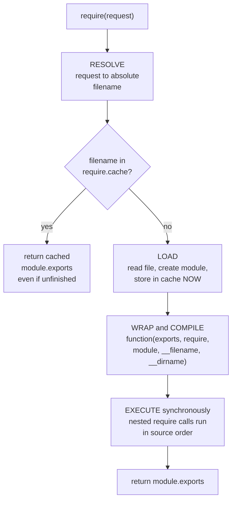
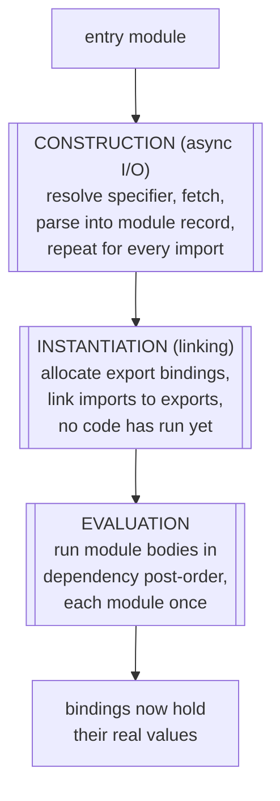
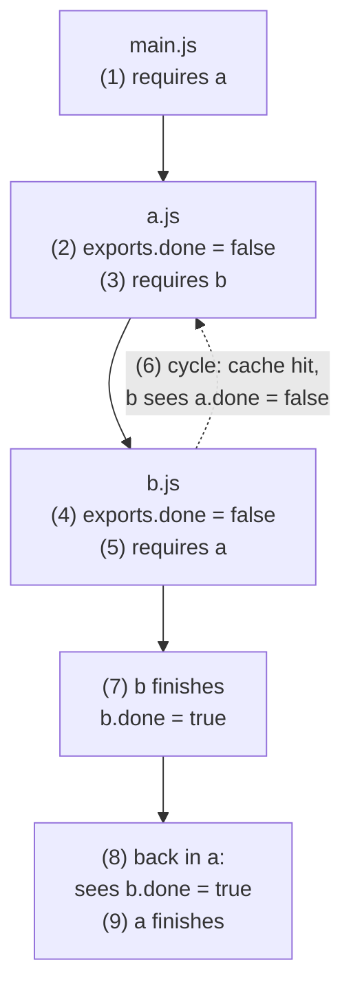

# Chapter 19: Modules: CommonJS vs ESM

## 19.1 Definition and why interviewers ask it

**A module is a file with its own private scope that shares only what it explicitly exports. CommonJS (CJS) is Node.js's original module system: `require()` is an ordinary function call that runs at runtime and returns a module's `module.exports` object. ES modules (ESM) are the language standard: `import` and `export` are declarations analysed before any code runs, and imports are live, read-only views of the exporting module's variables.**

Interviewers ask about modules because the two systems differ in ways that cause real production bugs: stale values, circular-dependency surprises, `ERR_REQUIRE_ESM`, `__dirname is not defined`, bundles that cannot be tree shaken. Typical rounds are the JavaScript fundamentals round (CJS versus ESM, `module.exports` versus `exports`), a Node.js/backend round (caching, circular dependencies, interop) and, for senior roles, a build-tooling or design round (tree shaking, package `exports`) (commonly reported). The strongest answers explain *when* each system runs code and *what* an import actually is.

## 19.2 Core concept

### Plain language

Imagine a shared notice board in an office. With **CommonJS**, `require` is a photocopier: the moment you ask, you get a photocopy of the board's current contents. If the board is updated later, your copy is stale, although any binders pinned to the board are the very same binders. With **ES modules**, `import` is a window onto the board: you always see what is on it now, but you cannot write on it through the window. CommonJS decides what to fetch while the code runs. ESM reads all the import lines first, builds the whole dependency map, and only then starts running anything.

### Precise version

**Why modules exist.** Before modules, every `<script>` shared one global scope. Name clashes and load-order bugs were common. Modules give each file its own scope, an explicit list of dependencies, and a single place for a name to come from.

**A short history**

| Era | Approach | Notes |
|---|---|---|
| Pre-2009 | Globals and namespace objects (`window.MyApp.utils`) | Collisions, manual script ordering |
| 2000s to 2010s | **IIFE module pattern**: a function that runs at once and returns a public API; the private variables live in its closure | Encapsulation without language support (Example 1) |
| 2009 | **CommonJS** in Node.js: `require`, `module.exports`, synchronous file loading | Fine on a server, where files are on local disk |
| 2010s | **AMD** (RequireJS): `define([deps], factory)`, asynchronous, for browsers. **UMD**: a wrapper that detects AMD, CommonJS or a global | Needed because browsers cannot load files synchronously |
| ES2015 | **ES modules**: `import`/`export` in the language | Static structure. The loading rules were defined by the host (browsers, Node.js) |
| Node.js 12.17 / 13.2 onward | ESM without a flag, with `.mjs` and `"type": "module"` | Both systems coexist in Node.js today |

**CommonJS vs ES modules**

| Aspect | CommonJS | ES modules |
|---|---|---|
| Syntax | `const x = require('x')`, `module.exports = ...` | `import x from 'x'`, `export const y = 1` |
| Nature of the statement | a function call: runs when reached, can sit in `if`/`try`/loops, argument can be computed | a declaration: top level only, specifier is a string literal, analysed before execution |
| Loading | **synchronous** | construction is **asynchronous** (I/O), evaluation is synchronous (unless top-level `await`) |
| What you receive | the exporter's `module.exports` object. Primitive values you destructure from it are **copies** | a **live binding** to the exporter's variable (read-only for the importer) |
| Strictness | sloppy by default | always strict |
| Top-level `this` | `module.exports` | `undefined` |
| Top-level `await` | not allowed | allowed |
| Module-scoped helpers | `require`, `module`, `exports`, `__filename`, `__dirname` (function parameters) | none of those. `import.meta.url`, plus `import.meta.filename` and `import.meta.dirname` in Node.js 20.11+ |
| Cache | `require.cache`, keyed by resolved filename, writable | module map keyed by URL, not accessible to user code |
| Circular imports | the importer gets the **partial** `exports` object | bindings are linked early. `let`, `const` and `class` are in the TDZ until their module runs; function declarations work |
| Relative path rules in Node.js | extension optional, directory `index.js`, `node_modules` lookup | full file extension required for relative paths, no `index` guessing |
| Tree shaking | practically impossible (dynamic) | designed for it (static) |
| JSON | `require('./data.json')` | `import data from './data.json' with { type: 'json' }` |

**The CommonJS wrapper.** A CJS file is not run as a script. Node.js compiles it as the body of a function with five parameters, which is why those five names look global but are local to each file, and why top-level `return` is legal in CJS:

```text
(function (exports, require, module, __filename, __dirname) {
  /* your file */
});
```

**`module.exports` versus `exports`.** Node.js creates `module.exports = {}` and passes the same object in as the parameter `exports`. Both names start as references to one object. `require` always returns `module.exports`. So `exports.a = 1` works (it mutates the shared object), but `exports = { a: 1 }` only rebinds the local parameter and `module.exports` is still `{}`.

**CommonJS exports are snapshots of values.** `module.exports = { count }` stores the number at that moment. Later changes to the exporter's local `count` do not reach the object. Objects and functions stored in it are shared by reference, so mutating `exports.obj.n` is visible everywhere.

**The require cache.** `require` resolves the request to an absolute filename and looks it up in `require.cache`. A hit returns the cached `module.exports` without running the file. A miss creates the module record, stores it in the cache **before** running the code, then runs it. So a module body executes once per process (per filename), and every importer shares one `exports` object. Deleting `require.cache[filename]` forces a re-run on the next `require`.

**Circular dependencies in CommonJS.** If `a` requires `b` and `b` requires `a` while `a` is still running, `b` gets the entry already in the cache: `a`'s `exports` as it is *so far* (a partial object). Whatever `a` assigned before calling `require('./b')` is visible, and the rest is missing. If `a` later replaces `module.exports`, `b` keeps the old object.

**ES modules: the static structure.**

| Feature | Behaviour |
|---|---|
| Named export | `export const x`, `export function f`, `export { x as y }` |
| Default export | `export default expr`. It is a binding named `default`. `export default n` exports the **value** of the expression at that moment (a snapshot), but `export { n as default }` exports a live binding |
| Import forms | `import d from`, `import { a, b as c } from`, `import * as ns from` (namespace object: null prototype, sealed, keys sorted), `import 'side-effect'` |
| Re-export | `export { a } from './a.js'`, `export * from './a.js'`, `export * as ns from './a.js'` |
| Hoisting | all imports are processed before the module body, wherever they are written. The imported module runs first |
| Strictness | always strict |
| Dynamic import | `import(specifier)` is an expression (usable anywhere, also in CJS) that returns a **promise** of the namespace object |
| Top-level await | `await` at module top level. The module and everything that imports it wait. It is not allowed in CJS |
| `import.meta` | host-provided metadata: `import.meta.url` (a `file://` URL in Node.js) |
| Singleton | a module is evaluated once per URL, and every importer sees the same module instance |

**Live bindings.** An `import { count }` creates an *alias* of the exporter's variable, not a new variable. If the exporter changes `count`, every importer sees the new value on its next read. The importer cannot assign (`count = 5` throws `TypeError: Assignment to constant variable.`), and the namespace object is read-only too.

**Node.js interop**

| Situation | Behaviour |
|---|---|
| File type | `.mjs` is always ESM, `.cjs` is always CJS. `.js` follows the nearest `package.json` `"type"` (`"module"` means ESM, otherwise CJS). In recent Node.js 22 releases a `.js` file with no `"type"` that contains ESM syntax is detected and run as ESM, with a warning, but do not rely on that |
| ESM imports CJS | allowed. The **default import is `module.exports`**. Named imports work only for names that Node.js can find by *static analysis* of the CJS source (for example `exports.a = 1`), not for names built at runtime |
| CJS loads ESM | `require(esm)` works in Node.js **22.12 and later** (also 20.19 and later) without a flag. It returns the module namespace object. It throws `ERR_REQUIRE_ASYNC_MODULE` if the ESM graph uses top-level `await`. Before that, `require` of an ES module threw `ERR_REQUIRE_ESM`, and the fix was `await import()` |
| ESM uses `require` | not defined. Use `createRequire(import.meta.url)` from `node:module` |
| `__dirname` in ESM | not defined. Use `import.meta.dirname` (Node.js 20.11+) or `fileURLToPath(new URL('.', import.meta.url))` |

**Tree shaking.** A bundler (Rollup, webpack, esbuild) builds the module graph from `import`/`export` declarations, marks which exports are actually used, and drops the rest ("dead code elimination" across modules). That is only sound because ESM is static: the set of imports and exports is known without running anything. CommonJS defeats it: `require` can be called conditionally or with a computed string, and `module.exports` can be assigned anything at any time. Barrel files with `export *`, namespace objects used dynamically (`ns[name]`), and modules with top-level side effects also limit it. The `"sideEffects": false` flag in `package.json` tells a bundler it may drop a whole module if none of its exports are used.

**Packages and the `exports` field.** A `package.json` `"exports"` map defines a package's public entry points, can pick a file by condition (`import` versus `require`), and blocks deep imports of files that are not listed. It supersedes `"main"` in modern Node.js and bundlers.

## 19.3 How it works internally

### A. How CommonJS loads a module

1. **Resolve.** `require(request)` turns the request into an absolute filename. A core module (`fs`, `node:path`) is returned directly. A relative or absolute path is tried as given, then with `.js`, `.json`, `.node`, then as a directory (`package.json` `main`, then `index.js`). A bare name such as `lodash` is searched in `node_modules` folders from the requiring file's directory upwards.
2. **Check the cache.** If `require.cache[filename]` exists, return its `module.exports` immediately, even when that module has not finished running (this is how a cycle is cut).
3. **Create and register.** Make a `Module` record `{ id, exports: {}, loaded: false, ... }` and store it in the cache **before** running any of its code.
4. **Load and compile.** Read the file. `.js` and `.cjs` are compiled as the body of the five-parameter wrapper function, `.json` is parsed with `JSON.parse`, `.node` is a native addon.
5. **Execute.** Call the wrapper synchronously with `this = module.exports`. Every `require` inside it runs the same algorithm, depth first, in the order of the calls in the source. If it throws, Node.js removes the module from the cache.
6. **Finish.** Set `loaded = true` and return `module.exports`, whatever it holds *now* (the code may have reassigned it).

### B. How ES modules load: three phases

1. **Construction.** Starting from the entry file, the host *resolves* each specifier to a URL, *fetches* the source (disk or network, asynchronous), and *parses* it into a **module record**. Parsing finds every `import` and `export` entry without running anything, which yields the list of dependencies, so the loader repeats the process for each one. Syntax errors and unresolvable imports fail here, before any code has run. The result is a graph of module records, each stored once in the **module map** under its URL.
2. **Instantiation (linking).** The engine creates a module environment for each record and allocates the *export bindings*: `function` declarations are initialised right away, `var` exports start as `undefined`, and `let`, `const` and `class` exports start **uninitialised** (the TDZ, Chapter 2). Each `import` is then linked to the exporter's binding, so the importer and exporter share one storage slot. No module code has run yet. A missing named export is a `SyntaxError` at this step.
3. **Evaluation.** The engine runs the module bodies in **dependency post-order** (depth first: all dependencies of a module run before the module itself), each module once. A module already in progress (a cycle) is skipped. Top-level `await` pauses a module, and modules that do not depend on it can continue.

Because of step 2, the engine knows what every module exports before running any module, which is what makes tree shaking, early error reporting and live bindings possible.

### C. Live bindings and the importer's view

1. An import binding is an indirection to the exporter's environment slot. Each read goes to that slot.
2. When the exporter runs `count++`, the slot changes, and all importers see the new value on their next read.
3. Assignment through an import binding throws `TypeError`, because the binding is immutable from the importer's side. A namespace object (`import * as ns`) exposes the same live bindings as read-only properties.
4. `export default <expression>` evaluates the expression once and stores the result in a hidden binding called `*default*`. Later changes to a variable used in that expression do not propagate. `export { name as default }` links to the variable itself.

### D. Circular imports in ESM

1. Instantiation links `a` and `b` to each other's bindings regardless of order, so no cycle ever fails at link time.
2. Evaluation starts from the entry and goes depth first. When it re-enters a module that is already evaluating, it does not run it again. So the module that is reached *deepest* in the cycle runs first, before the module that imported it.
3. At that moment the first module's function declarations are usable (they were initialised at instantiation), `var` exports are `undefined`, and `let`, `const` and `class` exports throw `ReferenceError: Cannot access 'x' before initialization`.
4. As soon as the other module finishes, the bindings fill in and later reads work (Figure 19.5).

### E. What `import()` does

`import(specifier)` runs the same construction, instantiation and evaluation for the requested subgraph, but starts at run time, from any scope. It returns a promise that fulfils with the namespace object. For a CommonJS target the namespace has a `default` export (`module.exports`) plus any detectable named exports. Bundlers use `import()` as a split point and emit a separate chunk.

### F. What V8 and Node.js add

The specification defines the module records and the three phases. Resolution, fetching and the module map are the host's job: browsers use URLs and the network, Node.js uses file URLs, `package.json` and its own CJS loader. V8 runs the linking and evaluation. The CJS loader is Node.js code, not part of the language.

## 19.4 Diagrams

### CommonJS loading: resolve, load, wrap, execute



> **How to explain this to the interviewer**
>
> 1. Draw the vertical chain RESOLVE, LOAD, WRAP, EXECUTE and say that everything happens inside one `require` call, synchronously.
> 2. Point at the cache diamond: "a hit returns immediately, so a module body runs once per filename".
> 3. Point at "store in cache NOW" and say: "it is registered before it runs, which is why a circular require gets a half-finished `exports` instead of looping".
>
> **Takeaway:** CommonJS loading is a function call, so what loads, and when, is decided while the code runs.

### ESM loading: construction, instantiation, evaluation



> **How to explain this to the interviewer**
>
> 1. Draw three boxes in a row and name them: construction, instantiation, evaluation. Say that no user code runs in the first two.
> 2. Under construction write "find all imports by parsing". Under instantiation write "wire bindings, let/const stay in TDZ". Under evaluation write "run bodies, dependencies first".
> 3. Say: "this is why imports are hoisted and why a missing export is an error before anything runs".
>
> **Takeaway:** ESM separates finding, wiring and running, and CommonJS does all three in one step.

### Live binding versus copied value

```ascii CommonJS copies the value at require time; ESM shares the exporter's variable
 CommonJS: the importer gets a COPY of the value

   counter.js                          main.js
   +-------------------------+         +--------------------------+
   | let count = 0;          |         | const c = require(...);  |
   | module.exports = {      | require | c.count          // 0    |
   |   count,   <- copies 0 -+-------->|                          |
   |   inc };                |         | c.inc();  // local count |
   | inc() { count++ }       |         |           // is now 1     |
   +-------------------------+         | c.count          // 0 STALE
                                       +--------------------------+
 ESM: the importer gets a read-only VIEW of the same variable

   counter.mjs                         main.mjs
   +-------------------------+         +--------------------------+
   | export let count = 0;   |<--same--| import { count, inc }    |
   | export function inc() { |  slot   |   from './counter.mjs';  |
   |   count++ }             |         | count            // 0    |
   +-------------------------+         | inc();                   |
                                       | count            // 1 LIVE
                                       | count = 5  // TypeError  |
                                       +--------------------------+
```

> **How to explain this to the interviewer**
>
> 1. Draw two files side by side. In the CommonJS pair, write `count: 0` inside `exports` and label the arrow "copy".
> 2. Show `inc()` changing only the exporter's local variable, and the importer still reading 0.
> 3. In the ESM pair, replace the copy with a single shared box labelled "count" that both files point at.
>
> **Takeaway:** CommonJS hands over values, ESM hands over access to the variable.

### Circular dependency in CommonJS



> **How to explain this to the interviewer**
>
> 1. Draw `main` calling `a`, `a` calling `b`, and a dashed arrow from `b` back to `a`. Number the steps in call order.
> 2. At the dashed arrow write "cache hit: whatever `a` had exported so far", and say that this is `{ done: false }`.
> 3. Finish by unwinding: `b` completes first and `a` then sees the finished `b`.
>
> **Takeaway:** in CommonJS a cycle gives the second module an unfinished `exports` object, and the order of the lines decides what is in it.

### Circular imports in ESM: order and visibility

```ascii ESM cycle: main -> a -> b -> a. b runs first and sees a's bindings early
 main.mjs --> a.mjs --> b.mjs --> a.mjs   (a is already in progress: not run again)

 INSTANTIATION (before any code)         EVALUATION (post-order)
 +---------------------------------+     +-----------------------------------------+
 | a.mjs:  a     = <uninitialised> |     | (1) b.mjs body runs FIRST               |
 |         hello = function (ready)|     |     hello() -> works (hoisted function) |
 | b.mjs:  b     = <uninitialised> |     |     a       -> ReferenceError (TDZ)     |
 +---------------------------------+     | (2) a.mjs body runs second              |
                                         |     b       -> 'B' (b has finished)     |
 const a = 'A'  in a.mjs is not          | (3) main.mjs body runs last             |
 initialised until step (2).             +-----------------------------------------+
```

> **How to explain this to the interviewer**
>
> 1. Draw the chain main, a, b and the arrow from b back to a. Say that the loader never runs a module twice.
> 2. On the left, list the state of each export after linking: functions ready, `const` in the TDZ.
> 3. On the right, number the evaluation order 1, 2, 3 from the deepest module outward, and note what each body can read at its turn.
>
> **Takeaway:** ESM cycles never fail at link time, they fail at read time, and only for bindings that are still in the TDZ.

### Whiteboard version

```ascii Whiteboard version: CommonJS versus ESM in four lines (90 seconds)
            CommonJS                         ESM
 syntax     require() call, runtime          import declaration, static
 you get    COPY of module.exports value     LIVE read-only binding
 phases     resolve>load>wrap>run (sync)     construct>link>evaluate
 cycles     partial exports object           TDZ error for let/const/class
```

## 19.5 Code examples

*The multi-file examples are marked `js norun`, because the sample runner executes one file at a time. Each file starts with a `// ---- name ----` line, and each was created as a real file and run with `node main.<ext>` on Node.js 22 (output verified on Node 22).*

### Example 1: the IIFE module pattern (the pre-ESM way)

```js
const counterModule = (function () {
  let count = 0;                       // private: lives in the closure
  return {
    inc() { return ++count; },
    get value() { return count; },
  };
})();
console.log(counterModule.inc(), counterModule.inc(), counterModule.value);
console.log(typeof count);
```

```text output
1 2 2
undefined
```

**Why:** the function runs at once and returns a public API. `count` is reachable only through the closure (Chapter 4), so nothing leaks to the global scope.

### Example 2: the CommonJS wrapper is a function

```js
console.log(typeof exports, typeof require, typeof module);
console.log(typeof __filename, typeof __dirname, arguments.length);
console.log(this === module.exports, exports === module.exports);
```

```text output
object function object
string string 5
true true
```

**Why:** the file body runs inside `function (exports, require, module, __filename, __dirname) { ... }`. That is why these five names exist without being declared, `arguments.length` is 5, and top-level `this` is `module.exports`.

### Example 3: CommonJS exports are copies of values, but objects are shared

```js norun
// ---- counter.js ----
let count = 0;
function inc() { count++; }
const obj = { n: 0 };
module.exports = { count, inc, obj, getCount: () => count };

// ---- main.js ----
const c = require('./counter');
c.inc();
c.obj.n++;
console.log(c.count, c.getCount(), c.obj.n);
const { count } = require('./counter');
console.log(count, require('./counter') === c);
```

```text output
0 1 1
0 true
```

**Why:** `module.exports = { count }` stored the number `0` once. `inc` changed the local variable inside `counter.js`, which the exported property never follows, but `getCount` reads the live variable through a closure. `obj` is one object shared by every importer, so `c.obj.n++` is visible everywhere. The second `require` returns the cached object, so `c` is the same object.

### Example 4: the require cache

```js norun
// ---- m.js ----
console.log('loading m');
module.exports = { n: 0 };

// ---- main.js ----
const path = require('path');
const a = require('./m');
a.n++;
const b = require('./m');
console.log(a === b, b.n);
const key = require.resolve('./m');
console.log(path.basename(key), key in require.cache, require.cache[key].loaded);
delete require.cache[key];
const c = require('./m');
console.log(c === a, c.n);
```

```text output
loading m
true 1
m.js true true
loading m
false 0
```

**Why:** the first `require` ran the file and cached it, so the second returned the same object and did not print. The cache key is the resolved absolute filename. Deleting the entry forced a fresh run, which created a new `exports` object.

### Example 5: ESM live bindings

```js norun
// ---- counter.mjs ----
export let count = 0;
export function inc() { count++; }

// ---- main.mjs ----
import { count, inc } from './counter.mjs';
import * as ns from './counter.mjs';
console.log(count, ns.count);
inc();
console.log(count, ns.count);
try { count = 5; } catch (e) { console.log(e.name + ': ' + e.message); }
try { ns.count = 5; } catch (e) { console.log(e.name + ': ' + e.message); }
console.log(Object.keys(ns), ns[Symbol.toStringTag], Object.isSealed(ns));
```

```text output
0 0
1 1
TypeError: Assignment to constant variable.
TypeError: Cannot assign to read only property 'count' of object '[object Module]'
[ 'count', 'inc' ] Module true
```

**Why:** `count` in `main.mjs` is an alias of the variable in `counter.mjs`, so `inc()` changes what both the named import and the namespace read. The importer cannot assign, and the namespace object is sealed with read-only properties.

### Example 6: `import()` returns a promise (works in CommonJS too)

```js
console.log('start');
const p = import('data:text/javascript,export const x = 1; export default "d"');
console.log(p instanceof Promise);
p.then((ns) => console.log('then', ns.x, ns.default, Object.keys(ns)));
console.log('end');
```

```text output
start
true
end
then 1 d [ 'default', 'x' ]
```

**Why:** `import()` is an expression available anywhere, including a CommonJS file. It returns a promise immediately and the module loads asynchronously, so `then` runs after the synchronous code. Namespace keys are sorted alphabetically.

### Example 7: ESM importing CommonJS

```js norun
// ---- lib.cjs ----
exports.alpha = 1;
exports.beta = function beta() { return 'beta'; };

// ---- dyn.cjs ----
function make() { return { a: 1, b: 2 }; }
module.exports = make();          // the names are invisible to static analysis

// ---- bad.mjs ----
import { a } from './dyn.cjs';

// ---- main.mjs ----
import lib, { alpha, beta } from './lib.cjs';
console.log(lib, alpha, beta());
const ns = await import('./dyn.cjs');
console.log(ns.a, ns.default.a);
try { await import('./bad.mjs'); } catch (e) {
  console.log(e.name + ': ' + e.message.split('.')[0]);
}
```

```text output
{ alpha: 1, beta: [Function: beta] } 1 beta
undefined 1
SyntaxError: Named export 'a' not found
```

**Why:** the default import is `module.exports`. Node.js found `alpha` and `beta` by scanning `lib.cjs` for `exports.x =` patterns, so those work as named imports. For `dyn.cjs` the object is built by a function call, so only `default` exists and the named import fails during linking, before any code runs.

### Example 8: `require(esm)` and its limit

```js norun
// ---- lib.mjs ----
export const x = 1;
export default function hi() { return 'hi'; }

// ---- tla.mjs ----
await Promise.resolve();
export const t = 1;

// ---- main.cjs ----
const m = require('./lib.mjs');
console.log(m.x, m.default());
try { require('./tla.mjs'); } catch (e) { console.log(e.code); }
import('./tla.mjs').then((ns) => console.log('import() works:', ns.t));
```

```text output
1 hi
ERR_REQUIRE_ASYNC_MODULE
import() works: 1
```

**Why:** on Node.js 22.12 and later, `require` can load an ES module that is fully synchronous and returns its namespace object (`default` is a property). A graph that contains top-level `await` cannot be loaded synchronously, so it throws `ERR_REQUIRE_ASYNC_MODULE`, and `import()` is the fallback. The output above was produced on Node.js 22.23.4 with no flags.

### Example 9: one module instance per URL

```js norun
// ---- x.mjs ----
export const o = { n: 0 };
console.log('evaluated x');

// ---- main.mjs ----
import { o } from './x.mjs';
const a = await import('./x.mjs');
const b = await import('./x.mjs?v=2');
o.n++;
console.log(a.o === o, b.o === o, b.o.n);
```

```text output
evaluated x
evaluated x
true false 0
```

**Why:** the static import and the dynamic import name the same URL, so they share one module instance and `x.mjs` runs once. A different query string is a different URL and gets its own instance, which runs the file again with a fresh `o`.

## 19.6 Common mistakes and gotchas

- **Reassigning `exports`.** `exports = { ... }` rebinds a local parameter. Assign to `module.exports`, or add properties to `exports` (Question 19.10).
- **Destructuring a CommonJS export and expecting updates.** `const { count } = require('./counter')` captures the value at that moment. Read it through the module object or a getter function (Example 3).
- **Assuming `import` is a function call.** It is a hoisted declaration. You cannot put it in an `if`, build the specifier from a variable, or run code before it (use `import()` for that).
- **Using `require`, `module`, `__dirname` in ESM.** They do not exist there. Use `createRequire`, `import.meta.dirname` and `import.meta.url`.
- **Forgetting file extensions in Node.js ESM.** `import './util'` fails. Write `'./util.js'`. CommonJS guesses extensions, ESM does not.
- **Mixing a default import with `module.exports` assumptions.** From ESM, `import x from './cjs.js'` always gives `module.exports`. Named imports from CJS only work for names Node.js can detect statically.
- **Expecting circular imports to behave the same in both systems.** CommonJS hands out a partial object. ESM hands out bindings that may still be in the TDZ (Questions 19.7 and 19.8).
- **`export default value` taken for a live binding.** It exports a snapshot. Use `export { value as default }` for a live one (Question 19.9).
- **Relying on side effects in tree-shaken libraries.** A bundler may drop an import whose exports are unused unless `package.json` says the module has side effects.
- **Using `require.cache` tricks in ESM.** There is no user-accessible module map. A query string (`?v=2`) is the usual way to load a fresh instance (Example 9).
- **Top-level `await` blocking dependants.** A module with a slow top-level `await` delays every module that imports it, and it makes `require(esm)` impossible for that graph.
- **Treating `"type": "module"` as local to one file.** It applies to every `.js` file under that `package.json`. Use `.cjs` for the CommonJS exceptions.

## 19.7 Quick revision cheat sheet

- **CJS:** `require()` is a synchronous runtime call. The file runs inside `function (exports, require, module, __filename, __dirname)`. You receive `module.exports`.
- **`exports` vs `module.exports`:** both start as one object. `require` returns `module.exports`, so `exports = x` breaks the link.
- **CJS caching:** `require.cache`, keyed by resolved filename, entry created *before* the code runs. A cycle returns the partial `exports`. Values are copied, objects are shared.
- **ESM:** static, hoisted, always strict, `this` is `undefined`, top-level `await`, `import.meta.url`. Imports are live read-only bindings.
- **ESM phases:** construction (resolve, fetch, parse), instantiation (allocate and link bindings), evaluation (post-order). CJS: resolve, load, wrap, execute.
- **ESM cycles:** function declarations work, `let`/`const`/`class` throw `ReferenceError` (TDZ) until their module has run.
- **Interop:** ESM imports CJS (default is `module.exports`, named exports by static detection). `require(esm)` works in Node.js 22.12+ unless the graph has top-level `await` (`ERR_REQUIRE_ASYNC_MODULE`). `import()` always works.
- **Tree shaking** needs static ESM. `"sideEffects": false` and avoiding `export *` barrels help. CJS defeats it.

## 19.8 Interview questions

*Key: ★ = very frequently reported. "Typically asked in" lines say which round a question tends to appear in; where no single source could be pinned down the question is labelled "commonly reported". Draw-it hints refer to the figures in section 19.4. Multi-file examples are `js norun` blocks whose printed output was verified by running the files on Node.js 22.*

#### Conceptual

### Q19.1 ★ Medium: What are the differences between CommonJS and ES modules?

*Typically asked in: JavaScript fundamentals round and Node.js/backend round (commonly reported).*

> **Model answer**
>
> CommonJS is Node's original system. `require` is a function call that runs synchronously at runtime, can sit inside an `if`, and returns the exporter's `module.exports` object, so primitive values are copies. ES modules are a language feature. `import` and `export` are static declarations that are analysed before anything runs, which enables early errors and tree shaking. Loading is asynchronous, evaluation follows dependency order, imports are live read-only bindings, and the code is always strict with `this` undefined at the top level. ESM also has top-level `await`, and in Node it needs file extensions and has no `__dirname`.

**Key points to mention**

- Runtime call versus static declaration; sync versus async loading.
- Copy of `module.exports` versus live binding.
- Strict mode, top-level `this`, top-level `await`, `__dirname`.
- Cycles: partial exports versus TDZ.
- Tree shaking only works on static structure.
- Draw it: the Whiteboard version in section 19.4.

### Q19.2 ★ Medium: What are live bindings in ES modules? How do they differ from CommonJS?

*Typically asked in: JavaScript fundamentals round, as a follow-up to the previous question (commonly reported).*

> **Model answer**
>
> A live binding means an imported name is not a new variable but an alias for the exporter's variable. If the exporting module changes `count`, every importer reads the new value the next time it looks. The importer can only read: assigning to an import throws a `TypeError`, and the namespace object is read-only. CommonJS is different. `module.exports = { count }` copies the number at that moment, so later changes are invisible, although objects stored in the exports are shared by reference. Under the hood, linking in the instantiation phase points the importer at the exporter's storage slot.

**Key points to mention**

- Alias to the exporter's slot, created at instantiation, read-only for the importer.
- CJS: value snapshot for primitives, shared reference for objects.
- Pitfall: `export default value` is a snapshot, `export { value as default }` is live (Question 19.9).
- Example 5. Draw it: Figure 19.3.

### Q19.3 ★ Easy: What is the difference between `module.exports` and `exports`?

*Typically asked in: JavaScript fundamentals round and Node.js round (commonly reported).*

> **Model answer**
>
> Node creates an empty object, assigns it to `module.exports`, and also passes it into the wrapper function as the parameter `exports`. So at the start both names point to the same object, and `require` returns whatever `module.exports` points to at the end. Adding properties with `exports.a = 1` mutates the shared object, so it works. But `exports = { a: 1 }` rebinds only the local parameter, and `module.exports` is still the empty object. When I want to export a function or a class as the whole module, I assign to `module.exports`. Mixing both is a bug.

**Key points to mention**

- Both start as references to one object. `require` returns `module.exports`.
- Reassigning `exports` breaks the link. Reassigning `module.exports` replaces the export.
- After `module.exports = ...`, later `exports.x = ...` is lost.
- Question 19.10 has the output prediction.

### Q19.4 ★ Medium: `require` versus `import`: when is each evaluated, synchronous or asynchronous, static or dynamic?

*Typically asked in: JavaScript fundamentals round (commonly reported).*

> **Model answer**
>
> `require` is a regular function call. It is evaluated when execution reaches it, it blocks while it reads and runs the file, and its argument can be computed, so it is dynamic and unanalysable ahead of time. A static `import` is a declaration. The engine finds it while parsing, fetches and links the whole graph before executing any module, and runs the imported modules first, whatever line the import is on. So imports are hoisted and static, with an asynchronous loading phase. For on-demand loading ESM has `import()`, an expression that returns a promise, works in conditions and loops, and also works inside CommonJS files.

**Key points to mention**

- `require`: runtime, synchronous, anywhere, computed specifier, order of calls.
- `import`: static, hoisted, top-level only, string literal, async construction, sync evaluation.
- `import()`: runtime and async, returns a promise of the namespace.
- Imports being hoisted is the same idea as Chapter 2 (Question 19.14).
- Draw it: Figures 19.1 and 19.2.

### Q19.5 Medium: What is tree shaking, and why does it require ES modules?

*Typically asked in: frontend build/performance round and design round (commonly reported).*

> **Model answer**
>
> Tree shaking is dead-code elimination across modules: the bundler works out which exports are actually imported and leaves the rest out of the bundle. It needs ES modules because their imports and exports are static declarations with string-literal specifiers, so the bundler can read the full graph without running code. CommonJS cannot do this: `require` can be conditional or computed and `module.exports` can be assigned anything at runtime. Practical limits are modules with top-level side effects, `export *` barrel files, and dynamic namespace access. The `sideEffects: false` flag in `package.json` lets a bundler drop whole unused modules.

**Key points to mention**

- Static analysis of import/export names, mark used exports, drop the rest.
- Why CJS is opaque: runtime calls and assignable `module.exports`.
- Side effects must be declared, and `export *` or `ns[name]` reduce precision.
- Production mode plus a minifier does the final removal in most bundlers.

### Q19.6 Medium: How does Node.js load and cache a CommonJS module?

*Typically asked in: Node.js/backend round (commonly reported).*

> **Model answer**
>
> `require` resolves the request to an absolute filename, such as adding `.js`, checking the directory `index.js`, or searching `node_modules`. It looks that filename up in `require.cache`. On a hit it returns the cached `module.exports` straight away. On a miss it creates a module record, stores it in the cache before running any code, compiles the file as the body of a function with `exports`, `require`, `module`, `__filename` and `__dirname`, and runs it synchronously. So a module body runs once per process, every importer shares one exports object, and storing the record early is what stops a circular `require` from looping.

**Key points to mention**

- Cache key is the resolved filename. Different paths to one file share one entry.
- Registered before execution, so a cycle returns partial exports.
- `delete require.cache[key]` forces a reload (Example 4).
- The wrapper function explains the five injected names (Example 2).
- Draw it: Figure 19.1.

#### Output prediction

### Q19.7 ★ Hard: What does this CommonJS program print? (circular dependency)

*Typically asked in: Node.js/backend round (commonly reported).*

```js norun
// ---- a.js ----
console.log('a: start');
exports.done = false;
const b = require('./b');
console.log('a: b.done =', b.done);
exports.done = true;
console.log('a: end');

// ---- b.js ----
console.log('b: start');
exports.done = false;
const a = require('./a');
console.log('b: a.done =', a.done);
exports.done = true;
console.log('b: end');

// ---- main.js ----
console.log('main: start');
const a = require('./a');
const b = require('./b');
console.log('main: a.done =', a.done, ', b.done =', b.done);
```

```text output
main: start
a: start
b: start
b: a.done = false
b: end
a: b.done = true
a: end
main: a.done = true , b.done = true
```

> **Model answer**
>
> `main` requires `a`. `a` registers itself in the cache, sets `done = false`, and requires `b`. `b` sets its own `done = false` and requires `a`. `a` is in the cache but unfinished, so `b` gets `a`'s partial exports, `{ done: false }`, and prints `false`. `b` finishes and returns to `a`, which sees `b.done = true` and finishes. Back in `main`, the second `require('./b')` is a cache hit and does not print again. The key idea is that a circular `require` returns whatever the other module had exported at that moment.

**Key points to mention**

- Cache entry exists before the module code runs.
- `b` sees a snapshot of `a`'s exports object at the time of the call, not the final state (the object is shared, so reading `a.done` *later* inside `b` would give `true`).
- If `a` had done `module.exports = ...` before requiring `b`, `b` would still hold the old object.
- Each module body runs once.
- Draw it: Figure 19.4.

### Q19.8 ★ Hard: What does this ES module program print? (circular imports and the TDZ)

*Typically asked in: senior JavaScript or Node.js round (commonly reported).*

```js norun
// ---- a.mjs ----
import { b } from './b.mjs';
console.log('a: body runs, b =', b);
export const a = 'A';
export function hello() { return 'hello from a'; }

// ---- b.mjs ----
import { a, hello } from './a.mjs';
console.log('b: body runs, hello() =', hello());
try { console.log(a); } catch (e) { console.log('b: ' + e.name + ': ' + e.message); }
export const b = 'B';

// ---- main.mjs ----
console.log('main: start');
import { a } from './a.mjs';
console.log('main: a =', a);
```

```text output
b: body runs, hello() = hello from a
b: ReferenceError: Cannot access 'a' before initialization
a: body runs, b = B
main: start
main: a = A
```

> **Model answer**
>
> Imports are hoisted, so `main` waits for `a`, and `a` for `b`. `b` imports `a`, which is already in progress, so it is not run again, and `b` evaluates first. At that moment `hello` works because function declarations are initialised when the module is instantiated. But `a` is a `const` that has not been evaluated, so reading it throws a `ReferenceError` from the TDZ. Then `a` runs and sees `b = 'B'`, and `main` finally runs its own body, so `main: start` appears after the other output. Nothing failed at link time.

**Key points to mention**

- Evaluation is depth first, post-order. The deepest module in the cycle runs first.
- Function declarations are usable early. `let`, `const` and `class` exports are in the TDZ. A `var` export would be `undefined`.
- `main: start` is not first, because the imports run before the module body.
- The fix is to break the cycle, move shared code into a third module, or read the binding lazily inside a function.
- Draw it: Figure 19.5.

### Q19.9 Hard: What does this print? (live binding or snapshot?)

*Typically asked in: senior JavaScript round (commonly reported).*

```js norun
// ---- d.mjs ----
export let n = 1;
export default n;                      // exports the VALUE of n right now
export function bump() { n++; }
let m = 10;
export { m as live };                  // exports the BINDING of m
export function bumpM() { m++; }

// ---- main.mjs ----
import def, { n, bump, live, bumpM } from './d.mjs';
bump();
bumpM();
console.log(def, n, live);
```

```text output
1 2 11
```

> **Model answer**
>
> It prints `1 2 11`. `n` and `live` are live bindings, so after `bump()` and `bumpM()` the importer reads the updated values 2 and 11. The default export is different. `export default n` evaluates the expression `n` once, stores the value 1 in a hidden binding, and that never changes, so `def` stays 1. If I want the default to be live I write `export { n as default }`. This is a classic trap, because `export default` looks like it exports the variable but exports the value of an expression.

**Key points to mention**

- Named exports of a variable are live. `export default <expression>` is a snapshot.
- `export { x as default }` links to the variable.
- Imports are read-only: assigning to `n` in `main` would throw.

### Q19.10 Medium: What does this print? (reassigning `exports`)

*Typically asked in: JavaScript fundamentals round (commonly reported).*

```js norun
// ---- x.js ----
exports = { a: 1 };

// ---- y.js ----
exports.b = 2;

// ---- z.js ----
module.exports = { c: 3 };

// ---- w.js ----
module.exports = { c: 3 };
exports.d = 4;

// ---- main.js ----
console.log(require('./x'), require('./y'), require('./z'), require('./w'));
```

```text output
{} { b: 2 } { c: 3 } { c: 3 }
```

> **Model answer**
>
> `{}`, `{ b: 2 }`, `{ c: 3 }`, `{ c: 3 }`. In `x.js`, `exports = {...}` only rebinds the function parameter, so `module.exports` is still the original empty object and that is what `require` returns. In `y.js`, adding a property mutates the shared object, so it appears. In `z.js`, assigning to `module.exports` replaces the export. In `w.js`, after `module.exports` is replaced, `exports` still points at the old object, so `exports.d = 4` is added to an object nobody returns, and `d` is lost.

**Key points to mention**

- `require` returns `module.exports`, never the local `exports`.
- `exports.x = ...` works until `module.exports` is reassigned.
- Safe habit: use `module.exports = ...` for the whole export, or only `exports.name = ...`.
- Example 2 shows the wrapper parameters.

#### Implement it yourself

### Q19.11 ★ Hard: Implement a mini CommonJS loader (`makeRequire`).

*Typically asked in: senior JavaScript or Node.js round, sometimes as a whiteboard design question (commonly reported).*

**Problem.** Given an in-memory "file system" `{ filename: sourceText }`, build `createLoader(files)` that returns a `require` function. It must resolve relative paths (with `.js` and `/index.js` fallbacks), wrap each source in a function with `exports`, `require`, `module`, `__filename` and `__dirname`, cache modules by resolved filename *before* running them, run each module once, and handle circular dependencies by returning the partial `exports`. A module that throws must not stay in the cache.

**Solution.** The wrapper is built with `new Function`. Each module gets its own `require`, bound to the directory of that module, so relative paths resolve correctly.

```js
const path = require('path').posix;

function createLoader(files) {
  const cache = Object.create(null);           // resolved filename -> module record

  function resolve(request, fromDir) {
    if (!request.startsWith('.')) throw new Error(`Cannot find module '${request}'`);
    const base = path.resolve(fromDir, request);
    for (const candidate of [base, base + '.js', base + '/index.js']) {
      if (candidate in files) return candidate;
    }
    throw new Error(`Cannot find module '${request}'`);
  }

  function makeRequire(fromDir) {
    return function require(request) {
      const filename = resolve(request, fromDir);
      if (cache[filename]) return cache[filename].exports;   // hit: even if unfinished
      const module = { id: filename, exports: {}, loaded: false };
      cache[filename] = module;                // cache BEFORE running: breaks cycles
      const dir = path.dirname(filename);
      const wrapper = new Function('exports', 'require', 'module', '__filename',
        '__dirname', files[filename]);
      try {
        wrapper.call(module.exports, module.exports, makeRequire(dir), module,
          filename, dir);
        module.loaded = true;
      } catch (err) {
        delete cache[filename];                // a failed load is not cached
        throw err;
      }
      return module.exports;
    };
  }

  return { require: makeRequire('/'), cache };
}

const files = {
  '/app/main.js': `
    console.log('main: start');
    const a = require('./a');
    const b = require('./b');
    console.log('main:', a.done, b.done, require('./util') === require('./util.js'));
  `,
  '/app/a.js': `
    console.log('a: start');
    exports.done = false;
    const b = require('./b');
    console.log('a: b.done =', b.done);
    exports.done = true;
  `,
  '/app/b.js': `
    console.log('b: start');
    exports.done = false;
    const a = require('./a');
    console.log('b: a.done =', a.done);
    exports.done = true;
  `,
  '/app/util.js': `
    console.log('util: evaluated');
    module.exports = { name: __filename, dir: __dirname, selfIsThis: this === exports };
  `,
  '/app/broken.js': `throw new Error('boom');`,
};

const loader = createLoader(files);
loader.require('./app/main');
console.log(Object.keys(loader.cache));
console.log(loader.cache['/app/util.js'].exports);
for (const request of ['./nope', './app/broken']) {
  try { loader.require(request); } catch (e) { console.log(e.message); }
}
console.log('/app/broken.js' in loader.cache);
```

```text output
main: start
a: start
b: start
b: a.done = false
a: b.done = true
util: evaluated
main: true true true
[ '/app/main.js', '/app/a.js', '/app/b.js', '/app/util.js' ]
{ name: '/app/util.js', dir: '/app', selfIsThis: true }
Cannot find module './nope'
boom
false
```

> **Model answer**
>
> I keep a cache object keyed by the resolved filename. `require` resolves the request against the calling module's directory, trying the exact name, then `.js`, then `/index.js`. If the filename is cached, I return its `exports`, even if it is unfinished, which is what makes circular requires terminate. Otherwise I create the module record and put it in the cache before running any code. I build a function with the five wrapper parameters from the source text, call it with `this` set to `module.exports`, and give it a `require` bound to its own directory. On an exception I delete the cache entry. Finally I return `module.exports`, so a module that reassigned it is honoured.

**Key points to mention**

- Cache before execute is the crucial ordering. Cache after execute would recurse forever on cycles.
- Return `module.exports`, not the original `exports`, so reassignment works.
- Per-module `require` so relative paths resolve from the right directory.
- Failure handling: drop the entry on throw. The real Node.js loader does this too.
- Simplifications: no `node_modules` lookup, no JSON, no package `main`, no core modules. Time is O(modules) per graph, each source compiled once. Real Node.js compiles the wrapper with `vm` rather than `new Function`, and `new Function` is used here only so the demo is self-contained.
- Draw it: Figure 19.1.

### Q19.12 Medium: Implement a lazy, cached `import()`-like loader.

*Typically asked in: machine-coding round or frontend performance discussion (commonly reported).*

**Problem.** Write `makeImporter(registry)` that returns `importLike(specifier)`. It returns a promise of a frozen, prototype-less "namespace" object. Concurrent calls for the same specifier must share one load, a failed load must not be cached (so a retry can succeed), and an unknown specifier must reject.

**Solution.** Cache the *promise*, not the result, so concurrent callers share it. Evict the entry if the promise rejects.

```js
function makeImporter(registry) {
  const cache = new Map();                      // specifier -> promise of namespace
  return function importLike(specifier) {
    if (cache.has(specifier)) return cache.get(specifier);
    const promise = Promise.resolve()
      .then(() => {
        const factory = registry[specifier];
        if (!factory) throw new Error(`Cannot find module '${specifier}'`);
        return factory();                       // may be async: fetch + parse
      })
      .then((exports) => Object.freeze({ __proto__: null, ...exports }));
    cache.set(specifier, promise);
    promise.catch(() => cache.delete(specifier));    // failed loads can be retried
    return promise;
  };
}

let loads = 0;
let attempts = 0;
const importLike = makeImporter({
  './math': async () => { loads++; return { add: (a, b) => a + b }; },
  './flaky': async () => {
    attempts++;
    if (attempts === 1) throw new Error('network');
    return { ok: true };
  },
});

async function main() {
  const [m1, m2] = await Promise.all([importLike('./math'), importLike('./math')]);
  console.log(m1 === m2, loads, m1.add(2, 3));
  console.log(Object.isFrozen(m1), Object.getPrototypeOf(m1));
  for (const label of ['first', 'second']) {
    try {
      console.log(label, (await importLike('./flaky')).ok);
    } catch (e) {
      console.log(label, e.message);
    }
  }
  try { await importLike('./missing'); } catch (e) { console.log(e.message); }
  console.log(attempts);
}
main();
```

```text output
true 1 5
true null
first network
second true
Cannot find module './missing'
2
```

> **Model answer**
>
> The important choice is to cache the promise rather than the resolved value. Two callers that ask for the same specifier at the same time then get the same promise, so the factory runs once. The load starts inside a `then`, so a missing specifier or a throwing factory becomes a rejection, not a synchronous throw. On success I wrap the exports in a frozen, null-prototype object to mimic a module namespace. On failure I remove the entry, so the next call retries. A button handler can then say `const { draw } = await importLike('./chart')` and pay the cost only on first use.

**Key points to mention**

- Cache the promise to deduplicate concurrent loads.
- Evict on rejection, otherwise one network blip fails forever.
- A frozen null-prototype object approximates a namespace. It is not live, because a real namespace is made of live bindings.
- Always return a promise, never throw synchronously.
- Real `import()` also keeps the module map, so evaluation happens once per URL (Example 9).

#### Follow-up traps

### Q19.13 ★ Medium: "Can you use `require` in an ES module? And can CommonJS load an ES module?"

*Typically asked in: Node.js/backend round (commonly reported).*

```js norun
// ---- lib.cjs ----
exports.alpha = 1;

// ---- main.mjs ----
import { createRequire } from 'node:module';
console.log(typeof require, typeof module, typeof exports);
try { require('./lib.cjs'); } catch (e) { console.log(e.name + ': ' + e.message); }
const req = createRequire(import.meta.url);
console.log(req('./lib.cjs').alpha);
```

```text output
undefined undefined undefined
ReferenceError: require is not defined
1
```

> **Model answer**
>
> Not directly. `require`, `module` and `exports` are parameters of the CommonJS wrapper, and an ES module is not wrapped, so using `require` throws a `ReferenceError`. I can import CommonJS with `import`, or create a `require` with `createRequire(import.meta.url)`. In the other direction, `require(esm)` works from Node 22.12 and 20.19 without a flag, but only for a graph with no top-level `await`. Otherwise it throws `ERR_REQUIRE_ASYNC_MODULE`, and in older versions `ERR_REQUIRE_ESM`. The universal answer is `import()`, which works from CommonJS and returns a promise.

**Key points to mention**

- No `require` in ESM, so `createRequire` or `import`.
- `require(esm)` is the recent change: state the version and the top-level `await` limit.
- `import()` always works from CJS, at the price of being asynchronous.
- Example 8.

### Q19.14 Easy: "Does `import` hoist?"

*Typically asked in: follow-up to the require/import question (commonly reported).*

```js norun
// ---- dep.mjs ----
console.log('dep runs');

// ---- main.mjs ----
console.log('first line of main');
import './dep.mjs';
```

```text output
dep runs
first line of main
```

```js norun
// ---- dep.js ----
console.log('dep runs');

// ---- main.js ----
console.log('first line of main');
require('./dep.js');
```

```text output
first line of main
dep runs
```

> **Model answer**
>
> Yes. An `import` declaration is processed before the module's own code, wherever it appears. The loader finds all imports at parse time and evaluates the imported modules first, so `dep.mjs` prints before the first line of `main.mjs`. A `require` is an ordinary call and runs in sequence, so there the first line prints first. This is the same instantiate-before-run idea as hoisting in Chapter 2, but for whole modules. If I need the import to happen at a particular moment, I use `import()` or `require`.

**Key points to mention**

- Imports are bindings created during instantiation, and the dependency body runs before the importer body.
- The hoisting applies to all static imports in the file, in source order among themselves.
- `require` and `import()` run when reached.
- Link to Chapter 2 for the declaration-hoisting idea.

### Q19.15 Easy: "What is `__dirname` in an ES module?"

*Typically asked in: Node.js/backend round (commonly reported).*

```js norun
// ---- main.mjs ----
import path from 'node:path';
import { fileURLToPath } from 'node:url';
console.log(typeof __dirname, typeof __filename);
const file = fileURLToPath(import.meta.url);
console.log(path.basename(file), file === import.meta.filename);
console.log(import.meta.dirname === path.dirname(file));
const dirUrl = new URL('.', import.meta.url);
console.log(fileURLToPath(dirUrl) === import.meta.dirname + path.sep);
```

```text output
undefined undefined
main.mjs true
true
true
```

> **Model answer**
>
> It does not exist. `__dirname` and `__filename` are parameters of the CommonJS wrapper, and ES modules are not wrapped. In an ES module the location comes from `import.meta.url`, which is a `file://` URL. In Node.js 20.11 and later I can read `import.meta.dirname` and `import.meta.filename` directly. On older versions I convert the URL with `fileURLToPath(import.meta.url)` and take `path.dirname` of the result. These properties exist for `file:` modules in Node, and in browsers only `import.meta.url` is available.

**Key points to mention**

- Wrapper parameters versus `import.meta`.
- Modern: `import.meta.dirname` and `import.meta.filename` (Node.js 20.11+).
- Portable: `fileURLToPath(new URL('.', import.meta.url))`.
- Do not build paths by stripping `file://` manually, because Windows paths and encoded characters break.

#### Sources and further reading

- ECMAScript specification, "Modules" (Module Records, `Link()`, `Evaluate()`, `export default` semantics): <https://tc39.es/ecma262/>
- Node.js documentation: "Modules: CommonJS modules" <https://nodejs.org/api/modules.html>, "Modules: ECMAScript modules" <https://nodejs.org/api/esm.html>, "Modules: Packages" (`exports`, `type`) <https://nodejs.org/api/packages.html>
- Node.js 22.12.0 release notes, which enable `require(esm)` by default (seen in search results): <https://nodejs.org/zh-cn/blog/release/v22.12.0>
- MDN, "JavaScript modules": <https://developer.mozilla.org/en-US/docs/Web/JavaScript/Guide/Modules>
- Lin Clark, "ES modules: A cartoon deep-dive" (Mozilla Hacks), the source of the construction, instantiation and evaluation phase names: <https://hacks.mozilla.org/2018/03/es-modules-a-cartoon-deep-dive/>
- javascript.info, "Modules, introduction": <https://javascript.info/modules-intro>
- Public write-ups used to check that the questions recur (search-result level, pages could not be opened in the authoring environment): PracHub, "JavaScript Module Interview Questions: Live Bindings, Cycles, and ESM Interop" <https://prachub.com/resources/javascript-module-interview-questions-live-bindings-cycles-and-esm-interop>; Medium, "How ES Modules and CommonJS Handle Dependencies Differently, And Why It Matters" <https://itamar-toledano.medium.com/how-es-modules-and-commonjs-handle-dependencies-differently-and-why-it-matters-244ef29630ce>. Question wording in this book is original.
