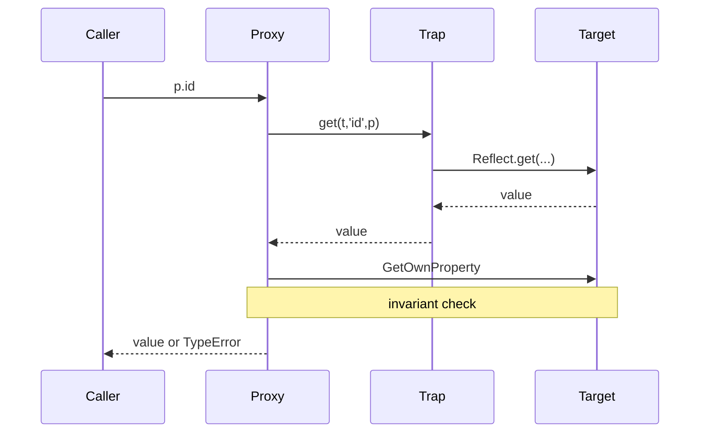
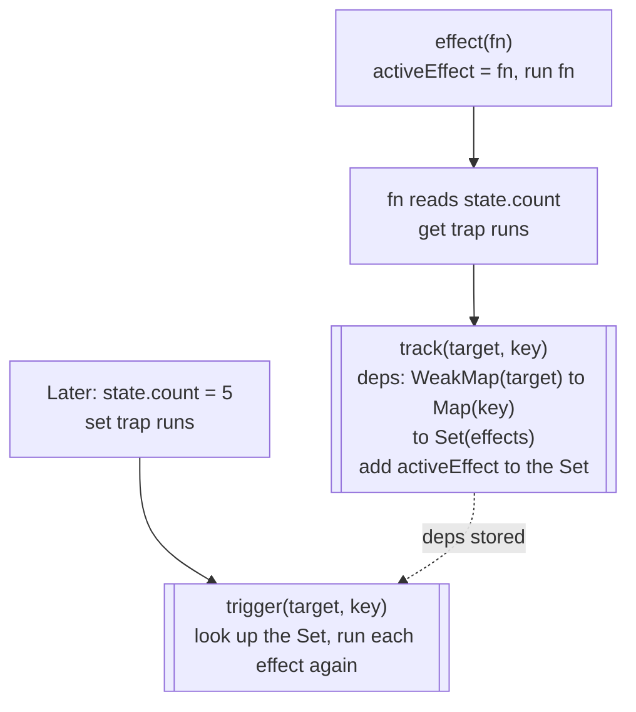
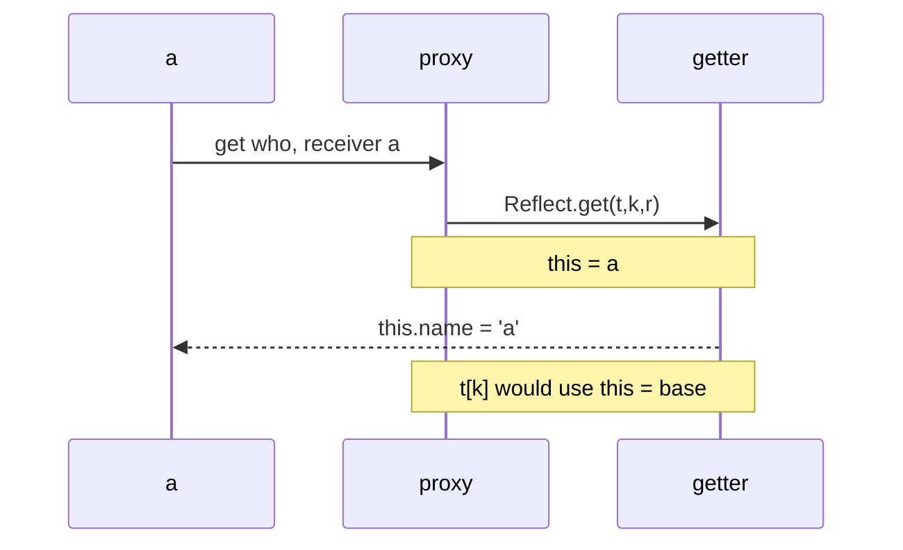

# Chapter 20: Proxy, Reflect, Symbols & Weak References

## 20.1 Definition and why interviewers ask it

**A `Proxy` is an object that wraps a target object and a handler of functions called traps. Each trap replaces one of the target's internal methods (`[[Get]]`, `[[Set]]`, `[[Call]]` and so on), so the proxy can observe, change or reject operations on the target. `Reflect` exposes those same internal methods as ordinary functions. Symbols are unique primitive values used as collision-free property keys and as hooks into language behaviour (`Symbol.iterator`). `WeakMap`, `WeakSet`, `WeakRef` and `FinalizationRegistry` let you attach data to objects, or point at them, without keeping them alive.**

These APIs are the "metaprogramming" part of the language. Interviewers use them to test whether you know what happens when you write `obj.x` (the `[[Get]]` internal method), how Vue 3 detects changes, why `WeakMap` is the right tool for private data and per-object caches, and what a symbol-keyed property is. They show up in senior-leaning JavaScript rounds and in machine-coding rounds ("implement an observable", "implement negative array indexes"), and the `WeakMap` versus `Map` question appears in memory-management discussions (commonly reported).

## 20.2 Core concept

### Plain language

A proxy is a receptionist standing in front of an office. Every visitor (read, write, delete, call) goes to the receptionist first. The receptionist can pass the visitor straight through, change what they ask for, answer without involving the office, or send them away. From the outside it looks like the office. Inside, the office does not know the receptionist exists.

A symbol is a name tag that nobody else can forge: two people can both be called "id", but two symbols named "id" are different tags. A `WeakMap` is a sticky-note board where each note is attached to an object. When the object is thrown away, its note goes with it, and the board never stops the object from being thrown away.

### Precise version

**Proxy.** `new Proxy(target, handler)` creates an *exotic object*: an object whose internal methods are not the ordinary ones. It stores `[[ProxyTarget]]` and `[[ProxyHandler]]`. For each operation, the engine looks up the matching trap on the handler. If the trap is missing, the operation is forwarded to the target. A proxy is callable only if its target is callable, and a constructor only if the target is a constructor, so `typeof` is decided at creation.

There are 13 traps, one per internal method (the spec calls `[[HasProperty]]` what many articles write as `[[Has]]`):

| Trap | Internal method | Triggered by |
|---|---|---|
| `get(target, key, receiver)` | `[[Get]]` | `p.x`, `p[k]`, reads that reach the proxy through a prototype chain |
| `set(target, key, value, receiver)` | `[[Set]]` | `p.x = v`, `p[k] = v` |
| `has(target, key)` | `[[HasProperty]]` | `key in p`, `with (p)` |
| `deleteProperty(target, key)` | `[[Delete]]` | `delete p.x` |
| `ownKeys(target)` | `[[OwnPropertyKeys]]` | `Object.keys`, `for...in`, `Object.getOwnPropertyNames`, `Reflect.ownKeys`, spread |
| `getOwnPropertyDescriptor(target, key)` | `[[GetOwnProperty]]` | `Object.getOwnPropertyDescriptor`, and `Object.keys` (enumerable filter) |
| `defineProperty(target, key, desc)` | `[[DefineOwnProperty]]` | `Object.defineProperty`, and `Reflect.set` with the proxy as receiver |
| `getPrototypeOf(target)` | `[[GetPrototypeOf]]` | `Object.getPrototypeOf`, `instanceof`, `__proto__` |
| `setPrototypeOf(target, proto)` | `[[SetPrototypeOf]]` | `Object.setPrototypeOf`, `__proto__ = ` |
| `isExtensible(target)` | `[[IsExtensible]]` | `Object.isExtensible` |
| `preventExtensions(target)` | `[[PreventExtensions]]` | `Object.preventExtensions`, `Object.seal`, `Object.freeze` |
| `apply(target, thisArg, args)` | `[[Call]]` | `p(...)`, `p.call(...)` (target must be callable) |
| `construct(target, args, newTarget)` | `[[Construct]]` | `new p(...)` (target must be a constructor) |

**The `receiver` argument.** In `get` and `set`, `receiver` is the object the operation started on. Usually it is the proxy itself. When the proxy sits in another object's prototype chain, it is that other object (`Object.create(proxy).x` passes the child as receiver). `Reflect.get(target, key, receiver)` runs getters with `this = receiver`, so forwarding the receiver preserves correct `this`. Returning `target[key]` instead runs getters with `this = target` and silently bypasses the proxy for everything the getter reads.

**Invariants.** A proxy may not lie about facts the target has fixed. After a trap returns, the engine compares its answer with the target and throws `TypeError` if they contradict. Examples:

| Trap | Invariant (target property is non-configurable unless said otherwise) |
|---|---|
| `get` | A non-writable data property must report its real value. A property with no getter must report `undefined`. |
| `set` | Returning `true` is not allowed for a non-writable data property when the value differs. |
| `has` | Cannot hide a non-configurable own property, or any own property of a non-extensible target. |
| `deleteProperty` | Cannot report success for a non-configurable own property. |
| `ownKeys` | No duplicates, only strings and symbols, must include every non-configurable key, and exactly the target's keys if the target is non-extensible. |
| `getPrototypeOf` | If the target is non-extensible, must return the real prototype. |
| `isExtensible` | Must equal `Object.isExtensible(target)`. |
| `construct` | Must return an object. |

A `set` trap that returns a falsy value is not an invariant violation. It only makes the assignment fail, which throws `TypeError` in strict mode and is silently ignored in sloppy mode.

**Transparent, not identical.** `proxy !== target`. Nothing, not even a trap, can intercept `===`, `Object.is`, `typeof` (apart from what the target decides) or being used as a `Set` or `Map` key. A proxy of an array passes `Array.isArray`, because the spec looks through the proxy to the target.

**Built-ins with internal slots.** `Map`, `Set`, `Date`, `Promise`, typed arrays and class instances with `#private` fields store state in *internal slots* or private elements that exist only on the real object. `Map.prototype.get` starts by checking that `this` has `[[MapData]]`. A method called through a proxy receives the proxy as `this`, which has no such slot, so it throws `TypeError`. Fix it by calling the method with the target as `this`, usually by binding functions to the target inside the `get` trap.

**Revocable proxies.** `Proxy.revocable(target, handler)` returns `{ proxy, revoke }`. After `revoke()`, every operation on the proxy throws `TypeError`. Use it to hand out temporary access.

**Cost.** Every operation on a proxy calls a JavaScript function, and engines cannot inline or optimise property accesses through it as they do for plain objects. In a micro-benchmark run for this book on Node.js 22 (20 million property reads), a proxy with an empty handler took roughly 0.25 s and one with a `get` trap that called `Reflect.get` roughly 0.55 s, against roughly 0.01 to 0.09 s for a plain object. Numbers vary by machine and engine version, but the order of magnitude explains why proxies belong at boundaries (state stores, validation, API wrappers) and not in hot inner loops.

**Reflect.** `Reflect` is a namespace object (not a constructor) with one method per proxy trap, with the same names and parameters. Each calls the corresponding internal method. Compared with the older `Object.*` functions and operators it has more consistent results:

| Operation | Operator or `Object.*` | `Reflect.*` |
|---|---|---|
| Define a property | `Object.defineProperty` throws on failure | `Reflect.defineProperty` returns `true` or `false` |
| Assign | `p.x = v` fails silently in sloppy mode | `Reflect.set` returns `true` or `false` and takes a `receiver` |
| Delete | `delete p.x` fails silently or throws in strict mode | `Reflect.deleteProperty` returns a boolean |
| Has | `'x' in p` | `Reflect.has(p, 'x')` (a function, usable with `apply`) |
| Keys | `Object.getOwnPropertyNames` plus `getOwnPropertySymbols` | `Reflect.ownKeys` returns strings and symbols together |
| Call | `fn.apply(thisArg, args)` (can be overridden on `fn`) | `Reflect.apply(fn, thisArg, args)` |
| Construct | `new F(...args)` | `Reflect.construct(F, args, newTarget)` sets `new.target` and the prototype separately |

All `Reflect` functions throw `TypeError` if the first argument is not an object.

**Symbols.** A symbol is a primitive (`typeof s === 'symbol'`) that is unique: `Symbol('a') !== Symbol('a')`. The optional description is only a label (`s.description`). Symbols are valid property keys next to strings.

| Created with | Identity | Registry | `Symbol.keyFor` |
|---|---|---|---|
| `Symbol(desc)` | New and unique every call | Not registered | `undefined` |
| `Symbol.for(key)` | Same symbol for the same string key, shared by all realms of the agent (for example an iframe and its parent page) | Global symbol registry | returns the key |
| Well-known (`Symbol.iterator`) | Created once by the engine and shared by all realms | Not in the registry | `undefined` |

Symbol-keyed properties are skipped by `for...in`, `Object.keys`, `Object.values`, `Object.entries`, `Object.getOwnPropertyNames` and `JSON.stringify`. They are copied by `Object.assign` and by object spread. They are visible to `Object.getOwnPropertySymbols`, `Reflect.ownKeys` and to the `in` operator. **They are not private.** True privacy needs `#private` fields, closures or a `WeakMap`.

Well-known symbols let objects customise built-in operations:

| Symbol | Used by | Effect |
|---|---|---|
| `Symbol.iterator` | `for...of`, spread, destructuring, `Array.from` | Returns an iterator |
| `Symbol.asyncIterator` | `for await...of` | Returns an async iterator |
| `Symbol.toPrimitive` | `+obj`, `` `${obj}` ``, `obj + ''`, `==` | Receives hint `'number'`, `'string'` or `'default'` |
| `Symbol.toStringTag` | `Object.prototype.toString` | Changes `[object Tag]` |
| `Symbol.hasInstance` | `instanceof` | Custom `x instanceof C` test |
| `Symbol.species` | `map`, `filter`, `slice` on subclasses, `Promise` | Constructor used for derived objects |
| `Symbol.isConcatSpreadable` | `Array.prototype.concat` | Spread array-likes (or not) |
| `Symbol.unscopables` | `with` | Names excluded from `with` lookups (for example `Array.prototype.flat`) |

**WeakMap and WeakSet.** Keys must be objects or *non-registered* symbols (ES2023). A `Symbol.for` symbol cannot be a key because the registry keeps it alive forever. A `WeakMap` is not iterable, has no `size`, no `clear`, no `keys`, and offers only `get`, `set`, `has`, `delete` (a `WeakSet` offers `add`, `has`, `delete`). An entry never keeps its key alive. The value is kept alive only while the key is reachable (an *ephemeron*). A plain `Map` references its keys strongly, so a key stays alive as long as the `Map` does.

**WeakRef and FinalizationRegistry.** `new WeakRef(obj)` holds `obj` weakly. `ref.deref()` returns the object or `undefined` if it has been collected. `new FinalizationRegistry(cb).register(obj, heldValue)` asks for `cb(heldValue)` to be called some time after `obj` is collected. When, and whether, the callback runs is up to the engine. Never base program correctness on it (garbage collection itself is Chapter 16).

## 20.3 How it works internally

### A. Reading a property through a proxy

1. The engine evaluates `p.id` by calling `p.[[Get]]('id', receiver)`, where `receiver` is `p`.
2. The proxy's `[[Get]]` reads `[[ProxyHandler]]`. If it is `null`, the proxy was revoked and a `TypeError` is thrown.
3. It looks up `handler.get`. If there is no trap, it returns `target.[[Get]]('id', receiver)`.
4. Otherwise it calls `trap.call(handler, target, 'id', receiver)`. Inside, `Reflect.get(target, 'id', receiver)` performs the ordinary `[[Get]]`.
5. The engine then checks **invariants**: it calls `target.[[GetOwnProperty]]('id')`. If the property is non-configurable and non-writable and the trap returned a different value, it throws `TypeError`. Otherwise the trap's result is returned.

### B. Derived operations call several traps

Many "single" operations are composed of more than one internal method, so one statement can run several traps:

- `Object.keys(p)` runs `ownKeys`, then `getOwnPropertyDescriptor` once per key to filter by `enumerable`. A key returned by `ownKeys` that the target does not have is dropped.
- `for (k in p)` runs `ownKeys` and `getOwnPropertyDescriptor` (and `getPrototypeOf` if defined) as it walks the chain.
- `{ ...p }` and `JSON.stringify(p)` run `ownKeys`, `getOwnPropertyDescriptor` and `get` for each key (`JSON.stringify` also reads `toJSON` first).
- `p.method()` runs `get` for `'method'` and then calls it with `this = p`, so reads inside the method go through the proxy again.
- `p.push(x)` on an array proxy runs `get` for `push`, `get` for `length`, `set` for the index and `set` for `length`.
- `Reflect.set(target, key, value, receiver)` with the proxy as `receiver` ends by calling `receiver.[[GetOwnProperty]]` and `receiver.[[DefineOwnProperty]]`, so a `set` trap that forwards with the default receiver also fires `getOwnPropertyDescriptor` and `defineProperty` traps on the same proxy. That is correct behaviour, but it surprises people who log every trap.

### C. Why method calls on built-ins fail

1. `const p = new Proxy(new Map(), {})`, then `p.get(1)`.
2. `[[Get]]` for `'get'` has no trap, so it returns `Map.prototype.get` found through the target.
3. The call has `this = p`.
4. `Map.prototype.get` performs `RequireInternalSlot(this, [[MapData]])`. The proxy is an ordinary-looking object with `[[ProxyTarget]]` and `[[ProxyHandler]]` slots only, so the check fails and `TypeError` is thrown. A class with a `#private` field behaves the same way: the private brand is on the original instance, not on the proxy.
5. Fix: in the `get` trap return `value.bind(target)` for functions, and read data properties from the target (`Reflect.get(target, key, target)`).

### D. How a Vue 3 style reactive system works

1. `reactive(obj)` returns a proxy. A `WeakMap` caches `target -> proxy`, so wrapping the same object twice gives the same proxy.
2. `effect(fn)` sets a global `activeEffect = fn` and runs `fn`.
3. During `fn`, every property read goes through the `get` trap. The trap calls `track(target, key)`, which stores `activeEffect` in a three-level structure: `WeakMap(target) -> Map(key) -> Set(effects)`.
4. A property write goes through the `set` trap. It forwards with `Reflect.set`, and if the value changed, calls `trigger(target, key)`, which runs every effect stored for that key.
5. **Deep reactivity is lazy.** When `get` returns an object, it wraps that object with `reactive(...)` on the way out. Nested objects are wrapped only when first read, not eagerly at creation.

### E. Weak references and garbage collection

1. A collector marks everything reachable from roots (stack, globals, closures). A **strong** reference counts as an edge during marking. A **weak** reference does not.
2. For a `WeakMap` entry, the collector treats key to value as an ephemeron: the value is marked only if the key was marked by some other path. When the key is not marked, the entry is dropped.
3. `new WeakRef(obj)` keeps `obj` alive until the end of the current synchronous job (the spec's "KeptAlive" list), so within one synchronous run `deref()` cannot be observed to change. Collection can only be seen in a later job.
4. A `FinalizationRegistry` callback is scheduled as a separate task after collection. The engine may delay it, batch it, or never run it (for example when the page or process ends).

## 20.4 Diagrams

### Reading a property through a proxy



> **How to explain this to the interviewer**
>
> 1. Draw four columns: caller, proxy, trap, target. Draw the arrow `p.id` from caller to proxy and from the proxy to the trap.
> 2. Draw the inner call `Reflect.get(target, key, receiver)` from the trap to the target, and say: "Reflect runs the default `[[Get]]`, with the right `this`".
> 3. Point at the last step: "before returning, the engine checks the answer against the target. If the target says this property is read-only and fixed, a different value from the trap is a `TypeError`".
>
> **Takeaway:** a trap can change what a read returns, but only inside the facts the target has locked in.

### The 13 traps and the operations behind them

```ascii The 13 traps, the internal method each replaces, and what triggers it
 trap                      internal method      triggered by
 ------------------------- -------------------- --------------------------------
 get                       [[Get]]              p.x   p[k]   inherited reads
 set                       [[Set]]              p.x = v
 has                       [[HasProperty]]      'x' in p   with (p)
 deleteProperty            [[Delete]]           delete p.x
 ownKeys                   [[OwnPropertyKeys]]  Object.keys  for-in  spread
                                                Reflect.ownKeys  getOwnPropertyNames
 getOwnPropertyDescriptor  [[GetOwnProperty]]   Object.getOwnPropertyDescriptor
                                                (also each key of Object.keys)
 defineProperty            [[DefineOwnProperty]] Object.defineProperty
                                                (also Reflect.set, receiver = p)
 getPrototypeOf            [[GetPrototypeOf]]   instanceof   Object.getPrototypeOf
 setPrototypeOf            [[SetPrototypeOf]]   Object.setPrototypeOf
 isExtensible              [[IsExtensible]]     Object.isExtensible
 preventExtensions         [[PreventExtensions]] preventExtensions, seal, freeze
 apply                     [[Call]]             p(...)   p.call(...)   (callable)
 construct                 [[Construct]]        new p(...)             (constructor)

 Missing trap  =  the operation is forwarded to the target unchanged.
 Invariants    =  checked AFTER the trap returns (TypeError on a contradiction).
```

> **How to explain this to the interviewer**
>
> 1. Say: "a proxy has one trap for each object internal method, 13 in total", and point at the left column.
> 2. Group them in three sets: property access (`get`, `set`, `has`, `deleteProperty`, `defineProperty`, `getOwnPropertyDescriptor`, `ownKeys`), prototype and extensibility (four), and function behaviour (`apply`, `construct`).
> 3. Add: "if I don't define a trap, the operation goes to the target, and after any trap the engine verifies invariants".
>
> **Takeaway:** know the three groups and that one statement such as `Object.keys` can fire several traps.

### Reactivity: track on read, trigger on write



> **How to explain this to the interviewer**
>
> 1. Draw the top chain: running an effect makes it the "active effect", reading a property fires the `get` trap, and the trap records "this effect depends on this key".
> 2. Draw the bottom chain: writing the property fires the `set` trap, which looks up who depends on that key and runs them again.
> 3. Connect the two with the dashed arrow and name the store: "a `WeakMap` from target to a `Map` from key to a `Set` of effects".
>
> **Takeaway:** reactivity is "record readers on get, re-run them on set", and a proxy is what lets you hook both without knowing property names in advance.

### What keeps a key alive: Map versus WeakMap

```ascii Reachability after "user = null": a Map keeps its keys alive, a WeakMap does not
   MAP: entry edges are strong                WEAKMAP: key edge is weak

   user  --X   (set to null)                  user  --X   (set to null)
   cache = Map, still reachable               cache = WeakMap, still reachable

   cache                                      cache
     |  key (strong)                            :  key (weak, not followed)
     v                                          v
   +-------------+                            +-------------+
   | user object |  still reachable           | user object |  no other path
   +-------------+  -> NOT collected          +-------------+  -> COLLECTED
   cache                                      cache
     |  value (strong)                          :  value (alive only while key is)
     v                                          v
   +-------------+                            +-------------+
   | metadata    |  stays alive too           | metadata    |  collected with key
   +-------------+                            +-------------+

   Marking follows solid edges only. Dotted edges (WeakMap) are not followed.
```

> **How to explain this to the interviewer**
>
> 1. Draw the same picture twice: a variable `user`, the object, and a cache holding an entry for it. Then cross out the `user` variable in both.
> 2. On the left, draw a solid line from the `Map` to the key. Say: "the Map is still alive, so the object is still reachable, so it can never be collected until I delete the entry".
> 3. On the right, draw a dotted line and say: "the WeakMap edge does not count, so after `user = null` nothing reaches the object, and both the object and its metadata can be collected".
>
> **Takeaway:** a `Map` extends the lifetime of its keys, a `WeakMap` never does.

### Why a Map proxy throws

```ascii Proxy has no internal slots, so built-in methods reject it as this
   const m = new Map([[1, 'a']]);          const p = new Proxy(m, {});

   p.get(1)
     |
     v  [[Get]] 'get' on the proxy: no trap, forwarded to the Map
   Map.prototype.get   called with  this = p      (the PROXY, not the Map)
     |
     v  RequireInternalSlot(this, [[MapData]])
     X  p has only [[ProxyTarget]] and [[ProxyHandler]]   ->   TypeError

   Fix, in the get trap:   value = Reflect.get(target, key, target)
                           return typeof value === 'function'
                             ? value.bind(target) : value
   Now Map.prototype.get runs with this = m, which owns [[MapData]].
   Same story for Set, Date, Promise, typed arrays and #private fields.
```

> **How to explain this to the interviewer**
>
> 1. Draw two boxes, `Proxy` and `Map`, with the proxy pointing to the map. Mark `[[MapData]]` inside the map box only.
> 2. Draw the method call arriving at the proxy and say: "the method runs with `this` equal to the proxy".
> 3. Point at `[[MapData]]`: "the check looks for the slot on `this`, and the proxy does not have it. Binding the function to the target fixes it".
>
> **Takeaway:** a proxy forwards operations, not internal slots.

### Which APIs can see a symbol-keyed property

```ascii Symbol keys are hidden from the common enumerators, not from reflection
   const s = Symbol('id');   const o = { name: 'Ann', [s]: 1 };

   API                              sees 'name'   sees [s]
   -------------------------------  -----------   --------
   o.name / o[s] / s in o               yes          yes
   for (k in o)                         yes          no
   Object.keys / values / entries       yes          no
   Object.getOwnPropertyNames           yes          no
   JSON.stringify(o)                    yes          no
   structuredClone(o)                   yes          no
   Object.getOwnPropertySymbols         no           yes
   Reflect.ownKeys                      yes          yes
   Object.assign({}, o)  /  { ...o }    yes          yes   (own enumerable symbols)
   a Proxy ownKeys trap                 yes          yes
```

> **How to explain this to the interviewer**
>
> 1. Draw two columns (string key, symbol key) and list five APIs down the left.
> 2. Tick the string column everywhere, and the symbol column only for `getOwnPropertySymbols`, `Reflect.ownKeys`, `Object.assign`/spread and direct access.
> 3. Say: "symbols avoid collisions and hide from casual loops. They are not access control".
>
> **Takeaway:** symbol keys are skipped by the usual enumerators and fully visible to reflection.

### Whiteboard version

```ascii Whiteboard version: proxy, Reflect, and weak keys (draw in 90 seconds)
  caller ---> [ PROXY ] ---trap(target, key, receiver)---> handler
                 |                                            |
          no trap|                                  Reflect.get / Reflect.set
                 v                                            |
              [ TARGET ] <------------------------------------+
  Symbol():  always new      Symbol.for():  shared by name (registry)
  WeakMap:  key --weak--> value    (key unreachable elsewhere => entry gone)
```

## 20.5 Code examples

### Example 1: a logging proxy forwards with Reflect

```js
const log = [];
const user = new Proxy({ name: 'Ann' }, {
  get(target, key, receiver) {
    log.push(`get ${String(key)}`);
    return Reflect.get(target, key, receiver);
  },
  set(target, key, value, receiver) {
    log.push(`set ${String(key)}=${value}`);
    return Reflect.set(target, key, value, receiver);
  },
  has(target, key) {
    log.push(`has ${String(key)}`);
    return Reflect.has(target, key);
  },
  deleteProperty(target, key) {
    log.push(`delete ${String(key)}`);
    return Reflect.deleteProperty(target, key);
  },
});
user.name;
user.age = 30;
'age' in user;
delete user.age;
console.log(log);
```

```text output
[ 'get name', 'set age=30', 'has age', 'delete age' ]
```

**Why:** each operator maps to exactly one trap here, and `Reflect` performs the default behaviour so the proxy behaves like the plain object.

### Example 2: `receiver` decides what `this` a getter sees

```js
const base = { name: 'base', get who() { return this.name; } };
const viaReflect = new Proxy(base, { get: (t, k, r) => Reflect.get(t, k, r) });
const viaTarget = new Proxy(base, { get: (t, k) => t[k] });

const a = Object.create(viaReflect);
a.name = 'a';
const b = Object.create(viaTarget);
b.name = 'b';
console.log(a.who, b.who);
```

```text output
a base
```

**Why:** `a.who` is not an own property of `a`, so the lookup reaches the proxy with `receiver = a`. `Reflect.get(t, k, r)` runs the getter with `this = a`. The `t[k]` version runs it with `this = base`.

### Example 3: invariants and `Proxy.revocable`

```js
const config = {};
Object.defineProperty(config, 'version', {
  value: 1, writable: false, configurable: false,
});

const liar = new Proxy(config, { get: () => 2 });
const honest = new Proxy(config, { get: () => 1 });
try { liar.version; } catch (e) { console.log(e.name); }
console.log(honest.version);

const { proxy, revoke } = Proxy.revocable({ secret: 42 }, {});
console.log(proxy.secret);
revoke();
try { proxy.secret; } catch (e) { console.log(e.name + ': ' + e.message); }
console.log(typeof proxy);
```

```text output
TypeError
1
42
TypeError: Cannot perform 'get' on a proxy that has been revoked
object
```

**Why:** `version` is non-writable and non-configurable, so a `get` trap must return `1`. The revoked message is V8's wording. `typeof` still works because it only inspects the proxy's own type, not the target.

### Example 4: a failing `set` trap, sloppy versus strict

```js
const readOnly = new Proxy({}, { set: () => false });

readOnly.a = 1;                       // sloppy: silently ignored
console.log('sloppy ok', 'a' in readOnly);

(function () {
  'use strict';
  try { readOnly.a = 1; } catch (e) { console.log(e.name + ': ' + e.message); }
})();
```

```text output
sloppy ok false
TypeError: 'set' on proxy: trap returned falsish for property 'a'
```

**Why:** `[[Set]]` returning `false` is an ordinary failure. Strict-mode code turns it into a `TypeError`, so a `set` trap should return `true` on success (a missing `return` is a common bug).

### Example 5: built-ins with internal slots, and the fix

```js
const map = new Map([['k', 1]]);
const naive = new Proxy(map, {});
try { naive.get('k'); } catch (e) { console.log(e.name); }

const fixed = new Proxy(map, {
  get(target, key) {
    const value = Reflect.get(target, key, target);   // receiver = target
    return typeof value === 'function' ? value.bind(target) : value;
  },
});
console.log(fixed.get('k'), fixed.size, fixed instanceof Map);

class Counter {
  #n = 0;
  inc() { return ++this.#n; }
}
const c = new Counter();
const pc = new Proxy(c, {});
try { pc.inc(); } catch (e) { console.log(e.name); }
const pcFixed = new Proxy(c, {
  get(target, key) {
    const value = Reflect.get(target, key, target);
    return typeof value === 'function' ? value.bind(target) : value;
  },
});
console.log(pcFixed.inc());
```

```text output
TypeError
1 1 true
TypeError
1
```

**Why:** `get`, `size` and `inc` all need a `this` that owns the internal slot or private field. Binding to the target supplies it. The trade-off is that calls made through the bound function bypass the proxy, so a reactive system must track the call separately.

### Example 6: Vue 3 style `reactive`, `effect`, `track`, `trigger`

```js
const targetMap = new WeakMap();   // target -> Map(key -> Set(effects))
const proxyCache = new WeakMap();  // raw object -> its proxy
let activeEffect = null;

function track(target, key) {
  if (!activeEffect) return;
  let deps = targetMap.get(target);
  if (!deps) targetMap.set(target, (deps = new Map()));
  let effects = deps.get(key);
  if (!effects) deps.set(key, (effects = new Set()));
  effects.add(activeEffect);
}

function trigger(target, key) {
  const effects = targetMap.get(target)?.get(key);
  if (effects) [...effects].forEach((fn) => fn());
}

function reactive(obj) {
  if (typeof obj !== 'object' || obj === null) return obj;
  if (proxyCache.has(obj)) return proxyCache.get(obj);
  const proxy = new Proxy(obj, {
    get(target, key, receiver) {
      const value = Reflect.get(target, key, receiver);
      track(target, key);
      return reactive(value);                 // lazy deep wrapping
    },
    set(target, key, value, receiver) {
      const old = target[key];
      const ok = Reflect.set(target, key, value, receiver);
      if (ok && !Object.is(old, value)) trigger(target, key);
      return ok;
    },
  });
  proxyCache.set(obj, proxy);
  return proxy;
}

function effect(fn) {
  activeEffect = fn;
  try { fn(); } finally { activeEffect = null; }
}

const state = reactive({ count: 0, user: { name: 'Ann' } });
effect(() => console.log('count is', state.count));
effect(() => console.log('user is', state.user.name));
state.count++;
state.user.name = 'Bob';
state.count = 1;                             // same value: no trigger
console.log(state.user === state.user);
```

```text output
count is 0
user is Ann
count is 1
user is Bob
true
```

**Why:** the first run of each effect records which keys it read. `state.count++` fires the first effect, `state.user.name = 'Bob'` fires the second, and assigning an unchanged value is skipped by the `Object.is` check. The proxy cache makes `state.user` return the same proxy each time. Real Vue also cleans up stale dependencies, batches runs and handles arrays and collections specially, which this sketch omits.

### Example 7: symbols as keys, and who can see them

```js
const id = Symbol('id');
const user = { name: 'Ann', [id]: 7 };

for (const k in user) console.log('for-in', k);
console.log(Object.keys(user), JSON.stringify(user));
console.log(Reflect.ownKeys(user), user[id], id in user);
console.log({ ...user }[id], Object.getOwnPropertySymbols(user).length);
```

```text output
for-in name
[ 'name' ] {"name":"Ann"}
[ 'name', Symbol(id) ] 7 true
7 1
```

**Why:** enumeration APIs that return strings skip symbols. `Reflect.ownKeys`, `in`, spread and direct access see them. The symbol is hidden from casual loops, not protected.

### Example 8: `Symbol()` versus `Symbol.for`, and well-known symbols

```js
console.log(Symbol('a') === Symbol('a'), Symbol.for('a') === Symbol.for('a'));
console.log(Symbol.keyFor(Symbol.for('a')), Symbol.keyFor(Symbol('a')));

const money = {
  amount: 5,
  [Symbol.toPrimitive](hint) {
    return hint === 'number' ? this.amount : hint === 'string' ? `$${this.amount}` : 'cash';
  },
};
console.log(+money, `${money}`, money + '');

class Even { static [Symbol.hasInstance](n) { return n % 2 === 0; } }
class Tagged { get [Symbol.toStringTag]() { return 'Tagged'; } }
console.log(2 instanceof Even, 3 instanceof Even, String(new Tagged()));

const range = {
  from: 1,
  to: 3,
  *[Symbol.iterator]() { for (let i = this.from; i <= this.to; i++) yield i; },
};
console.log([...range]);
```

```text output
false true
a undefined
5 $5 cash
true false [object Tagged]
[ 1, 2, 3 ]
```

**Why:** `Symbol()` is always new, `Symbol.for` reads and writes a global registry, and `keyFor` only knows registry symbols. The well-known symbols are hooks that the language operators call: `+` and template literals call `toPrimitive` with different hints, `instanceof` calls `hasInstance`, `Object.prototype.toString` reads `toStringTag`, and spread calls `iterator`.

### Example 9: `WeakMap` for private data and per-object caches

```js
const secrets = new WeakMap();

class Account {
  constructor(owner, balance) {
    this.owner = owner;
    secrets.set(this, { balance });          // hidden: not on the instance
  }
  get balance() { return secrets.get(this).balance; }
  deposit(n) { secrets.get(this).balance += n; return this; }
}

const acct = new Account('Ann', 10).deposit(5);
console.log(acct.balance, Object.keys(acct), Reflect.ownKeys(acct));

const wm = new WeakMap();
const key = {};
wm.set(key, 'meta');
console.log(wm.get(key), wm.has({}), typeof wm.size, typeof wm.clear, wm[Symbol.iterator]);
try { wm.set('text', 1); } catch (e) { console.log(e.name + ': ' + e.message); }
try { wm.set(Symbol.for('shared'), 1); } catch (e) { console.log(e.name); }
wm.set(Symbol('local'), 1);
console.log('unregistered symbol accepted');
```

```text output
15 [ 'owner' ] [ 'owner' ]
meta false undefined undefined undefined
TypeError: Invalid value used as weak map key
TypeError
unregistered symbol accepted
```

**Why:** the balance exists only in the `WeakMap`, so no reflection API on `acct` finds it, and when `acct` is collected the entry goes too. The keys must be objects or non-registered symbols. A `WeakMap` has no `size`, `clear` or iterator because the contents depend on garbage collection timing.

### Example 10: `WeakRef`, `deref` and `FinalizationRegistry` (timing is not deterministic)

```js norun
// Run with: node --expose-gc example.js   (global.gc is only a hint for the demo)
let big = { data: new Array(1e6).fill(0) };
const ref = new WeakRef(big);
const registry = new FinalizationRegistry((label) => console.log('collected:', label));
registry.register(big, 'big object');

console.log(ref.deref() === big);        // true: strongly held, and kept alive for this job

big = null;                              // drop the last strong reference
setTimeout(() => {
  globalThis.gc();                       // request a collection
  setTimeout(() => {
    console.log(ref.deref());            // undefined if collected, the object if not
  }, 50);
}, 0);
// Typical output (not guaranteed):
//   true
//   undefined
//   collected: big object
```

**Why:** a `WeakRef` does not keep its target alive, but the target is kept for the rest of the job that created the ref or called `deref`, so the check must wait for a later task. Whether the collection happens, and when the registry callback runs, is up to the engine. The example is marked `norun` because the output depends on GC timing.

## 20.6 Common mistakes and gotchas

- **Returning nothing from a `set` trap.** A missing `return true` makes the assignment fail, and strict mode (classes, modules) throws `TypeError`. Always return the result of `Reflect.set`.
- **Using `target[key]` instead of `Reflect.get(target, key, receiver)`.** Getters then run with `this = target`, accessing the target directly, so nothing read inside the getter is tracked or logged. It also breaks inheritance when the proxy is a prototype.
- **Proxying a `Map`, `Set`, `Date` or a class with `#private` fields without binding.** Methods throw `TypeError` because the proxy has no internal slots (Example 5).
- **Expecting `proxy === target`.** It is `false`. Keeping both references around (`Set`, `WeakMap` and identity checks) is a classic bug source. Hand out only the proxy.
- **Lying to the engine.** A trap that contradicts a non-configurable, non-writable property throws `TypeError` (Example 3). A frozen target limits what a proxy can do.
- **Forgetting that one operation fires several traps.** `Object.keys` runs `ownKeys` plus one `getOwnPropertyDescriptor` per key, and `JSON.stringify` reads `toJSON` first. A `get` trap must handle symbol keys (`Symbol.toPrimitive`, `Symbol.iterator`) and unknown names safely.
- **Wrapping in hot paths.** Proxies cost about an order of magnitude more per property access. Do not put one around data processed in an inner loop.
- **Calling symbols "private".** `Object.getOwnPropertySymbols`, `Reflect.ownKeys`, spread and `Object.assign` all see them.
- **Using `Symbol.for` for local uniqueness.** Registry symbols are global and shared by name, so another library can collide with your key. Use `Symbol()` unless you need sharing. Registered symbols cannot be `WeakMap` keys.
- **Converting a symbol implicitly.** `'' + sym` and `` `${sym}` `` throw `TypeError`. Use `String(sym)` or `sym.description`.
- **Iterating or sizing a `WeakMap`.** There is no way to do so. If you need to list entries, use a `Map` and manage cleanup yourself.
- **Putting a primitive or a registered symbol in a `WeakMap`.** Throws `TypeError`.
- **Building logic on `WeakRef` or `FinalizationRegistry`.** Callbacks may be delayed or skipped. Use them only for optional optimisation, such as dropping a cache entry or releasing a handle that is also released by an explicit `close()`.

## 20.7 Quick revision cheat sheet

- **Proxy** = target + handler of up to 13 traps, one per internal method. A missing trap forwards to the target. Traps are checked afterwards against **invariants** (`TypeError`).
- **Reflect** mirrors the internal methods, returns booleans instead of throwing, and accepts `receiver`. Inside a trap, forward with `Reflect.*(target, ..., receiver)` to keep default behaviour and the right `this`.
- **Proxies are not identical to targets** (`!==`), cannot intercept `===`, and break on built-ins with internal slots and `#private` fields unless you bind to the target.
- **Reactivity (Vue 3):** `get` trap tracks `activeEffect` in `WeakMap -> Map -> Set`, `set` trap triggers it, nested objects wrapped lazily and cached in a `WeakMap`. Vue 2 used `Object.defineProperty`, which cannot see added or deleted keys.
- **Symbol:** unique primitive, `Symbol()` always new, `Symbol.for` shared via registry, `keyFor` reads it. Symbol keys skip `for...in`, `Object.keys` and JSON, but not `Reflect.ownKeys`. Not private.
- **Well-known symbols:** `iterator`, `asyncIterator`, `toPrimitive`, `toStringTag`, `hasInstance`, `species`, `isConcatSpreadable`, `unscopables`.
- **WeakMap / WeakSet:** object (or non-registered symbol) keys, not iterable, no `size`, entries do not keep keys alive. Use for private data and per-object caches. A `Map` keeps keys alive.
- **WeakRef / FinalizationRegistry:** `deref()` may be `undefined`, callbacks are not guaranteed and not deterministic. Never use them for program logic.

## 20.8 Interview questions

*Key: ★ = very frequently reported. "Typically asked in" lines say which round a question tends to appear in; where no single source could be pinned down the question is labelled "commonly reported". Draw-it hints refer to the figures in section 20.4.*

#### Conceptual

### Q20.1 ★ Medium: What is a `Proxy`? Name some traps and use cases.

*Typically asked in: JavaScript fundamentals or senior rounds, ES6 features block (commonly reported).*

> **Model answer**
>
> A Proxy wraps a target object with a handler of traps. Each trap intercepts one fundamental operation: `get`, `set`, `has`, `deleteProperty`, `ownKeys`, `defineProperty`, `getOwnPropertyDescriptor`, `getPrototypeOf`, `setPrototypeOf`, `isExtensible`, `preventExtensions`, `apply` and `construct`. Operations without a trap go to the target. Use cases are validation, default values, negative array indices, logging and tracing, access control, API wrappers that turn property reads into calls, and reactivity systems like Vue 3. Limits: the engine enforces invariants, a proxy is not `===` to its target, it breaks on internal slots, and it is slower than a plain object.

**Key points to mention**

- 13 traps, one per internal method; missing trap means forwarding.
- Use cases: validation, defaults, negative indexes, logging, access control, reactivity.
- Invariants, identity, internal slots and cost as limits.
- Draw it: Figures 20.1 and 20.2.

### Q20.2 ★ Hard: Proxy versus `Object.defineProperty` for reactivity. Why did Vue 3 move to Proxy?

*Typically asked in: framework-aware JavaScript rounds and senior interviews (commonly reported).*

> **Model answer**
>
> Vue 2 made data reactive by walking every property at creation and replacing it with a getter and setter through `Object.defineProperty`. That has blind spots. It cannot see a property added or deleted later, so Vue needed `Vue.set` and `Vue.delete`. It cannot see array index writes or `length`, so Vue patched array methods. And it walks the whole object eagerly. A Proxy intercepts operations on the object, not individual properties, so it sees additions, deletions, `in` checks and iteration, supports arrays and Maps naturally, and wraps nested objects lazily on first access. The price is no support in very old browsers such as Internet Explorer, and the identity and internal-slot caveats.

**Key points to mention**

- `defineProperty` works per existing property, so there is no trap for new keys or deletes.
- Proxy works per object: all keys, including future ones, plus `has` and `ownKeys`.
- Lazy deep wrapping, with a `WeakMap` cache, replaces the up-front recursive walk.
- Trade-offs: needs ES2015 (no IE), proxy identity differs from the raw object.
- Draw it: Figure 20.3.

### Q20.3 Medium: Why should a trap use `Reflect` instead of operating on the target directly?

*Typically asked in: follow-up after Proxy basics (commonly reported).*

> **Model answer**
>
> `Reflect` methods run the default internal method with the same semantics the engine would have used, so a trap can add behaviour and still keep the default. There are three concrete reasons. First, `Reflect.get` and `Reflect.set` take the `receiver`, so getters and setters run with the right `this`, which matters when the proxy is in a prototype chain or when the getter reads other proxied properties. Second, `Reflect.set`, `Reflect.defineProperty` and `Reflect.deleteProperty` return booleans, which is exactly what the trap must return. Third, `Reflect` has one function per trap with matching arguments, so forwarding is a one-liner.

**Key points to mention**

- `receiver` preserves `this` for getters, setters and inheritance.
- Boolean results fit the trap contract (`set` must return a truthy value).
- Symmetry with the traps: `Reflect.<trap>(...arguments)` is the default.
- `target[key]` or `target[key] = v` loses the receiver and fails silently in sloppy mode.

### Q20.4 ★ Medium: What are Symbols and what are they used for? Name the well-known symbols.

*Typically asked in: JavaScript fundamentals round, ES6 block (commonly reported).*

> **Model answer**
>
> A Symbol is a primitive that is guaranteed unique, with an optional description for debugging. Its main use is as a property key that cannot collide with other keys, so libraries can add metadata to objects without clobbering existing names. Symbol-keyed properties are skipped by `for...in`, `Object.keys` and `JSON.stringify`, but they are visible through `Object.getOwnPropertySymbols` and `Reflect.ownKeys`, so they are hidden, not private. The well-known symbols let you customise language behaviour: `iterator`, `asyncIterator`, `toPrimitive`, `toStringTag`, `hasInstance`, `species`, `isConcatSpreadable` and `unscopables`.

**Key points to mention**

- Uniqueness, description, non-enumerable by the string-key APIs.
- Not private: `getOwnPropertySymbols`, `Reflect.ownKeys`, spread.
- Use cases: collision-free keys, metadata, protocol hooks, enum-like constants.
- Well-known symbols with one-line effects (table in 20.2).
- Draw it: Figure 20.6.

### Q20.5 ★ Medium: What is the difference between `WeakMap` and `Map`? When would you use a `WeakMap`?

*Typically asked in: JavaScript fundamentals and memory-management rounds (commonly reported).*

> **Model answer**
>
> A `Map` holds its keys strongly, so a key object stays alive while the `Map` does. A `WeakMap` holds keys weakly: if nothing else references the key, the key and its value can be collected, and the entry disappears. Because contents depend on garbage collection, a `WeakMap` accepts only objects or non-registered symbols as keys, and is not iterable, has no `size` and no `clear`. I use a `WeakMap` when data belongs to an object's lifetime: private instance data, per-object metadata, memoisation keyed by object, and DOM-node caches. I use a `Map` when I need to iterate, count, or use primitive keys.

**Key points to mention**

- Strong versus weak reference to the key; value kept only while the key is alive.
- Restrictions follow from GC: no iteration, `size` or `clear`.
- Use cases: private data, metadata, caches, DOM node associations, the reactive `targetMap`.
- Draw it: Figure 20.4.

### Q20.6 Hard: What are `WeakRef` and `FinalizationRegistry`, and why does the spec warn against them?

*Typically asked in: senior or memory-management rounds (commonly reported).*

> **Model answer**
>
> A `WeakRef` points at an object without keeping it alive. `deref()` returns the object, or `undefined` if it was collected. A `FinalizationRegistry` runs a callback after a registered object has been collected. Both depend on the garbage collector, whose timing is up to the engine. A collection might not run at all, the callback can be late, and some objects never get one, for example when the page or process ends. A deref also keeps the target alive until the current job ends, so it looks stable inside one run. So I never base correctness on them. I use them only for optimisations, like a cache that can drop entries, and I always provide an explicit cleanup path.

**Key points to mention**

- `deref()` may be `undefined`, so always check.
- Callbacks are non-deterministic and not guaranteed. The callback must not be required for correctness.
- Target kept alive until the end of the current job.
- Prefer explicit `dispose()` or `close()` plus a `WeakMap` for associated data.
- Point to Chapter 16 for how the collector decides.

#### Output prediction

### Q20.7 Easy: What does this print?

*Typically asked in: JavaScript fundamentals round, ES6 block (commonly reported).*

```js
const a = Symbol('x');
const b = Symbol('x');
console.log(a === b, a.description === b.description);
console.log(Symbol.for('k') === Symbol.for('k'), Symbol.for('k') === Symbol('k'));
console.log(Symbol.keyFor(Symbol.for('k')), Symbol.keyFor(a));
try { console.log(`${a}`); } catch (e) { console.log(e.name); }
console.log(String(a), a.toString());
```

```text output
false true
true false
k undefined
TypeError
Symbol(x) Symbol(x)
```

> **Model answer**
>
> `false true`: two `Symbol('x')` calls give different symbols that share a description. Then `true false`: `Symbol.for('k')` looks up the global registry, so both calls return the same symbol, but `Symbol('k')` is never registered and is a different value. `keyFor` returns the registry key for a registered symbol and `undefined` for a local one. The template literal tries to convert the symbol to a string implicitly, which throws a `TypeError`. Explicit `String(a)` and `a.toString()` are allowed and give `Symbol(x)`.

**Key points to mention**

- The description is a label, not an identity.
- `Symbol.for` is registry-based and global. `Symbol()` is never registered.
- Implicit string conversion throws, explicit is fine.
- `new Symbol()` throws, because `Symbol` is not a constructor.

### Q20.8 ★ Hard: What does this print? (`receiver` and a proxy in a prototype chain)

*Typically asked in: senior JavaScript rounds, as a follow-up on Reflect (commonly reported).*

```js
const base = { name: 'base', get who() { return this.name; } };
const viaReflect = new Proxy(base, { get(t, k, r) { return Reflect.get(t, k, r); } });
const viaTarget = new Proxy(base, { get(t, k) { return t[k]; } });

const a = Object.create(viaReflect);
a.name = 'a';
const b = Object.create(viaTarget);
b.name = 'b';
console.log(a.who, b.who);
```

```text output
a base
```



> **Model answer**
>
> `a base`. `a.who` is not an own property, so the lookup walks to the prototype, which is the proxy, and calls its `get` trap with `receiver` set to `a`, the object where the lookup began. `Reflect.get(t, k, r)` runs the getter with `this = r`, so it reads `a.name`, which is `'a'`. The second proxy uses `t[k]`, which runs the getter with `this` equal to the target `base`, so it returns `'base'` and ignores `b.name`. Forwarding the receiver is what makes proxies behave correctly under inheritance.

**Key points to mention**

- `receiver` is the object the lookup started on, not necessarily the proxy.
- `Reflect.get(t, k, r)` keeps `this = r`, `t[k]` uses `this = t`.
- Same rule for `set` and setters.
- A lookup passes through a proxy in a prototype chain only if nothing earlier in the chain has the property.

### Q20.9 Medium: What does this print? (symbol keys and enumeration)

*Typically asked in: JavaScript fundamentals round (commonly reported).*

```js
const id = Symbol('id');
const user = { name: 'Ann', [id]: 7 };
Object.defineProperty(user, 'secret', { value: 1, enumerable: false });

console.log(Object.keys(user));
console.log(JSON.stringify(user));
console.log(Object.getOwnPropertyNames(user));
console.log(Reflect.ownKeys(user));
console.log(Object.assign({}, user)[id], structuredClone(user)[id]);
```

```text output
[ 'name' ]
{"name":"Ann"}
[ 'name', 'secret' ]
[ 'name', 'secret', Symbol(id) ]
7 undefined
```

> **Model answer**
>
> `Object.keys` returns only enumerable string keys, so `['name']`. `JSON.stringify` also skips symbols and non-enumerable properties. `getOwnPropertyNames` includes non-enumerable strings, so `secret` appears, but no symbols. `Reflect.ownKeys` returns everything: strings, then symbols. `Object.assign` copies own enumerable symbol properties, so `7` survives. `structuredClone` copies only string keys, so the symbol is lost and the result is `undefined`.

**Key points to mention**

- Two separate filters: string versus symbol, and enumerable versus not.
- `Reflect.ownKeys` is the complete list, strings first then symbols.
- `Object.assign` and spread copy enumerable symbols, JSON and `structuredClone` do not.
- Draw it: Figure 20.6.

### Q20.10 ★ Hard: What does this print, and how do you fix it? (Proxy of a `Map` and of a class with `#private`)

*Typically asked in: senior JavaScript rounds, as a trap (commonly reported).*

```js
const wrap = (obj) => new Proxy(obj, {});

try { wrap(new Map([['a', 1]])).get('a'); } catch (e) { console.log(e.name); }
try { wrap(new Date(0)).getTime(); } catch (e) { console.log(e.name); }

class Box { #v = 1; read() { return this.#v; } }
try { wrap(new Box()).read(); } catch (e) { console.log(e.name); }

const bindingProxy = (obj) => new Proxy(obj, {
  get(target, key) {
    const value = Reflect.get(target, key, target);
    return typeof value === 'function' ? value.bind(target) : value;
  },
});
console.log(bindingProxy(new Map([['a', 1]])).get('a'), bindingProxy(new Box()).read());
```

```text output
TypeError
TypeError
TypeError
1 1
```

> **Model answer**
>
> The first three calls throw `TypeError`, then `1 1` prints. `p.get('a')` finds `Map.prototype.get` and calls it with `this` equal to the proxy. That method requires the internal slot `[[MapData]]`, which exists only on the real `Map`. `Date` has `[[DateValue]]`, and the class instance has a private brand on the original object. A proxy has none of these. The fix is to resolve properties against the target and bind functions to it, so the method runs with the real object as `this`. The cost: calls made through the bound function do not go through the proxy, so I track them separately.

**Key points to mention**

- Internal slots and private fields live on the real object, never on the proxy.
- Fix: `Reflect.get(target, key, target)` and `bind(target)`, or `get` returns target's own methods.
- Other affected types: `Set`, `Promise`, typed arrays, `WeakMap`.
- Arrays are fine: `Array.isArray` sees through proxies and array methods only use property access.
- Draw it: Figure 20.5.

#### Implement it yourself

### Q20.11 Medium: Implement an array with negative indices (`arr[-1]`) and a validating proxy.

*Typically asked in: machine-coding or JavaScript rounds (a Proxy-based negative-index question is listed on the interviewsvector.com site seen in search results).*

**Problem.** (1) Wrap an array so `arr[-1]` is the last item. (2) Create an object that only accepts known properties with valid values, and throws `TypeError` otherwise.

**Solution.**

```js
const withNegativeIndex = (arr) => {
  const isNeg = (k) => typeof k === 'string' && /^-\d+$/.test(k);
  const fix = (t, k) => (isNeg(k) ? String(t.length + Number(k)) : k);
  return new Proxy(arr, {
    get: (t, k, r) => Reflect.get(t, fix(t, k), r),
    set: (t, k, v, r) => Reflect.set(t, fix(t, k), v, r),
  });
};
const a = withNegativeIndex([10, 20, 30]);
console.log(a[-1], a[-3], a[-4], a[0], a.length);
a[-1] = 99;
a.push(40);
console.log([...a], Array.isArray(a));

const validated = (schema) => new Proxy({}, {
  set(target, key, value, receiver) {
    const check = schema[key];
    if (!check) throw new TypeError(`Unknown property "${String(key)}"`);
    if (!check(value)) {
      throw new TypeError(`Invalid value for "${key}": ${JSON.stringify(value)}`);
    }
    return Reflect.set(target, key, value, receiver);
  },
});
const user = validated({
  age: (v) => Number.isInteger(v) && v >= 0,
  name: (v) => typeof v === 'string',
});
user.age = 30;
user.name = 'Ann';
for (const bad of [() => { user.age = -1; }, () => { user.email = 'x'; }]) {
  try { bad(); } catch (e) { console.log(e.name + ': ' + e.message); }
}
console.log(user.age, user.name, JSON.stringify(user));
```

```text output
30 10 undefined 10 3
[ 10, 20, 99, 40 ] true
TypeError: Invalid value for "age": -1
TypeError: Unknown property "email"
30 Ann {"age":30,"name":"Ann"}
```

> **Model answer**
>
> Property keys arrive in the trap as strings, so I test the key against `/^-\d+$/` and convert it to `length + index` before forwarding with `Reflect.get` or `Reflect.set`. All other keys, including symbols, pass through untouched, and `a[-4]` on a three-element array becomes index `-1`, which is just `undefined`. For validation, the `set` trap looks up a checker in a schema, throws on unknown keys or failing values, and otherwise forwards with `Reflect.set` and returns its result. Throwing is deliberate: returning `false` would only fail silently in sloppy mode.

**Key points to mention**

- Keys are strings or symbols, so check `typeof k === 'string'` first.
- Forward everything else with `Reflect` and the receiver.
- Edge cases: an index below `-length` (a read gives `undefined`, a write creates a property named after the negative result, so guard it if that matters), `-0`, and non-integer keys such as `'-1.5'` (not matched by the pattern, so they pass through).
- Decide whether invalid input throws (clear errors) or returns `false` (silent in sloppy mode).
- Complexity O(1) per access, plus the proxy overhead.

### Q20.12 ★ Hard: Implement `observable(obj, onChange)`: a deep reactive object that reports every change with its path.

*Typically asked in: machine-coding and senior rounds, framework-aware (commonly reported).*

**Problem.** `observable(obj, onChange)` returns a proxy. Any set or delete, at any depth, calls `onChange(path, oldValue, newValue)` with a dotted path such as `user.name`. Do not report writes that do not change the value. Wrap nested objects lazily, and return the same proxy for the same object.

**Solution.**

```js
function observable(root, onChange) {
  const cache = new WeakMap();                       // raw object -> proxy

  function wrap(obj, path) {
    if (cache.has(obj)) return cache.get(obj);
    const proxy = new Proxy(obj, {
      get(target, key, receiver) {
        const value = Reflect.get(target, key, receiver);
        const nested = typeof value === 'object' && value !== null;
        return nested ? wrap(value, [...path, key]) : value;       // lazy
      },
      set(target, key, value, receiver) {
        const old = target[key];
        const ok = Reflect.set(target, key, value, receiver);
        if (ok && !Object.is(old, value)) onChange([...path, key].join('.'), old, value);
        return ok;
      },
      deleteProperty(target, key) {
        const had = Object.hasOwn(target, key);
        const old = target[key];
        const ok = Reflect.deleteProperty(target, key);
        if (ok && had) onChange([...path, key].join('.'), old, undefined);
        return ok;
      },
    });
    cache.set(obj, proxy);
    return proxy;
  }
  return wrap(root, []);
}

const changes = [];
const state = observable(
  { user: { name: 'Ann', tags: ['a'] }, n: 1 },
  (path, oldValue, newValue) =>
    changes.push(`${path}: ${JSON.stringify(oldValue)} -> ${JSON.stringify(newValue)}`),
);
state.n = 2;
state.user.name = 'Bob';
state.user.name = 'Bob';          // unchanged: ignored
state.user.tags.push('b');
delete state.n;
console.log(changes);
console.log(state.user === state.user);
```

```text output
[
  'n: 1 -> 2',
  'user.name: "Ann" -> "Bob"',
  'user.tags.1: undefined -> "b"',
  'n: 2 -> undefined'
]
true
```

> **Model answer**
>
> I wrap the root in a proxy and carry the path as an argument. The `get` trap forwards with `Reflect.get`, and if the value is an object it returns a proxy for it, created on first access and stored in a `WeakMap` keyed by the raw object, so identity is stable and nothing is wrapped eagerly. The `set` trap saves the old value, forwards with `Reflect.set`, and calls `onChange` only if the write succeeded and `Object.is(old, new)` is false. `deleteProperty` does the same for deletions. Array `push` works unchanged because it performs index and `length` sets, and the `length` set is not reported since it did not change after the index write.

**Key points to mention**

- `Reflect.get`/`Reflect.set` with the receiver keeps getters and inheritance correct.
- `WeakMap` cache: same proxy for the same object, and no memory leak.
- Lazy wrapping: cost is paid only for what is read.
- Edge cases: the same object at two paths keeps the first path; cycles are safe because of the cache; `Map`/`Set`/`Date` need special handling (Example 5); symbol keys in the path; `Object.is` for `NaN`.
- Complexity: O(1) per access plus the cost of building the path array (O(depth)).

### Q20.13 Medium: Implement `memoizeByObject(fn)` with a `WeakMap`, and private instance data with a `WeakMap`.

*Typically asked in: JavaScript rounds, memory-management follow-up (commonly reported).*

**Problem.** (1) `memoizeByObject(fn)` caches results of `fn(obj)` by object identity without preventing the objects from being garbage collected. (2) Store a class's private data in a `WeakMap` so it is invisible to reflection.

**Solution.**

```js
function memoizeByObject(fn) {
  const cache = new WeakMap();
  return (obj) => {
    if (cache.has(obj)) return cache.get(obj);
    const result = fn(obj);
    cache.set(obj, result);
    return result;
  };
}

let calls = 0;
const area = memoizeByObject((rect) => { calls++; return rect.w * rect.h; });
const r1 = { w: 2, h: 3 };
console.log(area(r1), area(r1), area({ w: 2, h: 3 }), calls);
try { area(5); } catch (e) { console.log(e.name); }

const priv = new WeakMap();
class Stack {
  constructor() { priv.set(this, []); }
  push(x) { priv.get(this).push(x); return this; }
  get size() { return priv.get(this).length; }
}
const s = new Stack().push(1).push(2);
console.log(s.size, Object.keys(s), Reflect.ownKeys(s), JSON.stringify(s));
```

```text output
6 6 6 2
TypeError
2 [] [] {}
```

> **Model answer**
>
> For memoisation I create a `WeakMap` inside the closure, keyed by the argument object. The first call computes and stores, repeated calls with the same object return the stored result, and a different object with equal content is a separate entry, because identity is the key. When an argument is no longer referenced elsewhere, the entry can be collected, so the cache cannot leak. Primitives are rejected, so a `Map` is needed for those. For private data I keep one module-level `WeakMap` from instance to a data object. Methods read through it, and nothing appears on the instance or through reflection.

**Key points to mention**

- Identity-based, not value-based: equal-looking objects miss the cache.
- Only objects (or non-registered symbols) as keys, so primitives throw `TypeError`.
- No leak, no `clear`, no `size`; cannot be inspected or enumerated.
- The `WeakMap` must live outside the instance (module scope) and must not be exported.
- `#private` fields are the modern alternative for private instance data. `WeakMap` is still useful for data attached to objects you do not own.

#### Follow-up traps

### Q20.14 Medium: "Can a Proxy intercept `===`? Is `proxy` the same as its target?"

*Typically asked in: follow-up after Proxy basics (commonly reported).*

```js
const target = {};
const proxy = new Proxy(target, {});
console.log(proxy === target, Object.is(proxy, target));
console.log(new Set([target]).has(proxy), new WeakSet([proxy]).has(target));
console.log(typeof proxy, typeof new Proxy(function () {}, {}), proxy instanceof Object);
console.log(Array.isArray(new Proxy([], {})));
```

```text output
false false
false false
object function true
true
```

> **Model answer**
>
> No. `===` and `Object.is` compare identity without calling any internal method, so there is no trap for them. A proxy is a separate object, so it is not equal to its target, and `Set`, `Map` and `WeakSet` treat them as different keys. `typeof` follows the target: a proxy of a function is `'function'`. `instanceof` can be influenced through `getPrototypeOf`, and `Array.isArray` looks through the proxy to the target. So a proxy is transparent for property access but not for identity, and mixing raw and proxied references in collections is a bug source.

**Key points to mention**

- No trap for `===`, `==` between objects, `Object.is`, or collection membership.
- `typeof`, `Array.isArray` follow the target. `instanceof` goes via `getPrototypeOf`.
- Store raw objects in a `WeakMap` (reactive cache) and hand out only proxies.
- A `get` trap cannot make `p.constructor === T` lie about identity of `p` itself.

### Q20.15 Medium: "Are Symbol-keyed properties private?"

*Typically asked in: follow-up after the Symbol question (commonly reported).*

```js
const hidden = Symbol('hidden');
class Vault {
  [hidden] = 'symbol data';
  #truly = 'private field';
  peek() { return this.#truly; }
}
const v = new Vault();
console.log(Object.keys(v), Object.getOwnPropertySymbols(v));
console.log(v[Object.getOwnPropertySymbols(v)[0]], Reflect.ownKeys(v).length);
console.log({ ...v }[hidden], v.peek(), Object.getOwnPropertyNames(v));
```

```text output
[] [ Symbol(hidden) ]
symbol data 1
symbol data private field []
```

> **Model answer**
>
> No. Symbol properties are hidden from `Object.keys`, `for...in` and `JSON.stringify`, which prevents accidental collisions and accidental serialisation, but anyone can call `Object.getOwnPropertySymbols` or `Reflect.ownKeys` and read or write the value. Spread and `Object.assign` copy them. If I need real privacy I use a `#private` field, which is checked by the engine and cannot be reached by reflection (a proxy cannot reach it either), a closure, or a `WeakMap` held in module scope.

**Key points to mention**

- Hidden from enumeration, not from reflection.
- Use cases: collision avoidance, metadata, protocol hooks, not secrecy.
- Real privacy: `#private`, closures, module-scoped `WeakMap`.
- Registered symbols (`Symbol.for`) are even more discoverable, since anyone can look them up by name.

#### Sources and further reading

- ECMAScript specification: Proxy Object Internal Methods and Internal Slots (including the invariants listed under each internal method), `Reflect`, Symbol Objects, WeakMap, WeakRef (`AddToKeptObjects`), and `FinalizationRegistry`: <https://tc39.es/ecma262/>
- MDN, `Proxy` (traps, invariants, `Proxy.revocable`): <https://developer.mozilla.org/en-US/docs/Web/JavaScript/Reference/Global_Objects/Proxy>
- MDN, `Reflect`: <https://developer.mozilla.org/en-US/docs/Web/JavaScript/Reference/Global_Objects/Reflect>
- MDN, `Symbol`: <https://developer.mozilla.org/en-US/docs/Web/JavaScript/Reference/Global_Objects/Symbol>
- MDN, `WeakMap`: <https://developer.mozilla.org/en-US/docs/Web/JavaScript/Reference/Global_Objects/WeakMap>
- MDN, `WeakRef` and `FinalizationRegistry`: <https://developer.mozilla.org/en-US/docs/Web/JavaScript/Reference/Global_Objects/WeakRef>, <https://developer.mozilla.org/en-US/docs/Web/JavaScript/Reference/Global_Objects/FinalizationRegistry>
- javascript.info, "Proxy and Reflect": <https://javascript.info/proxy>; "Symbol type": <https://javascript.info/symbol>; "WeakMap and WeakSet": <https://javascript.info/weakmap-weakset>
- Vue 3 documentation, "Reactivity in Depth" (Proxy-based reactivity compared with Vue 2's `Object.defineProperty`): <https://vuejs.org/guide/extras/reactivity-in-depth.html>
- Public listings checked for question frequency (search-result pages only; the pages themselves could not be fetched from this environment): interviewsvector.com, "Negative Array Indexing with Proxy (arr[-1])" <https://www.interviewsvector.com/javascript/negative-array-indexing>; prachub.com, "JavaScript Proxy Interview Questions: Invariants, Receivers, and Reflect" <https://prachub.com/resources/javascript-proxy-interview-questions-invariants-receivers-and-reflect>; GreatFrontEnd, "What are the differences between Map/Set and WeakMap/WeakSet?" <https://github.com/greatfrontend/top-javascript-interview-questions/blob/main/questions/what-are-the-differences-between-map-set-and-weakmap-weakset/en-US.mdx>; Stack Overflow, "What's the difference between ES6 Map and WeakMap?" <https://stackoverflow.com/questions/15604168/whats-the-difference-between-es6-map-and-weakmap>. Question wording in this book is original.
