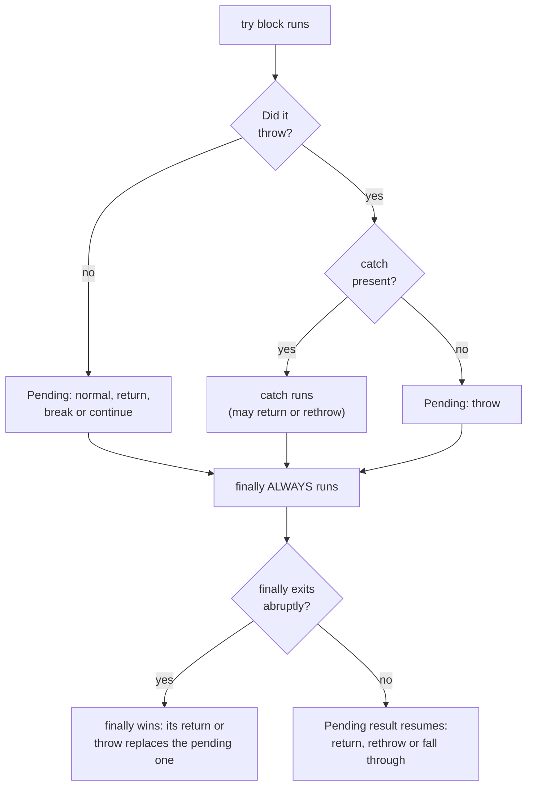
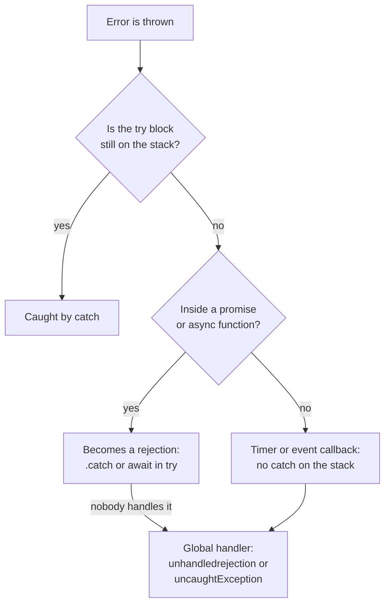

# Chapter 21: Error Handling, Strict Mode & Misc Internals

## 21.1 Definition and why interviewers ask it

**Error handling is the set of language rules for signalling and recovering from failure: `throw` raises any value, `try`/`catch`/`finally` intercepts it, and `Error` objects carry a type, message, stack and optional cause. Strict mode is an opt-in variant of the language that turns silent failures into exceptions and removes error-prone features. Property descriptors, accessors and tagged templates are the object-model and syntax details that explain much of the "why did that fail silently?" and "how does `` sql`...` `` work?" behaviour.**

Interviewers ask about errors because production JavaScript fails in unexpected places, and the answers show whether you understand sync versus async propagation, what `finally` really does, and how to build a useful error type. Strict mode and property descriptors come up in JavaScript-fundamentals rounds ("what does `'use strict'` change?", "what does `Object.freeze` do?") and as output-prediction puzzles. Tagged templates appear in framework-aware rounds (styled-components, `graphql-tag`, SQL libraries) and as a "what does this strange syntax do?" question (commonly reported).

## 21.2 Core concept

### Plain language

An exception is a fire alarm. `throw` pulls it, and the engine stops what it is doing and unwinds the call stack, frame by frame, until it finds a `catch` that handles it. `finally` is the "turn the lights off on your way out" rule: it runs whichever way you leave the room (finished normally, `return`, `break`, or an alarm). If someone in `finally` walks out through a different door (`return`, `throw`), that exit replaces the original one.

Strict mode is a stricter referee. Plays that sloppy mode waves through quietly (writing to a read-only property, using an undeclared variable) get a whistle (`TypeError`, `ReferenceError`). Property descriptors are the rule card attached to each property: can it change, can it be listed, can it be removed or redefined. A tagged template is a function that receives a template literal in pieces: the fixed text and the inserted values arrive separately, so the function can treat them differently (escape them, bind them as parameters, translate them).

### Precise version

**Built-in error types and when the engine throws each**

| Type | Thrown by the engine when | Example |
|---|---|---|
| `Error` | Base type. The engine rarely throws it directly. | `new Error('x')` |
| `TypeError` | A value is not of the expected type, or an operation is not allowed on it | `null.x`, `undefined()`, assigning to a `const`, writing a read-only property in strict mode, `1n + 1`, `new Symbol()` |
| `ReferenceError` | An identifier cannot be resolved, or is in the TDZ | `undeclared`, `this` before `super()`, strict-mode assignment to an undeclared name |
| `SyntaxError` | The source cannot be parsed. Also thrown at run time by `JSON.parse`, `eval`, `new Function`, `new RegExp`. | `JSON.parse('{bad')` |
| `RangeError` | A value is outside the allowed range | `new Array(-1)`, `'x'.repeat(-1)`, `(1).toFixed(101)`, call-stack overflow |
| `URIError` | Malformed input to `encodeURI`, `decodeURI`, `decodeURIComponent` | `decodeURIComponent('%')` |
| `EvalError` | Kept for compatibility. Current engines do not throw it. | (none) |
| `AggregateError` | Wraps several errors. Thrown by `Promise.any` when all inputs reject. | `err.errors` is the array |

`DOMException` (browsers and Node.js) is thrown by web APIs, for example `AbortError` or `DataCloneError`. It is an `Error` in practice (`instanceof Error`) and carries a legacy numeric `code`.

**`throw` accepts any value** (`throw 'oops'`, `throw { code: 42 }`, `throw null`), and `catch` receives it unchanged. Prefer `Error` objects: they capture a **stack trace** at construction, support `cause`, work with `instanceof`, and give tools such as debuggers and error reporters something to work with. Throwing a string loses all of that.

**Error object anatomy**

| Property | Where | Notes |
|---|---|---|
| `name` | `Error.prototype.name` (`'Error'`, `'TypeError'`, ...) | Own `name` is set only if you do so. Used by `toString()`. |
| `message` | Own, non-enumerable, only if a message was passed | `Error.prototype.message` is `''`. |
| `stack` | Own, non-enumerable in V8 | **Non-standard** in the spec (a proposal exists), but present in all major engines. Format differs between engines. Captured when the error is *created*, not when it is thrown. |
| `cause` | Own, non-enumerable, only if `{ cause }` option is passed (ES2022) | Chain the original error when you wrap it. |
| `errors` | `AggregateError` only | Array of the wrapped errors. |

Because own properties are non-enumerable, `JSON.stringify(new Error('x'))` is `'{}'` and `Object.keys(err)` is `[]`. `Error.captureStackTrace(obj)` exists in V8 (Chrome, Node.js) only. It attaches a stack to any object and can hide frames above a given function.

**Custom errors.** Use `class AppError extends Error`, call `super(message, options)` so the `Error` constructor installs `message`, `cause` and the stack, and set `name` (for example `this.name = new.target.name`). With native classes, `instanceof` works for every level of the hierarchy. The classic problem was ES5-transpiled output, where `Error.call(this)` cannot subclass, so `instanceof` failed unless you added `Object.setPrototypeOf(this, new.target.prototype)`.

**`try` / `catch` / `finally` semantics.** Each statement finishes with a *completion record*: `normal`, `return`, `break`, `continue` or `throw`. The rules:

1. If `try` completes abruptly with `throw` and there is a `catch`, the catch block runs with the thrown value. If it completes any other way, `catch` is skipped.
2. **`finally` always runs** when control leaves `try` or `catch`, whatever the completion type: normal, `return`, `break`, `continue` or `throw`. (It does not run if the process or thread is killed, `process.exit()` is called, or the code never leaves the block.)
3. The `return` expression is evaluated *before* `finally` runs, and the result is saved. If `finally` completes normally, the saved completion resumes. The saved value is a value, not a reference: `let n = 1; try { return n } finally { n = 2 }` returns `1`. (If the value is an object, `finally` can still mutate it.)
4. If `finally` itself completes abruptly (`return`, `throw`, `break`, `continue`), **its completion replaces the saved one**. A `return` in `finally` overrides the `try` return and swallows a pending exception. Avoid this.
5. A `catch` that throws still runs `finally`, and the new error propagates afterwards.
6. `catch` binding is optional since ES2019: `catch { ... }`. The `catch (e)` parameter is block-scoped, a `var` inside `catch` is function-scoped.

**Error handling by style**

| Style | How errors travel | How to handle |
|---|---|---|
| Synchronous | Exception unwinds the stack | `try`/`catch` around the call |
| Callbacks (Chapter 10) | Convention: error-first `(err, data)`. A `throw` inside an async callback runs on a different stack. | Check `err` in the callback. `try`/`catch` around the call that registered it does **not** see it. |
| Promises (Chapter 8) | A `throw` in `then`/executor becomes a rejection | `.catch()`, or the second argument of `then`. Always return or await promises so the chain is connected. |
| `async`/`await` (Chapter 9) | `await` of a rejected promise throws at the `await` | `try`/`catch` around the `await`. `return promise` (no `await`) inside `try` skips the `catch`. |

**What `try/catch` cannot catch.**

- A **syntax error** in the same script, because parsing fails before anything runs. (Syntax errors inside `eval`, `new Function` and `JSON.parse` can be caught, since they happen at run time.)
- An error thrown later on a different stack: inside `setTimeout`, event handlers or promise callbacks, when the `try` block has already finished.
- A rejected promise that you neither `await` nor `.catch`.
- Errors in other threads (`Worker`), which arrive as an `error` event on the worker object.
- Resource-loading failures (``, `<script>` `onerror`), which are events, not exceptions.

**Global handlers.** They are a last line of defence for reporting, not for recovery.

| Environment | Handler | Catches |
|---|---|---|
| Browser | `window.onerror` / `addEventListener('error')` | Uncaught synchronous exceptions and callback errors |
| Browser | `addEventListener('unhandledrejection')` | Promise rejections with no handler |
| Node.js | `process.on('uncaughtException')` | Uncaught exceptions. The process is in an undefined state, so log and exit. |
| Node.js | `process.on('unhandledRejection')` | Rejections with no handler. Since Node.js 15 the default is to crash the process with the error. |

**Error boundaries** (concept). A boundary is a place that catches errors from a subtree and shows a fallback instead of crashing the app. React implements it as a class component with `static getDerivedStateFromError` or `componentDidCatch`. It catches errors in rendering and lifecycle methods of children, not in event handlers or async code (use `try`/`catch` there). On the server, a Node.js process-level handler plays the same role.

**Strict mode.** Enabled with the directive `'use strict'` as the first statement of a script (whole script) or function (that function and everything inside it). It is automatic in ES modules and in class bodies. A directive in the middle of code does nothing. A function with non-simple parameters (defaults, destructuring, rest) cannot contain the directive (`SyntaxError`). Mixing a strict file with sloppy files by concatenation is a known hazard, which is why bundlers wrap each module.

**Strict vs sloppy, in detail**

| Area | Sloppy mode | Strict mode |
|---|---|---|
| `this` in a plain function call | `globalThis` | `undefined` |
| `this` with `call`/`apply` of a primitive | Boxed into an object (`5` becomes `Number {5}`), `null`/`undefined` become `globalThis` | Passed as is |
| Assign to undeclared name | Creates a global property | `ReferenceError` |
| Write to read-only, getter-only, frozen property | Silently ignored | `TypeError` |
| Add property to a non-extensible object | Ignored | `TypeError` |
| `delete` a non-configurable property | Returns `false` | `TypeError` |
| Write a property on a primitive (`'abc'.x = 1`) | Ignored | `TypeError` |
| Duplicate parameter names | Allowed | `SyntaxError` |
| `with` statement | Allowed | `SyntaxError` |
| Octal literals (`010`, `'\010'`) | Allowed | `SyntaxError` |
| `arguments` and parameters | Aliased for simple parameter lists | Not aliased |
| `arguments.callee` | Works | `TypeError` |
| Binding or assigning `eval` / `arguments` | Allowed | `SyntaxError` |
| `eval` variable scope | `var` leaks into the caller | Own scope |
| Function declaration in a block | Also a function-level `var` (Annex B) | Block-scoped only |
| `let`, `static`, `implements`, `interface`, `package`, `private`, `protected`, `public`, `yield` as identifiers | Allowed | `SyntaxError` |

**Accessors.** A property is either a *data property* (`value`, `writable`) or an *accessor property* (`get`, `set`). You create accessors with `get`/`set` in an object literal or class body, or with `Object.defineProperty`. Class and literal accessors are defined on the object or prototype (class accessors on `Class.prototype`, non-enumerable) and are inherited: a read finds the getter on the prototype chain and calls it with `this` equal to the object the read started on. Assigning to a property whose inherited accessor has only a getter fails (silently in sloppy mode, `TypeError` in strict mode) and does not create an own property. A property with `set` but no `get` reads as `undefined`.

**Property descriptors.** Every property has attributes:

| Attribute | Applies to | Controls | Literal / assignment default | `defineProperty` default for a new property |
|---|---|---|---|---|
| `value` | data | The stored value | the value | `undefined` |
| `writable` | data | Whether `[[Set]]` can change `value` | `true` | `false` |
| `get` / `set` | accessor | Functions run on read / write | as written | `undefined` |
| `enumerable` | both | Shown by `for...in`, `Object.keys`, `Object.entries`, spread, `JSON.stringify` | `true` | `false` |
| `configurable` | both | Whether the property can be deleted, or its attributes (except `value` of a writable property, and `writable` from `true` to `false`) changed | `true` | `false` |

When `defineProperty` is applied to an *existing* property, attributes you leave out keep their current value. You cannot mix `get`/`set` with `value`/`writable` in one descriptor (`TypeError`). A non-configurable property cannot be redefined with different attributes, except that a writable one may still change its value and may be made non-writable. `Object.getOwnPropertyDescriptor(s)` reads descriptors, `Object.defineProperties` writes several at once. `Object.freeze` sets every own property to non-configurable, and non-writable for data properties, and makes the object non-extensible. It is shallow. `Object.seal` makes properties non-configurable but keeps them writable. `Object.preventExtensions` only blocks adding properties. The `length` of an array is a non-enumerable, non-configurable, writable data property. Setting it truncates the array, but truncation stops at the first non-configurable element, so `length` can end up larger than requested (sloppy mode) or a `TypeError` is thrown (strict mode).

**Tagged templates.** A call in the form ``tag`text ${a} more ${b}` `` calls `tag(strings, a, b)`:

- `strings` is an array of the cooked (escape-processed) string pieces, always one more than the number of values. It has a `raw` property holding the uncooked pieces (backslashes as typed).
- `strings` and `strings.raw` are **frozen**, and the array is created **once per call site** and cached, so the same code location passes the identical array object every time. Two textually identical templates at different places give different arrays. Libraries use this for caching (for example one parsed query per call site).
- Since ES2018, invalid escape sequences are allowed in tagged templates. The cooked piece is `undefined` and only `raw` has the text.
- The tag can return **anything**, not only a string: an object, a function, a React element description.
- `String.raw` is a built-in tag that returns the raw pieces joined with the values.
- The expression values are evaluated left to right before the tag is called, and they are passed as they are, with no string conversion. The tag decides how to convert them.

Use cases: escaping HTML (`` html`<p>${userInput}</p>` ``), parameterised SQL (turn each value into a `$1` placeholder and pass values separately, which prevents injection), styled-components (`` styled.div`color: ${p => p.c};` ``), GraphQL documents, i18n message lookup.

**Other small internals worth a mention**

- **Labelled statements.** `outer: for (...) { ... continue outer; }` lets `break label` and `continue label` leave several levels. A label can also name a plain block (`blk: { ... break blk; }`).
- **Comma operator.** `(a, b)` evaluates both and gives `b`. The `(0, obj.method)()` idiom calls a function detached from `obj` (and `(0, eval)(code)` makes an indirect eval).
- **`void 0`** is `undefined` that cannot be shadowed (`undefined` is a global property, and a local variable named `undefined` is legal).
- **Optional chaining `a?.b.c.d`** short-circuits the *whole chain*: if `a` is `null` or `undefined`, the rest, including later calls and computed keys, is not evaluated, and the result is `undefined`. `a?.[i++]` does not increment `i` when `a` is nullish.
- **Nullish coalescing `a ?? b`** returns `b` only for `null` or `undefined` (not for `0`, `''`, `false`). `b` is not evaluated otherwise. Mixing `??` with `||` or `&&` without parentheses is a `SyntaxError`.
- **`Symbol.toStringTag` and `Object.prototype.toString`.** `Object.prototype.toString.call(x)` reads `x[Symbol.toStringTag]`, falling back to a built-in tag. It is the most reliable check for arrays, dates, `null`, regexps and so on (`[object Null]`, `[object Array]`), and a class can customise it.
- **`Function.prototype.length` and `name`.** `length` is the number of parameters before the first default or rest parameter. `name` is inferred from the binding (`const f = () => {}` has name `'f'`), prefixed for getters (`'get x'`) and bound functions (`'bound g'`). Both are non-writable but configurable.

## 21.3 How it works internally

### A. Creating, throwing and catching an error

1. `new Error(msg, { cause })` runs the `Error` constructor with `new.target`. It creates an ordinary object whose prototype comes from `new.target.prototype`, installs a non-enumerable `message` (if given) and `cause` (if the option is present), and the engine attaches the stack trace. In V8 the stack string is captured **at construction**, which is why an error created in one place and thrown in another reports where it was created.
2. `throw v` produces a *throw completion* carrying `v`. Each enclosing statement checks the completion, and function calls propagate it by popping the execution context (Chapter 1) and handing the completion to the caller.
3. The first `try` statement whose `try` block produced the completion and that has a `catch` gets the value bound to the catch parameter in a new block environment (Chapter 3).
4. If the stack empties with the throw completion still pending, the host reports an uncaught exception.

### B. `finally` and completion records

1. Evaluate the `try` block, giving a completion `B` (normal, return, break, continue or throw).
2. If `B` is a throw and there is a `catch`, evaluate it and replace `B` with that result `C`.
3. If there is a `finally`, evaluate it, giving `F`. A `return` expression has already been evaluated by now, so its value sits in `B`.
4. If `F` is *normal*, the result is `B` (the saved completion resumes). Otherwise the result is `F` and `B` is discarded. This is why `return` in `finally` overrides and swallows exceptions.

### C. Strict mode in the engine

1. The parser decides strictness per function from the directive prologue and from the enclosing code (modules and class bodies are always strict). Many strict rules are **early errors**: duplicate parameters, `with`, octal literals, `delete identifier`, binding `eval`. The whole script fails to parse, so nothing in it runs.
2. At call time, `this` binding differs: for a sloppy function, an `undefined` or `null` `this` becomes the global object and a primitive is converted with `ToObject`. For a strict function the value is used as it is.
3. An assignment `obj.x = v` ends in `obj.[[Set]]('x', v, obj)`, which returns `true` or `false`. The assignment operator then throws `TypeError` on `false` only in strict code. Assigning to an unresolvable name creates a global property in sloppy mode and throws `ReferenceError` in strict mode.
4. In sloppy functions with simple parameters, `arguments` is a *mapped* object whose indices alias the parameter bindings. Strict functions get an unmapped `arguments`, and `callee` is a poison-pill accessor that throws.

### D. Property descriptors

1. Literal creation and `obj.x = v` on a missing property call `CreateDataProperty`: all three attributes `true`.
2. `Object.defineProperty(obj, key, desc)` calls `[[DefineOwnProperty]]`, which runs `ValidateAndApplyPropertyDescriptor`. For a new property, missing fields default to `false`/`undefined`. For an existing property, it rejects changes to a non-configurable property (with the exceptions above) and returns `false`. `Object.defineProperty` turns that `false` into a `TypeError`, `Reflect.defineProperty` returns it.
3. Reads: `[[Get]]` finds the property on the object or up the prototype chain. A data property returns `value`. An accessor calls `get` with the original receiver as `this`.
4. Writes: `[[Set]]` (`OrdinarySet`) finds the property on the chain. A non-writable data property anywhere on the chain blocks the write, an inherited accessor calls `set`, otherwise an own data property is created or updated on the receiver.

### E. Tagged template evaluation

1. At parse time each template literal site gets a *template object*, created lazily on first evaluation: cooked strings array, `raw` array, both frozen, stored per site in the realm.
2. At each evaluation the expressions are evaluated left to right to give the values.
3. The tag is called as `tag(templateObject, ...values)`. When the tag is a member expression (`obj.tag`...), `this` is `obj`.

## 21.4 Diagrams

### try / catch / finally control flow



> **How to explain this to the interviewer**
>
> 1. Trace the left column: `try` runs, and if it throws, `catch` runs. Both routes (and the no-throw route) funnel into one box, `finally`.
> 2. Say: "whatever was pending, a return, a throw or a break, is parked while `finally` runs".
> 3. Point at the last decision: "if `finally` finishes normally, the parked result resumes. If it does a `return` or `throw` of its own, that replaces the parked one, which is how a `return` in `finally` swallows an exception".
>
> **Takeaway:** `finally` runs on every exit, and it can overwrite the exit it was guarding.

### Which errors can a try/catch see?



> **How to explain this to the interviewer**
>
> 1. Start at the top and ask the one question that decides everything: "is my `try` block still on the call stack when the error happens?"
> 2. Follow "no" to the two cases: promise or async code turns the error into a rejection, and callbacks from timers and events run on a fresh stack with nothing to catch them.
> 3. Finish at the global handlers: "both paths end at the global handler if nobody deals with them, and those are for reporting, not recovery".
>
> **Takeaway:** `try`/`catch` only catches what is thrown while it is on the stack, and `await` is what puts a rejection back on it.

### Custom error prototype chain

```ascii Prototype chain of new ValidationError('age', 'bad age', { cause })
  instance  ve
  +-----------------------------------+
  | own: message  'bad age'           |
  |      cause    RangeError(...)     |      ve instanceof ValidationError  true
  |      stack    'ValidationError...'|      ve instanceof AppError         true
  |      name     'ValidationError'   |      ve instanceof Error            true
  |      field    'age'               |
  | [[Prototype]] ---------+          |
  +------------------------|----------+
                           v
   ValidationError.prototype  (constructor: ValidationError)
        | [[Prototype]]
        v
   AppError.prototype         (constructor: AppError)
        | [[Prototype]]
        v
   Error.prototype            (name: 'Error', message: '', toString())
        | [[Prototype]]
        v
   Object.prototype  ->  null

   Error constructor runs via super(...): it installs message, cause and stack
   on the new object. Without super(), `this` does not exist (ReferenceError).
```

> **How to explain this to the interviewer**
>
> 1. Draw the instance box on top with its own properties, and three boxes underneath linked by arrows: `ValidationError.prototype`, `AppError.prototype`, `Error.prototype`.
> 2. Say: "`instanceof` walks this chain, so one instance matches every class above it".
> 3. Point at the `super()` note: "the base `Error` constructor creates the object and sets message, cause and the stack, so a subclass must call it first".
>
> **Takeaway:** a custom error is an ordinary prototype chain ending in `Error.prototype`.

### What each descriptor attribute controls

```ascii Property descriptor attributes, their defaults, and what they control
 attribute     kind      literal /     defineProperty   what it controls
                         assignment    (new property)
 ------------- --------- ------------- ---------------- ------------------------
 value         data      the value     undefined        the stored value
 writable      data      true          false            can [[Set]] change value
 get           accessor  as written    undefined        function run on read
 set           accessor  as written    undefined        function run on write
 enumerable    both      true          false            for-in, Object.keys,
                                                        Object.entries, spread,
                                                        JSON.stringify
 configurable  both      true          false            delete, redefine, change
                                                        kind (data <-> accessor)

 A property is EITHER data (value, writable) OR accessor (get, set), never both.
 Existing property + defineProperty: omitted attributes KEEP their current value.

 Object.preventExtensions : no new properties
 Object.seal              : + every property non-configurable
 Object.freeze            : + every data property non-writable   (shallow)
```

> **How to explain this to the interviewer**
>
> 1. Draw a six-row table with the attribute names and a column "what it controls".
> 2. Mark the three that matter for visibility and mutation: `writable` (change the value), `enumerable` (show up in loops and JSON), `configurable` (delete or redefine).
> 3. Add the defaults and say: "a plain assignment creates all `true`, `defineProperty` on a new property creates all `false`, and that is why defined properties are hidden and read-only".
>
> **Takeaway:** three booleans per property decide whether it can change, show up, and be removed.

### How a tagged template is desugared

```ascii A tagged template is a function call: strings array first, values after
   tag`Hi ${name}, you are ${age}!`

   becomes

   tag( strings,         name,   age )
          |
          +--> strings      = [ 'Hi ',  ', you are ',  '!' ]    cooked, frozen
               strings.raw  = [ 'Hi ',  ', you are ',  '!' ]    as typed, frozen

   Interleave to rebuild:   strings[0] + v0 + strings[1] + v1 + strings[2]
   strings.length == values.length + 1   (even for tag`` and tag`${x}`)

   Per call site: the SAME strings object on every evaluation of this source
   location. Two identical-looking templates in different places: different objects.
   The tag may return anything: string, object, function.
```

> **How to explain this to the interviewer**
>
> 1. Write a tagged template on the left and the equivalent function call on the right with an arrow between them.
> 2. Underline the two arrays: "the fixed text goes into a frozen `strings` array, the substituted values are separate arguments, and there is always one more string than values".
> 3. Say: "so the function can treat code and data differently, which is how SQL placeholders and HTML escaping work".
>
> **Takeaway:** the template is split into text and values before the tag runs, and the tag decides how to put them back together.

### Strict mode versus sloppy mode

```ascii Strict mode turns silent failures into errors and removes risky features
 situation                              sloppy                 strict
 -------------------------------------  ---------------------  -----------------
 this in f()                            globalThis             undefined
 this in f.call(5)                      Number object          5
 x = 1  (x undeclared)                  creates a global       ReferenceError
 write read-only / getter-only prop     ignored                TypeError
 add property to frozen object          ignored                TypeError
 delete non-configurable property       returns false          TypeError
 function f(a, a) {}                    allowed                SyntaxError
 with (obj) {}                          allowed                SyntaxError
 010  (octal)                           8                      SyntaxError
 arguments[0] after a = 99              99 (aliased)           original value
 arguments.callee                       the function           TypeError
 eval('var v')                          leaks v to caller      private scope
 { function g() {} }  then g outside    visible (Annex B)      not visible
 var let, public, yield ...             allowed (most)         SyntaxError

 Automatic strict:  ES modules, class bodies.   Opt in:  'use strict' directive.
```

> **How to explain this to the interviewer**
>
> 1. Draw two columns, sloppy and strict, and say: "strict mode does two things: errors instead of silent failure, and bans features that confuse the engine or the reader".
> 2. Fill in the three that interviewers ask for most: `this` is `undefined` in a plain call, assigning to an undeclared name throws `ReferenceError`, and writes to read-only properties throw `TypeError`.
> 3. Finish with how it turns on: the directive at the top of a script or function, and automatically in modules and classes.
>
> **Takeaway:** strict mode makes bugs loud and the semantics simpler for the engine.

### Whiteboard version

```ascii Whiteboard version: return in finally wins (draw in 60 seconds)
   function f() { try { return 'A'; } finally { return 'B'; } }      ->  'B'

   1. try   : evaluate 'A', park it as "return A"
   2. finally runs: it does its own "return B"
   3. finally exited abruptly -> its completion REPLACES the parked one

   finally ends normally  ->  parked "return A" resumes   (result 'A')
   finally throws/returns ->  parked completion is dropped (exception swallowed)
```

## 21.5 Code examples

### Example 1: the built-in error types and when they appear

```js
const attempts = [
  () => undeclaredName,
  () => null.property,
  () => new Array(-1),
  () => JSON.parse('{bad'),
  () => decodeURIComponent('%'),
  () => new Function('return ]'),
  () => { const c = 1; c = 2; },
];
for (const attempt of attempts) {
  try { attempt(); } catch (e) { console.log(e.name, e instanceof Error); }
}
try { throw 'a string'; } catch (e) { console.log(typeof e, e instanceof Error, e.stack); }
```

```text output
ReferenceError true
TypeError true
RangeError true
SyntaxError true
URIError true
SyntaxError true
TypeError true
string false undefined
```

**Why:** each failure maps to one type. `JSON.parse` and `new Function` throw `SyntaxError` at run time, so `try`/`catch` can see them. A thrown string has no `stack` and is not an `Error`, which is why you should throw `Error` objects.

### Example 2: anatomy of an error, `cause` and `AggregateError`

```js
const root = new TypeError('root cause');
const err = new Error('top level', { cause: root });

console.log(err.name, err.message, err.cause === root);
console.log(Object.keys(err), Object.getOwnPropertyNames(err).sort());
console.log(JSON.stringify(err), String(err), err.stack.split('\n')[0]);

const agg = new AggregateError([new Error('a'), new RangeError('b')], 'several');
console.log(agg.name, agg.errors.map((e) => e.name), agg instanceof Error);
Promise.any([Promise.reject(new Error('x')), Promise.reject(new Error('y'))])
  .catch((e) => console.log(e.constructor.name, e.errors.length));
```

```text output
Error top level true
[] [ 'cause', 'message', 'stack' ]
{} Error: top level Error: top level
AggregateError [ 'Error', 'RangeError' ] true
AggregateError 2
```

**Why:** `message`, `cause` and `stack` are own, non-enumerable properties, so `Object.keys` and `JSON.stringify` see nothing. The first line of the V8 stack is the same as `String(err)`. `Promise.any` rejects with an `AggregateError` that lists every rejection.

### Example 3: `finally` can override a `return` and swallow an exception

```js
function a() { try { return 'try'; } finally { console.log('a: finally runs'); } }
function b() { try { return 'try'; } finally { return 'finally'; } }
function c() { try { throw new Error('boom'); } finally { return 'swallowed'; } }
function d() { let n = 1; try { return n; } finally { n = 2; } }
function e() { const o = { n: 1 }; try { return o; } finally { o.n = 2; } }

console.log(a());
console.log(b());
console.log(c());
console.log(d(), e());
```

```text output
a: finally runs
try
finally
swallowed
1 { n: 2 }
```

**Why:** `a` runs `finally` before the function returns. In `b` the `finally` completion replaces the parked `return`. In `c` it also discards the pending throw. In `d` the return value was evaluated before `finally` changed `n`. In `e` the saved value is the object reference, so mutating it is visible.

### Example 4: `finally` with `continue` and `break`, and the optional catch binding

```js
for (let i = 0; i < 3; i++) {
  try {
    if (i === 1) continue;
    console.log('body', i);
  } finally {
    console.log('finally', i);
  }
}

function f() {
  for (let i = 0; i < 3; i++) {
    try { return 'return ' + i; } finally { break; }
  }
  return 'after loop';
}
console.log(f());

try { throw new Error('ignored'); } catch { console.log('no binding needed'); }
```

```text output
body 0
finally 0
finally 1
body 2
finally 2
after loop
no binding needed
```

**Why:** `continue` is a completion too, so `finally` runs before the loop continues. In `f`, the `break` in `finally` replaces the pending `return`, so the loop exits and the function carries on to `return 'after loop'`.

### Example 5: `try`/`catch` and async code

```js
const fail = () => Promise.reject(new Error('rejected'));

async function noAwait() {
  try { return fail(); } catch (e) { return 'caught inside'; }
}
async function withAwait() {
  try { return await fail(); } catch (e) { return 'caught inside'; }
}

(async () => {
  console.log(await withAwait());
  await noAwait().catch((e) => console.log('escaped the try:', e.message));

  try {
    setTimeout(() => { throw new Error('too late'); }, 0);
  } catch (e) {
    console.log('never printed');
  }
  process.once('uncaughtException', (e) => console.log('global handler:', e.message));
})();
```

```text output
caught inside
escaped the try: rejected
global handler: too late
```

**Why:** `return fail()` hands the promise to the caller before it settles, so the `catch` has already been left. `return await` keeps the function inside the `try` while waiting. The timer callback runs on a fresh stack after the `try` block has ended, so only the process-level handler sees it.

### Example 6: global handlers for unhandled rejections (Node.js)

```js
process.on('unhandledRejection', (reason) => {
  console.log('unhandledRejection:', reason.message);
});

Promise.reject(new Error('nobody handled me'));
const handled = Promise.reject(new Error('handled in time'));
handled.catch((e) => console.log('caught:', e.message));
```

```text output
caught: handled in time
unhandledRejection: nobody handled me
```

**Why:** the host checks for rejections with no handler after the current microtask queue drains. The handled one has a `catch` attached in time. In browsers the equivalent is `window.addEventListener('unhandledrejection', ...)`. Without a handler, current Node.js terminates the process.

### Example 7: `this`, undeclared variables and silent failures

```js
function sloppy() { return typeof this; }
function strict() { 'use strict'; return typeof this; }
console.log(sloppy(), strict(), sloppy.call(5), strict.call(5));

function leak() { leaked = 1; }
function noLeak() { 'use strict'; notDeclared = 1; }
leak();
console.log(typeof globalThis.leaked);
try { noLeak(); } catch (e) { console.log(e.name + ': ' + e.message); }

const frozen = Object.freeze({ id: 1 });
frozen.id = 2;                                    // sloppy: silently ignored
console.log(frozen.id);
(function () {
  'use strict';
  try { frozen.id = 2; } catch (e) { console.log(e.name); }
  try { delete frozen.id; } catch (e) { console.log(e.name); }
  try { frozen.extra = 1; } catch (e) { console.log(e.name); }
})();
```

```text output
object undefined object number
number
ReferenceError: notDeclared is not defined
1
TypeError
TypeError
TypeError
```

**Why:** the sloppy call gets `globalThis`, and `call(5)` boxes the primitive, so `typeof` is `'object'`. The sloppy `leaked = 1` creates a global. The frozen object ignores writes silently until strict mode turns each one into a `TypeError`.

### Example 8: descriptors, defaults and `defineProperty`

```js
const o = { visible: 1 };
Object.defineProperty(o, 'hidden', { value: 2 });
console.log(Object.getOwnPropertyDescriptor(o, 'visible'));
console.log(Object.getOwnPropertyDescriptor(o, 'hidden'));
console.log(Object.keys(o), JSON.stringify(o), o.hidden, Object.getOwnPropertyNames(o));

o.hidden = 99;                                   // sloppy: ignored
console.log(o.hidden, delete o.hidden);
try { Object.defineProperty(o, 'hidden', { value: 3 }); } catch (e) {
  console.log(e.name + ': ' + e.message);
}
console.log(Reflect.defineProperty(o, 'hidden', { value: 3 }));

const arr = [1, 2, 3];
Object.defineProperty(arr, 1, { configurable: false });
arr.length = 0;                                  // stops at the non-configurable index
console.log(arr, arr.length);
```

```text output
{ value: 1, writable: true, enumerable: true, configurable: true }
{ value: 2, writable: false, enumerable: false, configurable: false }
[ 'visible' ] {"visible":1} 2 [ 'visible', 'hidden' ]
2 false
TypeError: Cannot redefine property: hidden
false
[ 1, 2 ] 2
```

**Why:** `defineProperty` on a new key defaults all attributes to `false`, so `hidden` is read-only, hidden from `Object.keys` and JSON, and cannot be deleted or redefined. `Reflect.defineProperty` reports failure as `false` where `Object.defineProperty` throws. Truncating an array stops at the first non-configurable element.

### Example 9: getters, setters and inheritance

```js
class Temperature {
  #celsius = 0;
  get celsius() { return this.#celsius; }
  set celsius(v) { this.#celsius = v; }
  get fahrenheit() { return this.#celsius * 1.8 + 32; }       // getter only
}
const t = new Temperature();
t.celsius = 100;
console.log(t.celsius, t.fahrenheit, Object.keys(t));
t.fahrenheit = 0;                              // sloppy script: ignored
console.log(t.fahrenheit);
try { (() => { 'use strict'; t.fahrenheit = 0; })(); } catch (e) { console.log(e.name); }

const proto = { get kind() { return 'from proto'; } };
const child = Object.create(proto);
child.kind = 'own';                            // inherited getter only: ignored
console.log(child.kind, Object.hasOwn(child, 'kind'));

const writeOnly = { set v(x) { this._v = x; } };
writeOnly.v = 5;
console.log(writeOnly.v, writeOnly._v);
console.log(Object.getOwnPropertyDescriptor(Temperature.prototype, 'celsius').enumerable);
```

```text output
100 212 []
212
TypeError
from proto false
undefined 5
false
```

**Why:** accessors live on the prototype, so instances inherit them and `Object.keys(t)` is empty. A getter-only accessor ignores assignment (sloppy) or throws (strict), and an inherited getter-only accessor blocks creating an own property of the same name. A setter without a getter reads as `undefined`. Class accessors are non-enumerable.

### Example 10: tagged templates, `raw` and per-site caching

```js
function show(strings, ...values) {
  return { cooked: [...strings], raw: [...strings.raw], values };
}
console.log(show`a${1}b${2}c`);
console.log(show`line1\nline2 C:\temp`);

const same = (s) => s;
const site = () => same`x${1}y`;
console.log(site() === site(), same`x${1}y` === same`x${1}y`);
console.log(Object.isFrozen(site()), Object.isFrozen(site().raw), site().length);

console.log(String.raw`C:\new\table${1 + 1}`, String.raw({ raw: ['a', 'b', 'c'] }, 1, 2));
console.log(((s) => s[0])`\unicode`, ((s) => s.raw[0])`\unicode`);
```

```text output
{ cooked: [ 'a', 'b', 'c' ], raw: [ 'a', 'b', 'c' ], values: [ 1, 2 ] }
{
  cooked: [ 'line1\nline2 C:\temp' ],
  raw: [ 'line1\\nline2 C:\\temp' ],
  values: []
}
true false
true true 2
C:\new\table2 a1b2c
undefined \unicode
```

**Why:** the cooked string contains a real newline and a tab, `raw` keeps the backslashes. The same call site always receives the same frozen array, while two lookalike sites do not. `String.raw` just joins `raw` and the values. An invalid escape such as `\unicode` is legal in a tagged template and gives `undefined` for the cooked piece.

### Example 11: small internals in one place

```js
outer: for (let i = 0; i < 3; i++) {
  for (let j = 0; j < 3; j++) {
    if (j === 1) continue outer;
    if (i === 2) break outer;
    console.log('pair', i, j);
  }
}

console.log((1, 2, 3), void 0, typeof void 0);

let steps = 0;
const maybe = null;
maybe?.a[steps++].b();                        // whole chain skipped
console.log(maybe?.a.b.c, steps, 0 ?? 'x', '' ?? 'x', null ?? 'x');

function f(a, b = 1, c) {}
console.log(f.length, ((...rest) => {}).length, f.name, (() => {}).name);
const bound = f.bind(null);
const withGetter = { get g() { return 1; } };
console.log(bound.name, Object.getOwnPropertyDescriptor(withGetter, 'g').get.name);

const tag = (x) => Object.prototype.toString.call(x);
console.log(tag(null), tag([]), tag(new Date(0)), tag(/x/), tag(Promise.resolve()));
class Money { get [Symbol.toStringTag]() { return 'Money'; } }
console.log(tag(new Money()));
```

```text output
pair 0 0
pair 1 0
3 undefined undefined
undefined 0 0  x
1 0 f 
bound f get g
[object Null] [object Array] [object Date] [object RegExp] [object Promise]
[object Money]
```

**Why:** `continue outer` jumps to the next iteration of the outer loop. The comma operator yields its last operand. Once `maybe` is nullish the whole `?.` chain stops, so `steps++` never runs. `??` treats `0` and `''` as present values. `length` stops counting at the first default parameter. `Object.prototype.toString` gives reliable type tags and honours `Symbol.toStringTag`.

## 21.6 Common mistakes and gotchas

- **Throwing strings or plain objects.** No stack, no `instanceof Error`, poor reporting. Throw `Error` subclasses.
- **Forgetting `super(message)`.** In a derived class `this` does not exist before `super()` (`ReferenceError`), and `message` and `stack` would be missing. See Question 21.15.
- **Relying on `error.name` set by the prototype only.** A custom error without `this.name = ...` prints as `Error`. Set the name, usually from `new.target.name`.
- **Expecting `JSON.stringify(error)` to show anything.** `message`, `stack` and `cause` are non-enumerable. Serialise explicitly (`{ name, message, stack, cause }`).
- **`return` inside `finally`.** It overrides the earlier `return` and swallows exceptions. Keep `finally` for cleanup only.
- **Wrapping callback or timer code in `try`/`catch`.** It does not see errors thrown later on another stack. Handle the error inside the callback.
- **`return promise` inside `try` without `await`.** The `catch` and `finally` run before the promise settles. Use `return await`.
- **Empty `catch` blocks.** They hide real bugs. At least log, or rethrow what you cannot handle.
- **Catching everything and continuing.** After `uncaughtException` the process is in an unknown state. Log and exit. In the browser, a global `onerror` is for reporting.
- **Assuming strict mode applies everywhere.** It applies to the function or script that contains the directive, and automatically to modules and class bodies. Sloppy code called from strict code keeps its own mode, and a misplaced `'use strict'` (not the first statement) is silently ignored.
- **Putting `'use strict'` in a function with default or destructured parameters.** That is a `SyntaxError`.
- **Thinking `Object.freeze` is deep.** Nested objects stay mutable (Question 21.8).
- **Assuming `Object.defineProperty` defaults match assignment.** For a new property they are all `false`.
- **Expecting a strict-mode TypeError for a failed write in a sloppy script.** The write is silently skipped, so a missing setter or a frozen object looks like a no-op.
- **Mutating the `strings` array of a tagged template.** It is frozen (strict code throws), and shared across evaluations of the call site. Copy it first.
- **Building SQL or HTML by hand-concatenating values.** Use a tag that keeps values separate. The tag only helps if it actually escapes or parameterises.
- **Using `|| ` where `??` is meant.** `0`, `''` and `false` fall through to the default with `||`.

## 21.7 Quick revision cheat sheet

- **Error types:** `TypeError` (wrong type, read-only write in strict), `ReferenceError` (unresolvable name, TDZ), `SyntaxError` (parse, `JSON.parse`), `RangeError` (out of range, stack overflow), `URIError`, `EvalError` (unused), `AggregateError` (`Promise.any`).
- **Errors are objects with** `name`, `message`, `stack` (non-standard), `cause` (ES2022). Own properties are non-enumerable. Throw `Error`s, not strings. Custom: `class X extends Error`, call `super(message, options)`, set `name`.
- **`finally` runs on every exit** (not on `process.exit` or a crash). A `return` or `throw` in `finally` overrides the pending completion. The `return` value is computed before `finally` runs.
- **Async:** `try`/`catch` sees only what is thrown while it is on the stack. Use `await` (and `return await`) or `.catch`. Global fallbacks: `unhandledrejection`, `uncaughtException`, `unhandledRejection`.
- **Strict mode:** `'use strict'` in a script or function, automatic in modules and classes. `this` is `undefined` in plain calls, undeclared assignment and silent failures throw, no `with`, no octals, no duplicate params, no `arguments.callee`, own `eval` scope, block-scoped functions.
- **Descriptors:** `value`/`writable` or `get`/`set`, plus `enumerable` and `configurable`. Literals and assignment default to `true`, `defineProperty` on a new property to `false`. `freeze` is shallow.
- **Accessors** are inherited. Getter-only means assignments are ignored (strict: `TypeError`). Setter-only reads as `undefined`.
- **Tagged templates:** `tag(strings, ...values)`, `strings.raw`, frozen, cached per call site, tag may return anything. `String.raw` is the built-in raw tag.

## 21.8 Interview questions

*Key: ★ = very frequently reported. "Typically asked in" lines say which round a question tends to appear in; where no single source could be pinned down the question is labelled "commonly reported". Draw-it hints refer to the figures in section 21.4.*

#### Conceptual

### Q21.1 ★ Medium: What error types does JavaScript have, and how do you create a custom error?

*Typically asked in: JavaScript fundamentals round (commonly reported).*

> **Model answer**
>
> The built-in types are `Error` as the base, then `TypeError` for wrong types such as calling `undefined`, `ReferenceError` for names that do not resolve or sit in the TDZ, `SyntaxError` for unparseable code including `JSON.parse`, `RangeError` for out-of-range values and stack overflow, `URIError`, the unused `EvalError`, and `AggregateError`, which wraps several errors for `Promise.any`. For a custom error I write a class that extends `Error`, call `super(message, { cause })`, and set `name` and any extra fields such as a code. I throw `Error` objects, not strings, because they carry a stack trace and work with `instanceof`.

**Key points to mention**

- Types and when the engine throws each (table in 21.2).
- `name`, `message`, `stack`, `cause`: own non-enumerable properties.
- Custom error: `extends Error`, `super`, `name`, `instanceof` works.
- Any value can be thrown, but prefer `Error`.
- Draw it: Figure 21.3.

### Q21.2 ★ Medium: How do you handle errors in asynchronous code?

*Typically asked in: JavaScript fundamentals and async rounds (commonly reported).*

> **Model answer**
>
> A `try`/`catch` only catches errors thrown while it is on the call stack, so each async style needs its own mechanism. With callbacks, I check the `err` argument. With promises, a throw in `then` becomes a rejection, so I end the chain with `.catch`, and I always return the inner promises so the chain is connected. With `async`/`await`, I wrap the `await` in `try`/`catch`, and I use `return await` when the `catch` must see the failure. I use `Promise.allSettled` when I want every result. For anything that slips through I register `unhandledrejection` in browsers or `unhandledRejection` in Node.js, to report it.

**Key points to mention**

- Why `try`/`catch` around a callback registration does not work.
- `.catch` at the end of the chain, return promises, `finally` for cleanup.
- `await` brings the rejection back as an exception. `return promise` versus `return await promise`.
- `Promise.all` fails fast, `allSettled` waits, `any` gives `AggregateError`.
- Global handlers are for reporting. Chapters 8, 9 and 10.
- Draw it: Figure 21.2.

### Q21.3 ★ Medium: What is strict mode, how do you enable it, and what does it change?

*Typically asked in: JavaScript fundamentals round (commonly reported).*

> **Model answer**
>
> Strict mode is an opt-in variant of JavaScript that removes silent failures and some confusing features. You enable it with the `'use strict'` directive as the first statement of a script or a function, and it is automatic in ES modules and class bodies. It changes a lot: `this` is `undefined` in a plain function call instead of the global object, assigning to an undeclared variable throws `ReferenceError`, writes to read-only or frozen properties and deletes of non-configurable ones throw `TypeError`, duplicate parameter names, `with` and octal literals are syntax errors, `arguments` is not aliased to parameters, `arguments.callee` throws, and `eval` gets its own variable scope.

**Key points to mention**

- Directive at the top of a script or function. Modules and classes are strict by default.
- Silent failures become `TypeError` or `ReferenceError`.
- Syntax bans: `with`, duplicate params, octal, `eval`/`arguments` as names, new reserved words.
- `this` is not boxed or replaced by the global object.
- Cannot use the directive with non-simple parameters.
- Draw it: Figure 21.6.

### Q21.4 ★ Hard: What are property descriptors, and how does `Object.defineProperty` work?

*Typically asked in: JavaScript fundamentals and senior rounds (commonly reported).*

> **Model answer**
>
> Every property has a descriptor. A data property has `value` and `writable`, an accessor property has `get` and `set`, and both kinds have `enumerable` and `configurable`. `Object.getOwnPropertyDescriptor` reads it and `Object.defineProperty` creates or changes a property. Plain assignment creates a property with every flag `true`, but `defineProperty` on a new property defaults them all to `false`, so it is read-only, hidden from `Object.keys`, `for...in` and JSON, and cannot be deleted or redefined. A non-configurable property cannot be reconfigured. `Object.freeze` applies this to all properties, shallowly. Accessors let a property run code on read and write, and Vue 2 used them for reactivity.

**Key points to mention**

- Data versus accessor descriptors, the four flags.
- Defaults: `true` for assignment, `false` for `defineProperty` of a new key. Existing keys keep their old attributes.
- Effect on `for...in`, `Object.keys`, JSON, `delete`, redefinition.
- `defineProperty` throws, `Reflect.defineProperty` returns `false`.
- Array `length` quirk. `freeze`, `seal`, `preventExtensions`.
- Draw it: Figure 21.4.

### Q21.5 Medium: What are tagged templates, what is `strings.raw`, and what are they used for?

*Typically asked in: framework-aware JavaScript rounds (commonly reported).*

> **Model answer**
>
> A tagged template is a function call written as a tag followed by a template literal. The tag receives a frozen array of the literal's text pieces first, with a `raw` property that holds the unprocessed text with backslashes as typed, and then each `${}` value as a separate argument. The strings array always has one more entry than the values and is cached per call site. The tag can return anything. Uses: escaping HTML, building parameterised SQL so values never get concatenated, `styled-components`, GraphQL documents, i18n. `String.raw` is a built-in tag that returns the raw text, handy for Windows paths and regexes.

**Key points to mention**

- `tag(strings, ...values)`, `strings.length === values.length + 1`.
- `strings.raw` versus cooked, `String.raw`.
- Frozen, same object each time for a call site.
- Not limited to strings: any return type.
- Safety use cases (SQL, HTML) and DSL use cases.
- Draw it: Figure 21.5.

#### Output prediction

### Q21.6 ★ Medium: What does this print? (`try`, `catch`, `finally` and `return`)

*Typically asked in: JavaScript fundamentals round (commonly reported; the "finally overwrites the return value" question is a long-standing Stack Overflow topic).*

```js
function a() { try { return 'try'; } finally { console.log('a finally'); } }
function b() {
  try { throw new Error('x'); } catch (e) { return 'catch'; } finally { return 'finally'; }
}
function c() { let n = 1; try { return n; } finally { n = 2; } }
function d() {
  for (let i = 0; i < 3; i++) {
    try {
      if (i === 1) continue;
      console.log('body', i);
    } finally {
      console.log('fin', i);
    }
  }
  return 'done';
}
function e() { try { throw new Error('boom'); } finally { return 'swallowed'; } }
console.log(a());
console.log(b());
console.log(c());
console.log(d());
console.log(e());
```

```text output
a finally
try
finally
1
body 0
fin 0
fin 1
body 2
fin 2
done
swallowed
```

```ascii Trace of b(): the return in finally replaces the parked return
   try      : throw Error('x')                  pending = throw
   catch    : return 'catch'                    pending = return 'catch'
   finally  : return 'finally'   <- abrupt      pending = return 'finally'
   result   : 'finally'
```

> **Model answer**
>
> `a` prints `a finally` before the call returns `try`, because `finally` runs on the way out. In `b` the `try` throws, `catch` returns `'catch'`, but `finally` then does its own `return`, which replaces the parked one, so the result is `'finally'`. In `c`, the return value `1` is computed first, so changing `n` in `finally` does not matter. In `d`, `continue` also runs `finally`, so I see `fin` for every index. `e` returns `'swallowed'` and the exception disappears. The rule: `finally` always runs, and an abrupt exit from it wins.

**Key points to mention**

- `finally` runs on return, throw, break and continue.
- The return value is evaluated before `finally`. Primitives are copied, objects are shared.
- A `return` or `throw` in `finally` replaces the pending completion and can swallow an error.
- Draw it: Figure 21.1.

### Q21.7 Easy: What does `this` give in strict versus sloppy mode?

*Typically asked in: JavaScript fundamentals round (commonly reported).*

```js
function sloppy() { return typeof this; }
function strict() { 'use strict'; return typeof this; }
console.log(sloppy(), strict());
console.log(sloppy.call(5), strict.call(5));
console.log(sloppy.call(null), strict.call(null));
class C { m() { return this; } }
const m = new C().m;
console.log(m());
```

```text output
object undefined
object number
object object
undefined
```

> **Model answer**
>
> A plain call gives `globalThis` in sloppy mode, so `typeof` is `'object'`, and `undefined` in strict mode. With `call(5)`, sloppy mode wraps the primitive into a `Number` object, so `'object'`, while strict mode passes `5` unchanged, so `'number'`. With `call(null)`, sloppy mode substitutes the global object. Strict mode passes `null`, and `typeof null` is `'object'`, so that last column is a trap. The extracted class method prints `undefined`, because class bodies are strict, so losing the receiver gives `undefined` and not the global object.

**Key points to mention**

- Sloppy: `undefined`/`null` become `globalThis`, primitives become wrapper objects.
- Strict: `this` is used exactly as passed.
- `typeof null` is `'object'`, so the printed word is misleading.
- Classes and modules are always strict (Chapter 5 for the full `this` rules).

### Q21.8 Medium: What does `Object.freeze` do, and how does it behave in strict versus sloppy mode?

*Typically asked in: JavaScript fundamentals round (commonly reported).*

```js
const frozen = Object.freeze({ a: 1, nested: { b: 1 } });

function sloppy() {
  frozen.a = 2; frozen.c = 3; delete frozen.a;
  return JSON.stringify(frozen);
}
function strictWrite() { 'use strict'; frozen.a = 2; }
function strictAdd() { 'use strict'; frozen.c = 3; }
function strictDelete() { 'use strict'; delete frozen.a; }

console.log(sloppy());
for (const fn of [strictWrite, strictAdd, strictDelete]) {
  try { fn(); } catch (e) { console.log(e.name + ': ' + e.message); }
}
frozen.nested.b = 2;
console.log(frozen.nested.b, Object.isFrozen(frozen), Object.isFrozen(frozen.nested));
```

```text output
{"a":1,"nested":{"b":1}}
TypeError: Cannot assign to read only property 'a' of object '#<Object>'
TypeError: Cannot add property c, object is not extensible
TypeError: Cannot delete property 'a' of #<Object>
2 true false
```

> **Model answer**
>
> `Object.freeze` makes every own property non-writable and non-configurable and makes the object non-extensible. In sloppy mode the three attempts silently do nothing, so the JSON is unchanged. In strict mode each one throws `TypeError`: writing a read-only property, adding to a non-extensible object, and deleting a non-configurable property. The error messages are V8's wording. Freezing is shallow, so `nested.b = 2` succeeds, and `isFrozen(frozen.nested)` is `false`. For deep immutability I freeze recursively or use immutable data structures.

**Key points to mention**

- Sloppy: silent no-op. Strict: `TypeError`.
- Shallow: nested objects stay mutable.
- `seal` (no add or delete, still writable), `preventExtensions` (no add).
- Descriptor view: `writable: false`, `configurable: false`.
- Frozen is not `const`: `const` stops rebinding, `freeze` stops mutation.

#### Implement it yourself

### Q21.9 Medium: Implement a custom error hierarchy with `cause`, correct `name` and `instanceof`.

*Typically asked in: JavaScript or machine-coding rounds (commonly reported).*

**Problem.** Create `AppError`, and `ValidationError` that extends it with a `field`. Each reports its class name, supports `{ cause }`, passes `instanceof` checks at every level, and serialises to JSON usefully.

**Solution.**

```js
class AppError extends Error {
  constructor(message, options) {
    super(message, options);
    this.name = new.target.name;                 // 'AppError', 'ValidationError', ...
  }
  toJSON() {
    const out = { name: this.name, message: this.message };
    if (this.cause) out.cause = String(this.cause);
    return out;
  }
}

class ValidationError extends AppError {
  constructor(field, message, options) {
    super(message, options);
    this.field = field;
  }
  toJSON() { return { ...super.toJSON(), field: this.field }; }
}

const root = new RangeError('negative');
const err = new ValidationError('age', 'Bad age', { cause: root });

console.log(err.name, String(err));
console.log(err instanceof ValidationError, err instanceof AppError, err instanceof Error);
console.log(err.cause === root, err.field, typeof err.stack);
console.log(JSON.stringify(err));
try { throw err; } catch (e) {
  if (e instanceof ValidationError) console.log('handled', e.field);
  else throw e;
}
```

```text output
ValidationError ValidationError: Bad age
true true true
true age string
{"name":"ValidationError","message":"Bad age","cause":"RangeError: negative","field":"age"}
handled age
```

> **Model answer**
>
> I extend `Error` with a base `AppError` that calls `super(message, options)`, so the engine installs the message, the `cause` and the stack. I set `name` from `new.target.name`, so every subclass reports its own class name without repeating code. `ValidationError` adds `field` and calls `super` first. With native classes, the prototype chain makes `instanceof` work at every level. Since error fields are non-enumerable, I add `toJSON` that serialises name, message, cause and extras. In a catch I narrow by `instanceof` and rethrow what I do not handle.

**Key points to mention**

- `super(message, options)` first: otherwise `this` is unavailable and `cause` is lost.
- `new.target.name` for subclass names. A minifier can rename classes, so use an explicit `static code` or string for wire formats.
- `toJSON` because standard fields are non-enumerable.
- Catch narrowing with `instanceof`, rethrow unknown errors.
- ES5-transpiled code needs `Object.setPrototypeOf(this, new.target.prototype)`.
- `Error.captureStackTrace(this, new.target)` (V8 only) tidies the stack but is optional.

### Q21.10 Medium: Implement `safe(fn)`, a Go-style wrapper that returns `[err, data]` for sync and async functions.

*Typically asked in: JavaScript or machine-coding rounds (commonly reported).*

**Problem.** `safe(fn)` returns a function with the same arguments. It never throws. For a sync `fn` it returns `[null, result]` or `[error, undefined]`. If `fn` returns a promise, it returns a promise of the same pair.

**Solution.**

```js
function safe(fn) {
  return (...args) => {
    try {
      const result = fn(...args);
      if (result && typeof result.then === 'function') {
        return result.then((data) => [null, data], (err) => [err, undefined]);
      }
      return [null, result];
    } catch (err) {
      return [err, undefined];
    }
  };
}

const parse = safe(JSON.parse);
console.log(parse('{"a":1}'));
const [err, data] = parse('{bad');
console.log(err.name, data);

const fetchUser = safe(async (id) => {
  if (id < 0) throw new RangeError('bad id');
  return { id };
});
(async () => {
  console.log(await fetchUser(7));
  const [e2, d2] = await fetchUser(-1);
  console.log(e2.message, d2);
})();
```

```text output
[ null, { a: 1 } ]
SyntaxError undefined
[ null, { id: 7 } ]
bad id undefined
```

> **Model answer**
>
> The wrapper runs the function inside `try`/`catch`, so a synchronous throw becomes `[err, undefined]`. If the result is thenable, I attach both handlers to it and return the promise, so a rejection becomes the same pair and the returned promise never rejects. Success gives `[null, data]`. Checking `typeof result.then === 'function'` handles any promise-like value. I check `err` first, as in Go, which keeps happy-path code flat. The trade-off is that you must remember to check `err`, and a thrown non-Error arrives unchanged.

**Key points to mention**

- Both the sync `throw` and async rejection paths.
- Thenable check, not `instanceof Promise`.
- Callers must check `err`. Do not swallow silently: log or rethrow.
- Edge cases: `fn` returns a falsy value (`[null, 0]` works), `this` is lost (bind it), thrown non-errors.
- A `try`/`catch` with `await` achieves the same, this is mainly style.

### Q21.11 Medium: Implement an `html` tag that escapes values, and a `String.raw`-like tag.

*Typically asked in: framework-aware rounds and machine-coding follow-ups (commonly reported).*

**Problem.** `` html`<p>${userInput}</p>` `` must escape `&`, `<`, `>`, `"`, `'` in interpolated values but not in the template's own text. Arrays should be joined, and values wrapped with `raw()` must not be escaped. Also write `myRaw` that behaves like `String.raw`.

**Solution.**

```js
class Safe { constructor(text) { this.text = text; } toString() { return this.text; } }
const raw = (text) => new Safe(String(text));

const ESCAPES = { '&': '&amp;', '<': '&lt;', '>': '&gt;', '"': '&quot;', "'": '&#39;' };
const escape = (value) => {
  if (value instanceof Safe) return value.text;
  if (Array.isArray(value)) return value.map(escape).join('');
  return String(value).replace(/[&<>"']/g, (ch) => ESCAPES[ch]);
};

function html(strings, ...values) {
  const join = (out, str, i) => out + str + (i < values.length ? escape(values[i]) : '');
  return new Safe(strings.reduce(join, ''));
}

const name = '';
const items = ['a & b', 'c'];
console.log(String(html`<p>Hello, ${name}!</p>`));
console.log(String(html`<ul>${items.map((x) => html`<li>${x}</li>`)}</ul>`));
console.log(String(html`<b>${raw('<i>trusted</i>')}</b>`));

function myRaw(strings, ...subs) {
  return strings.raw.reduce((acc, s, i) => acc + s + (i < subs.length ? subs[i] : ''), '');
}
console.log(myRaw`a\n${1}b\t`, myRaw`C:\temp` === String.raw`C:\temp`);
```

```text output
<p>Hello, &lt;img src=x onerror=&quot;alert(1)&quot;&gt;!</p>
<ul><li>a &amp; b</li><li>c</li></ul>
<b><i>trusted</i></b>
a\n1b\t true
```

> **Model answer**
>
> The tag receives the literal text in `strings` and the values separately, so I can escape only the values. I interleave with `reduce`: append `strings[i]`, then the escaped `values[i]` while a value remains, since there is always one more string than values. To allow nesting, `html` returns a `Safe` wrapper, and `escape` passes `Safe` values through untouched, joins arrays after escaping each item, and escapes everything else after converting to a string. `raw()` marks trusted markup. `myRaw` does the same interleave on `strings.raw` with no escaping, which is all `String.raw` does.

**Key points to mention**

- `strings.length === values.length + 1`: interleave, then no value after the last string.
- Escape values, never the template text. Escape `'` and `"` for attribute contexts.
- A wrapper type for already-safe output prevents double escaping.
- Edge cases: `null` and `undefined` become strings, arrays, URL and JavaScript contexts need different escaping, so a real library does more.
- Complexity: O(total length).
- The same idea gives parameterised SQL: replace each value with `$n` and pass the values array separately.

### Q21.12 Medium: Implement `readonly(obj)` using `Object.defineProperty`.

*Typically asked in: JavaScript fundamentals or machine-coding rounds (commonly reported).*

**Problem.** `readonly(obj)` returns a deep read-only copy: properties cannot be written, deleted, reconfigured or added, getters keep working, and cyclic structures do not hang.

**Solution.**

```js
function readonly(source, seen = new WeakMap()) {
  if (typeof source !== 'object' || source === null) return source;
  if (seen.has(source)) return seen.get(source);
  const copy = Array.isArray(source) ? [] : Object.create(Object.getPrototypeOf(source));
  seen.set(source, copy);
  for (const key of Reflect.ownKeys(source)) {
    if (key === 'length' && Array.isArray(source)) continue;
    const desc = Object.getOwnPropertyDescriptor(source, key);
    if ('value' in desc) {
      desc.value = readonly(desc.value, seen);
      desc.writable = false;
    }
    desc.configurable = false;
    Object.defineProperty(copy, key, desc);
  }
  return Object.freeze(copy);
}

const config = readonly({
  a: 1,
  nested: { b: 2 },
  list: [1, 2],
  get double() { return this.a * 2; },
});
config.a = 9;
config.nested.b = 9;
config.extra = 1;
delete config.a;
console.log(config.a, config.nested.b, config.extra, config.double, config.list);
(function () {
  'use strict';
  const writes = [
    () => { config.a = 9; },
    () => { config.nested.b = 9; },
    () => config.list.push(3),
  ];
  for (const fn of writes) {
    try { fn(); } catch (e) { console.log(e.name); }
  }
})();
const cyclic = { name: 'loop' };
cyclic.self = cyclic;
const frozenCycle = readonly(cyclic);
console.log(frozenCycle.self === frozenCycle, Object.isFrozen(frozenCycle));
```

```text output
1 2 undefined 2 [ 1, 2 ]
TypeError
TypeError
TypeError
true true
```

> **Model answer**
>
> I build a copy that keeps the prototype and walk `Reflect.ownKeys`, which includes symbols and non-enumerable keys. For each key I read the descriptor. For data properties I recurse into the value and set `writable: false`, and for every property I set `configurable: false`, then define it on the copy. Accessors keep their `get`, so computed values still work. A `WeakMap` of already-visited objects handles cycles and shared references. Finally `Object.freeze` blocks adding properties. Writes then fail silently in sloppy code and throw `TypeError` in strict code.

**Key points to mention**

- Use descriptors, not assignment, so getters, symbols and non-enumerable keys survive.
- `writable: false` and `configurable: false` per property, `preventExtensions` or `freeze` for the object.
- Recursion with a `seen` map for cycles.
- Edge cases: arrays (`length` is handled by the array itself), `Map`, `Set` and `Date` internals stay mutable, class private fields are not copied.
- `Object.freeze` recursively is simpler, but it freezes the original. A `Proxy` with a `set` trap is the alternative (Chapter 20).
- Complexity O(n) in the number of reachable properties.

#### Follow-up traps

### Q21.13 Medium: "Does `finally` always run after a `return`?"

*Typically asked in: follow-up after the try/finally question (commonly reported).*

```js
function f() {
  try { return 'value'; } finally { console.log('cleanup runs first'); }
}
console.log(f());
console.log('before exit');
try {
  process.exit(0);
} finally {
  console.log('never printed');
}
```

```text output
cleanup runs first
value
before exit
```

> **Model answer**
>
> After a `return`, yes: the return expression is evaluated, then `finally` runs, and then the value is handed to the caller. It also runs after `throw`, `break` and `continue`. It does not run when the process or thread ends underneath it: `process.exit()`, a crash, a killed process, a power loss, or when the code never leaves the block, such as an infinite loop or a promise that never settles inside an `await`. Also a `return` or `throw` inside `finally` replaces the original completion, so `finally` is a poor place for logic.

**Key points to mention**

- `finally` runs on all normal control flow exits.
- Does not run on `process.exit()`, a crash or a hang.
- Return value computed first, `finally` second. `finally` can override it.
- Use it for cleanup only: close handles, release locks, stop spinners.

### Q21.14 ★ Medium: "Can you catch a promise rejection with `try`/`catch` without `await`?"

*Typically asked in: follow-up in async rounds (commonly reported).*

```js
const fail = () => Promise.reject(new Error('rejected'));

async function main() {
  try {
    fail().catch(() => {});           // handled here, not by the try
    const p = fail();                 // not awaited
    p.catch(() => {});
    console.log('try finished');
  } catch (e) {
    console.log('never printed');
  }

  try {
    await fail();
  } catch (e) {
    console.log('caught with await:', e.message);
  }

  try {
    return fail();                    // no await: the catch is already skipped
  } catch (e) {
    console.log('never printed');
  }
}
main().catch((e) => console.log('caller got:', e.message));
```

```text output
try finished
caught with await: rejected
caller got: rejected
```

> **Model answer**
>
> No. A rejection is not an exception on the current stack. It is a state of the promise, and the engine delivers it later as a microtask. By the time it is delivered, a plain `try` block has already finished, so the `catch` cannot see it. `await` fixes that: it suspends the function and, on rejection, resumes it by throwing at the `await`, so the surrounding `try`/`catch` works. A `return promise` without `await` also skips the `catch`, because the function returns before the promise settles. Otherwise attach `.catch`, or the process-level unhandled-rejection handler fires.

**Key points to mention**

- Rejection is delivered through the microtask queue, not the call stack.
- `await` converts a rejection into a throw at the await point.
- `return await` inside `try` versus `return promise`.
- Unhandled rejections crash modern Node.js and fire `unhandledrejection` in browsers.
- Always connect promises into the chain (`return` or `await` them).

### Q21.15 Medium: "Why does `class X extends Error` need `super(message)`? What happens without it?"

*Typically asked in: follow-up after the custom error question (commonly reported).*

```js
class Broken extends Error {
  constructor(message) {
    try { this.message = message; } catch (e) { console.log(e.name); }
    super(message);
  }
}
new Broken('x');

class Fine extends Error {}
const f = new Fine('boom');
console.log(f.message, f.name, f instanceof Fine, f instanceof Error, typeof f.stack);
class Named extends Error { constructor(m) { super(m); this.name = 'Named'; } }
console.log(String(new Named('bad')), String(f));
```

```text output
ReferenceError
boom Error true true string
Named: bad Error: boom
```

> **Model answer**
>
> In a derived class, the object is created by the base constructor, not by the derived one. Until `super()` returns, `this` is uninitialised, so touching it throws `ReferenceError`. For `Error`, the base constructor does the real work: it creates the object with the right prototype from `new.target`, sets `message` and `cause`, and captures the stack. So `super(message)` is required for the message and stack, and it is why a bare `class Fine extends Error {}` works but still reports the name `Error` until you set `name`. In old ES5-transpiled output the prototype was lost and `instanceof` failed, which `Object.setPrototypeOf(this, new.target.prototype)` fixed.

**Key points to mention**

- Derived constructors get `this` only after `super()` returns.
- The `Error` constructor installs `message`, `cause`, `stack` and uses `new.target.prototype`.
- `name` defaults to `'Error'`. Set it yourself.
- ES5 transpilation could break `instanceof`, native classes do not.
- Without a constructor, the default derived constructor calls `super(...args)` for you.

#### Sources and further reading

- ECMAScript specification: Error Objects, `try` Statement and Completion Records, Strict Mode Code, Property Attributes and `ValidateAndApplyPropertyDescriptor`, `GetTemplateObject` (Tagged Templates), `Object.prototype.toString`: <https://tc39.es/ecma262/>
- MDN, Control flow and error handling, `try...catch`, `Error` and `Error.cause`: <https://developer.mozilla.org/en-US/docs/Web/JavaScript/Reference/Statements/try...catch>, <https://developer.mozilla.org/en-US/docs/Web/JavaScript/Reference/Global_Objects/Error>
- MDN, Strict mode: <https://developer.mozilla.org/en-US/docs/Web/JavaScript/Reference/Strict_mode>
- MDN, `Object.defineProperty` and property descriptors: <https://developer.mozilla.org/en-US/docs/Web/JavaScript/Reference/Global_Objects/Object/defineProperty>
- MDN, Template literals (tagged templates, `String.raw`): <https://developer.mozilla.org/en-US/docs/Web/JavaScript/Reference/Template_literals>
- javascript.info, "Error handling, try...catch...finally": <https://javascript.info/try-catch>; "Custom errors, extending Error": <https://javascript.info/custom-errors>; "Property flags and descriptors": <https://javascript.info/property-descriptors>; "Property getters and setters": <https://javascript.info/property-accessors>
- Node.js documentation, Process events `uncaughtException` and `unhandledRejection`: <https://nodejs.org/api/process.html>
- V8, stack trace API (`Error.captureStackTrace`): <https://v8.dev/docs/stack-trace-api>
- Public listings checked for question frequency (search-result pages only, the pages themselves could not be fetched from this environment): GeeksforGeeks, "JavaScript Error and Exceptional Handling" <https://www.geeksforgeeks.org/javascript/javascript-error-and-exceptional-handling-with-examples/>; dev.to, "Error Handling in JavaScript: Try, Catch, Finally" <https://dev.to/satyasootar/error-handling-in-javascript-try-catch-finally-49bj>; Stack Overflow, "Javascript error handling with try .. catch .. finally" <https://stackoverflow.com/questions/286297/javascript-error-handling-with-try-catch-finally>. Question wording in this book is original.
