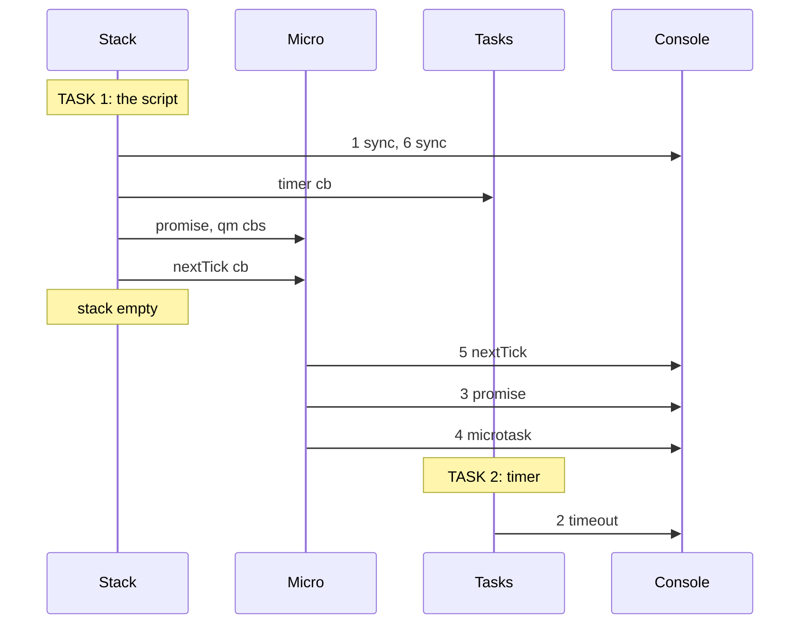
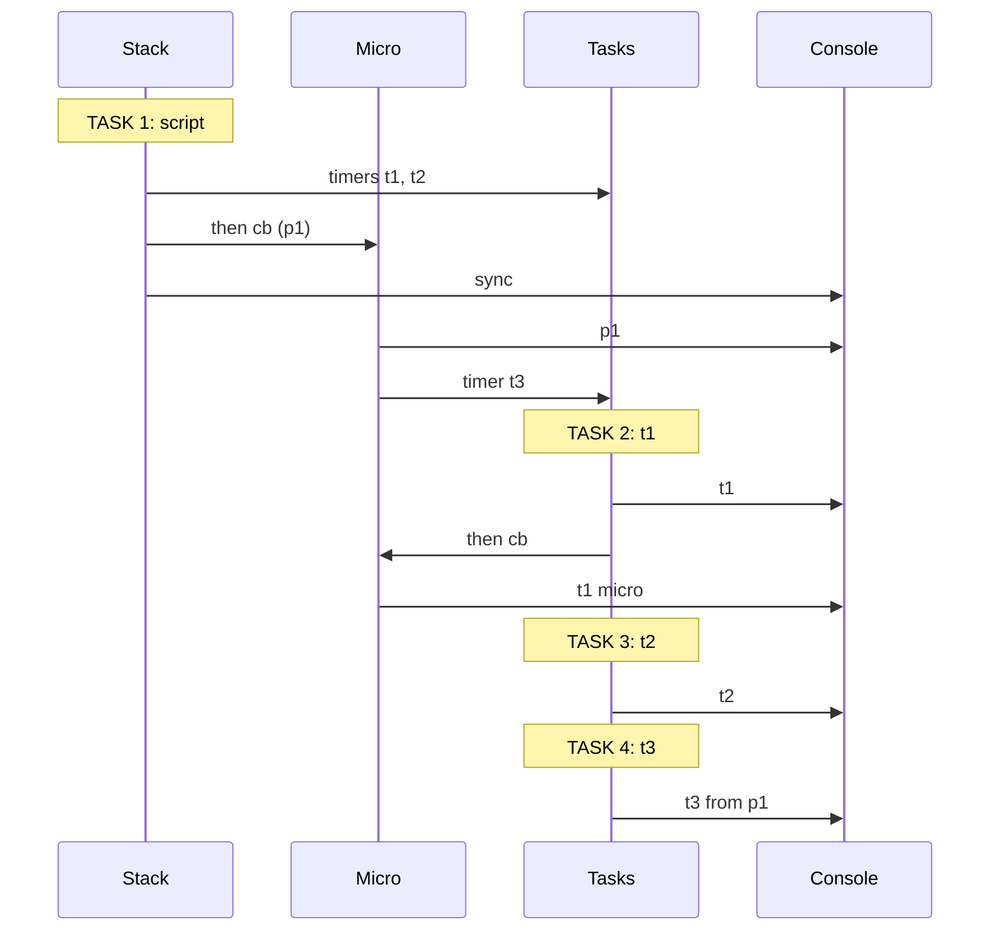
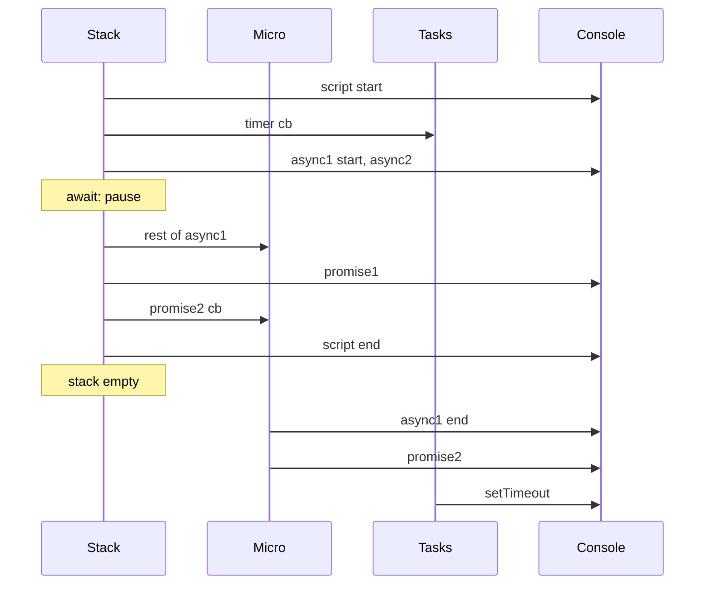
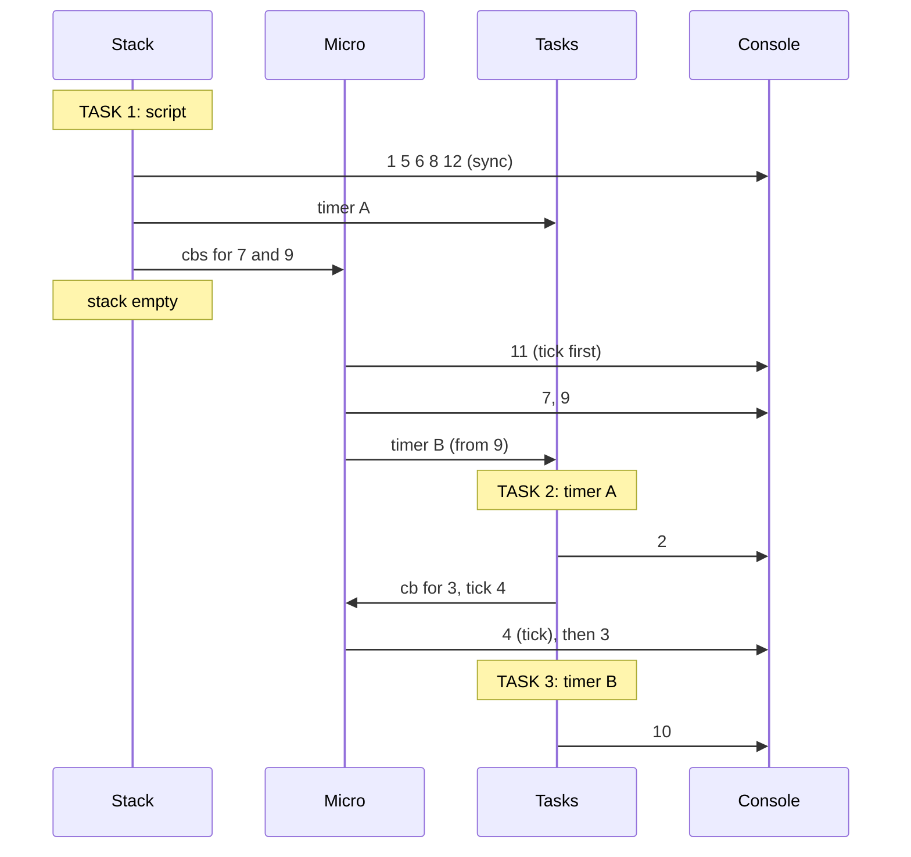

# Chapter 22: Mixed Output-Prediction Puzzles

This chapter is a rapid-fire round. Each puzzle mixes two or more of the topics from earlier chapters: hoisting (Chapter 2), scope and closures (Chapters 3 and 4), `this` (Chapter 5), prototypes (Chapter 6), the event loop (Chapter 7), promises (Chapter 8) and `async`/`await` (Chapter 9). Interviewers use this format because a single snippet shows within two minutes whether you have a working mental model or only memorised rules. Output-prediction snippets of this kind are among the most commonly reported items in JavaScript rounds (commonly reported).

How to use it: cover the output block, predict the output, say your reasoning aloud, then read the model answer. Every snippet was executed on Node.js 22 and its output block is what Node printed. Where the browser would differ, the puzzle says so.

*Key: ★ = staple question, frequently reported in public interview write-ups. Difficulty is the author's estimate. "Typically asked in" lines are given only for a few puzzles and always say "(commonly reported)".*

## 22.1 How to solve any output puzzle

Run the same eight steps every time. The order matters, because each step answers a question the next one needs.

1. **Hoist and instantiate, per scope.** Before reading any line, note what each scope creates: `var` and function declarations exist (`undefined` and the function), `let`, `const` and `class` exist but are in the temporal dead zone. Do this for the global scope, then again for each function when it is called.
2. **Find every call-site and decide `this`.** `this` is set by how a function is called: `obj.f()` gives `obj`, a bare `f()` gives `undefined` (strict) or the global object (sloppy), `new` gives a fresh object, `call`, `apply` and `bind` pick it explicitly. Arrow functions have no `this` of their own and use the one from where they were written.
3. **Resolve scope and closures, variable by variable.** A function sees the scope where it was *written*. Ask for each captured name: is there one shared binding (`var` in a loop) or one per iteration (`let` in a loop)?
4. **Run the synchronous part, top to bottom.** Write down what is printed. A `then` callback, a timer callback, an `await` continuation and a `queueMicrotask` callback do **not** run now. They are queued.
5. **Queue work as you meet it.** Put each callback in the right queue: timers in the task queue, promise reactions and `await` continuations in the microtask queue, `process.nextTick` callbacks in the Node tick queue. Keep each queue in the order callbacks were added.
6. **When the stack empties, drain.** Run the tick queue (Node), then every microtask, including microtasks added while draining. Only then take the next task (one timer callback). After that task, drain again.
7. **Check coercion and equality** wherever `==`, `+`, a template string or `typeof` appears: which primitive conversion runs, and how many times?
8. **Write the final order, then sanity-check it.** Every `then` callback prints after the synchronous code, and no timer callback prints before a microtask that was queued earlier.

```ascii The order of things: one turn of the event loop (the script is the first task)
   +-------------------------------------------------------------+
   | 1. SYNC: run the current task to completion on the stack    |
   +-------------------------------------------------------------+
                                |  stack is empty
                                v
   +-------------------------------------------------------------+
   | 2. process.nextTick queue (Node only), drained completely   |
   +-------------------------------------------------------------+
                                |
                                v
   +-------------------------------------------------------------+
   | 3. MICROTASKS: promise reactions, await resumptions,        |
   |    queueMicrotask. Drained completely, new ones included.   |
   |    (Node repeats 2 and 3 until both queues are empty.)      |
   +-------------------------------------------------------------+
                                |
                                v
   +-------------------------------------------------------------+
   | 4. RENDER (browser only, and only if a frame is due):       |
   |    requestAnimationFrame callbacks, style, layout, paint    |
   +-------------------------------------------------------------+
                                |
                                v
   +-------------------------------------------------------------+
   | 5. NEXT TASK: ONE timer callback, event, message or I/O     |
   |    callback. Then go back to step 1.                        |
   +-------------------------------------------------------------+
```

**Caveats that change answers**

- **`setTimeout(fn, 0)` against `setImmediate(fn)` in the main module is nondeterministic in Node.js.** The Node.js documentation says the order depends on process performance. No puzzle in this chapter asserts it. If an interviewer asks, say "it can go either way from the main module, but inside an I/O callback `setImmediate` always runs first".
- **`process.nextTick` exists only in Node.** In the browser, skip step 2. In a CommonJS file the tick queue drains before promise reactions. In an ES module the top-level code itself runs inside a promise job, so promise reactions run **before** ticks (tested: a `.mjs` file printed `promise` then `tick`). This chapter uses CommonJS, Node's default for `.js` files without `"type": "module"`.
- **Microtasks drain between two timer callbacks** in browsers and in Node 11 and later. Before Node 11, Node drained them only after all timers that were due had run, so older write-ups give a different answer for "promise inside a timer" puzzles (Q22.21).
- **Node's `setTimeout(fn, 0)` is stored as 1 ms.** Two timers with delays 0 and 1 run in creation order. Browsers clamp deeply nested timers to at least 4 ms. Puzzles here use delays that differ clearly.
- **Browser against Node on `this`.** A plain function called from a timer gets `this` = `window` in a sloppy browser script, and the `Timeout` object in Node. Puzzles that print `this.name` therefore say what each host prints.

## 22.2 Warm-ups: hoisting and `this`

### Q22.1 ★ Easy: declarations, expressions and `typeof`

*Typically asked in: JavaScript fundamentals round, first output question (commonly reported).*

```js
console.log(typeof declared, typeof expr);
try { console.log(typeof arrow); } catch (e) { console.log(e.name); }
function declared() {}
var expr = function () {};
const arrow = () => {};
console.log(typeof declared, typeof expr, typeof arrow);
```

```text output
function undefined
ReferenceError
function function function
```

> **Model answer**
>
> Instantiation runs first. `declared` is created as a ready function, `expr` is created as a `var` holding `undefined`, and `arrow` is created uninitialised because it is a `const`. So the first line prints `function undefined`. The second line reads `arrow` inside its dead zone. `typeof` only protects against names that do not exist anywhere. This one exists but is uninitialised, so it throws a `ReferenceError`. By the last line all three assignments have run and all three are functions.

**Key points to mention**

- Function declaration: fully hoisted. `var` expression: only the name. `const`: dead zone.
- `typeof` is safe for undeclared names, not for dead-zone names.
- An early *call* of `expr()` would be a `TypeError`, not a `ReferenceError`.

### Q22.2 ★ Medium: shadowing and the dead zone

*Typically asked in: JavaScript fundamentals round (commonly reported).*

```js
let v = 'outer';
function show() {
  try { console.log(v); } catch (e) { console.log(e.name); }
  let v = 'inner';
  console.log(v);
}
show();
console.log(v);
```

```text output
ReferenceError
inner
outer
```

> **Model answer**
>
> When `show` is called, instantiation creates its own `v`, uninitialised, because there is a `let v` in the function body. That binding shadows the outer `v` for the whole function, including the lines above the declaration. So the first `console.log(v)` finds the local `v`, sees it is uninitialised, and throws. The lookup does not continue outward to `'outer'`. After `let v = 'inner'` runs, the local `v` is usable and prints `inner`. The global `v` was never touched, so the last line prints `outer`.

**Key points to mention**

- `let` is hoisted: it shadows from the top of its scope.
- A found-but-uninitialised binding stops the lookup.
- The shadowing is per function call, so the outer variable is unaffected.

### Q22.3 ★ Medium: the `if (!foo)` trap

*Typically asked in: JavaScript fundamentals round (commonly reported).*

```js
var foo = 'global';
(function () {
  console.log(typeof foo);
  if (!foo) {
    var foo = 'local';
  }
  console.log(foo);
})();
```

```text output
undefined
local
```

> **Model answer**
>
> `undefined`, then `local`. The `var foo` inside the `if` is hoisted to the top of the function, even though the branch has not run yet. So the function has its own `foo`, which is `undefined` and shadows the global one. The first line prints `undefined`. Then `!foo` is true because `foo` is `undefined`, so the branch runs and assigns `'local'`. The author probably expected the global `'global'` to make the condition false, which is exactly why this snippet is asked.

**Key points to mention**

- `var` is function-scoped. A block does not create a scope for it.
- Hoisting depends on the source text, not on which branches run.
- The local `foo` shadows the global one before any line executes.

### Q22.4 Medium: parameter, `var` and function with the same name

```js
function f(x) {
  console.log(typeof x);
  var x = 2;
  function x() {}
  console.log(typeof x);
}
f(5);
```

```text output
function
number
```

> **Model answer**
>
> All three names refer to one binding. On entry the parameter `x` is bound to 5. Then the function declaration `x` is instantiated and overwrites that value with the function. The `var x` does not reset anything, because a `var` with the same name as an existing binding is a no-op. So the first `typeof` sees the function, not 5. When execution reaches `var x = 2`, the assignment replaces it, and the second `typeof` prints `number`.

**Key points to mention**

- Same name means one binding, not three.
- A function declaration beats the argument value. A bare `var` does not.
- The assignment `x = 2` stays where it was written.

### Q22.5 ★ Easy: a detached method and a timer

*Typically asked in: JavaScript fundamentals round, `this` follow-up (commonly reported).*

```js
const user = {
  name: 'Ada',
  hello() { console.log('hello', this.name); },
};
user.hello();
const detached = user.hello;
detached();
setTimeout(user.hello, 0);
setTimeout(() => user.hello(), 0);
setTimeout(user.hello.bind({ name: 'Bound' }), 0);
console.log('end of script');
```

```text output
hello Ada
hello undefined
end of script
hello undefined
hello Ada
hello Bound
```

```ascii How each call decides this, in the order the lines run
 call                     call form          this                   this.name
 -----------------------  -----------------  ---------------------  ---------
 user.hello()             method call        user                   'Ada'
 detached()               plain call, sloppy globalThis             undefined
 setTimeout(user.hello)   host calls it      Timeout (Node)         undefined
 setTimeout(() => ...)    arrow calls user.  user                   'Ada'
 setTimeout(bound)        bound function     { name: 'Bound' }      'Bound'
```

> **Model answer**
>
> The first call has a dot, so `this` is `user` and it prints `hello Ada`. The second copies the function into a variable and calls it with no object, so in sloppy mode `this` is the global object. Node's global object has no `name`, so it prints `undefined`. A browser prints an empty string, because `window.name` exists. Next, `end of script` prints, since the timers wait for the stack to empty. Timers run in creation order. Passing `user.hello` loses the object again, the arrow wrapper restores it by calling with a dot, and `bind` fixes `this` permanently.

**Key points to mention**

- `this` comes from the call-site, not from where the function was defined.
- Passing a method as a callback detaches it. Fix with an arrow wrapper or `bind`.
- Node calls timer callbacks with the `Timeout` object as `this`, browsers with `window`. Both give a wrong answer here.

### Q22.6 ★ Medium: arrow against regular function in an object literal

*Typically asked in: JavaScript fundamentals round (commonly reported).*

```js
const obj = {
  name: 'obj',
  regular() { return this === obj; },
  arrow: () => this === obj,
  nested() {
    function inner() { return this === obj; }
    const arrowInner = () => this === obj;
    return [inner(), arrowInner()];
  },
};
console.log(obj.regular(), obj.arrow(), obj.nested());
```

```text output
true false [ false, true ]
```

> **Model answer**
>
> `obj.regular()` is a method call, so `this` is `obj` and the answer is `true`. The `arrow` property is an arrow function written in an object literal. An object literal is not a scope, so the arrow takes `this` from the surrounding code, which here is the top of the module. That is `module.exports` in Node and `window` in a browser script, never `obj`. So it is `false`. In `nested`, `inner` is a plain function call with no object, so its `this` is the global object or `undefined`, and the result is `false`. The arrow inside `nested` uses the `this` of `nested`, which is `obj`, so `true`.

**Key points to mention**

- Arrow functions have no own `this`. They read it from the enclosing function or module.
- An object literal does not create a `this` scope.
- A nested regular function loses `this`. A nested arrow keeps it.

### Q22.7 Medium: `call`, `bind` and `bind` again

```js
function who() { return this.n; }
const a = { n: 'a' };
const b = { n: 'b' };
const bound = who.bind(a);
const holder = { n: 'holder', bound };
console.log(who.call(b), bound(), bound.call(b), holder.bound(), bound.bind(b)());
const arrow = () => this;
console.log(arrow.call(b) === arrow());
```

```text output
b a a a a
true
```

> **Model answer**
>
> `who.call(b)` sets `this` to `b`, so it prints `b`. `bound` is a new function with `this` fixed to `a` when it was created. After that, nothing overrides it. Calling it with `call(b)`, calling it as a method of `holder`, or binding it a second time to `b` all still give `a`. The first `bind` wins. The last line shows that arrow functions ignore `call` too: `arrow.call(b)` returns the same module-level `this` as `arrow()`, so the comparison is `true`.

**Key points to mention**

- A bound function keeps its first `this`. `call`, `apply`, method calls and a second `bind` cannot change it.
- Only `new` on a bound function ignores the bound `this`.
- Arrow functions ignore `call`, `apply` and `bind` for `this`.

### Q22.8 Medium: `this` and a global `var` (classic script)

This puzzle depends on a classic script, where a top-level `var` becomes a property of the global object. In a CommonJS file or an ES module `var name` would stay local to the file and the answers would change. The sample runs as a classic global script, which is also what a browser `<script>` tag gives you.

```js script
var name = 'global';
const obj = {
  name: 'obj',
  regular() { return this.name; },
  arrow: () => this.name,
  wrapped() { return (function () { return this.name; })(); },
  arrowIn() { return (() => this.name)(); },
};
const { regular } = obj;
console.log(obj.regular(), obj.arrow(), obj.wrapped(), obj.arrowIn(), regular());
console.log((obj.regular)(), (0, obj.regular)());
```

```text output
obj global global obj global
obj global
```

> **Model answer**
>
> Because this is a classic script, `var name` creates `globalThis.name`, so any call that falls back to the global object reads `'global'`. `obj.regular()` is a method call and gives `obj`. The arrow property uses the top-level `this`, which is the global object, so `global`. In `wrapped`, the inner `function` is called plainly, so it gets the global object and prints `global`. The arrow inside `arrowIn` borrows `this` from the method, so `obj`. The detached `regular()` is a plain call, so `global`. In the last line `(obj.regular)()` still has a dot-reference, so `obj`. The comma operator in `(0, obj.regular)()` returns the bare function and drops the object, so `global`.

**Key points to mention**

- `var` at the top of a classic script is a global property. In a module or CommonJS file it is not.
- Parentheses keep a reference, so `(obj.f)()` is still a method call. The comma operator strips it.
- Strict mode would give `undefined` instead of the global object, and the plain calls would throw.

### Q22.9 Medium: getter and setter `this` through the prototype chain

```js
const base = {
  _v: 1,
  get v() { return this._v; },
  set v(x) { this._v = x * 2; },
};
const child = Object.create(base);
child.v = 5;
console.log(child.v, base.v, Object.keys(child), Object.hasOwn(child, 'v'));
```

```text output
10 1 [ '_v' ] false
```

> **Model answer**
>
> `child` has no property `v`, so the assignment `child.v = 5` searches the prototype chain and finds the setter on `base`. The setter runs, and its `this` is the object the property was accessed on, which is `child`, not `base`. So `this._v = 10` creates an own property `_v` on `child`. Reading `child.v` calls the getter, again with `this` = `child`, and returns 10. The base is untouched, so `base.v` still returns 1. Only `_v` is an own key of `child`. `v` itself never becomes an own property, because an inherited setter handles the write.

**Key points to mention**

- Accessors found on the prototype run with `this` = the receiver, the object you used in the expression.
- An inherited setter prevents the assignment from creating an own data property.
- Writing through `this` is what makes the shadowing `_v` appear on `child`.

### Q22.10 Medium: prototype method against instance arrow property

*Typically asked in: JavaScript fundamentals round, React-flavoured (commonly reported).*

```js
class Btn {
  constructor(label) {
    this.label = label;
    this.arrow = () => this.label;
  }
  method() { return this.label; }
}
const b = new Btn('ok');
const { arrow, method } = b;
console.log(arrow());
try { console.log(method()); } catch (e) { console.log(e.name + ': ' + e.message); }
const other = new Btn('x');
console.log(b.arrow === other.arrow, b.method === other.method);
```

```text output
ok
TypeError: Cannot read properties of undefined (reading 'label')
false true
```

> **Model answer**
>
> The constructor creates a new arrow function for each instance. It captures the constructor's `this`, which is the new object, so `arrow()` still works after being detached and prints `ok`. `method` lives once on `Btn.prototype`, and it takes `this` from the call-site. Detached and called plainly, `this` is `undefined`, because class bodies are always strict. Reading `label` of `undefined` is a `TypeError`. The last line shows the trade-off: each instance has its own arrow, so the comparison is `false`, while all instances share one prototype method, so it is `true`.

**Key points to mention**

- Class code is strict, so a detached method gets `undefined`, not the global object.
- Arrow properties bind `this` per instance at the cost of one function per object.
- Prototype methods are shared and cheaper, but you must bind them when passing them around.

## 22.3 Closures in loops and callbacks

### Q22.11 ★ Easy: the `var` loop with timers

*Typically asked in: JavaScript fundamentals round, the classic closure question (commonly reported).*

```js
for (var i = 0; i < 3; i++) {
  setTimeout(() => console.log('i =', i), 0);
}
console.log('loop done, i =', i);
```

```text output
loop done, i = 3
i = 3
i = 3
i = 3
```

```ascii One shared i: every callback reads the same binding, after the loop has finished
   FUNCTION / GLOBAL ENVIRONMENT            callbacks created in the loop
 +-----------------------------+
 | i : 0 -> 1 -> 2 -> 3        |<------------  cb #1  reads i
 +-----------------------------+<------------  cb #2  reads i
   loop ends when i is 3        <------------  cb #3  reads i
   (timers fire later: all see 3)
```

> **Model answer**
>
> `var` is function-scoped, so the whole loop shares a single `i`. The loop runs synchronously and creates three timers, each holding a reference to that one variable, not a copy of its value. The loop ends when `i` reaches 3, and the line after it prints `loop done, i = 3`. Only then is the stack empty, and the timers fire, each reading `i`, which is still 3. So three lines of `i = 3`. Closures capture variables, not values.

**Key points to mention**

- One binding for the entire loop with `var`.
- The synchronous code finishes first, so the callbacks see the final value.
- Fixes follow in the next puzzle.

### Q22.12 ★ Medium: three fixes, one output order

```js
for (var a = 0; a < 3; a++) {
  (function (n) { setTimeout(() => console.log('iife', n), 0); })(a);
}
for (let b = 0; b < 3; b++) {
  setTimeout(() => console.log('let', b), 0);
}
for (var c = 0; c < 3; c++) {
  setTimeout((n) => console.log('arg', n), 0, c);
}
```

```text output
iife 0
iife 1
iife 2
let 0
let 1
let 2
arg 0
arg 1
arg 2
```

> **Model answer**
>
> All three loops fix the shared-variable problem in different ways. The IIFE passes the current `a` into a function, so each callback closes over its own parameter `n`. With `let`, the spec creates a fresh binding for every iteration and copies the value across, so each callback sees its own `b`. The third passes `c` as an extra argument to `setTimeout`, which stores the value at call time and hands it to the callback later. The nine timers all have the same delay, so they run in the order they were created: the IIFE group, then the `let` group, then the argument group.

**Key points to mention**

- IIFE: new function scope per iteration. `let`: new binding per iteration. Extra argument: a copy of the value.
- Timers with equal delay fire in creation order.
- `let` is the idiomatic fix today.

### Q22.13 Hard: a `let` loop whose body changes `i`

```js
for (let i = 0; i < 3; i++) {
  setTimeout(() => console.log(i), 0);
  i++;
}
```

```text output
1
3
```

```ascii Per-iteration bindings: the copy happens BEFORE the increment expression
 iteration 1  binding A: i = 0   timer captures A   body: i++ -> A.i = 1
               new iteration: copy A.i (1) into B, then run i++ on B -> B.i = 2
 iteration 2  binding B: i = 2   2 < 3 is true   timer captures B   body: i++ -> 3
               new iteration: copy B.i (3) into C, i++ on C -> 4, 4 < 3 false: stop
 timers later: the callback on A prints 1, the callback on B prints 3
```

> **Model answer**
>
> Two iterations run, so two timers are created. Each iteration of a `let` loop gets its own binding. In the first iteration `i` is 0, the timer captures that binding, and then `i++` in the body makes it 1. For the next iteration the engine copies the current value, 1, into a new binding and only then runs the loop's own `i++` on the copy, so it becomes 2. The test `2 < 3` passes, the second timer captures the new binding, and the body bumps it to 3. The copy becomes 4 and stops the loop. The first callback reads its binding, which holds 1, and the second reads 3.

**Key points to mention**

- A fresh binding per iteration, initialised from the previous one's final value.
- The captured binding stays alive and can be changed by the body after the timer is created.
- Callbacks read the value when they run, not when they were created.

### Q22.14 ★ Easy: counter factories

*Typically asked in: JavaScript fundamentals round (commonly reported).*

```js
function makeCounter() {
  let n = 0;
  return { inc: () => ++n, get: () => n };
}
const a = makeCounter();
const b = makeCounter();
a.inc(); a.inc(); b.inc();
console.log(a.get(), b.get());
const { inc } = a;
inc();
console.log(a.get());
```

```text output
2 1
3
```

> **Model answer**
>
> Each call to `makeCounter` creates a new environment with its own `n`, and the returned functions close over that environment. So `a` and `b` have independent counters: `a` was incremented twice and `b` once, giving `2 1`. Then `inc` is detached from `a`. That does not matter here, because these are arrow functions that never use `this`. They use the closure variable `n`. The detached call still increments the same `n`, so `a.get()` is 3.

**Key points to mention**

- One environment per call, so private state per instance.
- Closure state does not depend on `this`, so detaching is safe.
- The variable stays alive as long as a closure refers to it.

### Q22.15 Medium: `a == 1 && a == 2 && a == 3`

*Typically asked in: JavaScript fundamentals round, as a coercion puzzle (commonly reported).*

```js
const a = (() => {
  let n = 0;
  return { valueOf: () => ++n };
})();
console.log(a == 1 && a == 2 && a == 3);
console.log(a == 4, a + 1, `${a}`);
```

```text output
true
true 6 [object Object]
```

> **Model answer**
>
> Comparing an object with a number using `==` converts the object to a primitive. The default hint calls `valueOf` first. Each call increments the closure variable `n` and returns it, so the three comparisons see 1, 2 and 3, and the whole expression is `true`. The second line keeps counting: `a == 4` is `true`, and `a + 1` also uses the default hint, so `valueOf` gives 5 and the sum is 6. The template literal asks for a string, so it calls `toString` first. The object inherits `Object.prototype.toString`, which returns `[object Object]`, and `valueOf` is never called.

**Key points to mention**

- Object to primitive: the `default` hint tries `valueOf` first, the `string` hint tries `toString` first.
- Each comparison calls the conversion again, and the closure keeps state between calls.
- Evaluation is left to right, and `&&` short-circuits.

### Q22.16 Medium: stale closure

*Typically asked in: React-flavoured JavaScript round (commonly reported).*

```js
let state = 0;
function render() {
  const snapshot = state;
  return {
    show: () => console.log('show', snapshot, state),
    later: () => setTimeout(() => console.log('later', snapshot, state), 0),
  };
}
const r1 = render();
state = 1;
const r2 = render();
r1.later();
state = 2;
r2.later();
r1.show();
r2.show();
```

```text output
show 0 2
show 1 2
later 0 2
later 1 2
```

```ascii What each render closure holds
 name        snapshot   state (shared, one variable, read when the callback runs)
 ----------  ---------  ----------------------------------------------------------
 r1 callback  0         read at call time: 2
 r2 callback  1         read at call time: 2
 state changes: 0 -> 1 (before r2) -> 2 (before the timers and the shows run)
```

> **Model answer**
>
> `snapshot` is a `const` created fresh on each call of `render`, so `r1` holds 0 and `r2` holds 1. That is a copy of the value at render time. `state` is different: it is one outer variable that every closure reads when it runs. By the time anything prints, `state` is 2. The synchronous `show` calls print first, `show 0 2` and `show 1 2`, and the timers print afterwards with the same numbers. This is the stale-closure bug in React: a callback keeps the value from the render that created it and does not see later updates.

**Key points to mention**

- A value copied into a closure is frozen. A variable referenced by a closure is read live.
- Timers run after the synchronous code, so they see the last update.
- The fix is to read the latest value through a reference (a ref, or a function-form update).

### Q22.17 Medium: `this` inside nested timers

```js
const timer = {
  label: 'T',
  start() {
    setTimeout(function () { console.log('regular', this === timer); }, 0);
    setTimeout(() => console.log('arrow', this === timer), 0);
    const self = this;
    setTimeout(function () { console.log('self', self === timer); }, 0);
  },
};
timer.start();
```

```text output
regular false
arrow true
self true
```

> **Model answer**
>
> `start` is called as a method, so its `this` is `timer`. The first callback is a regular function that the host calls later. The host does not call it as a method of `timer`, so `this` is not `timer`. It is the `Timeout` object in Node and `window` in a sloppy browser script. That gives `false`. The arrow function has no `this` of its own, so it reads the one from `start`, which is `timer`, giving `true`. The third is the old pattern: copy `this` into a closure variable `self`, and the callback reads the variable. Same result as the arrow. The three timers have the same delay, so they print in creation order.

**Key points to mention**

- `this` of a callback depends on how the host calls it, not on where you wrote it.
- Arrow functions and `const self = this` both rely on the enclosing scope.
- Equal delays run in creation order.

### Q22.18 Medium: promise callbacks in loops

```js
var results = [];
for (var i = 0; i < 3; i++) {
  Promise.resolve().then(() => results.push(i));
}
for (let j = 0; j < 3; j++) {
  Promise.resolve().then(() => results.push(j));
}
setTimeout(() => console.log(results), 0);
console.log('sync', results.length);
```

```text output
sync 0
[ 3, 3, 3, 0, 1, 2 ]
```

> **Model answer**
>
> The loops run synchronously and only queue six microtasks. At that point `results` is still empty, so the synchronous log prints `sync 0`. The three callbacks from the `var` loop share one `i`, which is 3 by the time they run. The three from the `let` loop each have their own binding with 0, 1 and 2. The microtasks run in the order they were queued, right after the script ends, and before the timer. So the timer finds `[3, 3, 3, 0, 1, 2]`.

**Key points to mention**

- Queued callbacks run after the whole synchronous block, so shared variables are at their final value.
- Microtasks run before the timer and in FIFO order.
- `var` gives one shared binding. `let` gives one per iteration.


## 22.4 Event loop mixes

### Q22.19 ★ Easy: sync, `nextTick`, promise, `queueMicrotask`, timer

*Typically asked in: JavaScript fundamentals round, the opening event-loop question (commonly reported).*

```js
console.log('1 sync');
setTimeout(() => console.log('2 timeout'), 0);
Promise.resolve().then(() => console.log('3 promise'));
queueMicrotask(() => console.log('4 microtask'));
process.nextTick(() => console.log('5 nextTick'));
console.log('6 sync');
```

```text output
1 sync
6 sync
5 nextTick
3 promise
4 microtask
2 timeout
```



> **Model answer**
>
> The script is the first task. It prints `1 sync` and `6 sync` and queues four callbacks without running any of them. When the stack empties, Node runs the `nextTick` queue first, so `5 nextTick` prints, then drains the microtask queue in order: the promise callback and then the `queueMicrotask` callback. Only after the microtasks are empty does the event loop take the next task, the timer. So the order is both sync lines, nextTick, promise, microtask, timeout. In a browser there is no `nextTick`, so it would be sync, promise, microtask, timeout.

**Key points to mention**

- Whole script first, then microtasks, then the next task.
- In CommonJS, `nextTick` drains before promise callbacks. In an ES module, the promise callbacks come first.
- Promise reactions and `queueMicrotask` share one FIFO queue.
- Draw it: the trace diagram under this puzzle.

### Q22.20 Medium: microtasks scheduled by microtasks

```js
setTimeout(() => console.log('timeout'), 0);
Promise.resolve()
  .then(() => {
    console.log('p1');
    Promise.resolve().then(() => console.log('p1.1'));
    queueMicrotask(() => console.log('qm from p1'));
  })
  .then(() => console.log('p2'));
Promise.resolve().then(() => console.log('p3'));
console.log('sync');
```

```text output
sync
p1
p3
p1.1
qm from p1
p2
timeout
```

```ascii The microtask queue, step by step (front of queue on the left)
 step  queue before the step     runs      prints       adds to the queue
 ----  ------------------------  --------  -----------  ----------------------
 0     [p1, p3]                  script    sync         (p1 and p3 were queued)
 1     [p1, p3]                  p1        p1           p1.1, qm, and p2*
 2     [p3, p1.1, qm, p2]        p3        p3           -
 3     [p1.1, qm, p2]            p1.1      p1.1         -
 4     [qm, p2]                  qm        qm from p1   -
 5     [p2]                      p2        p2           -
 6     []                        timer     timeout      (next task)
 * p2 is queued when the p1 callback RETURNS, so it goes behind p1.1 and qm.
```

> **Model answer**
>
> `sync` prints first. Two promise reactions are queued, `p1` and `p3`, so the queue starts as `[p1, p3]`. `p1` runs and prints. Inside it, two new microtasks are queued, `p1.1` and the `queueMicrotask` callback. Then `p1` returns, which resolves the promise that `p2` is waiting for, and that queues `p2` behind them. The queue is now `[p3, p1.1, qm, p2]`. The loop keeps draining until the queue is empty, including the jobs added during the drain, so it prints `p3`, `p1.1`, `qm from p1`, `p2`. The timer waits for all of it.

**Key points to mention**

- The queue is drained completely, including microtasks added during the drain.
- A `.then` callback is queued only when the promise before it settles, so a chain advances one link per tick.
- A timer cannot run until the microtask queue is empty. A microtask loop that keeps refilling the queue starves timers and rendering.

### Q22.21 ★ Medium: a timer inside a promise, a promise inside a timer

*Typically asked in: JavaScript fundamentals round (commonly reported).*

```js
setTimeout(() => {
  console.log('t1');
  Promise.resolve().then(() => console.log('t1 micro'));
}, 0);
setTimeout(() => console.log('t2'), 0);
Promise.resolve().then(() => {
  console.log('p1');
  setTimeout(() => console.log('t3 from p1'), 0);
});
console.log('sync');
```

```text output
sync
p1
t1
t1 micro
t2
t3 from p1
```



> **Model answer**
>
> The script prints `sync`, queues two timers and one microtask. When the stack empties, the microtask runs: `p1` prints and queues a third timer, behind the first two. Now the loop takes the first timer task. It prints `t1` and queues a microtask. A task ends with a microtask checkpoint, so `t1 micro` runs before the second timer starts. Then `t2` runs, then `t3 from p1`. The rule is one task, then all microtasks, then the next task. Older Node versions (before 11) ran all due timers first and printed `t2` before `t1 micro`.

**Key points to mention**

- Every task is followed by a full microtask drain.
- A timer scheduled from a microtask goes to the back of the line of equal-delay timers.
- Node changed this ordering in version 11 to match browsers.
- Draw it: the trace diagram under this puzzle.

### Q22.22 Medium: different delays

```js
setTimeout(() => console.log('100 ms'), 100);
setTimeout(() => console.log('10 ms (first)'), 10);
setTimeout(() => console.log('0 ms'), 0);
setTimeout(() => console.log('10 ms (second)'), 10);
setTimeout(() => console.log('5 ms'), 5);
console.log('script end');
```

```text output
script end
0 ms
5 ms
10 ms (first)
10 ms (second)
100 ms
```

```ascii Timers sorted by due time, not by line order
 time (ms)  0         5         10        15  ...  100
            |---------|---------|---------|---------|
 due at:    0 ms      5 ms     10 ms (first, second)  100 ms
 line:      3rd       5th      2nd, then 4th          1st
 equal delay: the one created first runs first
```

> **Model answer**
>
> The script itself runs first and prints `script end`. A timer's delay is a minimum wait, and the loop runs the timers in order of their due time, not the order of the lines. So the 0 ms timer comes first, then 5 ms, then both 10 ms timers, and the 100 ms timer is last. The two 10 ms timers have the same due time, so they run in the order they were created. The answer assumes the script takes far less than the gaps between delays, which is true for a snippet this small.

**Key points to mention**

- Due time orders timers. Creation order breaks ties.
- A delay is a lower bound, never a promise.
- Node stores a delay of 0 as 1 ms, so timers with delays 0 and 1 run in creation order.

### Q22.23 Medium: a long synchronous loop and a "0 ms" timer

```js
let ticks = 0;
setTimeout(() => console.log('timer ran, ticks =', ticks), 0);
Promise.resolve().then(() => console.log('promise ran, ticks =', ticks));
for (let i = 0; i < 5e7; i++) ticks++;
console.log('loop done, ticks =', ticks);
```

```text output
loop done, ticks = 50000000
promise ran, ticks = 50000000
timer ran, ticks = 50000000
```

```ascii The loop blocks everything: callbacks wait, even the one that was due long ago
 time ------------------------------------------------------------------>
 stack:   [ script: loop runs for many ms ................ ][ promise ][ timer ]
 queued:   timer(0 ms) and promise reaction wait here ......^         ^
 due time of the timer passed long ago, but a task cannot interrupt another one
```

> **Model answer**
>
> `ticks` is 50 million when anything else runs. The `for` loop is part of the current task, and JavaScript never interrupts a running task, so the timer and the promise callback both wait. When the loop ends, `loop done` prints. Then the microtask runs and prints `promise ran`, and only after that the timer task runs, even though its 0 ms were over long ago. Both callbacks see `ticks` as 50000000. In a real page this is what a frozen UI is: the loop holds the main thread, so clicks and painting wait too.

**Key points to mention**

- Run-to-completion: nothing preempts synchronous code.
- A delay is a minimum, so a busy stack makes the real wait longer.
- Microtasks still go before the timer.
- Fix: split the work into chunks, use a Worker, or yield between chunks.

### Q22.24 Hard: `nextTick` and promises feeding each other

*Node.js only. The browser has no `process.nextTick`.*

```js
Promise.resolve().then(() => {
  console.log('P1');
  process.nextTick(() => console.log('tick from P1'));
  Promise.resolve().then(() => console.log('P2'));
});
process.nextTick(() => {
  console.log('T1');
  process.nextTick(() => console.log('T2'));
  Promise.resolve().then(() => console.log('P3'));
});
```

```text output
T1
T2
P1
P3
P2
tick from P1
```

```ascii Two queues: Node empties the whole tick queue, then the whole microtask queue
 step  tick queue       microtask queue   runs   prints        adds
 ----  ---------------  ----------------  -----  ------------  -----------------
 0     [T1]             [P1]              (script done, stack empty)
 1     [T1]             [P1]              T1     T1            T2 (tick), P3 (micro)
 2     [T2]             [P1, P3]          T2     T2            -
 3     []               [P1, P3]          P1     P1            tick-P1, P2
 4     [tick-P1]        [P3, P2]          P3     P3            -
 5     [tick-P1]        [P2]              P2     P2            -
 6     [tick-P1]        []                tick   tick from P1  -
 Node runs the tick queue first, then the microtasks until empty, then repeats.
```

> **Model answer**
>
> After the script, Node processes the tick queue. `T1` runs and queues another tick, `T2`, and a promise reaction, `P3`. Ticks run until their queue is empty, so `T2` prints before any promise callback. Then Node drains the microtask queue, which holds `P1` and `P3`. `P1` prints and adds a tick and a microtask `P2`. The microtask drain does not stop for the tick. It keeps going, so `P3` and then `P2` print, and the tick from `P1` runs last, once the microtask queue is empty. In short: ticks drain, then microtasks drain, then Node checks the tick queue again.

**Key points to mention**

- Node has two queues here, ticks and promise microtasks, each drained completely.
- Ticks added during a microtask drain wait until that drain finishes.
- `setImmediate` is a different, later phase and is deliberately not asserted here.

## 22.5 `async`/`await` and promise ordering

### Q22.25 ★ Medium: the classic `async1` and `async2`

*Typically asked in: JavaScript fundamentals round, one of the most reported async questions (commonly reported). Public write-ups of this snippet exist in English and Chinese.*

```js
async function async1() {
  console.log('async1 start');
  await async2();
  console.log('async1 end');
}
async function async2() {
  console.log('async2');
}
console.log('script start');
setTimeout(() => console.log('setTimeout'), 0);
async1();
new Promise((resolve) => {
  console.log('promise1');
  resolve();
}).then(() => console.log('promise2'));
console.log('script end');
```

```text output
script start
async1 start
async2
promise1
script end
async1 end
promise2
setTimeout
```



> **Model answer**
>
> The script runs synchronously until it needs a microtask. It prints `script start`, queues the timer, and calls `async1`. That prints `async1 start` and calls `async2`, which runs immediately and prints `async2`. The `await` then suspends `async1` and queues its remaining lines as a microtask, and control returns to the caller. The `Promise` executor is also synchronous, so `promise1` prints, and `promise2` is queued behind `async1`'s continuation. After `script end`, the microtasks run in order: `async1 end`, then `promise2`. The timer is last. Very old engines (before the 2018 change to `await`) printed `promise2` before `async1 end`.

**Key points to mention**

- Code before the first `await` runs synchronously, including the called async function's body.
- `await` queues the rest of the function as a microtask. It does not block the thread.
- The `Promise` executor runs synchronously. Only `then` callbacks are deferred.
- Draw it: the trace diagram under this puzzle.

### Q22.26 Hard: `await` a promise against `await` a plain value

```js
const p = Promise.resolve();
(async () => {
  await p;
  console.log('A1');
  await null;
  console.log('A2');
})();
(async () => {
  await null;
  console.log('B1');
  await p;
  console.log('B2');
})();
p.then(() => console.log('then1')).then(() => console.log('then2'));
```

```text output
A1
B1
then1
A2
B2
then2
```

```ascii Each await costs one microtask turn, whether the operand is a promise or a value
 step  queue (front first)    runs                    prints
 ----  ---------------------  ----------------------  --------
 0     [a1, b1, then1]        (script ended: three jobs queued in source order)
 1     [a1, b1, then1]        a1: resume A            A1      adds a2
 2     [b1, then1, a2]        b1: resume B            B1      adds b2
 3     [then1, a2, b2]        then1                   then1   adds then2
 4     [a2, b2, then2]        a2                      A2
 5     [b2, then2]            b2                      B2
 6     [then2]                then2                   then2
```

> **Model answer**
>
> Nothing prints during the script. The first async function awaits an already resolved native promise, which queues its continuation. The second awaits `null`, which `await` wraps in a resolved promise, so it also queues a continuation. The `then` callback is queued third. In the first round, `A1`, `B1` and `then1` run in that order. Each of them queues the next step: another `await`, another `await`, and the chained `then2`. So the second round is `A2`, `B2`, `then2`. A native promise or a plain value takes one microtask turn per `await`, so the order follows the order of queuing.

**Key points to mention**

- Since V8 7.2 and the matching spec change, `await` on a native promise takes one tick, the same as `await` on a value.
- Each `await` or `then` is one link. Interleaving follows the order jobs were queued.
- Ticks are easy to track with a queue table.

### Q22.27 Hard: an `async` function that returns a promise

```js
async function viaPromise() { return Promise.resolve('x'); }
async function viaValue() { return 'x'; }
viaPromise().then(() => console.log('returned promise'));
viaValue().then(() => console.log('returned value'));
Promise.resolve()
  .then(() => console.log('t1'))
  .then(() => console.log('t2'))
  .then(() => console.log('t3'))
  .then(() => console.log('t4'));
```

```text output
returned value
t1
t2
returned promise
t3
t4
```

```ascii Returning a promise from an async function costs three ticks instead of one
 step  queue (front first)       runs                         prints
 ----  ------------------------  ---------------------------  ----------------
 0     [job, rv, t1]             (job = adopt the returned promise)
 1     [job, rv, t1]             job: calls then on the promise  -     adds job2
 2     [rv, t1, job2]            rv                           returned value
 3     [t1, job2]                t1                           t1       adds t2
 4     [job2, t2]                job2: resolves outer promise  -       adds rp
 5     [t2, rp]                  t2                           t2       adds t3
 6     [rp, t3]                  rp                           returned promise
 7     [t3]                      t3, then t4                  t3, t4
```

> **Model answer**
>
> An `async` function that returns a plain value resolves its result promise right away, so its `then` callback is queued at once and runs in the first round. When it returns a promise, the result promise cannot simply adopt it. The engine first queues a job that calls `then` on the returned promise, then a job that resolves the outer promise, and only then does the `then` callback run. That is three turns instead of one. So `returned value` comes before `t1`, and `returned promise` lands after `t2`, before `t3`. The takeaway for real code: `return await p` and `return p` differ in timing, and tick counts like this are an implementation-visible detail you should not depend on.

**Key points to mention**

- Returning a promise from an async function (or from a `then` callback) costs about two extra ticks.
- The exact count follows from the spec's promise resolve procedure, so it is stable across engines, but never build logic on it.
- Plain values resolve immediately.

### Q22.28 Medium: `try`, `catch` and `finally` in an async function

```js
async function risky() {
  try {
    console.log('try');
    await Promise.reject(new Error('boom'));
    console.log('not reached');
  } catch (e) {
    console.log('catch', e.message);
    return 'from catch';
  } finally {
    console.log('finally');
  }
}
risky().then((v) => console.log('then', v));
console.log('sync end');
```

```text output
try
sync end
catch boom
finally
then from catch
```

> **Model answer**
>
> The call runs the body synchronously until the first `await`, so `try` prints. The `await` of a rejected promise suspends the function and returns control, so `sync end` prints next. In the microtask, the rejection is delivered into the function as a thrown exception at the `await`. The line after the `await` never runs, the `catch` block does, and it prints and returns a value. The `finally` block still runs before the function finishes, so it prints before the result promise is fulfilled. Only then does the `then` callback receive `from catch`.

**Key points to mention**

- `await` turns a rejection into an exception at the await point, so `try`/`catch` works.
- `finally` runs on every path, before the promise returned by the function settles.
- Code before the first `await` is synchronous.

### Q22.29 ★ Medium: a throw, a `catch` and a chain that continues

*Typically asked in: JavaScript fundamentals round (commonly reported).*

```js
Promise.resolve(1)
  .then((v) => { console.log('a', v); throw new Error('x'); })
  .then(() => console.log('b skipped'))
  .catch((e) => { console.log('catch', e.message); return 'recovered'; })
  .then((v) => console.log('c', v))
  .finally(() => console.log('finally'))
  .then((v) => console.log('d', v));
```

```text output
a 1
catch x
c recovered
finally
d undefined
```

> **Model answer**
>
> The first `then` prints and throws, which rejects the promise it returned. The next `then` has no rejection handler, so the rejection passes through it and `b skipped` never prints. The `catch` handles the error and returns a normal value, which means the promise after it is fulfilled again, and the chain continues on the success path. So `c` receives `recovered`. That callback returns nothing, so the value is `undefined`. `finally` runs with no argument and passes the previous result through unchanged, so the last `then` receives `undefined`.

**Key points to mention**

- A rejection skips `then` handlers that have no second argument until a `catch` or rejection handler.
- A `catch` that returns normally turns the chain back into a fulfilled one.
- `finally` does not change the value, unless it throws or returns a rejected promise.

### Q22.30 Medium: `Promise.all` and `Promise.race` with mixed timers

```js
const wait = (ms, v) =>
  new Promise((resolve) => {
    setTimeout(() => { console.log('done', v); resolve(v); }, ms);
  });
Promise.all([wait(40, 'A'), wait(10, 'B'), 'C', Promise.resolve('D')])
  .then((r) => console.log('all', r));
Promise.race([wait(25, 'E'), wait(5, 'F')])
  .then((v) => console.log('race', v));
```

```text output
done F
race F
done B
done E
done A
all [ 'A', 'B', 'C', 'D' ]
```

```ascii Timeline: timers fire by due time, the combinators settle on their own rule
 ms   5        10       25       40
      |        |        |        |
      F done   B done   E done   A done
      race     -        (ignored) all settles: result in INPUT order
      settles                      [A, B, C, D], not completion order
```

> **Model answer**
>
> All four timers start at once, and they fire by due time: F at 5 ms, B at 10, E at 25 and A at 40. `Promise.race` settles with the first input to settle, so it resolves with `F`, and its `then` callback runs in the microtask right after the F timer, before B's timer. `E` still finishes later, but the race ignores it. `Promise.all` waits for every input. Its result is in the order of the input array, `[A, B, C, D]`, not the order of completion, and the plain value `'C'` and the already resolved promise are accepted as they are. It settles after the slowest, `A`, so it logs last.

**Key points to mention**

- `all` keeps input order and waits for the slowest. It rejects at the first rejection.
- `race` settles with the first settled input. The other inputs keep running.
- Non-promise values are wrapped with `Promise.resolve`.
- Timer gaps here are 5 ms or more, which is enough on a normal machine but not a guarantee under heavy load.

### Q22.31 Medium: `forEach(async)` against `for...of`

```js
async function main() {
  [1, 2, 3].forEach(async (n) => {
    await null;
    console.log('forEach', n);
  });
  for (const n of [1, 2, 3]) {
    await null;
    console.log('for-of', n);
  }
  console.log('main done');
}
main().then(() => console.log('after main'));
console.log('sync');
```

```text output
sync
forEach 1
forEach 2
forEach 3
for-of 1
for-of 2
for-of 3
main done
after main
```

```ascii Why forEach does not wait, but the for-of loop does
 sync part:  forEach starts 3 callbacks, each stops at its await (3 jobs queued)
             for-of reaches its first await (1 job queued), main() returns
             'sync' prints
 queue:      [fe1, fe2, fe3, fo1]
 round 1:    forEach 1, forEach 2, forEach 3, for-of 1   (fo1 then awaits again)
 round 2:    for-of 2 -> round 3: for-of 3 -> 'main done' -> 'after main'
```

> **Model answer**
>
> `forEach` calls its callback three times and ignores what it returns. Each async callback runs until its `await` and then pauses, queueing its rest as a microtask. They are all queued before the `for...of` loop even starts. The loop reaches its own `await` and pauses `main`, so `main()` returns a pending promise and `sync` prints. The queue now holds the three `forEach` continuations and then the first loop step. Those run in order, which prints the three `forEach` lines and then `for-of 1`. The loop continues one step at a time, each step waiting for its own `await`, then `main done`, then `after main`.

**Key points to mention**

- `forEach` does not wait for async callbacks, because it never looks at their return values.
- Use `for...of` with `await` for sequential work, or `Promise.all(arr.map(...))` for parallel work.
- Each `await` costs a microtask turn, even for a plain value.

### Q22.32 Medium: generator and values passed to `next`

```js
function* g() {
  const a = yield 1;
  console.log('a =', a);
  const b = yield a + 1;
  console.log('b =', b);
  return a + b;
}
const it = g();
console.log(it.next('ignored'));
console.log(it.next(10));
console.log(it.next(20));
console.log(it.next());
```

```text output
{ value: 1, done: false }
a = 10
{ value: 11, done: false }
b = 20
{ value: 30, done: true }
{ value: undefined, done: true }
```

```ascii Each next(x) resumes the generator and x becomes the value of the paused yield
 call             x received   code that runs                    returns
 ---------------  -----------  --------------------------------  -----------------
 next('ignored')  nobody       runs to the first yield           {1, false}
 next(10)         a = 10       logs a, runs to yield a + 1       {11, false}
 next(20)         b = 20       logs b, runs return a + b         {30, true}
 next()           -            generator already finished        {undefined, true}
```

> **Model answer**
>
> The generator body does not run when `g()` is called. The first `next` starts it and runs to the first `yield`, which hands out 1. The argument of that first `next` has nowhere to go, because no `yield` is paused yet, so it is ignored. The second `next(10)` resumes at the paused `yield`, and the value 10 becomes the result of that `yield` expression, so `a` is 10. It prints `a = 10` and yields `a + 1`, which is 11. The third call sets `b` to 20, prints, and the `return` ends the generator with `done: true` and value 30. Any later call gives `undefined` and `done: true`.

**Key points to mention**

- `yield` is a two-way channel: a value goes out and the next `next(x)` brings a value in.
- The first `next` argument is discarded.
- A returned value appears once, with `done: true`. After that the value is `undefined`.

## 22.6 Boss level: everything at once

### Q22.33 Medium: `this`, a closure, a timer pair and a promise

```js
const counter = {
  count: 0,
  start() {
    setTimeout(function () { console.log('T1', this === counter); }, 0);
    setTimeout(() => { this.count++; console.log('T2', this.count); }, 0);
    Promise.resolve().then(() => { this.count += 10; console.log('P', this.count); });
    return () => this.count;
  },
};
const read = counter.start();
console.log('sync', read());
setTimeout(() => console.log('final', read()), 0);
```

```text output
sync 0
P 10
T1 false
T2 11
final 11
```

```ascii Tick table: what runs, what it prints, what count is
 phase        runs                     prints      count after
 -----------  -----------------------  ----------  -----------
 script       start(), read()          sync 0      0     (all callbacks queued)
 microtasks   P (arrow, this=counter)  P 10        10
 task 2       T1 (regular fn)          T1 false    10    (this is not counter)
 task 3       T2 (arrow)               T2 11       11
 task 4       final                    final 11    11
```

> **Model answer**
>
> `start` is called as a method, so its `this` is `counter`. It queues two timers and one promise reaction, and returns an arrow function that closes over that `this`. The script then calls `read()`, which sees `count` still 0, and prints `sync 0`. When the stack empties, the microtask runs first. Its arrow adds 10 and prints `P 10`. Then the timers run in creation order. `T1` is a regular function called by the host, so `this` is not `counter` and it prints `false`. `T2` is an arrow, so it increments the same object, 10 becomes 11, and `final` reads 11 through the returned closure.

**Key points to mention**

- Arrow functions keep `start`'s `this`. The regular function does not.
- Microtask before any timer, timers in creation order.
- The returned closure reads the live property, so it sees the changes.

### Q22.34 ★ Hard: a constructor, a loop `var`, a detached method and two queues

*Typically asked in: senior-leaning JavaScript round (commonly reported). This version is original and combines patterns that are widely reported separately.*

This sample runs as a classic global script, as in Q22.8, so a top-level `var` is a global property.

```js script
var label = 'global';
const w = new Widget('W');
function Widget(label) {
  this.label = label;
  var self = this;
  this.handlers = [];
  for (var i = 0; i < 2; i++) {
    this.handlers.push(function () { console.log('handler', self.label, i); });
  }
}
Widget.prototype.show = function () { console.log('show', this.label); };
const show = w.show;
setTimeout(w.handlers[0], 0);
Promise.resolve().then(show);
queueMicrotask(() => w.show());
show();
w.show();
w.handlers[1]();
```

```text output
show global
show W
handler W 2
show global
show W
handler W 2
```

> **Model answer**
>
> First hoisting: the function declaration `Widget` is instantiated before line 2 runs, so `new Widget('W')` works above its definition. Inside it, `var i` is shared by the two handlers, so after the loop `i` is 2 for both, while `self` is a per-call variable that holds the new object. The prototype method is assigned later, but nothing calls it before then. Now the synchronous calls. `show()` is detached, a plain call, so in a sloppy script `this` is the global object and `this.label` is the global `var`: `show global`. `w.show()` prints `show W`, and `w.handlers[1]()` prints `handler W 2`. Then the microtasks run in the order they were queued. `then(show)` is another plain call, so again `show global`, then the arrow prints `show W`. Last, the timer runs the first handler, which prints `handler W 2`.

**Key points to mention**

- Function declarations are hoisted. The prototype assignment is not, but only matters when called.
- `self` is a per-call closure variable, `i` is one shared `var` per constructor call.
- Callbacks passed to `then` and `setTimeout` are called without an object, so `this` is the global object (sloppy) or `undefined` (strict).
- Microtasks finish before the timer, in queue order.

### Q22.35 ★ Hard: twelve lines in Node

*Typically asked in: JavaScript round, rapid-fire output question (commonly reported). Public write-ups show many variants of this mix of `await`, promise, timer and a Node `nextTick`.*

```js
console.log('1');
setTimeout(() => {
  console.log('2');
  Promise.resolve().then(() => console.log('3'));
  process.nextTick(() => console.log('4'));
}, 0);
new Promise((resolve) => {
  console.log('5');
  resolve();
  console.log('6');
}).then(() => console.log('7'));
(async () => {
  console.log('8');
  await null;
  console.log('9');
  setTimeout(() => console.log('10'), 0);
})();
process.nextTick(() => console.log('11'));
console.log('12');
```

```text output
1
5
6
8
12
11
7
9
2
4
3
10
```



> **Model answer**
>
> The script is the first task, and everything synchronous runs now: `1`, then `5` and `6` because a promise executor runs immediately, then `8` because an async function runs until its first `await`, then `12`. Queued so far: a timer, the callback for `7`, the rest of the async function, and a tick for `11`. The stack is empty, so Node runs the tick, `11`, and then the microtasks in order, `7` and `9`. Running `9` queues a second timer. The next task is the first timer: it prints `2`, queues a promise reaction and a tick. At the end of that task the tick runs first, so `4`, and then the microtask `3`. The last task is the second timer, which prints `10`.

**Key points to mention**

- Sync part: promise executor and async function bodies run immediately, up to the first `await`.
- After every task, Node drains ticks first, then microtasks, until both are empty.
- A timer created from a microtask runs after the timer that was already waiting.
- In a browser, drop the `nextTick` lines: the order becomes 1 5 6 8 12 7 9 2 3 10.
- Draw it: the trace diagram under this puzzle.

## 22.7 Sources and further reading

The authoring sandbox could not fetch page bodies (every `web_fetch` returned HTTP 403), so none of the pages below was read in full. Entries marked "seen in search" were returned by a web search with the title and a snippet. Entries marked "canonical" are well-known references whose URLs are standard. All behaviour claimed in this chapter was checked by running the code on Node.js 22 (the `text output` blocks), except where a puzzle explicitly names browsers or older Node versions (see the list at the end of this section).

- Jake Archibald, "Tasks, microtasks, queues and schedules" (canonical, not opened): <https://jakearchibald.com/2015/tasks-microtasks-queues-and-schedules/>
- Jake Archibald, "In The Loop" (JSConf.Asia talk). Seen in search through a transcript write-up: <https://andreaverlicchi.eu/blog/jake-archibald-in-the-loop-jsconf-asia-talk-transposed/>
- javascript.info, "Event loop: microtasks and macrotasks" (seen in search): <https://javascript.info/event-loop>
- javascript.info, "Microtasks" (canonical, not opened): <https://javascript.info/microtask-queue>
- MDN, "Using microtasks in JavaScript with `queueMicrotask()`" (seen in search): <https://developer.mozilla.org/en-US/docs/Web/API/HTML_DOM_API/Microtask_guide>
- Node.js documentation, "The Node.js Event Loop, Timers, and `process.nextTick()`" (seen in search): <https://nodejs.org/learn/asynchronous-work/event-loop-timers-and-nexttick>
- Node.js documentation, "Understanding `setImmediate()`" (seen in search; its snippet says `nextTick` always runs before `setTimeout` and `setImmediate`): <https://nodejs.org/learn/asynchronous-work/understanding-setimmediate>
- ECMAScript specification: `Await`, `PromiseResolveThenableJob`, `NewPromiseReactionJob` and the promise resolve functions explain the tick counts in Q22.26 and Q22.27 (canonical): <https://tc39.es/ecma262/>
- Public interview write-ups seen in search, used to judge which snippets recur (question wording and code in this chapter are original):
  - GitHub, Advanced-Frontend/Daily-Interview-Question, issue 7, "async/await, Promise, setTimeout output" (the `async1`/`async2` snippet of Q22.25): <https://github.com/Advanced-Frontend/Daily-Interview-Question/issues/7>
  - ExplainThis, "The Most Common JavaScript Event Loop Interview Questions": <https://www.explainthis.io/en/swe/js-event-loop-questions>
  - dev.to, "Demystifying the JS Event Loop: A ByteDance Interview Question ..." (mixes sync code, timers, `async`/`await` and promises; the article presents it as an interview question, which this book has not verified): <https://dev.to/childrentime/demystifying-the-js-event-loop-a-bytedance-interview-question-to-deeply-understand-asyncawait-326g>
  - dev.to, "The Event Loop: Microtasks, Macrotasks & Output Prediction": <https://dev.to/zeeshanali0704/the-event-loop-microtasks-macrotasks-output-prediction-20fd>
  - PracHub, "JavaScript Event Loop Interview Questions: Tasks, Microtasks, and Async Traps": <https://prachub.com/resources/javascript-event-loop-interview-questions-tasks-microtasks-and-async-traps>
- Stack Overflow, "why is the nodejs event loop non-deterministic after the first run?" (seen in search; quotes the Node documentation on `setTimeout` against `setImmediate` in the main module): <https://stackoverflow.com/questions/43566082/why-is-the-nodejs-event-loop-non-deterministic-after-the-first-run>

**Not verified by running code in this chapter.** Browser behaviour (the `this` of timer callbacks, `window.name`, the absence of `process.nextTick`, the 4 ms clamp for nested timers), Node versions before 11 (timer and microtask ordering), and engines before the 2018 `await` change (Q22.25) are stated from the specifications and widely documented history, not from test runs here.
