# Chapter 23: Top 30 Machine-Coding & Polyfill Problems

## 23.1 How to approach a machine-coding problem

This chapter is the "implement it yourself" chapter. Each problem is a short, self-contained solution you can reproduce in 15 to 45 minutes, with the edge cases an interviewer is likely to probe. The selection follows what public interview write-ups list again and again for frontend and full-stack JavaScript rounds (commonly reported); for example, [GreatFrontEnd's list of must-know JavaScript coding questions](https://greatfrontend.com/blog/10-must-know-javascript-coding-interview-questions) and [the Front End Interview Handbook's utility-function page](https://www.frontendinterviewhandbook.com/coding/javascript-utility-function) both centre on debounce, throttle, array-method polyfills, flatten, deep clone and equality, memoize, event emitter, Promise combinators and curry. Problems marked ★ are the staples. Where a problem overlaps an earlier chapter (bind, map/filter/reduce, debounce, memoize, curry, compose), this chapter gives the fuller interview-grade version and points back to the chapter that explains the concept.

### The checklist

1. **Clarify.** Restate the signature, inputs, return value and error behaviour. Ask: sync or async? Does it mutate the input? What happens on bad input?
2. **List edge cases before coding.** Empty input, holes, `NaN`, `-0`, `null`, cycles, `this`, thrown errors, extra arguments. Say them aloud; write them as comments.
3. **Write the simplest correct version first.** Get the main path working, then add the edge cases one by one.
4. **State complexity** (time and space) without being asked.
5. **Test by hand** with two normal inputs and one edge case. Predict the output before you run it.
6. **Extend.** Offer the next layer: options, `this` and arguments, async support, cancellation, memory limits. Do this only when the basics work.

### What interviewers watch for

- Whether you ask about the spec before typing, and whether you know the *real* behaviour of the built-in you are replicating (holes, `thisArg`, argument count).
- Edge cases found by you, not by the interviewer.
- Clean names, small helper functions, no mutation of inputs, no leaked globals.
- Whether you can test your own code, including time-based code (inject a clock instead of waiting).
- Whether you can say what is **not** handled and why (for example `Symbol.species`, or strict-mode `this` in `call`).

### Time boxes

| Time box | What is expected | Examples from this chapter |
|---|---|---|
| About 15 min | Core algorithm plus two or three edge cases | P23.1, P23.5, P23.6, P23.14, P23.15 |
| About 25 min | Core plus options, `this`, cancellation | P23.2, P23.7, P23.10, P23.11, P23.12, P23.13 |
| About 45 min | Full design, tests, trade-offs | P23.8, P23.9, P23.18, P23.23, P23.24 |

### The 30 problems

"JS round" means a JavaScript-fundamentals or utility-implementation round; "MC round" means a machine-coding round. Both labels are "(commonly reported)" patterns, not statistics.

| # | Problem | Difficulty | Typically asked in |
|---|---|---|---|
| P23.1 | `Function.prototype.call` and `apply` polyfills | Medium | JS round (commonly reported) |
| P23.2 ★ | `Function.prototype.bind` polyfill (partial args, `new`) | Medium | JS round (commonly reported) |
| P23.3 | The `new` operator | Medium | JS round (commonly reported) |
| P23.4 | `instanceof` | Medium | JS round (commonly reported) |
| P23.5 | `Object.create` polyfill | Easy | JS round (commonly reported) |
| P23.6 ★ | `Array.prototype.map`, `filter`, `reduce` polyfills | Easy | JS round (commonly reported) |
| P23.7 ★ | `Array.prototype.flat` (depth, iterative variant) | Medium | JS round (commonly reported) |
| P23.8 ★ | `deepClone` (circular, Date, RegExp, Map, Set) | Medium | JS round, MC round (commonly reported) |
| P23.9 | `deepEqual` | Medium | JS round (commonly reported) |
| P23.10 ★ | `debounce` (leading/trailing, cancel, flush) | Medium | JS round, MC round (commonly reported) |
| P23.11 ★ | `throttle` | Medium | JS round, MC round (commonly reported) |
| P23.12 ★ | `memoize` (multi-argument, resolver) | Medium | JS round (commonly reported) |
| P23.13 ★ | `curry` (placeholders and infinite currying) | Medium | JS round (commonly reported) |
| P23.14 | `compose` and `pipe` (sync and async) | Easy | JS round (commonly reported) |
| P23.15 | `once`, `before` and `after` | Easy | JS round (commonly reported) |
| P23.16 ★ | `Promise.all` | Medium | JS round (commonly reported) |
| P23.17 | `Promise.allSettled`, `race` and `any` | Medium | JS round (commonly reported) |
| P23.18 ★ | A minimal Promise (A+ core) | Hard | JS round (commonly reported) |
| P23.19 | Promise pool with concurrency limit | Medium | JS round, MC round (commonly reported) |
| P23.20 | Retry with exponential backoff | Medium | JS round, MC round (commonly reported) |
| P23.21 | `sleep` and timeout wrapper | Easy | JS round (commonly reported) |
| P23.22 ★ | `EventEmitter` | Medium | JS round, MC round (commonly reported) |
| P23.23 | Async task queue / scheduler | Hard | MC round (commonly reported) |
| P23.24 ★ | LRU cache | Medium | MC round (commonly reported) |
| P23.25 | `get` and `set` by path | Medium | JS round (commonly reported) |
| P23.26 | Array utilities: `chunk`, `groupBy`, `uniqBy` | Easy | JS round (commonly reported) |
| P23.27 | Object flatten and unflatten | Medium | JS round (commonly reported) |
| P23.28 | Iterable utilities (`range`, `take`, `zip`) with generators | Medium | JS round (commonly reported) |
| P23.29 | Rate limiter (token bucket) | Hard | MC round (commonly reported) |
| P23.30 | `promisify` | Easy | JS round (commonly reported) |

### Conventions used in the solutions

- Polyfills are named `myCall`, `myBind`, `myMap` and so on, so the demo can compare them with the native method. Real polyfills must guard with `if (!Array.prototype.map)` and define the method with `Object.defineProperty(..., { writable: true, configurable: true })`. Plain assignment, as used here for brevity, creates an *enumerable* property that shows up in `for...in` over arrays.
- Timing code takes an injected scheduler (`timers`) and the demo drives it with a tiny fake clock, so the printed output never depends on real elapsed time.
- Every `text output` block is produced by running the code above it on Node 22.

## 23.2 The problems

### P23.1 Medium: Function.prototype.call and apply polyfills

Implement `fn.myCall(thisArg, ...args)` and `fn.myApply(thisArg, argsArray)` without using the native `call`, `apply` or `bind`.

*Typically asked in: JavaScript round (commonly reported).*

**Requirements and edge cases**

- `this` inside `fn` must be `thisArg`; the return value of `fn` is returned.
- Sloppy-function semantics: `null`/`undefined` becomes `globalThis`, primitives are boxed (`Object(5)`).
- `apply` accepts an array **or array-like** (`{ length: 2, 0: 'a', 1: 'b' }`) or `null`/`undefined`; other values throw `TypeError`.
- The temporary property must not clash with existing keys and must not remain on the object afterwards, even if `fn` throws.

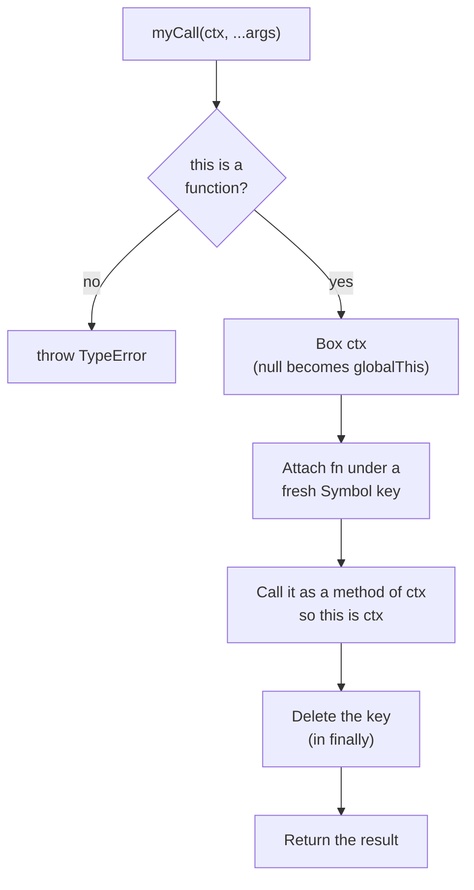

**Solution**

```js
Function.prototype.myCall = function (thisArg, ...args) {
  if (typeof this !== 'function') throw new TypeError('myCall needs a function');
  const ctx = thisArg == null ? globalThis : Object(thisArg); // sloppy-mode rules
  const key = Symbol('fn');                                   // cannot clash
  Object.defineProperty(ctx, key, { value: this, configurable: true });
  try {
    return ctx[key](...args);                                 // method call: this === ctx
  } finally {
    delete ctx[key];                                          // leave no trace
  }
};

Function.prototype.myApply = function (thisArg, argArray) {
  if (argArray == null) return this.myCall(thisArg);
  if (typeof argArray !== 'object' && typeof argArray !== 'function') {
    throw new TypeError('argArray must be an array-like');
  }
  return this.myCall(thisArg, ...Array.prototype.slice.call(argArray));
};

function greet(greeting, punct) { return greeting + ', ' + this.name + punct; }
const user = { name: 'Ada' };
console.log(greet.myCall(user, 'Hi', '!'), '|', greet.call(user, 'Hi', '!'));
console.log(greet.myApply(user, ['Hello', '?']), '|', greet.apply(user, ['Hello', '?']));
function kind() { return typeof this; }
function self() { return this; }
console.log(kind.myCall(5), kind.call(5), self.myCall(null) === globalThis);
console.log(Math.max.myApply(null, { length: 3, 0: 4, 1: 9, 2: 2 }));
console.log(Object.getOwnPropertySymbols(user).length, Object.keys(user));
try { greet.myCall(Object.freeze({ name: 'x' }), 'a', 'b'); } catch (e) {
  console.log('frozen target:', e.name);
}
try { greet.myApply(user, 5); } catch (e) { console.log(e.name + ': ' + e.message); }
```

```text output
Hi, Ada! | Hi, Ada!
Hello, Ada? | Hello, Ada?
object object true
9
0 [ 'name' ]
frozen target: TypeError
TypeError: argArray must be an array-like
```

**Complexity**

Time O(n) in the number of arguments (the spread and the slice); space O(n) for the argument list.

**Common mistakes**

- Attaching with a plain string key (`ctx.fn = this`). It can overwrite a real property and, if you forget the `delete`, leaks an enumerable key.
- Not deleting in a `finally`, so a throwing `fn` leaves the temporary property behind.
- Forgetting `null`/`undefined` to `globalThis` and primitive boxing, so `fn.myCall(5)` crashes.
- Assuming this trick is exact. It cannot reproduce *strict-mode* functions, where `fn.call(5)` sees the primitive `5`, and it fails on frozen or non-extensible targets (shown above). The native `Reflect.apply(fn, thisArg, args)` has neither problem, which is why production code uses it.

**Follow-up questions**

- How do you implement `bind` on top of this? (P23.2.)
- Why is a `Symbol` a better temporary key than a random string?

### P23.2 ★ Medium: Function.prototype.bind polyfill (partial args, new)

Implement `fn.myBind(thisArg, ...preset)` returning a function with a fixed `this` and preset leading arguments. Chapter 5 explains why a bound `this` cannot be overridden; Chapter 11 covers partial application.

*Typically asked in: JavaScript round (commonly reported).*

**Requirements and edge cases**

- Later arguments are appended after the preset ones.
- The bound `this` cannot be changed by `call`, `apply` or another `bind`.
- With `new`, `thisArg` is **ignored**: the constructor runs with a fresh object, and `instanceof` still works against the original constructor.
- `name` is `'bound ' + target.name` and `length` is `max(0, target.length - preset.length)`.

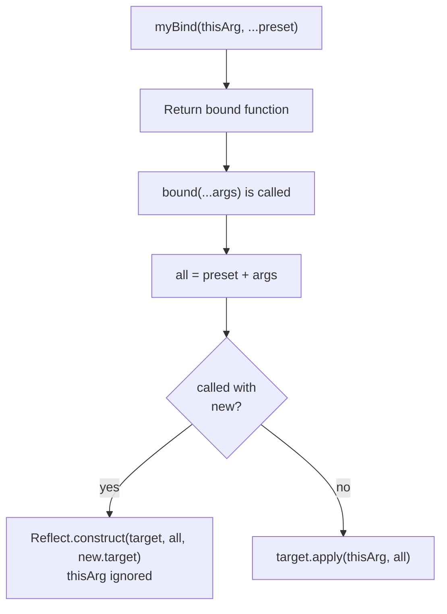

**Solution**

```js
Function.prototype.myBind = function (thisArg, ...preset) {
  const target = this;
  if (typeof target !== 'function') throw new TypeError('bind needs a function');
  function bound(...args) {
    const all = [...preset, ...args];
    return new.target
      ? Reflect.construct(target, all, new.target)   // `new bound()`: ignore thisArg
      : target.apply(thisArg, all);
  }
  bound.prototype = target.prototype;                // so `instanceof bound` works
  Object.defineProperty(bound, 'name', { value: 'bound ' + target.name });
  const len = Math.max(0, target.length - preset.length);
  Object.defineProperty(bound, 'length', { value: len });
  return bound;
};

function add(a, b, c) { return this.base + a + b + c; }
const mine = add.myBind({ base: 100 }, 1, 2);
const nat = add.bind({ base: 100 }, 1, 2);
console.log(mine(3), mine.length, mine.name);
console.log(nat(3), nat.length, nat.name);
console.log(mine.call({ base: 0 }, 3), mine.myBind({ base: 0 })(3));

function Point(x, y) { this.x = x; this.y = y; }
Point.prototype.toString = function () { return '(' + this.x + ', ' + this.y + ')'; };
const P1 = Point.myBind({ ignored: true }, 1);
const p = new P1(2);
console.log(String(p), p instanceof Point, p instanceof P1, Object.keys(p));
const arrowBound = (() => 1).myBind(null);
try { new arrowBound(); } catch (e) { console.log(e.name); }
```

```text output
106 1 bound add
106 1 bound add
106 106
(1, 2) true true [ 'x', 'y' ]
TypeError
```

**Complexity**

Binding is O(p) for `p` preset arguments. Each call is O(p + a) to build the argument array; extra space O(p + a).

**Common mistakes**

- The ES5 trick `this instanceof bound ? this : thisArg` breaks when the bound function is used through `Reflect.construct` or as a base class. `new.target` is the reliable check.
- Using `args.concat(arguments)` or mutating the shared `preset` array, so calls leak arguments into each other.
- Letting `thisArg` win with `new`. The spec says a bound function's `[[Construct]]` ignores the bound `this`.
- Forgetting that this polyfill gives the bound function a `prototype` property; native bound functions have none. Sharing `target.prototype` is the shortcut that keeps `instanceof` working.

**Follow-up questions**

- Why does `fn.bind(a).bind(b)` still use `a`?
- What changes if `target` is an arrow function? (`new` throws, as shown; `this` was never bindable.)

### P23.3 Medium: The `new` operator

Implement `myNew(Ctor, ...args)` that behaves like `new Ctor(...args)` for ordinary constructor functions. Chapter 6 shows the four steps of `new`.

*Typically asked in: JavaScript round (commonly reported).*

**Requirements and edge cases**

- Create an object whose prototype is `Ctor.prototype`; fall back to `Object.prototype` if `prototype` is not an object.
- Run `Ctor` with `this` set to that object.
- If `Ctor` returns an **object or function**, that value replaces the new object; a returned primitive is ignored.
- Throw `TypeError` for non-constructors (arrow functions, methods, non-functions).

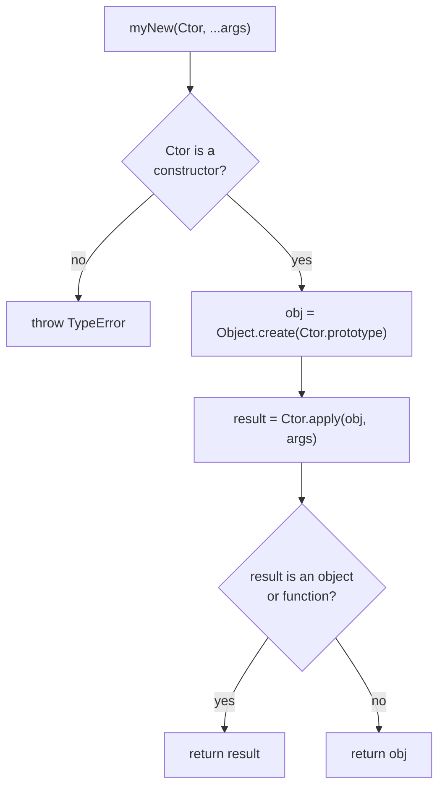

**Solution**

```js
function myNew(Ctor, ...args) {
  if (typeof Ctor !== 'function' || !('prototype' in Ctor)) {
    throw new TypeError('not a constructor');      // arrows, methods, async fns
  }
  const isObj = (v) => v !== null && (typeof v === 'object' || typeof v === 'function');
  const proto = isObj(Ctor.prototype) ? Ctor.prototype : Object.prototype;
  const obj = Object.create(proto);                // 1. new object, linked to prototype
  const result = Ctor.apply(obj, args);            // 2. run the constructor on it
  return isObj(result) ? result : obj;             // 3. an object result wins
}

function Person(name) { this.name = name; }
Person.prototype.hi = function () { return 'hi ' + this.name; };
const a = myNew(Person, 'Ada');
console.log(a.hi(), a instanceof Person, a.constructor === Person);

function ReturnsObj() { this.a = 1; return { b: 2 }; }
function ReturnsPrim() { this.a = 1; return 42; }
console.log(myNew(ReturnsObj), myNew(ReturnsPrim), new ReturnsObj());

const errs = [() => 1, { m() {} }.m, 5].map((f) => {
  try { myNew(f); } catch (e) { return e.name; }
});
console.log(errs);

class Box {}
try { myNew(Box); } catch (e) { console.log(e.name + ': ' + e.message); }
```

```text output
hi Ada true true
{ b: 2 } ReturnsPrim { a: 1 } { b: 2 }
[ 'TypeError', 'TypeError', 'TypeError' ]
TypeError: Class constructor Box cannot be invoked without 'new'
```

**Complexity**

O(1) for the setup plus whatever the constructor does; space O(1) beyond the new object.

**Common mistakes**

- Returning `obj` unconditionally, or returning the result when it is a primitive.
- Using `typeof result === 'object'` only. A returned *function* also replaces the new object, and `null` must not.
- Setting `obj.__proto__ = Ctor.prototype` after creating `{}` (works, but slower and non-idiomatic; `Object.create` links it directly).
- Claiming this is exact. `class` constructors reject `apply` (last line above), and `new.target` is `undefined` inside the constructor. A faithful version needs `Reflect.construct(Ctor, args)`, which makes the exercise trivial.

**Follow-up questions**

- How would you support `new.target`? (`Reflect.construct`.)
- What happens if `Ctor.prototype` is reassigned after objects were created? (Old objects keep the old prototype.)

### P23.4 Medium: instanceof

Implement `myInstanceof(obj, Ctor)` equivalent to `obj instanceof Ctor`.

*Typically asked in: JavaScript round (commonly reported).*

**Requirements and edge cases**

- Walk the prototype chain of `obj` and compare each link with `Ctor.prototype` (identity).
- Primitives on the left give `false` (no boxing); `Object.create(null)` objects give `false`.
- A static `Symbol.hasInstance` method on the right-hand side takes priority.
- Right-hand side not an object, or not callable, or with a non-object `prototype`: throw `TypeError`.

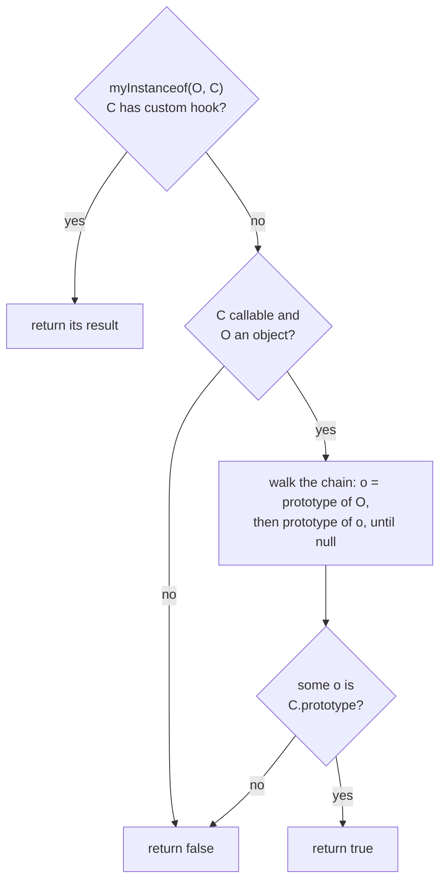

**Solution**

```js
const isObj = (v) => v !== null && (typeof v === 'object' || typeof v === 'function');

function ordinaryHasInstance(C, O) {
  if (typeof C !== 'function' || !isObj(O)) return false;
  const P = C.prototype;
  if (!isObj(P)) throw new TypeError('prototype is not an object');
  for (let o = Object.getPrototypeOf(O); o !== null; o = Object.getPrototypeOf(o)) {
    if (o === P) return true;                          // walk the [[Prototype]] chain
  }
  return false;
}

function myInstanceof(O, C) {
  if (!isObj(C)) throw new TypeError('right-hand side is not an object');
  const custom = C[Symbol.hasInstance];
  if (custom != null && custom !== Function.prototype[Symbol.hasInstance]) {
    return Boolean(custom.call(C, O));                 // user-defined static hook wins
  }
  if (typeof C !== 'function') throw new TypeError('right-hand side is not callable');
  return ordinaryHasInstance(C, O);
}

class Animal {}
class Dog extends Animal {}
const d = new Dog();
const cases = [[d, Dog], [d, Animal], [d, Object], [d, Array], [1, Number],
  [Object.create(null), Object]];
console.log(cases.map(([o, C]) => myInstanceof(o, C) + '/' + (o instanceof C)).join(' '));

class Even { static [Symbol.hasInstance](n) { return n % 2 === 0; } }
console.log(myInstanceof(4, Even), myInstanceof(3, Even), 4 instanceof Even);

function F() {}
const o = new F();
console.log(myInstanceof(o, F));
F.prototype = {};                                      // replace the prototype afterwards
console.log(myInstanceof(o, F), o instanceof F);

for (const rhs of [{}, () => {}, 5]) {
  try { myInstanceof({}, rhs); } catch (e) { console.log(e.name + ': ' + e.message); }
}
```

```text output
true/true true/true true/true false/false false/false false/false
true false true
true
false false
TypeError: right-hand side is not callable
TypeError: prototype is not an object
TypeError: right-hand side is not an object
```

**Complexity**

Time O(h) for chain height `h`; space O(1).

**Common mistakes**

- Comparing `o.constructor === Ctor`. `constructor` is an ordinary, overwritable property, and subclasses would fail.
- Using `obj.__proto__` instead of `Object.getPrototypeOf` (breaks for `Object.create(null)`).
- Thinking `instanceof` checks "was built by Ctor". It checks whether `Ctor.prototype` is *currently* on the chain, so replacing `F.prototype` (above) changes the answer for existing objects.
- Ignoring `Symbol.hasInstance`, the hook that lets a class customise the operator (`Even` above).

**Follow-up questions**

- How do native bound functions behave? (The spec unwraps their target function, which user code cannot see, so this polyfill does not support them.)
- Why does `1 instanceof Number` give `false` while `Object(1) instanceof Number` gives `true`?

### P23.5 Easy: Object.create polyfill

Implement `myCreate(proto, props?)`, creating an object whose prototype is `proto`. Chapter 6 covers the prototype chain.

*Typically asked in: JavaScript round (commonly reported).*

**Requirements and edge cases**

- `proto` must be an object, a function or `null`; anything else (including `undefined`) throws `TypeError`.
- `myCreate(null)` gives an object with **no** prototype (no `toString`).
- The optional second argument is a property-descriptor map, as in `Object.defineProperties`.

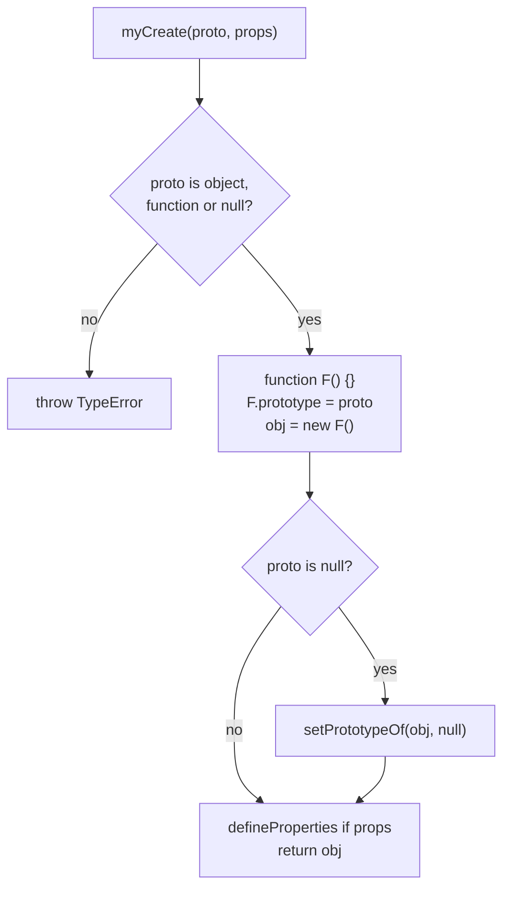

**Solution**

```js
function myCreate(proto, props) {
  if (proto !== null && typeof proto !== 'object' && typeof proto !== 'function') {
    throw new TypeError('Object prototype may only be an Object or null');
  }
  function F() {}
  F.prototype = proto;
  const obj = new F();                       // [[Prototype]] is F.prototype
  if (proto === null) Object.setPrototypeOf(obj, null);  // else Object.prototype is used
  if (props !== undefined) Object.defineProperties(obj, props);
  return obj;
}

const animal = { speak() { return this.name + ' makes a sound'; } };
const dog = myCreate(animal, { name: { value: 'Rex', enumerable: true } });
console.log(dog.speak(), Object.getPrototypeOf(dog) === animal, Object.keys(dog));
console.log(Object.getOwnPropertyDescriptor(dog, 'name').writable);
const bare = myCreate(null);
console.log(Object.getPrototypeOf(bare), 'toString' in bare, 'toString' in myCreate({}));
for (const bad of [42, undefined]) {
  try { myCreate(bad); } catch (e) { console.log(e.name, '/', (() => {
    try { Object.create(bad); } catch (n) { return n.name; }
  })()); }
}
```

```text output
Rex makes a sound true [ 'name' ]
false
null false true
TypeError / TypeError
TypeError / TypeError
```

**Complexity**

O(1) plus O(k) for `k` property descriptors; space O(1) beyond the object.

**Common mistakes**

- Forgetting `null`: `F.prototype = null` makes `new F()` fall back to `Object.prototype`, so a prototype-less object needs the extra `setPrototypeOf`.
- Copying `proto`'s properties into a new object. That is a clone, not inheritance; later changes to `proto` would not be visible.
- Using `{ __proto__: proto }`. It works for object literals, but is not a function you can call with a variable in older engines, and `__proto__` is a legacy accessor.
- Descriptors default to `writable: false`, `enumerable: false`, `configurable: false` when passed through `props` (printed above).

**Follow-up questions**

- Implement classical inheritance with it: `Child.prototype = Object.create(Parent.prototype)`; why must `constructor` be re-assigned?
- Why is `Object.setPrototypeOf({}, proto)` discouraged in hot code? (Changing a prototype after creation can defeat engine optimisations.)

### P23.6 ★ Easy: Array.prototype.map, filter, reduce polyfills

Implement `myMap`, `myFilter` and `myReduce` with the real semantics. Chapter 12 explains why these are higher-order functions; this is the full version.

*Typically asked in: JavaScript round (commonly reported).*

**Requirements and edge cases**

- Callback receives `(value, index, array)`; `map` and `filter` also take `thisArg`.
- **Holes are skipped** (`k in O`), and `map` keeps them in its result.
- `length` is read once up front: elements appended during iteration are not visited.
- Work on array-likes via `Array.prototype.myMap.call('abc', ...)`.
- `reduce` without an initial value uses the first *present* element; an empty array throws `TypeError`. `reduce(fn, undefined)` counts as "initial value supplied".
- Non-function callback throws `TypeError`.

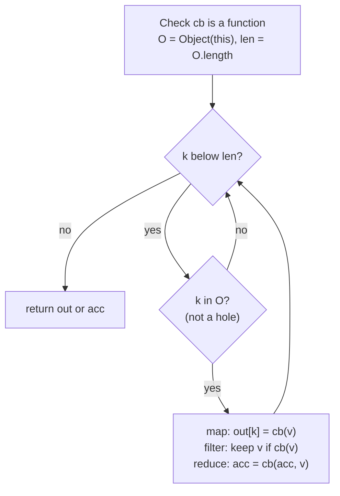

**Solution**

```js
const check = (cb) => {
  if (typeof cb !== 'function') throw new TypeError(String(cb) + ' is not a function');
};

Array.prototype.myMap = function (cb, thisArg) {
  check(cb);
  const O = Object(this), len = O.length >>> 0, out = new Array(len); // holes stay holes
  for (let k = 0; k < len; k++) if (k in O) out[k] = cb.call(thisArg, O[k], k, O);
  return out;
};

Array.prototype.myFilter = function (cb, thisArg) {
  check(cb);
  const O = Object(this), len = O.length >>> 0, out = [];
  for (let k = 0; k < len; k++) {
    if (!(k in O)) continue;
    const v = O[k];                                   // read once, as the spec does
    if (cb.call(thisArg, v, k, O)) out.push(v);
  }
  return out;
};

Array.prototype.myReduce = function (cb, ...init) {
  check(cb);
  const O = Object(this), len = O.length >>> 0;
  let k = 0, acc;
  if (init.length) acc = init[0];                     // even if it is undefined
  else {
    while (k < len && !(k in O)) k++;                 // first present element
    if (k >= len) throw new TypeError('Reduce of empty array with no initial value');
    acc = O[k++];
  }
  for (; k < len; k++) if (k in O) acc = cb(acc, O[k], k, O);
  return acc;
};

const holes = [1, , 3];
console.log(holes.myMap((x) => x * 2), holes.map((x) => x * 2));
console.log([1, 2].myMap(function (x) { return x * this.k; }, { k: 10 }));
console.log(Array.prototype.myMap.call('abc', (c) => c.toUpperCase()));
console.log([1, 2, 3, 4].myFilter((x) => x % 2 === 0), holes.myFilter(() => true));
const grow = [1, 2, 3];
console.log(grow.myMap((x, i) => { if (i === 0) grow.push(9); return x; }));
const sum = (a, b) => a + b;
console.log(holes.myReduce(sum), [].myReduce(sum, 0), [].myReduce(sum, undefined));
try { [].myReduce(sum); } catch (e) { console.log(e.name + ': ' + e.message); }
try { [1].myMap(null); } catch (e) { console.log(e.name + ': ' + e.message); }
```

```text output
[ 2, <1 empty item>, 6 ] [ 2, <1 empty item>, 6 ]
[ 10, 20 ]
[ 'A', 'B', 'C' ]
[ 2, 4 ] [ 1, 3 ]
[ 1, 2, 3 ]
4 0 undefined
TypeError: Reduce of empty array with no initial value
TypeError: null is not a function
```

**Complexity**

Time O(n) for each; space O(n) for `map` and `filter` output, O(1) extra for `reduce`.

**Common mistakes**

- Looping with `for...in` or `forEach` (order and hole behaviour differ), or skipping the `k in O` test so holes become `undefined` callbacks.
- Detecting a missing initial value with `init === undefined`. `reduce(fn, undefined)` is a legitimate call.
- Reading `this.length` on every iteration, so items pushed by the callback are visited and the loop may never end.
- In `filter`, pushing the callback's return value instead of the element.
- Forgetting `thisArg` (and that arrow callbacks ignore it).

**Follow-up questions**

- How does the native `map` pick the result type for subclasses? (`Symbol.species`; not replicated here.)
- Implement `reduceRight` and `flatMap`. How would you write an async `map` that preserves order? (`Promise.all` over `myMap`.)

### P23.7 ★ Medium: Array.prototype.flat (depth, iterative variant)

Implement `myFlat(depth = 1)`, plus an iterative version that survives very deep nesting.

*Typically asked in: JavaScript round (commonly reported).*

**Requirements and edge cases**

- Default depth is `1`; `Infinity` flattens fully; `0` or a negative number gives a shallow copy.
- `depth` is converted like `ToIntegerOrInfinity`: `NaN` becomes `0`, fractions truncate.
- Only real arrays (`Array.isArray`) are flattened. Strings, array-likes and typed arrays are kept as values.
- Holes are **removed**.
- The input is not mutated.

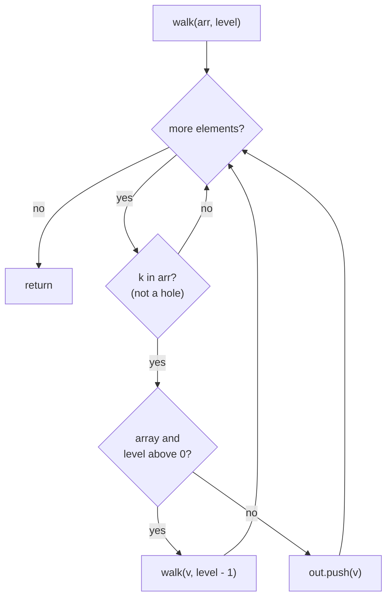

**Solution**

```js
Array.prototype.myFlat = function (depth = 1) {
  const d = Math.trunc(Number(depth)) || 0;          // NaN, -0 -> 0; Infinity stays
  const out = [];
  (function walk(arr, level) {
    for (let k = 0; k < arr.length; k++) {
      if (!(k in arr)) continue;                     // drop holes
      const v = arr[k];
      if (Array.isArray(v) && level > 0) walk(v, level - 1);
      else out.push(v);
    }
  })(this, d);
  return out;
};

// Iterative: explicit stack of [value, remainingDepth]; no call-stack limit.
function flatIterative(arr, depth = 1) {
  const out = [], stack = [];
  const pushAll = (a, d) => {
    for (let k = a.length - 1; k >= 0; k--) if (k in a) stack.push([a[k], d]);
  };
  pushAll(arr, depth);
  while (stack.length) {
    const [v, d] = stack.pop();
    if (Array.isArray(v) && d > 0) pushAll(v, d - 1);
    else out.push(v);
  }
  return out;
}

const data = [1, [2, [3, [4]]], , [5]];
const j = JSON.stringify;
console.log(j(data.myFlat()), j(data.flat()));
console.log(j(data.myFlat(2)), j(data.myFlat(Infinity)), j(data.myFlat(0)));
console.log(j([[1, 2], 'ab', { length: 1, 0: 9 }].myFlat()), j([1, [2]].myFlat(NaN)));
console.log(j(flatIterative(data, Infinity)) === j(data.flat(Infinity)));

let deep = [1];
for (let i = 0; i < 1e5; i++) deep = [deep];
console.log(j(flatIterative(deep, Infinity)));
try { deep.myFlat(Infinity); } catch (e) { console.log(e.name); }
```

```text output
[1,2,[3,[4]],5] [1,2,[3,[4]],5]
[1,2,3,[4],5] [1,2,3,4,5] [1,[2,[3,[4]]],[5]]
[1,2,"ab",{"0":9,"length":1}] [1,[2]]
true
[1]
RangeError
```

**Complexity**

Time O(N) for `N` total elements across all levels; space O(N) for the output plus O(depth) for the recursion or the explicit stack.

**Common mistakes**

- `arr.reduce((a, v) => a.concat(Array.isArray(v) ? flat(v) : v), [])` copies the accumulator on every step and is quadratic.
- `String(arr).split(',')` or `JSON.stringify` tricks. They stringify every value and break on strings, objects and `null`.
- Testing `typeof v === 'object'`: objects, `null` and array-likes are not flattened.
- Treating "no argument" as infinite depth, or forgetting that holes disappear.

**Follow-up questions**

- Make it lazy with a generator (`function*` that `yield*`s nested arrays). Chapter 15 covers generators.
- Implement `flatMap` (`map` then `flat(1)`) and explain why it only goes one level deep.

### P23.8 ★ Medium: deepClone (circular, Date, RegExp, Map, Set)

Implement `deepClone(value)` for plain data structures. Chapter 18 compares this with `structuredClone` and spread.

*Typically asked in: JavaScript round and machine-coding round (commonly reported).*

**Requirements and edge cases**

- Primitives and functions are returned as they are.
- **Circular references** and **shared references** must be preserved in the copy, not blown up or duplicated.
- `Date`, `RegExp` (source, flags, `lastIndex`), `Map` and `Set` need their own constructors; a `Map`/`Set` clones its entries.
- Arrays keep length and holes; plain objects keep their prototype and symbol keys.
- Say what you do **not** support (typed arrays, `Error`, DOM nodes, getters kept as values).

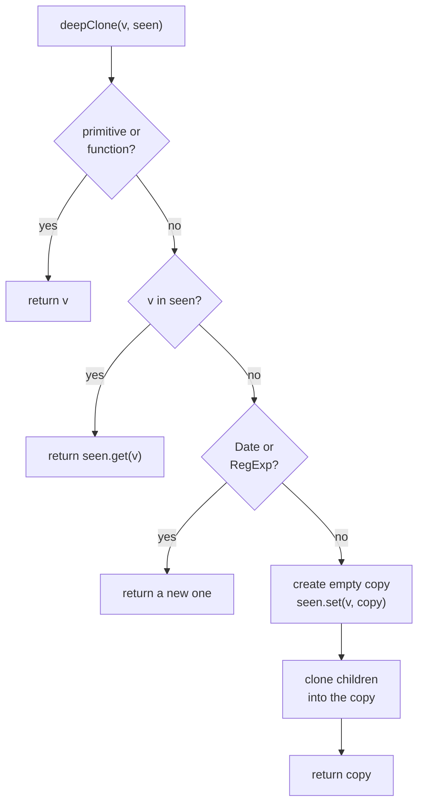

**Solution**

```js
function deepClone(value, seen = new WeakMap()) {
  if (value === null || typeof value !== 'object') return value; // primitives, functions
  if (seen.has(value)) return seen.get(value);       // cycle or shared reference
  if (value instanceof Date) return new Date(value.getTime());
  if (value instanceof RegExp) {
    const re = new RegExp(value.source, value.flags);
    re.lastIndex = value.lastIndex;
    return re;
  }
  let copy;
  if (value instanceof Map) copy = new Map();
  else if (value instanceof Set) copy = new Set();
  else if (Array.isArray(value)) copy = new Array(value.length);
  else copy = Object.create(Object.getPrototypeOf(value));  // keep the prototype
  seen.set(value, copy);                             // register BEFORE recursing
  if (value instanceof Map) {
    value.forEach((v, k) => copy.set(deepClone(k, seen), deepClone(v, seen)));
  }
  else if (value instanceof Set) value.forEach((v) => copy.add(deepClone(v, seen)));
  else {
    for (const key of Reflect.ownKeys(value)) {      // strings and symbols
      if (Object.prototype.propertyIsEnumerable.call(value, key)) {
        copy[key] = deepClone(value[key], seen);
      }
    }
  }
  return copy;
}

const src = {
  n: 1, d: new Date(0), r: /a+/gi, arr: [1, [2, 3], , 5],
  m: new Map([[{ k: 1 }, new Set([1, 2])]]), [Symbol('s')]: 'sym', fn() {},
};
src.self = src;
const c = deepClone(src);
console.log(c.self === c, c.d instanceof Date && c.d !== src.d, c.r.flags, c.r !== src.r);
const [[key, set]] = [...c.m];
console.log(key, key !== [...src.m.keys()][0], set instanceof Set, set.has(2));
src.arr[1].push(99);
console.log(c.arr[1], 2 in c.arr, c.arr.length, Object.getOwnPropertySymbols(c).length);
console.log(c.fn === src.fn);
const shared = { x: 1 };
const t = deepClone({ a: shared, b: shared });
console.log(t.a === t.b, t.a !== shared);
class Pt { constructor() { this.x = 1; } }
console.log(deepClone(new Pt()) instanceof Pt, structuredClone(new Pt()) instanceof Pt);
```

```text output
true true gi true
{ k: 1 } true true true
[ 2, 3 ] false 4 1
true
true true
true false
```

**Complexity**

Time O(N) in the number of nodes (each is visited once thanks to `seen`); space O(N) for the copy and the `WeakMap`, plus recursion depth.

**Common mistakes**

- `JSON.parse(JSON.stringify(x))`: drops `undefined`, functions and symbols, turns `Date` into a string, `Map`/`Set` into `{}`, `NaN` into `null`, and throws on cycles and `BigInt`.
- Registering the copy in `seen` *after* cloning the children, so a cycle recurses forever.
- Checking `typeof v === 'object'` without excluding `null`.
- Cloning with `{}`, which silently drops the prototype of class instances (`structuredClone` does this too; the last line above).

**Follow-up questions**

- Why not just call `structuredClone`? (It cannot copy functions, drops prototypes and getters; see Chapter 18.)
- How would you avoid stack overflow on very deep data? (An explicit work stack, as in P23.7.)
- How do you copy property descriptors and getters faithfully?

### P23.9 Medium: deepEqual

Implement `deepEqual(a, b)` that compares structure and values. Decide and state the rules: this version treats `NaN` as equal to `NaN`, `0` as equal to `-0` (SameValueZero), and requires equal prototypes.

*Typically asked in: JavaScript round (commonly reported).*

**Requirements and edge cases**

- Primitives: `===`, plus `NaN` equal to `NaN`.
- Arrays and plain objects: same prototype, same own enumerable keys (symbols included), equal values; arrays also need equal `length`.
- `Date` by time value, `RegExp` by source and flags, `Map` by key and value, `Set` by contents.
- **Cycles** must terminate. Two distinct `Date` objects have no own keys, so a keys-only comparison would wrongly call every pair equal.
- `{ 0: 1, length: 1 }` is not equal to `[1]`.

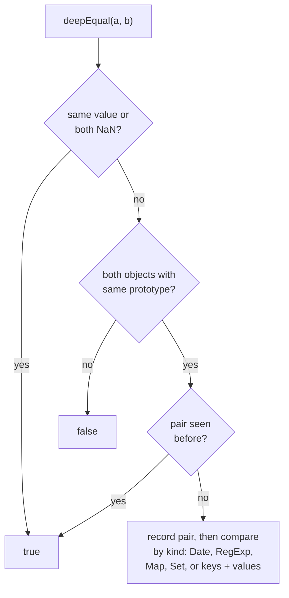

**Solution**

```js
const isEnum = (o, k) => Object.prototype.propertyIsEnumerable.call(o, k);
const own = (o) => Reflect.ownKeys(o).filter((k) => isEnum(o, k));

function deepEqual(a, b, seen = new WeakMap()) {
  if (a === b || (a !== a && b !== b)) return true;       // identical, or both NaN
  if (typeof a !== 'object' || typeof b !== 'object' || !a || !b) return false;
  if (Object.getPrototypeOf(a) !== Object.getPrototypeOf(b)) return false;
  const pairs = seen.get(a) ?? new Set();
  if (pairs.has(b)) return true;                          // cycle: assume equal
  pairs.add(b);
  seen.set(a, pairs);
  if (a instanceof Date) return Object.is(a.getTime(), b.getTime());
  if (a instanceof RegExp) return String(a) === String(b);
  if (a instanceof Map) {
    return a.size === b.size &&
      [...a].every(([k, v]) => b.has(k) && deepEqual(v, b.get(k), seen));
  }
  if (a instanceof Set) {
    if (a.size !== b.size) return false;
    const rest = [...b];                                  // consume each match once
    return [...a].every((x) => {
      const i = rest.findIndex((y) => deepEqual(x, y, seen));
      return i >= 0 && (rest.splice(i, 1), true);
    });
  }
  if (Array.isArray(a) && a.length !== b.length) return false;
  const ka = own(a), kb = own(b);
  return ka.length === kb.length &&
    ka.every((k) => kb.includes(k) && deepEqual(a[k], b[k], seen));
}

console.log(deepEqual({ a: [1, { b: 2 }] }, { a: [1, { b: 2 }] }),
  deepEqual({ a: 1, b: 2 }, { b: 2, a: 1 }));
console.log(deepEqual(NaN, NaN), deepEqual(0, -0), deepEqual(1, '1'), deepEqual(null, {}));
console.log(deepEqual([1, 2], { 0: 1, 1: 2, length: 2 }),
  deepEqual([1, , 3], [1, undefined, 3]));
console.log(deepEqual(new Date(5), new Date(5)), deepEqual(new Date(5), new Date(6)));
console.log(deepEqual(/a/g, /a/g), deepEqual(/a/g, /a/i));
console.log(deepEqual(new Map([[1, { a: 1 }]]), new Map([[1, { a: 1 }]])));
console.log(deepEqual(new Set([{ a: 1 }, { a: 1 }]), new Set([{ a: 1 }, { a: 2 }])));
const x = { n: 1 }; x.self = x;
const y = { n: 1 }; y.self = y;
console.log(deepEqual(x, y), deepEqual(x, { n: 1, self: { n: 1, self: null } }));
```

```text output
true true
true true false false
false false
true false
true false
true
false
true false
```

**Complexity**

Time O(N) for `N` nodes in plain objects and arrays (`kb.includes` adds a factor of the key count per object); Set comparison is O(n²) for `n` elements. Space O(N) for recursion and the `seen` map.

**Common mistakes**

- `JSON.stringify(a) === JSON.stringify(b)`: depends on key order, drops `undefined`, cannot see `NaN`, `Map`, `Set`, and throws on cycles.
- Comparing only `Object.keys(a)` against `b`, so `{ a: 1 }` equals `{ a: 1, b: 2 }`. Check both key counts.
- `typeof null === 'object'`, so `null` needs an explicit guard.
- Comparing `Date` or `RegExp` objects as plain objects (they have no own keys, so all pairs look equal).

**Follow-up questions**

- What is the difference between a loose and a strict version? (Prototype check, `-0` versus `0`, symbol keys. Node's `util.isDeepStrictEqual` is strict.)
- How would you support `Map` with object keys? (Match entries the way the `Set` branch does.)
- How would you return *where* the first difference is?

### P23.10 ★ Medium: debounce (leading/trailing, cancel, flush)

Implement `debounce(fn, wait, { leading, trailing })` with `cancel()`, `flush()` and `pending()`. Chapter 13 draws the timeline; this is the interview-grade version. The scheduler is injectable so the demo uses a fake clock.

*Typically asked in: JavaScript round and machine-coding round (commonly reported).*

**Requirements and edge cases**

- Every call restarts the wait. By default only the **last** call's arguments run, after `wait` ms of quiet (trailing).
- `leading: true` also runs on the first call of a burst. With `leading` and `trailing` both on, a burst of a **single** call runs once, not twice.
- Preserve `this` and arguments; return the last result.
- `cancel()` drops the pending call; `flush()` runs it now.
- A `wait` of quiet must be measured from the *last* call, not the first.

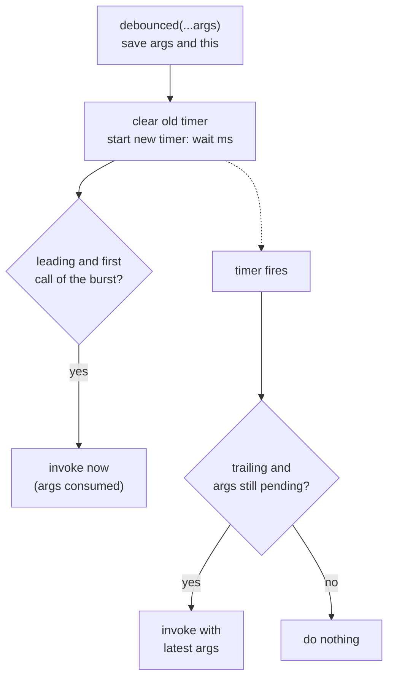

**Solution**

```js
function debounce(fn, wait, opts = {}) {
  const { leading = false, trailing = true } = opts;
  const { set, clear } = opts.timers || { set: setTimeout, clear: clearTimeout };
  let timer = null, lastArgs, lastThis, result;
  const invoke = () => {
    const args = lastArgs, ctx = lastThis;
    lastArgs = lastThis = undefined;                 // consumed: no double invoke
    result = fn.apply(ctx, args);
  };
  function debounced(...args) {
    lastArgs = args; lastThis = this;
    const startOfBurst = timer === null;
    if (!startOfBurst) clear(timer);
    timer = set(() => {
      timer = null;
      if (trailing && lastArgs) invoke();            // only if a call is still pending
    }, wait);
    if (leading && startOfBurst) invoke();
    return result;
  }
  debounced.cancel = () => {
    if (timer !== null) clear(timer);
    timer = null; lastArgs = lastThis = undefined;
  };
  debounced.flush = () => {
    if (timer === null) return result;
    clear(timer); timer = null;
    if (trailing && lastArgs) invoke();
    return result;
  };
  debounced.pending = () => timer !== null;
  return debounced;
}

function makeClock() {                               // fake clock for deterministic demos
  let now = 0, id = 0;
  const q = new Map();
  return {
    now: () => now,
    setTimeout: (fn, ms) => (q.set(++id, { fn, at: now + ms }), id),
    clearTimeout: (i) => q.delete(i),
    tick(ms) {                                       // advance time, firing due timers
      const end = now + ms;
      for (;;) {
        const due = [...q].filter(([, t]) => t.at <= end)
          .sort((a, b) => a[1].at - b[1].at)[0];
        if (!due) break;
        q.delete(due[0]); now = due[1].at; due[1].fn();
      }
      now = end;
    },
  };
}

function scenario(label, opts, script) {
  const clock = makeClock(), log = [];
  const timers = { set: clock.setTimeout, clear: clock.clearTimeout };
  const d = debounce((x) => (log.push(clock.now() + ':' + x), x), 100, { ...opts, timers });
  script(d, clock);
  console.log(label.padEnd(17), log.join(' ') || '(nothing)');
}

scenario('trailing', {}, (d, c) => {
  d(1); c.tick(50); d(2); c.tick(70); d(3); c.tick(100);
});
scenario('leading only', { leading: true, trailing: false },
  (d, c) => { d(1); c.tick(50); d(2); c.tick(200); d(3); c.tick(200); });
scenario('leading+trailing', { leading: true },
  (d, c) => { d(1); c.tick(30); d(2); c.tick(200); d('solo'); c.tick(200); });
scenario('cancel', {}, (d, c) => { d(1); c.tick(50); d.cancel(); c.tick(500); });
scenario('flush', {}, (d, c) => {
  d(1); c.tick(10); d(2);
  console.log('flush returns', d.flush(), 'pending', d.pending());
  c.tick(500);
});
```

```text output
trailing          220:3
leading only      0:1 250:3
leading+trailing  0:1 130:2 230:solo
cancel            (nothing)
flush returns 2 pending false
flush             10:2
```

**Complexity**

O(1) time per call and O(1) space: one timer and the latest arguments, however many calls arrive.

**Common mistakes**

- Creating a new debounced function on every render or event, so each has its own timer and nothing is ever debounced. Create it once.
- Wrapping the handler in an arrow, or calling `fn(...args)` without `apply`, losing `this`.
- With `leading` and `trailing` both on, invoking twice for a single call (the `lastArgs` clearing above prevents it).
- No `cancel`, leaving a pending call that fires after a component unmounts.
- Timing the wait from the first call (that is throttle).

**Follow-up questions**

- Add `maxWait` so a long burst still runs at least every `maxWait` ms (this is how `throttle` is built from `debounce`).
- Return a promise that resolves with the result of the trailing call.
- How do you use it in React without re-creating it on every render? (`useRef` or `useMemo`, with cleanup that calls `cancel`.)

### P23.11 ★ Medium: throttle

Implement `throttle(fn, wait, { leading, trailing })` with `cancel()`. Chapter 13 compares throttle and debounce. The scheduler and the clock are injectable.

*Typically asked in: JavaScript round and machine-coding round (commonly reported).*

**Requirements and edge cases**

- Run at most once per `wait` ms **during** a continuous stream, unlike debounce, which waits for the stream to stop.
- `leading` (default on): the first call runs immediately. `trailing` (default on): the latest call in the window runs when the window ends.
- A single call must not run twice. After a quiet period longer than `wait`, the next call runs immediately.
- Preserve `this` and arguments; `cancel()` clears the pending trailing call.

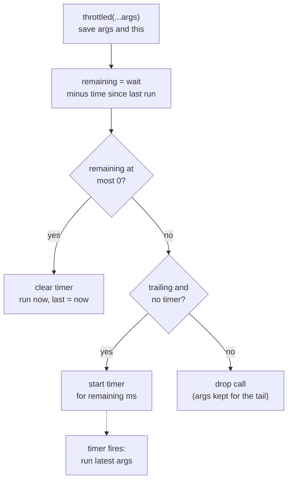

**Solution**

```js
function throttle(fn, wait, opts = {}) {
  const { leading = true, trailing = true } = opts;
  const { set, clear, now } = opts.timers || {
    set: setTimeout, clear: clearTimeout, now: Date.now,
  };
  let timer = null, last = null, lastArgs, lastThis, result;
  const run = () => {
    const args = lastArgs, ctx = lastThis;
    lastArgs = lastThis = undefined;
    result = fn.apply(ctx, args);
  };
  function throttled(...args) {
    const t = now();
    lastArgs = args; lastThis = this;
    if (last === null && !leading) last = t;         // no immediate run: window starts now
    const remaining = last === null ? 0 : wait - (t - last);
    if (remaining <= 0 || remaining > wait) {        // window over (or clock went back)
      if (timer !== null) { clear(timer); timer = null; }
      last = t;
      run();
    } else if (trailing && timer === null) {
      timer = set(() => {                            // tail of the window
        timer = null;
        last = leading ? now() : null;
        if (lastArgs) run();
      }, remaining);
    }
    return result;
  }
  throttled.cancel = () => {
    if (timer !== null) clear(timer);
    timer = last = null; lastArgs = lastThis = undefined;
  };
  return throttled;
}

function makeClock() {                               // fake clock for deterministic demos
  let now = 0, id = 0;
  const q = new Map();
  return {
    now: () => now,
    setTimeout: (fn, ms) => (q.set(++id, { fn, at: now + ms }), id),
    clearTimeout: (i) => q.delete(i),
    tick(ms) {
      const end = now + ms;
      for (;;) {
        const due = [...q].filter(([, t]) => t.at <= end)
          .sort((a, b) => a[1].at - b[1].at)[0];
        if (!due) break;
        q.delete(due[0]); now = due[1].at; due[1].fn();
      }
      now = end;
    },
  };
}

function scenario(label, opts, script) {
  const clock = makeClock(), log = [];
  const timers = { set: clock.setTimeout, clear: clock.clearTimeout, now: clock.now };
  const t = throttle((x) => (log.push(clock.now() + ':' + x), x), 100, { ...opts, timers });
  script(t, clock);
  console.log(label.padEnd(17), log.join(' ') || '(nothing)');
}

scenario('stream', {}, (t, c) => {
  for (let i = 1; i <= 8; i++) { t(i); c.tick(30); }
  c.tick(200);
});
scenario('leading only', { trailing: false }, (t, c) => {
  t(1); c.tick(30); t(2); c.tick(30); t(3); c.tick(100); t(4);
});
scenario('trailing only', { leading: false }, (t, c) => {
  t(1); c.tick(30); t(2); c.tick(30); t(3); c.tick(100);
});
scenario('single call', {}, (t, c) => { t('solo'); c.tick(500); });
scenario('cancel', {}, (t, c) => { t(1); c.tick(10); t(2); t.cancel(); c.tick(500); });
```

```text output
stream            0:1 100:4 200:7 300:8
leading only      0:1 160:4
trailing only     100:3
single call       0:solo
cancel            0:1
```

**Complexity**

O(1) time per call; O(1) space (one timer, the latest arguments, one timestamp).

**Common mistakes**

- A bare flag (`if (waiting) return; waiting = true; setTimeout(() => waiting = false, wait)`) drops the final event, so the UI ends on a stale value. Add the trailing call.
- Mixing up the two: debounce fires after the stream stops, throttle fires *during* it. The `stream` scenario shows four runs where debounce would show one.
- Measuring with `Date.now()` and ignoring that wall-clock time can jump; `performance.now()` is monotonic (inject it through `timers.now`).
- Creating the throttled function inside the event handler, so every event gets a fresh, empty throttle.

**Follow-up questions**

- Build throttle from debounce with `maxWait = wait`. Which options does that give you for free?
- For scroll and resize work tied to painting, why might `requestAnimationFrame` be a better throttle than a fixed `wait`?
- Add `flush()`.

### P23.12 ★ Medium: memoize (multi-argument, resolver)

Implement `memoize(fn, resolver?)` caching results per argument list. Chapter 14 explains purity and cache keys; this is the interview-grade version.

*Typically asked in: JavaScript round (commonly reported).*

**Requirements and edge cases**

- Cache hit for the same arguments: `fn` runs once. Different argument lists never collide: `f(1, 2)` and `f('1,2')` are distinct, and so are `f(1)` and `f(1, undefined)`.
- Objects as arguments are keyed by **reference**. An optional `resolver(...args)` picks a custom key.
- Results of `undefined`, `0` and `''` are cached too (use `has`, not truthiness).
- A call that **throws** is not cached.
- Recursive functions (Fibonacci) benefit when they call the memoized binding.

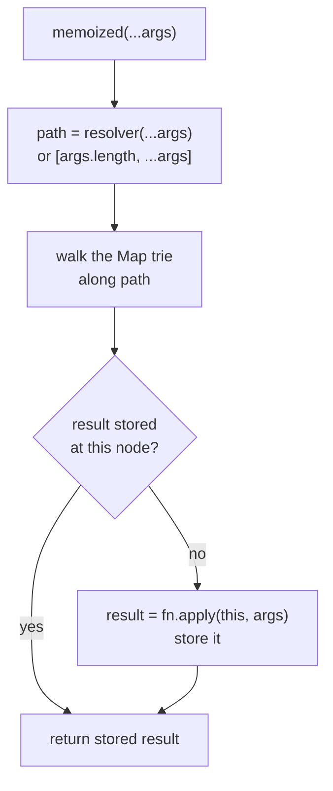

**Solution**

```js
const RESULT = Symbol('result');

function memoize(fn, resolver) {
  const root = new Map();                            // trie: one Map level per argument
  function memoized(...args) {
    const path = resolver ? [resolver.apply(this, args)] : [args.length, ...args];
    let node = root;
    for (const k of path) {                          // SameValueZero keys: NaN works
      if (!node.has(k)) node.set(k, new Map());
      node = node.get(k);
    }
    if (!node.has(RESULT)) node.set(RESULT, fn.apply(this, args)); // a throw stores nothing
    return node.get(RESULT);
  }
  memoized.clear = () => root.clear();
  return memoized;
}

let calls = 0;
const add = memoize((a, b) => { calls++; return a + b; });
console.log(add(1, 2), add(1, 2), add(2, 1), calls);

calls = 0;
const area = memoize((o) => { calls++; return o.w * o.h; });
const box = { w: 2, h: 3 };
area(box); area(box); area({ w: 2, h: 3 });
console.log('by reference:', calls);

calls = 0;
const byId = memoize((u) => { calls++; return u.id; }, (u) => u.id);
byId({ id: 1 }); byId({ id: 1 }); byId({ id: 2 });
console.log('with resolver:', calls);

let fibCalls = 0;
const fib = memoize((n) => { fibCalls++; return n < 2 ? n : fib(n - 1) + fib(n - 2); });
console.log(fib(50), fibCalls);

let n = 0;
const flaky = memoize(() => { n++; if (n === 1) throw new Error('boom'); });
try { flaky(); } catch (e) { console.log(e.message); }
flaky(); flaky();
console.log('runs:', n);
const nan = memoize((x) => ({ x }));
console.log(nan(NaN) === nan(NaN), nan() === nan(undefined));
console.log(JSON.stringify([undefined]) === JSON.stringify([null]));
```

```text output
3 3 3 2
by reference: 2
with resolver: 2
12586269025 51
boom
runs: 2
true false
true
```

**Complexity**

A lookup costs O(k) for `k` arguments (one `Map` hop each); space is O(distinct argument lists × k). The cache grows without bound.

**Common mistakes**

- Building the key with `JSON.stringify(args)` or `args.join(',')`. Many values collide (`undefined` and `null`, the string `'1,2'` and two numbers), functions vanish, and cyclic objects throw (last line above).
- Testing `if (cache[key])`, so cached `0`, `''` and `false` recompute.
- Ignoring `this` (it is not part of the key here; a resolver can add it) and ignoring that `fn` must be pure.
- Caching rejected promises for async functions, so a failed request is never retried.

**Follow-up questions**

- Add a size limit or TTL. (P23.24 builds an LRU cache you could plug in.)
- Use `WeakMap` for object arguments so cached entries can be garbage collected.
- Memoize an async function: cache the *promise*, and delete it from the cache if it rejects.

### P23.13 ★ Medium: curry (placeholders and infinite currying)

Implement `curry(fn, arity = fn.length)` with a placeholder `_`, then an infinite `sum(1)(2)(3)()`. Chapter 11 shows how arguments accumulate; this is the interview-grade version.

*Typically asked in: JavaScript round (commonly reported).*

**Requirements and edge cases**

- `f(a)(b)(c)`, `f(a, b)(c)`, `f(a)(b, c)` and `f(a, b, c)` all give the same result.
- A placeholder reserves a slot to fill later: `f(_, b)(a)(c)`.
- Partials are reusable: calling `f(1)` twice must not share state.
- `fn.length` ignores default and rest parameters, so allow an explicit `arity`.
- Infinite currying needs a terminator: an empty call `()`, or coercion (`valueOf` / `Symbol.toPrimitive`).

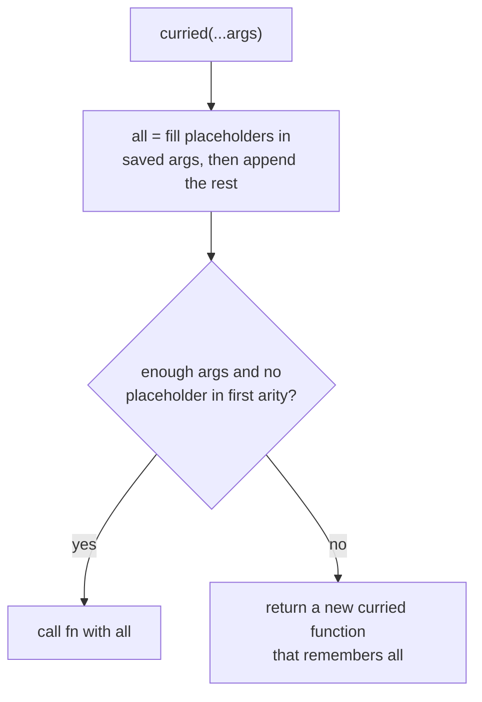

**Solution**

```js
const _ = Symbol('placeholder');

function merge(saved, args) {
  const rest = [...args];
  const filled = saved.map((a) => (a === _ && rest.length ? rest.shift() : a));
  return filled.concat(rest);                        // new array: partials stay reusable
}

function curry(fn, arity = fn.length) {
  const collect = (saved) => function (...args) {
    const all = merge(saved, args);
    const ready = all.length >= arity && all.slice(0, arity).every((a) => a !== _);
    return ready ? fn.apply(this, all) : collect(all);
  };
  return collect([]);
}

function sum(...args) {                              // infinite currying
  const total = args.reduce((a, b) => a + b, 0);
  const next = (...more) => (more.length ? sum(total, ...more) : total); // () ends it
  next[Symbol.toPrimitive] = () => total;            // lets `sum(1)(2) == 3` work too
  return next;
}

const volume = curry((l, w, h) => l * w * h);
console.log(volume(2)(3)(4), volume(2, 3)(4), volume(2)(3, 4), volume(2, 3, 4));
const base = volume(2);
console.log(base(3)(4), base(5)(6));                 // partials do not share state
const f = curry((a, b, c) => [a, b, c].join('-'));
console.log(f(_, 'b')('a')('c'), f(_, _, 'c')('a', 'b'), f('a')(_, 'c')('b'));
console.log(curry(Math.max, 3)(1)(5)(3), curry((a, b = 2) => a + b)(1));
console.log(sum(1)(2)(3)(), sum(1, 2)(3, 4)(), +sum(5)(5), `${sum(1)(2)}`, sum(1)(2) == 3);
```

```text output
24 24 24 24
24 60
a-b-c a-b-c a-b-c
5 3
6 10 10 3 true
```

**Complexity**

Each call costs O(a) to merge `a` saved arguments; total O(n²) for `n` single-argument calls because each step copies the saved list. Space O(n) per live partial.

**Common mistakes**

- Pushing into one shared `args` array in the closure, so `f(1)` called twice accumulates across calls.
- Relying on `fn.length` for functions with default or rest parameters (last line of the demo: `(a, b = 2) => ...` has length 1, so `curry` calls it right after `(1)`).
- Treating `undefined` as a placeholder. Use a unique `Symbol` so real `undefined` arguments still work.
- Forgetting to forward `this`.

**Follow-up questions**

- What is the difference between currying and partial application? (Currying always yields unary steps; partial application fixes some arguments and returns a function taking the rest.)
- How would you make `sum(1)(2)(3)` print `6` without a trailing `()` in `console.log`? (`valueOf`/`toString`, `Symbol.toPrimitive`, with its limits.)
- Write `uncurry`.

### P23.14 Easy: compose and pipe (sync and async)

Implement `pipe(f, g, h)(x) = h(g(f(x)))`, `compose(f, g, h)(x) = f(g(h(x)))`, and async versions that chain promises. Chapter 11 covers composition and data flow.

*Typically asked in: JavaScript round (commonly reported).*

**Requirements and edge cases**

- The first function may take several arguments; every later one takes the previous result.
- `pipe()` with no functions returns its first argument (identity).
- `compose` is `pipe` over the reversed list.
- Async: each step may return a value or a promise; a rejection or throw skips the remaining steps and rejects the final promise.
- Validate that every argument is a function.

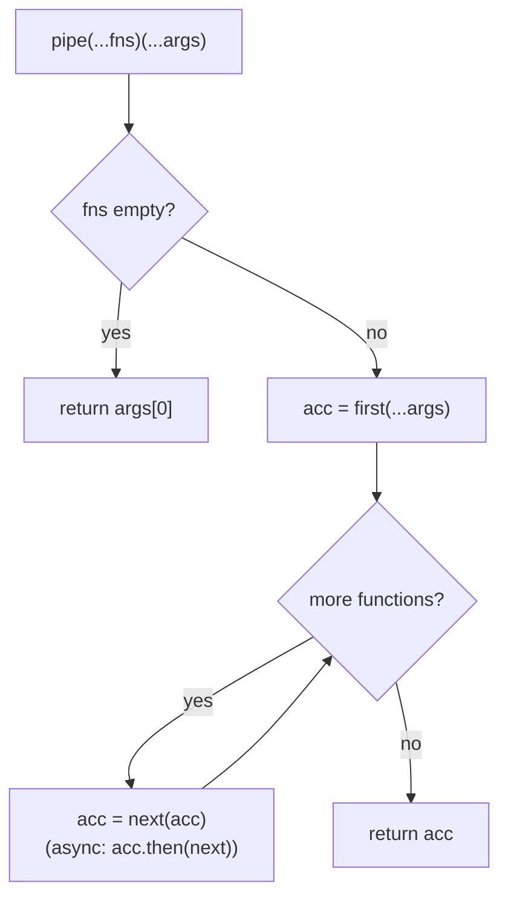

**Solution**

```js
const assertFns = (fns) => {
  if (fns.some((f) => typeof f !== 'function')) throw new TypeError('expected functions');
};

const pipe = (...fns) => {
  assertFns(fns);
  return (...args) => {
    if (!fns.length) return args[0];
    const [first, ...rest] = fns;
    return rest.reduce((acc, fn) => fn(acc), first(...args));
  };
};
const compose = (...fns) => pipe(...[...fns].reverse());

const pipeAsync = (...fns) => {
  assertFns(fns);
  return (...args) => {
    const [first = (x) => x, ...rest] = fns;
    const start = Promise.resolve().then(() => first(...args));  // throws become rejections
    return rest.reduce((p, fn) => p.then(fn), start);
  };
};
const composeAsync = (...fns) => pipeAsync(...[...fns].reverse());

const inc = (x) => x + 1, dbl = (x) => x * 2;
console.log(pipe(inc, dbl)(3), compose(inc, dbl)(3), pipe()(5));
console.log(pipe(Math.max, dbl)(1, 9, 4));
console.log(['1', '2', '3'].map(pipe(Number, inc)));
(async () => {
  const slowInc = async (x) => x + 1;
  console.log(await pipeAsync(slowInc, dbl, slowInc)(3));
  console.log(await composeAsync(slowInc, dbl)(3));
  const boom = () => { throw new Error('bad step'); };
  await pipeAsync(inc, boom, dbl)(1).catch((e) => console.log('caught:', e.message));
  console.log(await pipeAsync()(7));
  try { pipe(inc, 'x'); } catch (e) { console.log(e.name + ': ' + e.message); }
})();
```

```text output
8 7 5
18
[ 2, 3, 4 ]
9
7
caught: bad step
7
TypeError: expected functions
```

**Complexity**

Time O(k) function applications for `k` functions plus their own cost; space O(k) for the list (async adds one promise per step).

**Common mistakes**

- Reversing the order: `pipe` goes left to right, `compose` right to left (`reduceRight` in the usual one-liner).
- `array.map(pipe(...))` passes `(value, index, array)`, so a first function such as `parseInt` receives extra arguments. Note `pipe(Number, inc)` above ignores them.
- Mixing sync and async: `await` each step, or chain with `.then` as above; a sync `pipe` over async functions passes promises to the next function.
- Not turning a synchronous throw in the first async step into a rejection.

**Follow-up questions**

- Preserve `this` for the first function.
- Add a `tap(fn)` helper for logging in the middle of a pipeline.
- Stop early when a step returns `null` or `undefined` (a "Maybe" pipeline).

### P23.15 Easy: once, before and after

Implement `once(fn)`, `before(n, fn)` and `after(n, fn)` with the lodash semantics: `before` runs `fn` for the first `n - 1` calls and then returns the last result, `after` ignores the first `n - 1` calls, and `once` is `before(2, fn)`.

*Typically asked in: JavaScript round (commonly reported).*

**Requirements and edge cases**

- `once`: `fn` runs on the first call only; later calls return the **first result** and do not re-run `fn`.
- `before(n, fn)`: calls `1` to `n - 1` run `fn`; call `n` and later return the last result.
- `after(n, fn)`: calls before the `n`th return `undefined`; the `n`th and every later call run `fn`.
- Pass `this` and arguments through. Count the call *before* invoking `fn`, so a re-entrant or throwing `fn` cannot run twice.

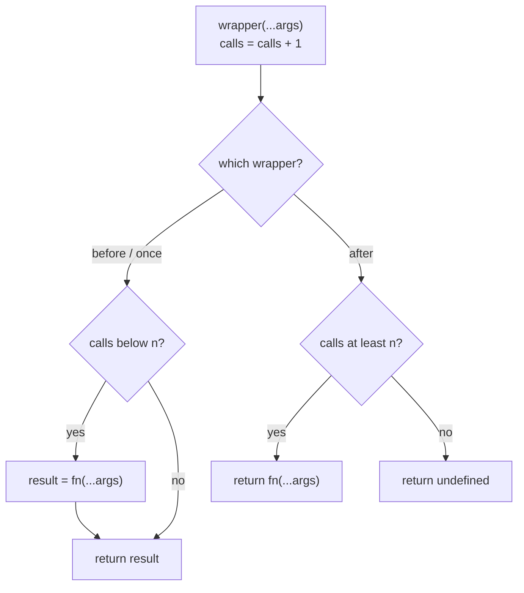

**Solution**

```js
function before(n, fn) {
  let calls = 0, result;
  return function (...args) {
    if (++calls < n) result = fn.apply(this, args);  // calls 1 .. n-1 run fn
    return result;                                   // later calls: the last result
  };
}

const once = (fn) => before(2, fn);

function after(n, fn) {
  let calls = 0;
  return function (...args) {
    if (++calls >= n) return fn.apply(this, args);   // nth call and beyond
  };
}

let hits = 0;
const init = once((name) => { hits++; return 'init ' + name; });
console.log(init('a'), init('b'), hits);

const twice = before(3, (x) => x * 10);
console.log(twice(1), twice(2), twice(3), twice(4));

const ctx = { id: 7, ready: after(3, function (tag) { return tag + ':' + this.id; }) };
console.log(ctx.ready('a'), ctx.ready('b'), ctx.ready('c'), ctx.ready('d'));

const bad = once(() => { throw new Error('x'); });
try { bad(); } catch (e) { console.log('first call threw', e.message); }
console.log(bad());

const self = once(() => { self(); return 'done'; });
console.log(self());

const done = after(3, () => 'all three finished');
console.log([1, 2, 3].map(() => done()));
```

```text output
init a init a 1
10 20 20 20
undefined undefined c:7 d:7
first call threw x
undefined
done
[ undefined, undefined, 'all three finished' ]
```

**Complexity**

O(1) time per call and O(1) space per wrapper.

**Common mistakes**

- Using a global flag, so two `once` wrappers share state. Keep the counter in the closure.
- Returning `undefined` on later calls instead of the cached result.
- Incrementing the counter *after* calling `fn`, so a re-entrant call runs `fn` again (the `self` example above would recurse until the stack overflows).
- Not deciding what a throw means. Here the throwing call is spent and later calls return `undefined`; some libraries retry instead. State your choice.

**Follow-up questions**

- Make `once` safe for async functions. (Cache the promise.)
- Use `after` to run a callback when `n` parallel requests have finished.
- Add a `reset()` method.

### P23.16 ★ Medium: Promise.all

Implement `promiseAll(iterable)` with the native semantics. Chapter 8 (Q8.9) gives the short version; this one adds the ordering and error details an interviewer probes.

*Typically asked in: JavaScript round (commonly reported).*

**Requirements and edge cases**

- Result is an array in **input order**, not completion order.
- Items may be promises, thenables or plain values; wrap each with `Promise.resolve`.
- The first rejection rejects the result; later outcomes are ignored (the other promises keep running).
- Empty input resolves with `[]`. A non-iterable argument gives a **rejected promise**, not a synchronous throw.
- Use a counter, not `results.length`: assigning `results[2]` first makes the array length 3 before the others arrive.
- An iterable that is a generator is consumed once, up front.

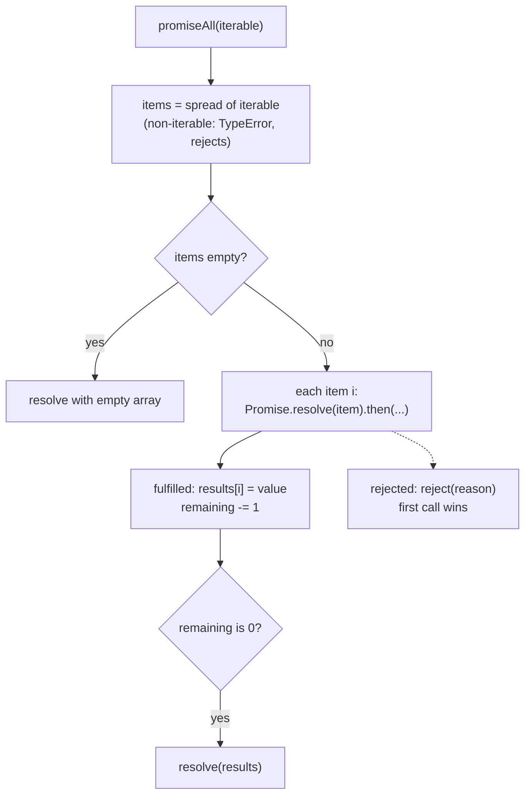

**Solution**

```js
function promiseAll(iterable) {
  return new Promise((resolve, reject) => {
    const items = [...iterable];                    // TypeError here becomes a rejection
    const results = new Array(items.length);
    let remaining = items.length;
    if (remaining === 0) return resolve(results);   // no callback would ever run
    items.forEach((item, i) => {
      Promise.resolve(item).then((value) => {
        results[i] = value;                         // by index: input order
        if (--remaining === 0) resolve(results);    // counter: completion order is random
      }, reject);                                   // later calls to reject are ignored
    });
  });
}

function deferred() {
  let resolve, reject;
  const promise = new Promise((res, rej) => { resolve = res; reject = rej; });
  return { promise, resolve, reject };
}

// Number of microtask ticks until a promise settles (to compare with the native one).
async function ticksToSettle(p) {
  let settled = false, n = 0;
  p.then(() => (settled = true), () => (settled = true));
  while (!settled) { await null; n++; }
  return n;
}

(async () => {
  const a = deferred(), b = deferred();
  const all = promiseAll([a.promise, 7, b.promise, Promise.resolve('now')]);
  b.resolve('B'); a.resolve('A');                   // finish in the opposite order
  console.log(await all);
  console.log(await promiseAll([]), await promiseAll(new Set([1, 2])));

  const c = deferred();
  const failing = promiseAll([c.promise, Promise.reject(new Error('first')), 3]);
  c.reject(new Error('second'));                    // too late: already rejected
  await failing.catch((e) => console.log('rejected with', e.message));

  const bad = promiseAll(5);                        // no synchronous throw
  console.log(bad instanceof Promise);
  await bad.catch((e) => console.log(e.name));

  const input = () => [1, Promise.resolve(2), new Promise((r) => r(3))];
  const mine = await ticksToSettle(promiseAll(input()));
  console.log('same ticks as native:', mine === await ticksToSettle(Promise.all(input())));
})();
```

```text output
[ 'A', 7, 'B', 'now' ]
[] [ 1, 2 ]
rejected with first
true
TypeError
same ticks as native: true
```

**Complexity**

Time O(n) to attach the handlers (the wait is the slowest promise); space O(n) for the results.

**Common mistakes**

- Using `results.push(value)`, which returns completion order.
- Checking `results.length === items.length` to detect completion. Writing `results[last]` first already makes the length equal.
- Forgetting the empty-array case, so `await promiseAll([])` hangs forever.
- Calling the executor's `resolve` for each item, or mapping with `await` in a loop. That runs the promises one after another instead of in parallel.
- Throwing synchronously for a bad argument. The native method returns a rejected promise, so `.catch` and `await` inside `try` both work.
- Believing that `Promise.all` cancels the others on failure. It only stops waiting; each pending promise continues (Chapter 8, Q8.15).

**Follow-up questions**

- How does the result change if you want to *continue* after failures? (`allSettled`, next problem.)
- Limit how many run at once. (P23.19.)
- What happens if an input is a thenable whose `then` throws? (`Promise.resolve` turns it into a rejected promise, so the whole result rejects.)

### P23.17 Medium: Promise.allSettled, race and any

Implement the other three combinators. Chapter 8 (Q8.10) builds `allSettled` on top of `all`; here each one stands alone, so you can see the shared skeleton and where they differ on empty input.

*Typically asked in: JavaScript round (commonly reported).*

**Requirements and edge cases**

- `allSettled` never rejects. It resolves with `{ status: 'fulfilled', value }` or `{ status: 'rejected', reason }` objects in **input order**.
- `race` settles like the first input to settle. A plain value wins over a pending promise.
- `any` resolves with the first **fulfilment**. If every input rejects it rejects with an `AggregateError` whose `errors` are in input order.
- Empty input: `allSettled([])` resolves with `[]`, `any([])` rejects with an empty `AggregateError`, `race([])` stays pending forever.
- A non-iterable argument gives a rejected promise.

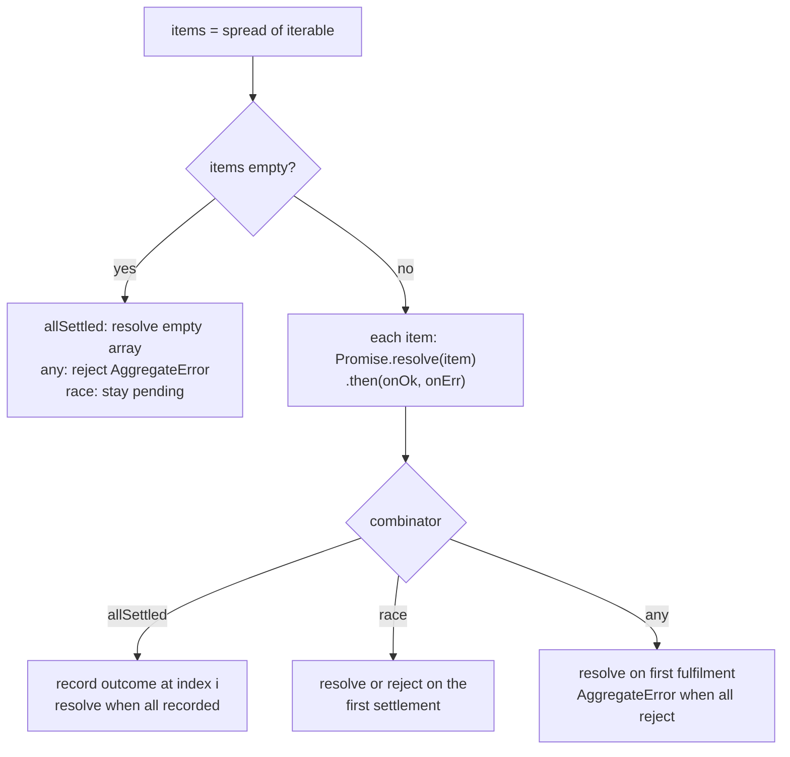

**Solution**

```js
function allSettled(iterable) {
  return new Promise((resolve) => {
    const items = [...iterable];
    const out = new Array(items.length);
    let left = items.length;
    if (left === 0) return resolve(out);
    items.forEach((item, i) => {
      const done = (outcome) => { out[i] = outcome; if (--left === 0) resolve(out); };
      Promise.resolve(item).then(
        (value) => done({ status: 'fulfilled', value }),
        (reason) => done({ status: 'rejected', reason })
      );
    });
  });
}

function race(iterable) {
  return new Promise((resolve, reject) => {
    for (const item of iterable) Promise.resolve(item).then(resolve, reject);
  });                                             // first settle wins; empty: never settles
}

function any(iterable) {
  return new Promise((resolve, reject) => {
    const items = [...iterable];
    const errors = new Array(items.length);
    let left = items.length;
    const fail = () => reject(new AggregateError(errors, 'All promises were rejected'));
    if (left === 0) return fail();
    items.forEach((item, i) => {
      Promise.resolve(item).then(resolve, (e) => {
        errors[i] = e;                              // by index, not by arrival
        if (--left === 0) fail();
      });
    });
  });
}

const deferred = () => Promise.withResolvers();
const peek = (p) => Promise.race([p, 'still pending']);  // a settled p wins if listed first

(async () => {
  const d1 = deferred(), d2 = deferred();
  const mixed = [d1.promise, d2.promise, 3];
  const settled = allSettled(mixed);
  d2.reject('bad'); d1.resolve('ok');
  const brief = (rs) => rs.map((r) => r.status + ':' + (r.value ?? r.reason)).join(' ');
  console.log(brief(await settled));
  console.log(brief(await Promise.allSettled(mixed)));

  const r1 = deferred(), r2 = deferred();
  const first = race([r1.promise, r2.promise]);
  r2.resolve('r2 first'); r1.resolve('r1 second');
  console.log(await first, '|', await race([Promise.resolve('p'), 'plain']));
  const e1 = deferred(), e2 = deferred();
  const lose = race([e1.promise, e2.promise]);
  e2.reject(new Error('race rejects')); e1.resolve('late');
  console.log(await lose.catch((e) => e.message));

  const x = deferred(), y = deferred(), z = deferred();
  const winner = any([x.promise, y.promise, z.promise]);
  y.reject('e-y'); z.resolve('z wins'); x.resolve('x too late');
  console.log(await winner);
  const p = deferred(), q = deferred();
  const allBad = any([p.promise, q.promise]);
  q.reject('e-q'); p.reject('e-p');            // q fails first, but errors keep index order
  const err = await allBad.catch((e) => e);
  console.log(err.name, err.errors, err instanceof AggregateError);

  console.log(await allSettled([]), (await any([]).catch((e) => e)).errors);
  console.log(await peek(race([])));
  console.log(await allSettled(5).catch((e) => e.name));
})();
```

```text output
fulfilled:ok rejected:bad fulfilled:3
fulfilled:ok rejected:bad fulfilled:3
r2 first | p
race rejects
z wins
AggregateError [ 'e-p', 'e-q' ] true
[] []
still pending
TypeError
```

**Complexity**

Time O(n) to attach the handlers; space O(n) for the outcomes or errors (`race` needs O(1)).

**Common mistakes**

- Implementing `any` as "`all` with the roles swapped" but resolving with an array of errors. It must be an `AggregateError`, and only when *all* inputs reject.
- Using `race` where you meant `any`: a fast rejection wins `race` but is ignored by `any`.
- Collecting `any` errors with `push`, which loses input order.
- Assuming `race([])` resolves or rejects. It never settles, so a `race` over a dynamic list can hang on an empty list.
- Forgetting that `allSettled` does not reject, so `try/catch` around `await` never fires; check each `status` instead.
- Implementing `race` with `for...of` plus `await` in the loop, which waits for the first item before attaching to the others.

**Follow-up questions**

- Build a timeout from `race` (P23.21) and say what it does not cancel.
- Implement `Promise.withResolvers`, which the demo uses (present in Node 22; check browser support before relying on it).
- Why does `Promise.all([p1, p2])` not produce an unhandled rejection for the loser when both reject? (Every input already has a rejection handler attached.)

### P23.18 ★ Hard: A minimal Promise (A+ core)

Implement `MyPromise` with a constructor, `then` chaining, thenable resolution and handlers that run asynchronously, plus `catch`, `finally`, `resolve` and `reject`. Chapter 8 explains the states and the extra ticks (Section 8.3, and Q8.11 for a version with private fields). This version follows the numbering of the Promises/A+ specification so you can cite rules in an interview.

*Typically asked in: JavaScript round, senior level (commonly reported).*

**Requirements and edge cases**

- State is `pending`, `fulfilled` or `rejected`; it changes **once** and never back. Later `resolve`/`reject` calls are ignored (2.1).
- `then(onFulfilled, onRejected)` returns a **new** promise. A handler that is not a function is skipped and the outcome passes through (2.2.7.3 and 2.2.7.4).
- Handlers never run synchronously, even on an already settled promise; use a microtask (2.2.4). Several `then` calls on one promise run in registration order (2.2.6).
- A handler's return value is fed into the **resolution procedure** (2.3): the same promise gives a `TypeError`, a thenable is followed (its `then` is read **once**, a throwing getter rejects, only the first call of `resolve`/`reject` counts), anything else fulfils.
- A throw in a handler or in the executor rejects.
- **Not covered:** unhandled-rejection tracking, subclassing and `Symbol.species`, the static combinators. The official Promises/A+ test suite could not be run in this environment (the package registry was unreachable), so the self-checks below are a small hand-written subset, not proof of conformance.

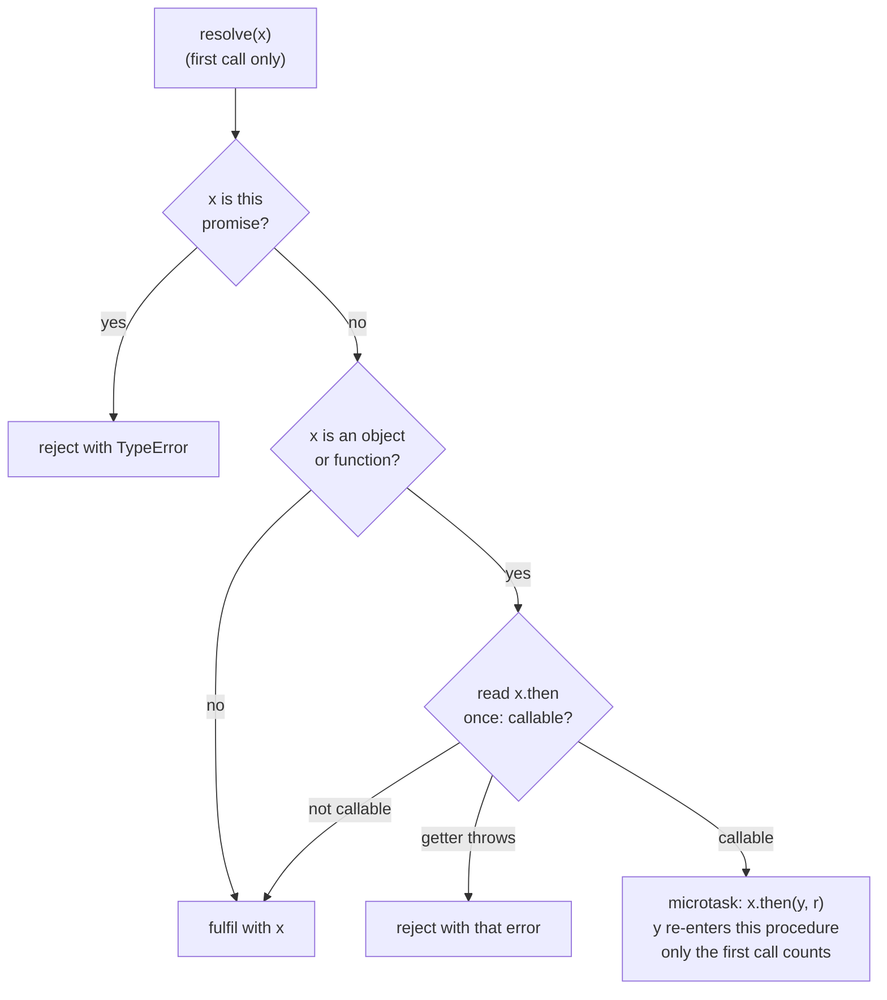

**Solution**

```js
// Promise resolution procedure (Promises/A+ 2.3), used by resolve().
function follow(self, x, fulfil, reject) {
  if (x === self) return reject(new TypeError('Chaining cycle detected'));   // 2.3.1
  if (x === null || (typeof x !== 'object' && typeof x !== 'function')) return fulfil(x);
  let then;
  try { then = x.then; } catch (e) { return reject(e); }                     // 2.3.3.2
  if (typeof then !== 'function') return fulfil(x);                          // 2.3.3.4
  queueMicrotask(() => {      // the ES spec calls a thenable's then in a job (native order)
    let called = false;                                                      // 2.3.3.3.3
    try {
      then.call(x,
        (y) => { if (!called) { called = true; follow(self, y, fulfil, reject); } },
        (r) => { if (!called) { called = true; reject(r); } });
    } catch (e) { if (!called) { called = true; reject(e); } }               // 2.3.3.3.4
  });
}

class MyPromise {
  constructor(executor) {
    if (typeof executor !== 'function') throw new TypeError('executor must be a function');
    this.state = 'pending'; this.value = undefined; this.jobs = [];
    const settle = (state, value) => {
      if (this.state !== 'pending') return;              // 2.1.2 and 2.1.3: settle once
      this.state = state; this.value = value;
      this.jobs.splice(0).forEach((job) => job());       // run waiting then-calls in order
    };
    let locked = false;                              // only the first resolve/reject counts
    const resolve = (x) => {
      if (locked) return;
      locked = true;
      follow(this, x, (v) => settle('fulfilled', v), (e) => settle('rejected', e));
    };
    const reject = (e) => { if (!locked) { locked = true; settle('rejected', e); } };
    try { executor(resolve, reject); } catch (e) { reject(e); }
  }

  then(onFulfilled, onRejected) {
    return new MyPromise((resolve, reject) => {          // 2.2.7: a new promise per then
      const job = () => queueMicrotask(() => {           // 2.2.4: always asynchronous
        const ok = this.state === 'fulfilled';
        const handler = ok ? onFulfilled : onRejected;
        if (typeof handler !== 'function') return (ok ? resolve : reject)(this.value);
        try { resolve(handler(this.value)); } catch (e) { reject(e); }
      });
      if (this.state === 'pending') this.jobs.push(job); else job();
    });
  }

  catch(onRejected) { return this.then(undefined, onRejected); }
  finally(fn) {
    if (typeof fn !== 'function') return this.then(fn, fn);
    return this.then(
      (v) => MyPromise.resolve(fn()).then(() => v),
      (e) => MyPromise.resolve(fn()).then(() => { throw e; })
    );
  }
  static resolve(x) { return x instanceof MyPromise ? x : new MyPromise((res) => res(x)); }
  static reject(e) { return new MyPromise((_, rej) => rej(e)); }
}

// 1. Order of microtasks must match the native Promise, including the returned promise.
function trace(P) {
  const log = [];
  P.resolve().then(() => { log.push('a1'); return P.resolve(); })
    .then(() => log.push('a2'));
  P.resolve().then(() => log.push('b1')).then(() => log.push('b2'))
    .then(() => log.push('b3')).then(() => log.push('b4'));
  return new Promise((done) => setTimeout(() => done(log.join(' ')), 0));
}

// 2. A small subset of the A+ rules (rule number, scenario, expected result).
const drain = () => new Promise((r) => setTimeout(r, 0));
const thenable = (then) => ({ then });
const checks = [
  ['2.1.2 settles once',
    () => new MyPromise((res, rej) => { res('first'); rej('x'); }), 'first'],
  ['2.2.4 handler is async', async () => {
    const log = [];
    MyPromise.resolve().then(() => log.push('then'));
    log.push('sync');
    await drain();
    return log.join(',');
  }, 'sync,then'],
  ['2.2.6 registration order', async () => {
    const log = [], p = MyPromise.resolve();
    p.then(() => log.push('a')); p.then(() => log.push('b')); p.then(() => log.push('c'));
    await drain();
    return log.join('');
  }, 'abc'],
  ['2.2.7.3 value passes through', () => MyPromise.resolve(5).then().then((v) => v), 5],
  ['2.2.7.4 reason passes through',
    () => MyPromise.reject('r').then((v) => v).catch((e) => e), 'r'],
  ['2.2.7.2 handler throws', () => MyPromise.resolve()
    .then(() => { throw new Error('t'); }).catch((e) => e.message), 't'],
  ['2.3.1 chaining cycle', () => {
    const p = MyPromise.resolve().then(() => p);
    return p.catch((e) => e.name);
  }, 'TypeError'],
  ['2.3.3 thenable is followed',
    () => MyPromise.resolve().then(() => thenable((res) => res('adopted'))), 'adopted'],
  ['2.3.3.3.3 first call wins',
    () => MyPromise.resolve(thenable((res, rej) => {
      res('one'); rej('two'); res('three');
    })), 'one'],
  ['2.3.3.3.4 late throw ignored',
    () => MyPromise.resolve(thenable((res) => { res('ok'); throw new Error('late'); })),
    'ok'],
  ['2.3.3.2 throwing getter',
    () => MyPromise.resolve({ get then() { throw new Error('g'); } })
      .catch((e) => e.message), 'g'],
  ['follows a native promise', () => new MyPromise((res) => res(Promise.resolve('native'))),
    'native'],
  ['executor throw rejects',
    () => new MyPromise(() => { throw new Error('exec'); })
      .catch((e) => e.message), 'exec'],
  ['finally keeps the value', () => MyPromise.resolve(7).finally(() => 99), 7],
];

(async () => {
  console.log('native:', await trace(Promise));
  console.log('mine  :', await trace(MyPromise));
  for (const [rule, run, expected] of checks) {
    const got = await run();                             // await accepts any thenable
    console.log(rule.padEnd(30), got === expected ? 'ok' : 'FAIL, got ' + got);
  }
})();
```

```text output
native: a1 b1 b2 b3 a2 b4
mine  : a1 b1 b2 b3 a2 b4
2.1.2 settles once             ok
2.2.4 handler is async         ok
2.2.6 registration order       ok
2.2.7.3 value passes through   ok
2.2.7.4 reason passes through  ok
2.2.7.2 handler throws         ok
2.3.1 chaining cycle           ok
2.3.3 thenable is followed     ok
2.3.3.3.3 first call wins      ok
2.3.3.3.4 late throw ignored   ok
2.3.3.2 throwing getter        ok
follows a native promise       ok
executor throw rejects         ok
finally keeps the value        ok
```

**Complexity**

Each `then` is O(1) to register and each reaction runs once, so a chain of `n` promises costs O(n) time and space. A promise keeps its reaction list until it settles.

**Common mistakes**

- Calling handlers synchronously when the promise is already settled. That is the classic "Zalgo" bug and breaks 2.2.4.
- Returning the **same** promise from `then` (so `p.then(...) === p`). Each `then` needs its own derived promise, otherwise a handler's result cannot differ from its input.
- Skipping the once-only guard in the thenable branch, so a misbehaving thenable that calls `resolve` and then `reject` settles twice.
- Reading `x.then` more than once, or letting a throwing getter escape instead of rejecting.
- Fulfilling with a promise as the value because `resolve(x)` never checks `x`.
- Forgetting pass-through: `p.then(undefined, handler)` must forward fulfilment, and `p.then(handler)` must forward rejection.
- Believing the handwritten checks above prove conformance. The suite from the Promises/A+ project (`promises-aplus-tests`) is the real test. It needs an adapter with `resolved`, `rejected` and `deferred`, each a few lines on this class, but it could not be installed here.

**Follow-up questions**

- Why does returning a promise from a handler cost two extra ticks, in the native engine and here? (Chapter 8, Section 8.3.)
- Add `Promise.all` and `Promise.race` on top (P23.16, P23.17) and an unhandled-rejection warning (track rejected promises with no handler after a tick).
- How would you make `state`, `value` and `jobs` private? (`#` fields, as in Chapter 8, Q8.11.)

### P23.19 Medium: Promise pool with concurrency limit

Implement `pool(tasks, limit, { settle })`: run an array of task functions with at most `limit` running at once, and return the results in input order. Chapter 9 (Q9.11) shows the worker-loop idea; this version adds validation, error policy and a deterministic test.

*Typically asked in: JavaScript round and machine-coding round (commonly reported).*

**Requirements and edge cases**

- Tasks are **functions** that return a promise (or a value). A promise is already running, so it cannot be limited.
- Never more than `limit` tasks running; a finished task frees its slot at once.
- Results are in **input order**, not completion order.
- Default error policy is fail-fast: the first rejection rejects the pool and **no new tasks start**; tasks already running are not cancelled. With `{ settle: true }` every task runs and the result holds `{ status, value | reason }` objects.
- Empty input resolves with `[]`. `limit` larger than the task count just starts every task. `limit` below 1 or not an integer is a `RangeError` (as a rejection, since the function is `async`).
- A task that throws synchronously counts as a rejection.

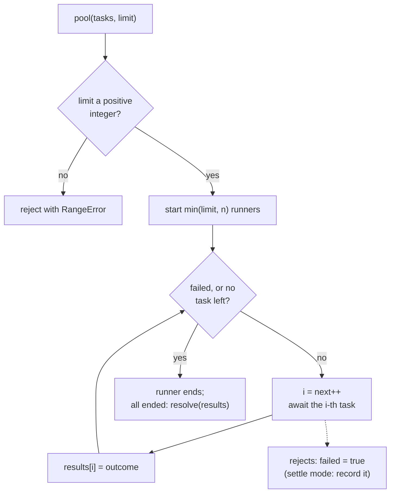

**Solution**

```js
async function pool(tasks, limit, { settle = false } = {}) {
  if (!Number.isInteger(limit) || limit < 1) {
    throw new RangeError('limit must be a positive integer');
  }
  const list = [...tasks];
  const results = new Array(list.length);
  let next = 0, failed = false;
  async function runner() {
    while (!failed && next < list.length) {
      const i = next++;                          // claim an index: no await in between
      try {
        const value = await list[i]();
        results[i] = settle ? { status: 'fulfilled', value } : value;
      } catch (reason) {
        if (!settle) { failed = true; throw reason; }   // stop starting new tasks
        results[i] = { status: 'rejected', reason };
      }
    }
  }
  const runners = Array.from({ length: Math.min(limit, list.length) }, runner);
  await Promise.all(runners);
  return results;
}

// Fake timers: tick() fires due timers in time order and lets promise callbacks run.
function makeClock() {
  let now = 0, id = 0;
  const q = new Map();
  const flush = () => new Promise((r) => setImmediate(r));
  return {
    now: () => now,
    set: (fn, ms) => (q.set(++id, { fn, at: now + ms }), id),
    async tick(ms) {
      const end = now + ms;
      await flush();                                 // let started tasks register timers
      for (;;) {
        const byTime = (a, b) => a[1].at - b[1].at;
        const due = [...q].filter(([, t]) => t.at <= end).sort(byTime)[0];
        if (!due) break;
        q.delete(due[0]); now = due[1].at; due[1].fn();
        await flush();
      }
      now = end;
    },
  };
}

let clock = makeClock();
let active = 0, peak = 0, starts = [], ends = [];
const job = (name, ms, fail) => () => {
  active++; peak = Math.max(peak, active);
  starts.push(name + '@' + clock.now());
  return new Promise((resolve, reject) => clock.set(() => {
    active--; ends.push(name + '@' + clock.now());
    fail ? reject(name + ' failed') : resolve(name.toLowerCase());
  }, ms));
};

const show = (v) => v.map((r) => (r?.status ? r.status + ':' + (r.value ?? r.reason) : r));

async function run(label, tasks, limit, opts, detail) {
  clock = makeClock(); active = peak = 0; starts = []; ends = [];
  const outcome = pool(tasks, limit, opts)
    .then((v) => show(v).join(' '), (e) => 'rejected: ' + e);
  await clock.tick(1000);
  console.log(label.padEnd(9), await outcome, '| peak', peak);
  if (detail) console.log('  starts:', starts.join(' '), '| ends:', ends.join(' '));
}

(async () => {
  const all = () => [job('A', 30), job('B', 10), job('C', 20), job('D', 10), job('E', 5)];
  await run('limit 2', all(), 2, {}, true);
  const mixed = () => [job('A', 20), job('B', 10, true), job('C', 10), job('D', 10)];
  await run('fail-fast', mixed(), 2, {}, true);
  await run('settle', mixed(), 2, { settle: true }, true);
  await run('limit 9', all(), 9, {}, true);
  await run('empty', [], 3, {});
  console.log(await pool(new Set([() => 1, () => Promise.resolve(2)]), 1));
  for (const bad of [0, 2.5, '3']) {
    await pool([], bad).catch((e) => console.log(e.name, String(bad)));
  }
  await pool([() => { throw new Error('sync throw'); }], 1)
    .catch((e) => console.log(e.message));
})();
```

```text output
limit 2   a b c d e | peak 2
  starts: A@0 B@0 C@10 D@30 E@30 | ends: B@10 A@30 C@30 E@35 D@40
fail-fast rejected: B failed | peak 2
  starts: A@0 B@0 | ends: B@10 A@20
settle    fulfilled:a rejected:B failed fulfilled:c fulfilled:d | peak 2
  starts: A@0 B@0 C@10 D@20 | ends: B@10 A@20 C@20 D@30
limit 9   a b c d e | peak 5
  starts: A@0 B@0 C@0 D@0 E@0 | ends: E@5 B@10 D@10 C@20 A@30
empty      | peak 0
[ 1, 2 ]
RangeError 0
RangeError 2.5
RangeError 3
sync throw
```

**Complexity**

Time is about (total work) / `limit` when durations are similar; scheduling cost is O(n). Space O(n) for the results and the copied task list.

**Common mistakes**

- Passing promises instead of functions: `pool(urls.map(fetch), 3)` has already started every request.
- `Promise.all(chunks.map(...))` in batches of `limit`. A slow task blocks the whole batch while slots sit idle; the worker-loop keeps every slot busy.
- Claiming the index after an `await` (`results[next++] = await ...`), so two runners can write the same slot or skip one.
- Returning results in completion order (`push`).
- Not stopping after a failure, so the pool keeps launching requests whose results are thrown away. Also remember that fail-fast does **not** cancel running tasks; pass an `AbortSignal` into the tasks if they must stop.
- No validation of `limit`: `0` gives zero runners and a promise that resolves with an array of holes.

**Follow-up questions**

- Add an `AbortSignal` that stops new tasks and passes the signal to running ones.
- Make it a streaming async generator that yields results as they finish.
- How does this differ from the queue in P23.23? (Fixed list known up front versus tasks added over time, with priorities and pause.)

### P23.20 Medium: Retry with exponential backoff

Implement `retry(fn, options)`: call an async function again after failures, waiting longer each time, with random jitter, a limit on attempts, a `shouldRetry` predicate and cancellation through an `AbortSignal`. Sleep and randomness are injected so the tests are deterministic.

*Typically asked in: JavaScript round and machine-coding round (commonly reported).*

**Requirements and edge cases**

- Attempts are numbered from 1. `maxAttempts` is the **total** number of calls, including the first.
- Delay before retry `k` is `min(maxMs, baseMs * factor^(k - 1))`. Jitter options: `none` (the delay), `full` (`random() * delay`), `equal` (half fixed, half random). Full jitter spreads many clients that failed together.
- `shouldRetry(error, attempt)` can refuse to retry, for example for HTTP 4xx errors that will never succeed. The error is then thrown immediately.
- When attempts run out, throw the **last** error (say so; the alternative is an `AggregateError` of all of them).
- `signal` aborts the sleep and stops further attempts; the rejection reason is `signal.reason`. A signal that is already aborted never calls `fn`.
- No timer may stay alive after an abort.
- `maxAttempts` must be a positive integer.

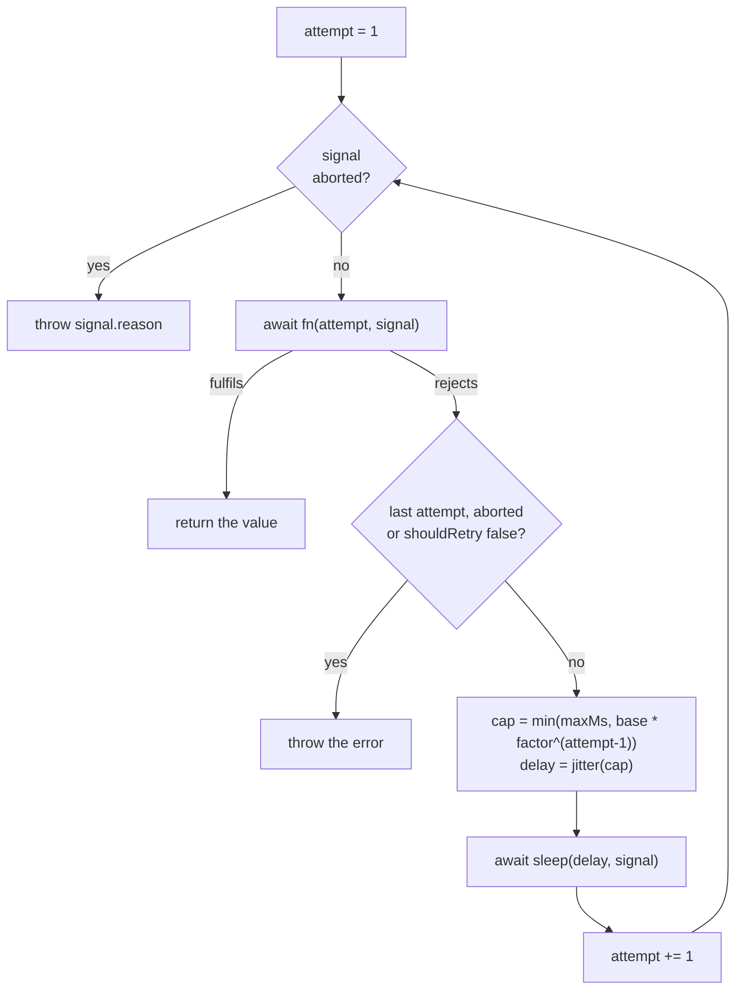

**Solution**

```js
const defaultSleep = (ms, signal) => new Promise((resolve, reject) => {
  if (signal?.aborted) return reject(signal.reason);
  const onAbort = () => { clearTimeout(timer); reject(signal.reason); };
  const timer = setTimeout(() => {
    signal?.removeEventListener('abort', onAbort);   // no leaked listener
    resolve();
  }, ms);
  signal?.addEventListener('abort', onAbort, { once: true });
});

const withJitter = { none: (cap) => cap, full: (cap, r) => r() * cap,
  equal: (cap, r) => cap / 2 + (r() * cap) / 2 };

async function retry(fn, opts = {}) {
  const { maxAttempts = 4, baseMs = 100, factor = 2, maxMs = 30000, jitter = 'full',
    random = Math.random, sleep = defaultSleep, shouldRetry = () => true,
    signal, onRetry } = opts;
  if (!Number.isInteger(maxAttempts) || maxAttempts < 1) {
    throw new RangeError('maxAttempts must be a positive integer');
  }
  for (let attempt = 1; ; attempt++) {
    signal?.throwIfAborted();                       // also covers an already aborted signal
    try {
      return await fn(attempt, signal);
    } catch (err) {
      const exhausted = attempt >= maxAttempts;
      if (signal?.aborted || exhausted || !shouldRetry(err, attempt)) throw err;
      const cap = Math.min(maxMs, baseMs * factor ** (attempt - 1));
      const delay = Math.floor(withJitter[jitter](cap, random));
      onRetry?.(err, attempt, delay);
      await sleep(delay, signal);                    // throws signal.reason if aborted
    }
  }
}

const flaky = (failures) => {                       // fails `failures` times, then succeeds
  let calls = 0;
  return async () => {
    if (++calls <= failures) throw new Error('flaky #' + calls);
    return 'ok after ' + calls;
  };
};

async function demo(label, opts, fn) {
  const delays = [];
  const sleep = async (ms, signal) => { signal?.throwIfAborted(); delays.push(ms); };
  const outcome = await retry(fn, { sleep, ...opts }).catch((e) => 'threw ' + e.message);
  console.log(label.padEnd(12), outcome.padEnd(15), JSON.stringify(delays));
}

(async () => {
  await demo('no jitter', { jitter: 'none' }, flaky(3));
  await demo('half', { random: () => 0.5 }, flaky(3));
  const seq = [0.1, 0.9, 0.5];
  await demo('sequence', { random: () => seq.shift() }, flaky(3));
  const capped = { jitter: 'none', baseMs: 1000, maxMs: 3000, maxAttempts: 5 };
  await demo('capped', capped, flaky(4));
  await demo('exhausted', { jitter: 'none', maxAttempts: 3 }, flaky(10));
  const notFound = async () => { throw Object.assign(new Error('404'), { status: 404 }); };
  await demo('no retry', { shouldRetry: (e) => e.status >= 500 }, notFound);
  await demo('bad option', { maxAttempts: 0 }, flaky(0));

  let called = false;
  const pre = AbortSignal.abort(new Error('already aborted'));
  await retry(async () => { called = true; }, { signal: pre })
    .catch((e) => console.log(e.message, 'fn called:', called));

  // Real timers: abort during a 60 s sleep. If the timer were not cleared this would hang.
  const ctrl = new AbortController();
  setTimeout(() => ctrl.abort(new Error('stopped by caller')), 5);
  const t0 = Date.now();
  await retry(flaky(9), { signal: ctrl.signal, jitter: 'none', baseMs: 60000 })
    .catch((e) => console.log(e.message, Date.now() - t0 < 5000));
})();
```

```text output
no jitter    ok after 4      [100,200,400]
half         ok after 4      [50,100,200]
sequence     ok after 4      [10,180,200]
capped       ok after 5      [1000,2000,3000,3000]
exhausted    threw flaky #3  [100,200]
no retry     threw 404       []
bad option   threw maxAttempts must be a positive integer []
already aborted fn called: false
stopped by caller true
```

**Complexity**

O(attempts) time plus the waiting; O(1) space. The total wait is at most `maxAttempts - 1` times `maxMs`.

**Common mistakes**

- Counting `maxAttempts` as *retries* (so a value of 3 makes 4 calls). Define the term in the signature and in a comment.
- Retrying errors that cannot succeed (validation, 4xx, programming errors). Retrying non-idempotent operations such as a payment `POST` can duplicate the effect; require an idempotency key or do not retry.
- No jitter, so every client that failed together retries together and hammers the recovering service (a thundering herd).
- No `maxMs` cap, so the delay grows to minutes. No attempt cap, so the loop never ends.
- Sleeping with a bare `setTimeout` that cannot be cancelled: a Node.js process or a React unmount waits for the full delay. Clear the timer and remove the abort listener.
- Calling `Math.random` directly inside the function. It makes the delays untestable; inject `random`.
- Swallowing the final error or wrapping it in a string. Keep the original error object (and say which attempt produced it).

**Follow-up questions**

- Honour a `Retry-After` header: let `shouldRetry` or the delay function return an override.
- Add a total deadline for all attempts together (see `withTimeout`, P23.21), and a circuit breaker that stops calling a dependency that keeps failing.
- Why is "full jitter" usually preferred to adding a small random amount to the exponential delay? (It spreads the load over the whole window instead of clustering near the same instants.) The AWS Architecture Blog post listed in Section 23.4 compares the jitter variants.

### P23.21 Easy: sleep and timeout wrapper

Implement `sleep(ms, { signal })` and `withTimeout(task, ms, { signal })`. The wrapper must reject with a `TimeoutError` after `ms`, clear its timer in every outcome, and hand the task an `AbortSignal` so cooperating work can really stop. Chapter 9 (Q9.12) has the short `Promise.race` version, and Chapter 8 (Q8.15) explains why a promise cannot be cancelled.

*Typically asked in: JavaScript round (commonly reported).*

**Requirements and edge cases**

- `sleep` resolves after `ms`; an aborted signal rejects with `signal.reason` and clears the timer (an already aborted signal never starts one).
- `withTimeout` settles like the task if it finishes in time; otherwise it rejects with `TimeoutError` and aborts the signal it gave to the task.
- Accept a promise **or** a function `(signal) => promise`. Only the function form can be told to stop.
- Clear the timer and remove listeners on success, failure, timeout and abort, so nothing keeps a Node.js process alive.
- A parent `signal` passed by the caller cancels both the wait and the task.
- A synchronous throw from the function becomes a rejection.
- Timers are injected so the demo needs no real waiting.

```mermaid
%% id: timeout-flow
%% title: withTimeout: three ways to finish, one cleanup
flowchart TD
  A["withTimeout(task, ms, opts)"] --> B["start timer for ms<br/>listen to parent signal"]
  B --> C["run task(innerSignal)<br/>or use the given promise"]
  C --> D{"what happens first?"}
  D -- "task settles" --> E["clear timer, remove listener<br/>settle like the task"]
  D -- "timer fires" --> F["abort innerSignal<br/>reject with TimeoutError"]
  D -- "parent aborts" --> G["clear timer, abort innerSignal<br/>reject with the reason"]
```

**Solution**

```js
class TimeoutError extends Error {
  constructor(ms) { super('Timed out after ' + ms + ' ms'); this.name = 'TimeoutError'; }
}
const realTimers = { set: setTimeout, clear: clearTimeout };

function sleep(ms, { signal, timers = realTimers } = {}) {
  return new Promise((resolve, reject) => {
    if (signal?.aborted) return reject(signal.reason);
    const onAbort = () => { timers.clear(timer); reject(signal.reason); };
    const timer = timers.set(() => {
      signal?.removeEventListener('abort', onAbort);
      resolve();
    }, ms);
    signal?.addEventListener('abort', onAbort, { once: true });
  });
}

function withTimeout(task, ms, { signal, timers = realTimers } = {}) {
  return new Promise((resolve, reject) => {
    const inner = new AbortController();
    let timer;
    const cleanup = () => {
      timers.clear(timer);
      signal?.removeEventListener('abort', onAbort);
    };
    const onAbort = () => { cleanup(); inner.abort(signal.reason); reject(signal.reason); };
    if (signal?.aborted) return reject(signal.reason);
    timer = timers.set(() => {
      cleanup();
      const err = new TimeoutError(ms);
      inner.abort(err);                              // tell cooperating work to stop
      reject(err);
    }, ms);
    signal?.addEventListener('abort', onAbort, { once: true });
    let work;
    try { work = typeof task === 'function' ? task(inner.signal) : task; }
    catch (e) { work = Promise.reject(e); }
    Promise.resolve(work).then(
      (v) => { cleanup(); resolve(v); },           // after a timeout these calls are no-ops
      (e) => { cleanup(); reject(e); }
    );
  });
}

function makeClock() {
  let now = 0, id = 0;
  const q = new Map();
  const flush = () => new Promise((r) => setImmediate(r));
  return {
    set: (fn, ms) => (q.set(++id, { fn, at: now + ms }), id),
    clear: (i) => q.delete(i),
    size: () => q.size,
    async tick(ms) {
      const end = now + ms;
      await flush();
      for (;;) {
        const byTime = (a, b) => a[1].at - b[1].at;
        const due = [...q].filter(([, t]) => t.at <= end).sort(byTime)[0];
        if (!due) break;
        q.delete(due[0]); now = due[1].at; due[1].fn();
        await flush();
      }
      now = end;
    },
  };
}

const track = (p) => {                              // observe a promise without awaiting it
  const r = { state: 'pending' };
  p.then((v) => Object.assign(r, { state: 'fulfilled ' + v }),
    (e) => Object.assign(r, { state: 'rejected ' + e.message }));
  return r;
};

async function scenario(label, build, steps) {
  const clock = makeClock();
  const timers = { set: clock.set, clear: clock.clear };
  const ctx = { clock, timers, parent: new AbortController() };
  const result = track(build(ctx));
  const lines = [];
  for (const ms of steps) {
    await clock.tick(ms);
    lines.push(result.state + ' [timers ' + clock.size() + ']');
  }
  console.log(label + ':', lines.join(' -> '));
}

(async () => {
  const done = (ctx, ms) => sleep(ms, { timers: ctx.timers });
  await scenario('sleep 100', (c) => done(c, 100), [99, 1]);
  await scenario('fast task', (c) => withTimeout(done(c, 50).then(() => 'ok'), 100,
    { timers: c.timers }), [49, 1]);
  await scenario('slow, promise',
    (c) => withTimeout(done(c, 500), 100, { timers: c.timers }), [99, 1]);
  // ^ the inner sleep timer stays pending: nothing can stop it
  await scenario('slow, function', (c) => withTimeout(
    (signal) => sleep(500, { signal, timers: c.timers }), 100,
    { timers: c.timers }), [99, 1]);
  await scenario('parent abort', (c) => {
    const p = withTimeout((signal) => sleep(500, { signal, timers: c.timers }), 100,
      { signal: c.parent.signal, timers: c.timers });
    c.parent.abort(new Error('user cancelled'));
    return p;
  }, [1]);
  await scenario('sync throw', (c) => withTimeout(() => { throw new Error('boom'); }, 100,
    { timers: c.timers }), [0]);
  await scenario('own rejection', (c) => withTimeout(
    Promise.reject(new TypeError('own')), 100, { timers: c.timers }), [0]);
})();
```

```text output
sleep 100: pending [timers 1] -> fulfilled undefined [timers 0]
fast task: pending [timers 2] -> fulfilled ok [timers 0]
slow, promise: pending [timers 2] -> rejected Timed out after 100 ms [timers 1]
slow, function: pending [timers 2] -> rejected Timed out after 100 ms [timers 0]
parent abort: rejected user cancelled [timers 0]
sync throw: rejected boom [timers 0]
own rejection: rejected own [timers 0]
```

**Complexity**

O(1) time and space per call: one timer, one controller and one listener.

**Common mistakes**

- Not clearing the timer after a fast success. The process stays alive until the timer fires, and with a fake or real timer you may later see a late `reject` that nobody handles.
- Believing the timeout cancels the work. With a promise argument the slow `sleep` timer above is still pending after the timeout (`[timers 1]`). Only a task that listens to the signal can stop.
- Rejecting with a plain string or a generic `Error`, so callers cannot tell a timeout from a failure. Use a named error class, or the `TimeoutError` that `AbortSignal.timeout(ms)` produces for you.
- Leaving the abort listener attached to a long-lived parent signal. Pass `{ once: true }` and remove it on cleanup.
- Ignoring an already aborted signal, which then waits for the whole timeout.

**Follow-up questions**

- Replace the custom code with `AbortSignal.timeout(ms)` and `AbortSignal.any([...])`. What is the difference in the error name? (The built-in timeout reason is a `DOMException` named `TimeoutError`; check availability in your target browsers.)
- Add per-attempt timeouts to `retry` (P23.20) and a total deadline for all attempts.
- How would you implement a cancellable `fetch` wrapper with the same signal?

### P23.22 ★ Medium: EventEmitter

Implement `on`, `off`, `once`, `emit` and `prependListener` with the semantics of Node's `events` module, including the special `error` event. Chapter 10 discusses callbacks and the observer idea.

*Typically asked in: JavaScript round and machine-coding round (commonly reported).*

**Requirements and edge cases**

- `on`, `once`, `off` and `prependListener` return the emitter, so calls chain. `emit` returns `true` if at least one listener ran, otherwise `false`.
- Listeners run **synchronously**, in registration order (`prependListener` puts one first), with `this` set to the emitter.
- `off(name, fn)` removes **one** registration: the most recently added match. It must also remove a `once` listener given the original function.
- `once` listeners run at most once, even if `emit` is called again from inside the listener.
- **Removing or adding during an emit does not change that emit.** `emit` iterates over a copy, so a listener removed by an earlier listener still runs this time, and a listener added now first runs on the next `emit`.
- Emitting `error` with no `error` listener **throws** the argument (wrapped in an `Error` if it is not one). With a listener it is an ordinary event.
- A listener that throws stops the remaining listeners and the exception reaches the caller of `emit`.
- A listener must be a function (`TypeError` otherwise).

```mermaid
%% id: emitter-flow
%% title: emit: snapshot the listeners, call them in order, special case for error
flowchart TD
  A["emit(name, ...args)"] --> B{"listeners for<br/>name?"}
  B -- "none, name is error" --> C["throw the error"]
  B -- "none" --> D["return false"]
  B -- "some" --> E["copy the listener list"]
  E --> F["call each copy with<br/>this = emitter"]
  F --> G["return true"]
```

**Solution**

```js
class Emitter {
  #map = new Map();                                  // name -> array of listeners

  #add(name, fn, prepend) {
    if (typeof fn !== 'function') throw new TypeError('listener must be a function');
    const list = this.#map.get(name) ?? [];
    if (prepend) list.unshift(fn); else list.push(fn);
    this.#map.set(name, list);
    return this;
  }
  on(name, fn) { return this.#add(name, fn, false); }
  prependListener(name, fn) { return this.#add(name, fn, true); }
  once(name, fn) {
    if (typeof fn !== 'function') throw new TypeError('listener must be a function');
    let fired = false;
    const wrapper = (...args) => {
      if (fired) return;                             // a re-entrant emit may reach it twice
      fired = true;
      this.off(name, wrapper);
      return fn.apply(this, args);
    };
    wrapper.listener = fn;                           // lets off(name, fn) find it
    return this.#add(name, wrapper, false);
  }
  off(name, fn) {
    const list = this.#map.get(name);
    if (!list) return this;
    for (let i = list.length - 1; i >= 0; i--) {     // most recent match first, like Node
      if (list[i] === fn || list[i].listener === fn) { list.splice(i, 1); break; }
    }
    if (list.length === 0) this.#map.delete(name);
    return this;
  }
  emit(name, ...args) {
    const list = this.#map.get(name);
    if (!list || list.length === 0) {
      if (name === 'error') {
        throw args[0] instanceof Error ? args[0]
          : new Error('Unhandled error. (' + require('node:util').inspect(args[0]) + ')');
      }
      return false;
    }
    for (const fn of [...list]) fn.apply(this, args); // iterate a copy
    return true;
  }
  listenerCount(name) { return this.#map.get(name)?.length ?? 0; }
}

function scenario(E) {
  const log = [];
  const say = (...x) => log.push(x.join(' '));
  const e = new E();
  const a = function (x) { say('a', x, 'this is emitter:', this === e); };
  const b = (x) => say('b', x);
  e.on('t', a).on('t', b);                           // chaining
  e.prependListener('t', (x) => say('c', x));
  say('emit t ->', e.emit('t', 1), '| emit none ->', e.emit('none'));

  e.once('o', (x) => say('once', x));
  say('emit o ->', e.emit('o', 1), e.emit('o', 2), '| count', e.listenerCount('o'));

  const second = () => say('second');
  e.on('r', () => { e.off('r', second); say('first removes second'); });
  e.on('r', second);
  e.emit('r'); say('--'); e.emit('r');               // second still runs once, then is gone

  e.on('g', () => { e.on('g', () => say('late listener')); say('adds a listener'); });
  e.emit('g'); say('--'); e.emit('g');

  const f = () => say('f');
  e.on('d', f); e.on('d', f); e.off('d', f);
  say('duplicates left:', e.listenerCount('d'));
  const never = () => say('never');
  e.once('x', never); e.off('x', never);
  say('off removes a once listener:', e.emit('x'));
  const m = () => say('m');
  e.on('m', m); e.once('m', m); e.off('m', m);        // removes the newest one (the once)
  e.emit('m'); e.emit('m');                           // the plain registration still runs

  const err = new E();
  try { err.emit('error', new Error('boom')); } catch (x) { say('threw', x.message); }
  try { err.emit('error', 'plain'); } catch (x) { say('threw', x.message); }
  err.on('error', (x) => say('handled', x.message));
  say('emit error ->', err.emit('error', new Error('x')));

  const bad = new E();
  bad.on('y', () => { throw new Error('L1'); }).on('y', () => say('L2 (not reached)'));
  try { bad.emit('y'); } catch (x) { say('emit threw', x.message); }
  try { bad.on('y', 'nope'); } catch (x) { say(x.name); }
  return log;
}

const { EventEmitter } = require('node:events');
const mine = scenario(Emitter);
console.log(mine.join('\n'));
console.log('same as node:events:', mine.join('|') === scenario(EventEmitter).join('|'));
```

```text output
c 1
a 1 this is emitter: true
b 1
emit t -> true | emit none -> false
once 1
emit o -> true false | count 0
first removes second
second
--
first removes second
adds a listener
--
adds a listener
late listener
duplicates left: 1
off removes a once listener: false
m
m
threw boom
threw Unhandled error. ('plain')
handled x
emit error -> true
emit threw L1
TypeError
same as node:events: true
```

**Complexity**

`on`: O(1). `emit`: O(L) for `L` listeners (plus the copy). `off`: O(L). Space O(total listeners).

**Common mistakes**

- Iterating the live array in `emit`. A `once` wrapper or `off` that splices during the loop makes the next listener get skipped.
- Implementing `once` by wrapping and then failing to remove it when the caller passes the original function to `off`. Store the original on the wrapper.
- Removing all matches in `off`, or the first instead of the latest. Node removes one, the most recently added.
- Calling listeners with `fn(...args)`, which loses `this`. (Arrow listeners ignore it anyway.)
- Treating `error` like any other event. An emitter whose `error` event has no listener should throw, otherwise failures disappear silently.
- Making `emit` asynchronous. Node's is synchronous; wrap in `queueMicrotask` yourself if you need that.
- Memory leaks: listeners added on every render or request and never removed. Node warns after more than 10 listeners for one event by default (`setMaxListeners`); this version does not.

**Follow-up questions**

- Add `removeAllListeners(name)`, `listeners(name)` and a `newListener` event.
- Return an unsubscribe function from `on` (the pattern used by many UI libraries) and compare it with `off`.
- Support wildcard events (`'user.*'`) or an `AbortSignal` option to remove a listener.
- What changes for an async emitter that awaits each listener? (`for...of` with `await`; errors and ordering become your design decisions.)

### P23.23 Hard: Async task queue / scheduler

Implement `TaskQueue` for tasks added over time: a concurrency limit, optional priority, `pause()` and `resume()`, a drain callback and an `onIdle()` promise. The caller of `add` gets the task's own result. Compare with P23.19, where the list is fixed.

*Typically asked in: machine-coding round (commonly reported).*

**Requirements and edge cases**

- At most `concurrency` tasks run at once; the default is 1 (a serial queue).
- `add(task, { priority })` returns a promise for that task's result or error. Higher priority starts first; equal priorities are **FIFO**.
- A failing task rejects only its own promise; the queue keeps going. A task that throws synchronously counts as a failure.
- The task never starts synchronously inside `add`, so callers see a consistent order.
- `pause()` stops **starting** tasks; running ones finish. `resume()` starts waiting ones. While paused with waiting tasks the queue is not idle.
- `onDrain` runs each time the queue becomes empty with nothing running; `onIdle()` resolves at that moment (or at once if already idle).
- Validate `concurrency`. Priority is only a **start order**: a running low-priority task is never preempted.

```mermaid
%% id: task-queue-flow
%% title: add inserts by priority; pump starts jobs while there is room
flowchart TD
  A["add(task, priority)"] --> B["insert by priority<br/>(FIFO among equals)"]
  B --> C["pump: while not paused and<br/>running below limit,<br/>start the next job"]
  J["a job settles"] --> K["running -= 1<br/>settle its promise"]
  K --> C
  K --> G{"nothing running and<br/>queue empty?"}
  G -- "yes" --> H["onDrain, resolve onIdle()"]
```

**Solution**

```js
class TaskQueue {
  #waiting = [];                                     // higher priority first, FIFO inside
  #running = 0;
  #paused = false;
  #idle = [];                                        // resolvers waiting for a drain

  constructor({ concurrency = 1, onDrain } = {}) {
    if (!Number.isInteger(concurrency) || concurrency < 1) {
      throw new RangeError('concurrency must be a positive integer');
    }
    this.concurrency = concurrency;
    this.onDrain = onDrain;
  }
  get size() { return this.#waiting.length; }
  get running() { return this.#running; }

  add(task, { priority = 0 } = {}) {
    return new Promise((resolve, reject) => {
      const job = { task, priority, resolve, reject };
      let i = this.#waiting.length;
      while (i > 0 && this.#waiting[i - 1].priority < priority) i--;
      this.#waiting.splice(i, 0, job);               // stable: after equal priorities
      this.#pump();
    });
  }
  pause() { this.#paused = true; }
  resume() { this.#paused = false; this.#pump(); }
  onIdle() {
    return this.#isIdle() ? Promise.resolve() : new Promise((r) => this.#idle.push(r));
  }

  #isIdle() { return this.#running === 0 && this.#waiting.length === 0; }
  #pump() {
    while (!this.#paused && this.#running < this.concurrency && this.#waiting.length) {
      const job = this.#waiting.shift();
      this.#running++;
      Promise.resolve().then(job.task)               // runs later; a sync throw rejects
        .then(job.resolve, job.reject)
        .then(() => {
          this.#running--;
          this.#pump();                              // a free slot: start the next job
          if (this.#isIdle()) {
            this.onDrain?.();
            this.#idle.splice(0).forEach((resolve) => resolve());
          }
        });
    }
  }
}

function makeClock() {
  let now = 0, id = 0;
  const q = new Map();
  const flush = () => new Promise((r) => setImmediate(r));
  return {
    now: () => now,
    set: (fn, ms) => (q.set(++id, { fn, at: now + ms }), id),
    async tick(ms) {
      const end = now + ms;
      await flush();
      for (;;) {
        const byTime = (a, b) => a[1].at - b[1].at;
        const due = [...q].filter(([, t]) => t.at <= end).sort(byTime)[0];
        if (!due) break;
        q.delete(due[0]); now = due[1].at; due[1].fn();
        await flush();
      }
      now = end;
    },
  };
}

(async () => {
  let clock = makeClock(), starts = [], ends = [];
  const job = (name, ms, fail) => () => {
    starts.push(name + '@' + clock.now());
    return new Promise((resolve, reject) => clock.set(() => {
      ends.push(name + '@' + clock.now());
      fail ? reject(new Error(name + ' failed')) : resolve(name.toLowerCase());
    }, ms));
  };
  const report = (label) => {
    console.log(label + ' starts:', starts.join(' '), '| ends:', ends.join(' '));
    starts = []; ends = [];
  };

  // 1. Priority: D and E jump ahead of C. A and B start at once (concurrency 2).
  const onDrain = () => ends.push('drain@' + clock.now());
  const q = new TaskQueue({ concurrency: 2, onDrain });
  const p = [q.add(job('A', 30)), q.add(job('B', 10)), q.add(job('C', 20)),
    q.add(job('D', 10), { priority: 5 }), q.add(job('E', 10), { priority: 5 })];
  console.log('right after add: running', q.running, 'waiting', q.size,
    'started', starts.length);
  await clock.tick(100);
  report('priority');
  console.log('results:', (await Promise.all(p)).join(' '));

  // 2. A failure rejects only its own promise.
  clock = makeClock();
  const q2 = new TaskQueue();
  const bad = q2.add(job('X', 5, true)).catch((e) => e.message);
  const good = q2.add(job('Y', 5));
  await clock.tick(20);
  console.log('failure:', await bad, '| next task:', await good);
  report('serial');

  // 3. Pause and resume.
  clock = makeClock();
  const q3 = new TaskQueue();
  const first = q3.add(job('P', 10)), second = q3.add(job('Q', 10));
  await clock.tick(5);
  q3.pause();
  await clock.tick(40);                              // P ends at 10; Q must not start
  console.log('paused: running', q3.running, 'waiting', q3.size);
  let idle = false;
  q3.onIdle().then(() => { idle = true; });
  q3.resume();
  await clock.tick(10);
  await Promise.all([first, second]);
  console.log('idle after resume:', idle);
  report('pause');

  for (const bad of [0, 1.5]) {
    try { new TaskQueue({ concurrency: bad }); } catch (e) { console.log(e.name); }
  }
  await new TaskQueue().add(() => { throw new Error('sync'); })
    .catch((e) => console.log(e.message));
})();
```

```text output
right after add: running 2 waiting 3 started 0
priority starts: A@0 B@0 D@10 E@20 C@30 | ends: B@10 D@20 A@30 E@30 C@50 drain@50
results: a b c d e
failure: X failed | next task: y
serial starts: X@0 Y@5 | ends: X@5 Y@10
paused: running 0 waiting 1
idle after resume: true
pause starts: P@0 Q@45 | ends: P@10 Q@55
RangeError
RangeError
sync
```

**Complexity**

`add` is O(w) for `w` waiting jobs because of the priority insertion (a binary heap gives O(log w), but then needs a sequence number for FIFO ties). Starting a job is O(1) with the array shift for small queues; use an indexed queue or heap when `w` is large. Space O(w).

**Common mistakes**

- Starting the task inside `add` before inserting it, so priority and the concurrency check are bypassed.
- Counting a running task only on success. A rejection that skips the `running--` leaks the slot, and the queue stalls after `concurrency` failures.
- A plain `Array.sort` by priority on every add. It is O(w log w) per call and, if not stable, breaks FIFO among equal priorities (the comparator also needs a sequence number).
- Treating `pause()` as "cancel running tasks". It only stops new starts.
- Resolving `onIdle` when the queue is empty but paused with jobs left, or never resolving it when the queue was already idle.
- Calling `onDrain` inside the loop that starts jobs, which can fire it while a job was just taken.

**Follow-up questions**

- Add `clear()` that rejects waiting jobs, a per-task timeout (P23.21) and an `AbortSignal` per task.
- Add per-task retries with backoff (P23.20), or a rate limit on starts (P23.29).
- Replace the sorted array with a binary heap. How do you keep FIFO order among equal priorities? (Compare `(priority, sequence number)`.)

### P23.24 ★ Medium: LRU cache

Implement an LRU (least recently used) cache with `get`, `put`, `has`, `delete` and `size`, all in O(1). Show both the `Map`-based version and the classic doubly-linked-list plus hash map version. Chapter 14 uses the `Map` trick inside a bounded `memoize`.

*Typically asked in: machine-coding round (commonly reported).*

**Requirements and edge cases**

- `put` of a new key when full evicts the **least recently used** entry. `get` and `put` of an existing key both mark it **most recently used**.
- `get` of a missing key returns `undefined`. A stored value of `undefined` or `null` must still count as present (use `has`, not a truthiness test).
- `put` of an existing key updates the value and does not evict.
- `has` and `peek` do **not** change the order (state this choice).
- Capacity `0` stores nothing; a negative, fractional or non-number capacity is a `RangeError`.
- Keys follow `Map` semantics: any value, `NaN` equals `NaN`, objects by identity.

```mermaid
%% id: lru-flow
%% title: LRU: every access moves the entry to the most recent end; put evicts the oldest
flowchart TD
  A["get(key) or put(key, value)"] --> B{"key found?"}
  B -- "yes" --> C["move entry to the most recent end<br/>(put: update the value too)"]
  B -- "no, get" --> D["return undefined"]
  B -- "no, put" --> E{"cache full?"}
  E -- "yes" --> F["evict the oldest entry"]
  E -- "no" --> G["insert as most recent"]
  F --> G
```

**Solution**

```js
const checkCapacity = (n) => {
  if (!Number.isInteger(n) || n < 0) throw new RangeError('capacity must be >= 0');
};

// Version 1: a Map remembers insertion order, so the first key is the least recent.
class LRUMap {
  #cap; #map = new Map();
  constructor(capacity) { checkCapacity(capacity); this.#cap = capacity; }
  get size() { return this.#map.size; }
  get(key) {
    if (!this.#map.has(key)) return undefined;
    const value = this.#map.get(key);
    this.#map.delete(key); this.#map.set(key, value);  // re-insert: now the newest
    return value;
  }
  put(key, value) {
    if (this.#cap === 0) return this;
    if (this.#map.has(key)) this.#map.delete(key);
    else if (this.#map.size >= this.#cap) this.#map.delete(this.#map.keys().next().value);
    this.#map.set(key, value);
    return this;
  }
  has(key) { return this.#map.has(key); }            // does not refresh
  peek(key) { return this.#map.get(key); }
  delete(key) { return this.#map.delete(key); }
  keys() { return [...this.#map.keys()].reverse(); } // most recent first
}

// Version 2: hash map for lookup, doubly linked list for order (head = most recent).
class LRUList {
  #cap; #map = new Map();
  #head = { prev: null, next: null }; #tail = { prev: null, next: null };  // sentinels
  constructor(capacity) {
    checkCapacity(capacity); this.#cap = capacity;
    this.#head.next = this.#tail; this.#tail.prev = this.#head;
  }
  get size() { return this.#map.size; }
  #unlink(n) { n.prev.next = n.next; n.next.prev = n.prev; }
  #pushFront(n) {
    n.prev = this.#head; n.next = this.#head.next;
    this.#head.next.prev = n; this.#head.next = n;
  }
  get(key) {
    const n = this.#map.get(key);
    if (!n) return undefined;
    this.#unlink(n); this.#pushFront(n);
    return n.value;
  }
  put(key, value) {
    if (this.#cap === 0) return this;
    let n = this.#map.get(key);
    if (n) { n.value = value; this.#unlink(n); }
    else {
      if (this.#map.size >= this.#cap) {
        const lru = this.#tail.prev;                 // the oldest node
        this.#unlink(lru); this.#map.delete(lru.key);
      }
      n = { key, value, prev: null, next: null };
      this.#map.set(key, n);
    }
    this.#pushFront(n);
    return this;
  }
  has(key) { return this.#map.has(key); }
  peek(key) { return this.#map.get(key)?.value; }
  delete(key) {
    const n = this.#map.get(key);
    if (!n) return false;
    this.#unlink(n); return this.#map.delete(key);
  }
  keys() {
    const out = [];
    for (let n = this.#head.next; n !== this.#tail; n = n.next) out.push(n.key);
    return out;
  }
}

function script(Cache) {
  const log = [], c = new Cache(3);
  const say = (...x) => log.push(x.map(String).join(' '));
  c.put('a', 1).put('b', 2).put('c', 3);
  say('get a:', c.get('a'), '| keys', c.keys());
  c.put('d', 4);                                     // evicts b, the least recent
  say('after put d:', c.keys(), '| has b:', c.has('b'), '| get b:', c.get('b'));
  c.put('c', 30);                                    // update, no eviction, c is newest
  say('after update c:', c.keys(), 'size', c.size);
  say('has a (no refresh):', c.has('a'), c.keys());
  say('peek a:', c.peek('a'), c.keys());
  say('delete d:', c.delete('d'), c.delete('zzz'), c.keys());
  c.put('u', undefined);                             // a stored undefined is still an entry
  say('has u:', c.has('u'), '| get u:', c.get('u'), '| size', c.size);
  c.put(NaN, 'nan'); c.put(NaN, 'nan2');
  say('NaN key:', c.get(NaN), 'size', c.size);
  const zero = new Cache(0); zero.put('x', 1);
  say('capacity 0:', zero.get('x'), zero.size);
  const one = new Cache(1); one.put('x', 1).put('y', 2);
  say('capacity 1:', one.keys());
  for (const bad of [-1, 1.5, '2']) {
    try { new Cache(bad); } catch (e) { say(e.name, JSON.stringify(bad)); }
  }
  return log;
}

const a = script(LRUMap), b = script(LRUList);
console.log(a.join('\n'));
console.log('both versions agree:', a.join('|') === b.join('|'));
```

```text output
get a: 1 | keys a,c,b
after put d: d,a,c | has b: false | get b: undefined
after update c: c,d,a size 3
has a (no refresh): true c,d,a
peek a: 1 c,d,a
delete d: true false c,a
has u: true | get u: undefined | size 3
NaN key: nan2 size 3
capacity 0: undefined 0
capacity 1: y
RangeError -1
RangeError 1.5
RangeError "2"
both versions agree: true
```

**Complexity**

`get`, `put`, `has`, `delete`: O(1) average for both versions. Space O(capacity). The `Map` version relies on delete-then-set being O(1) amortised and on `Map` iteration following insertion order, which the language guarantees.

**Common mistakes**

- Checking `if (value)` or `if (cache.get(key))` for a hit, so cached `0`, `''`, `false` and `undefined` look like misses.
- Forgetting to refresh on `get`. That makes a FIFO cache, not an LRU.
- Evicting before checking whether the key already exists, so updating an existing key at full capacity throws away an unrelated entry.
- In the linked-list version: forgetting to delete the evicted key from the hash map, or to update `prev` and `next` on **both** neighbours. Sentinel head and tail nodes remove the null checks.
- Using an array with `indexOf` and `splice` for order: O(n) per operation, which interviewers flag.
- A capacity of `0` that still stores one entry because eviction runs after the insert.

**Follow-up questions**

- Add a TTL per entry (check expiry on `get`, with an injected clock as in P23.29) and an `onEvict(key, value)` callback.
- Why would a production cache avoid caching `undefined`, and how do you cache "not found" results safely?
- How would you make it safe for async loaders? (Cache the promise, delete it on rejection, so concurrent callers share one request.)
- LFU (least frequently used) instead: what extra structure do you need? (A frequency map of lists.)

### P23.25 Medium: get and set by path

Implement `get(obj, 'a.b[0].c', default)` and `set(obj, path, value)` (mutating), plus `setIn` (immutable copy along the path). Parse the path into keys, create missing containers on `set`, and block prototype pollution.

*Typically asked in: JavaScript round (commonly reported).*

**Requirements and edge cases**

- Paths: dot segments, bracket indexes (`[0]`), quoted bracket keys (`['a.b']`, `["x"]`) and an **array path** (`['a', 'b.c']`) that skips parsing.
- `get` returns the default only when the resolved value is `undefined` or a segment cannot be read (a `null` or `undefined` parent). A resolved `null`, `0` or `false` is returned as is.
- `set` creates missing containers: an array when the **next** key is an index (`0`, `1`, ...), an object otherwise. It overwrites a primitive that is in the way.
- `set` must not walk into **inherited** properties (`toString`) and must refuse `__proto__`, `constructor` and `prototype` anywhere in the path.
- `setIn` copies only the objects and arrays along the path and shares the rest, and does not mutate the input.
- Known simplification: an empty segment (`'a..b'`) is skipped; use an array path for empty-string keys.

```mermaid
%% id: get-set-flow
%% title: set: parse the path, refuse unsafe keys, walk or create containers, assign last
flowchart TD
  A["set(obj, path, value)<br/>keys = toPath(path)"] --> C{"unsafe key?<br/>(proto, constructor,<br/>or prototype)"}
  C -- "yes" --> X["throw TypeError"]
  C -- "no" --> D{"last key?"}
  D -- "yes" --> E["cur[key] = value<br/>return obj"]
  D -- "no" --> H["cur = own object at key, or create<br/>an array if next key is an index,<br/>else an object"]
  H --> D
```

**Solution**

```js
const TOKEN = /\[(\d+)\]|\[(["'])(.*?)\2\]|([^.[\]]+)/g;
const IS_INDEX = /^(0|[1-9]\d*)$/;
const BLOCKED = new Set(['__proto__', 'constructor', 'prototype']);
const isObject = (v) => v !== null && (typeof v === 'object' || typeof v === 'function');

function toPath(path) {
  if (Array.isArray(path)) return path.map(String);
  return [...String(path).matchAll(TOKEN)].map((m) => m[1] ?? m[3] ?? m[4]);
}

function get(obj, path, defaultValue) {
  const keys = toPath(path);
  let cur = obj;
  for (const key of keys) {
    if (cur === null || cur === undefined) return defaultValue;
    cur = cur[key];
  }
  return cur === undefined ? defaultValue : cur;
}

function checkKeys(keys) {
  if (keys.some((k) => BLOCKED.has(k))) throw new TypeError('unsafe path segment');
}

function set(obj, path, value) {
  if (!isObject(obj)) return obj;
  const keys = toPath(path);
  if (keys.length === 0) return obj;
  checkKeys(keys);
  let cur = obj;
  keys.forEach((key, i) => {
    if (i === keys.length - 1) { cur[key] = value; return; }
    let next = Object.hasOwn(cur, key) ? cur[key] : undefined;  // never walk the prototype
    if (!isObject(next)) {
      next = IS_INDEX.test(keys[i + 1]) ? [] : {};
      cur[key] = next;
    }
    cur = next;
  });
  return obj;
}

function setIn(obj, path, value) {
  const keys = toPath(path);
  if (keys.length === 0) return obj;
  checkKeys(keys);
  const write = (node, i) => {
    if (i === keys.length) return value;
    const key = keys[i];
    const base = isObject(node) ? node : IS_INDEX.test(key) ? [] : {};
    const copy = Array.isArray(base) ? [...base] : { ...base };
    copy[key] = write(Object.hasOwn(base, key) ? base[key] : undefined, i + 1);
    return copy;
  };
  return write(obj, 0);
}

const data = { a: { b: [{ c: 42 }, { c: null }], 'x.y': 1 }, zero: 0, no: undefined };
console.log(get(data, 'a.b[0].c'), get(data, 'a.b[1].c', 'dflt'),
  get(data, 'a.b[2].c', 'dflt'));
console.log(get(data, "a['x.y']"), get(data, ['a', 'x.y']), get(data, 'zero', 'd'));
console.log(get(data, 'no', 'd'), get(data, 'a.q.r.s', 'd'), get(null, 'a', 'd'),
  get('abc', 'length'));
console.log(toPath('a.b[0]["c d"].e'), toPath('[0][1]'));

const o = {};
set(o, 'a.b[1].c', 'x');
console.log(JSON.stringify(o), Array.isArray(o.a.b));
set(o, 'a.b.0', 'over');                             // existing array: index key
set(o, 'n.o', 1); set(o, 'n.o.p', 2);                // primitive in the way is replaced
console.log(JSON.stringify(o));
const evils = ['__proto__.polluted', 'a.constructor.prototype.x', ['__proto__', 'p']];
for (const evil of evils) {
  try { set({}, evil, true); } catch (e) { console.log(e.name, JSON.stringify(evil)); }
}
set({}, 'toString.polluted', 1);                  // replaces the inherited function locally
console.log(({}).polluted, Object.prototype.toString.polluted);

const before = { a: { b: [1, 2], keep: { deep: 1 } } };
const after = setIn(before, 'a.b[0]', 99);
console.log(JSON.stringify(before), JSON.stringify(after));
console.log(after.a.keep === before.a.keep, after.a === before.a, after.a.b === before.a.b);
console.log(JSON.stringify(setIn({}, 'x[0].y', 1)), JSON.stringify(setIn(null, 'k', 1)));
```

```text output
42 null dflt
1 1 0
d d d 3
[ 'a', 'b', '0', 'c d', 'e' ] [ '0', '1' ]
{"a":{"b":[null,{"c":"x"}]}} true
{"a":{"b":["over",{"c":"x"}]},"n":{"o":{"p":2}}}
TypeError "__proto__.polluted"
TypeError "a.constructor.prototype.x"
TypeError ["__proto__","p"]
undefined undefined
{"a":{"b":[1,2],"keep":{"deep":1}}} {"a":{"b":[99,2],"keep":{"deep":1}}}
true false false
{"x":[{"y":1}]} {"k":1}
```

**Complexity**

Time O(k) for `k` path segments (plus the parse). `setIn` also copies each container on the path: O(k * w) for width `w`. Space O(k).

**Common mistakes**

- Splitting on `'.'` only. Index and bracket syntax then fail, and keys that contain dots cannot be expressed.
- Returning the default for every falsy result (`value || default`), so a stored `0`, `''`, `false` or `null` is replaced.
- Letting `set` walk or create `__proto__`, `constructor.prototype` and similar keys. `set({}, '__proto__.isAdmin', true)` would add `isAdmin` to **every** object. Utility libraries have shipped this exact vulnerability in deep `set` and `merge`; reject the keys and avoid walking inherited properties. For untrusted data also consider `Object.create(null)` containers or a `Map`.
- Building arrays for every numeric-looking key, including `'007'`, or objects for real indexes. Decide once (here: canonical non-negative integers).
- Throwing on a missing parent in `get`. The point of `get` is to be safe on partial data.
- Mutating the input in a function that is named or documented as immutable: spreading the root but sharing nested objects, then assigning into them.

**Follow-up questions**

- Add `has(obj, path)` and `unset(obj, path)`. How does `has` differ from `get(...) !== undefined`? (Own presence of a key versus value.)
- Optional chaining (`a?.b?.[0]?.c`) covers static paths. Why is `get` still useful? (Dynamic paths, defaults, config keys and form field names.)
- How would a Proxy-based "immer" style API let users write `draft.a.b = 1` and still produce an immutable result?

### P23.26 Easy: Array utilities: chunk, groupBy, uniqBy

Implement `chunk(arr, size)`, `groupBy(items, iteratee)` and `uniqBy(items, iteratee)`. Then compare `groupBy` with the built-in `Object.groupBy` and `Map.groupBy`.

*Typically asked in: JavaScript round (commonly reported).*

**Requirements and edge cases**

- `chunk`: split into arrays of `size`; the last one may be shorter; empty input gives `[]`; `size` must be a positive integer (decide between throwing and returning `[]`, and say which).
- `groupBy`: the iteratee is a function `(item, index)` or a property name. The result maps each key to the array of items in **input order**. Object keys become strings, so `1` and `'1'` share a group; a `Map` keeps the key type.
- Use a **null-prototype** object (or a `Map`) so keys such as `__proto__` and `constructor` are ordinary keys.
- `uniqBy`: keep the **first** item for each computed key, in input order. Compare keys with `Set` semantics (`SameValueZero`: `NaN` equals `NaN`, `0` equals `-0`).
- Input is not mutated.
- **Availability:** `Object.groupBy` and `Map.groupBy` exist in Node 22 (checked in the demo). Check the MDN compatibility table before using them in browser code; keep your own version as a fallback.

```mermaid
%% id: array-utils-flow
%% title: Three small loops over the input, differing in what they remember
flowchart TD
  A["input items"] --> B{"utility"}
  B -- "chunk" --> C["for i in steps of size<br/>out.push(slice(i, i + size))"]
  B -- "groupBy" --> D["key = iteratee(item, index)<br/>groups[key] gets item"]
  B -- "uniqBy" --> E["key = iteratee(item)<br/>keep item if key not in Set"]
```

**Solution**

```js
function chunk(arr, size = 1) {
  if (!Number.isInteger(size) || size < 1) throw new RangeError('size must be >= 1');
  const out = [];
  for (let i = 0; i < arr.length; i += size) out.push(arr.slice(i, i + size));
  return out;
}

const toFn = (it) => (typeof it === 'function' ? it : (x) => x?.[it]);

function groupBy(items, iteratee) {
  const fn = toFn(iteratee);
  const groups = Object.create(null);                // '__proto__' is just a key here
  let i = 0;
  for (const item of items) (groups[fn(item, i++)] ??= []).push(item);
  return groups;
}

function groupByMap(items, iteratee) {               // keeps key types and insertion order
  const fn = toFn(iteratee), groups = new Map();
  let i = 0;
  for (const item of items) {
    const key = fn(item, i++);
    if (!groups.has(key)) groups.set(key, []);
    groups.get(key).push(item);
  }
  return groups;
}

function uniqBy(items, iteratee = (x) => x) {
  const fn = toFn(iteratee), seen = new Set(), out = [];
  for (const item of items) {
    const key = fn(item);
    if (!seen.has(key)) { seen.add(key); out.push(item); }
  }
  return out;
}

console.log(chunk([1, 2, 3, 4, 5, 6, 7], 3), chunk([], 2), chunk('abcde', 2));
console.log(chunk([1, , 3, 4], 2));
for (const bad of [0, 1.5]) {
  try { chunk([1], bad); } catch (e) { console.log(e.name, bad); }
}

const words = ['one', 'two', 'three', 'four', 'five', 'six'];
const byLen = groupBy(words, (w) => w.length);
console.log(JSON.stringify(byLen));
const native = Object.groupBy(words, (w) => w.length);
console.log(JSON.stringify(native) === JSON.stringify(byLen));
console.log(typeof Object.groupBy, typeof Map.groupBy, Object.getPrototypeOf(byLen));
const m = groupByMap(words, (w) => w.length);
console.log([...m.keys()], [...Map.groupBy(words, (w) => w.length).keys()]);
const users = [{ role: 'admin', n: 1 }, { role: 'dev', n: 2 }, { role: 'admin', n: 3 }];
console.log(JSON.stringify(groupBy(users, 'role')));
console.log(JSON.stringify(groupBy([{ k: '__proto__' }, { k: 'x' }], 'k')));
try {
  const naive = {};                                 // an ordinary object as the accumulator
  for (const k of ['__proto__']) (naive[k] ??= []).push(1);
} catch (e) { console.log('naive groupBy:', e.name); }

const owner = { name: 'Ada' };
const items = [{ id: 1, owner }, { id: 2, owner }, { id: 3, owner: { name: 'Bob' } }];
console.log([...groupByMap(items, 'owner')].map(([k, v]) => k.name + ':' + v.length));

console.log(uniqBy([1, 1, NaN, NaN, 0, -0, '1']));
console.log(uniqBy([{ id: 1, v: 'a' }, { id: 2, v: 'b' }, { id: 1, v: 'c' }], 'id'));
console.log(uniqBy(['A', 'a', 'B', 'b', 'a'], (s) => s.toLowerCase()));
const twins = [{ a: 1 }, { a: 1 }];
console.log(uniqBy(twins).length, uniqBy(twins, JSON.stringify).length);
```

```text output
[ [ 1, 2, 3 ], [ 4, 5, 6 ], [ 7 ] ] [] [ 'ab', 'cd', 'e' ]
[ [ 1, <1 empty item> ], [ 3, 4 ] ]
RangeError 0
RangeError 1.5
{"3":["one","two","six"],"4":["four","five"],"5":["three"]}
true
function function null
[ 3, 5, 4 ] [ 3, 5, 4 ]
{"admin":[{"role":"admin","n":1},{"role":"admin","n":3}],"dev":[{"role":"dev","n":2}]}
{"__proto__":[{"k":"__proto__"}],"x":[{"k":"x"}]}
naive groupBy: TypeError
[ 'Ada:2', 'Bob:1' ]
[ 1, NaN, 0, '1' ]
[ { id: 1, v: 'a' }, { id: 2, v: 'b' } ]
[ 'A', 'B' ]
2 1
```

**Complexity**

All three are O(n) time and O(n) space (O(n) for the output; `uniqBy` also keeps a `Set` of keys). `chunk` with `slice` copies each element once.

**Common mistakes**

- Using a plain `{}` as the groups object: a group named `__proto__` or `constructor` breaks (shown above) or hits inherited properties. Use `Object.create(null)` or a `Map`.
- Expecting insertion order from an object with integer-like keys: they are listed in ascending numeric order (`3`, `4`, `5` above), whatever the input order. A `Map` keeps insertion order.
- `groupBy` that keeps only counts or the last item, or mutates the input.
- `uniqBy` built from `filter` plus `indexOf`: O(n²). Use a `Set`.
- Using `JSON.stringify` as the key for everything: it ignores `undefined`, functions and key order, and fails on cycles and `BigInt`.
- `chunk` with `i += size` where `size` is `0` (infinite loop) or fractional (overlapping slices). Validate first.

**Follow-up questions**

- Implement `partition(arr, pred)`, `countBy`, `keyBy` and `zipObject`.
- Write `chunk` as a generator that works lazily on any iterable (P23.28).
- Why does `Object.groupBy` return a null-prototype object, and what breaks if you call `.hasOwnProperty` on it? (The method does not exist; use `Object.hasOwn`.)

### P23.27 Medium: Object flatten and unflatten

Implement `flatten(obj, delimiter)`, turning `{ a: { b: [1, { c: 2 }] } }` into `{ 'a.b.0': 1, 'a.b.1.c': 2 }`, and the inverse `unflatten`. Handle empty containers, non-plain values and cycles, and make `unflatten` safe against prototype pollution.

*Typically asked in: JavaScript round (commonly reported).*

**Requirements and edge cases**

- Only **plain objects** and **arrays** are descended into. Everything else (`Date`, `Map`, class instances, functions, `null`, `undefined`) is a leaf value.
- Array indexes become path segments (`a.b.0`). `unflatten` creates an array when the **next** segment is a canonical index and an object otherwise.
- Empty `{}` and `[]` are kept as leaf values (`{ 'a': {} }`), otherwise they vanish and the round trip loses data.
- Cycles throw `TypeError` instead of recursing forever. The guard tracks the **current path** only, so the same object referenced twice (not a cycle) is flattened twice.
- Array holes are not visited (`Object.keys` skips them).
- `unflatten` rejects `__proto__`, `constructor` and `prototype` segments and never walks inherited properties.
- Known limits: keys that contain the delimiter and object keys that look like indexes are ambiguous after flattening (shown below).

```mermaid
%% id: flatten-flow
%% title: flatten: walk plain containers, guard the current path, keep leaves and empty containers
flowchart TD
  A["walk(node, prefix)"] --> B{"node on the<br/>current path?"}
  B -- "yes" --> X["throw TypeError"]
  B -- "no" --> C["each key: path = prefix + delimiter + key<br/>(no keys: out[prefix] = empty copy)"]
  C --> F{"value is a plain<br/>object or array?"}
  F -- "yes" --> A
  F -- "no" --> G["out[path] = value"]
```

**Solution**

```js
const { isDeepStrictEqual } = require('node:util');
const BLOCKED = new Set(['__proto__', 'constructor', 'prototype']);
const IS_INDEX = /^(0|[1-9]\d*)$/;

const isPlain = (v) => {
  if (v === null || typeof v !== 'object') return false;
  const proto = Object.getPrototypeOf(v);
  return proto === Object.prototype || proto === null;
};
const isContainer = (v) => Array.isArray(v) || isPlain(v);

function flatten(input, delimiter = '.') {
  if (!isContainer(input)) throw new TypeError('flatten needs a plain object or an array');
  const out = {};
  const path = new Set();                            // ancestors of the node being visited
  (function walk(node, prefix) {
    if (path.has(node)) throw new TypeError('circular reference at "' + prefix + '"');
    const keys = Object.keys(node);
    if (keys.length === 0 && prefix) out[prefix] = Array.isArray(node) ? [] : {};
    path.add(node);
    for (const key of keys) {
      const full = prefix ? prefix + delimiter + key : key;
      const value = node[key];
      if (isContainer(value)) walk(value, full); else out[full] = value;
    }
    path.delete(node);                             // a shared, non-cyclic reference is fine
  })(input, '');
  return out;
}

function unflatten(flat, delimiter = '.') {
  const root = {};
  for (const [full, value] of Object.entries(flat)) {
    const keys = full.split(delimiter);
    if (keys.some((k) => BLOCKED.has(k))) throw new TypeError('unsafe key: ' + full);
    let cur = root;
    keys.forEach((key, i) => {
      if (i === keys.length - 1) { cur[key] = value; return; }
      const own = Object.hasOwn(cur, key) ? cur[key] : undefined;
      if (own === null || typeof own !== 'object') {   // missing, or a primitive in the way
        cur[key] = IS_INDEX.test(keys[i + 1]) ? [] : {};
      }
      cur = cur[key];
    });
  }
  return root;
}

const input = {
  a: 1, b: { c: [10, { d: 20 }], e: {} }, f: [], g: null, h: undefined, when: new Date(0),
};
const flat = flatten(input);
console.log(flat);
console.log('round trip:', isDeepStrictEqual(unflatten(flat), input));
console.log(flatten({ a: { b: 1 }, c: [2] }, '/'), flatten([1, , 3]));

const loop = { name: 'x' };
loop.self = loop;
try { flatten(loop); } catch (e) { console.log(e.name + ': ' + e.message); }
const shared = { v: 1 };
console.log(flatten({ x: shared, y: shared }));
try { flatten(5); } catch (e) { console.log(e.name + ': ' + e.message); }

for (const evil of [{ '__proto__.polluted': true }, JSON.parse('{"__proto__":{"x":1}}')]) {
  try { unflatten(evil); } catch (e) { console.log(e.name + ': ' + e.message); }
}
console.log(({}).polluted, JSON.stringify(unflatten({ 'a.b': 1, 'a.b.d': 3 })));

console.log(JSON.stringify(unflatten(flatten({ a: { 0: 'x' } }))));  // became an array
console.log(flatten({ 'a.b': 1, a: { b: 2 } }));                     // two sources, one key
```

```text output
{
  a: 1,
  'b.c.0': 10,
  'b.c.1.d': 20,
  'b.e': {},
  f: [],
  g: null,
  h: undefined,
  when: 1970-01-01T00:00:00.000Z
}
round trip: true
{ 'a/b': 1, 'c/0': 2 } { '0': 1, '2': 3 }
TypeError: circular reference at "self"
{ 'x.v': 1, 'y.v': 1 }
TypeError: flatten needs a plain object or an array
TypeError: unsafe key: __proto__.polluted
TypeError: unsafe key: __proto__
undefined {"a":{"b":{"d":3}}}
{"a":["x"]}
{ 'a.b': 2 }
```

**Complexity**

Time O(N) for `N` total nodes and leaves (each is visited once; key concatenation adds the path length). Space O(N) for the output plus O(depth) for the recursion and the path set.

**Common mistakes**

- Recursing on `typeof v === 'object'`. That also descends into `Date`, `Map`, `null` (a crash on `Object.keys(null)`) and class instances.
- Dropping empty objects and arrays, so `unflatten(flatten(x))` is not equal to `x`.
- A global "visited" set for cycle detection, which wrongly rejects shared references that are not cycles. Track ancestors only, and remove a node on the way back up.
- Building the result with `result[path] = ...` when `path` can be `__proto__`, and in `unflatten` walking `obj[key]` for inherited keys. Use the blocklist and `Object.hasOwn`.
- Deep recursion on very deep input: an explicit stack avoids a `RangeError` (stack overflow), as in the iterative `flat` of P23.7.
- Claiming the round trip is lossless: it is not for keys containing the delimiter, numeric-looking object keys or sparse arrays. Bracket notation (`a[0].b`, as in P23.25) or a delimiter that cannot occur in keys narrows the problem.

**Follow-up questions**

- Add a `maxDepth` option and a mode that writes array indexes as `a[0]`.
- Use an explicit stack instead of recursion and compare memory.
- Flatten to a `Map` keyed by path arrays, which has no delimiter ambiguity.

### P23.28 Medium: Iterable utilities (range, take, zip) with generators

Write `range(start, end, step)`, `take(iterable, n)` and `zip(...iterables)` as **lazy** generators. Early exit must close the source iterators by calling their `return()` method so `finally` blocks run. Chapter 15 (Q15.11, Q15.12) introduces the iteration protocol and `return()`.

*Typically asked in: JavaScript round (commonly reported).*

**Requirements and edge cases**

- Nothing runs until the consumer asks for a value. `range(0, Infinity)` is fine as long as something stops pulling.
- `range`: `range(5)` is `0..4`; negative steps count down; a step of `0` or a non-finite `start` or `step` is a `RangeError`, thrown **at the call**, not at the first `next()` (generator bodies run lazily, so validate in a wrapper). Compute `start + i * step` instead of adding repeatedly to avoid drift.
- `take(it, n)`: yields at most `n` items; `n <= 0` pulls nothing. It stops without reading item `n + 1` from the source.
- `zip`: yields arrays and stops when the **shortest** source ends. Sources are pulled in order, so a later source is not pulled once an earlier one is done. `zip()` with no arguments yields nothing.
- When a consumer leaves early (`break`, destructuring, `return`), the generator's `finally` closes the sources. When `zip` finishes because one source ended, it closes the **others**.
- Generators are single-use; a second spread of the same one is empty.

```mermaid
%% id: iter-utils-flow
%% title: zip: pull in turn, stop at the first end, close what is still open
flowchart TD
  A["consumer calls next()"] --> B["pull next() from each source in order"]
  B --> C{"a source<br/>is done?"}
  C -- "no" --> D["yield the row of values"]
  D --> A
  C -- "yes" --> E["finally: call return()<br/>on the sources still open"]
  E --> F["done: true"]
  G["consumer breaks early"] -.-> E
```

**Solution**

```js
function range(start, end, step = 1) {
  if (end === undefined) [start, end] = [0, start];          // range(5) is 0..4
  if (!Number.isFinite(start) || !Number.isFinite(step) || step === 0) {
    throw new RangeError('range needs a finite start and a non-zero step');
  }
  const count = Math.max(0, Math.ceil((end - start) / step)); // Infinity is allowed
  return (function* () {
    for (let i = 0; i < count; i++) yield start + i * step;
  })();
}

function* take(iterable, n) {
  if (!(n > 0)) return;                              // pulls nothing, not even an iterator
  let i = 0;
  for (const value of iterable) {                 // leaving this loop calls source.return()
    yield value;
    if (++i >= n) return;
  }
}

function* zip(...iterables) {
  const iterators = iterables.map((it) => it[Symbol.iterator]());
  const open = new Set(iterators);
  try {
    while (iterators.length) {
      const row = [];
      for (const it of iterators) {
        open.delete(it);                             // if next() throws, do not close it
        const r = it.next();
        if (r.done) return;                          // the finally block closes the others
        open.add(it);
        row.push(r.value);
      }
      yield row;
    }
  } finally {
    for (const it of iterators) if (open.has(it)) it.return?.();
  }
}

const pulls = [];
function* source(name, n) {                          // logs each pull and its own cleanup
  try {
    for (let i = 0; i < n; i++) { pulls.push(name + i); yield i; }
  } finally { pulls.push(name + ' closed'); }
}
function show(label, fn) {
  pulls.length = 0;
  const result = fn();
  const tail = pulls.length ? ' | ' + pulls.join(' ') : '';
  console.log(label.padEnd(18) + ' ' + JSON.stringify(result) + tail);
}

show('range(5)', () => [...range(5)]);
show('range(2, 8, 3)', () => [...range(2, 8, 3)]);
show('range(5, 0, -2)', () => [...range(5, 0, -2)]);
show('range(0, 1, 0.25)', () => [...range(0, 1, 0.25)]);
show('empty ranges', () => [[...range(3, 3)], [...range(5, 0)]]);
show('take 3 of infinite', () => [...take(range(0, Infinity), 3)]);
show('take 2 of source', () => [...take(source('s', 10), 2)]);
show('take 0', () => [...take(source('t', 10), 0)]);
show('destructure one', () => { const [first] = source('d', 5); return first; });
show('zip uneven', () => [...zip(source('A', 5), source('B', 2))]);
show('zip 3 kinds', () => [...zip([1, 2, 3], 'ab', range(10, 20))]);
show('zip with infinite', () => [...take(zip(range(0, Infinity), 'abc'), 5)]);
show('zip()', () => [...zip()]);

const r = range(3);
console.log([...r], [...r]);                         // a generator is single-use
try { range(0, 5, 0); } catch (e) { console.log('eager:', e.name); }
function* lazyRange(a, b, step) { if (!step) throw new RangeError('step'); yield a; }
const g = lazyRange(0, 5, 0);
console.log('no error yet');
try { g.next(); } catch (e) { console.log('lazy:', e.name, 'on the first next()'); }
```

```text output
range(5)           [0,1,2,3,4]
range(2, 8, 3)     [2,5]
range(5, 0, -2)    [5,3,1]
range(0, 1, 0.25)  [0,0.25,0.5,0.75]
empty ranges       [[],[]]
take 3 of infinite [0,1,2]
take 2 of source   [0,1] | s0 s1 s closed
take 0             []
destructure one    0 | d0 d closed
zip uneven         [[0,0],[1,1]] | A0 B0 A1 B1 A2 B closed A closed
zip 3 kinds        [[1,"a",10],[2,"b",11]]
zip with infinite  [[0,"a"],[1,"b"],[2,"c"]]
zip()              []
[ 0, 1, 2 ] []
eager: RangeError
no error yet
lazy: RangeError on the first next()
```

**Complexity**

`range`: O(1) space, O(1) per item. `take`: O(n) time for `n` items and O(1) space. `zip`: O(k) per row for `k` sources, O(k) space for the iterator list. Nothing is buffered.

**Common mistakes**

- Validating arguments inside a generator body. The error is deferred until the first `next()` (the last lines above), often far from the bad call.
- Building arrays inside `take` or `zip` and returning them. That is eager, never ends on infinite input, and defeats the purpose.
- `take` that reads item `n + 1` first (`if (i++ === n) break` after pulling), so a source with side effects is consumed one item too far.
- Closing nothing: manual iterator code that stops early without calling `return()` leaks the resources a source's `finally` holds (file handles, locks, database cursors).
- Closing the source that already finished, or one whose `next()` threw. The protocol says an iterator that threw is considered closed.
- Accumulating floating-point steps (`x += 0.1`). Multiply the index by the step.
- Expecting to iterate a generator twice. Return an object with `[Symbol.iterator]()` that creates a fresh generator if you need a reusable range (Chapter 15, Q15.11).

**Follow-up questions**

- Implement `chunk`, `map`, `filter`, `flatten`, `enumerate` and `cycle` the same way.
- Write an async version of `take` for `for await...of` and `AsyncIterator.return()`.
- Compare with the iterator helpers (`Iterator.prototype.take`, `map`, `filter`). Check that your Node version and target browsers have them before relying on them.

### P23.29 Hard: Rate limiter (token bucket)

Implement a token-bucket limiter with an **injected clock**: capacity (burst size), a refill rate, `tryTake(n)` that returns whether the request is allowed and when to retry. Add a sliding-window limiter and a fixed-window one to show why interviewers ask about the boundary problem.

*Typically asked in: machine-coding round (commonly reported).*

**Requirements and edge cases**

- The bucket holds up to `capacity` tokens and starts full; each request takes `n` tokens (default 1). Tokens refill continuously at `refillPerSec`, never above `capacity`.
- **Lazy refill:** compute the tokens from the elapsed time on each call; no timer is needed.
- Fractional tokens are kept (`0.5` after a quarter second at 2 per second).
- A request for more than `capacity` can never succeed: report an infinite retry time.
- A clock that stands still or goes **backwards** adds no tokens and does not corrupt the state. Use a monotonic clock (`performance.now()`), not `Date.now()`, in production.
- The result carries `allowed`, `remaining` and `retryAfterMs`, which an HTTP layer maps to status 429 and a `Retry-After` header.
- Validate options. State what is per-process (one limiter per key and per server instance).

```mermaid
%% id: token-bucket-flow
%% title: Token bucket: refill from elapsed time, then take or report the wait
flowchart TD
  A["tryTake(n)"] --> B["elapsed = now - last<br/>tokens = min(capacity,<br/>tokens + elapsed * rate)"]
  B --> C{"n above capacity?"}
  C -- "yes" --> D["deny, retryAfter = Infinity"]
  C -- "no" --> E{"tokens >= n?"}
  E -- "yes" --> F["tokens -= n<br/>allow"]
  E -- "no" --> G["deny<br/>retryAfter = (n - tokens) / rate"]
```

**Solution**

```js
function tokenBucket({ capacity, refillPerSec, now = () => performance.now() }) {
  if (!(capacity >= 1) || !(refillPerSec > 0)) {
    throw new RangeError('capacity must be >= 1 and refillPerSec > 0');
  }
  let tokens = capacity, last = now();
  const refill = () => {
    const t = now();
    if (t <= last) return;                           // clock stood still or went backwards
    tokens = Math.min(capacity, tokens + ((t - last) / 1000) * refillPerSec);
    last = t;
  };
  return {
    tryTake(n = 1) {
      refill();
      if (n > capacity) {
        return { allowed: false, remaining: tokens, retryAfterMs: Infinity };
      }
      if (tokens >= n) {
        tokens -= n;
        return { allowed: true, remaining: tokens, retryAfterMs: 0 };
      }
      const retryAfterMs = Math.ceil(((n - tokens) / refillPerSec) * 1000);
      return { allowed: false, remaining: tokens, retryAfterMs };
    },
  };
}

function slidingWindow({ limit, windowMs, now = () => performance.now() }) {
  if (!Number.isInteger(limit) || limit < 1 || !(windowMs > 0)) {
    throw new RangeError('limit must be >= 1 and windowMs > 0');
  }
  const stamps = [];                     // accepted request times, oldest first
  return {
    tryTake() {
      const t = now();
      while (stamps.length && stamps[0] <= t - windowMs) stamps.shift();   // expired
      if (stamps.length < limit) {
        stamps.push(t);
        return { allowed: true, remaining: limit - stamps.length, retryAfterMs: 0 };
      }
      const retryAfterMs = Math.ceil(stamps[0] + windowMs - t);
      return { allowed: false, remaining: 0, retryAfterMs };
    },
  };
}

function fixedWindow({ limit, windowMs, now }) {  // allows 2x bursts at the edge
  let start = 0, count = 0;
  return {
    tryTake() {
      const t = now();
      if (t - start >= windowMs) { start = t - (t % windowMs); count = 0; }
      if (count >= limit) return { allowed: false };
      count++;
      return { allowed: true };
    },
  };
}

let t = 0;
const clock = () => t;
const bucket = tokenBucket({ capacity: 3, refillPerSec: 2, now: clock });
const wait = (ms) => (ms === Infinity ? 'never' : ms + 'ms');
const verdict = (r) => (r.allowed ? 'allow' : 'deny ' + wait(r.retryAfterMs));
const fmt = (r) => verdict(r) + ' (' + r.remaining + ')';
const at = (ms, n) => { t = ms; return fmt(bucket.tryTake(n)); };

console.log('burst   :', [at(0), at(0), at(0), at(0)].join(', '));
console.log('refill  :', [at(250), at(500)].join(', '));
console.log('capped  :', at(10500, 3), '| then', at(10500));  // 20 earned, 3 kept
console.log('too big :', at(10500, 4));
console.log('backward:', at(9000), '| forward', at(11000), '|', at(11500));

const run = (limiter, times) =>
  times.map((ms) => { t = ms; return limiter.tryTake().allowed ? 1 : 0; });
const edge = [900, 900, 900, 1000, 1000, 1000];
const opts = { limit: 3, windowMs: 1000, now: clock };
console.log('fixed  :', run(fixedWindow(opts), edge).join(''));
console.log('sliding:', run(slidingWindow(opts), edge).join(''));
const sw = slidingWindow({ limit: 3, windowMs: 1000, now: clock });
const atWindow = (ms) => { t = ms; return fmt(sw.tryTake()); };
console.log('window  :', [0, 100, 200, 300, 1000, 1100].map(atWindow).join(', '));
for (const bad of [{ capacity: 0, refillPerSec: 1 }, { capacity: 1, refillPerSec: 0 }]) {
  try { tokenBucket(bad); } catch (e) { console.log(e.name); }
}
```

```text output
burst   : allow (2), allow (1), allow (0), deny 500ms (0)
refill  : deny 250ms (0.5), allow (0)
capped  : allow (0) | then deny 500ms (0)
too big : deny never (0)
backward: deny 500ms (0) | forward allow (0) | allow (0)
fixed  : 111111
sliding: 111000
window  : allow (2), allow (1), allow (0), deny 700ms (0), allow (0), allow (0)
RangeError
RangeError
```

**Complexity**

Token bucket: O(1) time and space per limiter. Sliding window log: O(1) amortised per call and O(`limit`) space, because expired stamps are removed and at most `limit` are kept. Fixed window: O(1) and O(1).

**Common mistakes**

- Refilling with a timer (`setInterval`) per bucket. It wastes work for idle keys and drifts; compute the refill lazily from the elapsed time.
- Forgetting the cap, so an idle client banks hours of tokens and then sends a huge burst.
- `Date.now()` in production: system clock changes (NTP, manual) can go backwards. Use a monotonic clock and guard against negative elapsed time.
- Resetting `last` to an earlier time when the clock goes backwards, which later credits tokens that were never earned.
- A fixed window counter for strict limits: a client can send `limit` requests at the end of one window and `limit` at the start of the next, twice the limit within a short time (`111111` above against `111000` for the sliding window).
- Per-process state in a multi-instance service: each instance has its own bucket. Shared limits need a shared store with atomic updates (for example a script in Redis), which is outside this exercise.
- Never evicting idle keys from a per-user `Map` of limiters, a slow memory leak.

**Follow-up questions**

- Make a per-key limiter: a `Map` from user id to bucket, with idle buckets evicted after they are full again (their state is then equal to a fresh bucket).
- Wrap the bucket in an async `acquire(n)` that **waits** (using the injected sleep from P23.20) instead of denying.
- Implement the sliding-window **counter** approximation (two fixed windows weighted by overlap): what accuracy do you trade for memory?
- Leaky bucket versus token bucket: which allows bursts, and which smooths the output rate?

### P23.30 Easy: promisify

Implement `promisify(fn)` for the callback-last, error-first convention, preserve `this`, support functions that call back with several values, honour `util.promisify.custom`, and write `callbackify` as the follow-up. Chapter 8 (Q8.12) has the short version and Chapter 10 covers callbacks and error-first style.

*Typically asked in: JavaScript round (commonly reported).*

**Requirements and edge cases**

- The wrapper takes the original arguments, appends a Node-style callback `(err, ...values)` and returns a promise.
- A truthy `err` rejects; otherwise the promise resolves with the **first** value (what `util.promisify` does). An option `multiArgs: true` resolves with the array of all values.
- `this` is the wrapper's `this`, so methods keep working when called as `obj.method()`.
- A synchronous throw inside `fn` becomes a rejection (it happens inside the promise executor).
- A callback that is called twice is harmless: the promise ignores later settles.
- If `fn[util.promisify.custom]` is a function, use it instead (this is how Node's `util.promisify` handles functions whose callback shape does not fit; the symbol is `Symbol.for('nodejs.util.promisify.custom')`).
- `callbackify(asyncFn)` goes the other way: call `asyncFn`, then `cb(null, value)` or `cb(error)`.

```mermaid
%% id: promisify-flow
%% title: promisify: append a callback, settle the promise from it
flowchart TD
  A["promisify(fn)"] --> B{"fn has a custom<br/>promisified version?"}
  B -- "yes" --> C["return that function"]
  B -- "no" --> D["return wrapper(...args)"]
  D --> E["new Promise: call fn with this,<br/>args and a node-style callback"]
  E --> F{"callback(err, ...values)"}
  F -- "err is truthy" --> G["reject(err)"]
  F -- "otherwise" --> H["resolve(first value, or<br/>all values with multiArgs)"]
  E -.-> I["fn throws synchronously:<br/>the executor rejects"]
```

**Solution**

```js
const util = require('node:util');

function promisify(fn, { multiArgs = false } = {}) {
  if (typeof fn !== 'function') throw new TypeError('fn must be a function');
  const custom = fn[util.promisify.custom];
  if (typeof custom === 'function') return custom;
  return function (...args) {
    return new Promise((resolve, reject) => {
      fn.call(this, ...args, (err, ...values) => {
        if (err) return reject(err);                 // truthy check, as util.promisify does
        resolve(multiArgs ? values : values[0]);
      });
    });
  };
}

const callbackify = (fn) => function (...args) {
  const cb = args.pop();
  if (typeof cb !== 'function') throw new TypeError('last argument must be a callback');
  new Promise((resolve) => resolve(fn.apply(this, args))).then(
    (value) => queueMicrotask(() => cb(null, value)),  // outside the promise chain: a throw
    (error) => queueMicrotask(() => cb(error))         // in cb is uncaught, not swallowed
  );
};

function getUser(id, cb) {                           // callback-style, asynchronous
  queueMicrotask(() => (id > 0 ? cb(null, { id }) : cb(new Error('bad id ' + id))));
}
class Repo {
  constructor() { this.prefix = 'repo:'; }
  find(id, cb) { cb(null, this.prefix.concat(id)); } // calls back synchronously, uses this
}
function twoValues(cb) { cb(null, 'a', 'b'); }
function twice(cb) { cb(null, 'first'); cb(null, 'second'); }
function throws() { throw new Error('sync boom'); }
function legacy(cb) { cb(null, 'x', 'y'); }
legacy[util.promisify.custom] = () => Promise.resolve({ x: 'x', y: 'y' });

(async () => {
  console.log(await promisify(getUser)(1), await util.promisify(getUser)(1));
  console.log(await promisify(getUser)(0).catch((e) => e.message));
  const repo = new Repo();
  const find = promisify(repo.find);
  console.log(await find.call(repo, 7));
  repo.findAsync = promisify(repo.find);             // method call: this is repo
  console.log(await repo.findAsync(8));
  console.log(await find(9).catch((e) => e.name));   // lost this: a rejection, not a crash
  const multi = promisify(twoValues, { multiArgs: true });
  console.log(await promisify(twoValues)(), await multi());
  console.log(await promisify(twice)(), await promisify(throws)().catch((e) => e.message));
  const custom = legacy[util.promisify.custom];
  console.log(promisify(legacy) === custom, await promisify(legacy)());

  const add = callbackify(async (a, b) => a + b);
  add(2, 3, (err, sum) => console.log('callbackify:', err, sum));
  const fail = callbackify(async () => { throw new Error('async fail'); });
  fail((err, v) => console.log('callbackify error:', err.message, v));
  console.log('round trip:', await promisify(add)(4, 5));
  try { promisify('nope'); } catch (e) { console.log(e.name); }
})();
```

```text output
{ id: 1 } { id: 1 }
bad id 0
repo:7
repo:8
TypeError
a [ 'a', 'b' ]
first sync boom
true { x: 'x', y: 'y' }
callbackify: null 5
callbackify error: async fail undefined
round trip: 9
TypeError
```

**Complexity**

O(1) overhead per call: one promise and one closure.

**Common mistakes**

- Dropping `this`, so `promisify(obj.method)(...)` fails for methods that use it (the `find(9)` call above). Bind first, or call the wrapper as a method.
- Assuming `promisify` makes a function that **returns** a promise already, or one that does not take the callback last (`setTimeout(ms, cb)` has the callback first, which is why Node ships `timers/promises` and a custom form).
- Resolving with an array for one value, or silently dropping the second value of a callback that returns several (the default). Use `multiArgs`, a custom promisified form that returns an object, or `util.promisify.custom`.
- Testing `err !== null` or `err != null` where the convention is "truthy `err`", or the other way round, without saying which. A callback that passes `0` or `''` as an error is a bug in the callee.
- Calling the user's callback inside the promise chain in `callbackify`: an exception thrown by `cb` is caught by the promise and becomes an unhandled rejection. Detach it with `queueMicrotask`, `process.nextTick` or `setTimeout`.
- Mixing styles in one function (both returns a promise and accepts a callback), which makes error handling ambiguous.

**Follow-up questions**

- Write `promisifyAll(obj)` that adds `Async`-suffixed methods and keeps `this` bound.
- Node's `callbackify` has a special case for a rejection with a falsy reason (`null`, `0`, `''`). Why? (A falsy first argument would look like success to the callback.)
- When are callbacks still the right tool? (Events that fire many times, hot paths, and APIs that must stay callback-only.) Chapter 8, Q8.12 discusses the trade-offs.

## 23.3 Patterns that repeat across these problems

Most of the 30 problems are the same few ideas in different clothes. Naming the pattern out loud ("this is a worker loop with index slots") shows an interviewer that you are not memorising solutions.

| Technique | What it solves | Problems that use it |
|---|---|---|
| Closure for private state | Counters, timer ids, caches and flags that persist between calls without globals or classes | P23.10, P23.11, P23.12, P23.15, P23.29, P23.30 |
| Injected scheduler, clock or random function | Deterministic tests for time-based and random code; no real waiting | P23.10, P23.11, P23.19, P23.20, P23.21, P23.23, P23.29 |
| `Map`, `Set` and `WeakMap` as the data structure | O(1) lookup, `SameValueZero` keys, insertion order (LRU), cycle tracking, dedupe, caches that can be collected | P23.8, P23.9, P23.12, P23.22, P23.24, P23.26 |
| Microtask versus synchronous ordering | Handlers never run inside the call that scheduled them; match the native order | P23.14, P23.16, P23.17, P23.18, P23.19, P23.23, P23.30 |
| `this` and arguments preserved with `apply`, `call` and rest/spread | Wrappers that behave like the function they wrap | P23.1, P23.2, P23.10, P23.11, P23.12, P23.13, P23.22, P23.30 |
| Result slots by index plus a countdown | Input-order results from out-of-order completion; empty input resolves at once | P23.16, P23.17, P23.19 |
| Worker loops sharing one index | A concurrency limit with no queue structure; claim the index before any `await` | P23.19, P23.23 |
| Cancellation and cleanup | `clearTimeout`, `removeEventListener`, `AbortSignal`, iterator `return()`; nothing left alive | P23.10, P23.20, P23.21, P23.22, P23.28 |
| Cycle and re-entrancy guards | Stop on cycles (`WeakMap`, ancestor set) and on a handler that triggers itself | P23.8, P23.9, P23.18, P23.22, P23.27 |
| Safe keys: null-prototype objects, `Object.hasOwn`, blocklist | Keys such as `__proto__` and inherited properties must not change shared prototypes | P23.25, P23.26, P23.27 |
| Edge-case checklist: empty input, holes, `NaN`, `-0`, thrown errors, invalid options | The cases interviewers use to separate "works on the demo" from "correct" | P23.6, P23.7, P23.16, P23.17, P23.19, P23.24, P23.26, P23.27, P23.28 |

## 23.4 Sources and further reading

Honest note on method: web fetches for the pages below returned HTTP 403 in this environment, so none of them could be opened in full. Only the titles, URLs and search-result snippets were seen. The list of recurring problems is therefore based on those snippets plus the author's own knowledge of common interview questions (commonly reported, not measured). **Question wording, explanations and all solutions in this chapter are original and were run on Node 22.**

**Problem lists and interview write-ups (search snippets only)**

- GreatFrontEnd, "10 must-know JavaScript coding interview questions": <https://greatfrontend.com/blog/10-must-know-javascript-coding-interview-questions>
- Front End Interview Handbook, "JavaScript utility functions": <https://www.frontendinterviewhandbook.com/coding/javascript-utility-function>
- TechScreen, "Frontend engineer interview guide 2026": <https://techscreen.app/articles/frontend-engineer-interview-guide-2026>
- DEV Community, "Frontend machine coding rounds: the 5 patterns I would practice first (with code)": <https://dev.to/milindguptacreator/frontend-machine-coding-rounds-the-5-patterns-i-would-practice-first-with-code-74p>
- Interviews Vector, "Implement an LRU Cache in JavaScript": <https://www.interviewsvector.com/javascript/lru-cache>
- Interviews Vector, "Implement groupBy, and meet Object.groupBy / Map.groupBy": <https://www.interviewsvector.com/javascript/object-groupby>
- Machine-coding round write-up that lists a JavaScript rate limiter as an exercise: <https://rambhardwaj.hashnode.dev/machine-coding-round>

**Specifications and platform documentation (canonical references; these pages could not be opened either)**

- ECMAScript specification (Promise objects, iteration protocol, `Object.groupBy`): <https://tc39.es/ecma262/>
- Promises/A+ specification: <https://promisesaplus.com/>
- Promises/A+ compliance test suite (the suite P23.18 could not run): <https://github.com/promises-aplus/promises-tests>
- Node.js documentation, `events` (including `emitter.removeListener` and the `error` event): <https://nodejs.org/api/events.html>
- Node.js documentation, `util.promisify` and `util.promisify.custom`: <https://nodejs.org/api/util.html>
- MDN, `Object.groupBy`: <https://developer.mozilla.org/en-US/docs/Web/JavaScript/Reference/Global_Objects/Object/groupBy>
- MDN, `Map.groupBy`: <https://developer.mozilla.org/en-US/docs/Web/JavaScript/Reference/Global_Objects/Map/groupBy>
- AWS Architecture Blog, "Exponential Backoff and Jitter": <https://aws.amazon.com/blogs/architecture/exponential-backoff-and-jitter/>
- javascript.info, "Promise API" and "Generators": <https://javascript.info/promise-api>, <https://javascript.info/generators>

**Earlier chapters of this book**

- Chapter 8 (promises, Q8.9 to Q8.12 and Q8.15), Chapter 9 (async/await, Q9.11 and Q9.12), Chapter 10 (callbacks), Chapter 14 (memoization and LRU with a `Map`), Chapter 15 (iterators and generators, Q15.11 and Q15.12).

**What was verified by running code, not by reading**

- Every `js` example in this chapter was executed on Node 22, and each `text output` block is the real output.
- `Object.groupBy`, `Map.groupBy` and `Promise.withResolvers` exist in Node 22 (P23.17 and P23.26 print or use them). Browser support was not tested; check the MDN compatibility tables.
- The `EventEmitter` in P23.22 produced the same log as Node's own `events` module for the scenario shown. `util.promisify.custom` behaviour in P23.30 was checked against Node's own `util.promisify`.
- The official Promises/A+ test suite could not be installed or run here (the package registry returned HTTP 403), so P23.18 claims only the hand-written subset of rules it prints.
