# Chapter 24: Last-Day Revision Sheet

This chapter is for the day before the interview. It has no new theory. Section 24.1 gives one page per chapter, 24.2 collects the diagrams worth a second look, 24.3 lists the 25 questions that recur most across the book (with answers short enough to say aloud), and 24.4 is a framework for answering under pressure. Every fact here is taken from Chapters 1 to 23. If a summary and a chapter ever disagree, the chapter is right: go and read it.

## 24.1 One-page summaries (Chapters 1 to 23)

Each summary uses the same layout: a one-line definition, the facts an interviewer probes, classic outputs and pitfalls, what to say if asked to implement something, and where to read more. Question ids such as Q7.5 point to the interview questions in that chapter. Ids such as P23.10 point to the machine-coding problems in Chapter 23.

### Summary 1: Execution Context & Call Stack

**An execution context is the record the engine creates for each running piece of code; the call stack is the last-in-first-out stack of those records, and the top one is running.**

**Remember**

- Kinds: global, function (one per call, not per function), eval, module.
- Two phases: instantiation registers the declarations, then evaluation runs line by line.
- Instantiation gives: parameters bound, `arguments`, `var` as `undefined`, functions ready, `let`/`const`/`class` uninitialised.
- A call pushes, a return or throw pops. Overflow throws a catchable `RangeError`. The depth depends on frame size and engine, so quote no fixed number.
- The outer scope is fixed by where the function was defined. `this` is decided by how it was called.
- Defaults or destructuring in the parameters give the body its own variable environment.
- `await` pops an async function's context. A microtask pushes it back. Callbacks wait in queues until the stack is empty.

**Classic outputs and pitfalls**

- Ten calls create ten contexts. A popped context's environment survives only if a closure still holds it.
- A top-level `var` becomes a global property in classic scripts only, never in modules or CommonJS.
- "Hoisting moves code to the top" is the wrong mental model (Q1.14).

**If asked to implement:** a trampoline for deep recursion (Q1.12) or an iterative tree walk with an explicit stack (Q1.13).

**Cross-links:** Q1.3, Q1.5, Q1.15, Ch 2, Ch 7, Ch 9.

### Summary 2: Hoisting & Temporal Dead Zone

**Hoisting is the popular name for instantiation: every declaration in a scope is created before its first line runs, and no code is moved.**

**Remember**

- `var` starts as `undefined`. A function declaration starts as the function. `let`, `const` and `class` start uninitialised.
- The temporal dead zone (TDZ) runs from scope entry until the declaration executes. Reading or writing throws `ReferenceError`. It is about time, not text position.
- An uninitialised inner binding shadows the outer one for the whole block. The lookup never falls through. That is the proof that `let` is hoisted.
- `typeof undeclared` is `"undefined"`. `typeof` on a TDZ name throws.
- Function expressions and arrows hoist only as a `var`, so an early call is a `TypeError`.
- A `var` and a function with the same name share one binding. The function initialises it, and the `var` assignment overwrites it later.
- `import` declarations are hoisted: the imported module runs before the importer's own code.

**Classic outputs and pitfalls**

- `var` read before its assignment prints `undefined`, not an error.
- The `if (!foo) { var foo = ... }` trap: the local `foo` is `undefined`, so the branch runs (Q22.3).
- `let x = 2` inside a block makes an earlier `console.log(x)` in that block throw, even with an outer `x` (Q2.8).

**If asked to implement:** `instantiate(decls)`, a scope builder that enforces TDZ rules (Q2.13).

**Cross-links:** Q2.1, Q2.3, Q2.5, Q2.14, Q22.2, Ch 1, Ch 3, Ch 19.

### Summary 3: Scope, Lexical Environment & Scope Chain

**Scope is the static region of source where a name is visible; the scope chain is the runtime list of environments linked by `[[OuterEnv]]`, searched from the inside out.**

**Remember**

- JavaScript is lexical: a function's outer environment is where it was created, never where it was called.
- Lookup goes from the current record outward and the first match wins. An unresolvable read throws `ReferenceError`. An unresolvable write creates a global in sloppy mode and throws in strict mode.
- Record types: declarative (blocks, catch), function (adds `this`), module, object (`with`, global), global (object plus declarative).
- A block with `let`/`const`/`class` gets a new record on every entry, and `for (let ...)` gets a fresh copy per iteration. `var` ignores blocks.
- `let x` plus an inner-block `var x` in one function is a `SyntaxError`. `var` may redeclare a parameter.
- A named function expression's name is an immutable binding, visible only inside that function.
- `this` is not part of the scope chain. Default parameters get their own scope.

**Classic outputs and pitfalls**

- Assigning to an undeclared name leaks a global in sloppy mode, and throws in strict mode (Q3.8).
- Assigning to the name of a named function expression is ignored in sloppy mode and throws in strict mode (Q3.9).
- A function declaration inside a block behaves differently in sloppy and strict mode (Q3.10).

**If asked to implement:** a scope-chain resolver with `define`, `lookup` and `assign` (Q3.12).

**Cross-links:** Q3.2, Q3.3, Q3.7, Q3.11, Q22.2, Ch 2, Ch 4.

### Summary 4: Closures

**A closure is a function object plus the environment where it was created (`[[Environment]]`), so it keeps reading and writing those variables after the outer function has returned.**

**Remember**

- It captures bindings, not values. Reassignments are visible. Arguments are copied into parameters.
- The outer context is popped on return, but its environment survives while a closure references it.
- Closures made in one call share bindings. Separate calls get separate bindings.
- Loops: `var` shares one `i` and shows the final value. `let` makes one binding per iteration. Old fixes: an IIFE, the third argument of `setTimeout`, `bind`.
- Stale closure: a callback keeps the bindings of the run that created it, as in a React render. Fix with dependencies, a ref or an updater function.
- V8 keeps the captured variables of one scope in one context object, so a closure can retain a sibling's variable. Real leaks come from long-lived holders: listeners, timers, caches.
- Uses: privacy, factories, partial application, memoization, `once`.

**Classic outputs and pitfalls**

- The `var` loop with `setTimeout` prints the final value three times (Q4.6).
- "A closure copies the value" is wrong (Q4.13).
- A counter factory gives each call its own `count` (Q4.7).

**If asked to implement:** `once(fn)` and a call-at-most-`n` wrapper (Q4.11), `memoize` (Q4.12, P23.12, P23.15).

**Cross-links:** Q4.1, Q4.9, Q4.10, Q22.14, Q22.16, Ch 3, Ch 14, Ch 16.

### Summary 5: The this Keyword & Binding Rules

**`this` is bound on every call and decided by the call site. Arrow functions are the exception: they use the `this` of the scope where they were created.**

**Remember**

- Precedence for ordinary functions: `new`, then explicit (`call`/`apply`/`bind`), then implicit (`obj.f()`), then default (`undefined` in strict mode, `globalThis` in sloppy mode).
- `obj.f` is a Reference with a base, and the call uses the base as `this`. `(0, obj.f)()`, `const f = obj.f; f()` and `(obj.f = obj.f)()` lose it. `(obj.f)()` and `obj?.f()` keep it.
- Sloppy mode replaces `null`/`undefined` with `globalThis` and boxes primitives. Strict mode passes the value through.
- `bind` fixes `this` permanently. A later `call`, `apply` or `bind` cannot change it, but `new` ignores it.
- Arrows ignore all four rules, and `new` on an arrow throws `TypeError`.
- Class methods are not auto-bound and class code is strict, so a detached method sees `undefined`.
- Top level: `window` in classic scripts, `undefined` in ES modules, `module.exports` in CommonJS. A timer callback gets `window` in browsers and a `Timeout` object in Node.js.

**Classic outputs and pitfalls**

- An arrow function as an object-literal method sees the outer `this` (Q5.6, Q22.6).
- A detached method passed to `setTimeout` loses its object (Q5.7, Q22.5).
- `bind` called twice: the first binding wins (Q22.7).

**If asked to implement:** `call` and `apply` (Q5.10, P23.1), `bind` with partial arguments and `new` (Q5.11, P23.2).

**Cross-links:** Q5.2, Q5.5, Q5.13, Q5.14, Q21.7, Ch 21.

### Summary 6: Prototypes & Prototypal Inheritance

**A prototype is the object that another object's internal `[[Prototype]]` link points to. Property reads walk that chain until they find the key or reach `null`.**

**Remember**

- `__proto__` is the legacy accessor for `[[Prototype]]`. `.prototype` is a function property used by `new`. `rex.__proto__ === Dog.prototype`.
- Reads walk the chain. A write creates an own property on the receiver, except that an inherited setter is called and an inherited read-only property blocks the write.
- `new F()`: create an object linked to `F.prototype`, run `F` with `this` set to it, return it unless `F` returned an object.
- `class` is sugar over the same chain, with differences: needs `new`, non-enumerable methods, strict mode, TDZ, fields and `#private`. `extends` wires two chains.
- `instanceof` asks `Symbol.hasInstance`, then walks the chain looking for `F.prototype`.
- Every chain ends at `Object.prototype`, whose `[[Prototype]]` is `null`. Use `Object.hasOwn` for own keys. `in` includes inherited ones.
- Prototype pollution: an unsafe merge of a `__proto__` key changes `Object.prototype`. Skip those keys, or use `Object.create(null)` or `Map`.

**Classic outputs and pitfalls**

- `a.count++` writes an own property, but `a.items.push` mutates the shared array (Q6.6).
- Replacing `F.prototype` leaves earlier instances on the old object, and `instanceof` turns `false` (Q6.7).
- A constructor returning an object replaces `this`. A returned primitive is ignored (Q6.13).

**If asked to implement:** `myNew` (Q6.10, P23.3), `myInstanceOf` (Q6.11, P23.4), inheritance with `Object.create` (Q6.12, P23.5).

**Cross-links:** Q6.1, Q6.2, Q6.3, Q6.15, Ch 5, Ch 20.

### Summary 7: Event Loop, Task Queues & Microtasks

**The event loop is the host's scheduler: whenever the call stack is empty it runs one task, then all microtasks, then maybe renders, then picks the next task.**

**Remember**

- One stack. The host (browser or Node.js) does the waiting and queues callbacks. Running code is never interrupted.
- Microtasks: promise reactions, `await` continuations, `queueMicrotask`, `MutationObserver`. Tasks: timers, DOM events, messages, I/O, `setImmediate`.
- The microtask queue drains completely, including microtasks added meanwhile, so an endless chain freezes rendering.
- A timer delay is a minimum. Equal delays keep creation order. Browsers clamp nested timers to about 4 ms, and Node.js turns 0 into 1.
- Node.js phases: timers, pending, idle/prepare, poll, check, close. The `nextTick` queue runs first, then promises, after every callback (Node.js 11 and later).
- In an I/O callback `setImmediate` beats `setTimeout`. From the main module the order is not guaranteed.
- Animate with `requestAnimationFrame`. Yield long work with `setTimeout`, `MessageChannel` or `scheduler.yield()`.

**Classic outputs and pitfalls**

- Sync code, then `then` and `queueMicrotask`, then the timer (Q7.5).
- A long synchronous loop delays a "0 ms" timer (Q22.23).
- `setTimeout(fn, 0)` is not literally 0 ms (Q7.13).

**If asked to implement:** `sleep` with cancellation (Q7.10), chunked processing (Q7.11), an event-loop simulator (Q7.12).

**Cross-links:** Q7.1, Q7.2, Q7.3, Q7.8, Q7.14, Ch 8, Ch 9, Ch 22.

### Summary 8: Promises Internals

**A promise is an object for the eventual result of an asynchronous operation: pending, then fulfilled or rejected exactly once.**

**Remember**

- Settled means final. Resolved means locked in and may still be pending (resolved with a pending promise).
- The executor runs synchronously. A throw becomes a rejection unless the promise is already resolved. Only the first `resolve` or `reject` counts.
- `then` returns a new promise. A missing handler passes the outcome through. A returned value fulfils, a returned promise is followed, a throw rejects.
- Reactions are always microtasks, even on a settled promise. Resolving with a native promise or returning one costs two extra ticks.
- `catch(f)` is `then(undefined, f)`. `finally(f)` gets no argument and passes the outcome through, unless it throws.
- `all` fails fast, keeps order and gives `[]` for empty input. `allSettled` never rejects. `race` follows the first to settle, and empty input stays pending. `any` takes the first fulfilment, else `AggregateError`.
- Since Node.js 15 an unhandled rejection throws and exits with code 1. Promises cannot be cancelled: use `AbortController`.

**Classic outputs and pitfalls**

- Resolving with a promise makes `outer then` print after `tick 2` (Q8.7).
- A `then` callback that returns nothing passes `undefined` on (Q8.5).
- `return` inside `finally` can replace the outcome (Q8.14).

**If asked to implement:** `Promise.all` (Q8.9, P23.16), `allSettled`/`race`/`any` (Q8.10, P23.17), a minimal A+ promise (Q8.11, P23.18), `promisify` (Q8.12, P23.30).

**Cross-links:** Q8.1, Q8.2, Q8.3, Q8.13, Ch 7, Ch 9, Ch 10.

### Summary 9: async/await Internals

**An async function always returns a promise. It runs synchronously until its first `await`, where it suspends, and a microtask resumes it.**

**Remember**

- `return v` fulfils, `throw e` rejects, and nothing throws synchronously.
- `await v` is `PromiseResolve(v)` plus `PerformPromiseThen(resume, throwInto)`. The context is popped, and a microtask pushes it again.
- `await 42` and `await nativePromise` cost one tick (ES2019 and later; it was three for promises). A thenable costs more. `return promise` costs two extra ticks over `return value`.
- Mental model: a generator driven by a promise runner, with `await` as `yield`.
- Parallel work: create the promises first (`Promise.all`, `allSettled`). `await` in a loop is sequential. `forEach(async)` does not wait.
- Inside `try`, use `return await`, or `catch` and `finally` run too early.
- Top-level `await` works in ES modules only and delays dependents, not the thread. `await` never blocks the thread.

**Classic outputs and pitfalls**

- async1/async2: sync logs, then `async1 end`, then `promise2`, then the timer (Q9.6).
- `return promise` against `return await promise` settles at different ticks (Q9.8).
- A `try`/`catch` around a call that is not awaited catches nothing (Q9.9).

**If asked to implement:** a co-style `run(generatorFn)` (Q9.10), `asyncPool` (Q9.11, P23.19), `sleep` and `withTimeout` (Q9.12, P23.21).

**Cross-links:** Q9.1, Q9.3, Q9.5, Q22.25, Q22.26, Q22.27, Ch 7, Ch 8, Ch 15.

### Summary 10: Callbacks, Callback Hell & Inversion of Control

**A callback is a function passed to code that calls it later. Synchronous callbacks (`map`) run on the caller's stack, asynchronous ones (timers, I/O) on a fresh stack from the event loop.**

**Remember**

- Error-first convention: `cb(err, result)`, called once, written `return cb(err)`, and kept outside `try`.
- You cannot `try`/`catch` an asynchronous callback, because the frame is gone. Pass errors as arguments.
- Callback hell is nested dependent steps with repeated error checks. Fix with named functions, helpers, promises, `async`/`await`.
- Inversion of control: you hand your continuation to code you do not control. Risks: called early, late, never, twice, with wrong arguments, or errors swallowed.
- Promises restore trust: they settle once, are always asynchronous, carry one value, turn throws into rejections and normalise thenables.
- Zalgo is a callback that is sometimes synchronous and sometimes asynchronous. Make it always asynchronous.
- `series` takes the sum of the times, `parallel` the maximum with results by index, and `waterfall` feeds each result to the next task.

**Classic outputs and pitfalls**

- A cache hit calls back synchronously and a miss asynchronously, so the order flips (Q10.7).
- A missing `return` before `cb(err)` calls the callback twice (Q10.8).
- Wrapping an asynchronous call in `try`/`catch` does not catch its callback's throw (Q10.13).

**If asked to implement:** `promisify` (Q10.9, P23.30), `once` (Q10.10), `series` and `parallel` (Q10.11), `waterfall` (Q10.12).

**Cross-links:** Q10.3, Q10.5, Q10.15, Ch 8, Ch 21.

### Summary 11: Currying, Partial Application & Function Composition

**Currying turns `f(a, b, c)` into `f(a)(b)(c)`. Partial application fixes some arguments now and takes the rest in one later call. Composition feeds one function's output into the next.**

**Remember**

- Arity is the number of declared parameters. `fn.length` stops at the first default or rest parameter, which breaks a `length`-based `curry`.
- `bind` is partial application plus `this`.
- Mechanism: closures. Each call's scope holds the arguments so far, and the next call concatenates and checks `args.length >= fn.length`. Always build new arrays.
- Placeholders keep their slot. The earliest placeholders are filled first. Run when the first `arity` slots hold real values.
- Infinite currying ends with an empty call, or with `Symbol.toPrimitive` (add `toString` if you use `valueOf`).
- `pipe` runs left to right, `compose` right to left: `compose(...fns)` is `pipe(...fns.reverse())`. Build either with `reduce` or `reduceRight`.
- After the first function, each takes one argument, and the data goes last. Async `pipe`: `reduce((p, f) => p.then(f), Promise.resolve(x))`.

**Classic outputs and pitfalls**

- A curried function passed to `map` receives `(value, index, array)`, so it runs early (Q11.6).
- The `length` of functions with defaults or rest parameters is smaller than expected (Q11.5).
- Defaults and rest parameters break the standard `curry` (Q11.13).

**If asked to implement:** `curry` (Q11.8, P23.13), placeholders (Q11.9), infinite `sum` (Q11.10), `compose` and `pipe` (Q11.11, P23.14), `partial` (Q11.12).

**Cross-links:** Q11.1, Q11.2, Q11.14, Ch 4, Ch 5, Ch 12.

### Summary 12: Higher-Order Functions: map, filter, reduce

**A higher-order function takes a function as an argument, returns one, or both. It works because functions are first-class values.**

**Remember**

- The callback signature is `(value, index, array)`, with an optional `thisArg` last (not for `reduce`, and arrows ignore it).
- `map` returns a new array of the same length and keeps holes. `filter` returns a subset. `forEach` returns `undefined` and cannot be stopped or awaited. `some`, `every` and `find` short-circuit.
- Spec rules: `length` is read once, elements are read when visited, holes are skipped (except by `find` and `findIndex`), callability is checked up front, and the methods work on array-likes.
- `reduce` without `initialValue` starts with the first element as the accumulator, at index 1. An empty array without it throws `TypeError`. `reduce(fn, undefined)` is not "omitted".
- Mutation during iteration skips or misses elements. `forEach` never visits elements pushed during the loop.
- Each stage is one O(n) pass and `map`/`filter` allocate arrays. Use one `reduce`, a loop or iterator helpers for large lazy pipelines.
- `forEach(async)` does not wait. Use `await Promise.all(arr.map(async ...))` or `for...of`.

**Classic outputs and pitfalls**

- `['1','2','3'].map(parseInt)` gives `[1, NaN, NaN]`.
- `reduce` on an empty array with no initial value throws (Q12.4).
- You cannot `break` out of `forEach` (Q12.14).

**If asked to implement:** `map`, `filter`, `reduce`, `forEach`, `some`, `every`, `find` as the spec describes them (Q12.9, P23.6), `map` and `filter` through `reduce` (Q12.10), `groupBy` and `flatten` (Q12.11).

**Cross-links:** Q12.1, Q12.2, Q12.5, Q12.6, Q12.13, Ch 9, Ch 11.

### Summary 13: Debouncing & Throttling

**Debounce runs a function once after N ms of silence. Throttle runs it at most once per N ms window.**

**Remember**

- Debounce restarts its timer on every call and uses the latest arguments. Throttle keeps a steady rhythm during a burst.
- Leading runs at the start of a burst and trailing at the end. With both on, trailing runs only if there was a further call.
- The wrapper must be a regular function that calls `apply(this, args)`, returns the last result, and exposes `cancel`, `flush` and `pending`.
- Throttle variants: timestamp (simple, leading only, may lose the last event), timer window (leading and trailing), `requestAnimationFrame` (once per frame, for visual work).
- `maxWait` stops debounce starvation. lodash `throttle` is `debounce` with `maxWait` equal to `wait`.
- React: create the wrapper once (`useMemo` or `useRef`), cancel it in the cleanup, and keep the callback fresh through a ref.
- Test with an injected clock or fake timers, never real sleeps. `wait = 0` is still asynchronous.

**Classic outputs and pitfalls**

- Events at 0, 100, 200, 400 and 1000 ms: compare what each handler prints and when (Q13.5).
- A wrapper rebuilt on every render never debounces anything (Q13.7).
- An arrow wrapper loses the receiver, so the method prints `undefined` (Q13.6).

**If asked to implement:** `debounce` with options, `cancel` and `flush` (Q13.8, P23.10), `throttle` (Q13.9, P23.11), `maxWait` (Q13.10), `once`/`before`/`after` (Q13.11, P23.15).

**Cross-links:** Q13.1, Q13.2, Q13.4, Q13.14, Ch 4, Ch 7.

### Summary 14: Memoization & Pure Functions

**Memoization caches a pure function's result under a key built from its arguments, so repeated calls skip the work.**

**Remember**

- Pure means the same arguments give the same result with no side effects. Impure sources: mutable outer state, time, randomness, I/O, mutated arguments.
- The core is a closure plus a `Map`: build the key, test with `has` (not truthiness), return the stored value or compute and store it.
- Keys: a single primitive is its own key. Several arguments need `JSON.stringify` (JSON-safe data only), a resolver, or a nested `Map` trie. Object arguments by identity use a `WeakMap`.
- Recurse through the memoized function: Fibonacci drops from O(2^n) to O(n).
- Bounds: LRU by deleting and reinserting in a `Map`, TTL with a timestamp, `WeakMap` for object keys.
- Async: cache the promise, evict it on rejection, and let concurrent callers share one request.
- Skip it when the function is impure or cheap, the hit rate is low or the results are huge. `useMemo`, `useCallback`, `React.memo` and selectors are the same idea with a one-entry shallow comparison.

**Classic outputs and pitfalls**

- A memoized function that reads a changing setting returns stale answers (Q14.5).
- Two objects sharing one memoized method share one cache (Q14.6).
- `JSON.stringify` keys can conflate different arguments (Q14.7, Q14.14).

**If asked to implement:** `memoize` with a resolver (Q14.9, P23.12), LRU with TTL (Q14.11, P23.24), async memoize (Q14.12).

**Cross-links:** Q14.1, Q14.2, Q14.4, Q14.15, Ch 4, Ch 16.

### Summary 15: Iterators, Generators & the Iteration Protocols

**An iterable has `[Symbol.iterator]()` returning an iterator. An iterator has `next()` returning `{ value, done }`.**

**Remember**

- Consumers: `for...of`, spread, destructuring, `Array.from`, `Map` and `Set` constructors, `Promise.all`, `yield*`. Plain objects are not iterable. Array-likes need `Array.from`.
- `for...of` calls `next()` until `done`. On `break`, `throw` or `return` it calls `iterator.return()`. Normal completion does not.
- A generator function returns a generator object, which is both iterator and iterable. The body does not run until the first `next()`.
- States: `suspendedStart`, `suspendedYield`, `executing`, `completed`. `yield` pops the context but keeps it, and `next()` pushes it again.
- `next(v)` becomes the result of the paused `yield`. The first `next` argument is ignored. `return(v)` and `throw(e)` act at the paused `yield`, so `finally` runs.
- `yield*` delegates, forwards `next`, `throw` and `return`, and evaluates to the inner return value.
- Async: `Symbol.asyncIterator`, `async function*`, `for await`. Generators plus a runner are the ancestor of `async`/`await`.

**Classic outputs and pitfalls**

- A second spread of the same generator is empty (Q15.9).
- Destructuring two values calls `return()`, so the third is lost (Q15.9).
- `try`/`finally` inside a generator runs on `return()` and `throw()` (Q15.8).

**If asked to implement:** an iterable plain object (Q15.10), `range` (Q15.11), lazy `take`/`zip`/`chunk` (Q15.12, P23.28), an async runner (Q15.13).

**Cross-links:** Q15.1, Q15.2, Q15.3, Q15.6, Q15.15, Ch 9, Ch 20.

### Summary 16: Garbage Collection & Memory Management

**Garbage collection frees objects that are no longer reachable from the roots. Alive means reachable, not still needed.**

**Remember**

- Roots: the global object, stack frames and registers, handles, and callbacks held by the host.
- Mark-and-sweep marks everything reachable from the roots and frees the rest. It handles cycles. Compaction fixes fragmentation.
- Reference counting frees at zero but cannot free cycles, and it pays a counter update on every pointer write. Engines do not use it for the JavaScript heap.
- V8: a young generation (two semi-spaces, scavenger, copying, promote after surviving twice) and an old generation (mark-sweep-compact).
- Pauses are cut by parallel, incremental and concurrent marking, lazy sweeping, and write barriers.
- Leaks: accidental globals, timers, listeners, detached DOM, closures over big scopes, unbounded caches, long-lived promises.
- Find leaks with DevTools heap snapshots (compare, retaining path), the allocation timeline, `--trace-gc` and `process.memoryUsage()`.

**Classic outputs and pitfalls**

- `x = null` drops one reference. It frees nothing if another path remains (Q16.13).
- A reference cycle is not a leak in a tracing collector (Q16.15).
- You cannot schedule a collection. `WeakRef` and `FinalizationRegistry` timing is non-deterministic (Q16.14, Q16.7).

**If asked to implement:** `markAndSweep(roots, heap)` and a reference counter that fails on cycles (Q16.10), a bounded LRU cache (Q16.11), a listener-leak fix with `AbortController` (Q16.12).

**Cross-links:** Q16.1, Q16.2, Q16.4, Q16.8, Ch 4, Ch 14, Ch 20.

### Summary 17: Type Coercion, Equality & Number Quirks

**Coercion is the implicit conversion between types by operators and conditions, through fixed abstract operations: `ToPrimitive`, `ToNumber`, `ToString`, `ToBoolean`.**

**Remember**

- Falsy: `false`, `0`, `-0`, `0n`, `''`, `null`, `undefined`, `NaN` (plus `document.all`). Everything else is truthy, including `'0'`, `[]` and `{}`.
- `typeof null` is `'object'` (a bug). Functions and classes give `'function'`. `NaN` is `'number'`. An undeclared name is `'undefined'`.
- `+` applies `ToPrimitive` to both sides. If either is a string it concatenates, else it adds. `-`, `*` and `/` always use numbers.
- `ToPrimitive` tries `Symbol.toPrimitive`, then `valueOf` then `toString` (number or default hint), or the reverse (string hint). `Date` defaults to string.
- `==`: same type means `===`. `null == undefined` only. String against number becomes number, a boolean becomes a number first, an object a primitive. `NaN` equals nothing.
- Use `===`. `Object.is` tells `NaN` and `-0` apart. `includes`, `Set` and `Map` use SameValueZero.
- Doubles are inexact (`0.1 + 0.2`). Safe integers stop at 2^53 - 1. `BigInt` cannot mix with `Number` in arithmetic. `??` replaces only `null`/`undefined`.

**Classic outputs and pitfalls**

- `[] == ![]` is `true` (Q17.9).
- `null >= 0` is `true` while `null == 0` is `false` (Q17.10).
- `date + 1` is a string but `date - 1` is a number (Q17.14).

**If asked to implement:** `Object.is`, SameValueZero and a `uniq` (Q17.11), `isNumeric` (Q17.12), `sum(1)(2)(3)` usable as a number (Q17.13).

**Cross-links:** Q17.1, Q17.2, Q17.5, Q17.7, Ch 11, Ch 20.

### Summary 18: Shallow vs Deep Copy, Immutability & structuredClone

**Assignment copies the reference. A shallow copy duplicates only the top level. A deep copy duplicates the whole reachable structure.**

**Remember**

- Shallow copies (`{...o}`, `Object.assign`, `slice`, `[...a]`) share nested objects. They copy own enumerable keys including symbols, invoke getters, and do not copy the prototype.
- The JSON round trip loses `undefined`, functions, symbols, the `Date` type, `-0`, `Map`, `Set`, `RegExp` and the prototype. It throws on cycles and `BigInt`.
- `structuredClone` (Node.js 17+) keeps cycles, `Date`, `RegExp`, `Map`, `Set` and typed arrays. It throws `DataCloneError` for functions and symbols, turns class instances into plain objects, evaluates getters and drops symbol keys.
- A hand-written `deepClone` registers the copy in a `WeakMap` before recursing, special-cases `Date`/`RegExp`/`Map`/`Set`, uses `Object.create(getPrototypeOf(x))` and `Reflect.ownKeys`.
- `freeze` is stricter than `seal`, which is stricter than `preventExtensions`, and all are shallow. Sloppy mode fails silently, strict mode throws. `const` is not immutability.
- Immutable updates copy only the changed path and share the rest, so `===` detects a change in O(1).
- `toSorted`, `toReversed`, `toSpliced` and `with` copy instead of mutating (Node.js 20+).

**Classic outputs and pitfalls**

- A change through a shallow copy's nested object shows in the original (Q18.6).
- "Spread makes a deep copy" is wrong (Q18.13).
- A frozen object is not deeply immutable (Q18.14).

**If asked to implement:** `deepClone` with cycles (Q18.9, P23.8), `deepFreeze` (Q18.10), `setIn` (Q18.11), `deepEqual` (Q18.12, P23.9).

**Cross-links:** Q18.1, Q18.2, Q18.3, Q18.4, Ch 14, Ch 16.

### Summary 19: Modules: CommonJS vs ESM

**CommonJS loads modules with a synchronous runtime `require()` and returns `module.exports`. ES modules are static, hoisted and linked through live read-only bindings.**

**Remember**

- A CommonJS file runs inside `function (exports, require, module, __filename, __dirname)`. `exports` and `module.exports` start as one object, so `exports = x` breaks the link.
- The cache is `require.cache`, keyed by resolved filename, and the entry exists before the code runs. A cycle therefore returns the partial `exports`. Values are copied, objects are shared.
- ESM is always strict, has `this` as `undefined`, allows top-level `await` and offers `import.meta.url`.
- ESM phases: construction, instantiation, evaluation (post-order). CommonJS: resolve, load, wrap, execute.
- In ESM cycles, function declarations work, but `let`, `const` and `class` throw `ReferenceError` (TDZ) until their module has run.
- Interop: ESM can import CommonJS. `require(esm)` works in Node.js 22.12 and later unless the graph has top-level `await`. `import()` always works.
- Tree shaking needs static ESM. `"sideEffects": false` helps.

**Classic outputs and pitfalls**

- A CommonJS cycle shows the other module a half-filled `exports` (Q19.7).
- An ESM cycle reads a `let` too early and hits the TDZ (Q19.8).
- Reassigning `exports` loses the export (Q19.10). `__dirname` does not exist in ESM (Q19.15).

**If asked to implement:** a mini CommonJS loader, `makeRequire` (Q19.11), or a lazy cached loader (Q19.12).

**Cross-links:** Q19.1, Q19.2, Q19.3, Q19.13, Q19.14, Ch 2, Ch 5.

### Summary 20: Proxy, Reflect, Symbols & Weak References

**A Proxy wraps a target with a handler of up to 13 traps, one per internal method. Reflect mirrors those methods, Symbols are unique keys, weak collections do not keep keys alive.**

**Remember**

- A missing trap forwards to the target. After a trap, the engine checks invariants and throws `TypeError` on a violation.
- Inside a trap, forward with `Reflect.*(target, ..., receiver)` to keep default behaviour and the right `this`.
- A proxy is not `===` its target and cannot intercept `===`. It breaks on built-ins with internal slots and on `#private` fields unless methods are bound to the target.
- Vue 3 reactivity: `get` tracks the active effect in `WeakMap`, `Map`, `Set`, and `set` triggers it. Vue 2's `Object.defineProperty` cannot see added or deleted keys.
- `Symbol()` is always new, `Symbol.for` shares through a registry. Symbol keys skip `for...in`, `Object.keys` and JSON, but not `Reflect.ownKeys`. Not private.
- `WeakMap` and `WeakSet` take object keys, are not iterable and have no `size`. A `Map` keeps its keys alive.
- `WeakRef.deref()` may return `undefined`, and finalisation callbacks are not guaranteed. Never build logic on them.

**Classic outputs and pitfalls**

- A proxied `Map` throws `TypeError` on `get` until methods are bound (Q20.10).
- `receiver` is the inheriting object when a proxy sits in a prototype chain (Q20.8).
- Symbol keys hide from common enumerators, not from reflection (Q20.9).

**If asked to implement:** `observable(obj, onChange)` (Q20.12), negative array indices and a validating proxy (Q20.11), `memoizeByObject` with a `WeakMap` (Q20.13).

**Cross-links:** Q20.1, Q20.2, Q20.3, Q20.5, Ch 15, Ch 16.

### Summary 21: Error Handling, Strict Mode & Misc Internals

**An error is an object thrown with `throw` and caught with `try`/`catch`. Strict mode is an opt-in variant of the language that turns silent failures into errors.**

**Remember**

- Types: `TypeError`, `ReferenceError` (also TDZ), `SyntaxError` (also `JSON.parse`), `RangeError` (also stack overflow), `URIError`, `EvalError` (unused), `AggregateError`.
- Errors carry `name`, `message`, `stack` (non-standard) and `cause` (ES2022). Custom errors use `class X extends Error`, call `super(message, options)` and set `name`.
- `finally` runs on every exit except `process.exit` or a crash. A `return` or `throw` in `finally` overrides the pending completion.
- `try`/`catch` sees only what is thrown while it is on the stack. For asynchronous code use `await` (and `return await`) or `.catch`.
- Strict mode is automatic in modules and classes. `this` is `undefined` in plain calls, undeclared assignment and silent failures throw, and `with` is gone.
- Property descriptors: `value`/`writable` or `get`/`set`, plus `enumerable` and `configurable`. `defineProperty` on a new property defaults them to `false`.
- A tagged template calls `tag(strings, ...values)` with a frozen `strings` that has `.raw`.

**Classic outputs and pitfalls**

- A `return` in `finally` wins over an earlier `return` or `throw` (Q21.6, Q21.13).
- `try`/`catch` without `await` does not catch a rejection (Q21.14).
- A derived constructor must call `super(...)` before using `this`, and `super(message)` is what sets the message (Q21.15).

**If asked to implement:** an error hierarchy with `cause` (Q21.9), `safe(fn)` (Q21.10), an escaping `html` tag (Q21.11), `readonly(obj)` (Q21.12).

**Cross-links:** Q21.1, Q21.2, Q21.3, Q21.4, Ch 8, Ch 9.

### Summary 22: Mixed Output-Prediction Puzzles

**Any output puzzle yields to the same eight steps in the same order (section 22.1): instantiate, decide `this`, resolve scope, run the sync code, queue, drain, check coercion, sanity-check.**

**Remember**

- Instantiate each scope first: `var` and functions exist, `let`/`const`/`class` are in the TDZ.
- Decide `this` at every call site, and resolve closures variable by variable: one shared binding or one per iteration.
- Run the synchronous part completely. `then`, timer, `await` and `queueMicrotask` callbacks are queued, not run.
- When the stack empties: the Node.js tick queue, then every microtask (new ones too), then in browsers a render, then one task, then drain again.
- Timers run by due time, not by line order.
- In a CommonJS file the tick queue beats promises. In an ES module, promise reactions run before ticks. Before Node.js 11, microtasks drained only after all due timers.
- An `await` costs one tick. An async function that returns a promise costs three instead of one.

**Classic outputs and pitfalls**

- A timer inside a promise against a promise inside a timer (Q22.21).
- The classic `async1`/`async2` order (Q22.25).
- The shared `var i` against per-iteration `let` (Q22.11, Q22.12).

**If asked to implement:** nothing in this chapter. Practise tracing with a queue table, and write the event-loop simulator (Q7.12).

**Cross-links:** Q22.19, Q22.24, Q22.26, Q22.27, Q22.35, Ch 7, Ch 8, Ch 9.

### Summary 23: Top 30 Machine-Coding & Polyfill Problems

**A machine-coding problem asks for a small, correct, tested utility or polyfill in 15 to 45 minutes. The process counts as much as the code.**

**Remember**

- Process (23.1): clarify, list edge cases, write the simplest version, state complexity, test by hand, then extend.
- Staples (★): `bind` (P23.2), `map`/`filter`/`reduce` (P23.6), `flat` (P23.7), `deepClone` (P23.8), `debounce` (P23.10), `throttle` (P23.11), `memoize` (P23.12), `curry` (P23.13), `Promise.all` (P23.16), a minimal Promise (P23.18), `EventEmitter` (P23.22), LRU (P23.24).
- Time boxes: about 15 minutes for P23.1, P23.5, P23.6, P23.14, P23.15. About 25 for P23.2, P23.7, P23.10 to P23.13. About 45 for P23.8, P23.9, P23.18, P23.23, P23.24.
- Recurring patterns (23.3): closure state, injected clock, `Map`/`Set`/`WeakMap`, result slots plus a countdown, worker loops on one index, cleanup, cycle guards, safe keys.
- Real polyfills guard with `if (!Array.prototype.map)` and define methods non-enumerable.
- Say what you did not handle, for example `Symbol.species`.

**Classic outputs and pitfalls**

- Mutating the input or leaking a global.
- Forgetting empty input, holes, `NaN` or the `__proto__` key (P23.25, P23.27).
- Testing time code with real sleeps instead of a fake clock.

**If asked to implement:** choose by time box. Name the pattern first, then code the core.

**Cross-links:** sections 23.1 and 23.3, Ch 11 to Ch 14, Ch 8.

## 24.2 Diagram gallery

These are the diagrams most worth a second look the night before. Each image is a copy of a figure from its chapter. The chapter has the full explanation and the "how to explain this" steps. Cover the caption and try to say what the diagram shows.

### Execution and scope

Every call builds an environment, and every name is resolved by walking outward from it.




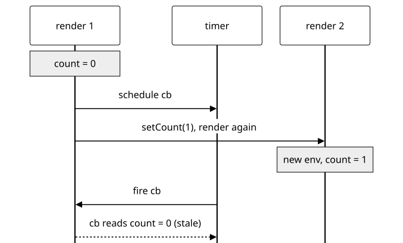

### Async

Timing questions all reduce to one rule: one task, then every microtask, then the next task.





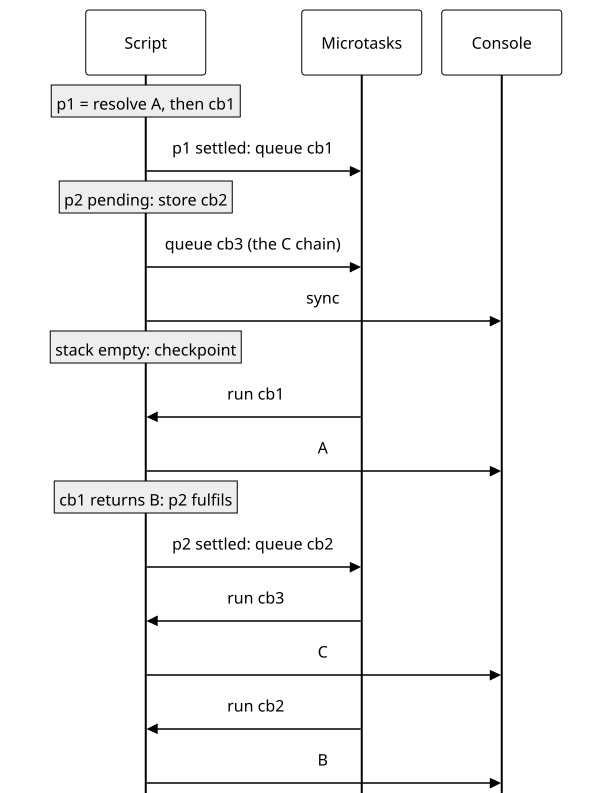

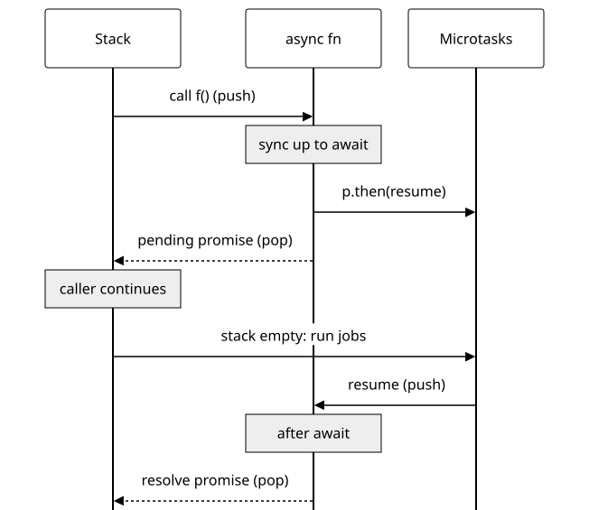

### Objects and types

How a call decides `this`, how `new` builds an object, how a read walks the chain, and how values are converted.






### Memory, modules and errors

What stays alive, what a cycle of imports sees, and which completion wins in `finally`.




### ASCII sketches worth redrawing

These are the whiteboard versions from the chapters. Each takes about two minutes to draw. Redraw them from memory, then compare.

```ascii Gallery: the scope chain (Chapter 3)
  inner env --outer--> middle env --outer--> outer env --outer--> Global --> null
   (own vars)           m                     p, o                g

  look here first; if missing, follow outer.
  outer = where the function was WRITTEN, not where it was called.
```

```ascii Gallery: what a closure is (Chapter 4)
  STACK: [Global]    HEAP: fn --[[Environment]]--> { count: 2 } --outer--> Global
         (makeCounter popped)

  function = code + pointer to its birth environment
  captures VARIABLES (shared, live), not copies of values
  the environment lives as long as something points to it
```

```ascii Gallery: how the call form decides this (Chapter 5)
   how it is called              this is
 +-----------------------------+------------------------------+
 | new F()                     | the new object               |
 | f.call(x)  f.apply(x)  bind | x (bind: permanent)          |
 | obj.f()                     | obj  (the thing before .f)   |
 | f()                         | undefined | globalThis       |
 | () => {}                    | outer this (call is ignored) |
 +-----------------------------+------------------------------+
   precedence: new > explicit > implicit > default; arrows ignore all four
```

```ascii Gallery: instance, prototype and constructor (Chapter 6)
   instance --__proto__--> F.prototype --__proto__--> Object.prototype --> null
                              |   ^
                  constructor |   | .prototype
                              v   |
                            +-------+
                            |   F   |
                            +-------+
   new F():  1 make object  2 link to F.prototype  3 run F  4 return it
```

```ascii Gallery: the event loop in one picture (Chapter 7)
   host: timers, network, events --> TASK queue          (stack = where JS runs)
   promise.then, queueMicrotask  --> MICROTASK queue

        +--> 1. run ONE task on the stack ---+
        |                                    v
   4. next tick                  2. run ALL microtasks (until empty)
        ^                                    |
        +---- 3. render? (rAF, layout) <-----+
```

```ascii Gallery: promise states and then (Chapter 8)
  pending --resolve(v)--> fulfilled(v) --.then(f)--> NEW promise p2
     |                                    f returns x: p2 resolves to x
     +----reject(e)----> rejected(e)  --.catch(g)--> NEW promise p3
                                          g returns normally: fulfilled
  settles ONCE.  callbacks ALWAYS run later, as microtasks.
```

## 24.3 The 25 most-asked questions overall

The ranking is editorial. It combines the ★ marks in Chapters 1 to 23 and how many chapters circle back to the same idea, and it puts the foundations (event loop, closures, `this`, prototypes) before the topics built on them. These topics are commonly reported in public interview write-ups, but the order is not a measured frequency. Every row points to the chapter question with the full model answer.

| # | Question | Chapter / question id | One-line answer |
|---|---|---|---|
| 1 | Explain the event loop. | Ch 7 / Q7.1 | One stack, host queues callbacks. When the stack is empty, run one task, then all microtasks, then maybe render. |
| 2 | Microtask versus macrotask: what is the difference? | Ch 7 / Q7.2 | Microtasks (promise jobs, `queueMicrotask`) drain fully after every task, so they beat timers, events and I/O. |
| 3 | What is the output order of sync code, `setTimeout`, a promise and `queueMicrotask`? | Ch 7 / Q7.5 | Synchronous code first, then microtasks in queue order, then the timer task. |
| 4 | What is a closure? | Ch 4 / Q4.1 | A function plus the environment where it was created. It keeps using those variables after the outer function returns. |
| 5 | What does a `var` loop with `setTimeout` print, and how do you fix it? | Ch 4 / Q4.6 | `var` shares one binding, so every callback prints the final value. `let`, an IIFE, the timer's extra argument or `bind` give 0, 1, 2. |
| 6 | How is `this` determined? | Ch 5 / Q5.1 | By the call site: `new`, then `call`/`apply`/`bind`, then `obj.f()`, then default (`undefined` in strict mode). |
| 7 | How does `this` differ in an arrow function? | Ch 5 / Q5.3 | An arrow has no own `this`. It uses the one from where it was created, and `call`, `apply` and `bind` cannot change it. |
| 8 | What is the difference between `call`, `apply` and `bind`? | Ch 5 / Q5.4 | `call` and `apply` invoke now (listed arguments or an array). `bind` returns a new function with `this` and leading arguments fixed. |
| 9 | What is the difference between `__proto__` and `prototype`? | Ch 6 / Q6.1 | `prototype` belongs to functions and is used by `new`. `__proto__` exposes any object's `[[Prototype]]`. |
| 10 | What does `new` do? | Ch 6 / Q6.3 | Creates an object, links it to `F.prototype`, runs `F` with `this` set to it, returns it unless `F` returned an object. |
| 11 | What is hoisting? | Ch 2 / Q2.1 | Declarations are instantiated at scope entry and nothing moves: `var` is `undefined`, functions are ready, `let`/`const`/`class` are uninitialised. |
| 12 | What are the differences between `var`, `let` and `const`? | Ch 2 / Q2.2 | `var` is function-scoped and starts `undefined`. `let` and `const` are block-scoped with a TDZ. `const` blocks reassignment, not mutation. |
| 13 | What is the temporal dead zone? | Ch 2 / Q2.3 | The time from scope entry until the declaration runs, when the binding exists but any access throws `ReferenceError`. |
| 14 | What is the difference between `==` and `===`? | Ch 17 / Q17.1 | `===` never converts types. `==` converts by fixed rules, and `null == undefined` only. Default to `===`. |
| 15 | What is a promise and what are its states? | Ch 8 / Q8.1 | Pending, then fulfilled or rejected once. Reactions always run as microtasks. Resolved is not the same as fulfilled. |
| 16 | Compare `Promise.all`, `allSettled`, `race` and `any`. | Ch 8 / Q8.3 | `all` fails fast. `allSettled` never rejects. `race` follows the first to settle. `any` takes the first fulfilment, else `AggregateError`. |
| 17 | How does `async`/`await` work under the hood? | Ch 9 / Q9.1 | It runs synchronously to the first `await`, suspends on a promise reaction, and a microtask resumes it. It is a generator plus a runner. |
| 18 | What is the output order of the `async1`/`async2` puzzle? | Ch 9 / Q9.6 | Sync lines first (including `async2`), then `async1 end` and `promise2` as microtasks, then the timer. |
| 19 | What is the call stack, and what happens on overflow? | Ch 1 / Q1.3 | A last-in-first-out stack of execution contexts. Runaway recursion throws `RangeError`. Use loops, a trampoline or chunking. |
| 20 | How do you run async work sequentially or in parallel? Why does `forEach(async)` not wait? | Ch 9 / Q9.3 | `await` in a loop is sequential. `Promise.all(items.map(fn))` is parallel. `forEach` ignores the returned promises. |
| 21 | Debounce versus throttle? (Implement: P23.10, P23.11) | Ch 13 / Q13.1 | Debounce runs once after N ms of silence. Throttle runs at most once per N ms. |
| 22 | How do you deep clone an object? | Ch 18 / Q18.2 | `structuredClone`. The JSON round trip drops `undefined`, functions and symbols, stringifies dates, and throws on cycles. |
| 23 | Implement `bind`. | Ch 5 / Q5.11 | Return a closure that applies the target with the stored `this` and joined arguments. Under `new`, construct and ignore the bound `this`. |
| 24 | Implement `Promise.all`. | Ch 8 / Q8.9 | Wrap each item in `Promise.resolve`, store by index, count down, reject on the first failure, resolve `[]` for empty input. |
| 25 | How does garbage collection work? | Ch 16 / Q16.1 | Objects unreachable from the roots are collected. V8 scavenges a young generation and runs mark-sweep-compact on the old one. |

### The 25 in one breath

Say these aloud, in order, until each one comes out in one breath.

1. One thread, one stack, and the host queues callbacks. When the stack empties I run one task, then every microtask, then maybe render.
2. A macrotask is one queue entry like a timer or click. Microtasks are promise jobs that all run after each task, before the next.
3. Synchronous code runs first, then microtasks in queue order, then the timer: start, end, promise, microtask, timeout.
4. A closure is a function plus the environment where it was created, so it keeps using those variables after the outer function returns.
5. With `var` all callbacks share one `i` and print 3. With `let` each iteration has its own binding and they print 0, 1, 2.
6. I read the call site: `new`, then `call`, `apply` or `bind`, then `obj.f()`, otherwise the default, which is `undefined` in strict mode.
7. An arrow function has no `this` of its own, takes it from where it was written, and ignores `call`, `apply`, `bind` and `new`.
8. `call` and `apply` run the function now, with arguments listed or in an array. `bind` returns a new function with `this` fixed.
9. `prototype` belongs to constructor functions and seeds instances. `__proto__` is any object's link to its prototype. So `rex.__proto__` equals `Dog.prototype`.
10. `new` makes an empty object, links it to `F.prototype`, runs `F` with `this` set to it, and returns it unless `F` returns an object.
11. Hoisting is the engine registering declarations before running: `var` as `undefined`, functions complete, `let`, `const` and `class` uninitialised. Nothing physically moves.
12. `var` is function-scoped and starts `undefined`. `let` and `const` are block-scoped with a dead zone. `const` blocks reassignment, not mutation.
13. The dead zone is the time between entering a scope and running the declaration, when touching the binding throws `ReferenceError`.
14. Triple equals never converts types. Double equals converts by fixed rules, and `null` equals `undefined` only. I default to triple equals.
15. A promise is pending, then fulfilled or rejected exactly once. Its callbacks always run later, as microtasks, even if it is already settled.
16. `all` returns every value or fails fast. `allSettled` reports everything. `race` takes the first to settle. `any` takes the first fulfilment or throws `AggregateError`.
17. An async function runs synchronously until `await`, then suspends. A microtask resumes it later. It behaves like a generator driven by promises.
18. Sync logs come first, including `async2`, then `async1 end` and `promise2` as microtasks, then the timeout. An `await` costs one tick.
19. The call stack holds execution contexts last in, first out. Runaway recursion throws `RangeError`. I use loops, trampolines or chunking.
20. `await` in a loop is sequential. `Promise.all` over `map` is parallel. `forEach` ignores the promises, so it never waits.
21. Debounce waits for silence, then runs once. Throttle runs at most once per interval and keeps a steady rhythm during a burst.
22. I use `structuredClone`. The JSON round trip drops `undefined`, functions and symbols, stringifies dates, empties `Map` and `Set`, and throws on cycles.
23. `bind` returns a closure that calls the target with the stored `this` and preset plus new arguments. Under `new` it constructs and ignores `this`.
24. Wrap each item in `Promise.resolve`, store results by index, count down, resolve at zero, reject on the first failure, resolve `[]` for empty input.
25. Objects unreachable from the roots are collected. V8 scavenges a young generation and runs mark-sweep-compact on the old, mostly incrementally and concurrently.

## 24.4 How to answer in an interview: a framework

Knowing the content is half of it. The other half is delivery: a short, structured answer, a trace you can follow aloud, and an honest "I am not sure". Public write-ups on frontend interviews repeat the same advice: clarify the requirements before you code and think aloud (see 24.5). Chapter 23 adds a third habit, testing your own work. The routines below turn that advice into steps you can rehearse.

### The CLEAR framework for conceptual questions

Use it for "what is...", "how does... work" and "why..." questions. A first pass takes 30 to 60 seconds aloud, which is the length of the model answers in Chapters 1 to 21.

| Letter | Step | What you say or do | Example for "What is a closure?" |
|---|---|---|---|
| C | Clarify | Restate the question in your words. Ask the depth: "Short version, or down to the engine?" | "A closure, as in a function that keeps outer variables? Happy to go to the environment level." |
| L | Layer | One plain sentence first, then the precise mechanism with the correct term. | "A function plus the environment it was created in. The function's `[[Environment]]` slot points to it." |
| E | Example | A snippet of three to five lines, or a sketch. Name what it prints before you run it in your head. | "A counter factory: `count` is private, and each call to the factory makes a new `count`." |
| A | Applies and edges | Where it matters and where it breaks: sloppy against strict mode, browser against Node.js, the known trap. | "It captures variables, not values. That is why a `var` loop with timers prints the last value." |
| R | Recap | One closing sentence, then stop. Offer to go deeper. | "So: function plus live environment. Want me to cover the memory side?" |

Keep three rules. Give the plain sentence before the spec vocabulary, because the plain sentence shows understanding and the vocabulary shows depth. Do not recite a definition and stop, since interviewers probe the mechanism next. If you reach a part you are unsure about, say so in the Applies step instead of guessing (see "When you don't know").

### Output-prediction drill

The full checklist is in section 22.1 (eight steps). Under pressure, run this spoken version of six.

1. **Name the topics.** Read the snippet and say what it mixes: "hoisting, a loop with `var`, a timer and a promise".
2. **Instantiate.** Say what each scope creates before any line runs: `var` is `undefined`, functions exist, `let` is in the dead zone.
3. **Run the synchronous part aloud.** Write each printed line on the board. Say "this callback is queued, not run" every time you meet `then`, `setTimeout`, `await` or `queueMicrotask`.
4. **Fix `this` and bindings at each call site.** "This is a plain call, so `this` is `undefined` in strict mode." "Shared `i`, or one per iteration?"
5. **Drain the queues.** Microtasks in queue order, including new ones, then one task, then drain again. In Node.js, the tick queue first.
6. **State the result with its reason, and the caveat.** "Prints A, B, C, because the microtask runs before the timer. In a browser, `this` would be `window`."

If you are unsure at step 5, draw the loop diagram from section 22.1 and the event-loop sketch (Figure 24.5). Do not change an answer silently: say "I mis-ordered this, because I forgot that `await` costs a tick."

### Implement-it-yourself routine

Section 23.1 has the full checklist and time boxes. The routine in short:

1. **Requirements.** Restate the signature, inputs, return value, sync or async, and whether the input may be mutated. "Should it preserve `this`?"
2. **Edge cases, before code.** Empty input, holes, `NaN`, `null`, cycles, thrown errors, extra arguments. Say them aloud and write them as comments.
3. **Simplest version first.** Make the main path work and run one example by hand. Add the edge cases one at a time.
4. **Complexity.** State time and space without being asked.
5. **Tests.** Two normal inputs and one edge case, with the expected output written before you run. For timers, inject a clock or scheduler instead of waiting.
6. **Extensions.** Only when the basics work: options, `this` and arguments, async support, cancellation, memory limits. Also say what you did not handle.

Name the pattern as you go ("result slots by index plus a countdown", "closure for private state"). Section 23.3 lists the patterns that repeat.

### Drawing on a whiteboard

Draw something small first, then talk. The figure numbers refer to the sketches in section 24.2. Where no figure number is given, the whiteboard version is in that chapter's section 4.

| Topic | Draw first | Say |
|---|---|---|
| Call stack and context (Ch 1) | A vertical stack with `Global` at the bottom, and a CREATE box next to a RUN box | "Each call pushes a context. Creation registers declarations, then execution runs line by line." |
| Scope chain (Ch 3, Figure 24.1) | Environment boxes joined by outer arrows, ending at `Global` and `null` | "Lookup goes outward from here. Outer means where the function was written, not where it was called." |
| Closure (Ch 4, Figure 24.2) | A function box with an arrow to an environment box that holds `count` | "The environment outlives the call, because the function still points to it. It holds variables, not copies." |
| `this` (Ch 5, Figure 24.3) | A two-column table of call forms and resulting `this` | "I look at the call, not the definition. Arrows ignore the table." |
| Prototypes (Ch 6, Figure 24.4) | `instance`, `F.prototype`, `Object.prototype`, `null` in a row with `__proto__` arrows | "A read walks this chain. `new` links the instance to `F.prototype`." |
| Event loop (Ch 7, Figure 24.5) | Stack, a task queue and a microtask queue, and the loop arrow | "One task, then all microtasks, then maybe render. Timers wait in the task queue." |
| Promises (Ch 8, Figure 24.6) | Three states and a `then` arrow into a new promise | "It settles once. `then` returns a new promise, and callbacks run as microtasks." |
| Garbage collection (Ch 16) | Roots with arrows to live objects, and a detached cycle | "Alive means reachable from a root. The cycle with no root pointing in is collected." |

### When you don't know

Silence is the worst answer, and a confident guess is the second worst. Use this order.

1. **Say what you do know.** "I have not used `WeakRef` directly. I know `WeakMap` holds its keys weakly."
2. **Relate it to a neighbouring idea.** "So I would expect `WeakRef` to be a weak pointer that can be cleared."
3. **Reason from the mechanism aloud.** Name the rule you are using: reachability, the call site, the queue order.
4. **Mark your confidence.** "I am fairly sure of this part. I am not sure whether the callback is guaranteed to run."
5. **Say how you would check.** "I would run it in Node.js and print the order," or "I would read the spec section on `await`."
6. **Take hints without defending.** Restate the hint, and update your answer out loud.

Do not invent a spec detail, a version number or a benchmark. A wrong precise claim costs more than an honest "not sure".

### Common red flags interviewers notice

These come from the author's reading of public interview write-ups and are not a measured ranking.

- Reciting a definition with no mechanism, such as "hoisting moves code to the top".
- Starting to code before asking about inputs, outputs and edge cases.
- Long silences, whether thinking or typing.
- Guessing an output without tracing it, or changing the answer without saying why.
- Mixing hosts: stating browser behaviour as if it held in Node.js, or ignoring strict against sloppy mode.
- Stating spec details with false certainty instead of saying "I am not sure".
- Never testing your own code, and forgetting empty input, `this`, errors and cycles.
- Memorised phrases that contradict your own example, such as "`let` is not hoisted" followed by a dead-zone explanation.

### The night before

Plan for about three hours, in this order, and stop at a fixed time so you can sleep.

1. **20 minutes:** read the table in 24.3 once, then say "The 25 in one breath" aloud without looking.
2. **45 minutes: async.** Read the cheat sheets 7.7, 8.7 and 9.7. Then cover the output and predict Q22.19, Q22.21, Q22.25 and Q22.35, using the drill above.
3. **35 minutes: scope, `this`, closures.** Read 2.7, 3.7, 4.7 and 5.7. Predict Q4.6 and a few of Q22.5 to Q22.12.
4. **30 minutes: objects and types.** Read 6.7, 17.7 and 18.7. Trace `[] == ![]` (Q17.9) and the `new` steps (Q6.3).
5. **40 minutes: implementation.** Write two from memory out of P23.2 (`bind`), P23.10 (`debounce`), P23.16 (`Promise.all`), P23.8 (`deepClone`), P23.12 (`memoize`) and P23.13 (`curry`). Compare with the chapter and fix the gaps.
6. **10 minutes:** flip through the gallery in 24.2 and redraw two of the ASCII sketches from memory.

Skim the summaries for the chapters you have not touched (24.1) only if time is left. Do not start new topics after that.

## 24.5 Sources and further reading

Most pages listed here could not be opened in full in the authoring environment: every `web_fetch` returned HTTP 403. The entries marked "seen in search" were returned by a web search with a title and a snippet, and nothing beyond that snippet was read. The facts in sections 24.1 to 24.3 come from Chapters 1 to 23 of this book, where each claim was checked by running code on Node.js 22 or marked as stated from the specification. All wording in this chapter is original.

- Chapters 1 to 23 of this book, in particular the cheat sheets (sections N.7), the interview questions (sections N.8), section 22.1 and sections 23.1 and 23.3. Each chapter lists its own sources.
- Front End Interview Handbook, "Introduction" (seen in search; the snippet says front end interviews test practical concepts and put less weight on algorithms): <https://www.frontendinterviewhandbook.com/introduction/>
- GreatFrontEnd, "How to Think Out Loud in a Frontend Coding Interview" (seen in search; the snippet advises explaining your understanding of the requirements and asking questions before coding; the page itself could not be opened): <https://www.greatfrontend.com/blog/how-to-think-out-loud-in-a-frontend-coding-interview>
- frontendlead.com, "12 Mistakes That Fail Frontend Interviews" (seen in search; the snippet advises spending a few minutes on inputs, outputs and edge cases and writing example calls): <https://frontendlead.com/blog/why-frontend-candidates-fail-interviews>
- huru.ai, "JavaScript Interview Questions and Answers" (seen in search; the snippet describes concept questions, output puzzles and implement-a-utility exercises as the three common shapes): <https://huru.ai/javascript-interview-questions/>
- OpenReplay, "10 JS Interview Questions and What They're Really Testing" (seen in search; hoisting, closures, `this`, the event loop and coercion): <https://blog.openreplay.com/10-js-interview-questions-testing/>
- dev.to, "JavaScript Interview Questions for Senior Developers in 2026: Closures, the Event Loop, Prototypes & Async" (seen in search): <https://dev.to/kirandeepjassalcrypto/javascript-interview-questions-for-senior-developers-in-2026-closures-the-event-loop-prototypes-503m>
- javascript.info, "Microtasks and macrotasks" (seen in search; fetch returned 403): <https://javascript.info/event-loop>
- Jake Archibald, "Tasks, microtasks, queues and schedules" (canonical, not opened): <https://jakearchibald.com/2015/tasks-microtasks-queues-and-schedules/>
- ECMAScript specification (canonical, not opened here): <https://tc39.es/ecma262/>

The ranking in 24.3 and the red-flag list in 24.4 are the author's synthesis. The sources above show that these topics recur, but none of them provides a frequency count, and this book does not claim one.
