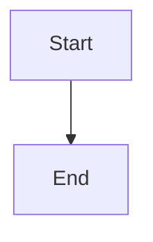

<!--
Copy to chapters/NN-slug.md (NN = two digits, slug from book.json) and replace N with the chapter number.
`npm run lint` enforces this structure. Conventions:
  * Every code fence has a language: js, ts, text, bash, json, html, css, ascii, mermaid.
  * `js` fences run on Node and must match the next ```text output fence (scripts/verify-samples.js).
      ```js script   run as a classic global script (top-level var becomes a global property)
      ```js norun    display only (browser-only, nondeterministic, or never terminates)
  * Mermaid blocks start with "%% id: kebab-name" and "%% title: caption". Ids are unique per chapter.
    Keep labels short, use <br/> for line breaks, avoid "1." or "-" at the start of a label, and avoid subgraphs
    whose title collides with edges (use a [[subroutine]] node for a grouped list instead).
  * ASCII diagrams: ```ascii Caption   (max 84 columns, plain ASCII).
  * Every diagram in section N.4 is followed by a "How to explain this to the interviewer" box.
    A figure whose caption starts "Whiteboard version" is exempt.
  * Mark very frequently reported questions with ★ in the heading.
  * Never invent company names or quotes. Use "(commonly reported)" when the source is unclear.
-->

# Chapter N: Title

## N.1 Definition and why interviewers ask it

**One-line definition.** Why interviewers ask it, and in which round (commonly reported).

## N.2 Core concept

### Plain language

Analogy and simple explanation.

### Precise version

The technical explanation, spec terms, tables.

## N.3 How it works internally

Numbered, step-by-step walkthrough of what the engine does.

## N.4 Diagrams

### Name of the diagram



> **How to explain this to the interviewer**
>
> 1. What to draw first.
> 2. What to point at.
> 3. The one-sentence takeaway.
>
> **Takeaway:** one sentence.

### Whiteboard version

```ascii Whiteboard version: caption (draw in under 2 minutes)
 +---+     +---+
 | A |---->| B |
 +---+     +---+
```

## N.5 Code examples

### Example 1: title

```js
console.log('hello');
```

```text output
hello
```

**Why:** the reason for the output.

## N.6 Common mistakes and gotchas

- Mistake and its fix.

## N.7 Quick revision cheat sheet

- 5 to 8 bullet recap.

## N.8 Interview questions

*Key: ★ = very frequently reported.*

#### Conceptual

### QN.1 ★ Easy: Question text?

*Typically asked in: round (commonly reported).*

> **Model answer**
>
> 30 to 60 seconds of spoken answer.

**Key points to mention**

- Point one.

#### Output prediction

#### Implement it yourself

#### Follow-up traps

#### Sources and further reading

- Links to the spec, MDN, javascript.info and the public write-ups consulted.
